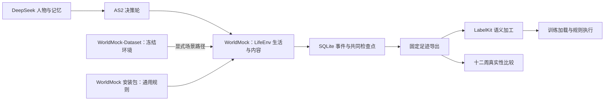

<a name="readme-worldmock"></a>
# WorldMock

> 按[资源与规则引擎简化规格](docs/dev/SPEC-resource-and-rule-simplification.md#spec-rrs-资源与规则引擎简化开发规格)修订「实验与数据、命令」（阶段 1）。


WorldMock 用 AgentSociety 2（下称 AS2）与 DeepSeek 驱动数字人的日常生活，把生活过程写成可追溯的数字足迹，
再交给 LabelKit 生产模型训练数据与规则引擎测试数据。
WorldMock-Dataset 提供具体环境的数据与制作工具；WorldMock 提供引擎及安装包内的固定通用规则。

<a name="readme-文档导航"></a>
## 文档导航

[docs/INDEX.md](docs/INDEX.md#index-worldmock-文档入口) 是唯一入口，给出项目状态、文档地图与阅读路径；其余文档按职责分工：

想自定义人物和生活环境，从[用户配置手册](docs/manual/README.md#readme-用户配置手册)开始：包含一天场景入门、
人物画像、场景、世界素材、规则、模型凭据、数据生成和评估配置的编写与校验方法。

<a name="readme-主文档集"></a>
### 主文档集

- [架构设计](docs/ARCHITECTURE.md#architecture-worldmock-架构设计)：系统分层、职责、数据流与核心裁决。
- [接口合同](docs/CONTRACTS.md#contracts-worldmock-接口合同)：跨模块接口合同与导航，记录引擎定义见所属设计。
- [实验身份](docs/EXPERIMENT.md#experiment-worldmock-实验设置)：依赖、场景、时间窗、样本与外部参照。
- [验证与验收](docs/VERIFICATION.md#verification-worldmock-验收标准)：四项协议门禁、report-only 边界、测试矩阵与证据规则。
- [实现状态](docs/dev/implementation-status.md#implementation-status-worldmock-实现状态)：当前实现情况与覆盖率。
- [覆盖率口径与基线](docs/dev/coverage-baseline.md#coverage-baseline-覆盖率门禁口径与基线)：覆盖率门禁的判定口径、失败关闭约定与基线记录。
- `docs/dev/SPEC-*.md`：特性实施规格；是否冻结以文件抬头与 `docs/INDEX.md#index-worldmock-文档入口` 为准。
- `docs/dev/PROPOSAL-*.md`（含按日期命名的 `PROPOSAL_<日期>_*.md`）：提案与裁决记录；是否已裁决以 `docs/INDEX.md#index-worldmock-文档入口` 为准。
- [规格覆盖率追溯矩阵](docs/dev/ANALYSIS-spec-coverage.md#analysis-spec-coverage-规格测试用例覆盖率追溯矩阵)：规格条款与测试用例的覆盖率追溯矩阵。
- `docs/dev/research/`：技术分析、审计与调研证据。

<a name="readme-设计文档集"></a>
### 设计文档集

- [记录引擎](docs/design/05-recording-engine.md#recording-engine-worldmock-产品设计说明书-记录引擎)：记录、素材、事务、检查点、分支、导出与诊断的统一设计和合同。

- [docs/design/](docs/design/)：产品设计说明书，提供实现级的完整规格，包含模块详细设计、算法流程、配置规格、数据格式等。参考 LabelKit 设计文档风格组织。
- [汇编版设计说明书](docs/design/worldmock-design.html)：十章设计文档加接口合同摘录（人物工具、模型请求与命令行）汇编成的单文件，先看这一份；由 `scripts/build_design_doc.py` 生成，章节或合同改动后重新汇编。



<a name="readme-安装"></a>
## 安装

使用 Python 3.12、Git 和 Node。AS2 与 LabelKit 的 protobuf 依赖范围互斥，分别使用固定源码及各自环境。
引导从仓库内上游源码与补丁重建 AS2，从固定 HTTPS 制品取得 LabelKit，不需要 SSH 密钥或预先安装 uv。
当前 Linux 64 位完整环境的验收范围为 x86_64；Linux ARM64/aarch64 无法安装锁定的 TextWorld 组合。
平台支持范围与验收要求以[冻结规格](docs/dev/SPEC-shared-rules-and-rebuildable-env.md#shared-rules-门禁可选部件与操作系统)为准。

```sh
python scripts/bootstrap.py --profile release
```

Windows 可用 `py -3.12`，其它系统可用 `python3.12` 执行引导；找不到 Python 3.12 会明确失败。
`--wheelhouse` 指定包含固定依赖和源码制品的离线目录；`--use-uv` 显式选择 uv 安装执行器。
`dev` 档位可记录缺少 Node 或 LabelKit，但缺失检查不能取得完整放行。
环境收据位于 `.work/environment-receipt.json`。安装步骤和平台验收边界见[运行配置](docs/manual/runtime.md#runtime-准备环境)。

引导完成后，在当前终端激活 WorldMock 环境，再执行本文的 `python` 和 `worldmock` 命令：

| 终端 | 激活命令 |
| --- | --- |
| POSIX shell | `source .venv/bin/activate` |
| Windows PowerShell | `.venv\Scripts\Activate.ps1` |
| Windows cmd | `.venv\Scripts\activate.bat` |

AS2 必须匹配 `patches/agentsociety2/SERIES` 登记的固定源码摘要；实际导入的包目录为空、无法导入或摘要不符时，
`run`、`resume`、`replay` 与 `validate` 拒绝启动。

DeepSeek 凭据保存于用户目录 `~/.config/worldmock/deepseek.env`，文件仅含 `DEEPSEEK_NODE_KEYS`，
填写单把或逗号分隔的多把密钥。建议权限为 `0600`；完整格式及各入口的读取方式见[运行配置](docs/manual/runtime.md#runtime-填写模型凭据)。
凭据文件不属于工程或运行产物，不能加入版本控制。

<a name="readme-实验与数据"></a>
## 实验与数据

正式环境由 WorldMock-Dataset 重制发布，路径由数据仓决定，`corpora/`、`catalog/`、`scenarios/` 并列。
目录为七份 JSON 与三份包 TOML 副本，场景结构为 `7`，使用环境标识和版本钉。
内容标题与摘要来自目录，生活活动效果来自语料；系统分类、身体和交换常数由 WorldMock 固定规则包提供。
人物自行选择行动；日历控制可用机会，不能将规定动作序列冒充模型决策。

运行输出位于 `runs/`。事件数据库与内容素材保留实际来源；模型调用、行为结果、共同检查点、
数据交付和真实性评估分别记录证据。恢复使用新目录，保留父运行。

<a name="readme-命令"></a>
## 命令

以下命令在 WorldMock 根目录执行，显式选择数据仓发布或人工编辑的环境根：

```sh
worldmock environment generate-map --locations experiments/published-environment/catalog/locations.json \
  --seed 7 --output experiments/published-environment/catalog/map.json --check
worldmock validate --environment experiments/published-environment
worldmock validate --scenario experiments/published-environment/scenarios/single-person.json
worldmock run \
  --scenario experiments/published-environment/scenarios/single-person.json \
  --output runs/white-collar
worldmock status --run-dir runs/white-collar
worldmock export --run-dir runs/white-collar --output runs/white-collar/exports/final
worldmock deliver --export runs/white-collar/exports/final --output runs/white-collar/delivery
```

`resume` 必须显式提供父运行、检查点和新的输出目录。数据采集、地图准备和正式目录构建由 WorldMock-Dataset 维护，
按数据仓的说明发布冻结环境。运行时只读已校验快照，不访问在线路线服务。

引擎最小端到端测试使用人工夹具 `tests/fixtures/environment/`。验证 Dataset 环境下的完整行为回归时显式选择环境：

```sh
python scripts/run_tests.py --tier full --workers 4 \
  --environment-root experiments/published-environment
```

双仓归属、发布与验收要求见[环境数据归属规格](docs/dev/SPEC-environment-data-ownership.md)；
本次整理的最终放行以实际门禁收据为准。

`replay` 还需 `--intervention` 指向严格的假设条件文件，在新分支中实际重演；`deliver --replay-export`
可接收该分支的完整导出，把实际分支结果与普通反事实想象分别标明。

交给 LabelKit 的 `DatasetDict` 数据集结构、导出与交付产物的字段，由
[接口合同](docs/CONTRACTS.md#contracts-worldmock-接口合同) 定义，本文件不重复。

真实性评估分两阶段：`evaluate` 提供双方数据、配置和新目录以生成固定统计及盲评包；
评审完成后，只传同一 `--output` 与三个 `--reviews` 文件进行解盲和结论发布。不能把模型评审称为真人评审。

环境检查已提供真实目录与全部场景加载，完整新格式 LifeEngine 运行在资源与规则引擎简化阶段 5 闭合；检查通过不替代运行、恢复、足迹与交付的实际证据。
