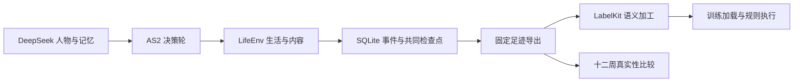

# WorldMock

WorldMock 通过 AgentSociety 2 和 DeepSeek 驱动人物生活，保存可追溯的数字足迹，再使用 LabelKit 生产训练数据和规则测试数据。
当前开发范围与验收依据见 [特性规范](docs/agentsociety2-design.md)，实际进度见 [实现与验收记录](docs/implementation-status.md)。



## 安装

使用 Python 3.12 和 uv。AS2 与 LabelKit 的 protobuf 依赖范围互斥，分别使用固定源码及各自环境。

```sh
uv sync --frozen
uv sync --project vendor/labelkit --frozen
```

DeepSeek 凭据保存于用户目录 `~/.config/worldmock/deepseek.env`，文件仅含 `DEEPSEEK_API_KEY`，权限为 `0600`。
凭据文件不属于工程或运行产物，不能加入版本控制。

## 实验与数据

正式实验使用 `scenarios/white-collar-12-weeks.json`，覆盖上海时区的 2026-01-05 至 2026-03-30，共 84 天。
人物自行选择行动；日历控制可用机会，不能将规定动作序列冒充模型决策。

运行输出位于 `runs/`。事件数据库与内容素材保留实际来源；模型调用、行为结果、共同检查点、
数据交付和真实性评估分别记录证据。恢复使用新目录，保留父运行。

旧手机穿刺实现已移除，仅保留 [经验档案](docs/history/mobile-prototype-lessons.md)。

## 命令

```sh
worldmock validate --scenario scenarios/white-collar-12-weeks.json
worldmock run --scenario scenarios/white-collar-12-weeks.json --output runs/white-collar
worldmock status --run-dir runs/white-collar
worldmock export --run-dir runs/white-collar --output runs/white-collar/exports/final
worldmock deliver --export runs/white-collar/exports/final --output runs/white-collar/delivery
```

`resume` 必须显式提供父运行、检查点和新的输出目录。`prepare-corpora --output` 重新获取固定来源；
运行时只读已校验快照，不访问在线路线服务。

`replay` 还需 `--intervention` 指向严格的假设条件文件，在新分支中实际重演；
`deliver --replay-export` 可接收该分支的完整导出，把实际分支结果与普通反事实想象分别标明。
导出的 `quality.json` 保留完成情况、内容接触、实际用量与估算成本；最终清单绑定全部消费者文件。
DatasetDict 的 `input`、`target`、`provenance` 保留为 JSON 文本，读取嵌套值时使用 `json.loads`；
`prompt`、`completion` 已提供可用于训练的消息。这样保留原始数值，避免加载器自动解码改变浮点数。

真实性评估分两阶段：`evaluate` 提供双方数据、配置和新目录以生成固定统计及盲评包；
评审完成后，只传同一 `--output` 与三个 `--reviews` 文件进行解盲和结论发布。不能把模型评审称为真人评审。
