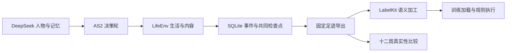

# WorldMock

WorldMock 用 AgentSociety 2（下称 AS2）与 DeepSeek 驱动数字人的日常生活，把生活过程写成可追溯的数字足迹，
再交给 LabelKit 生产模型训练数据与规则引擎测试数据。

## 文档导航

[docs/INDEX.md](docs/INDEX.md) 是唯一入口，给出项目状态、文档地图与阅读路径；其余文档按职责分工：

想自定义人物和生活环境，从[用户配置手册](docs/manual/README.md)开始：包含一天场景入门、
人物画像、场景、世界素材、规则、模型凭据、数据生成和评估配置的编写与校验方法。

### 主文档集

- [架构设计](docs/ARCHITECTURE.md)：系统分层、职责、数据流与核心裁决。
- [接口合同](docs/CONTRACTS.md)：跨模块接口合同与导航，记录引擎定义见所属设计。
- [实验身份](docs/EXPERIMENT.md)：依赖、场景、时间窗、样本与外部参照。
- [验证与验收](docs/VERIFICATION.md)：四项协议门禁、report-only 边界、测试矩阵与证据规则。
- [实现状态](docs/dev/implementation-status.md)：当前实现情况与覆盖率。
- [覆盖率口径与基线](docs/dev/coverage-baseline.md)：覆盖率门禁的判定口径、失败关闭约定与基线记录。
- `docs/dev/SPEC-*.md`：特性实施规格；是否冻结以文件抬头与 `docs/INDEX.md` 为准。
- `docs/dev/PROPOSAL-*.md`（含按日期命名的 `PROPOSAL_<日期>_*.md`）：提案与裁决记录；是否已裁决以 `docs/INDEX.md` 为准。
- [规格覆盖率追溯矩阵](docs/dev/ANALYSIS-spec-coverage.md)：规格条款与测试用例的覆盖率追溯矩阵。
- `docs/dev/research/`：技术分析、审计与调研证据。

### 设计文档集

- [记录引擎](docs/design/05-recording-engine.md)：记录、素材、事务、检查点、分支、导出与诊断的统一设计和合同。

- [docs/design/](docs/design/)：产品设计说明书，提供实现级的完整规格，包含模块详细设计、算法流程、配置规格、数据格式等。参考 LabelKit 设计文档风格组织。
- [汇编版设计说明书](docs/design/worldmock-design.html)：十章设计文档加接口合同摘录（人物工具、模型请求与命令行）汇编成的单文件，先看这一份；由 `scripts/build_design_doc.py` 生成，章节或合同改动后重新汇编。



## 安装

使用 Python 3.12 和 uv。AS2 与 LabelKit 的 protobuf 依赖范围互斥，分别使用固定源码及各自环境。

```sh
git submodule update --init vendor/agentsociety2 vendor/labelkit
uv sync --frozen
uv sync --project vendor/labelkit --frozen
```

AS2 必须是子模块指针锁定的提交 `8768e14`；实际导入的 AS2 包目录为空、无法导入或源码摘要不符时，
`run`、`resume`、`replay` 与 `validate` 拒绝启动。

DeepSeek 凭据保存于用户目录 `~/.config/worldmock/deepseek.env`，文件仅含 `DEEPSEEK_NODE_KEYS`，
填写单把或逗号分隔的多把密钥。建议权限为 `0600`；完整格式及各入口的读取方式见[运行配置](docs/manual/runtime.md#填写模型凭据)。
凭据文件不属于工程或运行产物，不能加入版本控制。

## 实验与数据

正式实验使用 `scenarios/white-collar-12-weeks.json`，覆盖上海时区的 2026-01-05 至 2026-03-30，共 84 天。
人物自行选择行动；日历控制可用机会，不能将规定动作序列冒充模型决策。

运行输出位于 `runs/`。事件数据库与内容素材保留实际来源；模型调用、行为结果、共同检查点、
数据交付和真实性评估分别记录证据。恢复使用新目录，保留父运行。

## 命令

```sh
worldmock validate --scenario scenarios/white-collar-12-weeks.json
worldmock run --scenario scenarios/white-collar-12-weeks.json --output runs/white-collar
worldmock status --run-dir runs/white-collar
worldmock export --run-dir runs/white-collar --output runs/white-collar/exports/final
worldmock deliver --export runs/white-collar/exports/final --output runs/white-collar/delivery
```

`resume` 必须显式提供父运行、检查点和新的输出目录。`prepare-corpora --output` 重新获取固定来源；
运行时只读已校验快照，不访问在线路线服务。

`replay` 还需 `--intervention` 指向严格的假设条件文件，在新分支中实际重演；`deliver --replay-export`
可接收该分支的完整导出，把实际分支结果与普通反事实想象分别标明。

交给 LabelKit 的 `DatasetDict` 数据集结构、导出与交付产物的字段，由
[接口合同](docs/CONTRACTS.md) 定义，本文件不重复。

真实性评估分两阶段：`evaluate` 提供双方数据、配置和新目录以生成固定统计及盲评包；
评审完成后，只传同一 `--output` 与三个 `--reviews` 文件进行解盲和结论发布。不能把模型评审称为真人评审。
