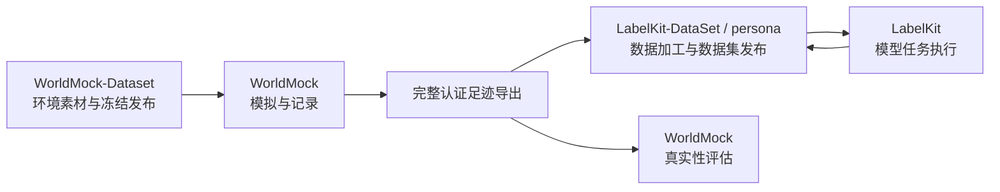

<a name="readme-worldmock"></a>
# WorldMock

WorldMock 用 AgentSociety 2 与 DeepSeek 驱动数字人的日常生活，把观察、决策、行动、状态变化和结果写成
连续、可追溯的数字足迹。WorldMock 负责模拟、记录、完整足迹导出和真实性评估。
WorldMock-Dataset 提供环境素材与制作工具；LabelKit-DataSet 负责足迹整理、LabelKit 模型任务、训练数据加载和规则测试数据。



<a name="readme-文档导航"></a>
## 文档导航

[文档入口](docs/INDEX.md#index-worldmock-文档入口)说明权威层级与当前状态。
自定义人物、环境和运行，从[用户配置手册](docs/manual/README.md#readme-用户配置手册)开始。

<a name="readme-主文档集"></a>
### 主文档集

- [架构设计](docs/ARCHITECTURE.md#architecture-worldmock-架构设计)：系统职责与数据流。
- [接口合同](docs/CONTRACTS.md#contracts-worldmock-接口合同)：模拟请求、运行身份与公共接口。
- [实验设置](docs/EXPERIMENT.md#experiment-worldmock-实验设置)：场景、时间窗、模型与外部参照。
- [验收标准](docs/VERIFICATION.md#verification-worldmock-验收标准)：行为、真实性和工程门禁。
- [实现状态](docs/dev/implementation-status.md#implementation-status-worldmock-实现状态)：按实际来源登记的证据和未完成项。

<a name="readme-设计文档集"></a>
### 设计文档集

[设计文档集](docs/design/README.md#readme-worldmock-设计文档集)按模拟、记录、评估等职责组织。
[汇编版设计说明书](docs/design/worldmock-design.html)由 `scripts/build_design_doc.py` 生成，包含当前设计章节和接口合同摘录。
[记录引擎设计](docs/design/05-recording-engine.md#recording-engine-worldmock-产品设计说明书-记录引擎)
是事件、素材、检查点、导出与诊断的唯一合同。

<a name="readme-目录结构"></a>
## 目录结构

```text
WorldMock/
├── .github/                    GitHub 自动检查的固定入口
├── custom/
│   ├── agents/life_agent.py    AgentSociety 2 扫描的 LifeAgent 类定义
│   └── envs/life_env.py        AgentSociety 2 扫描的 LifeEnv 类定义
├── src/worldmock/              可安装的生产代码
│   ├── agents/                 人物提示、记忆与模型协议辅助模块
│   ├── life/                   生活规则与世界运行
│   ├── footprints/             事件、素材、检查点与完整导出
│   └── evaluation/             因果核对、真实性评估与报告
├── tests/                      测试与人工最小环境；共享配置在 tests/conftest.py
├── scripts/                    环境引导、工程门禁与文档构建
├── tools/                      运行查看器等人工检查工具
├── patches/                    固定 AgentSociety 2 源码与补丁
├── requirements/               固定依赖锁
└── docs/                       当前合同、设计、手册与历史证据
```

`custom/` 的两个类必须在文件内实际定义，框架按文件扫描注册；内部辅助代码由安装包管理。
环境素材和数据加工工程分别在所属数据仓维护，通过正式文件交接。

<a name="readme-安装"></a>
## 安装

使用 `.python-version` 固定的 CPython 3.12.13、Git 与具有 SQLite 能力的 Node，并准备中文图表字体。
引导从固定源码与补丁重建 AgentSociety 2，只安装 WorldMock 和 AgentSociety 2：

```sh
python scripts/bootstrap.py --profile release
```

Windows 可用 `py -3.12`，其他系统可用 `python3.12`。`--wheelhouse` 指定离线制品目录；
`--use-uv` 显式选择 uv。`release` 要求 Node 和中文字体齐全，`dev` 记录缺失且不能取得完整放行。
环境收据位于 `.work/environment-receipt.json`；安装和激活步骤见[运行配置](docs/manual/runtime.md#runtime-准备环境)。

模型凭据的格式与读取方式见[填写模型凭据](docs/manual/runtime.md#runtime-填写模型凭据)，凭据不加入版本控制。
每个平台的重建与运行能力须由对应实际回执证明。

<a name="readme-实验与数据"></a>
## 实验与数据

正式环境由 WorldMock-Dataset 发布，环境根中 `corpora/`、`catalog/`、`scenarios/` 并列。
当前场景结构为 `7`，目录含七份 JSON 与三份包 TOML 副本；具体发布身份和验收按实际收据核对。
人物自行选择行动，场景只提供现实约束、机会和到达事件。

运行输出位于 `runs/`。事件数据库、素材、模型证据和共同检查点保留实际来源，恢复使用新的目录并保留父运行。
导出清单列出事件、活动、已核验经历、购买和 app 使用五类工件。

<a name="readme-命令"></a>
## 命令

在仓库根目录执行，显式选择数据仓发布或人工编辑的环境根：

```sh
worldmock environment generate-map --locations experiments/published-environment/catalog/locations.json \
  --seed 7 --output experiments/published-environment/catalog/map.json --check
worldmock validate --environment experiments/published-environment
worldmock validate --scenario experiments/published-environment/scenarios/single-person.json
worldmock run --scenario experiments/published-environment/scenarios/single-person.json --output runs/white-collar
worldmock status --run-dir runs/white-collar
worldmock export --run-dir runs/white-collar --output runs/white-collar/exports/final
```

`resume` 显式提供父运行、检查点和新的输出目录；`replay` 还需提供严格的干预文件，实际执行新分支。
完整导出随后交给 LabelKit-DataSet，加工任务、训练格式和规则测试数据由该仓库定义与验收。
来源快照已交接并核对摘要，整合后的新消费验收尚未取得。

真实性评估分两阶段：`evaluate` 提供双方输入、配置和新目录生成统计及盲评包；
评审完成后提供同一 `--output` 与三个 `--reviews` 文件进行解盲和结论发布。

引擎最小端到端测试使用 `tests/fixtures/environment/`。正式环境的完整行为回归显式选择环境：

```sh
python scripts/run_tests.py --tier full --workers 6 --environment-root experiments/published-environment
```

工程门禁、正式模型运行、数据集消费验收和跨平台证明分别登记，当前状态见[实现状态](docs/dev/implementation-status.md#implementation-status-worldmock-实现状态)。

<a name="readme-项目版本表"></a>
## 版本表

| 版本 | 日期 | 变更 |
| --- | --- | --- |
| `2026-10-07-repository-ownership` | 2026-10-07 | 明确三仓职责，整理框架入口、安装包与测试目录，删除下游加工入口和安装要求；新消费验收仍待所属仓库完成 |
