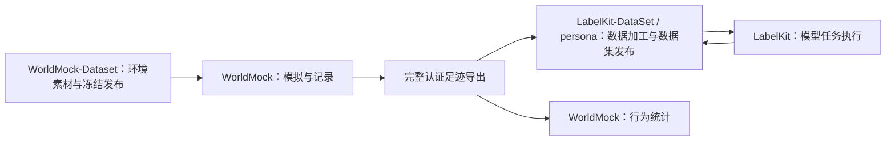

<a name="readme-worldmock"></a>
# WorldMock

WorldMock 自有的并发唤醒与时钟屏障内核借助配置的 OpenAI 兼容模型服务驱动一名或多名数字人的日常生活，把观察、唤醒决策、行动、状态变化和结果写成连续、可追溯的数字足迹。WorldMock 负责模拟、记录、完整足迹导出和行为统计。
WorldMock-Dataset 提供环境素材与制作工具；LabelKit-DataSet 负责足迹整理、LabelKit 模型任务、训练数据加载和规则测试数据。



<a name="readme-文档导航"></a>
## 文档导航

[文档入口](docs/INDEX.md)按模块列出当前系统设计，并区分操作手册和历史开发记录。
自定义人物、环境和运行，从[用户配置手册](docs/manual/README.md)开始。
在仓库根运行 `python scripts/build_design_doc.py` 可生成完整设计说明书 HTML；生成附件不进入版本控制。

<a name="readme-目录结构"></a>
## 目录结构

```text
WorldMock/
├── .github/                    GitHub 自动检查的固定入口
├── src/worldmock/
│   ├── resource_engine/        目录登记、只读对象与地图
│   ├── exchange_engine/        固定规则、分录与纯计算
│   ├── simulation_engine/      世界、沙盒、屏障提交、活动、调度与观察
│   ├── recording_engine/       事件、素材、认证质量报告与完整导出
│   ├── state/                  共享状态、请求、结果、日会话、挂起载荷与字段判定
│   ├── agents/                 人物提示、日会话连续上下文、通用循环、搜索子会话与记忆
│   ├── configuration/          多人物输入、模型档案路由与模型元数据
│   ├── runtime/                运行装配、时钟屏障宿主与运行生命周期
│   └── foundation/             基础模型、文件、时间与序列化
├── tests/                      测试与人工最小环境；共享配置在 tests/conftest.py
├── scripts/                    环境引导、工程门禁与文档构建
├── tools/                      运行查看器等人工检查工具
├── LICENSES/                   移植代码的上游许可原文（AgentSociety2，Apache-2.0）
├── requirements/               固定依赖锁
└── docs/                       当前合同、设计、手册与历史证据
```

环境素材和数据加工工程分别在所属数据仓维护，通过正式文件交接。

<a name="readme-安装"></a>
## 安装

使用 `.python-version` 固定的 CPython 3.12.13 与具有 SQLite 能力的 Node。
引导按哈希锁 `requirements/lock.txt` 安装依赖，再以可编辑方式安装 WorldMock：

```sh
python scripts/bootstrap.py --profile release
```

Windows 可用 `py -3.12`，其他系统可用 `python3.12`。`--wheelhouse` 指定离线制品目录；
`--use-uv` 显式选择 uv。`release` 要求 Node 齐全，`dev` 记录缺失且不能取得完整放行。
环境收据位于 `.work/environment-receipt.json`；安装和激活步骤见[运行配置](docs/manual/runtime.md)。

模型凭据的格式与读取方式见[填写模型凭据](docs/manual/runtime.md)，凭据不加入版本控制。
每个平台按哈希锁重建环境与运行的能力须由对应实际回执证明。

<a name="readme-实验与数据"></a>
## 实验与数据

环境根只含 `catalog/`、`personas/`（存放按文件名排列的一个或多个 `*.toml` 人物声明文件）与 `config.toml`，描述一个世界、一名或多名数字人和一次运行。
`config.toml` 通过 `[models.*]` 与 `[model_routing]` 声明阶段及人物维度的异构模型路由（见[运行配置](docs/manual/runtime.md#runtime-编写-config-toml)）。
目录使用清单、四份必需 JSONL 和按需放置的可选 JSONL（回调声明 `callbacks.jsonl`、两地距离与边限制声明 `map.jsonl`、出行方式 `travel-method.jsonl`）；
分城地图由各城地点、声明的边与唯一运行种子在内存生成，发布包不包含生成的 `map.json`。
完整格式和实际模型服务要求见[用户手册](docs/manual/README.md)。

运行输出位于 `runs/`。事件数据库、素材、模型证据和共同检查点保留实际来源，恢复使用新的目录并保留父运行。
导出清单列出事件、活动、已核验经历、购买、app 使用和地点停留六类工件。

<a name="readme-命令"></a>
## 命令

在仓库根目录执行，显式选择完整环境。以下 `D:/datasets/my-world` 是需要自行准备的外部环境：

```sh
worldmock validate --environment D:/datasets/my-world
worldmock run --environment D:/datasets/my-world --output runs/white-collar
worldmock status --run-dir runs/white-collar
worldmock export --run-dir runs/white-collar --output runs/white-collar/exports/final
```

`resume` 显式提供父运行、检查点和新的输出目录；`replay` 还需提供严格的干预文件，实际执行新分支。
完整导出随后交给 LabelKit-DataSet，加工任务、训练格式和规则测试数据由该仓库定义与验收。

行为分析与工作检查使用仓库工具，认证导出与 `quality.json` 统计遵循当前版本契约。详见[分析手册](docs/manual/evaluation.md)。
引擎端到端测试使用实际存在的合成环境 `tests/fixtures/dataset-environment/`，其中模型地址仅供测试。
完整验证运行：

```sh
python -m pytest tests
```

测试入口与证明范围见[总体架构](docs/design/01-architecture.md#architecture-工程验证)。
测试耗时、覆盖率明细和运行回执写入 `.work/`，由 CI 或发布附件保存。
