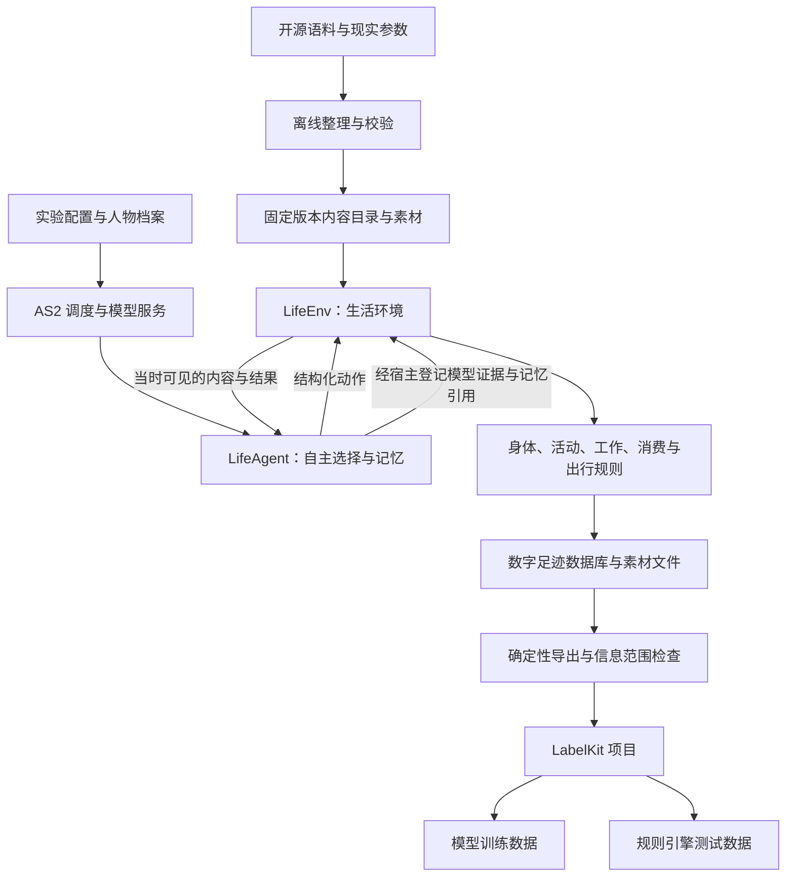
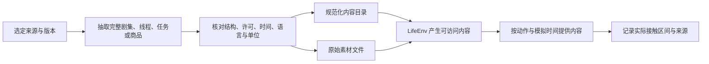

<!-- worldmock-doc: {"authority":"architecture","canonical_path":"docs/ARCHITECTURE.md","implementation_state":"NOT-COMPLETE","kind":"architecture","owner":"worldmock-core","replaces":[],"schema":"worldmock.document.metadata.v1","status":"FROZEN","superseded_by":null,"version":"2026-09-18"} -->
**Status: FROZEN** | **Owner: worldmock-core**

# WorldMock 架构设计

本文件记录 WorldMock 的核心设计理由、架构决策和系统边界。

**来源**: 从 `docs/history/agentsociety2-design.md` 提取 WHY 和设计理由部分

## 设计目标

数字人在需求驱动下与环境交互，留下完整数字足迹，供 LabelKit 生成动作序列、意图和 dreaming 语料，最终交付模型训练数据与规则引擎测试数据。

### 核心决策

| 范围 | 设计决定 | 理由 |
| --- | --- | --- |
| 基础框架 | 采用 AgentSociety 2 | 已提供人物决策、模型调用、记忆和运行管理；避免重写 Agent 框架 |
| 环境设计 | 新增 `LifeEnv` 环境模块 | 唯一负责生活规则、活动进度、资源结算和世界数字足迹 |
| 人物设计 | 新增 `LifeAgent` 人物类 | 人格与需求提示、生活动作工具、依据事件形成记忆 |
| 人物自主性 | 人物决定行为，环境执行约束 | 人物决定吃、睡、工作、娱乐、购买、出行与是否继续；环境执行可行性和资源约束 |
| 世界状态 | 环境确定性维护 | 人物不能直接设置余额、饥饿值、睡眠效果或工作验收结论，确保数据真实性 |
| 时间模型 | 统一模拟时间，事件驱动推进 | 按下一次相关事件推进，程序速度与人物生活时间分开 |
| 内容提供 | 实际接触逐段提供 | 保留原始来源、版本和区间；未接触内容不可见 |
| 数据记录 | SQLite + 文件 | SQLite 保存结构化事件与结算，文件保存原始素材与模型证据 |
| 数据交付 | 固定 JSONL 输入 LabelKit | 成品样本必须可追到原始事件 |
| 恢复机制 | 父子分支模型 | 从完整检查点建立有父子关联的新运行分支；原运行的部分经历保留 |
| 实验控制 | 运行前冻结 | 人格、模型、提示、规则和代码在正式运行前冻结；修复后使用新版本和新运行 |

**来源**: `docs/history/agentsociety2-design.md:23-32`

### 为何不能仅扩展 EnvBase

仅新增一个 `EnvBase` 子类不能满足全部要求。还需调整 AS2 的：
- 决策调度：支持事件驱动的时间推进
- 结构化工具调用：确保模型工具结果不被改写
- 时间约定：统一 `step(tick, t)` 的语义
- 失败处理：确保失败不会被静默吞掉
- 检查点关联：人物工作区与世界状态形成共同检查点

这些改动复用现有 AS2 执行链，不另写一套 Agent 框架。

**来源**: `docs/history/agentsociety2-design.md:20-21`

## 整体数据流

**来源**: `docs/history/agentsociety2-design.md:77-93`

### 模块职责划分

`LifeEnv` 内部按身体、活动、内容、工作、消费和出行分文件组织。它们共享同一状态与事务，不拆成各自维护时钟和余额的多个环境服务。

模型调用、向量检索、Ray 进程管理继续由 AS2 承担。

首个完整版本采用本机或单机多进程；并行独立实验各有自己的数据库和运行标识。

**来源**: `docs/history/agentsociety2-design.md:95-97`

## AS2 集成策略

### 通过扩展模块完成的部分

| 模块 | 设计职责 | 为何这样设计 |
| --- | --- | --- |
| `LifeEnv(EnvBase)` | 观察、动作接收、活动推进、资源结算、内容提供、数字足迹 | 使用现有环境注册、工具声明、共享 actor 和生命周期，避免重写环境基础设施 |
| `LifeAgent(PersonAgent)` | 人格与需求提示、生活动作工具、依据事件形成记忆 | 保留现有模型客户端、ReAct 执行和记忆检索；不重写人物循环 |
| 内容整理程序 | 将选定来源整理为固定目录、素材和参数 | 使用现有 JSON、Pydantic 和成熟数据读取工具 |
| 导出程序 | 读取确定事件范围，输出 LabelKit 输入及来源索引 | 只做字段选择、时间排序、素材展开、关联和校验 |
| LabelKit 项目 | 动作与意图标注、dreaming、训练输出和测试夹具 | 使用既有 Schema、提示、分类、生成、后处理和验证能力 |

**来源**: `docs/history/agentsociety2-design.md:100-109`

### 为何需要修改 AS2 核心

AS2 现有行为与本设计需求的差距：

| AS2 现有行为 | 问题 | 必须改动的理由 |
| --- | --- | --- |
| `AgentSociety.step` 调用所有人物，再调用环境 | 会直接跨过新启动活动的结束时刻 | 需要事件调度接口，按下一相关事件推进 |
| `step` 文档称 `t` 为步结束时间，实际传入开始时间 | 各模块分别猜测时间语义 | 必须统一约定并修复调用链 |
| `to_workspace` 捕获环境保存异常并只告警 | 不满足采集完整性 | 改为终止本次推进并记录失败 |
| ReAct 预算耗尽会合成结果 | 失败被 runner 标成成功 | 删除自动补造结果的出口 |
| 同批工具调用包含 `finish` 时，只保留结束调用 | 静默丢弃人物请求的生活动作 | 必须拒绝这种协议冲突 |
| 环境恢复错误被捕获后按新环境继续 | 混合了不一致的状态 | 改为指定完整检查点、新分支目录和全部必要状态校验 |

**来源**: `docs/history/agentsociety2-design.md:58-70`

这些改动应作为一个可维护的 AS2 分支或上游补丁管理，锁定提交版本。禁止用运行时 monkey patch、复制整个 AS2 调度器或保持两套人物决策循环完成接入。

**来源**: `docs/history/agentsociety2-design.md:132-133`

## 语料与环境结合

### 为何采用离线整理

开源语料经过离线整理，成为环境里的节目、游戏、工作材料、邮件、商品与出行依据。

**理由**:
- 原始内容、环境参数、评估参考答案分开管理
- 答案与后续剧情不能随输入材料一起暴露给人物
- 运行中只读取冻结的数据版本；不要临时重新下载变化中的数据集改变世界
- 按完整剧集、邮件线程、会议或任务抽样，避免随机取行破坏上下文

**来源**: `docs/history/agentsociety2-design.md:377-393`

### 数据进入环境的过程

**来源**: `docs/history/agentsociety2-design.md:379-388`

## 一条完整生活经历的数据流

此图用于展示能力连接，不是强制人物执行的剧情。人物可以拒绝任务、延期、买更便宜的食品、继续娱乐或取消购买；这些选择都形成足迹。

这段经历可以同时得到：
- 工作与购物动作序列
- 饮食或娱乐意图
- 工作报酬对后续消费的影响
- 资金不足、重复付款、未到货先使用、超时交付、睡眠不足效率下降等规则测试
- dreaming 可以对已知经历做归纳，或提出"若未获得报酬是否还能购买"的假设

经过环境分支执行得到的答案，与仅文本推演的答案采用不同来源标记。

**来源**: `docs/history/agentsociety2-design.md:716-732`

## 验收边界

数据来源真实不代表数字人行为已经符合人类分布。行为真实性需要独立样本、参数校准与人工复核。

本设计不以程序运行时长或 JSON 能被解析作为最终成功条件。

**来源**: `docs/history/agentsociety2-design.md:49-50`

## 与现有系统的关系

| 现有系统 | 关系 | 理由 |
| --- | --- | --- |
| AS2 replay | 分别承担回放、调用诊断和工作状态 | 不能直接代替本设计的事务结算与数据谱系 |
| AS2 trace | 调用诊断 | 不能直接代替本设计的事务结算与数据谱系 |
| AS2 workspace | 工作状态 | 不能直接代替本设计的事务结算与数据谱系 |
| WorldMock 现有 `trajectory.py` | 已有原始事件、素材哈希引用和脱敏实现经验 | 当前 JSONL 追加不提供新的世界事务保证 |
| LabelKit | 文本输入、序列标注、反事实生成 | 可复用；没有直接读取本仿真数据库或专用 dreaming 的现成入口 |

**来源**: `docs/history/agentsociety2-design.md:71-73`
