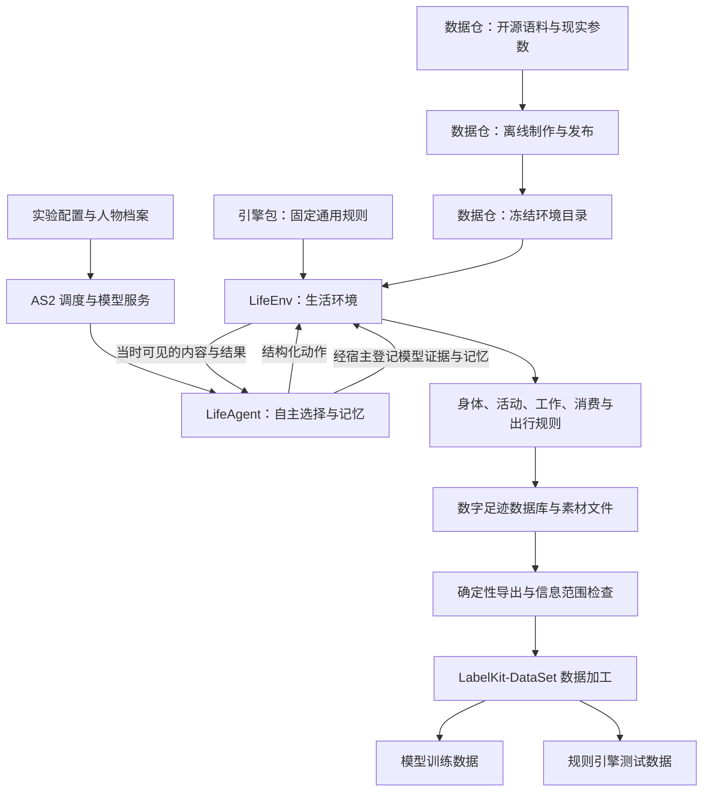
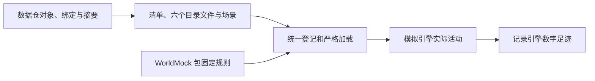
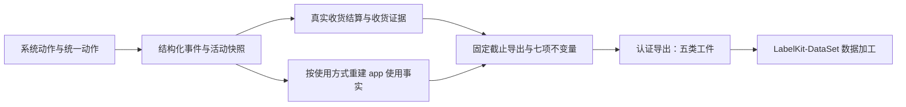
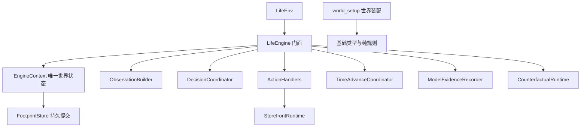

# WorldMock 架构设计

> 按[动作与内容简化规格](dev/SPEC-action-and-content-simplification.md#spec-acs-动作与内容简化开发规格)修订「固定规则、目录格式与加载边界、收货结算」（阶段 1、2）。

> 按[资源与规则引擎简化规格](dev/SPEC-resource-and-rule-simplification.md#spec-rrs-资源与规则引擎简化开发规格)修订「核心决策、一条完整生活经历如何形成数据及现行证据边界」（阶段 8）；此前阶段的修订并入同一现行合同。

> 状态：设计冻结（FROZEN）。分层、职责边界、核心决策与数据流理由以本文件为准；实现状态见 `docs/dev/implementation-status.md#implementation-status-worldmock-实现状态`。按人物 Prompt 规格修订，修订部分已实现并通过离线验收（证据见[人物 Prompt 验收记录](archive/persona-prompt/persona-prompt-verification.md)）。「核心决策」的人物设计一行按[一日运行保真规格](dev/SPEC-life-runtime.md#dayrun-fidelity-身体与需要)补一句（一日运行保真 AR1），已随该规格的名称解析与错误合同实现。
> 工具交互修订：按[工具交互规格](dev/SPEC-life-runtime.md#tool-interaction-工具请求)冻结目标设计；本次修订已实现，历史证据只证明原行为。
> 个人事务与工作安排修订：按[个人事务与工作安排规格](VERIFICATION.md#verification-incremental-evidence)「冻结条款修订」第 2、5、14、15、17 行修订（个人事务与工作安排 AR2–AR11）：「活动与经历的唯一归属」补个人事务与主观自述的分工；「必须达到的行为」补事务跨日保留与上班安排进入观察；「核心决策」补只读查询的执行位置与筛选、阶段 2 与阶段 3 的发布身份、世界状态行与人物自主性行；「可直接复用的能力」补只读查询转发的扩展。修订部分已实现并通过离线验收（证据见[个人事务与工作安排验收记录](archive/errands-workday/errands-workday-verification.md)）。
> 日期：2026-10-07
> 实施基线：AgentSociety 2 提交 `670c94f`（在线文档版本 2.8.7）
> 范围：AgentSociety 2 驱动的数字人生活模拟，以及完整数字足迹导出与真实性评估

本文件只写设计理由、职责边界与数据流。接口的签名、字段、枚举、Schema 与数据表的权威定义在 `docs/CONTRACTS.md#contracts-worldmock-接口合同`，本文件只引用不重复。

本项目的模拟由 AgentSociety 2（下称 AS2）承担调度与模型调用：它驱动被模拟的人按自身需求与环境交互，交互过程留下的可追溯记录就是数字足迹，随后交由 LabelKit-DataSet 组织 LabelKit 加工与数据集发布。被模拟的人在本文件称**数字人**，单个运行实例称**人物**。
**数字足迹**指生活过程留下的可追溯记录：人物的观察与决策、执行的每一步、世界状态的变化、活动结果、记忆与相互关系；**dreaming** 指把已有经历归纳成结论，或在其上做假设推演。

## 共享规则与可重建环境修订

按[共享规则与可重建环境规格](dev/SPEC-shared-rules-and-rebuildable-env.md)修订；验收结果独立记录。

共享规则分别由已有模块和基础模型叶子模块维护，业务消费者不复制规则。AS2 采用固定上游源码与有序补丁，WorldMock 维护人物记忆业务扩展；不复制调度器，不引入运行兼容层。

## 环境数据与通用规则的归属

WorldMock 唯一拥有 `worldmock.exchange` 中的分类、类别与使用方式、效果、供给表、身体与交换常数和公式，统一由规则版本 2 绑定。
包内可供性注册表和人物映射只从包读取，环境没有规则副本，内部动机规则退役。
WorldMock-Dataset 发布清单加六个目录文件，登记 app、地点、商品、动作、内容、图与绑定；场景钉住环境标识与版本。
标题和摘要来自 `contents.json`，类别效果由 WorldMock 固定。正式重制路径由数据仓发布决定，运行不搜索相邻仓库。
历史运行与输入保留字节，正式环境、真实模型运行和平台证明各有独立回执。

## 品类契约的独立归属

## 活动与经历的唯一归属

同一人物的持续活动由世界活动表表达，每人两个活动名额；能否同时进行按注册表声明的占用与目标、地点、
出行方式判定，能量不参与。模拟引擎推进每项进度，对每人的共同时间只结算一次身体变化，
再由记录引擎保存已提交证据并投影实际经历。
人物借助 AS2 原有记忆运行时保存感受、意图和反思，始终标为主观自述；人物看到的长期记忆是记忆层，
由已提交事件与世界状态确定性派生，环境结算的事实与人物自述分开写；关系与偏好的当前看法只在人设层。
要买到或拿到某件具体东西的打算由人物记成个人事务：它随人物状态保存、跨日保留并显示在待办层，
办没办成只由环境按本人收货证据确认，人物只能更新备注与提醒时刻，或取消并写原因；
事务的文字是人物记下的打算，不是世界事实。其余延续打算仍是主观自述，写在暂停与收尾的 summary 与记忆里。
自由文本不能反向修改世界事实。
完整行为及验收见[一日行为规格](dev/SPEC-dayrun-behavior.md#spec-dayrun-behavior-一日行为可信性特性开发规格)与[人物 Prompt 七层规格](dev/SPEC-life-realism.md#persona-prompt-七层请求)与[个人事务与工作安排规格](dev/SPEC-as2-integration.md#errands-workday-运行修复入库)，格式归记录引擎设计。

## 设计目标与边界

### 必须达到的行为

| 用户需求 | 必须达到的行为 |
| --- | --- |
| 付款与收货 | 每单付款一次，商品在实际收货时结算给收货人；工作按真实投入时间累计，工资只由明确预排事实支付；睡眠按实际时间恢复 |
| 个体差异 | 人物画像、工作主题分配、工作安排与生活选择形成差异；睡眠状态影响明确配置的身体转换效率 |
| 需求驱动 | 饥饿、疲劳、娱乐需要、未完成工作主题与当日目标进入人物观察和决策，不由脚本替人物排序选择；场景声明的上班安排由环境层每轮写明 |
| 内容丰富 | 覆盖饮食、app 使用与 app 内容、工作主题累计与叙述、邮件、导航和购物 |
| 日常与社交 | 人物能看见同处一地的他人、与他人和联系人通讯、在家完成晨间例程与用餐、按零点计划为其生成、可自行修订的当日计划安排活动，登记的个人事务跨日保留到环境确认办成或本人取消；机会由世界提供，不由脚本安排 |
| 可控场景 | 可定义地点、日历、天气、交通条件和模拟速度 |
| 真实反馈依据 | 明确区分来源数据、规则算出的结果、模型生成的文本和实际外部服务返回 |
| 完整数字足迹 | 保存数字足迹定义中的全部要素，导出与分支都不丢弃其中任何一类 |
| 足迹交接 | 提供完整认证导出与真实来源关联，交给 LabelKit-DataSet 加工 |
| 导出可用性 | 导出重算、来源认证与真实性评估读取同一批持久事实 |

本表只写设计必须达到的行为，不写这些行为如何判定。行为真实性的判定严格程度，以及不构成成功条件的边界，
见 `docs/VERIFICATION.md#verification-worldmock-验收标准`「结论边界」。

## 核心决策

工具交互沿用已有 AS2 调度、Pydantic 校验、JSON Schema 与名称解析，不加新包。
人物用目标和方式选择行动，`start_activity.items[]` 每项恰含 `target`、`way`、`app`、`to`、`pay_app`；整组另有 `answering`。内部标准动作由目标与方式唯一解析，退役字段直接拒绝。
世界查询与任务回看属于只读，不能成为世界动作或推进时间；查询所在模型回复仍计十六回合预算。
任务回看经环境 actor 的只读入口取回真实结果，世界查询由宿主在本次冻结观察上求值，环境侧同名分支是同一组纯函数的第二入口：
受理时两入口结果逐值相等，拒绝时给出同一份校验报告；两者都不写事件、不改世界版本与时钟、不计同刻轮数。
世界查询的六个必填键为 `name`、`way`、`category`、`app`、`available_only`、`offset`。
按名称、方式、公开类别与人物指定的 app 取交集，可只看当前能做的；筛选在排序和切页之前施加。
有效条件无匹配即合法空页，不代选 app，不扩大权限；返回紧凑的 `matches`、`total_count` 与 `next_offset`。
宿主与环境共用纯校验与错误构造，每次报错以英文原因返回精确位置数组和合法枚举，候选是完整新请求。
工作内容由目录登记，场景以 `work_content_ids` 分配；本人已分配且未完成的工作内容从运行开始可见，不依赖通知、素材、预约或截止。
累计只来自实际动作消费秒数，剩余内容时长决定本次结束时刻；已完成的指派内容不能重开。班次是人物履职信息，不禁止班内离岗。
控制工具的自述只更新文字，不能完成主题或增加工时；邮件是普通消息，不关联主题开放或评审付款。
地点类型、商品五类与动作五类来自固定闭集，目录只登记对象与绑定；同类店铺同菜单，食品统一价格，店铺全天服务。
目录格式 2、发布图格式 1、规则版本 2，场景结构 8、世界结构 11、运行清单 4 拒绝旧输入。
操作备忘从已提交事件派生，紧凑工具层只负责无损呈现，不建立第二份世界状态。
运行身份用 `environment_identity` 绑定环境标识、版本、规则版本、目录摘要和地图摘要，恢复不能沿用不同字节。已发布实验和历史输入不改写。
固定规则和目录、图、商品、动作、app 与工作内容按依赖顺序形成真实引擎闭环，导出与交付从同批实际事件认证；
禁止双格式兼容，各阶段生产行为与语义变异按[资源与规则简化门禁](VERIFICATION.md#verification-资源与规则引擎简化特性门禁)验证。
本次行为与变异验收以[验证规则](VERIFICATION.md#verification-工具交互特性门禁)为准，文档冻结不证明实现完成。

| 范围 | 设计决定 | 理由 |
| --- | --- | --- |
| 基础框架 | 采用 AgentSociety 2 | AS2 已提供模型调用、人物决策、记忆与运行管理这套机制，不必重写 Agent 框架 |
| 环境设计 | 新增 `LifeEnv` 环境模块 | 生活规则、活动进度、资源结算和世界数字足迹只有一个归属，不散成各自维护时钟与余额的多个环境服务 |
| 人物设计 | 新增 `LifeAgent` 人物类 | 提示按七层 JSON 组织、同一秒的连续决策续接原生消息，生活动作工具与依据事件形成的记忆都落在人物类上，复用现有 AS2 人物循环；宿主与环境共用同一套名称解析与错误结构，人物写的名称在两边得到相同的受理结果与可照填的候选（[一日运行保真规格](dev/SPEC-life-runtime.md#dayrun-fidelity-身体与需要)第三、四章） |
| 人物自主性 | 人物决定购买、睡眠、工作、娱乐、出行与是否继续 | 环境只执行可行性和资源约束，选择权留在人物；能量不构成可行性约束；动作照常列出，选错由业务拒绝说明；场景声明的工作安排只作为环境核验的事实呈现，今日计划改不了它，但它不构成拒绝理由，班内离岗照常受理、由指标度量 |
| 世界状态 | 由环境确定性代码维护 | 人物不能直接设置余额、饥饿值、睡眠效果、工作主题累计或个人事务的完成状态，数据才可信 |
| 时间 | 统一模拟时间，按下一次相关事件推进；决策不消耗模拟时间，没有进行中活动者同一秒再决策 | 程序速度与人物生活时间分开；时间线不留空 |
| 内容 | 实际接触的内容逐段提供 | 保留原始来源、版本和区间，未接触内容不可见 |
| 记录 | SQLite 保存结构化事件与结算，文件保存原始素材与模型证据 | 结构化事件用于查询、对账与导出；原始素材与模型证据按引用整份取用 |
| 足迹交接 | 固定截止的完整认证导出 | 下游加工由 LabelKit-DataSet 验收 |
| 恢复 | 从完整检查点建立有父子关联的新运行分支 | 原运行的部分经历保留，反事实分支与父运行同时可追溯 |
| 实验变更 | 人格、模型、提示、规则和代码在正式运行前冻结 | 修复后使用新版本和新运行，实验边界保持干净 |

## 整体架构

分层上只有两类角色：要不要做、做什么由人物自己决定，环境这一侧只判定可行性、施加资源约束，并把过程记成数字足迹；
AS2 负责调度与模型服务，LabelKit-DataSet 负责下游数据生产与其 LabelKit 任务。

`LifeEnv` 内部按身体、活动、内容、工作、消费和出行分文件组织。它们共享同一状态与事务，
不拆成各自维护时钟和余额的多个环境服务。模型调用与 Ray 进程管理继续由 AS2 承担；
素材检索的机制不由 AS2 决定，本项目只做确定性倒排与 facet，禁止向量检索与近似最近邻，见
`docs/dev/SPEC-life-runtime.md#spec-life-runtime-特性规格lifeenv-运行时行为与结算规则`「检索：确定性索引与 facet」与 `docs/dev/SPEC-life-realism.md#spec-life-realism-特性规格人物决策与画像`「素材淘汰与检索机制的禁止项」。
首个完整版本采用本机或单机多进程；并行独立实验各有自己的数据库和运行标识。

## 存储职责分层

Python 侧的共享存储边界只有两个：`FootprintStore` 保存状态与事件，`AssetStore` 保存素材。两条边界各自接受的调用、参数与写入合同，权威定义分别在 `docs/design/05-recording-engine.md#recording-engine-worldmock-产品设计说明书-记录引擎`「一致性保存与校验」和「保存与关联证据」主题中。

为什么坚持唯一写入者：世界状态之所以可信，靠的是一份唯一的事件顺序。并发的人物 worker 各自改写数据库，状态版本、事件序号与资金对账就失去可比对的基准，检查点之后的经历也无法逐项重建。因此校验与结算留在生活模型一侧，存储只落库已经通过校验的内容，不反过来决定活动能不能做；人物 worker 手里的句柄不指向数据库文件，也没有第二条写入口。唯一的写入进程是共享环境 actor。

## AS2 的差距与集成策略

仅新增一个 `EnvBase` 子类不能满足全部要求。还需要调整 AS2 的决策调度、结构化工具调用、时间约定和失败处理，
并把人物工作区与世界状态关联为可恢复的检查点。这些改动复用现有 AS2 执行链，不另写一套 Agent 框架。
下文关于 AS2 接口与行为的判断以状态头所记基线为准；依赖版本已在 `docs/EXPERIMENT.md#experiment-worldmock-实验设置`「依赖冻结」锁定，
改动落在 AS2 维护分支上，实现进度与测试基线见 `docs/dev/implementation-status.md#implementation-status-worldmock-实现状态`。

### 可直接复用的能力

AS2 的 `EnvBase`、`@tool`、`step`、`restore`、`to_workspace` 可直接承载自定义生活环境，
`PersonAgent` 的模型决策、工作区与记忆也可复用，只需按活动唤醒并限制可调用工具。
复用的代价是这套通用机制不认识本项目的业务状态：自定义状态不会因为挂了扩展点就自动获得一致的恢复能力，
恢复路径必须由本项目自己补齐。AS2 的 `EconomySpace` 按日自动加收入、减消费，与本设计的活动结算重复，
本场景不装配它，资金全部来自实际活动与合同结算，避免同一笔钱记两次。
只读查询的跨进程转发由 WorldMock 侧的 `LifeEnvActor`、`LifeEnvProxy` 两个子类承担，各只新增 `read_query` 一个方法；
它依赖锁定提交上 `DirectEnvActor._router`、`DirectRouter._environment()`、`EnvRouterProxy._actor` 三个私有成员，
升级 fork 时逐项复核，不 monkey patch、不改 AS2、不做多版本兼容。

复用边界的逐项清单见 `docs/dev/SPEC-as2-integration.md#spec-as2-integration-特性规格agentsociety-2-集成与改动`「选型理由与分层职责」。

### 必须修改的核心行为

AS2 核心链路上有几处行为与本设计直接冲突，必须在下游分支上确定性改掉，不能靠新增模块绕过。
**调度与时序**：现有 Society 按固定步长推进，一次推进可能越过活动应当结算的时刻；`t` 的时间语义在文档与调用之间也不一致。
时序是生活结算的前提，所以要改成按下一相关事件推进，并统一约定后再修调用链；
有人就绪时同一时刻可连续多轮，无人就绪才推进。
**失败语义**：环境保存、人物执行与记忆异常当前只记录告警，决策预算耗尽还会合成一个结果——
这些出口会把一次故障变成一段看似正常的生活，必须删除自动补造结果的路径。
**协议冲突**：同批工具调用里同时出现 `finish` 时，解析器只保留结束调用，人物已经提出的生活动作被静默丢弃。
生活决策已取消 `finish`，本条只约束只读问答。
**恢复分支**：恢复失败后按新环境继续、且复用原目录，会把父运行与子运行混成不一致的一份，
必须改为指定完整检查点与新分支目录，并校验全部必要状态。

每项改动的行为规则、算法与逐项改动清单见 `docs/dev/SPEC-as2-integration.md#spec-as2-integration-特性规格agentsociety-2-集成与改动`「AS2 核心改动清单」。

## 环境目录如何进入引擎

环境只经目录登记进入引擎。数据仓发布 `catalog/` 与 `scenarios/`，内容标题、摘要与真实或合成来源直接登记在 `contents.json`。
引擎不读取、校验或钉住任何 `corpora/` 文件，语料整理和来源记录归数据仓。

加载有效是运行前提；完整引擎、正式模型运行和平台执行以匹配身份的真实证据判断。

## 一条完整生活经历如何形成数据

系统动作与统一执行的动作先写入结构化事件；付款、运输、驿站到站与本人领取各保留自己的事实，只有真实收货才写收货证据并施加商品效果。记录引擎从固定截止的事件与活动快照重建按使用方式区分的 app 使用事实、购买与收货行，校验来源和足迹不变量后发布五类认证工件。

模型自述或私有文字不能替代环境事实；重算、所有人和来源事件校验拒绝修改后重新签名的伪造足迹。

dreaming 可以归纳真实经历或提出假设，实际环境分支与文本想象采用不同来源标记。图展示能力和证据关系，不规定行动顺序；人工日与工具链证明实现可运行，长期合理性、真实模型及完整自然日交付另行验证。

## 与现有系统的关系

| 现有系统 | 关系 | 理由 |
| --- | --- | --- |
| AS2 replay | 回放 | 不能直接代替本设计的事务结算与数据谱系 |
| AS2 trace | 调用诊断 | 不能直接代替本设计的事务结算与数据谱系 |
| AS2 workspace | 工作状态 | 不能直接代替本设计的事务结算与数据谱系 |
| WorldMock 现有 `trajectory.py` | 已有原始事件、素材哈希引用和脱敏实现经验 | 当前 JSONL 追加不提供新的世界事务保证 |
| LabelKit-DataSet 与 LabelKit | 数据集加工与模型任务执行 | 消费完整导出；新消费者的验收由数据集仓库登记 |

## 数据加工归属

WorldMock-Dataset 维护环境素材与发布；WorldMock 模拟生活、保存事实、导出完整足迹并执行真实性评估；
LabelKit-DataSet 维护输入整理、手机信号投影、LabelKit 模型任务、训练数据加载和规则测试数据。
WorldMock 的安装、项目校验和测试不要求 LabelKit。模拟过程的主观记忆和就寝反思仍属于人物运行代码。

来源快照已交给 LabelKit-DataSet 并核对摘要，整合后的新消费验收尚未取得；来源材料接收不能替代新消费者运行。

## 当前生产职责与依赖方向

`custom/` 仅保留实际定义 LifeAgent 和 LifeEnv 的框架扫描入口；人物辅助模块在 `src/worldmock/agents/`。
门面保留 LifeEnv 使用的公开方法签名，职责对象持有同一个上下文和必要的具名协作者。上下文不保存第二份场景或状态，不保存门面、服务字典或回调注册表。生产导入图覆盖模块级、函数内和显式动态导入，只有静态类型分支不参与运行期图；最终图无环。

运行配置、阶段与运行身份、人物输入准备归 `src/worldmock/run_setup.py`；画像覆盖目标纯构造归 `src/worldmock/profile/coverage_targets.py`，输入准备与校验共用，不借用上层运行入口。FootprintStore 只存取，分支恢复由 checkpoint 编排。运行期导入全部按真实模块解析，函数内延迟仅保留有明确原因且与实际导入对应的登记。

## 版本表

| 版本 | 日期 | 修订内容 |
| --- | --- | --- |
| `2026-09-18` | 2026-09-18 | 冻结分层、职责边界、核心决策、数据流理由与系统边界。 |
| `2026-09-18-revision-1` | 2026-09-18 | 行文与结构改造：状态头改为 LabelKit 形态；章节标题改为概念命名；移除来源行号引用；接口定义移交 `docs/CONTRACTS.md#contracts-worldmock-接口合同`。 |
| `2026-09-18-revision-2` | 2026-09-18 | 消除与相邻文档的逐字重复：AS2 复用边界与改动清单改为引用 `docs/dev/SPEC-as2-integration.md#spec-as2-integration-特性规格agentsociety-2-集成与改动` 的对应章节，结论边界改为引用 `docs/VERIFICATION.md#verification-worldmock-验收标准`，语料规则改为引用 `docs/dev/SPEC-life-runtime.md#spec-life-runtime-特性规格lifeenv-运行时行为与结算规则`；明确数字人与人物两个术语的分工；把实现前待办句改为当前状态陈述。 |
| `2026-09-18-revision-3` | 2026-09-18 | 消除与相邻文档的逐字重复：存储调用合同的原文移交 `docs/design/05-recording-engine.md#recording-engine-worldmock-产品设计说明书-记录引擎`「存储调用」，本文件只留单一写入者的理由；项目身份句、数字足迹定义与目标表中的要素枚举改为架构侧措辞，与 `docs/INDEX.md#index-worldmock-文档入口` 的项目陈述不再逐字相同；语料整理理由改用自己的句子，不再与 `docs/dev/SPEC-life-runtime.md#spec-life-runtime-特性规格lifeenv-运行时行为与结算规则` 的引述句同形。 |
| `2026-09-20-category-contract` | 2026-09-20 | 补登 `c582330`：新增「品类契约的独立归属」节，品类契约由资源引擎与交换引擎共同消费，结算采用闭集算子，规则与目录以内容摘要绑定运行。 |
| `2026-09-21-dayrun-behavior` | 2026-09-21 | 补登 `d998a31`：新增「活动与经历的唯一归属」节；文件头日期改为 2026-09-21。 |
| `2026-09-24-time-and-energy` | 2026-09-24 | 按[时间与能量规格](dev/SPEC-life-runtime.md#time-and-energy-决策不耗时时间只在做事时流动)「冻结条款修订」第 29 行修订：「活动与经历的唯一归属」改为每人两个活动名额，能否同时进行按注册表声明的占用与目标、地点、出行方式判定，能量不参与；「必须达到的行为」的当日计划改为由零点计划生成、人物可修订；「核心决策」的时间行补决策不消耗模拟时间、没有进行中活动者同一秒再决策，人物自主性行补能量不构成可行性约束、动作照常列出；「整体架构」的「记忆引用」改为「记忆」；「必须修改的核心行为」补同一时刻可连续多轮、无人就绪才推进，生活决策已取消 `finish`。 |
| `2026-09-27-persona-prompt` | 2026-09-27 | 按[人物 Prompt 七层规格](dev/SPEC-life-realism.md#persona-prompt-七层请求)「冻结条款修订」第 30 行修订，修订部分待实现：「活动与经历的唯一归属」的长期记忆视图改为记忆层（由已提交事件与世界状态派生，结算事实与人物自述分开），关系与偏好的当前看法在人设层，行为引用补该规格；「核心决策」人物设计行改为提示按七层 JSON 组织并同秒续接，AS2 人物循环照旧复用；「AS2 的差距与集成策略」经核对不改（续接由宿主在准备阶段之后注入，锁定的 AS2 不改）；文件头状态句补修订说明，日期改写。 |
| `2026-09-28-persona-prompt-implemented` | 2026-09-28 | 人物 Prompt 七层规格实现后文档（人物 Prompt 台账阶段 8，按最终代码 `f798ea7` 核对）：状态头「修订部分待实现」改为已实现并通过离线验收，链接人物 Prompt 验收记录；正文不变 |
| `2026-09-29-dayrun-fidelity` | 2026-09-29 | 按[一日运行保真规格](dev/SPEC-life-runtime.md#dayrun-fidelity-身体与需要)「文档同步作业」AR1 修订（随该规格冻结）：「核心决策」的人物设计一行补一句：宿主与环境共用同一套名称解析与错误结构，人物写的名称在两边得到相同的受理结果与可照填的候选；文件头补修订说明，日期改写 |
| `2026-09-29-dayrun-fidelity-implemented` | 2026-09-29 | 一日运行保真规格实现后（按 `34a41ee` 的代码核对）：宿主与环境共用的名称解析（`src/worldmock/life/name_resolution.py`）与错误结构（`src/worldmock/life/error_contract.py`）已落地，文件头「定稿不等于已实现」改为已随实现落地；正文不变 |
| `2026-10-01-tool-interaction` | 2026-10-01 | 工具交互设计冻结并已实现：复用现有校验与解析依赖，`items[]`及共享错误构造，只读查询与世界动作分工，普通任务完整通知与即时开放，类别完整供给和一次构建定价，派生操作备忘与紧凑呈现，新发布身份及行为与变异验收 |
| `2026-10-02-errands-workday` | 2026-10-02 | 按[个人事务与工作安排规格](VERIFICATION.md#verification-incremental-evidence)「冻结条款修订」第 2、5、14、15、17 行修订（个人事务与工作安排 AR2–AR11，随该规格冻结），修订部分在冻结时未随文实现（该规格阶段 1–4 实现后的核对见 `2026-10-04-errands-workday-implemented` 行）：「活动与经历的唯一归属」补个人事务的登记、保存与完成确认，行为引用补该规格；「必须达到的行为」日常与社交行补事务跨日保留，需求驱动行补上班安排由环境层写明；「核心决策」工具交互段补只读查询的执行位置、来源与可执行筛选、阶段 2 与阶段 3 的发布身份，世界状态行补个人事务的完成状态，人物自主性行补工作安排不构成拒绝理由；「可直接复用的能力」补 `LifeEnvActor`、`LifeEnvProxy` 的只读查询转发与三个私有成员依赖；「整体架构」与「必须修改的核心行为」经核对不改；`2026-10-01-tool-interaction` 一行移到按日期的位置；文件头补修订说明，日期改写 |
| `2026-10-04-errands-workday-implemented` | 2026-10-04 | 个人事务与工作安排规格实现后（个人事务与工作安排 AR14、AR15，按 `d8a41d3` 的代码核对）：`src/worldmock/life/read_query_runtime.py` 的只读查询转发（`LifeEnvActor`、`LifeEnvProxy` 各只新增 `read_query`）、个人事务的状态与结算模块（`src/worldmock/life/errand_state.py`、`src/worldmock/life/errands.py`）、工作安排求值模块（`src/worldmock/life/work_schedule.py`）已落地，世界结构为 9、质量报告结构为 4、场景结构为 5、卡片结构为 3（抽取提示 `card-v3`）；文件头的冻结期未实现注记改为修订部分已实现并通过离线验收，链接[个人事务与工作安排验收记录](archive/errands-workday/errands-workday-verification.md)；`2026-10-02-errands-workday` 行里的冻结期状态注记改为指向本行；正文不变。证据为离线测试，配对全天复跑（该规格阶段 6）未执行，项目整体的三项真实验收仍未完成 |
| `2026-10-05-layering-and-test-tiers` | 2026-10-05 | 实际具名职责对象、唯一上下文、单向依赖与当前文档归属 |
| 共享规则与可重建环境 | 2026-10-05 | 同步唯一规则归宿、固定源码补丁和平台验收合同 |
| `2026-10-05-idle-fillers-c` | 2026-10-05 | 按[让「等待」成为例外规格](dev/SPEC-idle-fillers.md#spec-idle-fillers-让等待成为例外开发规格)阶段 1（班次与休息时段起止的唤醒）登记：新增模块 `src/worldmock/life/duty_edges.py`，由人物在场景里声明的工作安排与世界时钟直接求出班次与休息时段的起止，供唤醒判定与下一边界、下一次决策机会的候选共用，不存交付状态；唤醒原因闭集追加 `shift_start`、`shift_end`、`break_start`、`break_end` 四个成员，都不在睡眠允许集合内；正文不改；版本表并回此前被空行隔开的两行 |
| `2026-10-06-rrs-rules` | 2026-10-07 | 阶段 1：固定规则与 RULES_VERSION、七份环境目录、真实环境命令和五字段运行身份；旧品类合同归档，后续消费者按阶段闭合 |
| `2026-10-06-rrs-app` | 2026-10-07 | 阶段 4：娱乐统一为 app 使用，由所选 app 抽取内容并留下可追溯的内容进度与推送记录；完整引擎闭环仍待阶段 5。 |
| `2026-10-06-rrs-work` | 2026-10-07 | 同步工作主题工时、完成行为与无评审边界 |
| `2026-10-06-rrs-docs` | 2026-10-07 | 连续 app、推送、主题工时与食品出行的数据流；工资独立结算和认证足迹的真实验收边界 |
| `2026-10-07-repository-ownership` | 2026-10-07 | 按用户裁决收敛目录与职责：WorldMock 保留模拟、记录、完整认证足迹与评估；下游加工、模型任务、训练和规则数据归 LabelKit-DataSet，源码快照已接收，新消费验收另记实际证据 |
| `2026-10-07-acs-rules` | 2026-10-07 | 固定规则版本 2；目录格式 2、场景结构 8、世界结构 11、运行清单 4；环境仅发布目录与场景，规则只从包读取。 |
| `2026-10-07-acs-receipt` | 2026-10-07 | 付款与收货分别留证，收货由唯一函数恰好结算一次，效果与证据归收货人；个人事务七键，用餐目标按本人 meal 收货推进。 |
