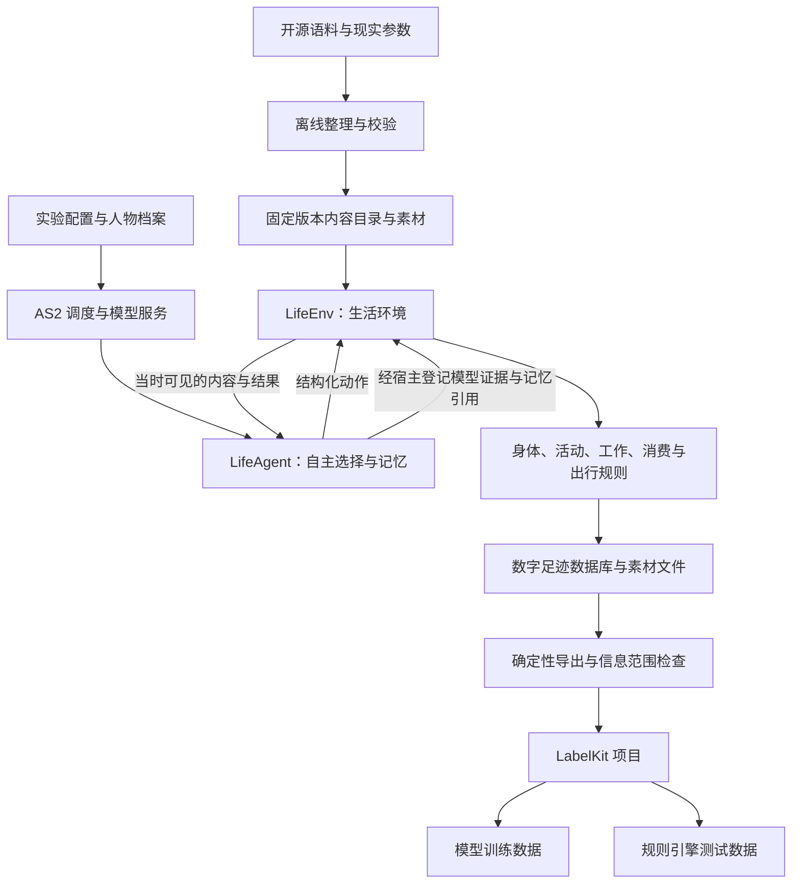

# WorldMock 架构设计

> 状态：设计冻结（FROZEN）。分层、职责边界、核心决策与数据流理由以本文件为准；实现状态见 `docs/dev/implementation-status.md`。
> 日期：2026-09-18
> 实施基线：AgentSociety 2 提交 `670c94f`（在线文档版本 2.8.7）；LabelKit 提交 `5a359ca`
> 范围：AgentSociety 2 驱动的数字人生活模拟，以及数字足迹向 LabelKit 的交付

本文件只写设计理由、职责边界与数据流。接口的签名、字段、枚举、Schema 与数据表的权威定义在 `docs/CONTRACTS.md`，本文件只引用不重复。

本项目的模拟由 AgentSociety 2（下称 AS2）承担调度与模型调用：它驱动被模拟的人按自身需求与环境交互，交互过程留下的可追溯记录就是数字足迹，随后交由 LabelKit 加工成模型训练与规则引擎测试两类下游数据。被模拟的人在本文件称**数字人**，单个运行实例称**人物**。
**数字足迹**指生活过程留下的可追溯记录：人物的观察与决策、执行的每一步、世界状态的变化、活动结果、记忆与相互关系；**dreaming** 指把已有经历归纳成结论，或在其上做假设推演。

## 设计目标与边界

### 必须达到的行为

| 用户需求 | 必须达到的行为 |
| --- | --- |
| 消费与生产 | 进食投入金钱和时间；工作投入时间和精力并获得合同报酬；睡眠投入时间并恢复状态 |
| 个体差异 | 职业、技能、工作机会和合同影响产出或报酬；睡眠状态影响明确配置的转换效率 |
| 需求驱动 | 饥饿、疲劳、娱乐需要及工作义务进入人物观察和决策，不由脚本替人物排序选择 |
| 内容丰富 | 覆盖饮食、节目、游戏、工作记录、邮件、导航和购物 |
| 日常与社交 | 人物能看见同处一地的他人、与他人和联系人通讯、在家完成晨间例程与用餐、按自己生成的当日计划安排活动；机会由世界提供，不由脚本安排 |
| 可控场景 | 可定义地点、日历、天气、交通条件和模拟速度 |
| 真实反馈依据 | 明确区分来源数据、规则算出的结果、模型生成的文本和实际外部服务返回 |
| 完整数字足迹 | 保存数字足迹定义中的全部要素，导出与分支都不丢弃其中任何一类 |
| LabelKit 接入 | 提供动作序列、意图、dreaming 的可加工输入与来源关联 |
| 最终可用性 | 训练加载器能够读取成品；规则测试程序能够读取夹具、执行并比较预期结果 |

本表只写设计必须达到的行为，不写这些行为如何判定。行为真实性的判定严格程度，以及不构成成功条件的边界，
见 `docs/VERIFICATION.md`「结论边界」。

## 核心决策

| 范围 | 设计决定 | 理由 |
| --- | --- | --- |
| 基础框架 | 采用 AgentSociety 2 | AS2 已提供模型调用、人物决策、记忆与运行管理这套机制，不必重写 Agent 框架 |
| 环境设计 | 新增 `LifeEnv` 环境模块 | 生活规则、活动进度、资源结算和世界数字足迹只有一个归属，不散成各自维护时钟与余额的多个环境服务 |
| 人物设计 | 新增 `LifeAgent` 人物类 | 人格与需求提示、生活动作工具、依据事件形成的记忆都落在人物类上，复用现有 AS2 人物循环 |
| 人物自主性 | 人物决定吃、睡、工作、娱乐、购买、出行与是否继续 | 环境只执行可行性和资源约束，选择权留在人物 |
| 世界状态 | 由环境确定性代码维护 | 人物不能直接设置余额、饥饿值、睡眠效果或工作验收结论，数据才可信 |
| 时间 | 统一模拟时间，按下一次相关事件推进 | 程序速度与人物生活时间分开 |
| 内容 | 实际接触的内容逐段提供 | 保留原始来源、版本和区间，未接触内容不可见 |
| 记录 | SQLite 保存结构化事件与结算，文件保存原始素材与模型证据 | 结构化事件用于查询、对账与导出；原始素材与模型证据按引用整份取用 |
| 交付 | 固定 JSONL 输入 LabelKit | 成品样本必须可追到原始事件 |
| 恢复 | 从完整检查点建立有父子关联的新运行分支 | 原运行的部分经历保留，反事实分支与父运行同时可追溯 |
| 实验变更 | 人格、模型、提示、规则和代码在正式运行前冻结 | 修复后使用新版本和新运行，实验边界保持干净 |

## 整体架构

分层上只有两类角色：要不要做、做什么由人物自己决定，环境这一侧只判定可行性、施加资源约束，并把过程记成数字足迹；
AS2 负责调度与模型服务，LabelKit 负责下游数据生产。

`LifeEnv` 内部按身体、活动、内容、工作、消费和出行分文件组织。它们共享同一状态与事务，
不拆成各自维护时钟和余额的多个环境服务。模型调用与 Ray 进程管理继续由 AS2 承担；
素材检索的机制不由 AS2 决定，本项目只做确定性倒排与 facet，禁止向量检索与近似最近邻，见
`docs/dev/SPEC-life-runtime.md`「检索：确定性索引与 facet」与 `docs/dev/SPEC-life-realism.md`「素材淘汰与检索机制的禁止项」。
首个完整版本采用本机或单机多进程；并行独立实验各有自己的数据库和运行标识。

## 存储职责分层

Python 侧的共享存储边界只有两个：`FootprintStore` 保存状态与事件，`AssetStore` 保存素材。两条边界各自接受的调用、参数与写入合同，权威定义分别在 `docs/design/05-recording-engine.md`「一致性保存与校验」和「保存与关联证据」主题中。

为什么坚持唯一写入者：世界状态之所以可信，靠的是一份唯一的事件顺序。并发的人物 worker 各自改写数据库，状态版本、事件序号与资金对账就失去可比对的基准，检查点之后的经历也无法逐项重建。因此校验与结算留在生活模型一侧，存储只落库已经通过校验的内容，不反过来决定活动能不能做；人物 worker 手里的句柄不指向数据库文件，也没有第二条写入口。唯一的写入进程是共享环境 actor。

## AS2 的差距与集成策略

仅新增一个 `EnvBase` 子类不能满足全部要求。还需要调整 AS2 的决策调度、结构化工具调用、时间约定和失败处理，
并把人物工作区与世界状态关联为可恢复的检查点。这些改动复用现有 AS2 执行链，不另写一套 Agent 框架。
下文关于 AS2 接口与行为的判断以状态头所记基线为准；依赖版本已在 `docs/EXPERIMENT.md`「依赖冻结」锁定，
改动落在 AS2 维护分支上，实现进度与测试基线见 `docs/dev/implementation-status.md`。

### 可直接复用的能力

AS2 的 `EnvBase`、`@tool`、`step`、`restore`、`to_workspace` 可直接承载自定义生活环境，
`PersonAgent` 的模型决策、工作区与记忆也可复用，只需按活动唤醒并限制可调用工具。
复用的代价是这套通用机制不认识本项目的业务状态：自定义状态不会因为挂了扩展点就自动获得一致的恢复能力，
恢复路径必须由本项目自己补齐。AS2 的 `EconomySpace` 按日自动加收入、减消费，与本设计的活动结算重复，
本场景不装配它，资金全部来自实际活动与合同结算，避免同一笔钱记两次。

复用边界的逐项清单见 `docs/dev/SPEC-as2-integration.md`「选型理由与分层职责」。

### 必须修改的核心行为

AS2 核心链路上有几处行为与本设计直接冲突，必须在下游分支上确定性改掉，不能靠新增模块绕过。
**调度与时序**：现有 Society 按固定步长推进，一次推进可能越过活动应当结算的时刻；`t` 的时间语义在文档与调用之间也不一致。
时序是生活结算的前提，所以要改成按下一相关事件推进，并统一约定后再修调用链。
**失败语义**：环境保存、人物执行与记忆异常当前只记录告警，决策预算耗尽还会合成一个结果——
这些出口会把一次故障变成一段看似正常的生活，必须删除自动补造结果的路径。
**协议冲突**：同批工具调用里同时出现 `finish` 时，解析器只保留结束调用，人物已经提出的生活动作被静默丢弃。
**恢复分支**：恢复失败后按新环境继续、且复用原目录，会把父运行与子运行混成不一致的一份，
必须改为指定完整检查点与新分支目录，并校验全部必要状态。

每项改动的行为规则、算法与逐项改动清单见 `docs/dev/SPEC-as2-integration.md`「AS2 核心改动清单」。

## 离线语料如何进入环境

开源语料经过离线整理，成为环境里的节目、游戏、工作材料、邮件、商品与出行依据。为什么整理必须前置到离线阶段、而不能边运行边抓取：

- 原始内容、环境参数与评估参考答案需要分账管理，混在一起就没有干净的对账基础；
- 参考答案与后续剧情属于评估资产，一旦随输入材料进入观察就等于提前泄题；
- 运行期只读冻结的数据版本，临时下载变化中的数据集等于让世界在运行中被改写；
- 抽样以完整的邮件线程、剧集、会议或任务为最小单位，逐行随机取会切断上下文。

语料的来源准入、内容目录契约与内容提供规则见 `docs/dev/SPEC-life-runtime.md`「语料进入环境与内容提供」。

## 一条完整生活经历如何形成数据

此图用于展示能力连接，不是强制人物执行的剧情。人物可以拒绝任务、延期、买更便宜的食品、继续娱乐或取消购买；
这些选择都形成数字足迹。

这段经历可以同时得到工作与购物动作序列、饮食或娱乐意图、工作报酬对后续消费的影响，
以及资金不足、重复付款、未到货先使用、超时交付、睡眠不足效率下降等规则测试。
dreaming 可以对已知经历做归纳，或提出「若未获得报酬是否还能购买」的假设。
经过环境分支执行得到的答案，与仅文本推演的答案采用不同来源标记。

## 与现有系统的关系

| 现有系统 | 关系 | 理由 |
| --- | --- | --- |
| AS2 replay | 回放 | 不能直接代替本设计的事务结算与数据谱系 |
| AS2 trace | 调用诊断 | 不能直接代替本设计的事务结算与数据谱系 |
| AS2 workspace | 工作状态 | 不能直接代替本设计的事务结算与数据谱系 |
| WorldMock 现有 `trajectory.py` | 已有原始事件、素材哈希引用和脱敏实现经验 | 当前 JSONL 追加不提供新的世界事务保证 |
| LabelKit | 文本输入、序列标注、反事实生成 | 可复用；没有直接读取本仿真数据库或专用 dreaming 的现成入口 |

## 版本表

| 版本 | 日期 | 修订内容 |
| --- | --- | --- |
| `2026-09-18` | 2026-09-18 | 冻结分层、职责边界、核心决策、数据流理由与系统边界。 |
| `2026-09-18-revision-1` | 2026-09-18 | 行文与结构改造：状态头改为 LabelKit 形态；章节标题改为概念命名；移除来源行号引用；接口定义移交 `docs/CONTRACTS.md`。 |
| `2026-09-18-revision-2` | 2026-09-18 | 消除与相邻文档的逐字重复：AS2 复用边界与改动清单改为引用 `docs/dev/SPEC-as2-integration.md` 的对应章节，结论边界改为引用 `docs/VERIFICATION.md`，语料规则改为引用 `docs/dev/SPEC-life-runtime.md`；明确数字人与人物两个术语的分工；把实现前待办句改为当前状态陈述。 |
| `2026-09-18-revision-3` | 2026-09-18 | 消除与相邻文档的逐字重复：存储调用合同的原文移交 `docs/design/05-recording-engine.md`「存储调用」，本文件只留单一写入者的理由；项目身份句、数字足迹定义与目标表中的要素枚举改为架构侧措辞，与 `docs/INDEX.md` 的项目陈述不再逐字相同；语料整理理由改用自己的句子，不再与 `docs/dev/SPEC-life-runtime.md` 的引述句同形。 |
