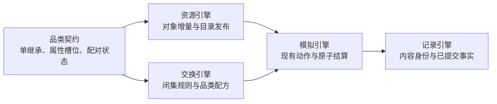
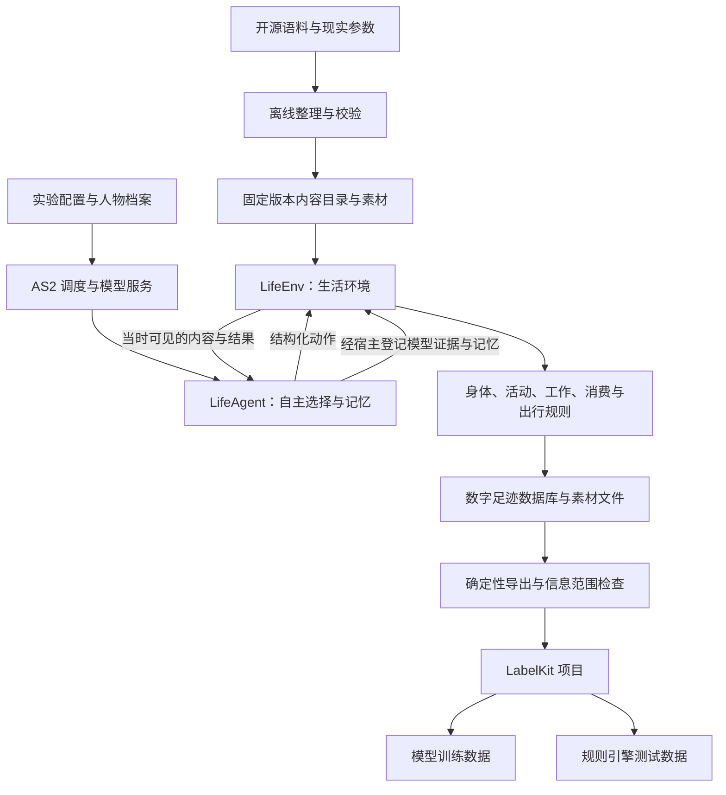
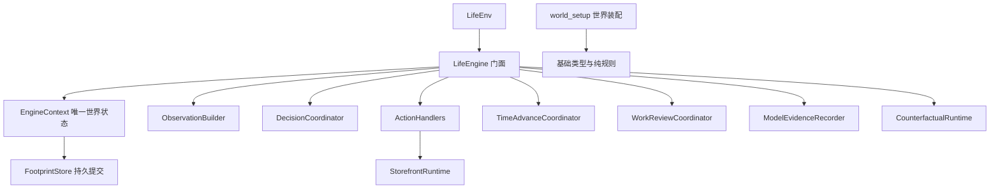

# WorldMock 架构设计

> 状态：设计冻结（FROZEN）。分层、职责边界、核心决策与数据流理由以本文件为准；实现状态见 `docs/dev/implementation-status.md#implementation-status-worldmock-实现状态`。按人物 Prompt 规格修订，修订部分已实现并通过离线验收（证据见[人物 Prompt 验收记录](archive/persona-prompt/persona-prompt-verification.md)）。「核心决策」的人物设计一行按[一日运行保真规格](dev/SPEC-life-runtime.md#dayrun-fidelity-身体与需要)补一句（一日运行保真 AR1），已随该规格的名称解析与错误合同实现。
> 工具交互修订：按[工具交互规格](dev/SPEC-life-runtime.md#tool-interaction-工具请求)冻结目标设计；本次修订已实现，历史证据只证明原行为。
> 个人事务与工作安排修订：按[个人事务与工作安排规格](VERIFICATION.md#verification-incremental-evidence)「冻结条款修订」第 2、5、14、15、17 行修订（个人事务与工作安排 AR2–AR11）：「活动与经历的唯一归属」补个人事务与主观自述的分工；「必须达到的行为」补事务跨日保留与上班安排进入观察；「核心决策」补只读查询的执行位置与筛选、阶段 2 与阶段 3 的发布身份、世界状态行与人物自主性行；「可直接复用的能力」补只读查询转发的扩展。修订部分已实现并通过离线验收（证据见[个人事务与工作安排验收记录](archive/errands-workday/errands-workday-verification.md)）。
> 日期：2026-10-05
> 实施基线：AgentSociety 2 提交 `670c94f`（在线文档版本 2.8.7）；LabelKit 提交 `5a359ca`
> 范围：AgentSociety 2 驱动的数字人生活模拟，以及数字足迹向 LabelKit 的交付

本文件只写设计理由、职责边界与数据流。接口的签名、字段、枚举、Schema 与数据表的权威定义在 `docs/CONTRACTS.md#contracts-worldmock-接口合同`，本文件只引用不重复。

本项目的模拟由 AgentSociety 2（下称 AS2）承担调度与模型调用：它驱动被模拟的人按自身需求与环境交互，交互过程留下的可追溯记录就是数字足迹，随后交由 LabelKit 加工成模型训练与规则引擎测试两类下游数据。被模拟的人在本文件称**数字人**，单个运行实例称**人物**。
**数字足迹**指生活过程留下的可追溯记录：人物的观察与决策、执行的每一步、世界状态的变化、活动结果、记忆与相互关系；**dreaming** 指把已有经历归纳成结论，或在其上做假设推演。

## 共享规则与可重建环境修订

按[共享规则与可重建环境规格](dev/SPEC-shared-rules-and-rebuildable-env.md)修订；验收结果独立记录。

共享规则分别由已有模块和基础模型叶子模块维护，业务消费者不复制规则。AS2 采用固定上游源码与有序补丁，WorldMock 维护人物记忆业务扩展；不复制调度器，不引入运行兼容层。

## 品类契约的独立归属

资源引擎维护对象身份和属性增量，交换引擎维护共享规则，两者共同消费版本化的品类契约。
品类只承担分类、属性约束和配对状态；结算采用闭集算子，经既有模拟引擎与资源账本落实。
对象的归属修改不改规则，品类细化则携带影响报告与审核记录发布新版本。
规则和目录以内容摘要绑定运行，版本相同而字节不同不能用于恢复既有运行。

本层不取代内容可供性声明，也不把所有活动题材改造成商品品类。
行为规范见 `docs/dev/SPEC-category-contract.md#spec-category-contract-品类契约与交换规则开发规格`；字段归 `docs/CONTRACTS.md#contracts-worldmock-接口合同`，实际证据归
`docs/dev/category-contract-verification.md`。

## 活动与经历的唯一归属

同一人物的持续活动由世界活动表表达，每人两个活动名额；能否同时进行按注册表声明的占用与目标、地点、
出行方式判定，能量不参与。模拟引擎推进每项进度，对每人的共同时间只结算一次身体变化，
再由记录引擎保存已提交证据并投影实际经历。
人物借助 AS2 原有记忆运行时保存感受、意图和反思，始终标为主观自述；人物看到的长期记忆是记忆层，
由已提交事件与世界状态确定性派生，环境结算的事实与人物自述分开写；关系与偏好的当前看法只在人设层。
要买到、拿到或吃掉某件具体东西的打算由人物记成个人事务：它随人物状态保存、跨日保留并显示在待办层，
办没办成只由环境按结算证据确认，人物只能更新备注与提醒时刻，或取消并写原因；
事务的文字是人物记下的打算，不是世界事实。其余延续打算仍是主观自述，写在暂停与收尾的 summary 与记忆里。
自由文本不能反向修改世界事实。
完整行为及验收见[一日行为规格](dev/SPEC-dayrun-behavior.md#spec-dayrun-behavior-一日行为可信性特性开发规格)与[人物 Prompt 七层规格](dev/SPEC-life-realism.md#persona-prompt-七层请求)与[个人事务与工作安排规格](dev/SPEC-as2-integration.md#errands-workday-运行修复入库)，格式归记录引擎设计。

## 设计目标与边界

### 必须达到的行为

| 用户需求 | 必须达到的行为 |
| --- | --- |
| 消费与生产 | 进食投入金钱和时间；工作投入时间和精力并获得合同报酬；睡眠投入时间并恢复状态 |
| 个体差异 | 职业、技能、工作机会和合同影响产出或报酬；睡眠状态影响明确配置的转换效率 |
| 需求驱动 | 饥饿、疲劳、娱乐需要及工作义务进入人物观察和决策，不由脚本替人物排序选择；场景给人物声明了工作安排时，今天的上班安排由环境层每轮写明 |
| 内容丰富 | 覆盖饮食、节目、游戏、工作记录、邮件、导航和购物 |
| 日常与社交 | 人物能看见同处一地的他人、与他人和联系人通讯、在家完成晨间例程与用餐、按零点计划为其生成、可自行修订的当日计划安排活动，登记的个人事务跨日保留到环境确认办成或本人取消；机会由世界提供，不由脚本安排 |
| 可控场景 | 可定义地点、日历、天气、交通条件和模拟速度 |
| 真实反馈依据 | 明确区分来源数据、规则算出的结果、模型生成的文本和实际外部服务返回 |
| 完整数字足迹 | 保存数字足迹定义中的全部要素，导出与分支都不丢弃其中任何一类 |
| LabelKit 接入 | 提供动作序列、意图、dreaming 的可加工输入与来源关联 |
| 最终可用性 | 训练加载器能够读取成品；规则测试程序能够读取夹具、执行并比较预期结果 |

本表只写设计必须达到的行为，不写这些行为如何判定。行为真实性的判定严格程度，以及不构成成功条件的边界，
见 `docs/VERIFICATION.md#verification-worldmock-验收标准`「结论边界」。

## 核心决策

工具交互沿用已有 AS2 调度、Pydantic 校验、JSON Schema 与名称解析，不加新包。
人物用目标和方式选择行动，`start_activity.items[]` 每项含 `target`、`way`、`from`、`to`，删除旧平行数组和 `actions`；内部标准动作由目标与方式唯一解析。
世界查询与任务回看属于只读，不能成为世界动作或推进时间；查询所在模型回复仍计十六回合预算。
任务回看经环境 actor 的只读入口取回真实结果，世界查询由宿主在本次冻结观察上求值，环境侧同名分支是同一组纯函数的第二入口：
受理时两入口结果逐值相等，拒绝时给出同一份校验报告；两者都不写事件、不改世界版本与时钟、不计同刻轮数。
世界查询可按购买来源（`from`）筛选，并可只看此刻能做的（`available_only`）：来源解析与购买共用同一纯函数，
来源的合法写法是地点显示名（含住处）与渠道称呼；筛选在排序与切页之前施加；
除来源无法解析、渠道称呼误写进名称两种参数错误外，无匹配即合法空页，不放宽、不换来源；结果只省略空值，不再逐项附完整请求候选。
宿主与环境共用纯校验与错误构造，每次报错以英文原因返回精确位置数组和合法枚举，候选是完整新请求。
任务输入仅用必填 `appointment=null` 表示普通工作，或 `{starts_at, reason}` 表示真实预约；普通开放由最早本人关联通知编译，
内部 `RuntimeWorkTask.available_at` 统一供调度与受理，输入不重复声明。每封关联邮件必须引用存在任务且收件人为该任务受派人物，
每项合同至少一封关联通知，素材必须先于通知有效；预约最早通知不晚于约定开始，后续提醒不改变开放时刻。
地点供给复用 kind 准入池及逐店类别、对象、价格位置和来源声明；每店取自身选定类别后代全集与显式对象的并集，
不复制 kind 根池或随机抽样。门店位置与确定性小幅偏移在范围内构建一次报价，模拟引擎只消费冻结供给。
操作备忘从已提交事件派生，紧凑工具层只负责无损呈现，不建立第二份世界状态。
版本在触及相应输入形状的阶段发布：任务阶段场景升 4，供给与价格阶段地图升 3、品类与规则绑定升 3并发布新目录，世界结构保持 8；
不要求所有身份同次升级，后续目录内容变化仍按版本规则另发不可变版本，实际身份写进该阶段收据。
个人事务与工作安排规格沿用同一做法：阶段 2 把世界结构升为 9、质量报告结构升为 4，各只升一次，版本 8 的检查点与导出按版本拒绝。
阶段 3 把场景结构升为 5、卡片结构升为 3（抽取提示 `card-v3`）：旧场景按版本拒绝，缺下班与到家两个必填键的旧结构化卡片被拒，
仓库三份场景的 `scenario_sha256` 随结构升版改变；地图、目录、品类与规则绑定、导出清单、运行清单与行为评估结构标识不变。
已有场景的随机种子不改，地图按各自种子独立发布，恢复按原有代码、输入与提示身份严格核对。
错误接口、任务、供给价格、料理、查询、操作备忘与紧凑呈现依次完成独立端到端闭环；每阶段可单独复验，
通过生产入口行为测试与独立变异后再扩展，禁止双格式兼容，阶段门禁见[验证门禁](VERIFICATION.md#verification-工具交互特性门禁)。
本次行为与变异验收以[验证规则](VERIFICATION.md#verification-工具交互特性门禁)为准，文档冻结不证明实现完成。

| 范围 | 设计决定 | 理由 |
| --- | --- | --- |
| 基础框架 | 采用 AgentSociety 2 | AS2 已提供模型调用、人物决策、记忆与运行管理这套机制，不必重写 Agent 框架 |
| 环境设计 | 新增 `LifeEnv` 环境模块 | 生活规则、活动进度、资源结算和世界数字足迹只有一个归属，不散成各自维护时钟与余额的多个环境服务 |
| 人物设计 | 新增 `LifeAgent` 人物类 | 提示按七层 JSON 组织、同一秒的连续决策续接原生消息，生活动作工具与依据事件形成的记忆都落在人物类上，复用现有 AS2 人物循环；宿主与环境共用同一套名称解析与错误结构，人物写的名称在两边得到相同的受理结果与可照填的候选（[一日运行保真规格](dev/SPEC-life-runtime.md#dayrun-fidelity-身体与需要)第三、四章） |
| 人物自主性 | 人物决定吃、睡、工作、娱乐、购买、出行与是否继续 | 环境只执行可行性和资源约束，选择权留在人物；能量不构成可行性约束；动作照常列出，选错由业务拒绝说明；场景声明的工作安排只作为环境核验的事实呈现，今日计划改不了它，但它不构成拒绝理由，班内离岗照常受理、由指标度量 |
| 世界状态 | 由环境确定性代码维护 | 人物不能直接设置余额、饥饿值、睡眠效果、工作验收结论或个人事务的完成状态，数据才可信 |
| 时间 | 统一模拟时间，按下一次相关事件推进；决策不消耗模拟时间，没有进行中活动者同一秒再决策 | 程序速度与人物生活时间分开；时间线不留空 |
| 内容 | 实际接触的内容逐段提供 | 保留原始来源、版本和区间，未接触内容不可见 |
| 记录 | SQLite 保存结构化事件与结算，文件保存原始素材与模型证据 | 结构化事件用于查询、对账与导出；原始素材与模型证据按引用整份取用 |
| 交付 | 固定 JSONL 输入 LabelKit | 成品样本必须可追到原始事件 |
| 恢复 | 从完整检查点建立有父子关联的新运行分支 | 原运行的部分经历保留，反事实分支与父运行同时可追溯 |
| 实验变更 | 人格、模型、提示、规则和代码在正式运行前冻结 | 修复后使用新版本和新运行，实验边界保持干净 |

## 整体架构

分层上只有两类角色：要不要做、做什么由人物自己决定，环境这一侧只判定可行性、施加资源约束，并把过程记成数字足迹；
AS2 负责调度与模型服务，LabelKit 负责下游数据生产。

`LifeEnv` 内部按身体、活动、内容、工作、消费和出行分文件组织。它们共享同一状态与事务，
不拆成各自维护时钟和余额的多个环境服务。模型调用与 Ray 进程管理继续由 AS2 承担；
素材检索的机制不由 AS2 决定，本项目只做确定性倒排与 facet，禁止向量检索与近似最近邻，见
`docs/dev/SPEC-life-runtime.md#spec-life-runtime-特性规格lifeenv-运行时行为与结算规则`「检索：确定性索引与 facet」与 `docs/dev/SPEC-life-realism.md#spec-life-realism-特性规格人物决策与画像`「素材淘汰与检索机制的禁止项」。
首个完整版本采用本机或单机多进程；并行独立实验各有自己的数据库和运行标识。

## 存储职责分层

Python 侧的共享存储边界只有两个：`FootprintStore` 保存状态与事件，`AssetStore` 保存素材。两条边界各自接受的调用、参数与写入合同，权威定义分别在 `docs/design/05-recording-engine.md#recording-engine-worldmock-产品设计说明书-记录引擎`「一致性保存与校验」和「保存与关联证据」主题中。

为什么坚持唯一写入者：世界状态之所以可信，靠的是一份唯一的事件顺序。并发的人物 worker 各自改写数据库，状态版本、事件序号与资金对账就失去可比对的基准，检查点之后的经历也无法逐项重建。因此校验与结算留在生活模型一侧，存储只落库已经通过校验的内容，不反过来决定活动能不能做；人物 worker 手里的句柄不指向数据库文件，也没有第二条写入口。唯一的写入进程是共享环境 actor。

## AS2 的差距与集成策略

仅新增一个 `EnvBase` 子类不能满足全部要求。还需要调整 AS2 的决策调度、结构化工具调用、时间约定和失败处理，
并把人物工作区与世界状态关联为可恢复的检查点。这些改动复用现有 AS2 执行链，不另写一套 Agent 框架。
下文关于 AS2 接口与行为的判断以状态头所记基线为准；依赖版本已在 `docs/EXPERIMENT.md#experiment-worldmock-实验设置`「依赖冻结」锁定，
改动落在 AS2 维护分支上，实现进度与测试基线见 `docs/dev/implementation-status.md#implementation-status-worldmock-实现状态`。

### 可直接复用的能力

AS2 的 `EnvBase`、`@tool`、`step`、`restore`、`to_workspace` 可直接承载自定义生活环境，
`PersonAgent` 的模型决策、工作区与记忆也可复用，只需按活动唤醒并限制可调用工具。
复用的代价是这套通用机制不认识本项目的业务状态：自定义状态不会因为挂了扩展点就自动获得一致的恢复能力，
恢复路径必须由本项目自己补齐。AS2 的 `EconomySpace` 按日自动加收入、减消费，与本设计的活动结算重复，
本场景不装配它，资金全部来自实际活动与合同结算，避免同一笔钱记两次。
只读查询的跨进程转发由 WorldMock 侧的 `LifeEnvActor`、`LifeEnvProxy` 两个子类承担，各只新增 `read_query` 一个方法；
它依赖锁定提交上 `DirectEnvActor._router`、`DirectRouter._environment()`、`EnvRouterProxy._actor` 三个私有成员，
升级 fork 时逐项复核，不 monkey patch、不改 AS2、不做多版本兼容。

复用边界的逐项清单见 `docs/dev/SPEC-as2-integration.md#spec-as2-integration-特性规格agentsociety-2-集成与改动`「选型理由与分层职责」。

### 必须修改的核心行为

AS2 核心链路上有几处行为与本设计直接冲突，必须在下游分支上确定性改掉，不能靠新增模块绕过。
**调度与时序**：现有 Society 按固定步长推进，一次推进可能越过活动应当结算的时刻；`t` 的时间语义在文档与调用之间也不一致。
时序是生活结算的前提，所以要改成按下一相关事件推进，并统一约定后再修调用链；
有人就绪时同一时刻可连续多轮，无人就绪才推进。
**失败语义**：环境保存、人物执行与记忆异常当前只记录告警，决策预算耗尽还会合成一个结果——
这些出口会把一次故障变成一段看似正常的生活，必须删除自动补造结果的路径。
**协议冲突**：同批工具调用里同时出现 `finish` 时，解析器只保留结束调用，人物已经提出的生活动作被静默丢弃。
生活决策已取消 `finish`，本条只约束只读问答。
**恢复分支**：恢复失败后按新环境继续、且复用原目录，会把父运行与子运行混成不一致的一份，
必须改为指定完整检查点与新分支目录，并校验全部必要状态。

每项改动的行为规则、算法与逐项改动清单见 `docs/dev/SPEC-as2-integration.md#spec-as2-integration-特性规格agentsociety-2-集成与改动`「AS2 核心改动清单」。

## 离线语料如何进入环境

开源语料经过离线整理，成为环境里的节目、游戏、工作材料、邮件、商品与出行依据。为什么整理必须前置到离线阶段、而不能边运行边抓取：

- 原始内容、环境参数与评估参考答案需要分账管理，混在一起就没有干净的对账基础；
- 参考答案与后续剧情属于评估资产，一旦随输入材料进入观察就等于提前泄题；
- 运行期只读冻结的数据版本，临时下载变化中的数据集等于让世界在运行中被改写；
- 抽样以完整的邮件线程、剧集、会议或任务为最小单位，逐行随机取会切断上下文。

语料的来源准入、内容目录契约与内容提供规则见 `docs/dev/SPEC-life-runtime.md#spec-life-runtime-特性规格lifeenv-运行时行为与结算规则`「语料进入环境与内容提供」。

## 一条完整生活经历如何形成数据

此图用于展示能力连接，不是强制人物执行的剧情。人物可以拒绝任务、延期、买更便宜的食品、继续娱乐或取消购买；
这些选择都形成数字足迹。

这段经历可以同时得到工作与购物动作序列、饮食或娱乐意图、工作报酬对后续消费的影响，
以及资金不足、重复付款、未到货先使用、超时交付、睡眠不足效率下降等规则测试。
dreaming 可以对已知经历做归纳，或提出「若未获得报酬是否还能购买」的假设。
经过环境分支执行得到的答案，与仅文本推演的答案采用不同来源标记。

## 与现有系统的关系

| 现有系统 | 关系 | 理由 |
| --- | --- | --- |
| AS2 replay | 回放 | 不能直接代替本设计的事务结算与数据谱系 |
| AS2 trace | 调用诊断 | 不能直接代替本设计的事务结算与数据谱系 |
| AS2 workspace | 工作状态 | 不能直接代替本设计的事务结算与数据谱系 |
| WorldMock 现有 `trajectory.py` | 已有原始事件、素材哈希引用和脱敏实现经验 | 当前 JSONL 追加不提供新的世界事务保证 |
| LabelKit | 文本输入、序列标注、反事实生成 | 可复用；没有直接读取本仿真数据库或专用 dreaming 的现成入口 |

## 当前生产职责与依赖方向

门面保留 LifeEnv 使用的公开方法签名，职责对象持有同一个上下文和必要的具名协作者。上下文不保存第二份场景或状态，不保存门面、服务字典或回调注册表。生产导入图覆盖模块级、函数内和显式动态导入，只有静态类型分支不参与运行期图；最终图无环。

运行配置、阶段与运行身份、人物输入准备归 `src/worldmock/run_setup.py`；画像覆盖目标纯构造归 `src/worldmock/profile/coverage_targets.py`，输入准备与校验共用，不借用上层运行入口。FootprintStore 只存取，分支恢复由 checkpoint 编排。运行期导入全部按真实模块解析，函数内延迟仅保留有明确原因且与实际导入对应的登记。

## 版本表

| 版本 | 日期 | 修订内容 |
| --- | --- | --- |
| `2026-09-18` | 2026-09-18 | 冻结分层、职责边界、核心决策、数据流理由与系统边界。 |
| `2026-09-18-revision-1` | 2026-09-18 | 行文与结构改造：状态头改为 LabelKit 形态；章节标题改为概念命名；移除来源行号引用；接口定义移交 `docs/CONTRACTS.md#contracts-worldmock-接口合同`。 |
| `2026-09-18-revision-2` | 2026-09-18 | 消除与相邻文档的逐字重复：AS2 复用边界与改动清单改为引用 `docs/dev/SPEC-as2-integration.md#spec-as2-integration-特性规格agentsociety-2-集成与改动` 的对应章节，结论边界改为引用 `docs/VERIFICATION.md#verification-worldmock-验收标准`，语料规则改为引用 `docs/dev/SPEC-life-runtime.md#spec-life-runtime-特性规格lifeenv-运行时行为与结算规则`；明确数字人与人物两个术语的分工；把实现前待办句改为当前状态陈述。 |
| `2026-09-18-revision-3` | 2026-09-18 | 消除与相邻文档的逐字重复：存储调用合同的原文移交 `docs/design/05-recording-engine.md#recording-engine-worldmock-产品设计说明书-记录引擎`「存储调用」，本文件只留单一写入者的理由；项目身份句、数字足迹定义与目标表中的要素枚举改为架构侧措辞，与 `docs/INDEX.md#index-worldmock-文档入口` 的项目陈述不再逐字相同；语料整理理由改用自己的句子，不再与 `docs/dev/SPEC-life-runtime.md#spec-life-runtime-特性规格lifeenv-运行时行为与结算规则` 的引述句同形。 |
| `2026-09-20-category-contract` | 2026-09-20 | 补登 `c582330`：新增「品类契约的独立归属」节，品类契约由资源引擎与交换引擎共同消费，结算采用闭集算子，规则与目录以内容摘要绑定运行。 |
| `2026-09-21-dayrun-behavior` | 2026-09-21 | 补登 `d998a31`：新增「活动与经历的唯一归属」节；文件头日期改为 2026-09-21。 |
| `2026-09-24-time-and-energy` | 2026-09-24 | 按[时间与能量规格](dev/SPEC-life-runtime.md#time-and-energy-决策不耗时时间只在做事时流动)「冻结条款修订」第 29 行修订：「活动与经历的唯一归属」改为每人两个活动名额，能否同时进行按注册表声明的占用与目标、地点、出行方式判定，能量不参与；「必须达到的行为」的当日计划改为由零点计划生成、人物可修订；「核心决策」的时间行补决策不消耗模拟时间、没有进行中活动者同一秒再决策，人物自主性行补能量不构成可行性约束、动作照常列出；「整体架构」的「记忆引用」改为「记忆」；「必须修改的核心行为」补同一时刻可连续多轮、无人就绪才推进，生活决策已取消 `finish`。 |
| `2026-09-27-persona-prompt` | 2026-09-27 | 按[人物 Prompt 七层规格](dev/SPEC-life-realism.md#persona-prompt-七层请求)「冻结条款修订」第 30 行修订，修订部分待实现：「活动与经历的唯一归属」的长期记忆视图改为记忆层（由已提交事件与世界状态派生，结算事实与人物自述分开），关系与偏好的当前看法在人设层，行为引用补该规格；「核心决策」人物设计行改为提示按七层 JSON 组织并同秒续接，AS2 人物循环照旧复用；「AS2 的差距与集成策略」经核对不改（续接由宿主在准备阶段之后注入，锁定的 AS2 不改）；文件头状态句补修订说明，日期改写。 |
| `2026-09-28-persona-prompt-implemented` | 2026-09-28 | 人物 Prompt 七层规格实现后文档（人物 Prompt 台账阶段 8，按最终代码 `f798ea7` 核对）：状态头「修订部分待实现」改为已实现并通过离线验收，链接人物 Prompt 验收记录；正文不变 |
| `2026-09-29-dayrun-fidelity` | 2026-09-29 | 按[一日运行保真规格](dev/SPEC-life-runtime.md#dayrun-fidelity-身体与需要)「文档同步作业」AR1 修订（随该规格冻结）：「核心决策」的人物设计一行补一句：宿主与环境共用同一套名称解析与错误结构，人物写的名称在两边得到相同的受理结果与可照填的候选；文件头补修订说明，日期改写 |
| `2026-09-29-dayrun-fidelity-implemented` | 2026-09-29 | 一日运行保真规格实现后（按 `34a41ee` 的代码核对）：宿主与环境共用的名称解析（`src/worldmock/life/name_resolution.py`）与错误结构（`src/worldmock/life/error_contract.py`）已落地，文件头「定稿不等于已实现」改为已随实现落地；正文不变 |
| `2026-10-01-tool-interaction` | 2026-10-01 | 工具交互设计冻结并已实现：复用现有校验与解析依赖，`items[]`及共享错误构造，只读查询与世界动作分工，普通任务完整通知与即时开放，类别完整供给和一次构建定价，派生操作备忘与紧凑呈现，新发布身份及行为与变异验收 |
| `2026-10-02-errands-workday` | 2026-10-02 | 按[个人事务与工作安排规格](VERIFICATION.md#verification-incremental-evidence)「冻结条款修订」第 2、5、14、15、17 行修订（个人事务与工作安排 AR2–AR11，随该规格冻结），修订部分在冻结时未随文实现（该规格阶段 1–4 实现后的核对见 `2026-10-04-errands-workday-implemented` 行）：「活动与经历的唯一归属」补个人事务的登记、保存与完成确认，行为引用补该规格；「必须达到的行为」日常与社交行补事务跨日保留，需求驱动行补上班安排由环境层写明；「核心决策」工具交互段补只读查询的执行位置、来源与可执行筛选、阶段 2 与阶段 3 的发布身份，世界状态行补个人事务的完成状态，人物自主性行补工作安排不构成拒绝理由；「可直接复用的能力」补 `LifeEnvActor`、`LifeEnvProxy` 的只读查询转发与三个私有成员依赖；「整体架构」与「必须修改的核心行为」经核对不改；`2026-10-01-tool-interaction` 一行移到按日期的位置；文件头补修订说明，日期改写 |
| `2026-10-04-errands-workday-implemented` | 2026-10-04 | 个人事务与工作安排规格实现后（个人事务与工作安排 AR14、AR15，按 `d8a41d3` 的代码核对）：`src/worldmock/life/read_query_runtime.py` 的只读查询转发（`LifeEnvActor`、`LifeEnvProxy` 各只新增 `read_query`）、个人事务的状态与结算模块（`src/worldmock/life/errand_state.py`、`src/worldmock/life/errands.py`）、工作安排求值模块（`src/worldmock/life/work_schedule.py`）已落地，世界结构为 9、质量报告结构为 4、场景结构为 5、卡片结构为 3（抽取提示 `card-v3`）；文件头的冻结期未实现注记改为修订部分已实现并通过离线验收，链接[个人事务与工作安排验收记录](archive/errands-workday/errands-workday-verification.md)；`2026-10-02-errands-workday` 行里的冻结期状态注记改为指向本行；正文不变。证据为离线测试，配对全天复跑（该规格阶段 6）未执行，项目整体的三项真实验收仍未完成 |

| `2026-10-05-layering-and-test-tiers` | 2026-10-05 | 实际具名职责对象、唯一上下文、单向依赖与当前文档归属 |
| 共享规则与可重建环境 | 2026-10-05 | 同步唯一规则归宿、固定源码补丁和平台验收合同 |
