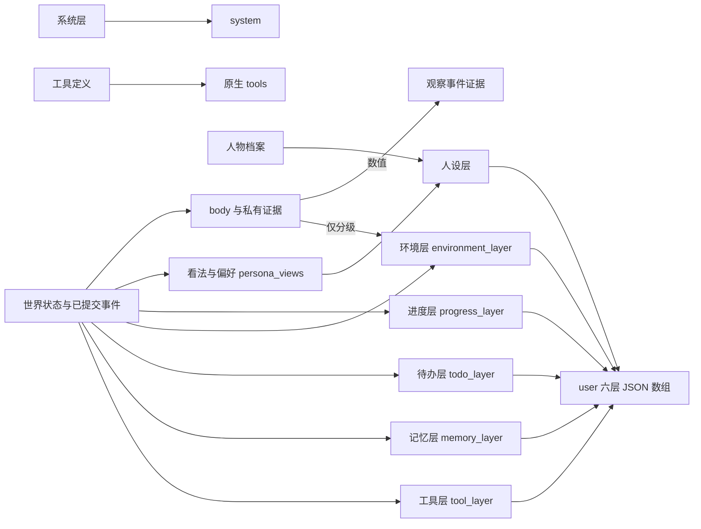

# WorldMock 接口合同

> 状态：FROZEN；2026-09-27 按[人物 Prompt 规格](dev/SPEC-persona-prompt.md#冻结条款修订)修订，修订部分已实现并通过离线验收（证据见[人物 Prompt 验收记录](dev/persona-prompt-verification.md)）；修订内容见「版本表」`2026-09-27-persona-prompt-freeze`、`2026-09-27-persona-prompt` 与 `2026-09-28-persona-prompt-implemented` 三行。
> 范围：LifeEnv 与 LifeAgent 适配接口、数字足迹事件与存储、语料内容目录、LabelKit 输入输出与交付格式、命令行与运行状态。
> 权威：记录引擎的事件、素材、存储与导出合同统一在[记录引擎设计](design/05-recording-engine.md)定义；其余接口签名、字段名、枚举值、Schema、文件格式与命令行参数在本文件定义。其他文档只引用所属合同，代码变更先更新对应合同。

## LifeEnv 状态字段

### 状态归属

| 状态 | 内容 | 修改权限 |
| --- | --- | --- |
| 世界 | `simulation_time`, `locations`, `weather`, `corpus_version`, `calendar`, `scheduled_events` | 环境规则 |
| 人物身体 | `available_energy_kcal`, `sleep_deficit_hours`, `entertainment_need`, `recent_activities`, `physiological_state` | 时间推进、进食、睡眠和活动结算 |
| 人物资产 | `account_balance`, `inventory`, `consumables_count`, `access_rights` | 交易、交付、使用与合同结算 |
| 人物活动 | `activity_type`, `start_time`, `progress`, `next_decision_time`, `occupied_resources`（占用名为 `idle`、`travel`、`eyes`、`ears`、`hands`、`voice`、`work`，按[时间与能量规格](dev/SPEC-time-and-energy.md)第五章「并行准入」由注册表声明）, `pause_reason`, `end_reason`, `same_moment_rounds`（本秒已进行的决策轮数）, `same_moment_stage`（受限轮阶段：`open`、`conclude_pending`、`start_or_resume`、`resume_or_conclude`、`conclude_only`；`conclude_only` 留在闭集中，但开始或恢复被拒后留在原阶段，现行阶梯不再进入它）；活动名额为常量 2（进行中、暂停中与待收尾的活动各占一个，`conclude_activity` 之后释放） | 人物申请，环境验证并执行；同刻计数与受限轮阶段由环境随决策轮与时钟推进维护 |
| 地点会话 | `sessions`：一段地点停留或两地之间的一段路（`kind` 取 `stay`、`transit`，`status` 取 `active`、`ended`），名称为地点或路段加开始时刻，例如「在家（1月5日 00:00 起）」「去张江办公室的路上（1月5日 14:17 起）」 | 环境随出发与到达开始和结束；人物不手动开始或结束会话 |
| 工作 | `task`, `materials`, `deadline`, `deliverable`, `review_result`, `contract`, `payment_status` | 任务来源、人物交付与独立验收规则 |
| 内容接触 | `visible_catalog`, `read_emails`, `played_segments`, `game_state`, `material_ranges` | 实际接触行为与内容提供过程 |
| 记忆 | AS2 人物记忆及其版本、`source_event`, `retrieval_results` | 人物记忆流程 |

人物身体与资产的准确数值属于世界事实，只进入足迹与评估。人物实际收到的是七层 JSON 请求（见「七层字段」），身体只以环境层 `body` 中由确定性规则算出的五项体感分级进入；训练数据导出再按目标系统的信息范围裁剪，不默认线上设备能读到环境隐藏状态。

### 资源与需求字段

| 量 | 类型 | 单位 | 说明 |
| --- | --- | --- | --- |
| `time` | UTC 整数秒 | seconds | 场景时区，同秒事件有严格序号 |
| `money` | 整数 | 最小货币单位 (分) | 避免浮点累计误差 |
| `available_energy` | 浮点 | kcal | 实验中的可用能量状态；非负；结算以 0 截断，不阻止任何活动 |
| `sleep_deficit` | 浮点 | hours | 与食品能量独立 |
| `entertainment_need` | 浮点 | 归一化 [0,1] | 随生活积累 |
| `work_need` | 复合对象 | - | `deadline`, `contract`, `task`, `economic_goal` |

### 生命周期

| 接口 | 签名 | 行为 |
| --- | --- | --- |
| `__init__` | `(scenario_path: str \| None = None)` | 仅保存配置路径和建立资源句柄，尚不创建世界 |
| `init` | `(start_datetime: datetime)` | 核验内容目录、规则、初始世界与时间；初始化数据库和事件计划 |
| `step` | `(tick: int, t: int)` | `tick` 为推进秒数，`t` 统一为结束时间；满足 `t = 上次已确认时刻 + tick` |
| `to_workspace` | `(workspace_path: str \| None = None)` | 遵循 AS2 签名；无参时使用已绑定工作区，持久化必要状态与检查点引用；错误必须传播 |
| `restore` | `(workspace_path: str)` | 读取明确指定的有效检查点，核对代码、规则、数据、时间和人物状态版本 |
| `close` | `()` | 关闭数据库等资源，保留运行终态与未完成活动 |

AS2 的环境扫描要求自定义环境类直接定义在 `custom/envs/*.py`；`LifeEnv` 在该文件定义，业务逻辑导入普通模块。正式实例通过现有 AS2 环境参数传入场景路径；`init` 缺少场景时明确失败，不生成默认世界继续运行。无参检查只用于注册与工具 Schema 发现，运行测试必须传入真实场景参数。

### 人物工具与管理接口

所有模型生活工具经 `submit_action(call)` 统一登记，宿主附加 `agent_id`、`decision_id`、`action_id`、
观察版本与本轮顺序；这些上下文由 runner 与路由绑定，不出现在模型可填写的参数中。
工具 Schema 由对应请求模型直接生成，全部字段必填，数组数量边界由本地校验器执行，不能静默截取。
工具定义只经原生 `tools` 发送，整次运行不变：参数不带逐轮名称枚举，description 只写用途，世界交互规则只在系统层写一次
（见「请求组成」）；名称的合法性由宿主本地校验与环境受理判定。
模型只看人类可理解且能唯一定位的对象名称、五个动词与方式；本轮私有 `interaction_bindings` 将（对象，动词，方式）
绑定到内部身份、标准动作、出行方式、履约方式与冻结报价，绝不进入模型提示。`obtain` 的目标可以是本轮未展示的商品名，
按指名购买解析（见「请求字段与结算检查」）；其余动词的目标必须是本轮工具层列出的名称，不是时由宿主按协议错误在本轮纠正。
LifeEnv 不为每个模型工具另建同名 RPC 方法。

| 工具 | 参数 | 返回 |
| --- | --- | --- |
| `observe` | `context` (宿主只读 RPC) | 当前可见状态、已到达通知和已完成的内容接触结果 |
| `start_activity` | `targets: list[str]`、`actions: list[str]`、`ways: list[str]`、`from: list[str \| null]`、`to: list[str \| null]`（五个数组等长一至二项，逐项对应；`actions[i]` 取 `travel`、`interact`、`obtain`、`consume`、`sleep`，`ways[i]` 取 `targets[i]` 本轮列出的方式短语，`from[i]`、`to[i]` 按动词取值，见「请求模型的闭集与字面边界」）与请求级 `answering: str \| null`；`from[i]`、`to[i]`、`answering` 在严格模式下必填可空 | 一次登记逐项启动活动；系统按冻结绑定把（对象，动词，方式）映射为内部标准动作与结算参数，整组按第五章准入原子受理；给予是瞬时动作，不产生活动 |
| `recall_task_summary` | `task_name`（可读任务名、待办层写出的目标文字或活动名，活动也可写记忆层 `self_notes` 所写的活动名；名称只取七层中出现的，会话名不在其中） | 只读回看本人进度，不修改世界；结果写进进度层该调用的 `result.details.recall`，同一秒接着决策时随续接的 tool 消息返回；回看的 summary 仍在记忆层时结果只写「已在记忆层」与活动名，不重复正文 |
| `report_status` | `task: list[str]`, `summary: list[str]`（等长一至两项，逐项点名活动） | 逐项播报进行中活动的进展；点名暂停的活动即恢复它（只在其开始地点）；关联当日目标同步记录各自自述（`PlanGoal.progress_note` 照存，不进提示） |
| `pause_activity` | `task: list[str]`, `summary: list[str]`（等长一至两项，逐项点名进行中活动） | 逐项写自述并暂停所选进行中活动；暂停仍占名额，路上的活动不能暂停；关联当日目标同步记录各自自述（`PlanGoal.progress_note` 照存，不进提示） |
| `conclude_activity` | `task: list[str]`, `summary: list[str]`, `memories: list[list[Memory]]`（三数组等长一至两项；`memories[i]` 是关于 `task[i]` 的零至多条记忆 `{type, text, importance, keywords, subject}`，合计不超过八条） | 逐项写总结与记忆并结束所选活动：进行中、暂停中或刚结束待收尾的活动；结束后释放名额，未选中活动保持原状 |
| `revise_day_plan` | `goals: List[{intent_kind, goal, remind_time}]`（替换全部未推进目标；`remind_time` 必填可为 null） | `status: "submitted"` |
| `submit_work` | `task_name`, `deliverable` | 有可见的未付款任务时开放；任务名称取本轮可见名称，未达标的提交以 `WORK_INCOMPLETE`、正在做的任务以 `WORK_TASK_IN_PROGRESS`、过了截止的提交以 `WORK_SUBMISSION_LATE` 业务拒绝；未付款的逾期任务保留到截止当日的本地日结束；工时达标（任务目标的 `contract.remaining`）、活动状态（活动目标的 `state`）与提交条件（`submit_work` 的 `available`、`reason`）分别说明 |
| `send_message` | `recipient_name`, `text` | 发送模型撰写的消息，收件人名称取本轮可见名称 |

三个活动控制工具写下的 `summary` 与 `conclude_activity` 的记忆原文，在本 session 内是进度层中该调用的参数
（relationship、preference 记忆从参数中略去，只在人设层呈现）；session 结束后，成功的 `pause_activity`、`conclude_activity`
写下的 summary 与记忆原文进入记忆层 `self_notes`，`report_status` 的 summary 不进入。

#### 交互菜单声明与有效菜单

场景根对象必须显式包含 `interaction_menus_by_location_kind`，键集合恰好等于场景中
场景选中地点经地图目录解析后的 `kind` 不同值集合；每个人物也必须显式包含 `interaction_menu`。人物值可以为
`null`，表示不在地点菜单之外增加限制；地点菜单不能为 `null`。解析后的地点 `kind` 是交互菜单地点类，
与候选资格使用的 `location_kinds` 不是同一个字段或词表。

```python
InteractionMenu = {
    "allowed_actions": list[str],
}
```

数组非空、无重复且只接受非空白字符串，菜单对象不接受未知字段。
`allowed_actions` 的闭集是 `START_ACTIVITY_ACTIONS`：它是内部标准动作，不是人物词表，场景文件不改；
人物所选（对象，动词，方式）经本轮私有绑定映射为内部动作后按菜单判定（[时间与能量规格](dev/SPEC-time-and-energy.md)
第五章「请求形状与菜单」）。其中 `wait`、`sleep` 必须存在，保证人物在每个地点都能等待与睡觉；二者分别对应动词
`interact` 的「自己」对象（方式「等待」）与动词 `sleep`。场景地点类缺项或多项、人物字段缺失、未知名称、
错误类型、重复、空数组或缺少保护动作均拒绝加载。

八个模型工具名由 `REQUEST_MODELS` 固定，地点菜单不剪裁工具，只收窄 `start_activity`
的可读动作选择。工作成果、消息正文和活动控制工具的工具资格由当前领域条件决定。

当前有效菜单按人物权威位置取得地点类菜单，再与人物菜单逐字段求交集并确定性排序；人物菜单为
`null` 时直接使用地点类菜单。它是现有状态、阶段、可见目标和回合预算门控之前的
准入约束，只能继续收窄动作选择，不能放宽既有规则。条件未满足的动作照常列出并附说明，不剪裁；
唯一的状态性收窄是同刻上限的受限轮。完整活动控制、下钻品类映射和恢复资格见
[交互菜单规格](dev/SPEC-interaction-menu.md#观察与人物工具)。菜单不得删除工具层 `targets`、
`affordance_contract` 或候选，也不得改变候选排除原因、呈现上限和轮转。

工具层、本地决策校验和环境受理使用同一轮冻结菜单。环境在产生领域副作用前按权威
状态重验；违反动作准入的请求返回 `INTERACTION_MENU_DENIED`，
并沿用 `action_rejected` 与 `action_result` 的公开结果通道。拒绝不得扣款、消费、启动或恢复活动、
推进游戏、发送消息或调用工作验收。只读人物查询不进入生活观察与菜单，只开放 `memory_recent`、
`memory_search`、`memory_time_range` 三个记忆工具及只读 `finish`。完整声明、失败关闭和验收要求以[冻结特性规格](dev/SPEC-interaction-menu.md)为准。

| 管理接口 (不向模型暴露) | 参数 | 返回 |
| --- | --- | --- |
| `scheduling_state` | - | `decidable_agents: List[str]`, `next_event_time: int` |
| `commit_decision_round` | `round_id: str` | 按预定顺序结算请求 |
| `checkpoint` | `request` | 保存共同检查点 |

模型工具名是 LifeAgent 的原生请求合同。旧的分领域工具名直接删除，不维护别名；
领域执行函数继续负责实际结算。食物与耐用品的使用由 `start_activity` 的可读对象和动作定位，
再由引擎依据冻结绑定选择对应领域请求；模型不填写库存数量、物品内部身份或结算时长。
余额调整、天气设定、地点瞬移、验收强制通过和全世界读取不向人物暴露，也不提供通用代码执行接口。
`readonly=True` 表示调用不改变生活状态，观察调用本身仍需要留下证据。

### 当日目标请求

零点后台任务 `plan_day` 生成当日计划，人物以 `revise_day_plan` 修订。两者使用同一严格形状 `{goals: [...]}`：
零点计划的输出由 `PlanDayRequest` 校验，`revise_day_plan` 的请求模型与它同形。条目为
`PlanGoalInput`，只允许下表三个字段，禁止旧时段载荷和未知字段；工具 Schema 内联条目，
本地与环境共同校验文本长度、数量和意图闭集，不依赖提供商不支持的 Schema 关键字。
行为与验收见 [当日目标规格](dev/SPEC-day-plan-goals.md) 与[时间与能量规格](dev/SPEC-time-and-energy.md)第四章。

| 字段 | 类型 | 说明 |
| --- | --- | --- |
| `intent_kind` | 下表十一种意图的闭集 | 同一清单最多出现一次 |
| `goal` | 非空白文本，最多三百字符 | 人物想推进什么，可写粗略时段，文字不驱动活动；实际家族活动不证明这句话已完成 |
| `remind_time` | `str \| null`，必填，可为 null | 场景本地 `HH:MM`（小时 00–23，分钟 00–59）；换算为当日绝对时刻，须晚于生成或修订时刻、早于次日零点；null 表示不设提醒。只有这个字段触发定时决策 |

清单零至八条，数组顺序就是优先级。同一人物同一本地日只生成一次（幂等键 `plan_submitted_dates`），可为空；
恢复与重放不重复生成。零点计划任务在调用模型之前按幂等键跳过当日已生成的人物，同日重复生成不以业务拒绝返回。
修订只提交替换后的全部未推进目标；已推进目标按原相对顺序保留前缀，合并后仍满足上限和唯一性。
`intent_kind`、`goal`、`remind_time` 三个字段完全相同的未推进条目保留登记时刻与提醒状态，不重校时刻，
所以原样重发已触发提醒的目标不被拒绝；只改 `remind_time` 的条目保留登记时刻并换成新提醒；
改变文字或删除记录为旧承诺丢弃，新条目重新登记；被替换或删除的目标，旧提醒取消。

`DayPlan` 持久形状是 `{day_end, goals}`。环境以场景本地次日零点填 `day_end`（场景本地零点指本地日期变更的那一秒：
夏令时在零点拨快、当日没有 00:00 时是该日的 01:00，零点回拨后重复出现的 00:00 不是零点）；
每条 `PlanGoal` 附加 `registered_at`、`progressed_at`、`progress_activity_id`、`remind_at`、`reminded_at`。
推进时刻与活动标识同时为 null 表示未推进，同时有值表示已有真实结算证据。
`remind_at`（`int | null`）是 `remind_time` 换算出的当日绝对时刻，未设提醒为 null；`reminded_at`（`int | null`）
是提醒触发的时刻，只有设了提醒的目标才有，且不早于 `remind_at`；提醒只触发一次。
这些字段由环境生成，人物请求不能写入。零点计划的登记写 `environment_event`（`visibility=system`，
`data.kind="day_plan_generated"`）：`data.day_plan` 与修订结果同形，目标的 `registered_at` 为该事件时刻，
`data.source_event_ids` 为输入来源事件。修订的动作完成结果 `data.day_plan` 和正时长结算事件
`data.day_plan` 同样保存完整对象；计划与这些事件都与世界状态在同一事务提交。


| `intent_kind` | 活动家族闭集 |
| --- | --- |
| 睡眠 | `sleep` |
| 晨间例程 | `lifestyle:wellness`, `wait` |
| 通勤 | `travel` |
| 工作 | `work` |
| 用餐 | `consume` |
| 休息 | `wait`, `lifestyle:wellness` |
| 娱乐 | `watch`, `play_game`, `browse`, `lifestyle:hobby` |
| 社交 | `chat`, `call`, `lifestyle:social` |
| 家务 | `lifestyle:household`, `lifestyle:pet` |
| 运动 | `lifestyle:sport` |
| 外出 | `travel`, `lifestyle:outdoor` |

生活活动家族来自目录 `category`，活动快照原样保存该类别。同一活动在同一人物当日
最多推进一项目标，按未推进清单顺序匹配，不把重叠家族当成两份进展。

工具开放与生命周期：`plan_day` 不是人物工具。
存在当日计划即可开放 `revise_day_plan`，包括空清单后追加目标。计划只在本地日界清除，
不因就寝隐藏。环境不按清单执行活动，不从目标文字推导时刻；只有 `remind_time` 触发定时决策，
提醒可结束睡眠。

| 结算拒绝错误码 | 触发条件 |
| --- | --- |
| `PLAN_GOALS_INVALID` | 请求自身合法，但与保留的已推进目标合并后超过容量或违反领域约束 |
| `PLAN_GOAL_ALREADY_PROGRESSED` | 试图把已推进意图重新提交为待推进目标 |
| `PLAN_REMIND_TIME_INVALID` | 新登记或只改了提醒的条目，其 `remind_time` 换算为当日绝对时刻后不晚于修订时刻，或不早于次日零点；三个字段完全相同的条目不重校。零点计划的输出违反同一约束时不是业务拒绝，按输出不合法附回重试（见「生成参数」） |
| `PLAN_NOT_FOUND` | 没有当日计划时请求修订 |
| `ACTION_REQUEST_INVALID` | 请求未通过引擎边界严格校验，包括旧字段、超量或重复意图、非法文本、`remind_time` 格式错误或伪造状态字段 |

当日计划只在待办层 `day_plan` 呈现：零点计划生成前或当日结束后为 `null`，之后为
`{date, goals}`，`goals[]` 至多八条、保持计划顺序，每条为 `{intent_kind, goal, progressed, remind_time}`
（`remind_time` 为 `HH:MM` 或 `null`）。`progressed` 为真只表示目标得到推进，不等于完成；目标行不显示人物自述，
`PlanGoal.progress_note` 照存、不进提示；内部活动证据不进提示。观察时刻是环境层 `observed_at`，原计划专用日首、日末、
就寝换算锚点与 `current_epoch` 已移除；人物作息在人设层 `rhythm`，营业情况在工具层目标的 `state`。

### 当日目标的配置与质量输出

场景沿用 `reconsideration_interval_seconds`（默认 5400 秒），并增加
`idle_reconsideration_interval_seconds`（默认 10800 秒）；两者为不超过 86400 的正整数，
空闲间隔不能短于常规间隔。进行中的等待不算在手承诺；人物只在等待、且没有未推进目标、可见未完成任务、
暂停活动或其他进行中活动时用空闲间隔，其余清醒情形用常规间隔。选择与威胁条件见 [目标决策节律](dev/SPEC-day-plan-goals.md#事件驱动的决策节律)。

决策节律场景参数：

| 场景键 | 取值 | 含义 |
| --- | --- | --- |
| `max_same_moment_decisions` | 正整数，缺省 3 | 同一人物同一模拟秒的决策轮数上限，时钟推进即归零；同刻轮数计入成功、拒绝与重放，不是连续失败次数；达到上限后进入受限轮（至多三轮），只开放一类动作（时间与能量规格第一章规则 3），受限只经工具层 `available`、`reason` 表达；受限轮用完仍没有进行中活动或仍有待收尾活动时写 `decision_budget_exhausted` 并技术停顿（见「动作状态与动作结果」）；取代 `max_consecutive_rejections`（合同本无此键） |
| `activity_feedback_seconds` | 整数秒，60–86400 | 身体、进度与内容的结算间隔；等待的计划时长取它 |
| `progress_report_interval_seconds` | 正整数秒，缺省 1800 | 进行中活动的播报间隔 |

质量输出 `quality.json.day_plan_metrics` 按代码摘要分组，来源是同一认证截止的事件，
摘要从冻结 manifest 注入。每组包含 `habitual_consistency`、`external_constraints`、
`deliberate_goals` 和 `gates.external_constraint_block_count`；
字段、错误码闭集、分母、缺证据规则的唯一统计合同见
[度量输出合同](dev/SPEC-day-plan-goals.md#度量输出合同)，门禁地位见 [验证文档](VERIFICATION.md)。

### 请求字段与结算检查

| 模型请求 | 结算时的关键检查 |
| --- | --- |
| `start_activity` | 对象名称、动词与方式必须在同一冻结观察中唯一匹配（`obtain` 的目标不在本轮列出时按下文「指名购买」解析）；按绑定解析内部身份、标准动作、方式与报价，依次检查当前菜单（按映射后的内部动作）、名额（进行中、暂停中与待收尾的活动各占一个，常量 2）、目标在场与实际地点、出行方式、注册表占用、物品状态及其余领域条件，能量不参与；多条不成立时报第一条，结果与组内先后无关；多目标整体接受或拒绝；两项同为 `obtain` 时订单按（方式，收货地）拆分：方式同为「到店」或同为「远程下单」且收货地相同时合成一单，同一请求中只有 `to` 不同时才允许重复目标，去重键为（供给，收货人）；同为 `consume`、方式相同且各项 `to` 都是自己时合成一餐（「使用」一次只用一件，两件以 `ACTION_REQUEST_INVALID` 拒绝并说明「一次只能使用一件东西」），「制作」不合并（一次请求只做一份配方），其余两项各自受理；`consume` 的 `to` 为人物名时是给予（见下文「来源与去向」）；瞬时的取得（到店、远程下单）可与持续活动同一请求：当场成单、活动照常开始，二者按同一套准入整组判定（例如驾车与远程下单同一请求以 `ACTIVITY_PRECONDITION_UNMET` 拒绝，下一步「先下单，再出发」）；与出发同一请求使用持有物以 `PRODUCT_NOT_HELD` 拒绝，下一步「先用完再出发」 |
| `recall_task_summary` | 名称唯一对应本人可回看的任务、当日目标（按待办层写出的目标文字）或活动（按本轮活动名或记忆层 `self_notes` 所写的活动名）；对应不止一项（两个目标文字相同，或两个条目的同一 `self_notes` 活动名指不同活动）时与找不到一样报 `TASK_NOT_FOUND`（会话名不在七层中出现，不可回看）；只读，不修改世界 |
| `report_status`、`pause_activity`、`conclude_activity` | `task[]` 中每个名称唯一对应本人进行中、暂停中或待收尾的活动（活动名为「做什么＋对象＋开始时刻」），数组等长且一至两项（`conclude_activity` 的 `task`、`summary`、`memories` 三数组等长）；所有状态转换先验证再原子更新，自述另标未经核验 |
| `submit_work` | 任务名称唯一且可见，归属、进度、截止、素材与重复结算校验通过后单独评审；被提交的任务本身不在进行中（否则 `WORK_TASK_IN_PROGRESS`）；晚于截止提交报 `WORK_SUBMISSION_LATE`，截止同秒不算迟交 |
| `send_message` | 收件人名称唯一且可见，渠道与文本符合规则 |
| `revise_day_plan` | 目标数量、文字、保留已推进目标与领域约束符合当日目标合同；`remind_time` 格式不合法报 `ACTION_REQUEST_INVALID`，新登记或改了提醒的条目换算后须晚于修订时刻、早于次日零点，否则报 `PLAN_REMIND_TIME_INVALID` |

出行、购买、消费、内容、社交和生活活动的内部领域请求仍按各自规则检查精确时长、数量、
报价、余额和占用（占用名按[时间与能量规格](dev/SPEC-time-and-energy.md)第五章「并行准入」重列）；模型请求不含这些计算值。
观看、游戏内容与生活活动的派生时长超过 86400 秒时按 86400 秒受理，并在受理结果写明计划时长（进度层该调用的
`result.details.planned`）；出行超限仍以 `ROUTE_DURATION_INVALID` 拒绝。系统展示可比较的报价和预计时间，
结算使用当轮冻结报价与权威状态；指名购买按当前报价在同一秒批量结算。报价变化或竞争导致的实际不可行性以具体业务拒绝返回，
不让模型根据提示中的取整文字回填精确秒数。

**指名购买。** `obtain` 的目标不在本轮列出时，环境按名称解析：先精确匹配标签「<门店>出售的<商品>」，再按商品名找满足所选方式的
唯一供给（到店：当前地点的门店；远程下单：配送到收货地的门店），`from` 可限定门店。零个匹配报 `SUPPLY_NOT_FOUND`，
`details.candidates` 给至多 3 个确定性的近似标签（词项相似度，不用向量检索与近似最近邻）；多店同名且 `from` 为空报
`SUPPLY_NAME_AMBIGUOUS`，`details.candidates` 列出门店；恰好一个时按当前报价在同一秒批量结算，价格、余额、营业与库存照常检查。
不自动换成别的商品。指名路径不查可见凭据；浏览与轮转本身不变，可见期只管展示与比较。

**来源与去向。** 收货地点不作参数：自己的收货地是当前地点，同世界人物是其所在地点，场景联系人取 `Contact.receive_location_id`
（为空时不能收实物）。订单只有一个收货人，付款人仍是执行人物，送达只入收货人的持有（见「供给结算与事件载荷」）。
`consume` 的 `to` 为人物名时是给予：瞬时动作，不占名额，任何人都不增加摄入；从本人手边移出每件 `min(1, 持有)`，记入对方持有；
要求同处（同世界人物在同一地点；联系人则本人位于其收货地点）。给予的内部标准动作仍记为 `consume`（「收件人不是自己」分支），
菜单、可供性目录与品类配对不变。直接送给他人与自己收货后再给予不会重复转移：订单只入一个收货人，给予只能转出真实持有的量。

**代点请求与订单关联。** `answering` 填一条可见直接消息的规范名称，由观察私有绑定映射到消息；它只关联 `to` 等于该消息发件人的
那几项，订单记 `request_message_id`。已有同一（消息，收货人，商品）的未取消关联订单时再提交，以 `REQUEST_ALREADY_HANDLED`
业务拒绝，`details.linked_orders` 列出已关联订单与预计送达时刻；换了商品、回应新消息或不关联时照常购买，不全局禁止复购。
关联在进度层的参数与结果中可见，session 结束后写进记忆层 `settled` 句。

#### 活动受理拒绝码

活动受理与工作提交的业务拒绝以 `action_result` 登记，不终止运行。

| 错误码 | 触发条件 |
| --- | --- |
| `ACTIVITY_DURATION_INVALID` | 非出行活动的派生时长不足 60 秒：开工或恢复工作时距截止或剩余合同不足 60 秒（开工与恢复使用同一截止约束，恢复上限取 min（距截止，合同上限减已累计），恢复不越过截止；原因如「离截止不到一分钟，来不及开始」，下一步「提交已完成的部分」）、进食时长越出 60–14400 秒（不足一份时按份量折算，见「禁止进入提示的字段」的食用口径）；观看、游戏内容与生活活动超过 86400 秒按 86400 秒受理，不以此拒绝 |
| `ROUTE_DURATION_INVALID` | 出行的派生时长越出 1–86400 秒 |
| `WORK_TASK_IN_PROGRESS` | `submit_work` 提交的任务本人正在做（有以它为目标的进行中工作活动）；评审准备与结算共用这一判定，不调用评审模型。做别的任务时提交已达标的任务照常评审与付款 |
| `WORK_SUBMISSION_LATE` | `submit_work` 晚于任务截止提交（截止同秒仍按「晚于截止才算迟交」）；未付款的逾期任务保留在工具层到截止当日的本地日结束，`contract.outlook` 写「已过截止」，`submit_work` 标不可用并写原因；不新增迟交规则，不把没有提交说成提交失败 |
| `SAME_MOMENT_ACTION_RESTRICTED` | 达到同刻上限后的受限轮中，请求不属于本轮开放的动作类；工具层已把这些动作与工具标为 `available=false` 并写同一原因；计入同刻轮数 |
| `SESSION_LIMIT_EXCEEDED` | 名额超限：进行中、暂停中与待收尾的活动已占满两个名额（或本次开始的活动放不下），原因中点名占名额的活动并提示先结束一项：占满时说两件事都在做、先结束一件，只剩一个名额却要同时开始两项时说明只剩一个名额、不能同时开始两项；两个名额都被暂停活动占满时选择出行同样以此拒绝 |
| `ACTIVITY_PRECONDITION_UNMET` | 前置条件未满足，附 `unmet` 与 `suggested`（可读名称，不含身份）：需要在某地（办公室工作、到店取得、当面交谈、限地点使用；途中与同一请求出发都不算在场）；出发前仍有进行中活动（点名要先结束或暂停的活动）；暂停的活动在开始地点以外恢复（点名该地点，人在别处可以直接结束它）；驾车时需要手动操作的瞬时动作（发消息、远程下单、提交成果）；远程下单的送达地不在该供给的可配送目的地（原因「暂时送不到这里」，下一步点名能送达的地点）；生活活动要停在一个地点做：出行途中或与出行同一请求时不成立（途中下一步「到达后再做」，同一请求下一步「先做完再出发」）；给予要求同处，不同处时 `unmet=recipient_present`（原因如「要和王磊在同一个地方才能给他」；身边没有任何能给的人——没有同处的同世界人物，本人也不在任何联系人的收货地点——时原因不指名「要和对方在同一个地方才能给」，工具层的给予动作以同一原因标不可用）；直接配送到联系人却送不到（原因如「暂时送不到王磊那里」） |
| `ACTIVITY_CONCLUSION_REQUIRED` | 有刚结束、待收尾的活动时做别的事（包括只结束其他活动）；原因为「先给刚结束的某事收尾」，点名待收尾活动 |
| `ACTIVITY_PAUSE_UNAVAILABLE` | 暂停路上的活动（回不到那段路）；可以直接结束。交谈、通话沿用 `SOCIAL_ACTIVITY_CANNOT_PAUSE` |
| `PRODUCT_NOT_HELD` | 食用、使用、给予或制作的持有物此刻不在手边（此刻所在地点没有这件东西，即可消费量为零；食用不足一份时按实际持有份量受理）；途中没有可用的持有物（原因「路上没有可用的持有物」，下一步「到达后再用」）；与出行同一请求时出发后手边也没有（原因「出发后手边没有可用的持有物」，下一步「先用完再出发」），与组内先后无关 |
| `SUPPLY_NOT_FOUND` | `obtain` 的目标不在本轮列出，按指名购买找不到满足所选方式的供给；`details.candidates` 给至多 3 个确定性的近似标签，不自动替换 |
| `SUPPLY_NAME_AMBIGUOUS` | 指名购买按商品名匹配到多家门店的供给且 `from` 为空；`details.candidates` 列出门店 |
| `REQUEST_ALREADY_HANDLED` | `answering` 关联的同一（消息，收货人，商品）已有未取消的关联订单；`details.linked_orders` 列出已关联订单与预计送达时刻 |

`start_activity` 的数组不合法、`targets`、`actions`、`ways`、`from`、`to` 不等长、目标重复（只有 `to` 不同的除外），
`from`、`to` 的组合不在「请求模型的闭集与字面边界」所列之内，或（对象，动词，方式）映射不唯一、
不在本轮闭集中，报 `ACTION_REQUEST_INVALID`。每次业务拒绝的结果 `data` 另带 `reason`（一句中文原因）与 `next_step`
（可读的下一步：要先处理的活动名、要去的地点名或做法，不含内部身份；没有可读的下一步时为 `null`），由确定性代码从拒绝生成，写进进度层该调用的
`result.details`；占用冲突 `RESOURCE_CONFLICT` 同样带原因与下一步。引导性拒绝码
`ACTIVITY_PRECONDITION_UNMET`、`ACTIVITY_CONCLUSION_REQUIRED`、`SESSION_LIMIT_EXCEEDED` 是人物选了带说明的动作，
计入当日目标度量的 `other_rejections`，不入外部约束闭集。合同本无 `INSUFFICIENT_ENERGY`，删除只发生在代码。

### 请求模型的闭集与字面边界

工具 Schema 由请求模型直接生成，全部字段必填，整次运行不变，不绑定逐轮名称枚举。模型可填写的名称与动作短语必须非空白，
并在本轮可见投影中唯一（`obtain` 的目标可以是未列出的商品名，按指名购买解析）；同名对象使用自然语言的地点或起始时间消歧，
不生成索引编号。

| 请求 | 字段 | 闭集或边界 |
| --- | --- | --- |
| `start_activity` | `targets` | 一至两个名称；每个名称均为当轮工具层中唯一的目标名称，`obtain` 的目标也可以是未列出的「<门店>出售的<商品>」或商品名；组合按第五章准入：注册表占用交集与准入事实（目标在场与实际地点、出行方式、物品状态） |
| `start_activity` | `actions` | 与 `targets` 等长并逐项对应；闭集为五个动词 `travel`、`interact`、`obtain`、`consume`、`sleep` |
| `start_activity` | `ways` | 与 `targets` 等长并逐项对应；取对应对象本轮列出的方式短语（步行、驾车；工作、观看、游玩、交谈、通话、阅读、浏览、进行、等待；到店、远程下单、制作；食用、使用、给予；接着看、从头再看、接着听、从头再听；睡觉），只有一种方式也要照填；出行方式与履约方式由方式表达；指名购买取「到店」或「远程下单」 |
| `start_activity` | `from` | 与 `targets` 等长，元素为 `str \| null`；取值按下表 |
| `start_activity` | `to` | 与 `targets` 等长，元素为 `str \| null`；取值按下表；人物写本轮工具层人物目标的名称（带类别前缀，如「人物：王磊」「联系人：王磊」），不在本层的同世界人物也可写「人物：<名>」（私有 `person_bindings`）；写的名称不是任何人物时以 `RECIPIENT_NOT_FOUND` 业务拒绝 |
| `start_activity` | `answering` | `null` 或一条可见直接消息的规范名称「<发件人> HH:MM 的消息」（不是今天的消息在 HH:MM 前加「M月D日」）；可见指出现在进度层 `message_arrival` 或记忆层的未回复消息 |
| `recall_task_summary` | `task_name` | 当前冻结观察中唯一的可读任务名称、待办层写出的目标文字、活动名称或记忆层 `self_notes` 所写的活动名 |
| `submit_work` | `task_name` | 当前冻结观察中唯一的可读任务名称 |
| `report_status`、`pause_activity`、`conclude_activity` | `task` | 一至两个唯一的可读活动名称，不重复；活动名为「做什么＋对象＋开始时刻」（开始时刻用绝对日期），同一轮可见的名称重复时追加「（第二次）」这类序号 |
| `report_status`、`pause_activity`、`conclude_activity` | `summary` | 与 `task` 等长的逐项非空白模型自述；关联目标同步写对应进度（`PlanGoal.progress_note` 照存，不进提示） |
| `conclude_activity` | `memories` | 与 `task` 等长；`memories[i]` 是关于 `task[i]` 的零至多条记忆，合计不超过八条；每条为 `{type, text, importance, keywords, subject}`，字段约束见「记忆字段」；超限由本地请求模型拒绝，按协议错误在本轮重试 |
| `revise_day_plan` | `goals[].remind_time` | 每条目标必填，可为 null；非 null 时为场景本地 `HH:MM`（两位小时 00–23、两位分钟 00–59），格式错误报 `ACTION_REQUEST_INVALID`；换算后的时刻约束见「当日目标请求」。零点计划 `plan_day` 不是人物工具，其输出条目按同一边界校验 |
| `send_message` | `recipient_name` | 当前冻结观察中的唯一可读人物名称 |
| `send_message` | `text` | 不超过 300 字符 |
| `submit_work` | `deliverable` | 会议纪要结构：`summary`、`decisions`、`action_items`，三者均不得为空白 |

`start_activity` 各动词的 `from[i]`、`to[i]` 合法组合（收货地点不作参数，见「请求字段与结算检查」的「来源与去向」）：

| 动词 | `from[i]` | `to[i]` | 方式 |
| --- | --- | --- | --- |
| `obtain` | 门店名；目标本身是「<门店>出售的<商品>」或方式为制作时为 `null` | 「自己」或人物（收货人，写人物目标的名称） | 到店、远程下单；制作只配 `to` 为「自己」 |
| `consume` | 「自己」（手边的持有物） | 「自己」表示自己吃或用；人物（写人物目标的名称）表示给予 | 食用、使用只配 `to` 为「自己」；给予只配人物 |
| `travel`、`interact`、`sleep` | `null` | `null` | 不变 |

工作任务的可读名称由场景必填的 `WorkTaskConfig.title` 提供；不得缺省并回退到内部 `task_id`。
引擎在冻结观察中保存标题到合同身份的私有绑定，模型只使用标题。

请求不能指定任意文件路径让环境读取；工作成果引用只允许已经登记且对人物可见的素材，
实际文本交付由宿主保存成新素材。请求校验失败返回明确业务错误；环境不替人物选择其他对象或动作。

### 动作状态与动作结果

```python
ActionStatus = Literal[
    "submitted",      # 已提交待结算
    "accepted",       # 已接受
    "in_progress",    # 进行中
    "completed",      # 完成
    "rejected",       # 拒绝
    "cancelled",      # 取消
    "failed",         # 失败
    "unknown"         # 结果未知
]
```

人物工具在决策阶段登记请求，已提交状态只留在宿主侧，不回给模型；资产检查和世界修改在收齐本轮提案后由环境执行。模型和游戏外部调用结果不明时，结果状态使用 `unknown`。登记成功不等于购买成功，也不等于活动完成：开始一个三十分钟的活动只代表它已开始，结果中不能立即包含三十分钟后的剧情或交付成果。已接受动作带活动标识、起始时间和下一次反馈时间；完成事件带实际执行区间、结果及可追溯的结算。正常业务拒绝回给人物继续选择；记录失败或程序错误终止运行，不能伪装成业务拒绝。人物记录的「已提交」必须引用实际登记的动作请求，决定想做、请求已登记与动作已完成分别表达。

生活决策开放「人物工具与管理接口」表中的八个人物工具与预算内的记忆查询，没有 `finish`。一次决策恰好一个世界请求，决策就是所选的世界请求：世界请求必须是响应中唯一的调用，登记即结束本次决策，不向模型发送登记确认，登记后不追加任何 tool 消息；受理或业务拒绝的结果写进进度层，同一秒接着决策时随续接的 tool 消息返回（见「思考回传」）；记忆查询是观察，可以在请求之前多次使用，不结束本次决策。回合预算全部归行动阶段（见「回合预算」），预算耗尽仍无登记的世界请求即人物决策失败；单次决策的回合预算与下文同刻的跨决策预算分开计。有刚结束、待收尾的活动时做别的，以 `ACTIVITY_CONCLUSION_REQUIRED` 业务拒绝。显式只读人物查询保留只读 `finish`：它必须单独返回，不能与其他工具出现在同一批调用中。当前未开放的工具必须拒绝执行。冲突响应保存原文和协议错误，整批不执行，在现有 ReAct 剩余回合内把错误反馈给模型自行重新提交。每次非法响应消耗一个回合，预算耗尽才终止人物决策。

达到同刻上限（场景 `max_same_moment_decisions`）后进入受限轮（至多三轮），按观察私有证据 `same_moment_stage` 的受限轮阶段只开放一类动作；原生工具与参数不变，受限只经工具层表达：不属于本轮开放类别的动作与工具标 `available=false`，`reason` 为同刻限制，记忆查询照常；越界请求以 `SAME_MOMENT_ACTION_RESTRICTED` 业务拒绝并计入同刻轮数（[时间与能量规格](dev/SPEC-time-and-energy.md)第一章「实现约定」）。开始或恢复被拒后留在原阶段，被拒的选项在工具层标原因（阶段闭集中的 `conclude_only` 因此不再被进入）。受限轮用完仍没有进行中活动，或仍有待收尾活动（例如待收尾活动旁另有进行中活动：有待收尾就要在同一秒再决策，不写该事件这一秒便没有上界）时，环境不替人物造活动：写一条 `environment_event`（`visibility=system`，`data` 为 `{kind: "decision_budget_exhausted", error_code, next_decision_at}`，`error_code` 为最近的拒绝码），设 `next_decision_at = now + activity_feedback_seconds`，时钟可以推进（技术停顿，身体按静息结算），不记成人物主动等待；质量报告对它计数（见[记录引擎的质量报告](design/05-recording-engine.md#质量报告)）。

### 领域枚举

活动类型与状态、活动变更、履约方式、出行方式与计酬方式在源码中以 `StrEnum` 声明，取值如下。

```python
ActivityKind = Literal[
    "wait", "sleep", "work", "watch", "play_game", "travel",
    "read_mail", "browse", "consume", "lifestyle", "chat", "call",
]

ActivityStatus = Literal[
    "active", "paused", "completed", "cancelled", "failed", "truncated",
]

ActivityChange = Literal["pause", "resume", "cancel", "change_speed"]

TravelMode = Literal["driving", "walking"]

FulfillmentKind = Literal["delivery", "pickup"]

ContractKind = Literal["package", "hourly", "piece"]
```

`lifestyle` 是生活活动子类型的统一活动类型，具体条目放 `target_id`，令牌形式为 `lifestyle:<activity_id>`；`chat` 与 `call` 是交谈与通话的独立活动类型，不在可供性注册表内。

| 接口 | 取值 |
| --- | --- |
| 订单状态 `DeliveryState.status` | `pending`、`ready`、`delivered`、`cancelled` |
| 决策轮状态 `DecisionRoundState.status` | `open`、`committed`、`aborted` |
| 世界状态结构版本 `WorldState.schema_version` | 8（相对 7 的变化见本节末表） |
| 活动边界 `ActivityState.boundary_type` | `planned_end`、`feedback`、`game_feedback`、`paused`、`cancelled`、`experiment_end`、`counterfactual_replay`、`route_ended`（路上开始的活动随到达或途中结束出行由世界结束）、`partner_ended`（交谈对方结束，本人以其为伙伴的进行中交谈在同一秒结束，状态为 `completed` 并成为待收尾）、`plan_reminder`（当日目标提醒到点结束睡眠；睡眠的计划结束与提醒同秒时记 `planned_end`） |
| 活动中断原因 `ActivityState.interruption_reason` | `agent_cancelled`（人物主动结束）、`experiment_end`、`LOCATION_ACCESS_DENIED`（到达准入失败）、`route_ended`、`partner_ended`、`plan_reminder`（提醒结束睡眠） |
| 地点会话 `SessionState.kind` / `SessionState.status` | `stay`、`transit` / `active`、`ended` |

环境自主到期事件（世界状态 `pending_events`）的类型闭集：

```python
ScheduledKind = Literal[
    "mail_arrival", "delivery_arrival", "work_available",
    "task_expired", "calendar_flag", "bill_due", "payroll",
    "price_change", "supply_quote_change", "product_release",
    "message_arrival",  # 联系人回复的预排送达（「联系人回复」）
]
```

| `ScheduledEvent` 字段 | 说明 |
| --- | --- |
| `scheduled_id`, `kind`, `due_at`, `sequence` | 事件身份、类型、到期模拟时刻与确定序号 |
| `agent_id`, `data` | 相关人物（可为空）与事件载荷 |

世界状态结构版本 8 相对 7 的变化（只升一次，版本 7 的检查点以版本不符拒绝）：

| 字段 | 类型与缺省 | 含义 |
| --- | --- | --- |
| `SessionState.opened_by_action_id` | `str \| null`，缺省 null | 由决策引起的会话切换（出发、途中结束出行）记引起切换的动作；运行开始与到达为 null。进度层据此取 session 下界 |
| `ActivityState.paused_at` | `int \| null`，缺省 null | 暂停时写入、恢复时清空；待办层暂停项按它排序 |
| `DeliveryState.recipient_id` | `str`，必填 | 订单唯一的收货人：`agent:<id>` 或联系人身份 |
| `DeliveryState.request_message_id` | `str \| null`，缺省 null | `answering` 关联的直接消息 |
| `WorldState.contact_holdings` | `dict[str, dict[str, float]]`，缺省 `{}` | 联系人身份到商品身份到持有数量；配送或给予给联系人时记入 |
| `AgentState.outbox` | `dict[str, Message]`，缺省 `{}` | 发给场景联系人的消息，按 `message_id` 键，与 `inbox` 同形 |
| 活动 `data.opened` | `dict[str, float]` | 进食开吃份量：商品身份到已从库存移入本次进食的份数 |
| `SameMomentStage` | 枚举 | 去掉 `wait_only` |
| 观察形状 | — | 观察事件 `data` 改为七层数据（见「七层字段」） |

生活场景的 `Contact` 另增可空的 `receive_location_id`（见「场景联系人」），`catalog_version` 不变。

## 地图与门店供给合同

本节定义 [地图与门店供给规格](dev/SPEC-map-and-storefront.md) 的字段面。记录正文和恢复材料由
[记录引擎](design/05-recording-engine.md)定义；实现与验收状态独立记录。

### 冻结地图与场景引用

| 结构 | 字段 | 约束 |
| --- | --- | --- |
| `MapDatasetReference` | `dataset_id`、`version`、`path`、`sha256` | 稳定非空身份、整数版本、冻结文件位置及 SHA-256；文件身份与语料清单一致 |
| 场景 `locations` | 每项仅 `location_id` | 引用地图地点，不复制名称、坐标、营业或路线 |
| 场景 `products` | 每项仅 `product_id` | 引用商品定义，不携带卖方、报价或门店库存 |
| 场景 `supplies` | `supply_id`、可选 `initial_stock` | 引用冻结供给，可显式覆盖实例库存初值 |
| 地图地点 `branch_label` | 可选非空字符串，缺省 null | 同名地点的分店标签；显示名为「名称（branch_label）」，没有标签时显示名就是名称 |
| 运行时场景 | 完整 `map_dataset`、`locations`、`routes`、`products`、`supplies` | 只解析场景选中的范围；引用之外不得行动；地点的 `name` 是显示名（分店标签已并入名称，运行时地点的 `branch_label` 为 null），提示、拒绝原因、会话名、事件与导出一律读它，`map_dataset` 保留原名与标签 |
| 人物声明 | `qualifications` | 显式资格集合；到达与购买分别验证，不能从画像推断 |

地图元数据固定 WGS84、时区、区域、来源时间、许可及通知。地点同时具有 `kind`、`business_kind`、
`location_kinds`，分别服务交互菜单、经营业态和活动环境；品牌可以缺失。`kind` 取场所类型闭集（见「地点类词表」），
与活动环境 `location_kinds` 是两个闭集。
场景加载（`load_runtime_scenario`）在目录准入之后另做世界准入，任一不满足即以 `IntegrityError` 拒绝加载、不留到运行中途：
所选地点的 `kind` 属于场所类型闭集（原因写明地点与类别）；所选地点的显示名唯一，重名且无法以 `branch_label` 区分即拒绝
（原因写明显示名与两处地点）；每个人物可能同时看到的对象名称唯一，即工具层目标与私有绑定所用的名称（地点、门店商品、手边与他处持有物、
商品目录、内容、游戏、本人启用的生活活动、本人受理的工作、同世界其他人物、本人联系人、本人收件的邮件与「自己」），
写法与观察投影同一来源（原因写明重复的名称与来源）。供给以 `supply_id` 标识，
`(location_id, product_id, seller_account_id)` 唯一；多个卖方账户允许共享经营角色。
商品没有卖方、门店、购买报价、库存或配送处理时长；商品效果与取得后的持有仍按 `product_id`。
运行时 `ProductConfig` 继承 `InventoryItemConfig`，共享 `category_id`、`inventory_unit` 和使用语义；购买可供性由独立供给补充。

当前版本边界为地图文件结构 2、商品目录 major 4、品类契约版本 2、交换规则绑定版本 2、场景结构 3、世界状态结构 8。
这些版本分别约束不同输入，不能相互替代。地图文件结构随地点字段 `branch_label` 由 1 升到 2，数据集声明与地点、供给、路线三个目录文件
同用这一版本，结构 1 的地图直接拒绝；仓库地图已按结构 2 重新发布（数据未变，只有结构版本与文件摘要变化），场景结构、世界状态结构与目录版本不变。
场景结构保持 3；含旧键 `max_consecutive_rejections` 的场景按未知字段拒绝。旧商品门店字段、旧场景内嵌地点、旧结构地图和旧世界状态直接拒绝，
不保留迁移脚本、兼容解析或回退数据源。

### 营业与报价声明

| 结构 | 字段 | 约束 |
| --- | --- | --- |
| `QuoteConfig` | `price_version`、`price_fen` | 非空报价版本与正整数分价格，取值由供给声明 |
| 时态声明共有字段 | `effective_from`、`effective_to`、`reviewed_on`、`still_valid_on`、`source` | 生效时刻带时区，结束可空；适用区间左闭右开，核对日期不得晚于可信截止日；来源保留事实或假设依据 |
| `OpeningCalendar` | 时态共有字段、`weekly`、`exceptions` | 周声明与日期例外使用同一时间口径 |
| `weekly` | 周一至周日的字符串键 `"0".."6"` 到开放区间映射，七天全部声明 | 每段以分钟 `opens`/`closes` 表示；跨午夜的 `closes` 大于 1440 |
| `exceptions` | 日期到开放区间映射 | 优先于每周声明；空区间明确闭店，不能继承前日跨夜营业 |
| 营业结果 | `open`、`closed`、`unknown` | 未生效、声明间隙与未知资料保持未知，不默认全天开放 |

同类生效声明不得重叠。所有营业消费者使用同一解释入口；运行例外覆盖和日历边界进入事件时钟。
报价未定义时不能购买，不使用零价或最后一次旧值。核对有效性在发布时校验，不把近期资料冒充实验日期事实。
`source` 严格使用 `DataSource`：`kind`、`url`、`retrieved_at`、`license`、`notice`、`fact_cutoff`、`applicability`。
当前报价状态恢复也校验该结构；空对象不能充当来源。显式调价和补货声明使用自身的场景假设来源。

### 地点发现与购买身份

人物通过 `start_activity` 选择可读地点发现对象与动作；以下筛选值是冻结观察对应的私有绑定，
不让模型填写内部身份、游标或精确时长。引擎的发现请求保存 `product_id: str | null`、
`business_kind: str | null`、`travel_mode: walking | driving`、`max_travel_seconds: int | null` 与
`cursor: str | null`，五个字段均必填。
分页以实际呈现条数为界，返回 `total/returned/returned_places/next_cursor`；游标绑定地图、选区、筛选与起点，
时间推进或世界版本更新不使同一查询失效。越界或篡改游标明确拒绝，不自动重启首屏。
道路范围使用分时路线预计秒数。已知超范围、不可达和资料未知分别表达，未知结果保留地点身份与原因。
路线状态为 `reachable/unreachable/unknown`；成功和已证不可达记录必须绑定原始响应及哈希。
每个所选有向端点与方式组合都必须有记录；`unknown` 可仅有来源解释且禁止出行。真正缺记录属于发布错误，
既不能伪造 `unreachable`，也不能用漏项隐式表达 `unknown`。

发现结果经 `action_result` 登记，写进进度层该调用的结果，包含实际筛选条件及有序地点/供给结果。
浏览是活动：浏览得到的供给成为工具层的商品目标，浏览调用的结果只列名称（`details.browse_items`）；
没有进行中活动时同一秒再决策。
`discovery_result` 保留名称，当前无触发来源。
每行公开实际返回的路线、分时路程和费用、营业、资格、报价及版本、库存、履约和来源；不得注入未返回供给。
完整记录结构见[地图与门店供给证据](design/05-recording-engine.md#地图与门店供给证据)。

公开供给行保留原始 `price_fen`、`price_version` 与 `quote`，同时提供 `purchase_pairing_state`、`purchase_coefficient` 和 `purchase_price_fen`。
配对为 `defined` 时，系数来自冻结声明，`purchase_price_fen` 通过同一 `purchase_amount` 入口计算购买一份的实际金额；报价未知时金额为 `null`。
配对不是 `defined` 时保留原始报价和配对状态，系数及实际金额均为 `null`，`purchase_allowed=false`；动机跳过该供给，但不隐藏已持有物品。
人物的余额判断和价格排序也使用该入口计算的一份金额。多份请求必须用原始报价、数量和系数重新求整行金额，不能把已取整的一份金额乘以数量。
原始报价保持正整数分；明确的 `defined` 配对可以有零系数并产生零额付款，仍正常扣供给库存和履约，不能把 `no_effect` 当作零价购买。

购买的内部结算行使用 `supply_id`、数量和冻结 `price_version`；整单一至五项，
同一地点、同一卖方且无重复供给。模型只选择公开供给的可读名称（或按名称指名购买，见「请求字段与结算检查」）和购买动作。
消费每行仍用 `product_id`、`quantity`。自提必须在所选门店，不要求配送路线；配送按供给支持、范围及路径验证。
每个订单行调用 `evaluate_purchase(quote.price_fen, quantity, coefficient)`，以 Decimal 对整行乘积向上取整分，形成该行的 `total_price_fen`；整单 `total_price_fen` 为各行金额之和。不得先对单价取整再乘数量。
报价身份和值保持原声明，付款账户取人物账户、收款账户取供给 `seller_account_id`；品类配对继续校验，禁止静态商品转账边替代。
错误字段继续使用既有 `error_code`；未知营业、闭店、资格不足、无报价、旧报价、库存不足、履约不支持、
路径不可达和资料未知必须可区分，不能统一归成“未找到商品”。英文错误与日志不得泄露凭据。

### 持久化当下事实

| 世界字段 | 身份与语义 |
| --- | --- |
| `supply_stock` | 供给身份到非负库存；替代按商品共用的门店库存 |
| `supply_quotes` | 供给身份到当前报价状态或 `null`；未知保留空值，不从初始目录补回 |
| `opening_exceptions` | 地点身份到日期开放区间的世界覆盖；与冻结定义共同求值 |
| `presentation_state` | 购买呈现按人物与供给身份记录，持有使用保留商品身份 |

世界结构版本为 `8`，旧购买请求与旧场景直接拒绝，旧检查点（含版本 7）以版本不符拒绝。人物的 `visible_supply_ids`、
`supply_browsed_at`、`supply_browsed_location` 分别保存实际可见供给集合及逐供给的呈现时刻、呈现地点映射。
三者的供给键集必须一致；只更新本次实际呈现行，不延长未呈现供给的可见期。可见期只管展示与比较，不是购买资格：
指名购买不查可见凭据。资格、库存、
报价、营业例外和轮转状态随共同检查点往返；地图或代码身份改变后不能打开或恢复为同一运行。

### 供给结算与事件载荷

`price_change` 携带 `supply_id/price_version/amount_fen/source`，显式调价必须用新版本和自己的场景假设来源。
调价要求到期时存在有效报价，新的起点为 `due_at`，终点保留原报价到期或下一声明边界；无有效声明不能凭空生成永久价格。
`supply_quote_change` 在声明生效与失效边界完整替换报价，声明间隙写入 `null`；同一边界先切换声明，再执行该秒显式调价。
`product_release` 携带 `supply_id/stock/source`，仅把该供给库存设置为声明数量，允许明确置零；来源必须标为场景假设。

一次配送使用单个 `delivery_arrival` 事件，其 `order_ids` 列表引用整单全部项目。结果的 `orders` 保存各项实际交付状态，
`inventory_changes` 仅记录本次新增数量；重复到期不再增加库存且该列表为空。订单保留 `supply_id/product_id/location_id/`
`seller_account_id/price_version/route_id/source` 与金额，另记唯一的收货人 `recipient_id`（`agent:<id>` 或联系人身份）与
`answering` 关联的 `request_message_id`（不关联为 null）；付款人仍是执行人物。送达只入收货人的持有：同世界人物入其库存，
仍以目的地和商品身份合并；联系人入 `WorldState.contact_holdings`。

## 社交接口

社交在 `LifeEnv` 内实现，复用现有消息通道与事件类型，不装配 AS2 社交空间。行为规则归 `docs/dev/SPEC-life-runtime.md`「社交最小可行版」，本节定义字段面、闭集与数值边界。

### 场景联系人

联系人按人物在场景中声明，允许缺省为空；同一人物内 `contact_id` 唯一。

| 字段 | 类型 | 说明 |
| --- | --- | --- |
| `contact_id` | 文本 | 联系人身份，同一人物内唯一 |
| `salutation` | 文本 | 称谓 |
| `relation` | 文本 | 关系 |
| `closeness` | 整数，0–30 | 亲密度 |
| `channels` | 文本数组 | 可用联系渠道，元素非空；引擎据此约束可达性 |
| `reply_policy` | 枚举 | 回复策略，取下方闭集 |
| `receive_location_id` | 文本或 null | 收货地点（地点身份）；为 null 时不能收实物。配送与给予送到联系人时按它判定，联系人收到的物品记入 `WorldState.contact_holdings` |

```python
ReplyPolicy = Literal["none", "template", "model"]
```

### 消息与收件箱

```python
MessageKind = Literal["direct", "chat_invite"]
```

| 量 | 值 |
| --- | --- |
| 消息信封字段 | `message_id`, `kind`, `sender_id`, `recipient_id`, `text`, `created_at` |
| 消息正文上限 | 300 字符，按字符数计，超出即拒绝，不截断；直发消息与交谈邀请同一上限 |
| 交谈邀请文本 | 由引擎生成，携带发起方姓名与邀约时长 |
| 送达记录 | `environment_event` 的 `data.kind` 取 `message_arrival`，携带 `message_id`、`recipient_id`、`occurred_at` |
| 发件记录 | 发给场景联系人的消息记入发件人的 `AgentState.outbox`（按 `message_id` 键，与收件箱同形），供联系人回复请求组装双方往来 |

### 交谈与通话

| 量 | 值 |
| --- | --- |
| 交谈请求 | `kind=chat`，要求双方共同在场且对方可交谈（对方清醒且未在主动游戏） |
| 交谈时长 | 由场景 `activity_feedback_seconds` 派生后截取到 60–7200 秒，受理结果写明计划时长 |
| 通话请求 | `kind=call`，`partner_id` 取场景联系人身份 |
| 通话时长 | 由场景 `activity_feedback_seconds` 派生后截取到 600–3600 秒，受理结果写明计划时长 |
| 社交需要缓解速率 | 交谈被接受：双方各 0.5/小时；交谈被拒绝：发起方 0.2/小时；通话：0.4/小时 |
| 接受判定 | 发起人正有以对方为伙伴标识的进行中交谈活动时，对方对发起人选择交谈即接受，对方交谈的计划结束时刻对齐发起人；一方结束时，对方以其为伙伴的进行中交谈同秒结束（`partner_ended`） |
| 资源占用 | 交谈、通话占用 `voice`、`ears`（[时间与能量规格](dev/SPEC-time-and-energy.md#并行准入)）；交谈要求双方在场且都不在途中，通话可与驾车并行；不可暂停，取消任意时刻允许并保留已结算进度 |

### 联系人回复

| 量 | 值 |
| --- | --- |
| 策略行为 | `none`：消息照常送达、不回复；`template`：落一条占位回复文本（与模型回复同样预排送达）；`model`：触发一次独立模型调用；给非 `model` 策略联系人发消息不再被拒绝 |
| 幂等 | 每条收到的消息最多回复一次，幂等键为收件消息的 `message_id` |
| `model` 回复请求字段 | `contact_id`, `reply_to_message_id`, `recipient_id`, `incoming_text`, `history`, `received`：`history[{speaker, time, text}]` 为双方此前的消息（不含本次来信）按时间排序，至多 20 条；`received[{item, quantity, time}]` 为对方实际收到的物品（已送达的订单记预计送达时刻，当面给予记给予时刻）；`thinking` 固定 `disabled`，`max_chars` 固定 200 |
| 回复文本上限 | 200 字符 |
| 回复消息身份 | `reply-<被回复消息身份>` |
| 回复影响 | 只进入收件方收件箱，不改变任何资源或任务 |
| 送达时刻 | 回复在生成后登记为预排送达事件（世界状态 `pending_events`，类型 `message_arrival`），延迟为实验常量 `CONTACT_REPLY_DELAY_SECONDS`（缺省 300 秒）；到期写入收件箱并留 `message_arrival` 送达记录，收件人以 `message_arrival` 唤醒，睡眠中过滤 |
| 回复落库标记 | 域记录的 `source_kind` 为 `model_npc`；足迹事件的 `source_kind` 闭集取 `environment`、`model`、`scenario`、`external`，不含该值，落库映射为 `model`，原值保留在事件 `data.source_kind` |

| 回复事件 | 形状 |
| --- | --- |
| 待回复登记 | `environment_event`，`data.kind` 取 `model_npc_reply_pending`，携带 `request`（`model` 回复请求字段面，含 `history` 与 `received`） |
| 回复完成 | `environment_event`，`data.kind` 取 `model_npc_reply`，携带 `source_kind`、`reply_to_message_id`、`request`、`response`、`usage`、`reply`；在回复生成时写入，收件箱条目在预排送达到期时才出现 |

### 社交拒绝错误码

| 错误码 | 触发条件 |
| --- | --- |
| `RECIPIENT_NOT_FOUND` | 消息收件人或给予的收件人既非同世界人物也非本人声明的联系人 |
| `MESSAGE_TEXT_TOO_LONG` | 消息文本超过 300 字符 |
| `CHAT_PARTNER_NOT_AVAILABLE` | 发起交谈时对方不在同一地点或不可交谈（睡眠/主动游戏中） |
| `SOCIAL_PARTNER_NOT_FOUND` | 交谈对象不在世界人物中 |
| `CONTACT_NOT_FOUND` | 通话对象不是本人声明的联系人 |
| `CALL_DURATION_OUT_OF_RANGE` | 通话时长超出 10–60 分钟；派生时长按区间截取（通话 600–3600 秒、交谈 60–7200 秒），不再触发 |
| `CHAT_ALREADY_ACTIVE` | 同一对人物已有进行中交谈时再次发起交谈；在目标判定这一步报出，先于占用判定 |
| `RESOURCE_CONFLICT` | 新建或恢复活动的个人独占资源与本人 ACTIVE 活动冲突，或组合内部冲突；占用按[时间与能量规格](dev/SPEC-time-and-energy.md#并行准入)重列 |
| `SOCIAL_ACTIVITY_CANNOT_PAUSE` | 对交谈或通话发起暂停 |
| `SOCIAL_ACTIVITY_OPERATION_UNKNOWN` | 交谈或通话的变更操作不在取消与恢复之内 |
| `ACTIVITY_TOO_SHORT` | 折算后的社交活动时长不足 60 秒；接受交谈时发起方的交谈剩余不足 60 秒（原因「对方的交谈快结束了」，下一步「等对方结束后再发起新的交谈」）；交谈动作照常列出并带同一说明 |

工具层目标照常列出，不剪裁；使用与执行器相同的活动资源声明检查本人正在执行的活动，
条件未满足或占用冲突的动作标 `available=false`，以 `reason` 写一句可读原因（与选了之后的拒绝原因一字不差）。
业务拒绝（含 `RESOURCE_CONFLICT`）后按[时间与能量规格](dev/SPEC-time-and-energy.md#规则)第一章
在同一秒再决策，受 `max_same_moment_decisions` 约束。

## 观察投影字段

引擎在每个观察边界装配一棵观察字典，供宿主构造七层请求：原生 `tools` 放工具定义（整次运行不变），system 放系统层 JSON，
user 放工具层、人设层、记忆层、待办层、环境层、进度层六个对象组成的 JSON 数组。观察字典分三部分：环境构建的层数据、
只进事件证据的 `body` 数值与私有证据、只供宿主与环境解析名称的私有绑定与事件级工具支持行；后两部分不进入提示。
各层的内容规则归[人物 Prompt 规格](dev/SPEC-persona-prompt.md)第一章，本节定义字段面。

### 七层字段



| 请求位置 | 层 | 来源 | 保存 |
| --- | --- | --- | --- |
| 原生 `tools` | 工具定义 | 宿主常量：八个人物工具与记忆查询工具（见「请求组成」） | 实际请求 |
| system | 系统层 | 宿主常量，全文见「请求组成」 | 实际请求 |
| user 第 1 项 | 工具层 | 观察键 `tool_layer` | 观察事件 |
| user 第 2 项 | 人设层 | 宿主由人物档案、人物姓名与场景联系人渲染（见「人格与卡片字段」），看法与偏好取私有观察键 `persona_views` | 观察事件保存 `persona_views`；整层在实际请求 |
| user 第 3 项 | 记忆层 | 观察键 `memory_layer`，由环境从已提交事件与世界状态派生（见「记忆字段」） | 观察事件 |
| user 第 4 项 | 待办层 | 观察键 `todo_layer` | 观察事件 |
| user 第 5 项 | 环境层 | 观察键 `environment_layer` | 观察事件 |
| user 第 6 项 | 进度层 | 观察键 `progress_layer`，只交给宿主，不写入观察事件 | 观察事件只存来源事件引用 `progress_event_ids`（调用记录的来源是 `action_requested` 与 `action_result`，记忆查询记录的来源是私有的 `model_request`、`model_response`）；完整 JSON 在实际请求 |

观察字典不再有 `scene`、`facts` 与 `recent_action_results`。每项信息在整个请求中只有一处完整内容，其他位置只用名称引用
（唯一出现原则，见人物 Prompt 规格第一章）。

通用格式：

- 每层都是 JSON 对象，首键为 `layer`，取固定的中文层名；键序固定，按紧凑形式序列化（不转义非 ASCII 字符，分隔符不带空格）。
- 时刻字段（`*_at`、`observed_at`、`recorded_at`、`session_started_at`、`until_at`、`paused_at`、`occurred_at`、`deadline`）为带场景时区偏移、
  精确到秒的 ISO 8601（如 `2026-09-28T10:33:00+08:00`）；`date` 与 `noted_on` 为场景本地日期 `YYYY-MM-DD`；`remind_time` 为 `HH:MM`，
  与 `revise_day_plan` 同名同形。
- 数量、价格与时长写成人读短语，数字与单位之间一个空格，不给原始秒数或以分为单位的整数：时长「不到 1 分钟」「约 12 分钟」「约 1.5 小时」
  （一小时及以上取到半小时）；金额「32 元」「32.5 元」；份数「0.25 份」「1 份」（金额与份数至多两位小数）。短语里的时刻用场景本地 `HH:MM`，
  与观察日期不同的加「M月D日」。
- 没有内容的列表写 `[]`，允许为空的写 `null`，不填编造的值。
- 名称沿用现行的唯一可读标签：交互对象标签须唯一，活动名重名时追加「（第二次）」；他处持有物的名称带地点（`持有物：<商品>（<地点>）`），
  与手边同名持有物不重名。
- 人物写下的内容（`self_note`、`self_notes`、人设层的看法与偏好）是否经核验，由系统层规则统一说明，各字段不逐条标注。

**工具层** `{layer, targets}`：`targets` 是本轮展示的目标，可以为空（空列表是合法状态，决策照常）；工具定义只在原生 `tools` 中。

| 字段 | 含义 |
| --- | --- |
| `name` | 唯一可读名称 |
| `kind` | `location`、`product`、`person`、`content`、`game`、`catalog`、`lifestyle`、`task`、`activity`、`message`、`self`（地点、商品、人物、内容、游戏、目录、生活、任务、活动、消息、自己；场景联系人并入 `person`） |
| `phase` | 只有活动目标有：「进行中」或「刚结束」；其他为 `null` |
| `state` | 此刻的可读状态：营业情况、每份热量、在场的人在做什么、内容剩余与否、邮件是否已读、活动的客观进度（刚结束时写终态原因）；没有时为 `null`。活动的客观进度写已做时长（工作另写有效时长），进行或暂停中另写本次计划的「还剩」时长，进食只写「已吃 X 份，剩 Y 份」；工作活动不写合同的「还差」，合同要求的剩余只在 `contract` |
| `contract` | 只有任务目标有此键：`deadline`、`remaining`（有效工时的达标情况，例如「有效工时已达标（约 6.4/4 小时）」）、`outlook`（「到截止前做不完」「已过截止」或 `null`） |
| `actions[]` | `start_activity` 的一项动词与方式：`action`（五个动词）、`way`（方式闭集）、`available`、`reason`（不可用时必填，可用时为 `null`）、`price`、`duration`、`quantity`（可为小数份）、`note`（后四项没有时为 `null`）；活动目标为 `[]` |
| `tools[]` | 以本目标名称为参数的其他工具 `{tool, available, reason}`：活动目标依次为 `report_status`、`pause_activity`、`conclude_activity`；任务目标为 `submit_work`；人物目标为 `send_message`；其他目标为 `[]` |

- **可用性只有一个来源。** `available` 与 `reason` 由与环境受理同序的判定产生（菜单→决策是否到期→同刻阶段→待收尾→名额与出发前→准入组→对象自身条件），
  `reason` 取拒绝时的原文，提示与拒绝一字不差。
- **列出即可提交。** 列出的动作都可以提交；不可用的由环境以同一原因业务拒绝。受限轮与待收尾期间，其余动作标 `available=false`，
  原因分别是同刻限制与「先给刚结束的<活动>收尾」；受限轮的收尾阶段（`conclude_pending`）每项待收尾活动的 `conclude_activity` 都可用，
  只收尾其中几项也受理，阶段持续到没有待收尾活动。运行内可能满足的条件照常列出并标原因；永久不能满足的不列：没有路线的出行不列，人物技能够不上的任务整个不列（没有任务目标，
`task_bindings` 也没有它的名称）。
- **活动也是目标。** 进行中与刚结束的活动是控制工具的对象；暂停的活动只在待办层。
- **供给与持有物。** 供给支持到店就列「到店」、支持配送就列「远程下单」，不按人物此刻在哪里剪裁：人不在店里时「到店」标不可用并点名门店，
  此刻所在地点（途中为出发地）不在该供给的可配送目的地时「远程下单」标不可用，原因「暂时送不到这里」。食品的 `state` 写每份热量
  （「每份约 N 千卡」，N 为每份热量按 5 进位取整到 10，不足 5 千卡写「几乎不含热量」）。他处持有物作为目标列出，名称带地点，
  食用与使用标不可用并写明只能在当地用；送达的订单成为持有物目标。门店商品目标第一个动作的 `note` 写供给声明的来源标记
  「来源：<事实或场景假设>（<来源引用>），事实截止 <YYYY-MM-DD>」，每个目标只写一次；远程下单的送达估计照写在它自己的 `note`，
  两者落在同一动作时以「；」相连；持有物没有来源标记。
- **内容。** 内容对象与只能观看的游戏对象的方式为「接着看」「从头再看」（播客为「接着听」「从头再听」），动作的 `duration` 写全长或剩余时长，`note` 为 `null`。
  内容品类含 `podcast_episode`，沿用 watch 播放活动及内容进度；官方段落全部播放后才揭示文本。正式餐馆覆盖与音频片段合同见
  [一日行为规格](dev/SPEC-dayrun-behavior.md)。
- **任务。** 未付款的逾期任务保留到截止当日的本地日结束：`outlook` 写「已过截止」，`submit_work` 标不可用并写原因。
  工时达标写在 `contract.remaining`，正在做写在活动目标的 `state`，提交条件写在 `submit_work` 的 `available`、`reason`，各说一件事。
- **展示不是资格上限。** `obtain` 所填名称不在本轮目标中时走指名购买解析；其余动词所填名称不在本轮目标中时由宿主按协议错误在本轮纠正。
- **`to` 的候选**是本层的人物目标与「自己」，写目标的名称。同世界的其他人物不在本层时也可以写「人物：<名>」（私有 `person_bindings`，工具层仍只列同处的人物）：给予他以不同处拒绝（`unmet=recipient_present`），配送给他送到其所在地点。

**人设层**（宿主渲染；来源、合并与原地更新见「人格与卡片字段」）：

| 字段 | 含义 |
| --- | --- |
| `identity` | `{name, age, occupation, living_arrangement}` |
| `rhythm` | 起床、出门、午餐、晚餐、就寝窗口与睡眠中点、睡眠需要：`{wake, leave_home, lunch, dinner, bedtime, sleep_midpoint, sleep_need}`，均为可读短语（刻钟也要写对）；没有结构化卡片时为 `null` |
| `habits` | 至多五条 `{trigger, response, time_window}` |
| `tastes` | `{content_genres, food_preferences, media}` 或 `null` |
| `coping` | 压力时的应对方式，或 `null` |
| `relationships[]` | `{person, role, closeness, channels, view}`：`role` 是关系说法，只凭看法出现的已知人物为 `null`；`closeness` 取「很亲近」「较亲近」「一般」「疏远」或 `null`；`view` 是人物对此人的最新看法，没有时为 `null` |
| `preferences[]` | 人物写下的偏好 `{subject, preference, noted_on}`，`noted_on` 为写下的本地日期 |

**记忆层**（环境派生；写法、零点与窗口见「记忆字段」）：

| 字段 | 含义 |
| --- | --- |
| `earlier_days[]` | `{date, settled, self_notes}`：起源于该日且此刻仍未了结的事实，加上归属该日的就寝反思；空日期不出现 |
| `earlier_today[]` | `{recorded_at, settled, self_notes}`：今天已结束的每个 session 一条，`recorded_at` 为 session 结束时刻；没有可保留的内容就不出现 |
| `settled` | 系统写的确定性句子（文本数组） |
| `self_notes` | `[{activity, text}]`：pause、conclude 写下的 summary 与记忆原文，按活动名标注；就寝反思的 `activity` 为 `null` |

**待办层**：

| 字段 | 含义 |
| --- | --- |
| `paused_activities[]` | 按暂停时刻从老到新（同刻按事件顺序）：`name`、`paused_at`、`place`（只能回这里恢复）、`progress`（客观进度短句；进食写「已吃 0.2 份，剩 0.8 份」）、`tools[]`（`report_status` 表示恢复，`conclude_activity` 表示结束，各带 `available`、`reason`；人在别处时恢复标不可用，原因点名地点） |
| `day_plan` | `null` 或 `{date, goals[{intent_kind, goal, progressed, remind_time}]}`，见「当日目标请求」 |

**环境层**：

| 字段 | 含义 |
| --- | --- |
| `observed_at` | 当前观察时刻 |
| `body` | 五项体感分级 `{appetite, sleepiness, entertainment, social, mood}`，取值就是 `body.levels` 的分级文字（见「体感与动机证据」）；数值不进提示 |
| `location` | `{session_kind, name, place_type, fixed_rules}`：`session_kind` 取 `stay`、`transit`；`name` 停留时为地点名，路程中为路段标签（「去<目的地>的路上」）；`place_type` 停留时为场所类型的中文标签，路程中为出行方式（「步行」「驾车」）；`fixed_rules` 为场所的固定规则，取本轮有效菜单排除的动作的可读说法（每个排除的动作一句「这里不能<说法>」），菜单全开时为 `[]`；路程中有效菜单仍按出发地解析（[时间与能量规格](dev/SPEC-time-and-energy.md)第五章），`fixed_rules` 取同一菜单，与工具层一致 |

**进度层** `{layer, session_started_at, events}`：`session_started_at` 为当前 session 的开始时刻；`events` 是本 session 的有序记录，
按 `occurred_at` 排列，同一时刻由截止与提醒推导的记录（`task_deadline`、`plan_reminder`，依此序）在前，事件记录按事件序号在后。JSON 部分写到构造本请求快照的那一刻：续接链的快照在链首决策时构造，此后同秒发生的事
只经续接消息出现（见「思考回传」）；不续接的请求写到此刻。每条记录以 `occurred_at`、`type` 开头：

| `type` | 内容字段 | 含义 |
| --- | --- | --- |
| `tool_call` | `tool`、`arguments`、`result`，可选 `self_note` | 一次世界请求或记忆查询连同公开结果；回复正文为空时没有 `self_note` 键。记忆查询的 `result` 只写条数（`details.episodes`）；`conclude_activity` 的参数略去 relationship、preference 记忆 |
| `message_arrival` | `sender`、`kind`（`direct`、`chat_invite`、`mail`），`text` 或 `subject` | 直接消息与交谈邀请带全文 `text`（交谈邀请的全文后接回应方式「，对<发起人>选择交谈即接受」，见[时间与能量规格](dev/SPEC-time-and-energy.md)第五章「交谈」）；邮件只有 `subject`，正文在阅读结果中；邮件的 `sender` 可为 `null` |
| `delivery` | `order`、`status`、`message` | 本人付款的订单的可读名称与送达进展；`status` 取 `ready`、`delivered`、`cancelled`。收货人是同世界其他人物时，收货人没有这条记录，送达的物品在其工具层成为持有物目标 |
| `task_deadline` | `task`、`stage` | `due_soon` 在截止前 1800 秒，`expired` 在截止时刻；截止时刻本身只在工具层 |
| `plan_reminder` | `goal` | 当日目标的提醒到时；提醒时刻本身只在待办层 |
| `condensed` | `until_at`、`lines` | 预算浓缩产生的折叠记录，`lines` 为 `settled` 写法的句子（见「可见期与提示预算」） |

- **session 下界。** 运行开始为 0；到达取该 session 的开始时刻；由决策引起的切换（出发、途中结束出行）取引起切换的那条结果的事件序号
  （`SessionState.opened_by_action_id`）。这些参照点识别边界提交，下界是边界提交的末事件序号（一次提交是序号连续、
  `state_version_before` 与 `state_version_after` 都相同的一组事件，与记忆层「session 与归属」同一区间，同一事件只在两层之一出现）。
  结果游标及其文本嗅探已删除。
- **截止与提醒**由截止时刻与提醒写入时刻推导，不新增事件类型。
- **业务拒绝**照常记录，带 `error_code` 与 `details` 中的原因和下一步；协议纠错回合不记录。调用与结果合为一条记录，不给模型任何调用编号。
- **直接消息**以全文进入进度层，「已读」指全文已经呈现。

`tool_call.result` 的公开字段为 `occurred_at`、`status`（`ActionStatus` 取值）、`error_code`（没有时为 `null`）、`message` 与 `details`
（恒写，没有新事实时为 `{}`），工作结果另带公开 `work_review`。结果在本 session 内一直留在进度层，session 结束后按「记忆字段」写入记忆层
`settled`；同一秒接着决策时，同一投影另作为续接 tool 消息的 `result`。`details` 只放本次新产生的可读事实，不复述参数，
不含内部身份与资源账户，键取下列闭集（按动作适用者出现）：

| 键 | 形状 |
| --- | --- |
| `purchases` | `[{product, quantity, paid, destination, expected_at, recipient, request}]`：商品、份数、实际付款、送达地点与预计时刻（`expected_at` 为带时区 ISO 8601）、收货人与关联消息名（不关联为 `null`） |
| `given` | `[{product, quantity, recipient}]`：给予的商品、实际转出的份数（人读短语）与收件人的可读名称 |
| `planned` | `[{name, duration}]`：受理的计划时长，活动名与人读时长；`report_status` 恢复暂停的活动时为恢复后的计划时长 |
| `arrival` | `{place, access}`：到达地点与「进入」或「没能进去」 |
| `browse_items` | 浏览得到的商品名称；浏览与同一请求的另一项活动一起开始时，写在全部子活动结束后的那条结果中，只写一次（工具层的置顶取同一份浏览结果） |
| `mail` | `{subject, body}`：读完的邮件主题与正文（邮件正文只在阅读动作的结果中出现） |
| `recall` | 回看结果（见下文） |
| `reason`、`next_step` | 业务拒绝的一句中文原因与可读的下一步（要先处理的活动名、要去的地点名或做法；没有可读的下一步时 `next_step` 为 `null`） |
| `candidates` | 指名购买的近似候选（至多 3 个标签）或同名门店 |
| `outcome` | `[{activity, outcome, items, note}]`：进食与未完成的浏览的收尾结果逐项写终局（「完成」「提前结束」「失败」），进食的 `items[{product, eaten, discarded, remaining}]` 写已吃、丢弃、剩余份量，未完成的浏览 `note` 为「未取得浏览结果」（进食的 `note` 为 `null`）；其他活动的收尾没有该键；人物写「吃完了」不能覆盖结算结果 |
| `episodes` | 记忆查询返回的条数（整数）；条目本身只在本秒续接消息的 tool 消息中 |
| `linked_orders` | `[{order, expected_at}]`：`REQUEST_ALREADY_HANDLED` 时已关联的订单与预计送达时刻（带时区 ISO 8601） |

`recall` 首键 `kind` 取 `task`、`goal`、`activity`，按回看对象分三种：任务给 `{kind, name, due_at, progress_note}`（`due_at` 为带时区 ISO 8601，
`progress_note` 是最近一条相关活动自述）；目标给 `{kind, goal, intent_kind, progressed}`；活动给 `{kind, name, place, phase, objective_progress, progress_note}`
（`place` 为活动最近所属会话的说法，`phase` 取「进行中」「已暂停」「刚结束」「已收尾」「已结束」，`objective_progress` 与活动目标的客观进度同一短语）；
没有自述时不写 `progress_note`；自述照原文，是否经核验由系统层规则统一说明，不逐条标注。
回看的 summary 仍在记忆层时结果只写 `{kind, activity, progress_note}`：`activity` 是它在记忆层 `self_notes` 中的活动名，`progress_note` 为「已在记忆层」，
不写其他回看事实。
动作、事件、订单、商品、供给、会话、活动、路线、报价版本和账户身份不进入模型结果。

原始观察与结算证据保留完整供给身份、版本及比较行。模型投影中同一供给的当前事实与
本次结果避免重复呈现；发生报价或库存变化时明确告知新值，不要求模型解析内部差异引用。

观察私有证据 `verified_experiences` 保留：本人在该观察事件之前已提交的最近五条已核验经历，按 event_seq 正序，
每项包含 kind、agent_id、activity_id、source_event_id、event_seq、occurred_at 和种类载荷。它只作记忆写入等证据，
不写成句子进入提示；模型不能写入它，来源与事件正文由[记录引擎设计](design/05-recording-engine.md)维护。

事件级工具支持行必须包含 `interaction_menu`，字段形状就是当前人物有效的 `InteractionMenu`。
它与该观察一起冻结并进入观察事件证据，供工具层、本地决策校验和宿主派发共用；
不把所有人物或地点的原始声明送入当前人物的 user 消息。地点变化只影响下一次观察。

`work_review` 仅包含公开汇总、必需事实判断和交付项判断；嵌套字段也按显式清单选择。
两类判断的 `rationale` 不得包含本次评审任一内部参考身份或 SHA-256 摘要。
解析阶段将此类输出作为协议错误，按既有评审预算纠错并保存原始响应；公开投影入口重复验证该边界。
合法理由完整保留，不截短、不生成替代理由。内部身份、摘要与完整评审证据只留在宿主侧。

旧观察字段的去向（`scene`、`facts` 整体删除）：

| 旧字段 | 新位置 |
| --- | --- |
| `current_time` | 环境层 `observed_at` |
| `location`、`felt` | 环境层 `location`、`body` |
| `people_here`、`reachable_places`、`routes`、`products`、`inventory`、`interactive_objects`、`tasks`、`current_activities`、`just_ended` | 工具层目标：`interactive_objects[].actions[].note` 拆成 `reason` 与 `note`，另加 `price`、`duration`、`quantity`；「正在做」「刚结束」改为活动目标的 `phase` 与 `state`；`completion_outlook` 改为任务目标的 `contract.outlook`；`energy`、`delivery_eta`、`effort` 改由目标的 `state` 与动作的 `price`、`duration`、`note` 表达 |
| `paused_activities` | 待办层 `paused_activities`（加 `paused_at`、`place`、`tools`） |
| `day_plan` | 待办层 `day_plan` |
| `contacts` | 人设层 `relationships`；发消息的对象是人物目标 |
| `inbox` | 直接消息与交谈邀请为进度层 `message_arrival`（全文）；邮件为消息目标与 `message_arrival`（只有主题） |
| `progress.results`、`progress.alarms` | 进度层 `tool_call.result`、`task_deadline`、`plan_reminder` |

删除、不再进入提示：`just_now`、`inbox_head`、`inbox_has_older_unread`、`todos_summary`、`local_food_summary`、`precondition_hints`、
`same_moment_note`、`drive_summary`、`experiences`、`progress.sessions`、`current_epoch`，以及任务的 `new_material_chars`、`required_skill`、
`minimum_skill`。同刻上一轮的结果在进度层该调用的结果中（同一秒续接时随 tool 消息返回），受限只由工具层 `available`、`reason` 表达。

### 七层 Schema

七层 Schema 的机器可读形式是 `src/worldmock/life/prompt_schemas.py` 中的 Python 常量（JSON Schema 2020-12），由运行清单的
`code_sha256` 覆盖；提示指纹 `prompt_sha256` 绑定两份系统层与各层 Schema。`docs/dev/research/persona-prompt-schemas/` 只是提案时的快照，
与本节不一致处以本节与该模块为准。发送前不做逐层 Schema 校验，测试用它校验各层构建器的输出。

| 常量或函数 | 内容 |
| --- | --- |
| `SYSTEM_LAYER_SCHEMA`、`TOOL_LAYER_SCHEMA`、`PERSONA_LAYER_SCHEMA`、`MEMORY_LAYER_SCHEMA`、`TODO_LAYER_SCHEMA`、`ENVIRONMENT_LAYER_SCHEMA`、`PROGRESS_LAYER_SCHEMA` | 七层各自的 Schema，形状见「七层字段」 |
| `TOOL_DEFINITION_SCHEMA` | 原生工具定义的一项，`function.strict` 恒为 `true` |
| `USER_LAYER_NAMES` | user 数组的层序：工具层、人设层、记忆层、待办层、环境层、进度层 |
| `LAYER_SCHEMAS` | 层名（含系统层）到 Schema 的映射 |
| `validate_layer(layer)` | 按 `layer` 取 Schema 校验一层，不合规时抛出 `ValueError` |

Schema 固定的闭集与格式：

| 位置 | 闭集或格式 |
| --- | --- |
| `layer` | `系统层`、`工具层`、`人设层`、`记忆层`、`待办层`、`环境层`、`进度层` |
| 工具层 `targets[].kind` | `location`、`product`、`person`、`content`、`game`、`catalog`、`lifestyle`、`task`、`activity`、`message`、`self` |
| 工具层 `targets[].phase` | `进行中`、`刚结束`；非活动目标为 `null` |
| 工具层 `actions[].action` | `travel`、`interact`、`obtain`、`consume`、`sleep` |
| 工具层 `actions[].way` | 方式闭集，同「请求模型的闭集与字面边界」的 `ways`（含「给予」） |
| 工具层与待办层 `tools[].tool` | `report_status`、`pause_activity`、`conclude_activity`、`submit_work`、`send_message`；待办项只有 `report_status`（恢复）与 `conclude_activity`（结束） |
| 工具层 `contract` | 恰好 `deadline`、`remaining`、`outlook` 三键，只在 `kind` 为 `task` 时出现 |
| 人设层 | `habits` 至多五条；`relationships[]` 为 `{person, role, closeness, channels, view}`；`preferences[]` 为 `{subject, preference, noted_on}` |
| 记忆层 `self_notes[]` | `{activity, text}` |
| 待办层 `day_plan.goals[]` | 至多八条；`intent_kind` 取「当日目标请求」的十一种意图 |
| 环境层 `body` | 恰好五键：`appetite` 取 不饿、有点想吃、饿、很饿、饿得难受、饿得发慌；`sleepiness` 取 清醒、有点乏、困、很困、撑不住；`entertainment` 取 不闷、有点想放松、很想放松；`social` 取 不想找人、想和人说说话、有点孤单；`mood` 取 很烦、有点烦、平静、挺好、很开心 |
| 环境层 `location.session_kind` | `stay`、`transit` |
| 进度层 `events[].type` | `tool_call`、`message_arrival`、`delivery`、`task_deadline`、`plan_reminder`、`condensed` |
| 进度层 `message_arrival.kind` | `direct`、`chat_invite`、`mail` |
| 进度层 `task_deadline.stage` | `due_soon`、`expired` |
| 进度层 `delivery.status` | `ready`、`delivered`、`cancelled` |
| 进度层 `tool_call.result.status` | `ActionStatus` 取值 |
| 时刻与日期 | 时刻 `^\d{4}-\d{2}-\d{2}T\d{2}:\d{2}:\d{2}[+-]\d{2}:\d{2}$`；日期 `^\d{4}-\d{2}-\d{2}$`；`remind_time` 为 `HH:MM` 或 `null` |

### 活动控制行

观察顶层 `active_activities` 是稳定按 started_at、activity_id 排序的活动控制列表，无活动时为空列表。
删除 active_activity 与人物 current_activity_id，不接受单项/列表双形状。
WorldState.activities 是唯一活动事实源；人物另外持久保存 body_settled_at 及
已实际交付的当前威胁 delivered_warning_signatures。状态、资源及时间不变量见
[并行活动规格](dev/SPEC-dayrun-behavior.md#同一人物的活动集合)。

每项恰好八键；人物按本轮可读活动名播报、暂停、恢复与结束，名称经私有 `activity_bindings` 解析为活动身份；内部 data 不直接复制进提示。

| 字段 | 说明 |
| --- | --- |
| `activity_id` | 本人活动的不透明身份 |
| `kind` | ActivityKind 枚举值 |
| `status` | `active_activities` 一组恒为 active，仅从活动表实际 ACTIVE 项取得；`pending_conclusions` 一组为实际终态 |
| `title` | 关联内容或任务标题，无关联时为 null |
| `progress` | 中文进度短语，与工具层活动目标的 `state`、待办层暂停项的 `progress` 同源 |
| `elapsed_seconds` | 已执行整数秒 |
| `planned_duration_seconds` | 计划整数秒 |
| `data` | 独立深拷贝；游戏保留真实 game_session_id，与同次观察会话一致 |

观察顶层 `pending_conclusions` 另列待收尾活动的控制行（状态为 `completed`、`failed` 或 `cancelled` 且
`concluded_at` 为空的活动；`truncated` 不收尾），字段同上八键，按同一顺序排序，只接受 `conclude_activity`。
`paused_activities` 仍提供暂停活动的完整记录及 remaining_duration_seconds；恢复不查能量。
每项按独立生命周期控制；
不从列表第一项猜测目标，不隐式暂停未点名活动，缺失或非法控制结构明确失败。
进行中与刚结束的活动各是工具层的一个活动目标（`phase` 为「进行中」或「刚结束」，`state` 为客观进度，刚结束时写终态原因），
暂停的活动只在待办层；活动集合逐项呈现，不能把其中一项描述为人物的全部活动。
观察 `occupied_resources` 是这些 ACTIVE 显式资源声明的排序并集（占用名按[时间与能量规格](dev/SPEC-time-and-energy.md)
第五章「并行准入」重列为 `idle`、`travel`、`eyes`、`ears`、`hands`、`voice`、`work`）；不另存状态。
候选与环境准入按同一注册表资源交集判定；工具层目标与原生工具不按占用剪裁，冲突的动作照常列出，标 `available=false`
并以同一原因写 `reason`，选了由环境以 `RESOURCE_CONFLICT` 业务拒绝。

组合启动结果 data.activities 提供各独立活动记录，顶层 activity_id 为 null；data.activity_results 与请求逐项对应。瞬时的取得（到店、远程下单）与持续活动同一请求时，data.activities 只含开始的活动，取得一项的逐项结果是它的订单结果，订单另汇总到 data.orders；没有活动开始（到店与远程下单各一项）时结果为 `completed`。
单项动作仍引用它自己的 activity_id。组合请求只在全部子活动终结后产生一次动作聚合终态，
各子活动此前的完成或取消留在自身 activity_progress；完整聚合规则见特性规格。

### 体感与动机证据

`body` 分两组：`levels` 是进入提示的体感分级短语，恰好五键 `appetite`、`sleepiness`、`entertainment`、`social`、`mood`，
原样成为环境层 `body`；`values` 是只进事件的数值，含 `appetite`、`sleepiness`、`entertainment_need`、`social_need`、`mood_valence`、`sleep_pressure`、`energy_kcal`、`sleep_deficit_hours`。动机评分器继续计算并写入 `motivation_internal`，只供评估与研究，不进提示。

人物身体常量 `chronotype_midsleep` 与 `sleep_need_hours` 属于人物状态与人物档案，驱动世界层结算，不是观察投影字段，数值不进提示（人设层 `rhythm` 以可读短语写睡眠中点与睡眠需要）；确定性口味权重 `taste_weights` 属于人物状态，由卡片口味与内容题材匹配得到，只供内部评分器与浏览排序使用，不进提示。

### 可见期与提示预算

| 量 | 值 |
| --- | --- |
| 门店供给可见期 | 只覆盖实际呈现的供给，只管展示与比较，不是购买资格；逐供给记录后超过 1800 秒或离开呈现地点失效，人在门店也不能自动展示未呈现供给；指名购买不受可见期限制 |
| 工作材料单次揭示上限 | 每任务 2000 字符，只揭示自上次决策以来的新读区间；材料正文当前不进入七层中的任何一层，进入哪一层另立规格（人物 Prompt 规格「范围外登记」），本行上限尚无对应的提示呈现 |
| 本 session 的调用结果 | 在本 session 内持续保留在进度层，不按条数截断 |
| 完整模型请求容量 | 每次发送前计数原生 `tools`、系统层、六层 JSON、续接消息（含回传的 `reasoning_content`）与预留输出 |
| 进度层浓缩阈值 | 完整请求达到所用模型上下文窗口的 85% |
| 记忆层窗口 | 记忆层 JSON 不超过 8000 字符，删减顺序见「记忆字段」 |
| 人物卡片汉字上限 | 600，只约束卡片派生的字段 |

完整请求达到阈值时依次处理，每步之后重新计数：

0. 提前结束本秒续接：本次请求改为从新快照构造，此前的思考不再出现（见「思考回传」）；
1. 从旧到新去掉未受保护记录的 `self_note`；
2. 把最旧一段未受保护、已有结果的记录折成一条 `condensed` 记录，`lines` 为这些记录的 `settled` 写法句子；紧挨在这一段之前的 `condensed` 记录并入这次折叠，仍达阈值时再折下一段。

始终完整保留（受保护）的是：工具层的进行中与刚结束活动、待办层的暂停活动、未了结订单相关的记录、上次请求之后的新记录。
工具层、人设层、待办层与环境层不浓缩；记忆层只受自身 8000 字符窗口约束。不静默删减。仍达到阈值或超过输入额度时按容量故障停止，
并按系统层、工具定义、各 user 层、续接消息、预留输出分层记录 token 用量与英文错误日志。
材料揭示是增量窗口，门店供给可见期是可见性条件，不属于容量故障。

工作公开评审只取 `public_work_review` 定义的字段：`accepted`、`required_fact_total`、
`required_fact_passed`、`required_fact_missing`、`missing_content_categories`、
`required_fact_assessments`、`delivery_assessments`。逐项判断只含公开内容品类、判断、
理由与经来源核实的原文片段，不含内部参考身份、答案、哈希、资源账户或完整活动快照。
具体时序与无损回灌行为见 [决策上下文规格](dev/SPEC-decision-context.md#登记确认与结算结果)。

### 候选与呈现合同

候选的生成、资格、排序与轮转是行为规则，归 `docs/dev/SPEC-life-runtime.md`「候选契约与呈现规则」；本节只定义该章的字段面、闭集、返回体结构、场景常量名与派生量字段。

### 候选对象与来源

```python
CandidateKind = Literal["product", "lifestyle", "content", "game", "task"]

CandidateSource = Literal["on_site", "browsed", "carried", "activated"]
```

`CandidateKind` 保持原闭集。购买候选 `kind=product` 的 `object_id` 取 `supply_id`，并保留商品引用 `product_id`；
持有与使用候选仍按商品身份。用途区分购买与使用，排序、游标、排除统计及轮转不能把不同门店供给合并。
浏览或发现只决定哪些供给在工具层展示，不能把整份商品目录变成展示；购买资格不以展示为限，`obtain` 可以按名称指名购买场景中存在的供给（见「请求字段与结算检查」）。

| 来源 | 含义 |
| --- | --- |
| `on_site` | 当前地点的常驻对象 |
| `browsed` | 浏览或激活过、且仍在时效内的对象 |
| `carried` | 在当前位置手边持有的对象 |
| `activated` | 由画像激活集在本次场景中激活的对象 |

### 排除原因码

被排除项携带的原因码取下列闭集；原因码是稳定标识，不得按人类可读文案替代。

```python
ExclusionReason = Literal[
    "ELIGIBILITY_LOCATION_ABSENT",        # 人物不在该对象要求的商家或使用地点
    "ELIGIBILITY_LOCATION_KIND_MISMATCH",  # 地点类交集为空
    "ELIGIBILITY_CLOSED_HOURS",           # 不在营业时段
    "ELIGIBILITY_OPENING_UNKNOWN",        # 当前营业声明未知，不能当作闭店
    "ELIGIBILITY_OUT_OF_STOCK",           # 库存为零
    "ELIGIBILITY_DELISTED",               # 目录级下架（墓碑语义，保留可读）
    "ELIGIBILITY_RESOURCE_CONFLICT",      # 资源占用冲突（按重列的占用判定，观看另按内容品类）
    "ELIGIBILITY_DURATION_OUT_OF_RANGE",  # 时长越界
    "ELIGIBILITY_DISABLED",               # 不在本人启用集内
    "ROTATION_DEFERRED",                  # 本次呈现名额已满
]
```

`ROTATION_DEFERRED` 在闭集内，计为一个排除项，能取到稳定的原因码；它与其他排除项的差别在于作用范围：只影响本次呈现的结果，不改变对象状态、不写目录。

### 排序键与游标

| 量 | 字段 | 说明 |
| --- | --- | --- |
| 排序键 | `taste_weight`（定点整数，四位小数口径与 `taste_weights` 一致）、`attention_prior`（定点整数）、`object_id`（决胜键） | 主键为口味 × 注意力先验；决胜键取对象标识，保证全序 |
| 游标 | `cursor` | 上一页返回的稳定游标；首屏显式为 `null`，后续原样传回，不解析内部结构 |
| 排序键版本 | `order_key_version` | 排序键口径的版本号，参与游标的身份 |

游标身份由（冻结目录摘要、世界状态版本、`order_key_version`、游标）四项决定。

### 下推返回体

图鉴与下推动作由 `start_activity` 的可读对象与动作发起；对应的 `action_result.data` 返回体：

| 字段 | 类型 | 说明 |
| --- | --- | --- |
| `tool` | 文本 | 工具名 |
| `category` | 文本 | 品类键 |
| `returned` | 整数 | 本次返回条数 |
| `total` | 整数 | 该分区过滤后的候选总数 |
| `next_cursor` | 文本或 `null` | 下一页游标，最后一页为 `null` |
| `items` | 数组 | 本次返回的条目行 |
| `excluded` | 数组 | 原始结果逐项保存 `{object_id, kind, reason}` 及存在的其他排除属性，`reason` 取 `ExclusionReason`；公开投影按全部非 `object_id` 属性分组，以 `object_ids` 保留各项身份 |

浏览游标解码后的排序键必须是两项整数与一项非空对象身份，偏移必须是非负整数；
布尔、浮点数、非有限值、缺项和 `null` 均为无效游标，不强制转换类型。
无效游标只拒绝当前动作并允许下一轮正常查询，不改变世界或呈现状态。

`returned` 取代此前的 `count` 告知值；`count` 不再作为返回体字段。
公开排除分组必须能够逐项还原原始排除行，不能只按原因码合并后丢失其他属性。
直接下钻和有时长浏览完成共用这条投影规则，原始事件仍保留逐项行。

### 场景常量

下列常量在场景层声明（不放 `catalog/manifest.json`，避免一次增量即触发目录版本 major 变更）：

| 常量 | 含义 | 默认值 |
| --- | --- | --- |
| `candidate_presentation_limit` | 单次呈现上限 | 20 |
| `candidate_pool_limit` | 单个检索分区池上限，只用于计数与下推 | 1000 |
| `rotation_quota_ratio` | 每次呈现留给长期未呈现对象的换新名额比例 | 0.15 |
| `rotation_stale_seconds` | "长期未呈现"的判定阈值 | 无缺省，必须声明 |
| `retrieval_index_threshold` | 单一品类池超过该规模时启用倒排与 facet | 1000 |

### 派生量字段

轮转判据与曝光留痕所需的派生量；它们是时刻或计数，不含偏好推断。

| 字段 | 类型 | 说明 |
| --- | --- | --- |
| `last_presented_at` | 整数，UTC 纪元秒 | 按（人物、对象标识）记录的上次呈现时刻；键为人物与对象标识，值为时刻 |

`WorldState` 新增字段 `presentation_state`，承载 `last_presented_at`。轮转状态按对象逐个记录时刻，不按检索分区记游标：游标位置以后的对象优先与「哪些对象长期未被呈现」不是同一个判据，未访问分区里刚被呈现过的对象会被误当成长期未呈现。地图与门店供给特性再次更新 `WorldState.schema_version`，新增供给状态并严格拒绝旧结构；具体版本与状态字段见「地图与门店供给合同」。

### 地点类词表

地点类取生活活动地点类的单一封闭集，地点声明与条目声明同名同值：

```python
LocationKind = Literal["home", "office", "outdoor", "fitness", "venue", "anywhere"]
```

| 字段 | 位置 | 含义 |
| --- | --- | --- |
| `location_kinds` | 唯一地图地点目录，场景通过地点身份引用 | 该地点满足哪些活动环境，必填、非空且为实际环境闭集子集；不由经营业态推断，地点侧禁止 `anywhere` |
| `location_kinds` | 内容品类与生活活动条目声明 | 该条目需要哪些地点类；含 `anywhere` 表示恒可行 |
| `required_location_id` | 目录对象 | 具体地点实例要求；与地点类判定并列，取交集即可行 |

准入要求与品类覆盖要求归 `docs/dev/SPEC-life-realism.md`「世界素材品类要求」；交集判定的运行期行为归 `docs/dev/SPEC-life-runtime.md`「候选契约与呈现规则」。

地点的单值 `kind`（场所类型）是另一个封闭集，服务交互菜单与环境层的场所类型标签，与上表的活动环境 `location_kinds` 不是同一概念，
不能互相代替：

```python
PlaceKind = Literal["home", "office", "merchant", "restaurant", "convenience_store", "supermarket", "wet_market",
                    "fitness", "park"]
```

取值与环境层的场所类型表 `PLACE_TYPES`（地点类别到中文标签）的键同源，不另建闭集；所选地点的 `kind` 越出该集合时，
场景加载以 `IntegrityError` 拒绝并写明地点与类别（见「冻结地图与场景引用」）。场景的 `interaction_menus_by_location_kind`
键集合仍须恰好等于所选地点的 `kind` 集合。

### 禁止进入提示的字段

观察字典中不得进入提示的字面键：`world_state_version`、`end_time`、`affordance_contract`、
`interaction_menu`、`interaction_menus_by_location_kind`、`observation_event_id`、
`interaction_bindings`、`task_bindings`、`goal_bindings`（名称就是待办层写出的目标文字）、`activity_bindings`（另带 `note_labels`：记忆层
`self_notes` 中这项活动去掉开始时刻后缀的活动名，只作回看名称）、`session_bindings`（会话名不在七层中出现，
观察不再产生此键，键名仍留在禁止键表中）、`message_bindings`（本次观察可见的直接消息：进度层 `message_arrival` 的与记忆层中未回复的）、
`person_bindings`（同世界全部其他人物，`{name: "人物：<名>", person_id: "agent:<id>"}`，不论是否同处，供去向与 relationship 记忆的对象识别；
工具层仍只列同处的人物）、
`persona_views`、`progress_meta`、`progress_event_ids`、`presented_message_ids`、续接私有键 `continuation`、
`motivation_hints`、`game_catalog`、
完整活动快照（`activity_snapshot`、`activities`），内部身份键 `agent_id`、`activity_id`、`source_event_id`、`event_seq`、`product_id`、
`location_id`、`destination_id`、`content_id`（与[时间与能量规格](dev/SPEC-time-and-energy.md)第七章
「发给模型的内容不含内部身份」一致），以及嵌套的 `profile.motivation` 与
`profile.entertainment_preferences`。宿主渲染系统层、六层 JSON 与续接 tool 消息时逐键校验（`narration.FORBIDDEN_OBSERVATION_KEYS`）；原生 `tools` 是整次运行不变的常量，
由测试校验其描述与参数；记忆查询的 tool 消息只含 `{type, text, time, epistemic_status}`。代码中的键表是本段所列的超集，另含动作、事件、会话、任务、路线、
供给、订单、消息与联系人身份键（`action_id`、`event_id`、`session_id`、`task_id`、`route_id`、`supply_id`、`order_id`、`message_id`、`contact_id`）、
`price_version`、账户与余额键、`resource_changes`、数值身体键（`energy_kcal`、`sleep_pressure`、`sleep_deficit_hours`、`chronotype_midsleep`、`sleep_need_hours`）、
`taste_weights` 与下文的内部评审键，并拒绝一切以 `_sha256` 结尾的键。地点目标的出行动作只给方式、人读时长、
票价、费力与可用性，发现结果只提供实际返回地点和供给的公开事实，不能复制全量地图或世界库存。
路线坐标与几何不得进入提示。事件级工具支持行（当前有效菜单、完整任务、路线、商品、门店供给、库存物品使用合同、
可供性合同、游戏目录、内容进度、工作进度、邮件头、日历与地点目录）只供生成工具层与
私有绑定，不原样进入提示。工具层 `targets[].actions[]` 是公开的动词、方式、可用性、原因与说明，
允许进入提示；它不授予读取完整可供性合同或内部状态的权限。

事件级 `inventory_items` 为当前地点正数持有物的使用合同，覆盖在售商品和独立库存物品；
每行只含 `product_id`、`name`、`use_modes`、`use_duration_seconds`、`required_location_id`。
持有数量仍以 `available_inventory` 和人物可见的工具层持有物目标为准，不复制到使用合同。
宿主据此约束 `consume` 的身份、使用方式、时长和地点。
`purchase` 读取实际门店 `supplies` 的当前报价与供给库存；商品定义和 `inventory_items` 只提供规格与使用合同，不能为持有物虚构供给、报价或可购买性。
`consume.items[].quantity` 是请求份数，配方实际输入还要按冻结规则与配对系数缩放。
人物侧保持请求模型的数量范围与数组边界校验，不直接把份数与物品持有量比较；
实际持有是否足够由环境结算路径检查，拒绝结果写进进度层该调用的结果。

食用按实际持有份量：开始进食时每件取 `min(1, 手边持有)` 从库存移入活动数据的 `opened`（可小于 1 份），时长为
`max(60, round(整份时长 × 份量))` 秒，进食时长的校验按份量折算；工具层动作的 `quantity`、`duration` 与目标 `state` 中的热量同一口径。
摄入只按 `opened` 与实际进度计算，不再扣库存。暂停保留 `opened` 的剩余，别处不能用，恢复时不再核库存；结束（进行中或暂停的进食）
丢弃 `opened` 减已吃的部分，写入活动与结果，不补算摄入，其他份数不动；自然吃完丢弃为 0；实验截止截断时不丢弃。

结果投影同样递归禁止内部评审字段（`reference_id`、`reference_assessments`、`oracle`、`oracle_path`、
`input_path`、`expected`）、摘要字段、完整 `activity`、账户及资源变化字段，以及数值身体状态、
身体常量与 `taste_weights`。体感分级文字仍可见；不能把禁止的数值换一个嵌套位置重新送入提示。

## 人物决策提示与生成参数

每次提供决策机会时只有一个行动阶段：行动循环可以先做记忆查询，也可能有协议纠错回合；决策就是人物所选的世界请求（工具调用），
登记即结束本次决策，不向模型发送登记确认。正常无查询无纠错只需一次请求。回复正文可以为空，不要求、不重问、不代写；
提交世界请求那一次回复的非空正文写入 `action_requested.data.self_note`（没有正文为 null），作为该调用的 `self_note` 在进度层
保留到本 session 结束，不进入记忆。`decision_started` 在本次决策的首个行动请求时与该请求同批写入、排在其前，不带自述
（字段见[记录引擎设计](design/05-recording-engine.md)）。
每次请求都经同一证据路径保存完整请求与响应。请求模板与生成参数在本节定义，七层请求与同秒续接的行为归
[人物 Prompt 规格](dev/SPEC-persona-prompt.md)，登记与结果通道的约束归 [决策上下文规格](dev/SPEC-decision-context.md)，
其他人物行为归 `docs/dev/SPEC-life-realism.md`。

### 请求组成

| 阶段 | 消息 | 工具 |
| --- | --- | --- |
| 行动 | system 为生活决策系统层 JSON；user 为工具层、人设层、记忆层、待办层、环境层、进度层六个对象组成的 JSON 数组（见「七层字段」）；同一秒续接时其后依次追加原生 assistant 与 tool 消息（见「思考回传」） | 原生 `tools`：八个人物工具（见「人物工具与管理接口」）与记忆查询 `memory_recent`、`memory_search`、`memory_time_range`，整次运行不变，唯一的例外是本次决策只剩最后一个回合时去掉记忆查询工具；世界请求登记即结束本次决策，没有 `finish` |
| 只读问答 | system 为只读系统层 JSON；user 为人设层与记忆层两个对象组成的 JSON 数组，外部问题作为其后一条 user 消息原样给出 | `memory_recent`、`memory_search`、`memory_time_range`（最后一个回合去掉）与只读 `finish` |
| 零点计划 | system 为零点计划的中文模板；user 为一份 JSON 输入（见下文） | 唯一严格工具 `submit_day_plan`，`tool_choice=required` |

生活决策不开放 `memory_step_range`、`memory_tick_range`：提示中没有步号与秒数坐标。工具 description 只写用途，不含协议与阶段规则；
数值上限由 Schema 与本地校验报错。只读问答的人设层与记忆层取自最近一次生活决策保存在人物工作区的快照，运行开始后尚无决策时
记忆层的两个列表都为空；只读问答不写世界与记忆，不产生决策事件。

system 是一份固定的系统层 JSON：键依次为 `layer`、`role`、`rules`，紧凑序列化（不转义非 ASCII 字符，分隔符不带空格），
整次运行逐字节不变，由提示指纹绑定。`rules` 每条只写一次机制，不要求人物每次写正文；工具 description 不重复这些规则。
身份前言、只读前言与「怎样过一天」已删除：世界规则只在系统层写一次，身份只在人设层。生活决策的系统层全文如下
（为便于阅读缩进展示，各字符串逐字相同）：

```json
{
  "layer": "系统层",
  "role": "你是模拟世界中的一个人物，依据人设层选择下一步行动；世界的时间、状态与结算由环境负责。",
  "rules": [
    "请求由七层组成：本层是交互规则；工具层列出此刻可操作的目标，以及各目标的动作、条件与代价；人设层是你是谁；记忆层是此前各段停留、路程与更早日期中已经发生的事；待办层是暂停的活动与今日计划；环境层是此刻的身体感受与所在地点；进度层是本段停留或路程中已经发生的事。",
    "每次决策恰好提交一个世界请求：start_activity、recall_task_summary、report_status、pause_activity、conclude_activity、revise_day_plan、submit_work、send_message 之一；提交前可以查询自己的记忆。",
    "世界请求提交后只是登记；环境结算后，结果写进进度层，同一时刻接着决策时，结果随工具结果返回。说打算做或说已经做过，都不等于做了。",
    "进度层的结果与记忆层的 settled 是环境核验的事实；self_note、self_notes 以及人设层的看法与偏好是你自己写下的，未经核验。",
    "回复正文可以留空；写了会作为该次调用的 self_note 保留到本段停留或路程结束，不进入记忆。",
    "思考只在同一时刻的连续决策之间保留，时间推进后丢弃；需要延续的打算写进 report_status、pause_activity 或 conclude_activity 的 summary。",
    "时间只在你有进行中的活动时推进；没有进行中的活动时，同一时刻会继续请你决策。等待与睡觉也是活动。",
    "你最多同时有两项活动，进行中、暂停与刚结束的都算；活动一结束，同一时刻先用 conclude_activity 收尾，再做别的。",
    "出发前先结束或暂停手上的活动，交谈与通话不能暂停；路上开始的活动不能暂停，到达时与出行一起结束，再逐项收尾。",
    "暂停的活动只能回到原来的地点恢复，用 report_status 点名即恢复；在别处可以直接结束。",
    "工具层列出的动作都可以提交；available 为 false 的会被拒绝，原因就是 reason 所写，照着调整即可。",
    "名称照工具层、待办层中的写法填写；商品可以直接写名称购买，即使此刻没有展示；不存在时会返回相近的候选。",
    "obtain 与 consume 用 from 写来源、to 写去向：to 写「自己」是自己吃或用，写人物名是交给对方，对方收到不等于已经吃掉；替别人办事时，用 answering 写所回应的消息。",
    "你会饿、会困、会累，饿着或困着做事会慢，走路比坐车更费力。饿了趁早弄吃的：手边的、在路上的、这里能买的、能送到这里的都算；下单后要等送到，拿到手才能吃。",
    "困了就去睡；想在某个时刻起来，就给今日计划的目标写上提醒时刻。睡着时只有提醒或睡够了才会醒。",
    "工作要在要求的地点做，留意截止时间与已完成的有效工时；工时达标不等于已经提交，提交前先结束正在做的工作，过了截止再提交会被拒绝。",
    "花钱量力而行；有人找你时，按你们的关系与当时的情况回应。"
  ]
}
```

只读问答的系统层全文：

```json
{
  "layer": "系统层",
  "role": "你是模拟世界中的一个人物，依据人设层与记忆层回答外部问题。",
  "rules": [
    "请求由人设层、记忆层与外部问题组成。",
    "记忆层的 settled 是环境核验的事实，self_notes 与人设层的看法、偏好是你自己写下的，未经核验。",
    "只能查询自己的记忆，不能改变世界，也不写入记忆。",
    "回答完成后单独调用 finish。"
  ]
}
```

每次决策只向环境读取一次观察；六层 user 只构造一次，在本次决策的各回合与同一秒的续接链内逐字节固定。
宿主 observations 随工具调用增长，其中的完整审计记录不再整体序列化进提示；实际模型消息以原生 assistant/tool 配对承载
本次决策的交互历史（记忆查询与协议纠错回合），同一秒的前序决策按「思考回传」续接。

零点计划是运行时的后台请求，调用方式同联系人回复：不在决策机会中发出，不调用人物，不读写人物工作区与记忆运行时，
不含记忆摘要。规格输入中的「人物卡片与场景的人物背景原文」按如下口径取：人物卡片取场景声明的人物档案（名字、背景原文、
健康习惯、社交风格与作息窗口）；编译后的卡片只存于人物工作区，零点计划不读工作区。
请求由中文模板（system）、一份 JSON 输入（user）与唯一严格工具 `submit_day_plan`
组成，生成参数见「生成参数」；模板、Schema 与参数是模块常量（`src/worldmock/life/day_planning.py`），由运行清单的
`code_sha256` 覆盖。user 输入的键如下：

| 键 | 内容 |
| --- | --- |
| `计划日期`、`生成时刻`、`回顾时段` | 场景本地日期（即写入 `plan_submitted_dates` 的值）、生成时刻（带星期）与回顾时段的起止 |
| `人物` | 人物卡片，取场景声明的人物档案：名字、背景原文 `background_story`、健康习惯、社交风格与作息窗口（午饭、晚饭、就寝时段）；未声明的项省略。编译后的卡片只存于人物工作区，零点计划不读工作区 |
| `已核验经历` | 回顾时段内本人已核验经历的确定性句子，按时间顺序；句式与记忆层 `settled` 共用同一模块：时刻为场景本地 `HH:MM`，跨日加「M月D日」，金额按元，份数至多两位小数，时长用人读短语 |
| `动作结果` | 回顾时段内本人已结算的公开动作结果写成的句子：消息送达、订单受理（带预计送达或取货地点）、配送送达与工作验收 |
| `收尾记录` | 回顾时段内已受理的 `conclude_activity` 请求记下的逐项 `{时间, 活动, 收尾说明, 想记住的, 说明}`（被拒与重放的请求不列）；`想记住的` 是该项 `memories` 的文字，`说明` 恒为「你自己记下的，未经核验」 |
| `待办任务`、`收件箱`、`在途订单`、`联系人` | 此刻可见、未付款且未过截止的任务（名称、截止、要求的地点）、收件箱（发件人、摘要、是否已读、时间）、本人待交付的订单（商品、数量、预计送达、送达地点）与联系人（称呼、关系） |
| `上一天的目标` | 零点边界上刚结束这一日计划的最后一份快照（含末段推进）：每条目标的意图、文字与是否已推进 |

回顾时段在零点边界是刚结束的本地日（前一日 00:00 至本次零点，结束于本次零点的经历区间属于刚结束的这一日），
在启动路径是生成时刻所在本地日中生成时刻之前的部分（起点恰为零点时为空）。输入不含身体数值、交互对象、私有绑定、未到期的预排事件、
人物的主观记忆库与任何内部身份；来源由系统登记（`day_plan_generated.data.source_event_ids`），模型不填身份。
整次请求按 token 计数，达到所用模型窗口 85% 时先裁掉较早的经历句子，仍超限按容量故障处理（运行故障）。

零点计划的中文模板（system）：

```text
你要为一个人写出他这一天的当日目标清单。用户消息是一份 JSON，只含世界已经记下的事实：人物档案与背景原文、
回顾时段里已核验的经历、他本人已结算的动作结果、他收尾时自己记下的话（未经核验，只代表他的想法），
以及此刻他能看到的待办任务、收件箱、在途订单、联系人和上一天目标的推进情况。
按下面的规矩写：
一、写零到八条目标，按优先级从高到低排列；每条从给定的意图里选一个，同一意图只写一条。
二、goal 用一句中文写他打算做什么，可以写粗略的时段和要提前做的准备，不超过三百字；记录里没有的事不要编造。
三、remind_time 只在他需要在某个时刻被提醒或叫醒时填写，取当天本地时间 HH:MM，必须晚于生成时刻、早于当天结束；
不需要提醒就填 null。他收尾时写明了第二天几点起床或几点出门的，就给对应的目标定这个时刻的提醒。
四、只调用一次 submit_day_plan，提交完整清单。
```

输出 Schema：`submit_day_plan` 声明 `strict=true`，参数是 `PlanDayRequest` 的严格 Schema
`{goals: [{intent_kind, goal, remind_time}]}`，三键必填（`intent_kind` 取十一种意图闭集，`remind_time` 为 `HH:MM` 或 null），
没有记忆字段；条数零至八、意图唯一、文字长度与提醒时刻（晚于生成时刻、早于次日零点）由本地校验执行，同「当日目标请求」。

### 工具返回通道

| 返回语义 | 宿主证据 | 人物模型可见内容 |
| --- | --- | --- |
| 生活动作登记 | 完整 `ActionReceipt`，含请求身份与哈希，用于审计与幂等 | 无：登记即结束本次决策，登记后不追加任何 tool 消息，登记确认与登记回执都不回给模型 |
| 即时记忆查询 | 实际查询输入与结果 | 当轮 tool 消息返回的记忆内容，每条只含 {type, text, time, epistemic_status}，不含条目身份，只序列化一次；同一秒的续接中原样保留，时间推进后进度层只留条数 |
| 已结算世界结果 | 完整动作结算事件 | 进度层该调用的公开结果投影，在本 session 内持续保留；同一秒接着决策时另作为续接 tool 消息的 `result`；不在提交时提前回流 |

工作验收可在提交期间准备，仍只在批量结算后对人物可见。原生工具配对身份不属于内部世界身份，
不能为删除句柄而删除 `tool_call_id`：同一秒续接时，tool 消息对应上一决策世界请求的 `tool_call_id`。
登记回执在 observation 与 data 两处均不得进入模型正文。

### 回合预算

每次决策至多 16 个回合（`max_react_turns`），全部归行动阶段，记忆查询、协议纠错回合与世界请求共用：为世界请求保留 1 个回合，
剩余回合（含本回合）不少于 2 时才开放记忆查询，只剩最后一个回合时原生 `tools` 去掉记忆查询工具。预算 JSON 与低预算提示不再追加到 system。
只读问答（`readonly`）为只读 `finish` 保留 1 个回合。剩余回合不足以完成本阶段时明确终止本次决策，不发注定失败的请求。
单次决策的回合预算与同刻的跨决策预算（受限轮与 `decision_budget_exhausted`，见「动作状态与动作结果」）分开计，前者耗尽时的处理不变。

### 生成参数

| 阶段 | `thinking` | `temperature` | `max_tokens` | `tool_choice` | `tools` |
| --- | --- | --- | --- | --- | --- |
| 行动 | `enabled` | 不发送 | 8000 | `auto` | 原生生活工具 |
| 只读问答 | `enabled` | 不发送 | 8000 | `auto` | 三个记忆工具与只读 `finish` |
| 工作验收 | `disabled` | 不发送 | 不发送 | `required` | 单个验收工具 |
| 联系人回复 | `disabled` | 不发送 | 8000 | 不发送 | 不发送 |
| 零点计划 | `disabled` | 不发送 | 8000 | `required` | 单个 `submit_day_plan` 工具 |
| 画像抽取 | `disabled` | 0.3 | 8000 | 不发送 | 不发送 |

`thinking` 经请求的扩展体发送。联系人回复、零点计划与画像抽取关闭思考；行动阶段开启思考，
使用 `tool_choice=auto`，模型未产出工具调用时由 ReAct 协议纠错回合处理。只读问答与行动经 LifeAgent 同一个请求入口发送，
生成参数与行动相同，发送前同样按整次请求计数。
工作验收与零点计划关闭思考，使用 `tool_choice=required`。各阶段不发送 OpenRouter 的 `reasoning` 扩展参数。

零点计划与联系人回复一样使用独立客户端：模型与端点取运行清单的模型身份并逐项核对，客户端 `max_retries=0`，
不流式输出。输出不合法（JSON、条数、意图唯一性、文字长度、`remind_time` 的格式或时刻有误）时，在原请求之后追加
一条 user 消息附回英文错误（JSON 键 `PREVIOUS_INVALID_RESPONSE`、`VALIDATION_ERROR`、`INSTRUCTION`）重试，
首次请求之外至多 3 次。这是零点计划自有的校验重试计数，数值与「模型身份」的 `transport_max_retries` 相同，
但分开计数，不借用传输预算；瞬时传输失败与联系人回复一样另用调度器的传输预算。校验重试或传输重试耗尽即运行故障，
保留请求、响应与错误证据，不用空计划或丢弃字段兜底。零点计划的参数不进运行清单的阶段键。

模型请求证据按 `data.purpose` 区分：工作验收为 `work_review`，零点计划为 `plan_day`，人物决策的请求不带 `purpose`。
交付窗口、决策 token 统计与行为指标的决策请求排除带 `purpose` 的请求，质量报告的 `model_usage` 仍计入它们。
人物请求之中，行动请求按「不带 `purpose`、`tools` 中有生活工具 `start_activity`、thinking 开启」识别，写入 `decision_started`、
交付窗口与决策统计共用这一判定；记忆巩固与反思的模型调用不带工具，只读问答的工具中没有生活工具，因此都可与行动请求区分。

### 模型身份

| 键 | 值 |
| --- | --- |
| `provider` | `openai_compatible` |
| `base_url` | `https://api.deepseek.com` |
| `requested_model` | `deepseek-flash` |
| `max_retries` | 0；非传输错误不在客户端内重试 |
| `transport_max_retries` | 3；仿真调度器独立的瞬时传输重试预算 |
| `max_react_turns` | 16；记忆查询、工具纠错与世界请求共享的有限预算，全部归行动阶段（见「回合预算」） |
| 工具声明 | 每个函数声明 `strict=true` |
| `reasoning_effort` | 不发送 |

运行凭据来自唯一私密文件 `~/.config/worldmock/deepseek.env`，schema 仅允许 `DEEPSEEK_NODE_KEYS` 一个键：值为逗号分隔的至少一个非空密钥段，读取时逐段去除首尾空白、按出现顺序去重后以逗号连接传给仿真 LLM 与 CODER 角色；拒绝符号链接、未知键、空值与空段。多把密钥在 LiteLLM Router 中按 deployment 负载分摊。

仿真调度器按 LiteLLM 的连接、超时、内部服务错误与服务暂不可用异常类型识别瞬时传输失败；
每次逻辑请求最多额外尝试三次，依次退避 2、4、8 秒。传输预算与 `max_retries` 独立计数，
认证、无效参数、协议与业务错误不得借用剩余传输预算；任一对应预算耗尽立即报告真实总尝试次数。
LiteLLM Router 自身不重试，不启用备用模型；全部尝试保留同一逻辑请求的参数。
`transport_max_retries` 与 `max_react_turns` 冻结在阶段运行身份（运行清单键 `stage_model_identity`，取代 `two_stage_model_identity`）内，
缺失或篡改都拒绝。
恢复人物工作区时，实际 config.json 也必须显式包含整数 `max_react_turns=16`，
与清单一致；缺失、类型错误或错值均在恢复执行前拒绝，不使用 Agent 默认预算。
此传输策略适用于仿真 LLMClient；画像抽取使用独立 requests 客户端，当前仍使用凭据池首把，
不属于运行阶段 Router 的分摊与传输重试范围。LabelKit 的独立请求合同见下文。

阶段键为 `action`、`work_review`：`action` 为 `{thinking: "enabled", tool_choice: "auto", max_tokens: 8000, same_second_continuation}`，
`work_review` 为 `{thinking: "disabled", tool_choice: "required"}`。逐阶段参数、重试次数、模型身份、提示指纹与工具 Schema 指纹一起冻结进运行清单，
运行中不变更；`validate` 复核该身份一致，不一致即拒绝新运行。提示指纹 `prompt_sha256` 绑定两份系统层与七层 Schema，工具 Schema 指纹
`tool_schema_sha256` 绑定原生工具定义，二者随七层模板、只写用途的 description 与 `from`、`to` 重钉。新建、打开既有运行（含从工作区加载）、
恢复、反事实重放与 `validate` 五个入口经同一校验拒绝阶段中含 `decision_statement` 的清单，不提供别名或迁移；恢复与重放继承父清单的
`same_second_continuation`，不能覆盖。显式无模型身份的引擎直驱路径不生成替代模型身份。

### 思考回传

思考只在同一秒的连续决策中按提供商协议原样回传：本次决策内与同一秒续接链中的每个 assistant 工具消息必须完整回传模型给出的
`reasoning_content`，与 `content`、`tool_calls` 一起进入后续带工具的请求；时间推进后丢弃，思考不进入七层中的任何一层。
被拒绝的工具调用整批不执行，在现有 ReAct 剩余回合内把协议错误反馈给模型自行重新提交。

**成链条件。** 同一人物在同一模拟秒内的相邻两次决策，同一 session；两者之间没有反事实干预；此前各 assistant 回合都带非空
`reasoning_content`；上一决策以恰好一个世界请求结束。条件不满足即断链：下一次请求从新快照构造，进度层写到此刻，此前的思考不再出现。

**缓冲来源。** 环境从模型证据重建上一决策的末次请求与响应，在观察事件提交后挂到观察返回体的私有键 `continuation` 上交给宿主
（不满足成链条件、证据缺失、上一世界请求的结果记录缺失或开关关闭时为 null）；不另存、不导出，并在禁止进入提示的键表中。普通恢复同样可以续接；
反事实分支在分支起点一律断链（上一观察属于父运行，或上一决策之后发生过反事实干预），分支内此后同一秒的相邻决策照常成链。

**消息布局。** 决策 k+1 的消息 = 决策 k 末次请求的全部消息（system、链首快照 user、此前各原生回合，含记忆查询与纠错回合）
＋ 决策 k 的最终 assistant 消息（`reasoning_content`、`content`、`tool_calls`）＋ 一条对应其世界请求 `tool_call_id` 的 tool 消息。
链首快照 user 逐字节不变，续接本身不改变原生 `tools`。

**tool 消息**的 `content` 是一个紧凑 JSON 对象，键依次为 `result`、`changes`、`events`，空键省略；不含登记确认与内部身份：

| 键 | 内容 |
| --- | --- |
| `result` | 该世界请求的公开结果，与进度层 `tool_call.result` 同一投影 |
| `changes` | 相对于模型当前所见（链首快照依次叠加此前各 `changes`）的改动：`targets` 的 `updated`（完整目标对象）与 `removed`（名称）；`paused_activities` 的 `added`（新增或内容有变的完整暂停项）与 `removed`（名称）；`day_plan` 整体替换；`body` 整体替换；`relationships`、`preferences` 的更新项。以最新为准 |
| `events` | 上一决策的观察之后同秒发生、且不是本结果的进度层记录（不含调用记录，也不含截止与提醒推导的记录），例如他人同秒发来的消息（带全文）；链首之后的每条记录只在一条 tool 消息中出现一次 |

记忆层与环境层 `location` 在链内不会改变：它们只随时间推进或 session 切换而变，而这两者都会断链。

**折叠。** 时间推进后，进度层从事件重建：调用来自 `action_requested`，结果来自 `action_result`，`self_note` 来自
`action_requested.data.self_note`；思考从不读取，纠错回合丢弃；记忆查询返回的条目只在本秒续接消息中，折叠后只留条数。

**上界与自检。** 链长不超过同刻上限加受限轮（交谈对方结束另加的轮次照旧计入），每次决策另受 16 个回合约束。发送前检查续接链中
每个 assistant 都带 `reasoning_content`，缺失就断链；带续接链的请求中本次决策内的 assistant 缺思考时以明确的英文错误失败。

**开关。** 运行参数 `same_second_continuation`（缺省开；新建运行由 `worldmock run --same-second-continuation on|off` 给出）
冻结进运行清单的 `stages.action` 与人物配置（LifeAgent profile 的 `same_second_continuation`），恢复与重放继承父清单的值，
不能覆盖；恢复时人物配置与父清单不符即以完整性错误拒绝。清单没有阶段身份的引擎直驱路径按缺省开。
关闭时每次决策都从新快照构造请求，只用于对比运行；两臂对比用只读子命令 `scripts/inspect_run.py continuation`
（见[记录引擎设计「调试工具」](design/05-recording-engine.md#调试工具)）。

## 记录引擎接口导航

记录引擎的接口、行为和格式统一维护于[记录引擎设计](design/05-recording-engine.md)。
下列入口只用于跨模块定位，不重复定义合同。

### 数字足迹事件结构

见[事件字段与类型](design/05-recording-engine.md#数字足迹事件结构)、
[保存边界](design/05-recording-engine.md#保存边界)和[来源与可见性](design/05-recording-engine.md#来源与可见性)。

### 数字足迹存储接口

见[存储调用与行为](design/05-recording-engine.md#数字足迹存储接口)。

### 资金事件字段

见[资金守恒验证](design/05-recording-engine.md#资金守恒验证)。

### 共同检查点与恢复

见[保存共同检查点](design/05-recording-engine.md#保存共同检查点)与[恢复与反事实分支](design/05-recording-engine.md#恢复与反事实分支)。

### 持久化结构

见[运行目录与数据表](design/05-recording-engine.md#持久化结构)。

## 品类契约与目录字段

行为规则由 [品类契约规格](dev/SPEC-category-contract.md) 定义；本节固定文件字段与命令输入。
当前原生目录为 `4.1`（时间与能量规格阶段 4 改可供性注册表后升次版本），品类契约及交换规则的 `contract_version`
均为 `2`；格式版本与运行结构版本分别校验。
原始对象声明、解析后的运行视图与人物浏览使用的活动品类是不同层次，不能混用其字段。

| 文件 | 顶层字段 |
| --- | --- |
| `category-contract.json` | `format_version: 1`、正整数 `contract_version`、`categories`、`pairings`、`sources`、`review` |
| `exchange-rules.json` | `format_version: 1`、相同 `contract_version`、`rules`、`sources`、`review` |
| `objects.jsonl` 每行 | `object_id`、`name`、`category_id`、`values`、`provenance`、正整数 `version` |
| `manifest.json` | `version_major`、`version_minor`、`category_requirements` 和下方四个内容身份字段 |

| 声明 | 字段与闭集 |
| --- | --- |
| 品类节点 | `category_id`、`name`、`parent_id`、`kind`、`slots`、`values`；形态为 `entity`、`person`、`product`、`service`、`contract` |
| 属性槽 | 槽名映射到 `schema`（JSON Schema）、`required`、`unit`；子类与祖先约束同时成立 |
| 属性值 | `absolute`、`relative`、`proportional` 三个槽名映射；同层同槽只选一种 |
| 有向配对 | `actor_category_id`、`target_category_id`、`action`、`state`、`rule_id`、`coefficient`、`review` |
| 配对状态 | `defined` 必须有规则和显式系数；`no_effect` 必须有审核；`undefined` 表示未定义。后二者不携带生效规则或系数 |
| 来源 | `source_id`、`type`、`producer`、`source`、`artifact`、`method`、`paths`、`note`；`paths` 为绝对 JSON Pointer 数组 |
| 来源种类 | `fact`、`anchored`、`assumption`、`scenario`；生产者为 `human`、`data_source`、`model` |
| 审核 | `reviewer`、`reviewer_type`、`evidence`、`reason`、`authorization`；人工为 `human`，委托审查为 `delegated_agent`，两种身份都必须记录非空授权来源 |

动作闭集为 `purchase`、`consume:eat`、`consume:use`、`work:settle`、`travel:walking`、`travel:driving`。
规则共同字段为 `rule_id`、`category_id`、`action`、`operator`、`resource_id`、`unit`、`conservation`。
`conservation` 只取 `open` 或 `closed`，必须与资源定义一致。

| `operator` | 专属字段 |
| --- | --- |
| `purchase_transfer` | `from_role`、`to_role`；不接受 `price_slot` |
| `food_energy_source` | `energy_slot`、`duration_slot` |
| `durable_use` | 可选 `effect_slot` |
| `travel_fare` | `minimum_fen`、`fen_per_meter` |
| `work_hourly` | `rate_slot`、`maximum_duration_slot` |
| `work_piece` | `rate_slot` |
| `work_package` | `amount_slot` |
| `inventory_transform` | `input_category_id`、`output_category_id`、`input_quantity`、`output_quantity`、`inventory_unit` |

购买规则的 `from_role` 必须为 `buyer`，不允许声明另一付款人而仍从人物账户扣款。
`merchant` 是购买规则的收款角色，运行时绑定所选供给的 `seller_account_id`；不再从商品 `merchant_role` 或场景角色唯一性推断卖方。
购买规则编译为 `RuleEdge`，报价在结算时传入，商品不得编译静态购买 `TransferEdge`。
库存仍使用 `kind=level` 的资源定义，不增加第三种资源形态。
场景 `recipe_output_bindings` 为输出品类身份到输出对象身份的映射；没有配方的场景使用空对象。
库存配方按实际缩放数量检查库存，保留可表示的微量变化，不固定保留小数位，也不以库存容差放行不足输入。
正数量若下溢为零、超出有限数值范围或无法形成实际库存变化，以
`INVENTORY_RECIPE_QUANTITY_UNREPRESENTABLE` 拒绝，不扣加库存或推进配方活动；
受理拒绝仍正常记录 `action_rejected` 与 `action_result`。配方完成提交失败时，
库存、活动进度和该次足迹事务保持原值。
原始对象不得写 `edges`、公式或旧的 `object_kind` 字段。

目录和运行清单共享 `category_contract_version`、`category_contract_sha256`、
`exchange_rules_sha256`、`catalog_content_sha256`。前三者绑定契约版本及两个原始文件的字节；
最后一项绑定对象、资源、墓碑、契约、交换规则、可供性与规则文件，以及排除该摘要自身的规范化清单。
检查点与导出继续保存原始运行清单，字段的持久化责任见 [记录引擎](design/05-recording-engine.md)。

## 语料内容目录字段

| 字段 | 含义 |
| --- | --- |
| `item_id`, `kind` | 稳定内容标识与食品、节目、游戏、工作、邮件、商品、路线等类别 |
| `source` | 数据集、版本、原始记录标识与文件哈希 |
| `language`, `region`, `valid_time` | 语言、适用地区和数据时间 |
| `assets` | 原始文字、图像、音视频、任务附件等文件引用及哈希 |
| `segments` | 内容区间、媒体起止位置、顺序与是否具有可靠时间依据 |
| `attributes` | 营养、类别、技能要求等已核对属性及单位；原始语料可保留历史价格依据，当前成交报价属于门店供给 |
| `access` | 人物、地点、时间、持有权和前置事件等访问条件 |
| `evaluation_refs` | 参考答案或评价依据，仅验收端可用 |
| `usage_rights` | 可用于内部处理、再分发和训练的条件及核对结果 |

## LifeAgent 人格与记忆字段

### 人格与卡片字段

| 字段 | 类型 | 说明 |
| --- | --- | --- |
| `background_story` | str | 人物背景故事；正式人物的作息、消费与风险倾向写在各自的背景里并由卡片承载 |
| `PersonaCard` | 编译产物 | 由 `background_story` 确定性渲染出的结构化人物卡片 |
| `persona_card_struct` | 人物 `profile` 中的卡片结构化字段 | 新建运行时另存（`PersonaCard` 去掉 `situation` 的 JSON 形式），恢复时校验；宿主据此渲染人设层 |
| 卡片长度 | - | 卡片以人设层 JSON 进入实际模型请求（见「七层字段」）；600 汉字上限只约束卡片派生的字段 |
| 删除字段 | - | `occupation`, `routine_preference`, `consumption_preference`, `risk_preference` 模板字段与 `entertainment_preferences` 随机浮点删除 |

| `PersonaCard` 字段 | 类型 | 说明 |
| --- | --- | --- |
| `identity` | `Identity` | 身份：`age` 取 16–100，`occupation` 不超过 20 字，`living_arrangement` 不超过 30 字 |
| `relationships` | `Relationship[]`，1–4 条 | 关系：`name_or_appellation` 不超过 12 字、`role` 不超过 12 字、`intimacy` 取 0–30 整数、`channels` 取 1–3 项非空文本 |
| `situation` | `Situation` | 当下处境：`busy_this_week`（本周在忙什么）与 `cares_about`（在意什么），各不超过 60 字；卡片编译照旧，不进提示 |
| `time_anchors` | `TimeAnchors` | 时间锚点：`wake`、`leave_home`、`lunch`、`dinner`、`bedtime` 五个时间窗口，按起点排列为起床 < 出门 < 午餐 < 晚餐 < 就寝；递增序列后的回绕小值构造时确定性 +24 归一为次日锚点（1.0→25.0，落在字段值里），归一后仍不单调的（同日乱序，如 8→7）拒绝 |
| `chronotype_midsleep` | 浮点，小时 | 时型（自由日睡眠中点），取 [0, 24)，吸附 0.25 小时格点 |
| `sleep_need_hours` | 浮点，小时 | 睡眠需要，取 7.0–9.0，吸附 0.25 小时格点，默认 7.5 |
| `habits` | `HabitSignature[]`，至多 5 条 | 习惯签名：`trigger` 不超过 30 字、`response` 不超过 40 字、`time_window` |
| `tastes` | `Tastes` | 口味：`content_genres` 至多 6 项、`food_preferences` 至多 6 项、`media` 至多 4 项，条目非空且去重；内容题材与内容条目 `genre[]` 确定性匹配得到 `taste_weights`，只供内部评分器与浏览排序使用 |
| `coping` | 文本 | 应对方式（压力时做什么），不超过 60 字 |

时间窗口（`TimeWindow`）取自午夜起的小时数，半开区间：`start_hour` 取 [0, 30)，`end_hour` 取 (0, 30]，两者吸附 0.5 小时格点，跨度不超过 12 小时。就寝窗口允许跨午夜：`end_hour` 可大于 24（如 23–25 表示到次日 01:00）；锚点回绕归一后 `start_hour` 亦可大于 24（25 表示次日 01:00），上限为次日 06:00 地平线（30 小时）。这些字段属于人物作息，不构成当日目标的时间计划。

编译产物（`CompiledPersona`）除卡片外还包含 `big_five`（大五五维各取 1–7 整数）、`world_dynamics`（大五到世界层动力学参数）、`source`（`background_story` 指纹、抽取模型、提示版本，以及三次一致性的运行次数与逐字段平均众数占比）、`schema_version` 与 `warnings`。抽取提示版本为 `card-v1`，卡片结构版本为 2。出现 `occupation`、`routine_preference`、`consumption_preference`、`risk_preference` 四个已删除模板字段的旧档案明确报错，不静默兼容。

| `CompiledPersona` 附属字段 | 字段面 |
| --- | --- |
| `schema_version` | 固定 2 |
| `big_five` | `openness`、`conscientiousness`、`extraversion`、`agreeableness`、`neuroticism`，各取 1–7 整数 |
| `source` | `background_story_sha256`（指纹，64 位小写十六进制）、`model`、`prompt_version`，以及 `consensus`（`runs` 不小于 1、`agreement` 取 0–1） |
| `warnings` | 文本数组，默认为空 |

| `world_dynamics` 参数 | 类型 | 说明 |
| --- | --- | --- |
| `mood_pulse_amplitude` | 浮点 [0, 1] | 情绪脉冲幅度 |
| `mood_halflife_minutes` | 浮点 [10, 180] | 情绪半衰期，分钟 |
| `social_need_growth_per_hour` | 浮点 (0, 0.5] | 社交需要每小时增长率 |
| `conversation_relief_per_hour` | 浮点 [0, 1] | 交谈每小时缓解量 |
| `diversity_weight` | 浮点 [0, 1] | 内部评分器多样性权重 |
| `invitation_acceptance` | 浮点 [0, 1] | 接受邀约倾向 |
| `reply_tendency` | 浮点 [0, 1] | 回复消息倾向 |
| `present_preference` | 浮点 [0, 1] | 内部评分器现时偏好 |

大五分数、九参数与任何权重不进入模型提示。

人设层（字段见「七层字段」）由宿主用 `persona_card_struct`、人物姓名与场景联系人渲染，环境只下发由事件派生的看法与偏好
（观察私有键 `persona_views`）。卡片编译、三次一致性、`render_card`（输出与本特性之前逐字节相同）、卡片结构版本 2 与冻结恢复不变。没有结构化卡片的人物，
卡片派生的字段只填姓名，其余为 `null` 或 `[]`；场景联系人与看法、偏好照常呈现。卡片关系与场景联系人按名称精确合并（卡片 `name_or_appellation` 等于联系人称谓 `salutation`），对不上的各占一项；
只来自场景联系人的项 `closeness` 为 `null`、`channels` 为 `[]`，场景联系人的亲密度与渠道仍不进提示；只凭看法出现的已知人物
（不在卡片与场景联系人中的同世界人物）另占一项，`role`、`closeness` 为 `null`、`channels` 为 `[]`，不填编造的值。`view` 与 `preferences`
只来自成功的 `conclude_activity.memories` 中 `type` 为 relationship、preference 且带 `subject` 的条目，同一对象按事件顺序取最后一条，
存储仍只追加；这两类条目只在人设层出现，不进记忆层，也从进度层该调用的参数中略去。购买本身不写偏好。

### 记忆字段

人物在决策中只在结束活动时写记忆：`conclude_activity.memories` 逐项对应 `task[]`（`memories[i]` 是关于
`task[i]` 的记忆），合计零至八条。此外只有就寝反思与阈值巩固。所有模型写入、反思及 memory_* 查询结果都是
人物自述，持久记录和结果固定 epistemic_status=subjective；系统登记的来源不赋予正文客观事实地位。

| 字段 | 类型及合同 |
| --- | --- |
| type | commitment、relationship、preference、goal、conflict、resolution、identity、routine、reflection |
| importance | 零至一浮点数 |
| keywords | 至多十二项文本关键词 |
| text | 非空、至多一千字符的人物语言，不包含八位以上十六进制身份 |
| source | 由系统按写入点固定为 `activity_conclusion`（结束活动）或 `reflection`（就寝反思），与 `memory_updated.data.trigger` 同一组取值；表示形成来源，不表示事实已核验，模型不填 |
| epistemic_status | 固定 subjective；由严格人物输入与持久运行时共同保证 |
| subject | `conclude_activity.memories` 的条目字段，`str \| null`，必填可空：`type` 为 relationship、preference 时必填，写看法或偏好的对象；其他类型为 null；relationship 的 `subject` 须是已知人物（卡片关系名、联系人姓名或称谓、同世界人物名）。只在 WorldMock 的请求与事件中，写入 AS2 前剥掉 |

记忆不带 `refs`，来源由系统登记：`conclude_activity` 的 `action_result.data.memory_sources` 为私有字段
`[{task, activity_id, session_id, verified_event_ids}]`，模型不填、不选任何身份。`conclude_activity` 登记后
结算被拒时，其记忆仍作为人物自述保留，来源标为该动作，但不呈现（不进记忆层与人设层）。

WorldMock 删除模型可写 event、observation 类型。主观自由文字不得进入已核验经历、
完成事实章节、客观指标或世界状态。memory_* 只查询主观 episodes，每条只返回 {type, text, time, epistemic_status}，
不含条目身份，并明确返回其性质；生活决策与只读问答只开放 `memory_recent`、`memory_search`、`memory_time_range`；
已结算的事实来自记忆层 `settled` 与进度层，不另建事实检索框架。

持久 episode 保留 id、agent_id、tick、tick_duration_sec、step_index、time、step_count、
merge_count。近二十四小时同类型 bigram Jaccard 不低于 0.6 时合并，更新计数与形成时刻，
不重复追加文本。记忆更新区分新增与合并，合法合并旧身份不是重复落库。
完整 MemoryUpdateEvidence 及 memory_updated 字段、主观快照和四个内容哈希由
[记录引擎设计](design/05-recording-engine.md#已核验经历与主观记忆)唯一维护。

主观巩固触发保持 importance 累计三、待巩固十条、入睡后的第一个边界三选一；结束活动写入的条目计入待巩固条数与
重要度累计，就寝反思的条目不计（由 WorldMock 记忆运行时自行判定，不改 AS2）。阈值巩固的新条目只以 {type, text, time} 交给模型（另带人物卡片文本与当前主观归纳）。
阈值巩固保留，主观归纳单独持久保存，但不再进入提示；模型不能直接重写完整 MEMORY.md。刷新视图不重置主观巩固计数。

提示中的身份与关系、偏好由人设层承载，事实与人物自述由记忆层承载；主观归纳、最近条目窗口与已核验经历句子不再作为提示块。
记忆层在构建提示时由环境从已提交事件与世界状态派生，不新增持久状态，构建结果随观察事件保存，导出的就是模型所见：

- **session 与归属。** session 由出发、到达、到达被拒、途中结束出行、实验截止切换；一个 session 的记录区间是「前一边界提交的末事件序号，
  到本边界提交的末事件序号」。一次提交是事件序号连续、`state_version_before` 与 `state_version_after` 都相同的一组事件（推进版本的提交之后
  同版本追加的观察与模型证据不属于它）；边界提交由参照点识别：运行开始的首个 session 下界为 0，到达（含到达被拒）取该 session 开始时刻的
  首个事件所在的提交，由决策引起的切换（出发、途中结束出行）取 `SessionState.opened_by_action_id` 那条动作首个结果所在的提交。
  出发请求整体归旧 session，到达那一秒的收尾调用归新 session，路程中收到的消息、送达与发出的消息归路程 session；进度层下界取同一区间，
  同一事件只在两层之一出现。条目是派生视图，不新增工具或模型总结请求，不为 session 建档。
- **`settled`。** 只收人物可见、状态为 `completed` 或 `in_progress`、且不是重放的结果与世界事件，句式由共享模块生成（金额按元，
  份数至多两位小数，时长用人读短语，跨日加「M月D日」）：瞬时世界请求（下单、给予、发消息、提交工作）各一句，下单句带回应的消息与收货人；
  提交工作写「HH:MM 提交「<任务>」，通过」，评审要求返工（`WORK_REQUIRES_REWORK`）时写「…，未通过」，这是唯一写成 `settled` 句的业务拒绝；
  在本 session 结束的活动每项一句（起止含暂停区间、终局、实际份量或有效工时）：活动按它结束的提交归属（带该活动终态快照的最早事件
  所在的提交），到达时结束的出行归路程 session，实验截止截断的活动归最后一段，之后的 `conclude_activity` 本身不另写句子；
  收到直接消息（全文）、邮件（主题）、送达、新工作各一句。不写失败的请求、记忆查询、回看、`report_status`、暂停与恢复、`revise_day_plan`、
  提醒、截止预警、身体结算、交谈邀请与其他层的当前状态；购买句只由订单生成，未完成的浏览不产生购买句。
- **`self_notes`。** 取本 session 区间内成功的 `pause_activity`、`conclude_activity` 请求中的 `summary[i]` 与 `memories[i][j].text`，
  按 `task[i]` 标注（条目内不重名时去掉开始时刻后缀）；relationship、preference 记忆，`report_status` 的 summary，回复正文与被拒请求的内容都不进入。
- **零点与未了结。** 零点不切断 session，按当前时刻的本地日期分区：`earlier_today` 取结束时刻落在今天的已结束 session；
  `earlier_days[d]` 为起源于 d 且此刻仍未了结的事项加归属 d 的就寝反思，空日期不出现；归属今天的反思（如白天小睡之后）当天不出现，次日起在 `earlier_days` 中出现。未了结按此刻判断：订单为本人状态 `pending` 或 `ready`；
  直接消息为收到之后没有成功 `send_message` 回复发件人（通话不算回复）。已了结的旧事项自动消失。
- **窗口。** 记忆层 JSON 不超过 8000 字符；超出时依次删去最旧日期的反思，再把最旧的今日条目缩成只剩未了结的 `settled` 句；
  未了结事项与最近一个 session 的条目永不删去；仍超出时写英文日志，交给整次请求的 85% 阈值处理。记录本身不删除：更早的 summary 可按活动名（记忆层
  `self_notes` 所写的活动名即可）用 `recall_task_summary` 回看，结束活动写下的记忆与反思可用记忆查询取得。

就寝反思至多五条，必须引用有效输入记忆（反思对输入记忆身份的引用属系统内部，不进人物决策提示），
type=reflection、importance=0.8、source=reflection、epistemic_status=subjective，不产出 relationship、preference。这些新增身份进入同次更新证据。
宿主覆写 AS2 的记忆快照记录，为反思条目加来源，引擎据此识别：由含 `wake_from_sleep` 的那一轮找到刚结束的睡眠，反思的归属日期取
「睡眠开始时刻前推 6 小时」的本地日期，归入记忆层该日的 `earlier_days`。
空 memories 合法；无任何变化可以没有更新事件，实际摘要或反思变化必须记录。
写盘失败不报告成功。事件、哈希及来源截止的记录格式见
[记录引擎设计](design/05-recording-engine.md)，行为与恢复验收见
[一日行为规格](dev/SPEC-dayrun-behavior.md#已核验经历与人物自述)。

## LabelKit 输入结构与窗口编码

### 输入结构示例

下列为设计示例，不是已采集经历。

```json
{
  "sample_id": "string",
  "run_id": "string",
  "agent_id": "string",
  "source_event_ids": ["string"],
  "task": "action_sequence" | "intent" | "dreaming" | "rule_test",
  "evidence": {
    "window_start": "ISO8601",
    "window_end": "ISO8601",
    "boundary": "activity_completed" | "interrupted" | "time_cutoff",
    "events": [
      {
        "event_id": "string",
        "time": "ISO8601",
        "type": "EventType",
        "content": "string"
      }
    ]
  }
}
```

JSONL 实际每个对象一行；`input.text_field = "evidence"` 使用 LabelKit 已有的对象序列化能力，顶层来源字段配置透传。不使用 LabelKit 保留的 `_meta.event` 冒充其内部生成 stream。

### 窗口声明与字段字典编码

每个输入窗口声明起止、知识截止、活动身份与边界类型；上下文超限明确失败，不自动裁正文。
动作和意图窗口以同人物、同决策、动作前最后一次实际 `model_request` 的 `messages`、`tools` 和
模型可见请求参数作为 prompt 权威来源，并以原请求事件身份和 canonical SHA-256 绑定来源索引；同一秒续接的请求中，
`messages` 含本秒前序决策的原生 assistant（带 `reasoning_content`）与 tool 消息，原样保留。
只提取实际发给生活人物模型的行动请求；工作评审、画像抽取等私有请求不得进入任何训练输入或目标。
窗口内其他事件只补实际可见事实与可引用来源，不得据结构化观察反推、替换或增加实际 prompt 中没有的
七层内容（工具层、人设层、记忆层、待办层、环境层、进度层）。`self_note` 作为实际请求的一部分进入动作与意图窗口；
dreaming 输入读 `action_requested.data.self_note` 与实际请求中的层 JSON，不读 `scene`：窗口内每个动作请求取同人物、同决策、
动作前最后一次实际行动请求（与动作窗口同一 prompt 权威），把其首个 user 的六层 JSON 连同该动作请求的事件身份写入
`input.decision_layers`（`[{action_event_id, layers}]`），请求事件身份与层 JSON 的 canonical SHA-256 写入
`provenance.decision_layer_sources`（`[{event_id, sha256}]`），这些请求事件同时进入 `provenance.source_event_ids`；
实际请求缺失或首个 user 不是层序正确的六层 JSON 时明确拒绝。意图与 dreaming 窗口裁去的 `conclude_activity.memories`
指窗口事件中 `action_requested` 的请求投影；`decision_prompt` 与 `decision_layers` 是模型实际收到的原文，照原样保留，
其中可以合法地含有本 session 进度层参数或记忆层 `self_notes` 里的常规收尾记忆原文（relationship、preference 记忆本就不进这两处）。
动作窗口的 prompt 截止在目标动作前；意图窗口可以读取已发生的公开结果，
但目标事实仍与输入分开。观察的禁用键必须在字段级投影后才可进入窗口；私有响应不得混入。
`decision_prompt` 必须保留实际请求中的 assistant `reasoning_content`，因为工具调用后模型确实收到该字段；
窗口的其他事件和目标不得额外混入 `reasoning_content`。前置状态与 `events[0].data` 相同时只保存事件引用，
不复制整棵状态。
文字、动作和意图窗口按请求人物核对其 decision/action 组的可见来源；
同一不透明标识关联到其他人物时明确拒绝。

模型输入统一采用窗口内字段字典表示，普通窗口和真实重执行窗口经过同一编码入口。字典与表示版本始终显式存在，未共享的字段保留原值。仅同一窗口内重复出现的完整字段值可以共享；是否共享按 canonical JSON 的实际字节计算，只有重复原值的总字节大于全部指针与一份字典项的总字节时才选入，整体收益不足以抵消字典项与指针开销时清空字典、保留字段原值，不裁剪任何内容。

| 编码合同 | 规定 |
| --- | --- |
| 引用形式 | RFC 6901 JSON Pointer，在本记录内单跳取得完整字段值 |
| 字典项 | 保存字段名、完整 SHA-256 与原值 |
| 拒绝条件 | 外部或跨记录引用、字段不符、摘要不符、嵌套引用、未使用字典项 |
| 依赖 | `jsonpointer==3.0.0`，在根依赖中直接声明 |
| 身份 | 逻辑 `window_id` 绑定解码后的完整输入；LabelKit 记录身份绑定实际读取的编码行，来源索引另存模型输入摘要 |
| 隔离 | 未来目标及其他人物、窗口的数据不得成为共享来源 |

## LabelKit 训练记录与交付格式

### 交付格式

| 产物 | 最小字段 |
| --- | --- |
| 动作训练记录 | `task`, `input` (允许看到的历史), `target` (下一动作及参数), `provenance` (来源引用), `terminal` / `truncated` |
| 意图训练记录 | `input` (允许看到的足迹), `target` (意图标签), `evidence_events`, `annotation_source`, `ambiguity_state` |
| dreaming 训练记录 | `input` (截止时刻的经历), `target` (归纳或反思目标), `hypothesis`, `branch_source` |
| 规则测试夹具 | `initial_state`, `events` (有序输入), `expected` (预期命中或不命中), `rule_version`, `trigger_time`, `state_assertions`, `provenance` |
| 交付清单 | `input_hash`, `output_hash`, `schema_version`, `rule_version`, `model_version`, `count`, `rejection_reasons`, `source_groups`, `loader_result` |

标注 Schema 的完整候选只包含 `target`；`task`、`input`、`provenance` 和 `target.facts` 由 WorldMock 在语义评审通过后一次性组装，评审前不复制这些字段，也不向模型暴露原始真值。动作目标保留在原始行的独立 `target` 中，不能发送给模型充当动作前的历史。

### 数据集字段与划分

训练正式记录使用 `task`、`input`、`target`、`provenance`，其中 `provenance` 保存来源组、事件、运行和模型身份；目标加载器在保持这些事实字段的同时输出明确的 `prompt` / `completion` 消息结构。规则夹具使用 `initial_state`、`events`、`expected`、`provenance`，表达式、预期和输入分别冻结。

`input`、`target`、`provenance` 三列使用 Datasets 原生 `Json(decode=False)` 保存 JSON 文本，以标准 `json.loads` 逐记录核对原值，保留缺失与 `null` 的区别和浮点数；`prompt`、`completion` 使用已核验的 JSON 文本。所有来源连通组只能进入一个 split；只有一个连通组时允许全部进入同一 split。

### 反事实与重演字段

`deliver --replay-export` 接受实际完成的反事实分支导出。父检查点之前的事件必须逐字相同，分支清单、一次真实干预的摘要和父检查点内的可见来源必须匹配。余额条件干预使用 `set_balance_fen`，应用于子分支首次决策之前，随后由人物自主选择。

| 字段 | 取值与含义 |
| --- | --- |
| `world_kind` | `observed` 表示普通反事实输入，其事实只属于原世界；`resimulated` 只用于实际执行并认证过的环境分支 |
| `environment_replay` | 没有环境重演的普通反事实材料为 `null`，不能声称已经执行或观察到想象结果 |
| dreaming 记录绑定 | 声明假设条件与 `resimulated` 世界，绑定父运行、父检查点、干预事件、实际结果事件和最终检查点 |
| dreaming 材料字段 | 来源事件、知识截止时刻、生成模型与规则版本；任务可为经验归纳、反思或反事实推演 |

规则扰动单独使用 LabelKit 现有 sequence generation，覆盖缺失、乱序和超时；消费前验证其成功 manifest、运行身份、main/stream 行数与哈希，模型不生成夹具的预期结论。

### 运行报告

足迹导出的 `quality.json` 字段与核验规则统一见[记录引擎的质量报告](design/05-recording-engine.md#质量报告)。

最终交付清单绑定全部加工输入、输出、评审轨迹、日志、规则及实际 DatasetDict 文件；DatasetDict 必须经 `save_to_disk` 后重新 `load_from_disk` 验证行守恒。

## LabelKit 语义候选与标签值

| 字段 | 上限 |
| --- | --- |
| `claims` | 最多 32 条 |
| claim 正文 | 最多 512 字符 |
| claim 引用 | 最多 64 个引用，单个引用标识最多 64 字符 |
| `intent_candidates` | 最多 8 个且不重复 |
| `uncertainty` | 最多 1024 字符 |

三十二条是上限而非目标数量。数组超过 `maxItems` 时，错误包含字段路径、允许的最大数量和实际数量，候选全文只放在返工提示的原始输出中。每条只引用直接支持正文所需的真实事件，不为了完整保存原始材料穷举全部引用身份。

| 标签 | 取值与含义 |
| --- | --- |
| `fact` | 正文中的每个独立断言都由该 claim 所列来源直接支持；来源已明确给出的类别、持续性与因果关系仍可标为 `fact` |
| `inference` | 具有可追溯依据，明确区别于已证实结果 |
| `hypothesis` | 假设条件为未执行的动作与可见触发情境（含触发时刻的可见数值）；可能结果用推测措辞陈述且不得标为 `fact`，其 `evidence_event_ids` 只须支持假设条件 |
| `intent` | 可见证据不能支持具体意图时取 `unknown`；`basis=uncertain` 与 `intent=unknown` 是合法组合 |
| `uncertainty` | 只保留「假设结果未在观察世界发生、无法验证」的一般性声明，不复述 hypothesis claim 已回答的具体反事实问题 |

身份字段视为不透明标识，除非可见输入明确说明其组成语义，否则不得从数字或片段解释步骤、时间或结果。命名布尔字段的 `false` 只否定该字段表达的命题，不能据此推出未提供的上位类别或其反面。

## LabelKit 调用配置

动作、意图和 dreaming 使用 LabelKit 普通 process，固定输入文件且关闭去重、重新语义分段和分类。

| 配置项 | 值 |
| --- | --- |
| 生成与独立评审 `context_window` | `1000000` |
| 语义候选输出 | `thinking=disabled`，`max_tokens=131072` |
| 独立评审输出 | `thinking=enabled`，`max_tokens=65536`，使用单独 judge 角色 |
| 语义返工 | `verify.policy=repair`，最多三轮，每轮返工后重新独立评审 |
| 传输重试 | `max_retries=0`，每次实际 HTTP attempt 只发送一次请求 |
| 请求截止 | `timeout_s` 为总墙钟截止，持续收到响应字节不延长截止；同时保留 HTTPX 连接、读取、写入和连接池超时 |
| 失败归类 | 总截止归类为明确的 provider 请求失败 |
| 响应校验 | 2xx 响应先通过 JSON 顶层对象校验，再调用供应商字段解析器；非对象响应记录 `malformed provider response` 与类型，不记录响应原文或敏感内容，也不合成空结果 |

## 人物卡片覆盖率产出

人物卡片覆盖率校验把人物卡片的习惯反应与口味条目逐个映射到世界里实际可执行的目标或条目，防止卡片写了世界里没有的东西。

| 项 | 合同 |
| --- | --- |
| 产出文件 | `persona_coverage.json`，默认写在场景文件同目录，可由参数改写路径 |
| 触发命令 | `worldmock validate` 与 `worldmock profile validate` 都执行该校验 |
| 可执行比例阈值 | 0.8；任一人物低于阈值即校验失败并列出缺失项，此时不写出文件 |
| 文件结构版本 | 1 |
| 匹配规则 | 口味条目与目标品类集精确相等；习惯反应与目标关键词互为子串 |

下列为产出示例。文件只在全部人物通过时写出，因此 `passed` 为真、`missing` 为空。

```json
{
  "schema_version": 1,
  "scenario_id": "string",
  "threshold": 0.8,
  "agents": [
    {
      "agent_id": 1,
      "schema_version": 1,
      "total_items": 12,
      "covered_items": 12,
      "executable_ratio": 1.0,
      "passed": true,
      "missing": []
    }
  ]
}
```

| 逐人物报告字段 | 说明 |
| --- | --- |
| `agent_id` | 人物编号，与逐人物报告的其他字段平级展开 |
| `total_items` | 参与校验的条目数，即习惯反应与三类口味条目之和 |
| `covered_items` | 命中世界可执行目标的条目数 |
| `executable_ratio` | 可执行比例，保留四位小数；无条目时为 1.0 |
| `passed` | 比例是否达到阈值 |
| `missing` | 未命中的条目，每条含 `kind` 与 `value`；失败时随错误消息与返回值列出 |

`missing[].kind` 取 `habit_response`（习惯反应）、`content_genre`（内容题材）、`food_preference`（饮食喜好）或 `media`（媒介）。目标集由场景、目录与语料确定性派生：习惯反应关键词取生活活动目录条目名与场景地点名，内容题材取内容语料条目的题材闭集，饮食喜好取正餐语料名与目录中可进食商品名，媒介取世界实际可观看或可游玩的品类词。

## CLI 命令接口

对外命令统一使用 `worldmock`。命令失败返回非零状态并记录英文错误，不能创建看似成功的 manifest。

| 命令 | 参数 | 行为 |
| --- | --- | --- |
| `prepare-corpora` | - | 获取明确来源子集、核对文件、形成规范化目录与来源清单 |
| `validate` | `scenario_path` | 校验场景、语料、依赖、规则和目标数据合同，不启动人物 |
| `run` | `scenario_path`, `output_dir`，可选 `--same-second-continuation on\|off`（缺省 `on`） | 从明确场景新建运行目录，经 AS2 执行到场景终点；已存在的运行目录不能被覆盖；同秒续接开关冻结进清单 `stages.action.same_second_continuation` 与人物配置（见「思考回传」），`resume`、`replay` 不接受该参数，继承父清单的值 |
| `resume` | `parent_checkpoint`, `output_dir` | 指定父运行和完整检查点，在新的运行目录恢复；不允许隐式新建 |
| `replay` | `parent_checkpoint`, `intervention`, `output_dir` | 指定父运行、共同检查点及一次余额条件干预，在新反事实分支实际执行 |
| `status` | `run_dir` | 只读显示已确认模拟时间、阶段、人物活动与调用统计 |
| `export` | `run_dir`, `cutoff_event`, `output_dir` | 固定截止事件和活动边界，形成完整证据 JSONL、来源索引与哈希 |
| `deliver` | `export_dir`, `labelkit_project`, `output_dir` | 执行 LabelKit、独立校验、训练加载与规则执行，最后发布成功清单 |
| `evaluate` | `baseline_dir`, `experiment_dir`, `output_dir` | 核对两套数据身份与可比范围，产出机器报告、图表和中文结论 |
| `profile compile` | `text`, `runs`, `out` | 编译指定文本的人物卡片、大五与世界层动力学，输出卡片、卡片渲染文本（`render_card`，不再进入模型请求；进入请求的是人设层 JSON）与溯源 |
| `profile check` | `text`, `runs` | 重复编译并断言卡片一致性与大五众数稳定 |
| `profile validate` | `scenario_path`, `coverage_out` | 校验场景人物卡片的世界可执行覆盖并写 `persona_coverage.json` |
| `category check` | `--catalog`，可选 `--queries`、`--run-dir` | 严格加载目录，报告三态配对查询与真实规则触达次数 |
| `category refine` | `--catalog`、`--candidate`、`--parent-category`，可选 `--run-dir` | 列出对象归属建议、规则与配对变化；不改旧目录 |
| `category publish` | `--catalog`、`--candidate`、`--output`、`--assignments`、可重复的 `--scenario` | 检查完整候选与场景，将递增版本原子发布到新路径 |

`category check --queries` 读取 JSON 数组，每项恰含 `actor_category_id`、`target_category_id`、`action`。
`category publish --assignments` 读取对象身份到品类身份的 JSON 映射；没有改挂时显式传空对象。
维护命令成功向标准输出写一个 JSON 对象，发布命令至少要求一份真实场景。

### 运行状态枚举

运行生命周期由模拟引擎的运行编排维护；记录引擎只读呈现已确认的状态。

```python
RunStatus = Literal[
    "created",      # 已创建
    "running",      # 运行中
    "completed",    # 完成
    "failed",       # 失败
    "interrupted"   # 中断
]

RunPhase = Literal[
    "deciding",     # 决策中
    "resolving",    # 结算中
    "advancing",    # 推进中
    "checkpointing",# 检查点中
    "stopped"       # 已停止
]
```

运行状态使用 `created`、`running`、`completed`、`failed`、`interrupted`；运行阶段使用 `deciding`、`resolving`、`advancing`、`checkpointing`、`stopped`，正常睡眠属于活动状态。不得把已提交请求序号作为已完成活动或支付的证明。

### 运行诊断输出

运行宿主与各模块负责自身日志埋点，公共输出约定如下。

持久足迹是审计事实；运行日志帮助定位问题，两者不能互相充当完成证据。

| 输出 | 当前格式与用途 |
| --- | --- |
| 标准错误流 | Python 标准 logging 输出英文运行错误及诊断信息；日志级别用于排查问题 |
| `logs/ops-YYYYMMDD.jsonl` | 按场景时区的模拟日追加操作日志，字段为 `at`、`sim_time`、`component`、`level`、`code`、`detail` 及可用关联键 |
| `status.json` | 运行边界写入的 `status`、`phase`、`error_type`，不是世界状态快照 |
| `worldmock status` | 从已提交数据库汇总 `run_id`、`state_version`、`current_time`、`active_activities`、`event_counts`、`recent_checkpoints`、`runtime`、`token_stats`、`observed_model_usage`、`people` 与 `wall_time` |

操作日志的 `at` 为程序 UTC 时刻；模拟时间戳按场景时区显示，datetime 输入保留其自身时区。
现有组件常量为 `engine`、`agent_runtime`、`memory`、`review`、`commerce`、`travel`、`checkpoint`、`runtime`；
级别常量为 `info`、`warn`、`error`。当前 `OpsLogger` 不在运行时验证组件或事件码闭集，不能把示例码当成强制 Schema。
实际埋点包括 `DECISION_ROUND_COMMITTED`、`ACTION_ACCEPTED`、`ACTION_REJECTED`、`FUNDS_CHANGED`、
`MODEL_EXCHANGE`、`MEMORY_UPDATED` 与 `CHECKPOINT_COMMITTED`，它们和持久事件类型是不同字段。

操作日志逐条 flush，未作逐条 fsync；写入或关闭失败只报告到 stderr，属于当前诊断输出行为。
必要模型留证、记忆或数据库写入失败仍按[模拟引擎的失败处理](design/04-simulation-engine.md#失败处理)停止运行，不因诊断日志的处理方式而放宽。

## 版本表

以下仅为历史修订记录；旧时段合同已由当日目标规格替代，不构成现行接口。

| 版本 | 日期 | 修订内容 |
| --- | --- | --- |
| 2026-09-18 | 2026-09-18 | 建立为接口唯一权威：涵盖 LifeEnv 状态与工具、动作状态与动作结果、数字足迹事件与存储、共同检查点与恢复、语料内容目录、LifeAgent 人格与记忆字段、LabelKit 输入窗口与交付字段、语义候选上限与标签值、调用配置和命令行接口 |
| 2026-09-18-revision-0 | 2026-09-18 | 按代码补齐接口面：修正 `plan_day` 与 `revise_day_plan` 的段字段并新增日程骨架请求节；补 `PersonaCard` 字段名、类型与取值；补记忆条数上限、字段面、类型闭集、合并阈值、巩固触发与反思；新增观察投影字段节、人物决策提示与生成参数节、人物卡片覆盖率产出节；命令行补画像编译三个子命令 |
| 2026-09-18-revision-1 | 2026-09-18 | 补入社交接口节（场景联系人字段与回复策略闭集、消息种类与字数上限、交谈与通话时长与缓解速率、联系人回复事件与拒绝错误码）、领域枚举节、请求模型的闭集与字面边界节、编译产物附属字段面；修正 `revise_day_plan` 的段数下限表述与存储调用签名（`commit`、`checkpoint`、`restore` 按源码为准），并补 `AssetStore.put_json`、`FootprintStore.read_agent_events` |
| 2026-09-18-revision-2 | 2026-09-18 | 按源码修正事件字段表的来源与可见性字段名、闭集与默认值，补 `artifact_refs` 字段组与存储分配字段的类型边界；新增决策节律增量字段节并登记唤醒原因冻结闭集；覆盖率产出节以「人物卡片覆盖率」统一概念词 |
| 2026-09-18-revision-3 | 2026-09-18 | 事件字段节补观察记录的字段形态合同：`observation` 事件的 `data` 即结构化观察投影本身，人物决策提示里的观察记录以 `turn`、`action`、`ok` 与 `data` 四个键承载，不另写入 JSON 字符串副本 |
| 2026-09-20-recording | 2026-09-20 | 记录引擎的事件、存储、检查点、运行状态与足迹质量报告归入单一设计文档，本文件保留接口导航 |
| 2026-09-20-boundaries | 2026-09-20 | 运行状态与公共日志合同由运行宿主管理，记录引擎仅提供已保存事实的查询与完整性诊断 |
| `2026-09-20-decision-context` | 2026-09-20 | 对齐决策上下文特性规格：统一决策自述命名，明确登记与结算结果的通道、场景信息和预算边界 |
| `2026-09-20-interaction-menu` | 2026-09-20 | 冻结地点类与人物交互菜单声明、观察证据、模型与宿主共同门控及环境拒绝合同 |
| 2026-09-20-category | 2026-09-20 | 冻结品类、对象增量、来源审核、闭集交换算子、库存输出绑定、维护命令与内容身份字段 |
| 2026-09-20-max-tokens | 2026-09-20 | 决策自述生成参数 `max_tokens` 400→2000：OpenRouter `deepseek-v4.1-flash` 每响应必带 reasoning 耗 token，400 预算下 content 必空（冒烟实证） |
| 2026-09-20-statement-budget | 2026-09-20 | 决策自述生成参数 `max_tokens` 2000→8000：抽取阶段实测 reasoning 峰值 4925-6916，2000 预算下复杂决策 content 被 reasoning 烧穿（一日模拟 07:30 中断实证）；联系人回复代码常量同步 8000（合同无独立条目） |
| 2026-09-20-reasoning-cap | 2026-09-20 | 三个有界生成调用点加 reasoning 上限（决策自述 1500、联系人回复 1500、画像抽取 3000，OpenRouter 扩展参数 `reasoning.max_tokens`）：temp 1.3 偶发 reasoning 思考螺旋烧穿全部 `max_tokens`（`finish=length`、content 为空，两次一日模拟 07:30 实测）；上限实测被尊重且只截断思考不伤内容；`reasoning.effort` 实测破坏输出，禁用。生成参数表新增 `reasoning` 上限列与联系人回复、画像抽取两行 |
| 2026-09-20-temp-1-0 | 2026-09-20 | 决策自述生成参数 `temperature` 1.3→1.0：模型更换后旧温度偶发采样脱轨（reasoning 螺旋烧穿/多语言乱码/超长输出，均发于一日模拟 07:30 最富上下文轮次，累计 12 发 5 发病态；乱码样本 reasoning 3587 超 1500 上限，证实 `reasoning.max_tokens` 为软限制、正文中「实测被尊重」表述同步修正）；同请求 temp 1.0 与 0.8 各 4 发全部正常（8/8）。联系人回复请求不带 `temperature`（表载「不发送」），无变更 |
| 2026-09-20-active-activity | 2026-09-20 | 观察投影字段节新增活动控制行合同：`active_activity` 控制行冻结为 7 键闭集（含 `status`，槽位不变量下恒 `"active"`），`paused_activities` 为完整 dump 加恢复可行性三键。迁移到极简控制行时丢 `status` 键曾致 LifeAgent 控制合同构建崩溃（runs/deepseek-day-openrouter 一日模拟 08:00 轮实证）；字段闭集防两侧再漂移；此历史合同已由上文八键 active_activities 集合及世界版本 5 取代 |
| `2026-09-20-killpoint-conversions` | 2026-09-20 | 模型可控输入的引擎严格路径全部转为业务拒绝：`note` 上限 300 字符进日程骨架字段表（请求模型与持久层同限）；社交拒绝错误码表补 `MESSAGE_TEXT_TOO_LONG` 与 `CHAT_PARTNER_NOT_AVAILABLE`（交谈共同在场/可交谈校验）；结算拒绝错误码表补通用兜底 `ACTION_REQUEST_INVALID`（引擎边界请求再验证）。此前四条路径以裸异常穿透 `commit_decision_round` 杀死整个 run（unit-15 审计 E1-E3 探针复现），agent 侧记忆工具幻觉 id 改为可重试失败反馈（E4） |
| `2026-09-20-plan-epoch-disclosure` | 2026-09-20 | 日程骨架单位披露合同：schema 一直要求 epoch 秒但提示只给 ISO 本地时间，模型猜成"当日分钟数"烧掉 33/83≈40% 模型调用直至 ReAct 预算耗尽（unit-11 审计 §6）。plan_day/revise_day_plan 工具描述与 `PlanSegmentInput.start/end` 字段描述写明绝对 Unix epoch 秒（UTC）；scene/facts 在 `current_time` 旁披露 `current_epoch` 与 `day_start_epoch`，时间句内并排渲染。工具 Schema 指纹随之重钉（`life_prompt_sha256` 输入不含工具描述，不变） |
| `2026-09-20-day-end-disclosure` | 2026-09-20 | 日程骨架披露第三个锚点 `day_end_epoch`（当日结束，即场景时区次日 00:00）：与 `day_end_seconds`/DayPlan 校验拒绝边界同源（段 `end` 越过即 `PLAN_SEGMENTS_INVALID`）。此前只披露 `current_epoch`/`day_start_epoch`，模型规划末段只能猜当日结束边界，猜过线即拒且拒绝消息不含边界值，run10 一日模拟 agent 2 连续 10 次被拒触发 fail-closed 死亡（unit-18）。scene/facts 键表、时间句、`PlanSegmentInput.end` 字段描述与 plan_day/revise_day_plan 工具描述硬规则同步；工具 Schema 指纹随之重钉（`life_prompt_sha256` 输入不含工具描述，不变） |
| `2026-09-20-bedtime-epoch-disclosure` | 2026-09-20 | 日程骨架披露第四个锚点 `bedtime_epoch`（当日就寝锚点，人物特有）：与 `bedtime_anchor`/DayPlan 校验就寝覆盖边界同源（最末段 `end` 低于它即 `PLAN_SEGMENTS_INVALID` "plan does not cover until bedtime"，修订同校验）。`day_end_epoch` 只救跨午夜钳制型；就寝不跨午夜的人物（陈曦型 bedtime 23.5 < day_end）在"最后一段规划到就寝"路径仍要猜就寝时刻（unit-18 残余风险）。per-agent 注入经 `AgentConfig.bedtime_window` 末端（与 `engine._plan_day` 同一取值链）；scene/facts 键表、时间句、`PlanSegmentInput.end` 字段描述与 plan_day/revise_day_plan 工具描述硬规则同步；工具 Schema 指纹随之重钉（`life_prompt_sha256` 输入不含工具描述，不变） |
| `2026-09-21-daily-goals` | 2026-09-21 | 补登 `2d97d3d`：「日程骨架请求」改为「当日目标请求」，`plan_day`、`revise_day_plan` 改为 `{goals: [{intent_kind, goal}]}`（零至八条有序目标），`DayPlan` 为 `{day_end, goals}` 并附登记与推进证据；错误码改为 `PLAN_GOALS_INVALID`、`PLAN_GOAL_ALREADY_PROGRESSED`，删段式错误码；新增「当日目标的配置与质量输出」；scene 与 facts 删日首、日末、就寝换算锚点，`day_plan` 改为目标清单；版本表加历史说明句 |
| `2026-09-21-daily-goals-merge` | 2026-09-21 | 补登 `db7d629`：合并时改写「人格与卡片字段」的 `TimeWindow` 段，删日程骨架就寝锚点句，改为作息字段不构成当日目标的时间计划 |
| `2026-09-21-dayrun-resilience` | 2026-09-21 | 补登 `fa150fb`：活动控制行改为八键（加 `data`，游戏保留真实 `game_session_id`）；「下推返回体」补浏览游标解码校验，无效游标只拒绝当前动作；「模型身份」加 `transport_max_retries`（3）与 `max_react_turns`（16），写明仿真调度器的瞬时传输重试（退避 2、4、8 秒，与 `max_retries` 分开计数） |
| `2026-09-21-concurrent-activities` | 2026-09-21 | 补登 `d998a31`：新增组合启动工具 `start_parallel_activities` 及其菜单与结算检查；`RESOURCE_CONFLICT` 改为新建或恢复活动的个人独占资源与本人 ACTIVE 活动冲突，或组合内部冲突；世界状态结构版本 4 改 5；scene 改 `current_activities` 并增 `local_food_summary`；活动控制行改为 `active_activities` 集合，补暂停活动与 `occupied_resources` 说明；新增「已核验经历与当地餐食」；「记忆字段」改为人物自述口径（`epistemic_status=subjective`，删模型可写的 `event`、`observation` 类型，增 `reflection`）；`2026-09-20-active-activity` 行注明已被取代 |
| `2026-09-21-world-schema-5` | 2026-09-21 | 补登 `aa22dc8`：「持久化当下事实」的世界结构版本 4 改 5，与领域枚举一致 |
| `2026-09-23-agent-interaction` | 2026-09-23 | 补登 `3880738`：删 `change_playback_speed`、`game_action` 工具行及其菜单保护项 |
| `2026-09-24-activity-execution` | 2026-09-24 | 补登 `2913546`：工具面收敛为九个按可读名称填写的工具（`start_activity(targets, actions)`、`recall_task_summary`、`report_status`、`pause_activity`、`conclude_activity`、`plan_day`、`revise_day_plan`、`submit_work`、`send_message`），私有 `interaction_bindings` 绑定内部身份；交互菜单改为 `allowed_actions`（闭集 `START_ACTIVITY_ACTIONS`，保护 `wait`、`sleep`）；请求检查、闭集与字面边界按新工具重写，工作任务标题必填；发现与购买的筛选值改为私有绑定；scene 与 facts 删 `current_epoch` 与内部身份（facts 删 `location_id`），facts 增 `interactive_objects`、`progress`，取代 `recent_action_results`；提示预算改为整次请求计数与 85% 进度浓缩；禁止进入提示的字段加 `interaction_bindings`；LabelKit 动作与意图窗口以实际 `model_request` 为 prompt 权威来源 |
| `2026-09-24-scenario-validation` | 2026-09-24 | 补登 `eee89fc`：交互对象的 `preconditions_met` 按执行器的资源声明检查进行中活动，`RESOURCE_CONFLICT` 后下一次决策排到最早活动结束或下一反馈间隔；生成参数删 `reasoning` 上限列与说明，行动阶段 `max_tokens` 为 8000，画像抽取关闭思考；模型身份 `base_url` 改 `https://api.deepseek.com`、`requested_model` 改 `deepseek-flash` |
| `2026-09-24-issue-1` | 2026-09-24 | 补登 `778beca`：`submit_work` 在有效工作量达到合同要求后开放；前置条件不满足或资源被占用的动作不列入交互对象；LabelKit `decision_prompt` 保留实际请求中的 assistant `reasoning_content` |
| `2026-09-24-time-and-energy` | 2026-09-24 | [时间与能量规格](dev/SPEC-time-and-energy.md)冻结，按其冻结作业改写：`available_energy` 非负，结算以 0 截断，不阻止任何活动；有效菜单删能量与日首计划门控，条件未满足的动作照常列出并附说明，唯一的状态性收窄是同刻上限的受限轮；当日计划由零点计划生成，`plan_day` 不是人物工具，只有 `remind_time` 触发定时决策；浏览是活动，删「下一秒」回灌，`discovery_result` 当前无触发来源；交谈、通话占用 `voice`、`ears`，时长由 `activity_feedback_seconds` 派生后截取，补交谈接受与对方同秒结束（`partner_ended`）；交互对象不剪裁，业务拒绝后在同一秒再决策，删按最早活动结束排期；已核验经历只以句子给模型，饥饿为「饿」及以上时 `local_food_summary` 为吃饭途径句；进度浓缩单位改为较旧会话中已收尾的活动。补登上列实施计划 C38 所列九个提交。工具面、错误码、枚举、结构版本与场景参数随各实施阶段落地，届时另追加版本行 |
| `2026-09-25-time-and-energy-stage-0` | 2026-09-25 | 时间与能量规格阶段 0（绿色基线，issue #1）：交互对象层可以为空（「场景段落与事实清单」）；世界状态结构版本改为 7（「领域枚举」「冻结地图与场景引用」「持久化当下事实」），旧检查点以版本不符拒绝；新增「活动受理拒绝码」并登记 `WORK_TASK_IN_PROGRESS`；`submit_work` 对全部可见未付款任务开放 |
| `2026-09-25-time-and-energy-stage-1` | 2026-09-25 | 时间与能量规格阶段 1：「状态归属」的人物活动加同刻计数 `same_moment_rounds` 与受限轮阶段 `same_moment_stage`（六个取值）；「当日目标的配置与质量输出」改为进行中的等待不算在手承诺，只在等待且没有其他在手承诺时用空闲间隔，并增「决策节律场景参数」：`max_same_moment_decisions`（缺省 3，时钟推进即归零），补登 `activity_feedback_seconds`（60–86400，等待时长取它）与 `progress_report_interval_seconds`（缺省 1800）；「活动受理拒绝码」增 `SAME_MOMENT_ACTION_RESTRICTED`；「冻结地图与场景引用」写明场景结构保持 3，含旧键的场景按未知字段拒绝；「动作状态与动作结果」写明达到同刻上限后按受限轮阶段收窄世界请求工具与名称枚举（记忆查询照常），越界请求以 `SAME_MOMENT_ACTION_RESTRICTED` 拒绝；「场景段落与事实清单」的 `scene` 增 `same_moment_note`（受限轮的一句说明，不写次数）；「联系人回复」增送达时刻：回复登记为 `CONTACT_REPLY_DELAY_SECONDS`（缺省 300 秒）后到期的预排送达，到期写入收件箱并以 `message_arrival` 唤醒、睡眠中过滤，「回复完成」注明模型回复证据在生成时写入；「领域枚举」的 `ScheduledKind` 增 `message_arrival` |
| `2026-09-25-time-and-energy-stage-2` | 2026-09-25 | 时间与能量规格阶段 2（身体与能量）：`start_activity` 的结算检查中能量不参与（「请求字段与结算检查」）；`local_food_summary` 的含义指向「已核验经历与当地餐食」；`facts.products` 的食品带 `energy`，配送以人读送达时刻 `delivery_eta` 取代原始秒数，`facts.routes` 带 `effort`、`feasible` 只表示可达，新增 `facts.inventory` 行（他处持有物注明只能在当地使用），`drive_summary` 行归位（「场景段落与事实清单」）；暂停控制行删 `minimum_energy_cost_kcal`、`resume_energy_feasible`（「活动控制行」）；排除原因码删 `ELIGIBILITY_ENERGY_INSUFFICIENT`（「排除原因码」）；禁止进入提示的字段删 `energy_feasibility`，`routes` 条目加费力，事件级工具支持行删能量可行性（「禁止进入提示的字段」） |
| `2026-09-25-time-and-energy-stage-3` | 2026-09-25 | 时间与能量规格阶段 3（活动、会话与记忆）：「状态归属」加活动名额（常量 2）与「地点会话」一行（`sessions` 由环境随出发与到达开始和结束）；「人物工具与管理接口」的回看、播报、暂停与结束改为点名活动，`conclude_activity` 加 `memories` 并可结束进行中、暂停或待收尾的活动，工具资格改称活动控制工具；「请求字段与结算检查」与「请求模型的闭集与字面边界」的名称指向活动（回看可取任务、当日目标、活动或会话名），加名额检查与 `memories` 行；「活动受理拒绝码」登记 `SESSION_LIMIT_EXCEEDED`（名额；原因按占满与只剩一个名额两种说法点名占名额的活动）、`ACTIVITY_PRECONDITION_UNMET`（出发前与别处恢复）、`ACTIVITY_CONCLUSION_REQUIRED`、`ACTIVITY_PAUSE_UNAVAILABLE`，形状错误报 `ACTION_REQUEST_INVALID`；「动作状态与动作结果」取消生活决策的 `finish`，一轮决策恰好一个世界请求、登记即结束，只读问答保留只读 `finish`；「领域枚举」登记 `boundary_type`、`interruption_reason`（加 `route_ended`）与会话的种类和状态；scene 加 `just_ended`、`current_activities` 只列进行中活动，facts 的 `progress` 按会话分组列活动行、增 `experiences` 句子，结果 `details` 加 `recall`；「活动控制行」另列待收尾一组 `pending_conclusions`；「禁止进入提示的字段」加内部身份键并放行进度层活动行；请求组成、工具返回通道、回合预算与模型身份按去掉 `finish` 改写，记忆查询不返回条目身份；「记忆字段」改为经 `conclude_activity.memories` 写入、来源由系统登记（删 `refs`），巩固只计结束活动写入的条目 |
| `2026-09-25-time-and-energy-stage-4` | 2026-09-25 | 时间与能量规格阶段 4（生活动作与并行准入）：「状态归属」的`occupied_resources` 占用名重列为 `idle`、`travel`、`eyes`、`ears`、`hands`、`voice`、`work`；「人物工具与管理接口」的 `start_activity` 改为 `targets`、`actions`、`ways` 三个等长数组，`actions` 取五个动词，私有绑定另记履约方式；「交互菜单声明与有效菜单」写明 `allowed_actions` 是内部标准动作、按映射后的内部动作判定；「请求字段与结算检查」按第五章准入顺序检查（名额、目标在场与实际地点、出行方式、占用、物品状态），观看、游戏内容与生活活动超过 86400 秒按 86400 秒受理；「活动受理拒绝码」登记 `ACTIVITY_DURATION_INVALID`、`ROUTE_DURATION_INVALID`，`ACTIVITY_PRECONDITION_UNMET` 加驾车时手动操作，业务拒绝带 `reason` 与 `next_step`，引导性拒绝计入 `other_rejections`；「请求模型的闭集与字面边界」增 `ways` 行；「领域枚举」的结束原因加 `partner_ended`；「联系人回复」改为 `none` 照常送达不回复、`template` 落占位回复，「社交拒绝错误码」删 `CONTACT_REPLY_NOT_MODEL`、增 `CHAT_ALREADY_ACTIVE`；scene 增 `just_now`，facts 的 `tasks` 增 `completion_outlook`，`interactive_objects` 改为 `{object, actions: [{action, note}]}` 不剪裁，结果 `details` 加 `planned`、`reason`、`next_step`；「活动控制行」写明 Schema 不按占用剪裁；「排除原因码」按重列的占用判定；「禁止进入提示的字段」的动作改为动词加方式与说明；当前原生目录升为 `4.1` |
| `2026-09-25-time-and-energy-stage-5` | 2026-09-25 | 时间与能量规格阶段 5（零点计划、计划提醒与常驻提示）：「人物工具与管理接口」删 `plan_day` 行，`revise_day_plan` 的条目加 `remind_time`；「交互菜单声明与有效菜单」的模型工具名改为八个；「当日目标请求」改为零点后台任务 `plan_day` 生成当日计划、人物以 `revise_day_plan` 修订，条目为三个字段（增必填可空的 `remind_time`：场景本地 `HH:MM`，换算后须晚于生成或修订时刻、早于次日零点），同一人物同一本地日只生成一次（幂等键 `plan_submitted_dates`，恢复与重放不重复），修订时三个字段完全相同的条目保留登记与提醒状态、只改提醒的换成新提醒、替换或删除的取消旧提醒，`PlanGoal` 加 `remind_at`、`reminded_at`，零点计划的登记写 `environment_event`（`data.kind="day_plan_generated"`，`visibility=system`，带 `data.day_plan` 与 `data.source_event_ids`）；错误表删 `PLAN_ALREADY_SUBMITTED`，增 `PLAN_REMIND_TIME_INVALID`，`remind_time` 格式错误归 `ACTION_REQUEST_INVALID`；「请求字段与结算检查」与「请求模型的闭集与字面边界」删 `plan_day`，加 `remind_time` 校验；「领域枚举」的 `boundary_type`、`interruption_reason` 加 `plan_reminder`；scene 与 facts 的 `day_plan` 目标行带「提醒 HH:MM」，facts 的 `day_plan` 行按实际投影改写，`progress.alarms` 加提醒触发句；「请求组成」的两阶段 system 加固定一节「怎样过一天」并登记全文（只读问答不含），新增零点计划的请求组成（JSON 输入键、回顾时段、容量裁剪、中文模板与 `submit_day_plan` 输出 Schema）；「生成参数」增零点计划行（`max_tokens` 8000，`tool_choice=required`，输出不合法时附回错误至多重试 3 次，与传输预算分开计数，不进清单阶段键），模型请求按 `data.purpose` 区分。复核补正：零点计划输入的 `人物` 是规格「人物卡片与场景的人物背景原文」的落地口径，人物卡片取场景声明的人物档案（名字、背景原文、健康习惯、社交风格与作息窗口），编译后的卡片只存于人物工作区，零点计划不读工作区；`收尾记录` 只列已受理的 `conclude_activity` 请求（被拒与重放的不列）；`DayPlan.day_end` 所说的场景本地零点按本地日期变更判定（夏令时在零点拨快的日子为 01:00） |
| `2026-09-26-time-and-energy-stage-4-review` | 2026-09-26 | 时间与能量规格阶段 4 评审修复：「请求字段与结算检查」的 `start_activity` 写明两项同为 `obtain` 且方式同为「到店」或同为「远程下单」时合成一单、同为 `consume` 且方式相同时合成一餐（「使用」一次只用一件）、「制作」不合并，其余两项各自受理；瞬时的取得可与持续活动同一请求，当场成单并按同一套准入整组判定（驾车与远程下单同一请求报 `ACTIVITY_PRECONDITION_UNMET`，下一步「先下单，再出发」），与出发同一请求使用持有物报 `PRODUCT_NOT_HELD`（「先用完再出发」），该码登记进「活动受理拒绝码」；「活动受理拒绝码」的 `ACTIVITY_PRECONDITION_UNMET` 加远程下单的送达地不在可配送目的地（「暂时送不到这里」）与生活活动在途中或与出行同一请求；「社交拒绝错误码」的 `ACTIVITY_TOO_SHORT` 加接受交谈时发起方的交谈剩余不足 60 秒（「对方的交谈快结束了」），交谈动作照常列出并带同一说明；「场景段落与事实清单」的 `interactive_objects` 写明技能不够的任务不列开工动作，供给支持到店就列「到店」、支持配送就列「远程下单」、不按人物所在剪裁（不在店里或此地送不到时带说明），只能观看的游戏对象与内容对象用同样的方式与时长说明，`note` 也可以是内容的时长；「活动控制行」的组合启动结果写明 `activity_results` 逐项对应、瞬时的取得不产生活动而汇总到 `orders` |
| `2026-09-26-time-and-energy-stage-7` | 2026-09-26 | 时间与能量规格阶段 7（文档一致性核对）：「人物工具与管理接口」的 `report_status` 写明暂停的活动只在其开始地点恢复；「当日目标的配置与质量输出」的 `max_same_moment_decisions` 注明取代 `max_consecutive_rejections`（合同本无此键）；「活动受理拒绝码」的 `ACTIVITY_DURATION_INVALID` 开工原因改为举例（剩余合同不足时另有说法）；「动作状态与动作结果」写明生活决策开放八个人物工具；「活动控制行」删「供 LifeAgent 冻结继续、暂停、取消和变速的目标身份」，改为人物按本轮可读活动名控制，名称经私有 `activity_bindings` 解析 |
| `2026-09-27-persona-prompt-freeze` | 2026-09-27 | [人物 Prompt 规格](dev/SPEC-persona-prompt.md)冻结，按其「冻结条款修订」第 1 行的【冻】作业（人物 Prompt 台账 C1、C20、C23 的原则句与 C32）改写：「状态归属」写明人物实际收到的是七层 JSON，身体只以环境层的体感分级进入；「人物决策提示与生成参数」改为每次决策只有一个行动阶段（可含记忆查询与协议纠错回合），决策就是所选的世界请求，登记即结束本次决策、不向模型发送登记确认，回复正文可以为空，有则作为该调用的 `self_note` 保留到 session 结束、不进入记忆；「动作状态与动作结果」的结算结果改为写进进度层、同一秒接着决策时随续接的 tool 消息返回；「思考回传」改为思考只在同一秒的连续决策中原样回传、时间推进后丢弃；文件头注明按该规格修订、修订部分待实现 |
| `2026-09-27-persona-prompt` | 2026-09-27 | 按人物 Prompt 规格修订（人物 Prompt 台账 C2–C19、C21–C30 的【同】作业，裁决 #21–#38 取推荐；修订部分待实现，实现后按实施台账复核）：「状态归属」「当日目标的配置与质量输出」「动作状态与动作结果」「活动受理拒绝码」删 `wait_only` 阶段及其升级，受限只经工具层 `available`、`reason` 表达，受限轮用完仍无进行中活动时写 `decision_budget_exhausted` 并技术停顿（C2）；`start_activity` 改为五个等长数组 `targets`、`actions`、`ways`、`from`、`to` 与请求级 `answering`，登记各动词的合法组合，方式闭集增「给予」，工具定义整次运行不变、不带逐轮名称枚举、description 只写用途（C3）；「下一次观察的 `facts.progress.results[]`」一律改为进度层 `tool_call.result`，本 session 内持续保留，`details` 不复述参数并登记键闭集（增 `outcome`、`candidates`、`linked_orders`），回看结果同秒随续接返回（C4）；目标 `progress_note` 照存不呈现，当日计划只在待办层 `day_plan`，summary 在本 session 内是进度层参数、结束后进入记忆层 `self_notes`（C5）；记忆条目增必填可空的 `subject`（C6）；「交互菜单声明与有效菜单」的 `scene`、`facts` 改为工具层 `targets`，只读查询只开放三个记忆工具（C7）；可见期只管展示与比较，`obtain` 可指名未展示的商品并按当前报价结算，登记 `SUPPLY_NOT_FOUND`、`SUPPLY_NAME_AMBIGUOUS`，不自动替换，其余动词的未列名称仍按协议纠错（C8）；合成一餐只限各项 `to` 都是自己，`consume` 指向他人为给予（瞬时、同处、只转移），订单唯一收货人 `recipient_id` 与 `request_message_id`，登记 `REQUEST_ALREADY_HANDLED`，`ACTIVITY_PRECONDITION_UNMET`、`PRODUCT_NOT_HELD`、`RECIPIENT_NOT_FOUND` 覆盖给予（C9）；世界状态结构版本 7 改 8（「领域枚举」「冻结地图与场景引用」「持久化当下事实」），登记版本 8 的新字段（C10）；`Contact.receive_location_id`、`WorldState.contact_holdings`、`AgentState.outbox`，联系人回复请求增 `history`（至多 20 条）与 `received`（C11）；开工与恢复使用同一截止约束，未付款的逾期任务保留到截止当日结束，登记 `WORK_SUBMISSION_LATE`，达标、活动状态与提交条件分开说明（C12）；`PRODUCT_NOT_HELD` 改为可消费量为零，食用按实际持有份量，开吃份量暂停保留、结束丢弃（C13）；「观察投影字段」重写总述与流程图，「场景段落与事实清单」改名为「七层字段」并逐字段迁移、删除旧键，新增「七层 Schema」登记 `src/worldmock/life/prompt_schemas.py`（C14–C16）；「活动控制行」「体感与动机证据」「禁止进入提示的字段」改为工具层活动目标、`levels` 五键与覆盖七层、原生 `tools` 与续接消息的禁止键表，删「在动态工具说明中关联物品身份与公开名称」（C17）；删除「已核验经历与当地餐食」，`verified_experiences` 只作私有证据，播客句移入「七层字段」（C18）；「可见期与提示预算」删收件头条数与决策自述汉字上限，结果在本 session 内保留，计数范围改为原生 `tools`、系统层、六层 JSON、续接消息与预留输出，新增记忆层 8000 字符窗口，浓缩改为先提前结束续接、再去 `self_note`、再折叠为 `condensed`（C19）；「请求组成」删决策自述阶段、身份前言、只读前言与「怎样过一天」全文，行动与只读请求改为七层 JSON，逐字登记生活决策与只读问答的系统层全文（C21、C22）；同秒续接：链首 user 逐字节固定，后续决策追加原生 assistant 与一条 tool 消息 `{result, changes, events}`，缓冲由环境从模型证据重建，写明断链、折叠、上界、自检与运行参数 `same_second_continuation`，登记回执不回给模型，记忆查询条目只在续接消息中（C23）；回合预算全部归行动阶段，预算 JSON 与低预算提示不再追加到 system，单次与跨决策预算分开计（C24）；「生成参数」「模型身份」删决策自述行，行动请求按「带生活工具且 thinking 开启」识别，`two_stage_model_identity` 改名 `stage_model_identity`，阶段键只剩 `action`、`work_review`（`action` 增 `same_second_continuation`），五个入口拒绝含 `decision_statement` 的清单，提示与工具指纹重钉，删「决策自述证据」整节（C25）；零点计划输入的已核验经历写明句式，删「决策自述」字样（C26）；卡片以人设层 JSON 呈现（去掉 `situation`、加姓名、合并关系、`view` 与 `preferences`），登记 `persona_card_struct`，600 汉字上限只约束卡片派生字段，`profile compile` 的输出说明同步（C27）；「记忆字段」改为人设层与记忆层承载（派生、零点分区、8000 字符窗口），主观归纳不呈现、阈值巩固保留，被拒 conclude 的记忆照存不呈现，就寝反思带来源与归属日期（C28、C29）；「窗口声明与字段字典编码」注明续接消息与 `reasoning_content` 原样保留，「人物卡片、记忆或场景」改为七层名称，dreaming 读 `self_note` 与层 JSON（C30） |
| `2026-09-28-persona-prompt-implemented` | 2026-09-28 | 人物 Prompt 七层规格实现后文档（人物 Prompt 台账阶段 8，按最终代码 `f798ea7` 核对）：状态头改为修订部分已实现并通过离线验收；「状态归属」受限轮阶段注明 `conclude_only` 留在闭集中而不再被进入；决策节律参数与「动作状态与动作结果」写明受限轮用完仍有待收尾活动时同样写 `decision_budget_exhausted`（待收尾就要同秒再决策，否则这一秒没有上界）；「请求模型的闭集与字面边界」的 `to` 写人物目标的名称（带类别前缀），不在本层的同世界人物可写「人物：<名>」（私有 `person_bindings`），名称不是人物时 `RECIPIENT_NOT_FOUND`；「七层字段」补可用性判定中的决策是否到期、技能不够的任务整个不列、内容动作的时长在 `duration`、活动客观进度的「还剩」、`to` 的候选、交谈邀请的回应方式、同秒推导记录排在事件记录之前、送达记录只给付款人、路程中 `fixed_rules` 取出发地菜单、`progress_event_ids` 的来源、`details` 增 `given` 与 `episodes`、`outcome` 只给进食与未完成的浏览、`recall` 的逐键形状（首键 `kind`），session 下界的提交按 `state_version_before` 与 `state_version_after` 识别；「体感与动机证据」写明人设层以短语写睡眠中点与睡眠需要；「可见期与提示预算」注明工作材料揭示尚无提示呈现（规格范围外），折叠并入紧挨着的 `condensed`；「禁止进入提示的字段」写明 `session_bindings` 不再产生、`message_bindings` 与 `person_bindings` 的内容、校验覆盖范围与代码键表是本段的超集；「生成参数」增只读问答行（与行动相同）；「联系人回复」写明 `history` 不含本次来信、`received` 的时刻口径；「人格与卡片字段」写明无卡片人物只是卡片派生字段为空、按联系人称谓合并、`render_card` 输出不变；「记忆字段」写明边界提交的识别、活动句按结束提交归属、返工的提交句、归属今天的反思次日出现、巩固输入；「思考回传」写明断链的补充条件、反事实分支在起点断链、`events` 只带上一决策观察之后的新记录、暂停项 `added` 含内容有变的项、发送前自检的范围、开关的命令行参数与人物配置；「窗口声明与字段字典编码」增 dreaming 的 `input.decision_layers` 与 `provenance.decision_layer_sources`，写明裁去记忆只作用于动作请求事件的投影、实际请求原样保留；「CLI 命令接口」的 `run` 增 `--same-second-continuation on\|off`。理由：规格实现后以代码为事实核对接口合同，行为以人物 Prompt 规格为准 |
| `2026-09-28-persona-prompt-spec-fixes` | 2026-09-28 | 人物 Prompt 七层规格最后一批代码与规格出入的修复（见[人物 Prompt 验收记录](dev/persona-prompt-verification.md#代码与规格的出入)）：`recall_task_summary` 的当日目标名称就是待办层写出的目标文字（私有 `goal_bindings` 不再拼「目标：<意图>：<目标文字>」），活动也可按记忆层 `self_notes` 所写的活动名回看（活动绑定另带 `note_labels`），名称对应不止一项时报 `TASK_NOT_FOUND`；受限轮的收尾阶段每项待收尾活动的 `conclude_activity` 都可用，只收尾其中几项也受理；业务拒绝没有可读的下一步时 `next_step` 为 `null`；`details.purchases` 删 `way`（请求参数，不复述）；门店商品目标第一个动作的 `note` 写来源标记；`browse_items` 在同一请求的多项活动全部结束后的结果中照写，工具层置顶取同一份浏览结果 |
