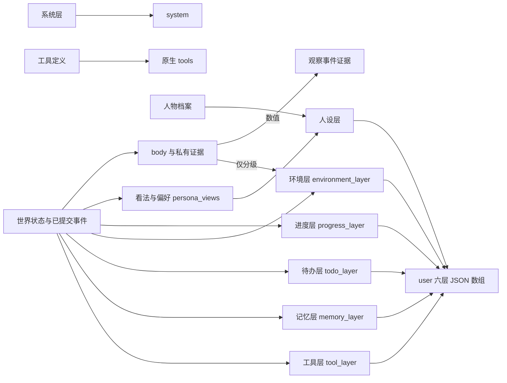

<a name="contracts-worldmock-接口合同"></a>
# WorldMock 接口合同

> 按[动作与内容简化规格](dev/SPEC-action-and-content-simplification.md#spec-acs-动作与内容简化开发规格)修订「固定规则、目录格式与加载边界」（阶段 1）。

> 2026-10-07：按[资源与规则引擎简化规格](dev/SPEC-resource-and-rule-simplification.md#spec-rrs-资源与规则引擎简化开发规格)同步阶段 7 的记录、导出、交付与评估合同。

> 按[资源与规则引擎简化规格](dev/SPEC-resource-and-rule-simplification.md#spec-rrs-资源与规则引擎简化开发规格)修订「环境数据归属合同、品类契约与目录字段、类别供给的构建合同、营业与报价声明、环境目录文件、环境目录与绑定、地点类词表、CLI 命令接口、环境与检查命令合同、冻结地图与场景引用、持久化当下事实、LifeEnv 状态字段、资源与需求字段、领域枚举、禁止进入提示的字段、模型身份、共同检查点与恢复、持久化结构、交互菜单声明与有效菜单、状态归属」（阶段 1）；「冻结地图与场景引用」、「地图与门店供给合同」（阶段 2）；「地点发现与购买身份、供给结算与事件载荷、活动受理拒绝码、请求字段与结算检查、请求模型的闭集与字面边界、候选与呈现合同、候选对象与来源、排除原因码、排序键与游标、下推返回体、场景常量、派生量字段、可见期与提示预算、运行输入警告、人物卡片覆盖率产出、体感与动机证据、人格与卡片字段、个人事务」（阶段 3）；app 使用、内容与推送（阶段 4）；工作主题、单一行动阶段与最终人物工具面（阶段 5）；「请求组成」的系统层 app 推送、并行、名称、购买来源与主题工时规则及提示指纹（阶段 6）。


> 状态：FROZEN；2026-09-27 按[人物 Prompt 规格](VERIFICATION.md#verification-incremental-evidence)修订，修订部分已实现并通过离线验收（证据见[人物 Prompt 验收记录](archive/persona-prompt/persona-prompt-verification.md)）；修订内容见「版本表」`2026-09-27-persona-prompt-freeze`、`2026-09-27-persona-prompt` 与 `2026-09-28-persona-prompt-implemented` 三行。2026-09-29 按[一日运行保真规格](VERIFICATION.md#verification-incremental-evidence)的【同】作业 C1–C19 修订，修订部分已实现并通过离线验收；修订内容见「版本表」`2026-09-29-dayrun-fidelity` 行。
> 本次工具交互合同于 2026-10-01 按[工具交互规格](dev/SPEC-life-runtime.md#tool-interaction-工具请求)冻结，已实现；本次生产验收单独记录；既有验收只证明此前版本。
> 2026-10-02 [个人事务与工作安排规格](VERIFICATION.md#verification-incremental-evidence)冻结：本文件相应条款按[配套实施计划](archive/errands-workday/errands-workday-implementation-plan.md)的文档同步作业随该规格阶段 1–4 的代码逐阶段修订；阶段 1–4 的修订均已实现并通过离线验收（证据见[个人事务与工作安排验收记录](archive/errands-workday/errands-workday-verification.md)）；冻结时在「请求组成」加的三处修订指针已随阶段 1、阶段 3 全部删去；修订内容见「版本表」`2026-10-02-errands-workday-freeze`、`2026-10-03-errands-workday-stage-1`、`2026-10-03-errands-workday-stage-1-review`、`2026-10-03-errands-workday-stage-2`、`2026-10-03-errands-workday-stage-4`、`2026-10-03-errands-workday-stage-3`、`2026-10-04-errands-workday-stage-3-review` 与 `2026-10-04-errands-workday-implemented` 各行。
> 按[让「等待」成为例外规格](dev/SPEC-idle-fillers.md#spec-idle-fillers-让等待成为例外开发规格)修订「工作安排声明」（阶段 1）、「请求组成」与「七层 Schema」（阶段 2）、「请求组成」的零点计划模板（阶段 3）。
> 按[同时做两件事规格](dev/SPEC-parallel-activities.md#spec-parallel-activities-同时做两件事开发规格)修订「状态归属」「人物工具与管理接口」、「个人事务」的入口、「请求字段与结算检查」「活动受理拒绝码」「动作状态与动作结果」与「七层字段」的待办层（阶段 1）；「状态归属」的占用名、「交谈与通话」与「活动控制行」的占用，以及「品类契约与目录字段」的占用声明来源与旧占用名环境的拒绝（阶段 2）；「请求组成」与「七层 Schema」（阶段 3）。
> 范围：LifeEnv 与 LifeAgent 适配接口、数字足迹事件与存储、语料内容目录、完整足迹交接、命令行与运行状态。
> 权威：记录引擎的事件、素材、存储与导出合同统一在[记录引擎设计](design/05-recording-engine.md#recording-engine-worldmock-产品设计说明书-记录引擎)定义；其余接口签名、字段名、枚举值、Schema、文件格式与命令行参数在本文件定义。其他文档只引用所属合同，代码变更先更新对应合同。

<a name="contracts-共享规则与可重建环境修订"></a>
## 共享规则与可重建环境修订

按[共享规则与可重建环境规格](dev/SPEC-shared-rules-and-rebuildable-env.md)修订；验收结果独立记录。

结构化身份使用唯一规范 JSON。安全文件拒绝绝对路径（含 Windows 上无盘符的根路径）、..、反斜杠和任一平台不能原样保存的名字，以及符号链接与目录联接；有效结算区间为非布尔整数且起点小于终点。目录与生活模型的曲线均有限非负，资源名非空白。纠正消息共享序列化结构，零点计划与反思各自的原响应回显、英文指令和重试次数不变。

<a name="contracts-环境与检查命令合同"></a>
### 环境与检查命令合同

| 入口 | 参数与行为 | 输出和失败 |
| --- | --- | --- |
| `python scripts/bootstrap.py` | `--profile` 取 `release` 或 `dev`，默认 release；`--wheelhouse PATH` 只消费离线制品；`--use-uv` 显式选 uv，缺失报错 | Python 必须 3.12；固定来源先核对，哈希锁安装，源码不解析额外依赖；`.work/environment-receipt.json` 只记相对路径 |
| `python scripts/fresh_check.py` | `--repository`、`--commit`、`--profile`、`--wheelhouse`、`--output`；`--compare` 读取两份实际平台结果 | 无子模块、无 SSH、无 pip 缓存的新 clone；任一命令失败退出；比较要求同提交、同源码摘要且都通过 |
| `python scripts/coverage_gate.py` | `--shards N` 映射 worker 数；`--environment-root` 显式选择发布环境并绑定实际字节摘要；`--from-json` 核验 collection、summary、worker 选择与完成回执的同一运行身份及覆盖数据摘要 | 唯一入口 `scripts/run_tests.py` 按实测文件权重调度完整文件；当前解释器、进程数据隔离、选择/收集/完成节点多重集精确一致且无重复；全量节点三阶段完整且均 passed；输入字节、运行身份和覆盖摘要匹配，无失败、无跳过、非空、有效收据、分支至少 85%、公共接口零缺口才通过 |
| 安装 profile | release 缺 Node 或中文字体失败；dev 固定原因标明缺失和对应检查 | dev 缺部件不能产生最终通过收据；跨平台核心与重建必须有实际平台收据 |

Linux 完整环境的架构边界与安装限制以[冻结规格](dev/SPEC-shared-rules-and-rebuildable-env.md#shared-rules-门禁可选部件与操作系统)为准；
Linux ARM64/aarch64 的锁定组合安装失败不能按可选部件缺失跳过，也不能产生通过收据。

收据字段为 `schema_version`、`profile`、`python_version`、`dependency_locks`、AS2 源码摘要、
`node_version`、`missing_components`、`passed`。
安全路径只接受根内相对普通文件，逐组件拒绝链接和父引用；所属错误构造只在失败时执行一次。
公共曲线输入与输出均为有限非负数且拒绝布尔；资源名非空白，效率曲线非空。
目录模型深冻结，严格模型拒绝未知字段。

环境命令为 `worldmock environment generate-map --locations PATH --seed INT --output PATH [--check]` 与 `worldmock validate --environment ROOT`。文件、身份和全部登记码的英文原因见[环境目录文件](#contracts-环境目录文件)；任一失败非零退出。

环境根只有 `catalog/` 与 `scenarios/`，不读取语料或比对规则副本。

<a name="contracts-环境数据归属合同"></a>
## 环境数据归属合同

WorldMock 维护模拟器、严格模型、加载校验、记录与导出。分类、类别与使用方式、状态效果、供给表、身体与交换常数、公式归 `worldmock.exchange`，以规则版本 2 绑定。
包规则只从引擎读取；可供性与人物映射留在包中，内部动机规则退役，环境没有规则副本。

WorldMock-Dataset 发布 app、地点、商品、动作、内容、图与绑定。环境根只有 `catalog/` 与 `scenarios/`，正式重制路径由数据仓发布决定。
目录能填的数只有价格、内容时长与集数；名称真实，摘要有出处或声明合成，数值明确为仿真假设。
调用方显式给出场景或环境根，运行不搜索相邻仓库。历史运行、导出与冻结输入保持原字节，不提供旧格式兼容。

<a name="contracts-lifeenv-状态字段"></a>
## LifeEnv 状态字段

世界结构 `10` 的事实表由环境维护，人物不能通过自由文本改写余额、食品持有、内容位置、订单、推送状态或工作主题累计。当前字段见[持久化当下事实](#contracts-持久化当下事实)。

<a name="contracts-状态归属"></a>
### 状态归属

| 状态 | 内容 | 修改权限 |
| --- | --- | --- |
| 世界 | `simulation_time`, `locations`, `weather`, `corpus_version`, `calendar`, `scheduled_events` | 环境规则 |
| 人物身体 | `available_energy_kcal`, `sleep_deficit_hours`, `entertainment_need`, `recent_activities`, `physiological_state` | 时间推进、进食、睡眠和活动结算 |
| 人物资产 | `account_balance`, `inventory{location_id: {food_id: 份数}}` | 交易、实际交付与食用 |
| 人物活动 | `activity_type`, `start_time`, `progress`, `next_decision_time`, `occupied_resources`（占用名为 `wait`、`work`、`use_app`、`read_mail`、`consume`、`lifestyle`、`talk`、`travel` 八个，每种动作占自己的名字，只有同一种动作互斥，按[时间与能量规格](dev/SPEC-life-runtime.md#time-and-energy-决策不耗时时间只在做事时流动)第五章「并行准入」由注册表声明）, `pause_reason`, `end_reason`, `same_moment_rounds`（本秒已进行的决策轮数）, `same_moment_stage`（受限轮阶段：`open`、`conclude_pending`、`start_or_resume`、`resume_or_conclude`、`conclude_only`；`resume_or_conclude` 与 `conclude_only` 留在闭集中，现行阶梯不再进入它们：到达同刻上限时有待收尾进入 `conclude_pending`，没有进行中也没有待收尾时进入 `start_or_resume`，开始或恢复被拒后留在原阶段）；活动名额为常量 2（进行中与待收尾的活动各占一个，暂停的不占，暂停的个数不设上限；`pause_activity` 与 `conclude_activity` 之后名额让出，恢复暂停的活动要有空名额） | 人物申请，环境验证并执行；同刻计数与受限轮阶段由环境随决策轮与时钟推进维护 |
| 地点会话 | `sessions` 和每段会话自己的 `app_pushes`：一段地点停留或两地之间的一段路（`kind` 取 `stay`、`transit`，`status` 取 `active`、`ended`），名称为地点或路段加开始时刻，例如「在家（1月5日 00:00 起）」「去张江办公室的路上（1月5日 14:17 起）」 | 环境随出发与到达开始和结束；人物不手动开始或结束会话 |
| 工作 | `{topic, target_seconds, worked_seconds, last_report}`；场景分配主题，目录冻结目标工时，进度跨全部非失败工作活动累计 | 主题来自目录；实际活动结算更新累计与播报，不含材料、交付、评审或付款状态 |
| 个人事务 | `errands`：本人未完成的个人事务，键为事务身份，每条 `ErrandState` 记 `errand_id`、`name`、`outcome`、`product_id`、`quantity`、`progress`、`memo`、`registered_at`、`remind_at`、`reminded_at`、`origin_action_id`、`origin_event_id`（字段见「个人事务」）；完成或取消即移出 | 人物经 `report_status`、`pause_activity`、`conclude_activity` 的请求级 `errands` 记下（新增）、更新、取消；完成只由环境按结算证据写入，人物不能自报完成；提醒的交付由环境记下 |
| 内容接触 | 跨 app 的 `content_progress{content_id: {content_id, position_seconds, completed_rounds}}` 与活动 `played[]`；实际接触事实 | 实际 app 活动推进；暂停与结算写回，恢复读取最新全局位置 |
| 记忆 | AS2 人物记忆及其版本、`source_event`, `retrieval_results` | 人物记忆流程 |

人物身体与资产的准确数值属于世界事实，只进入足迹与评估。人物实际收到的是七层 JSON 请求（见「七层字段」），身体只以环境层 `body` 中由确定性规则算出的五项体感分级进入；WorldMock 的完整导出保留事实与可见性；LabelKit-DataSet 按目标系统的信息范围决定训练字段，不默认线上设备能读到环境隐藏状态。

<a name="contracts-资源与需求字段"></a>
### 资源与需求字段

| 量 | 类型 | 单位 | 说明 |
| --- | --- | --- | --- |
| `time` | UTC 整数秒 | seconds | 场景时区，同秒事件有严格序号 |
| `money` | 整数 | 最小货币单位 (分) | 避免浮点累计误差 |
| `available_energy` | 浮点 | kcal | 实验中的可用能量状态；非负；结算以 0 截断，不阻止任何活动 |
| `sleep_deficit` | 浮点 | hours | 与食品能量独立 |
| `entertainment_need` | 浮点 | 归一化 [0,1] | 随生活积累 |
| `work_need` | 复合对象 | - | 场景工作主题与工作安排；实际工时由活动推导 |

资源定义与身体常数归 `worldmock.exchange.body`，食品热量按 `FoodCategory` 常数取得；库存是按地点和食品身份记录的份数，订单、内容进度与会话推送按[持久化当下事实](#contracts-持久化当下事实)保存。

<a name="contracts-生命周期"></a>
### 生命周期

| 接口 | 签名 | 行为 |
| --- | --- | --- |
| `__init__` | `(scenario_path: str \| None = None)` | 仅保存配置路径和建立资源句柄，尚不创建世界 |
| `init` | `(start_datetime: datetime)` | 核验内容目录、规则、初始世界与时间；初始化数据库和事件计划 |
| `step` | `(tick: int, t: int)` | `tick` 为推进秒数，`t` 统一为结束时间；满足 `t = 上次已确认时刻 + tick` |
| `to_workspace` | `(workspace_path: str \| None = None)` | 遵循 AS2 签名；无参时使用已绑定工作区，持久化必要状态与检查点引用；错误必须传播 |
| `restore` | `(workspace_path: str)` | 读取明确指定的有效检查点，核对代码、规则、数据、时间和人物状态版本 |
| `close` | `()` | 关闭数据库等资源，保留运行终态与未完成活动 |

AS2 的环境扫描要求自定义环境类直接定义在 `custom/envs/*.py`；`LifeEnv` 在该文件定义，业务逻辑导入普通模块。正式实例通过现有 AS2 环境参数传入场景路径；`init` 缺少场景时明确失败，不生成默认世界继续运行。无参检查只用于注册与工具 Schema 发现，运行测试必须传入真实场景参数。

<a name="contracts-person-tools"></a>
### 人物工具与管理接口
所有模型生活工具经 `submit_action(call)` 统一登记，宿主附加 `agent_id`、`decision_id`、`action_id`、
观察版本与本轮顺序；这些上下文由 runner 与路由绑定，不出现在模型可填写的参数中。
工具 Schema 由对应请求模型直接生成，全部字段必填，数组数量边界由本地校验器执行，不能静默截取。
工具定义只经原生 `tools` 发送，整次运行不变：参数不带逐轮名称枚举，description 只写用途，世界交互规则只在系统层写一次
（见「请求组成」）；参数 Schema 的字段级说明是 Schema 的一部分、不是 description：三个活动控制工具的参数逐字段写一句「格式与来源」（如活动名
「照工具层、待办层或进度层写出的名称原样抄写，包括『（9月28日 12:05 起）』这样的开始时刻」），不写规则与上限（上限由本地校验执行）；
请求级 `errands`、每条变更对象及其八个键同样各写一句（定稿见下文的用途句与字段说明表）；三个控制工具的用途句与这些说明一律不用
「登记」一词（既有说明扫描把它判为协议说法）；
`start_activity` 只有请求级 `prefer` 带一句字段说明（两个取值与空值的含义，并说明方式写「购买」时怎样定到店还是远程下单）；
名称的合法性由宿主本地校验与环境受理判定：两边在同一冻结观察上调用同一个统一名称解析（`src/worldmock/life/name_resolution.py`，
[一日运行保真规格](dev/SPEC-life-runtime.md#dayrun-fidelity-身体与需要) 3.1），宿主判为可受理的，环境也受理。
模型只选择可理解且能唯一定位的对象名称与方式；五类内部动作由方式唯一推导；本轮私有 `interaction_bindings` 将（对象，动词，方式）
绑定到内部身份、标准动作、出行方式、履约方式与冻结报价，绝不进入模型提示。全部目录类对象（食品、生活活动、应用、
地点、联系人与人物、任务、活动）都可以直接写名称：精确匹配或无损归一后唯一即受理，归一写进结果
`details.resolved`（见「请求模型的闭集与字面边界」）；食品、生活活动与地点即使本轮没有列出也可以写：本人启用的生活活动、
app 与生活活动取观察私有的目录绑定 `catalog_bindings`，地点取冻结地点表，受理时照常做资格与准入判定；`obtain` 以到店、远程下单或「购买」
写出的其余名称与写「购买」的商品目标按指名购买解析（见「请求字段与结算检查」，多家都能服务时按请求级 `prefer` 选定一家）。
名称不是任何可以操作的对象、归一后不止一个或方式不属于对象能力时，由宿主按协议错误
在本轮纠正，从不替换：`start_activity` 的候选写成可以照填的请求，其余名称参数的原因写出最接近的几个名称（见「工具返回通道」）。
LifeEnv 不为每个模型工具另建同名 RPC 方法。
只读查询共用 `read_query` 这一个 RPC：运行时由 `LifeEnvProxy(EnvRouterProxy)` 等待远端并返回结果对象，
`LifeEnvActor(DirectEnvActor)` 把查询交给唯一的生活环境（`src/worldmock/life/read_query_runtime.py`），二者各只新增
`read_query` 一个方法，运行装配以这两个类建立环境 actor 与代理；actor 类固定 `max_concurrency=1`、不提供参数；
这是锁定 AS2 提交上的 Life 扩展，不改 AS2、不做多版本兼容。

| 工具 | 参数 | 返回 |
| --- | --- | --- |
| `observe` | `context` (宿主只读 RPC) | 当前可见状态、已到达通知和已完成的内容接触结果 |
| `read_query` | `context`、`tool`（`query_world` 或 `recall_task_summary`）、`request`（对应请求模型的实例）(宿主只读 RPC) | 按决策身份取本决策唯一一条已提交观察即时求值并返回结果对象；工具与请求类型不符、找不到唯一观察是协议违约；回看的业务拒绝以错误结构 `{error_code, reason, fix, items, unmet}` 作为返回值；不写事件、不改世界版本与时钟、不计同刻轮数 |
| `start_activity` | 必填 `items: [{target, way, from, to}]` 一至两项及必填可空 `answering`、`prefer`；购买 prefer 仅“最快拿到”或“到手价最低”，非购买必须 null | 一项一个对象，本地严格类型校验，方式唯一推导内部动作、整组原子；删除 actions 与旧数组；to=null统一本人，给予或送给他人填写实名 |
| `query_world` | 必填 name、way、category、from（可空字符串，至少一个非 null；name、way、category 非 null 不得为空白，from 非 null 须是地点显示名或渠道称呼，空白写法与其余写法一样按查询错误纠正）、available_only（布尔，拒绝字符串、数字与 null）及 offset（非负 JSON 整数，拒绝布尔和字符串）；六键无缺省，旧四键请求按缺字段拒绝；category 取公开 callable_index 的 `query_categories` 标签，from 与 `start_activity` 购买项的 `from` 同名同义 | 按冻结观察权限与筛选交集分页查询，返回matches、total_count、next_offset；不揭示新事实、不登记世界 |
| `recall_task_summary` | `task_name`（当前冻结观察中本人有权回看的任务、目标或活动名称） | 即时只读回看，作为 tool 消息直接返回；不登记世界或进度 events，不计同刻轮数，仍计模型回合 |
| `report_status` | `items: list[{activity_name, summary}]`（一至两项，一项一个对象，逐项点名活动）与请求级必填 `errands: list[{change, name, outcome, item, quantity, memo, remind_time, reason}]`（与 `items` 平级，零至四条，可为 `[]`；个人事务的新增、更新、取消，见「个人事务」） | 逐项播报进行中活动的进展；点名暂停的活动即恢复它（只在其开始地点，且要有空名额）；关联当日目标同步记录各自自述（`PlanGoal.progress_note` 照存，不进提示）；`errands` 的变更与活动状态转换同批校验、同一事务提交，成功结果在 `details.errands` 给回执 `[{errand, change}]`，请求里没有「完成」 |
| `pause_activity` | `items: list[{activity_name, summary}]`（一至两项，一项一个对象，逐项点名进行中活动）与请求级必填 `errands: list[{change, name, outcome, item, quantity, memo, remind_time, reason}]`（与 `items` 平级，零至四条，可为 `[]`；个人事务的新增、更新、取消，见「个人事务」） | 逐项写自述并暂停所选进行中活动；暂停让出名额，恢复要有空名额，路上的活动不能暂停；关联当日目标同步记录各自自述（`PlanGoal.progress_note` 照存，不进提示）；`errands` 的变更与活动状态转换同批校验、同一事务提交，成功结果在 `details.errands` 给回执 `[{errand, change}]`，请求里没有「完成」 |
| `conclude_activity` | `items: list[{activity_name, summary, memories, views}]`（一至两项，一项一个对象；`memories` 是关于这项活动的零至多条普通记忆 `{type, text, importance, keywords}`，没有对象字段；`views` 是零至多条看法或偏好 `{type, about, text, importance, keywords}`，`about` 写对象、宿主写入时作为存储的 `subject`；两者都必填、可为空列表，全部项合计不超过八条，见「记忆字段」）与请求级必填 `errands: list[{change, name, outcome, item, quantity, memo, remind_time, reason}]`（与 `items` 平级，零至四条，可为 `[]`；个人事务的新增、更新、取消，见「个人事务」；`errands` 不占 `memories` 与 `views` 合计八条的上限） | 逐项写总结、记忆与看法并结束所选活动：进行中、暂停中或刚结束待收尾的活动，暂停的在任何地点都可直接结束；结束后进行中与待收尾活动所占的名额让出，未选中活动保持原状；`errands` 的变更与活动状态转换同批校验、同一事务提交，成功结果在 `details.errands` 给回执 `[{errand, change}]`，请求里没有「完成」 |
| `revise_day_plan` | `goals: List[{intent_kind, goal, remind_time, around_time}]`（替换全部未推进目标；`remind_time`、`around_time` 必填可为 null） | `status: "submitted"` |
| `send_message` | `recipient_name`, `text` | 发送模型撰写的消息，收件人名称取本轮可见名称 |

三个活动控制工具写下的 `summary` 与 `conclude_activity` 的普通记忆原文，在本 session 内是进度层中该调用的参数（按现行形状
`{"items": [{activity_name, summary, memories}]}` 写出，`views` 与请求级 `errands` 从参数中略去：前者只在人设层呈现，后者的文字
只在待办层呈现，本 session 内由该调用结果的 `details.errands` 回执可见）；session 结束后，成功的
`pause_activity`、`conclude_activity` 写下的 summary 与普通记忆原文进入记忆层 `self_notes`，`report_status` 的 summary 不进入。
读这三个工具请求的地方（宿主与环境的受理、进度层、记忆层、看法与偏好、零点计划输入、记忆写入点、交付窗口、质量报告与查看器）
都经 `control_items`（`src/worldmock/life/control_items.py`；查看器按同一规则读）取得逐项的活动名、自述与存储形状的记忆，
请求级的个人事务变更经同一模块的 `control_errands` 读出；只读取带 `items` 与 `errands` 两个键的现行形状，不直接读旧 task 或
平行数组；事件或导出里的控制请求缺 `errands` 键是完整性故障，旧形状记录直接拒绝，不留读取分支。
旧输入与旧运行直接按格式或身份错误拒绝，不提供迁移或回退。

其余工具的用途句由实际 `TOOL_DESCRIPTIONS` 定义；本合同逐字登记三个控制工具及 `query_world` 的用途句（「description 只写用途」的
原则见上文与[人物 Prompt 规格](dev/SPEC-life-realism.md#persona-prompt-七层请求)）；三个控制工具的用途句与请求级 `errands` 的字段说明在此逐字登记。

`query_world` 的用途句定稿（与代码逐字相同）：「按已知名称、方式、公开品类或购买来源查询世界，可只看此刻能做的，按返回的偏移量翻页。」。

三个控制工具的用途句与字段说明定稿（与代码逐字相同）：

| 位置 | 定稿 |
| --- | --- |
| `report_status` | 按活动名写下一两项活动的进展，并写下个人事务的变更。 |
| `pause_activity` | 按活动名暂停一两项进行中的活动并写下进展与个人事务的变更。 |
| `conclude_activity` | 按活动名结束一两项活动，写下总结、想记住的事、形成的看法与个人事务的变更。 |
| `items[].memories` | 关于这项活动、以后做决定用得上的新情况，一条一个对象，没有就写空列表。 |
| `errands` | 要新增、更新或取消的个人事务，一条一个对象，没有就写空列表。 |
| 每条变更 | 一条个人事务的变更：做什么、名称、要办成的事、备注、提醒钟点与取消原因。 |
| `change` | 这条变更做什么，从列出的三种里选一种。 |
| `name` | 事务的名称，新增时自己起，之后照待办层里的写法写。 |
| `outcome` | 要办成的结果，从列出的两种里选一种。 |
| `item` | 要取得或吃掉的商品名称。 |
| `quantity` | 要办成的份数。 |
| `memo` | 用自己的话写打算怎么办、去哪办。 |
| `remind_time` | 想被提醒去办这件事的钟点。 |
| `reason` | 不办了的原因。 |

<a name="contracts-交互菜单声明与有效菜单"></a>
#### 交互菜单声明与有效菜单

场景根对象必须显式包含 `interaction_menus_by_location_kind`，键集合恰好等于八个内置 `LocationKind`；每个人物也必须显式包含 `interaction_menu`。人物值可以为
`null`，表示不在地点菜单之外增加限制；地点菜单不能为 `null`。解析后的地点 `kind` 是交互菜单地点类，
候选活动环境由 `PLACE_KIND_ENVIRONMENTS` 从地点类型派生。

```python
InteractionMenu = {
    "allowed_actions": list[str],
}
```

数组非空、无重复且只接受非空白字符串，菜单对象不接受未知字段。
`allowed_actions` 的闭集是 `START_ACTIVITY_ACTIONS`：`travel_to`、`sleep`、`wait`、`purchase`、`do` 五项内部标准动作；
人物所选（对象，动词，方式）经本轮私有绑定映射为内部动作后按菜单判定（[时间与能量规格](dev/SPEC-life-runtime.md#time-and-energy-决策不耗时时间只在做事时流动)
第五章「请求形状与菜单」）。其中 `wait`、`sleep` 必须存在，保证人物在每个地点都能等待与睡觉；二者分别对应动词
`interact` 的「自己」对象（方式「等待」）与动词 `sleep`。场景地点类缺项或多项、人物字段缺失、未知名称、
错误类型、重复、空数组或缺少保护动作均拒绝加载。

七个模型请求名由 `REQUEST_MODELS` 固定，地点菜单不剪裁工具，只收窄 `start_activity`
的可读动作选择。分配的工作内容经活动工具推进；消息正文和活动控制工具的工具资格由当前领域条件决定。

当前有效菜单按人物权威位置取得地点类菜单，再与人物菜单逐字段求交集并确定性排序；人物菜单为
`null` 时直接使用地点类菜单。它是现有状态、阶段、可见目标和回合预算门控之前的
准入约束，只能继续收窄动作选择，不能放宽既有规则。条件未满足的动作照常列出并附说明，不剪裁；
唯一的状态性收窄是同刻上限的受限轮。完整活动控制、下钻品类映射和恢复资格见
[交互菜单规格](dev/SPEC-interaction-menu.md#spec-interaction-menu-观察与人物工具)。菜单不得删除工具层 `targets`、
`affordance_contract` 或候选，也不得改变候选排除原因、呈现上限和轮转。

工具层、本地决策校验和环境受理使用同一轮冻结菜单。环境在产生领域副作用前按权威
状态重验；违反动作准入的请求返回 `INTERACTION_MENU_DENIED`，
并沿用 `action_rejected` 与 `action_result` 的公开结果通道。拒绝不得扣款、消费、累计分配的工作内容、启动或恢复活动、
发送消息。只读人物查询不进入生活观察与菜单，只开放 `memory_recent`、
`memory_search`、`memory_time_range` 三个记忆工具及只读 `finish`。完整声明、失败关闭和验收要求以[冻结特性规格](dev/SPEC-interaction-menu.md#spec-interaction-menu-特性规格交互菜单)为准。

| 管理接口 (不向模型暴露) | 参数 | 返回 |
| --- | --- | --- |
| `scheduling_state` | - | `decidable_agents: List[str]`, `next_event_time: int` |
| `commit_decision_round` | `round_id: str` | 按预定顺序结算请求 |
| `checkpoint` | `request` | 保存共同检查点 |

模型工具名是 LifeAgent 的原生请求合同。旧的分领域工具名直接删除，不维护别名；
领域执行函数继续负责实际结算。食物与耐用品的使用由 `start_activity` 的可读对象和动作定位，
再由引擎依据冻结绑定选择对应领域请求；模型不填写库存数量、物品内部身份或结算时长。
余额调整、天气设定、地点瞬移、验收强制通过和全世界读取不向人物暴露，也不提供通用代码执行接口。
`readonly=True` 表示调用不改变生活状态，观察调用本身仍需要留下证据。

<a name="contracts-day-goal-request"></a>
### 当日目标请求
零点后台任务 `plan_day` 生成当日计划，人物以 `revise_day_plan` 修订。两者使用同一严格形状 `{goals: [...]}`：
零点计划的输出由 `PlanDayRequest` 校验，`revise_day_plan` 的请求模型与它同形。条目为
`PlanGoalInput`，只允许下表四个字段，禁止旧时段载荷和未知字段；工具 Schema 内联条目，
本地与环境共同校验文本长度、数量和意图闭集，不依赖提供商不支持的 Schema 关键字。
行为与验收见 [当日目标规格](dev/SPEC-day-plan-goals.md#spec-day-plan-goals-当日目标特性开发规格) 与[时间与能量规格](dev/SPEC-life-runtime.md#time-and-energy-决策不耗时时间只在做事时流动)第四章。

| 字段 | 类型 | 说明 |
| --- | --- | --- |
| `intent_kind` | 下表十一种意图的闭集 | 同一清单最多出现一次 |
| `goal` | 非空白文本，最多三百字符 | 人物想推进什么，可写粗略时段，文字不驱动活动；实际家族活动不证明这句话已完成 |
| `remind_time` | `str \| null`，必填，可为 null | 场景本地 `HH:MM`（小时 00–23，分钟 00–59）；换算为当日绝对时刻，须晚于生成或修订时刻、早于次日零点；null 表示不设提醒。当日目标里只有这个字段触发定时决策（个人事务另有自己的 `remind_time`，换算与唤醒规则不同，见「个人事务」） |
| `around_time` | `str \| null`，必填，可为 null | 大致时刻：场景本地 `HH:MM`（格式同 `remind_time`），人物打算在几点前后推进这条目标；换算为登记当日的绝对时刻 `around_at`，不要求晚于生成或修订时刻，不触发任何决策，只用于推进判定（见下文）；null 表示不限时刻（[一日运行保真规格](dev/SPEC-life-runtime.md#dayrun-fidelity-身体与需要) 8.2） |

清单零至八条，数组顺序就是优先级。同一人物同一本地日只生成一次（幂等键 `plan_submitted_dates`），可为空；
恢复与重放不重复生成。零点计划任务在调用模型之前按幂等键跳过当日已生成的人物，同日重复生成不以业务拒绝返回。
修订只提交替换后的全部未推进目标；已推进目标按原相对顺序保留前缀，合并后仍满足上限和唯一性。
`intent_kind`、`goal`、`remind_time`、`around_time` 四个字段完全相同的未推进条目保留登记时刻与提醒状态，不重校时刻，
所以原样重发已触发提醒的目标不被拒绝；只改 `remind_time` 的条目保留登记时刻并换成新提醒（大致时刻取新值）；
只改 `around_time` 的条目保留登记时刻与提醒状态，只换大致时刻，不重校、不触发决策；
改变文字或删除记录为旧承诺丢弃，新条目重新登记；被替换或删除的目标，旧提醒取消。

零点计划的输出与 `revise_day_plan` 的请求共用同一校验函数：每个重复的意图同时定位首次出现与其后每次出现的条目
（`goals[i].intent_kind`）；条数超过八条定位在 `goals`，与重复意图在同一次校验里一并报告，不因超限提前返回。
修订入口照错误合同逐条给完整 `path`、`written`（重复时为该意图字符串，超限时为提交的 `goals`）与
`allowed_values`（重复意图各条为全部十一种意图；超限一条定位在数组 `goals`，该位置没有闭集，为 `[]`，上限写在原因
`day goals require at most eight entries` 里）；零点计划入口的附回文本逐条列位置与原因。英文原因为
`intent_kind '<kind>' may occur only once; keep one goal for this intent and merge these entries into it`
（原文里的 `tasks` 一词已删去，避免被读成把个人事务并进当日目标）。至多八条、每意图一条不变。
零点置空当日计划、`revise_day_plan` 与目标推进都不改动个人事务：事务不在 `DayPlan` 里，零点置空与修订整表替换都不波及它；
零点计划的输入只读事务（输入键「个人事务」，见「请求组成」），不创建、不更改、不终结（见「个人事务」）；`progressed` 的含义不变。

`DayPlan` 持久形状是 `{day_end, goals}`。环境以场景本地次日零点填 `day_end`（场景本地零点指本地日期变更的那一秒：
夏令时在零点拨快、当日没有 00:00 时是该日的 01:00，零点回拨后重复出现的 00:00 不是零点）；
每条 `PlanGoal` 附加 `registered_at`、`progressed_at`、`progress_activity_id`、`remind_at`、`reminded_at`、`around_at`。
推进时刻与活动标识同时为 null 表示未推进，同时有值表示已有真实结算证据。
`remind_at`（`int | null`）是 `remind_time` 换算出的当日绝对时刻，未设提醒为 null；`reminded_at`（`int | null`）
是提醒触发的时刻，只有设了提醒的目标才有，且不早于 `remind_at`；提醒只触发一次。`around_at`（`int | null`）是
`around_time` 换算出的登记当日绝对时刻，早于次日零点，不限时刻为 null。
这些字段由环境生成，人物请求不能写入。零点计划的登记写 `environment_event`（`visibility=system`，
`data.kind="day_plan_generated"`）：`data.day_plan` 与修订结果同形，目标的 `registered_at` 为该事件时刻，
`data.source_event_ids` 为输入来源事件。修订的动作完成结果 `data.day_plan` 和正时长结算事件
`data.day_plan` 同样保存完整对象；计划与这些事件都与世界状态在同一事务提交。


| `intent_kind` | 活动家族闭集 |
| --- | --- |
| 睡眠 | `sleep` |
| 晨间例程 | `lifestyle:wellness`, `wait` |
| 通勤 | `travel` |
| 工作 | `work` |
| 用餐 | `consume` |
| 休息 | `wait`, `lifestyle:wellness` |
| 娱乐 | `use_app`, `lifestyle:hobby` |
| 社交 | `chat`, `call`, `lifestyle:social` |
| 家务 | `lifestyle:household`, `lifestyle:pet` |
| 运动 | `lifestyle:sport` |
| 外出 | `travel`, `lifestyle:outdoor` |

生活活动家族来自目录 `category`，活动快照原样保存该类别。同一活动在同一人物当日
最多推进一项目标，按未推进清单顺序匹配，不把重叠家族当成两份进展。
推进判定：同家族、登记之后的正时长结算；目标带 `around_at` 时，活动在当日内的进行区间（活动快照的实际开始时刻
`started_at` 至结算止点，止点不越过次日零点；不是结算区间起点）还须与 `[around_at − 5400, around_at + 5400]`
有正时长交集（容差 `GOAL_TIME_TOLERANCE_SECONDS = 5400` 秒是实验假设）；`around_at` 为 null 的目标只按家族与登记后的
正时长结算判定。「睡前」「上午」这类文字不由环境解读，写计划的模型把它换算成大致时刻。质量输出 `day_plan_metrics`
回放事件时用同一判定（`schedule.ran_in_goal_window`）。
例行意图闭集 `ROUTINE_INTENT_KINDS` 为睡眠、晨间例程、通勤、用餐（上表意图的子集，属于人设层作息）：这类目标照常
受理、判定与记录；`day_plan_metrics.deliberate_goals` 的推进比例只计非例行意图的目标，例行意图的目标另计一行
`routine_goals`。

工具开放与生命周期：`plan_day` 不是人物工具。
存在当日计划即可开放 `revise_day_plan`，包括空清单后追加目标。计划只在本地日界清除，
不因就寝隐藏。环境不按清单执行活动，不从目标文字推导时刻；当日目标里只有 `remind_time` 触发定时决策，
提醒可结束睡眠；`around_time` 只用于推进判定。个人事务的提醒只提供一次决策机会，不结束睡眠（见「个人事务」）。

| 结算拒绝错误码 | 触发条件 |
| --- | --- |
| `PLAN_GOALS_INVALID` | 请求自身合法，但与保留的已推进目标合并后超过容量或违反领域约束 |
| `PLAN_GOAL_ALREADY_PROGRESSED` | 试图把已推进意图重新提交为待推进目标 |
| `PLAN_REMIND_TIME_INVALID` | 新登记或只改了提醒的条目，其 `remind_time` 换算为当日绝对时刻后不晚于修订时刻，或不早于次日零点；四个字段完全相同或只改了 `around_time` 的条目不重校。零点计划的输出违反同一约束时不是业务拒绝，按输出不合法附回重试（见「生成参数」） |
| `PLAN_NOT_FOUND` | 没有当日计划时请求修订 |
| `ACTION_REQUEST_INVALID` | 请求未通过引擎边界严格校验，包括旧字段、超量或重复意图、非法文本、`remind_time` 或 `around_time` 格式错误、缺字段或伪造状态字段 |

当日计划只在待办层 `day_plan` 呈现：零点计划生成前或当日结束后为 `null`，之后为
`{date, goals}`，`goals[]` 至多八条、保持计划顺序，每条为 `{intent_kind, goal, progressed, remind_time, around_time}`
（`remind_time` 为 `HH:MM` 或 `null`，`around_time` 为`HH:MM`或 `null`）。`progressed` 为真只表示目标得到推进，不等于完成；目标行不显示人物自述，
`PlanGoal.progress_note` 照存、不进提示；内部活动证据不进提示。观察时刻是环境层 `observed_at`，原计划专用日首、日末、
就寝换算锚点与 `current_epoch` 已移除；人物作息在人设层 `rhythm`，营业情况在工具层目标的 `state`。

<a name="contracts-day-plan-template"></a>
### 当日目标的配置与质量输出
场景沿用 `reconsideration_interval_seconds`（默认 5400 秒），并增加
`idle_reconsideration_interval_seconds`（默认 10800 秒）；两者为不超过 86400 的正整数，
空闲间隔不能短于常规间隔。进行中的等待不算在手承诺；人物只在等待、且没有未推进目标、可见未完成任务、
暂停活动或其他进行中活动时用空闲间隔，其余清醒情形用常规间隔。未完成的个人事务不算在手承诺，不改变常规与空闲重估间隔
的选择，也不改变闭店预警。选择与威胁条件见 [目标决策节律](dev/SPEC-day-plan-goals.md#spec-day-plan-goals-事件驱动的决策节律)。

决策节律场景参数：

| 场景键 | 取值 | 含义 |
| --- | --- | --- |
| `max_same_moment_decisions` | 正整数，缺省 3 | 同一人物同一模拟秒的决策轮数上限，时钟推进即归零；同刻轮数计入成功、拒绝与重放（名称类拒绝每人每秒前两次不计，第 3 次起照常，见「动作状态与动作结果」），不是连续失败次数；达到上限后进入受限轮（至多三轮），只开放一类动作（时间与能量规格第一章规则 3），受限只经工具层 `available`、`reason` 表达；受限轮用完仍没有进行中活动或仍有待收尾活动时写 `decision_budget_exhausted` 并技术停顿（见「动作状态与动作结果」）；取代 `max_consecutive_rejections`（合同本无此键） |
| `activity_feedback_seconds` | 整数秒，60–86400 | 身体、进度与内容的结算间隔；等待的计划时长取它 |
| `progress_report_interval_seconds` | 正整数秒，缺省 1800 | 进行中活动的播报间隔 |

质量输出 `quality.json.day_plan_metrics` 按代码摘要分组，来源是同一认证截止的事件，
摘要从冻结 manifest 注入。每组包含 `habitual_consistency`、`external_constraints`、
`deliberate_goals` 和 `gates.external_constraint_block_count`；
字段、错误码闭集、分母、缺证据规则的唯一统计合同见
[度量输出合同](dev/SPEC-day-plan-goals.md#spec-day-plan-goals-度量输出合同)，门禁地位见 [验证文档](VERIFICATION.md#verification-worldmock-验收标准)。

<a name="contracts-个人事务"></a>
### 个人事务

行为归[个人事务与工作安排规格](dev/SPEC-as2-integration.md#errands-workday-运行修复入库)第二章，本节定义字段面。状态模型、上限与枚举词在
`src/worldmock/life/errand_state.py`；私有绑定、待办层行、变更的校验与应用、事务事件、完成依据与结算、提醒全部是
`src/worldmock/life/errands.py` 的纯函数，引擎与三个处理器只接线。

**范围与状态。** 个人事务只表达能由世界结算确认的事：取得或吃掉一件具体商品若干份；不能绑定具体商品的打算（「买点菜」「早点睡」）
不记成事务，仍写当日目标、summary 或记忆。状态闭集三值：未完成、已完成、已取消；没有截止与过期，运行结束时仍未完成的照实留在最终状态。
「已完成」只由确定性环境代码按结算证据写入，请求里没有「完成」；「已取消」由人物请求并必须写原因。事务是人物记下的打算，与当日目标
文字、活动自述同类：随人物状态保存，但不是世界事实，不改变余额、库存、身体、订单与验收；名称、备注与取消原因只用于呈现，不参与结算与
完成判定。工作主题、订单与未回复消息的呈现位置与完成事实不变，待办层不复述它们。

**存放。** `AgentState.errands: dict[str, ErrandState]`（键为事务身份，缺省 `{}`）只保存未完成事务，完成或取消时移出，终态、原因与
证据只写进同一提交的事件；事务不放进 `DayPlan`，零点置空与修订整表替换都不波及它。

| `ErrandState` 字段 | 类型 | 含义 |
| --- | --- | --- |
| `errand_id` | 字符串 | `<来源动作身份>:errand:<新增条目在请求中的下标>`，确定性生成，只存状态与事件（提示禁键） |
| `name` | 非空白字符串 | 人物起的名称，照写保存 |
| `outcome` | `obtain`、`eat` | 结果种类（请求里写「取得」「吃掉」） |
| `product_id` | 字符串 | 新增时由商品名解析 |
| `quantity` | 整数 1–9 | 要办成的份数 |
| `progress` | 浮点，九位小数 | 已累计量，恒小于数量（达到即完成并移出） |
| `memo` | 字符串或 null | 人物写的备注 |
| `registered_at` | 时刻 | 记下（受理）的时刻 |
| `remind_at`、`reminded_at` | 时刻或 null | 提醒的绝对时刻与实际交付提醒的时刻；只有设了提醒的事务才有交付时刻，且不早于提醒时刻 |
| `origin_action_id`、`origin_event_id` | 字符串 | 来源动作与请求事件 |

**上限**（实验假设，见[实验文档的实验假设声明](EXPERIMENT.md#experiment-实验假设声明)）：每人未完成事务至多 8 条；一次请求至多 4 条变更；
名称至多 30 字符；备注与取消原因各至多 120 字符；数量 1 至 9。待办层不浓缩，上限由校验执行，不静默截取、不自动合并。

**入口。** `report_status`、`pause_activity`、`conclude_activity` 各有请求级必填字段 `errands`（与 `items` 平级，零至四条，可为 `[]`）；
不放进 `items[]`，不扩到 `start_activity`、`revise_day_plan`，不新增工具。只有本次决策能点名一项活动时才能变更事务：进行中的可播报、
暂停或结束；暂停的在其开始地点可用 `report_status`（会恢复它，要有空名额），在任何地点都可用 `conclude_activity`（会结束它）；待收尾的用
`conclude_activity`；空闲与只做瞬时动作（购买、给予、发消息、交工、修订计划）期间没有入口，这些既有效果不因携带事务而改变。

每条变更是封闭对象，八个键全部必填（字段说明的定稿见「人物工具与管理接口」）：

| 键 | 类型 | 说明 |
| --- | --- | --- |
| `change` | 「新增」「更新」「取消」 | 没有「完成」 |
| `name` | 非空白字符串 | 新增时由人物写，兼作描述；更新与取消照待办层写法 |
| `outcome` | 「取得」「吃掉」或 null | 完成依据的结果种类 |
| `item` | 非空白字符串或 null | 商品名称，按名称解析到唯一商品 |
| `quantity` | 整数或 null | 份数 |
| `memo` | 非空白字符串或 null | 人物写的备注：打算怎么办、去哪办（不叫 `next_step`：那是拒绝结果里环境给出的下一步） |
| `remind_time` | `HH:MM` 或 null | 想被提醒的钟点，与当日目标的 `remind_time` 同名同形 |
| `reason` | 非空白字符串或 null | 取消原因 |

| 变更 | 必须非空 | 必须为 null | 其余 |
| --- | --- | --- | --- |
| 新增 | `outcome`、`item`、`quantity` | `reason` | `memo`、`remind_time` 可空 |
| 更新 | — | `outcome`、`item`、`quantity`、`reason` | `memo`、`remind_time` 为替换语义，null 即清空 |
| 取消 | `reason` | `outcome`、`item`、`quantity`、`memo`、`remind_time` | — |

完成依据记下后不可改，要改就取消后重新新增，二者可以在同一请求里完成并沿用原名；事务记下后不可改名，终结后名称可以再用。
同一请求内按「取消、更新、新增」的次序求值：重名、同结果同商品与上限都按扣除本请求取消之后的未完成集合判定；同一条未完成事务在
一次请求里至多被一条更新或取消点名，两条新增不得同名。同一人物同时至多一条相同（结果种类，商品）的未完成事务，所以一条证据至多
完成一条事务。

**原子受理。** 事务变更与同一请求的活动状态转换同批校验、同一事务提交：环境先解析活动名，再在同一冻结观察上复核事务变更，活动状态
转换之后才把变更应用到人物状态；请求因任何原因被业务拒绝时事务变更一并不生效，任何一条事务变更不合法则整请求被拒、世界不变。
新增以零累计量记下；更新只替换备注与提醒（写了钟点就按受理时刻重新换算并重新计一次提醒）；取消即移出。每条被受理的变更恰好写一条
事务事件（内容没有变化的更新也写），只在成功分支生成，不经拒绝分支也会提交的暂存通道；宿主不旁路写入事务。事务变更不是记忆写入点，
不产生 `memory_updated`（同一请求的 `memories` 仍按既有规则在登记时由宿主写入，见「记忆字段」）。成功结果恒带回执
`details.errands`：`[{errand, change}]`，顺序同请求，新增写所写的名称，更新与取消写待办层里的名称，没有变更时为 `[]`；被拒结果
没有该键。回执是「结果不复述参数」的声明例外：进度层的调用参数略去 `errands`，回执是事务变更在进度层的唯一呈现。

**校验与错误。** 请求模型校验结构（缺键、类型、枚举、交叉约束、长度、单次条数）；同请求重名、同一事务被点名两次、名称与商品的解析、
同名、同依据与上限由 `errands.change_issues` 在同一冻结观察上判定，宿主与环境调用同一函数、判定一致。不新增业务拒绝码，
这些错误都不带 `candidates`、不替换：

| 情形 | 宿主纠错 | 明细 |
| --- | --- | --- |
| 缺键、类型、枚举、交叉约束、长度、单次条数；两条新增同名；同一事务被两条更新或取消点名（只报较晚的一条） | `ARGUMENTS_INVALID` | `path` 完整到 `errands[j].<键>`，枚举给全部合法值，`expected` 给类型与格式，上限写在 `why` |
| 更新或取消的 `name` 找不到、对应多条 | `NAME_NOT_FOUND`、`NAME_AMBIGUOUS` | `allowed_values` 列本人全部未完成事务名（至多 8 个，名称字段不列全量的明示例外） |
| 新增的 `item` 解析不到唯一商品 | `NAME_NOT_FOUND`、`NAME_AMBIGUOUS` | 找不到时最接近的至多三个商品名、有歧义时对应的商品名（至多三个）写在 `why`；`allowed_values` 为 `[]` |
| 新增的名称与已有未完成事务（扣除本请求取消的）或同请求较早一条新增归一后相同；结果种类与商品都与它们相同；新增后未完成数超过 8 | `ARGUMENTS_INVALID` | 依次定位在该条的 `name`、`item` 与 `change`，`why` 写明冲突的事务名或上限 |

明细的英文文案与代码逐字相同（尖括号内为代入值，名称写在「」里、多个以顿号相隔）。结构错误的 `why` 取请求模型的校验原因：交叉约束为
`<键> is required when change is <变更>` 与 `<键> must be null when change is <变更>`；字符上限为
`errand name must be within 30 characters`、`errand memo must be within 120 characters`、`errand cancel reason must be within 120 characters`；
份数为 `errand quantity must be between 1 and 9`；单次条数为 `<工具名> takes at most four errand changes`（定位在 `errands`）。
与未完成事务、商品名相关的错误由 `errands.change_issues` 给出：

| 情形 | `expected` | `why` |
| --- | --- | --- |
| 更新或取消的 `name` 找不到；对应多条 | `The exact name of an open errand in the todo layer is required.` | `The errand name 「<所写>」 is not known.`；`The errand name 「<所写>」 matches several open errands.` |
| 同一事务被第二条更新或取消点名 | 同上 | `The open errand 「<事务名>」 is named by more than one update or cancel in this request.` |
| 新增的 `item` 找不到；对应多个商品 | `An exact known product name is required.` | `No product is named 「<所写>」.`，有相近名称时后接 ` Nearest product names: 「<商品名>」、….`；`The product name 「<所写>」 matches several products: 「<商品名>」、….` |
| 新增的名称与未完成事务同名；与同请求较早一条新增同名 | `A name that no open errand uses is required.` | `An open errand is already named 「<事务名>」.`；`Two added errands share the name 「<名称>」.` |
| 结果种类与商品都与未完成事务相同；与同请求较早一条新增相同 | `A different product or outcome is required.` | `The open errand 「<事务名>」 already tracks this outcome and product.`；`Two added errands track the same outcome and product.` |
| 新增后未完成数超过上限 | `An addition that the open errands can still take is required.` | `This addition would exceed the limit of 8 open errands.` |

环境复核的合并拒绝以各条 `why` 用 `; ` 相连作原因，改法按明细码各写一句（同样以 `; ` 相连）：`NAME_NOT_FOUND` 为 `Use an exact name.`，
`NAME_AMBIGUOUS` 为 `Use an unambiguous complete name.`，`ARGUMENTS_INVALID` 为 `Correct every reported errand change.`。

更新与取消的名称在本人未完成事务中按统一名称解析（与活动名同一函数：精确，再无损归一，唯一才受理）。环境在三个处理器里复核（只防
绕过宿主的请求），失败合并为一次 `ACTION_REQUEST_INVALID`（见「活动受理拒绝码」）；绑定指向的事务不在本人未完成集合（观察与世界对不上）
时报不带明细的 `ACTION_REQUEST_INVALID`。事件或导出里的控制请求缺 `errands` 键是完整性故障，旧形状记录直接拒绝，不留读取分支。
观察的两类私有绑定 `errand_bindings`、`errand_item_bindings` 与事务身份 `errand_id` 见「禁止进入提示的字段」；事务名不进回看名称。

**完成依据与结算。** 依据是结果种类 × 商品 × 数量，证据都必须在记下之后：

| 结果种类 | 算数的结算证据 |
| --- | --- |
| 取得 | 本人作为收货人的订单变为已送达：动作结果顶层 `orders` 里状态为 `delivered` 的订单（到店成交与当场送达的远程订单），以及配送送达事件里本次新送达的入库行（经订单身份取收货人）；本人收到的当面给予（动作结果顶层 `given`） |
| 吃掉 | 本人进食活动的进度结算中该商品的本区间食用量 |

- **不算**：下单受理、未送达订单、活动开始、目标 `progressed`、任何自述；记下前已持有的；本人买给别人、送达别人手上的
  （收货人是联系人时不算任何人物取得）。归属看收货人，不看事件的人物字段。
- **不含地点条件**：到店成交的物品留在门店，事务照样办成；要在家里用的东西应远程下单送到家，人物可以把这层意思写在备注里。
- **先后按事件顺序，不按时刻**：以往提交记下的事务对本次提交的全部证据有效；本次提交里新增的事务只认排在其 `errand_registered` 之后
  的证据；本次提交里被取消的事务不再接受该提交的任何证据（结算时它已不在未完成集合）。决策不耗模拟时间，「同一秒先收尾记下、再到店
  买下」因此能完成。活动进度类证据另要求其结算区间的起点不早于记下的时刻。
- **只读一处**：结算证据只由 `errands.evidence_rows` 读取：动作结果只读顶层 `orders` 与 `given`，不读并行开始时逐项结果
  `activity_results` 里的同一订单；重放的动作结果不算；只读结果事件，不读受理事件；配送事件只读本次新送达的入库行，重复到期的订单
  不再产生入库行。
- **累计与容差**：累计量（九位小数）达到数量减 1e-9 即完成；不足时保持未完成并记录已累计量，此后吃掉或给出不回退。每次购买每件商品
  一份，数量大于一靠多次结算累计。缺货、闭店、买不起时事务保持未完成，原因只出现在它本来的位置（该次购买的拒绝结果、进度层当日操作
  备忘与工具层商品目标的原因），待办层不重算可用性。

结算是纯函数 `errands.settle(状态, 本次提交的事件草稿)`，每次提交恰好调用一次：决策轮提交在全部动作结算之后，时钟推进在后台事件
并入之后、构造节律边界之前。按草稿先后扫描，每条证据至多命中所有人同一（结果种类，商品）的那一条未完成事务；达标则移出未完成集合并写
`errand_completed`，否则存下累计量并写 `errand_progressed`。证据行只在订单由未送达变为已送达的那一次出现，所以状态里不设「已消费
证据」集合。

**提醒时刻。** 只支持时刻，不支持条件。`remind_time` 换算为绝对时刻：该钟点在受理时刻所在本地日的时刻严格晚于受理时刻时取今天，
否则取下一本地日（按本地日历换算），所以总在二十四小时之内。到点只提供一次决策机会并记一次（写 `reminded_at`），不改变事务的其余
状态；更新时写新的 `remind_time` 重新计一次；事务完成或取消后不再提醒；没有提醒时刻的事务不另外提供决策机会，只在平常的决策机会里
可见。唤醒原因为新增成员 `errand_reminder_due`（追加在 `plan_reminder_due` 之后；唤醒原因闭集、睡眠允许集合与触发表不在本文件，见
[生活运行时规格的决策节律](dev/SPEC-life-runtime.md#spec-life-runtime-决策节律结算边界与唤醒条件分离)），不进入睡眠允许集合：想在某个时刻起床仍只用
当日目标的提醒。调度口径：清醒人物的未提醒时刻进入下一边界与下一次决策机会的候选，精确在该时刻到点，预测与唤醒共用同一事实生成器，
候选只取严格晚于此刻的时刻；睡眠中的人物不计入候选、不形成静默边界、不交付也不消耗。每个为清醒人物提供决策机会的边界（含人物刚醒来
的那个边界，平常边界与零点边界同理）都把该人物全部已到点未提醒的事务一并交付：`errand_reminder_due` 只计一次，与该边界的其他原因
（如同刻到期的 `plan_reminder_due`）按枚举顺序并列，每条事务各写一条 `errand_reminded`；睡眠期间错过的提醒因此在醒来的边界交付，
不另起边界。进度层的提醒记录由该事件派生。未完成的事务不算在手承诺（见「当日目标的配置与质量输出」）。

**事件。** 事件类型闭集不变，`environment_event` 的 `data.kind` 增六种：

| `kind` | 何时写 | `caused_by` | 可见性 | 载荷 |
| --- | --- | --- | --- | --- |
| `errand_registered`、`errand_updated`、`errand_cancelled` | 控制请求受理时，每条被受理的变更一条 | 请求事件 | `system` | `{kind, errand}`（新增与更新为受理后的快照，取消为移出前的快照），取消另带 `reason` |
| `errand_progressed` | 结算证据命中但未达数量 | 证据事件 | `system` | `{kind, errand, quantity_added}` |
| `errand_completed` | 结算证据命中并达到数量 | 证据事件 | `agent` | `{kind, errand, quantity_added}`，`errand.progress` 为最终累计量 |
| `errand_reminded` | 提醒实际交付时 | 无 | `agent` | `{kind, errand}`（记下 `reminded_at` 后的快照） |

六种事件的决策、动作与活动身份都为空，只经 `caused_by` 关联：它们不进入任何动作窗口的结果，也不落进别人那次决策的分组（证据可以是
别人的动作，例如他人买给本人），结算与提醒事件不沿用证据事件的决策身份。一条事件只对应一条事务，人物字段为事务所有人，来源为环境，
`errand` 为 `ErrandState` 的 JSON 快照；不得含 `activity` 与 `resource_changes` 键。被进度层消费的 `errand_reminded`、
`errand_completed` 是人物可见的（交付窗口要求每个进度来源都是本人可见的结果或事件），其余四种只供审计与指标。事务变化与触发它的
事件、世界状态在同一 SQLite 事务提交。

**检查点与版本。** 共同检查点保存未完成事务；恢复后待办层逐字节相同，不重复记下、完成与提醒。`AgentState.errands` 随世界状态结构
版本 9 引入（见「领域枚举」），版本 8 的检查点与导出按版本拒绝，不迁移。

**度量。** 质量报告的 `errand_metrics`、`conclusion_memories` 两个只报告分组与 `quality.json` 结构 4 见
[记录引擎的质量报告](design/05-recording-engine.md#recording-engine-质量报告)，不写进 `day_plan_metrics`。

取得型事务只累计真实食品购买、送达或给予的持有变化；名为做饭的生活活动不产生食品。

<a name="contracts-工作安排声明"></a>
### 工作安排声明

行为归[个人事务与工作安排规格](dev/SPEC-as2-integration.md#errands-workday-运行修复入库) 4.3–4.7，本节定义字段面。场景人物配置增必填可空字段
`work_schedule`：键必须显式写出，`null` 表示这个人物没有任何在岗语义；分配了任一 `work_content_ids` 的人物必须声明非空工作安排，
且分配内容的工作地点就是该安排的 `workplace_location_id`。非空安排为 `{workplace_location_id, weekly, exceptions}`，
三键都必填、没有缺省，班次 `{starts, ends, breaks}` 的三键同样必填（没有休息时段写 `[]`），未知键拒绝。形状示例：

```json
{
  "workplace_location_id": "office",
  "weekly": {
    "0": {"starts": 540, "ends": 1080, "breaks": [[720, 810]]},
    "1": {"starts": 540, "ends": 1080, "breaks": [[720, 810]]},
    "2": {"starts": 540, "ends": 1080, "breaks": [[720, 810]]},
    "3": {"starts": 540, "ends": 1080, "breaks": [[720, 810]]},
    "4": {"starts": 540, "ends": 1080, "breaks": [[720, 810]]},
    "5": null,
    "6": null
  },
  "exceptions": {"2026-02-14": {"starts": 540, "ends": 1080, "breaks": []}, "2026-02-17": null}
}
```

示例只示意形状（工作地点 `office` 只是写法）；完整声明须覆盖场景日历里落在时间窗内的全部特殊日（见下文交叉核对）。

| 字段 | 约束 |
| --- | --- |
| `workplace_location_id` | 非空，工作地点的 `location_id`，必须是场景所选地点；提示与零点计划输入只写它的显示名 |
| `weekly` | 七天全写，键为 `"0".."6"`（周一为 `"0"`），值为当日班次或 `null`（当日不当班） |
| `exceptions` | 键为规范的 ISO 日期，值为当日班次或 `null`；按日期覆盖每周声明（日期例外优先） |
| 班次 | `starts`、`ends` 为自当地零点起的整数分钟，班次同日：`0 ≤ starts < ends ≤ 1440`；`breaks` 为 `[[起, 止], …]`，每段落在班次内、升序、互不重叠；区间一律半开 |

命名与单位沿用营业日历（见「营业与报价声明」）。不从星期推断、不从任务分布推断班次，不带时区字段（复用场景唯一的
`timezone`）。校验的落点：班次与安排的形状错误由场景模型的校验器拒绝（英文原因 `work shift must satisfy 0 <= starts < ends <= 1440`、
`work shift breaks must lie within the shift`、`work shift breaks must be ascending and must not overlap`、
`work_schedule weekly must declare all seven weekdays`、`work_schedule exception dates must use canonical ISO format`）；
跨引用在场景加载（`load_runtime_scenario`）的世界准入之后核对，任一不满足即以 `IntegrityError` 拒绝加载，顶层英文明细以
`Work schedules are not admissible:` 起头，逐条写明人物、日期与字段（先列工作地点、再列日历，各按人物编号与日期升序）：

- 工作地点是场景所选地点；
- 与场景日历 `calendar` 交叉核对：补班日（`makeup_work_dates`）必须有班次，春节（`spring_festival_dates`）、病假（`sick_leave_date`）、
  事假日（`personal_leave_date`）必须不当班；加班机会日（`overtime_opportunity_dates`）不要求班次，聚餐日同样不作要求。
  交叉核对只对落在场景时间窗内的日历日期执行（不早于开始时刻的当地日期，且该日当地零点早于结束时刻），时间窗外的例外日期
  不拒绝；场景日历是场景级的，病假、事假日对所有声明了班次的人物同时生效。

该字段首次发布时场景结构由 4 升到 5：结构 4 的场景按版本拒绝，缺该字段的场景按缺字段拒绝；当时三份场景同批显式写出
该字段，首版全部人物为 `null`（只做结构升级，是否给正式十二周场景声明班次是实验条件，另行裁决），它们的 `scenario_sha256`
随之改变。当前因环境数据归属使用场景结构 6，结构 5 的旧输入同样按版本拒绝；具体环境由数据仓冻结并显式加载。

**效力与边界。** 工作安排是场景声明、环境求值的事实，不是人物的习惯：零点计划、`revise_day_plan` 与分配的工作内容累计都不改变它，
主题完成后 `duty` 仍是「当班中」；每轮只在环境层 `duty` 呈现（见「七层字段」），零点计划的输入另有计划日期当天的
`上班安排`（见「请求组成」）。环境不因它新增任何拒绝，出行照常列出、照常受理；班内离岗由行为评估的工作负荷与作息偏离指标
从事件与场景重算，不另写事件，不新增输入警告码。班次与休息时段的起止是唤醒原因（`shift_start`、`shift_end`、`break_start`、
`break_end` 四个成员）：只给清醒的人物在该时刻一次决策机会，不结束任何活动，不进入睡眠允许集合，不写事件，也不新增进度层记录；
通常表现为环境层 `duty.status` 的变化，首尾相接的休息时段没有可见变化；闭集、触发条件与候选口径不在本文件，见
[生活运行时规格的决策节律](dev/SPEC-life-runtime.md#spec-life-runtime-决策节律结算边界与唤醒条件分离)。声明的例外只有班次内休息时段；
当日不当班不产生班次，模型写的理由不构成例外。例外只影响指标口径，不影响受理。分配的工作内容自运行开始可见，
人物在工作地点即可开始或恢复；工作安排不改变主题累计的准入或剩余工时上限。

人物以 `work_content_ids` 分配 `work_study` 类别的目录内容，引用必须已登记且不得重复。
分配内容的动作不得是 `offline_assisted`；同一工作内容只能分配给一个人物。
有分配内容的人物必须声明 `work_schedule`（`WORK_SCHEDULE_REQUIRED`）；
声明排班的人物至少分配一条内容（`WORK_CONTENT_REQUIRED`）。
分配内容的 `duration_seconds` 之和不得少于运行起止区间内的排班秒数（`WORK_CONTENT_INSUFFICIENT`）；
引用不存在、不是工作与学习类别、重复分配或方式不合要求，以 `WORK_CONTENT_UNKNOWN` 拒绝。
工作地点取 `work_schedule.workplace_location_id`，分配的工作内容只能在该地点进行；从运行开始可做，班次不改变内容可见性。

<a name="contracts-request-settlement"></a>
### 请求字段与结算检查

| 模型请求 | 结算时的关键检查 |
| --- | --- |
| `start_activity` | 名称和方式在冻结观察中解析；食品购买 M0–M3 依次核对名称、来源、履约与能服务。M3 到店要求在场，远程下单要求店铺绑定 app（点 app 时须是该 app）。组内全部校验后原子受理，同店同履约同收货地合单；同餐多食品合并消费。路途中自送以及出发与自送同请求均拒绝；模型不填写固定价格、精确时长或内部身份 |
| `recall_task_summary` | 名称唯一对应本人可回看的任务、当日目标（按待办层写出的目标文字）或活动（按本轮活动名或记忆层 `self_notes` 所写的活动名）；对应不止一项（两个目标文字相同，或两个条目的同一 `self_notes` 活动名指不同活动）时与找不到一样报 `TASK_NOT_FOUND`（会话名不在七层中出现，不可回看）；只读，不修改世界 |
| `report_status`、`pause_activity`、`conclude_activity` | `items[]` 一至两项、一项一个对象，每项的 `activity_name` 唯一对应本人进行中、暂停中或待收尾的活动（活动名为「做什么＋对象＋开始时刻」），各项互不相同（`conclude_activity` 每项另带 `memories` 与 `views`）；所有状态转换先验证再原子更新，自述另标未经核验；请求级 `errands` 零至四条：每条八键必填并满足「个人事务」的交叉约束，同一条未完成事务至多被一条更新或取消点名、两条新增不得同名，按取消、更新、新增的次序求值；更新与取消的 `name` 唯一对应本人一条未完成事务，新增的 `item` 按名称解析到唯一商品；事务变更与活动状态转换同批校验、同一事务提交，任何一条不合法则整请求被拒、世界不变，请求被业务拒绝时事务变更一并不生效 |
| `send_message` | 收件人名称唯一且可见，渠道与文本符合规则 |
| `revise_day_plan` | 目标数量、文字、保留已推进目标与领域约束符合当日目标合同；`remind_time` 或 `around_time` 格式不合法报 `ACTION_REQUEST_INVALID`，新登记或改了提醒的条目换算后须晚于修订时刻、早于次日零点，否则报 `PLAN_REMIND_TIME_INVALID`；`around_time` 不要求晚于修订时刻 |

出行、购买、消费、内容、社交和生活活动的内部领域请求仍按各自规则检查精确时长、数量、
固定价格、余额和占用（占用名按[时间与能量规格](dev/SPEC-life-runtime.md#time-and-energy-决策不耗时时间只在做事时流动)第五章「并行准入」重列）；模型请求不含这些计算值。
app 打开固定为 `APP_USE_DEFAULT_SECONDS = 1800`，系统先取当前会话未释放推送的内容，否则只在所选 app 的绑定内容中确定性抽取；生活活动的派生时长超过 86400 秒时按 86400 秒受理，并在受理结果写明计划时长（进度层该调用的
`result.details.planned`）；出行超限仍以 `ROUTE_DURATION_INVALID` 拒绝。系统展示固定到手价和图上预计时间，
结算使用固定食品价格与权威状态；指名购买按目录菜单在同一秒批量结算。余额、在场或 app 绑定不满足时以具体业务拒绝返回，
不让模型根据提示中的取整文字回填精确秒数。

食品在 `foods.json` 定义 `food_id`、名称、`category`、固定 `price_fen` 与店铺绑定。类别只有 `snack`、`drink`、`meal`，同一食品全店同价，同类型食品店铺菜单完全相同。
`store_ids="all"` 只展开到食品店铺类型，住宅不出售食品；目录一次派生 `foods_by_store` 与店铺 app 索引。没有报价、价位、抖动、库存、营业或资格。

`from` 只接受 `null`、登记店铺显示名或 `apps.json` 的 app 名，来源与购买共用同一名称解析；`null` 不额外限制，食品完整标签仍约束标签店铺。
到店必须人在店内，`app_id=null`；app 配到店以 `SUPPLY_SOURCE_MISMATCH` 拒绝。远程下单要求店铺绑定 app；没有任何 app 是 `FULFILLMENT_NOT_SUPPORTED`，所点 app 未绑定该店是 `APP_NOT_BOUND`，app 的店不卖该食品是 `SUPPLY_NOT_AT_STORE`。
`from=null` 且店铺绑定多个 app 时取最小 `app_id`，写进 `details.notes`。app 来源从目录绑定派生，不读取手机配置。

订单行以 `(store_id, food_id)` 标识，重复项以 `ORDER_DUPLICATE_ITEM` 拒绝；同单同店、同卖方、同履约与同收货地点。每单仅一笔人物到 `merchant:<store_id>` 的转账，金额为固定食品单价乘份数再加一次配送费。
到店即时交付；外卖每单配送费固定 `500` 分，预计时刻为 `now + 600 + ceil(最短距离 / 5.0)`。每单仅一个 `delivery_arrival`，重复结算不重复交付。
本人收货地点是当前停留地点，路途中自送或与出发同请求自送以 `ACTIVITY_PRECONDITION_UNMET` 拒绝，`unmet=delivery_destination`；给他人按真实收货地点。人物离开后仍送到订单地点，食品归收货人在当地持有。

<a name="contracts-活动受理拒绝码"></a>
#### 活动受理拒绝码

活动受理的业务拒绝以 `action_result` 登记，不终止运行。
下表错误说明使用中文解释业务条件，实际 reason/fix/message/next_step 及引号中的反馈示例统一英文；对象与人物原名保留。

| 错误码 | 触发条件 |
| --- | --- |
| `ACTIVITY_DURATION_INVALID` | 非出行活动的派生时长不足 60 秒：工作主题剩余目标不足 60 秒时，开始与恢复都用原因 `Less than one minute of the topic remains; work cannot start.` 和下一步 `Choose another activity.`；进食时长越出 60–14400 秒（不足一份时按份量折算，见「禁止进入提示的字段」的食用口径）；生活活动超过 86400 秒按 86400 秒受理；app 使用固定为 1800 秒，不以此拒绝 |
| `APP_CONTENT_EMPTY` | app 没有绑定内容；原因 "This app has no content to use."，下一步 "Choose another app."，工具层与打开受理相同 |
| `ROUTE_DURATION_INVALID` | 出行的派生时长越出 1–86400 秒 |
| `WORK_TOPIC_NOT_FOUND` | 所写工作主题未分配给本人；原因 `The named work topic is not assigned to you.`，下一步 `Use an exact known work topic name.`；环境直接派发也按同一码拒绝 |
| `SAME_MOMENT_ACTION_RESTRICTED` | 达到同刻上限后的受限轮中，请求不属于本轮开放的动作类；工具层已把这些动作与工具标为 `available=false` 并写同一原因；计入同刻轮数 |
| `SESSION_LIMIT_EXCEEDED` | 名额超限：进行中与待收尾的活动已占满两个名额，或本次要占的名额放不下（暂停的活动不占名额）；开始活动、出行与恢复暂停的活动（`report_status` 点名暂停的活动）都可能触发。原因点名占名额的活动：只剩一个名额却要同时开始两项时为「Only one activity slot remains because … occupies a slot.」，名额占满时为「Both activity slots are occupied by ….」；下一步按被点名的活动能否暂停（进行中、不在路上、不是交谈或通话，与 `pause_activity` 同一判定）：都能暂停为「Conclude or pause one of … first.」，都不能为「Conclude one of … first.」，混合时为「Conclude one of …, or pause …, first.」（暂停只点名能暂停的）。恢复暂停的活动依次检查开始地点（`ACTIVITY_PRECONDITION_UNMET`）、工作主题剩余目标（`ACTIVITY_DURATION_INVALID`）、空名额（本码）与占用冲突（`RESOURCE_CONFLICT`）；一个请求里恢复两项时逐项检查，与开始两项的写法一致，前一项恢复后即占名额（只剩一个名额时第二项的原因点名第一项）。未带原因抛出本码时的缺省原因为「Active and pending-conclusion activities occupy both available slots.」 |
| `ACTIVITY_PRECONDITION_UNMET` | 要求另一地点时下一步 `Go to <place>.`，`unmet=required_location_id`；路途中自送 `unmet=delivery_destination`，原因 "Place the order before departing or after arriving."，下一步 "Wait until you arrive, then place the order."；已经到达 `unmet=already_at_destination`。闭集只有这三项 |
| `ACTIVITY_CONCLUSION_REQUIRED` | 有刚结束、待收尾的活动时做别的事（包括只结束其他活动）；原因为「Conclude the activity that has just ended before proceeding.」，点名待收尾活动 |
| `ACTIVITY_PAUSE_UNAVAILABLE` | 暂停路上的活动（回不到那段路）；可以直接结束。交谈、通话沿用 `SOCIAL_ACTIVITY_CANNOT_PAUSE` |
| `PRODUCT_NOT_HELD` | 食用或给予的持有物此刻不在手边（此刻所在地点没有这件东西，即可消费量为零；食用不足一份时按实际持有份量受理）；途中没有可用的持有物（原因「No held items are usable while traveling.」，下一步「Use the item after arrival.」）；与出行同一请求时出发后手边也没有（原因「No held items are usable after departing.」，下一步「Finish using the item before departing.」），与组内先后无关 |
| `SUPPLY_NOT_FOUND` | 指名购买按名称（完整标签或商品名）找不到这件商品（分段匹配 M0，只表示没有这件商品）；该项明细的 `candidates` 是至多 3 个确定性的近似标签（此刻能按所写方式服务的在前）写成的可照填请求，不自动替换 |
| `SOURCE_NOT_FOUND` | 指名购买的 `from` 既不是所选地点的显示名也不是渠道称呼（场景没有钉定手机配置或配置核验失败时没有渠道，App 名也是这种）；在 M0 之后判定（商品本身找不到时报 `SUPPLY_NOT_FOUND`）；明细的参数名是 `from`，候选为最相近的门店名与 App 称呼（同一目标与方式，换 `from`），一个也不相近时为此刻能买到这件商品的来源 |
| `SUPPLY_SOURCE_MISMATCH` | 完整标签「<门店>出售的<商品>」配了另一个已知地点或不含该门店的渠道作 `from`（分段匹配 M1，环境一侧：按名写的标签，以及本轮列出的标签配了不含该门店的渠道；本轮列出的标签写了另一个已知地点先由宿主以同一码纠正，见「工具返回通道」）；原因如「The target names <store>, but from names a different location.」「The target names <store>, which is not a member of this channel.」；明细的参数名是 `from`，候选就是这个标签（`from` 为 `null`） |
| `SUPPLY_NOT_AT_STORE` | 指名购买的商品名配了已知地点或渠道作 `from` 但范围里没有它（分段匹配 M1）；原因写这家店（或这个 App 的门店）不卖，那家店完全没有供给时写「No products are available for purchase at this store.」；明细的参数名是 `from`，候选为出售它的门店的完整标签 |
| `FULFILLMENT_NOT_SUPPORTED` | 指名购买在 `from` 的范围里同名的供给都不支持所写方式（分段匹配 M2，方式为「购买」时跳过）；原因写只能用哪种方式（如「番茄 can only be ordered remotely.」），明细的参数位置是 `items` 对应项的 `way`，候选为范围内同名供给的完整标签换成它支持的方式；整单结算时所选履约方式不受供给支持同样报此码 |
| `REQUEST_ALREADY_HANDLED` | `answering` 关联的同一（消息，收货人，商品）已有未取消的关联订单；`details.linked_orders` 列出已关联订单与预计送达时刻 |

`start_activity` 的 items 不合法、少于一项或多于两项、项内缺失/多余字段、目标重复（只有 to 不同的除外），
`from`、`to` 的组合不在「请求模型的闭集与字面边界」所列之内，或（对象，方式）映射内部动作不唯一、
不在本轮闭集中，报 `ACTION_REQUEST_INVALID`；其中名称解析不出的各项（宿主已在本轮纠正，这里只防绕过宿主的请求）逐项写进
`items`，明细的码为 `NAME_NOT_FOUND`、`NAME_AMBIGUOUS` 或 `WAY_NOT_OFFERED`，带可照填的候选，原因逐项相连。

`report_status`、`pause_activity`、`conclude_activity` 各项的 `activity_name` 同样逐项按统一名称解析（与宿主本地校验同一函数）：
解析不出的各项（宿主已在本轮纠正，这里只防绕过宿主的请求）合并成一次 `ACTION_REQUEST_INVALID`，逐项写进 `items`，与宿主纠错中
活动名的明细相同：参数名为 `activity_name`，码为 `NAME_NOT_FOUND`（原因写出最接近的几个活动名）或 `NAME_AMBIGUOUS`（原因列出
这些完整活动名），不带候选；名称都解析出来之后，状态、地点与决策边界等其余条件报告全部可独立判定的问题。这两种防御拒绝的顶层码都是
`ACTION_REQUEST_INVALID`，不在下文的名称类拒绝码闭集中，照常计入同刻轮数、照常施加情绪脉冲。
请求级 `errands` 由环境在这三个处理器里用与宿主同一个纯函数（`errands.change_issues`）复核（只防绕过宿主的请求）：活动名都解析
出来之后，全部事务问题合并成一次 `ACTION_REQUEST_INVALID`（与活动名的防御拒绝一样计入同刻轮数），逐条写进 `items`（`path` 到 `errands[j].<键>`，明细码为
`ARGUMENTS_INVALID`、`NAME_NOT_FOUND` 或 `NAME_AMBIGUOUS`；都不带候选、不替换：`name` 错误在 `allowed_values` 列本人全部未完成
事务名，`item` 错误把最接近的至多三个商品名写在 `why`）；不新增业务拒绝码（见「个人事务」）。

**名称类拒绝码。** 闭集（`worldmock.life.error_contract.NAME_REJECTION_CODES`，宿主与环境同一口径，
[一日运行保真规格](dev/SPEC-life-runtime.md#dayrun-fidelity-身体与需要) 3.4）：宿主的 `HOST_NAME_CODES` 为 `NAME_NOT_FOUND`、`NAME_AMBIGUOUS`、`WAY_NOT_OFFERED`、`WORK_TOPIC_NOT_FOUND`、
`SUPPLY_SOURCE_MISMATCH`、`SUBJECT_NOT_KNOWN`（协议纠错，只耗本次决策的回合、不进引擎）；环境的 `ENVIRONMENT_NAME_CODES` 为 `SUPPLY_NOT_FOUND`、
`SUPPLY_NOT_AT_STORE`、`FULFILLMENT_NOT_SUPPORTED`、`SOURCE_NOT_FOUND`、`SUPPLY_SOURCE_MISMATCH`、
`TASK_NOT_FOUND`（业务拒绝，每人每模拟秒前两次不计同刻轮数、不施加 `service_refused` 情绪脉冲，第 3 次起照常，见「动作状态与动作
结果」）。`SUPPLY_SOURCE_MISMATCH` 两边都有：本轮列出的标签写了另一个已知地点由宿主纠正，按名写的标签与配了不含该门店的渠道的
标签由环境拒绝；删除不再使用的商品重名拒绝码及旧运行分类分支。一个请求中可独立判定的问题逐项报全部；
质量报告 `name_rejections` 按这个闭集与其余协议错误分开计数（环境一侧按 `ENVIRONMENT_NAME_CODES` 逐码列出）。

**拒绝结构。** 宿主解析、请求模型、名称解析、环境业务和查询错误共用
`{error_code, reason, fix, items, unmet}`，所有报错、reason/fix/message 和错误日志使用英文，中文对象名保留原名。
每条明细恰含 `{path, written, error_code, allowed_values, expected, why, candidates}`。
path 是从本次工具调用根开始的完整数组，例如
`["tool_calls", 0, "function", "arguments", "items", 0, "views", 1, "type"]`；替代旧 index/field。
有限闭集从请求模型或冻结对象能力直接取出，allowed_values 全量返回并保留真实 null 类型，不受三条候选上限截断。
prefer 在已确定购买时仅两条中文值，无购买时仅[null]；方式还未合法时返回通用三值，不推测后续依赖条件。
没有有限枚举时为 []，expected 给类型、格式、范围或前置条件；不得列全目录作为静态枚举。
JSON 损坏定位到 function.arguments，expected 写解析行列；未知工具定位 function.name 并列本轮合法工具；
无工具调用或组合错误定位 tool_calls。跨字段校验定位每个受影响的真实字段，不以空根位置漏报。
可独立判断的问题一次全报，缺对象时不猜后续业务事实；任何失败都整批不执行。
候选至多三条 `{tool, arguments, note}`，note 必填可空、非空时为英文，arguments 是可原样提交的完整新模型参数，不保留旧片段形状。
原因区分不存在、时间未到、地点错误、食品持有或业务条件；食用没有持有物时可另给完整购买请求。
英文 next_step 说明世界里下一步，fix 说明怎样修改请求；unmet 沿用既有领域规则，仅私有证据保存内部约束身份。
message 与 reason 一致；公开 details 保留 fix/items/resolved/notes 和允许公开的原因，不暴露评估答案或内部身份。
异常分支写英文日志，protocol_feedback 作为结构化证据持久化，不从英文日志反解析位置。
已有名称无损归一仍记 resolved；被删除的参数、表外 prefer、固定来源旧值不归一受理。
具体入口与行为验收见[工具交互规格](dev/SPEC-life-runtime.md#tool-interaction-每次错误都要足够具体)。

| 食品与来源拒绝码 | 条件 |
| --- | --- |
| `ORDER_DUPLICATE_ITEM` | 同单重复 `(store_id, food_id)` |
| `APP_NOT_BOUND` | 所点 app 未绑定店铺且店铺有其他 app；不写 `unmet` |
| `FULFILLMENT_NOT_SUPPORTED` | 没有任何 app 的店铺要求外卖 |
| `SUPPLY_NOT_AT_STORE` | 登记店铺或 app 下没有该食品 |

英文原因与下一步逐字采用[资源与规则引擎简化规格](dev/SPEC-resource-and-rule-simplification.md#spec-rrs-活动受理拒绝码)。

<a name="contracts-closed-request-models"></a>
### 请求模型的闭集与字面边界

工具 Schema 由请求模型直接生成，全部字段必填，整次运行不变，不绑定逐轮名称枚举。模型可填写的名称与动作短语必须非空白，
并在本轮冻结观察中无损归一后唯一（统一名称解析 `name_resolution`，[一日运行保真规格](dev/SPEC-life-runtime.md#dayrun-fidelity-身体与需要) 3.1）：先精确
匹配，再依次按统一全半角与括号、去掉空白、比对时忽略「（模拟）」，去掉活动名的开始时刻「（M月D日 HH:MM 起）」（与记忆层短名同一
正则）与邮件名的到达时刻，按动词与方式增补或去掉类别前缀（「地点：」「联系人：」「人物：」「活动：」「应用：」「持有物：」
「工作：」「邮件：」）逐级放宽，第一级有匹配就停，唯一即受理并写进结果 `details.resolved`（`[{written, as}]`），多于一个为
`NAME_AMBIGUOUS`；「家」「住处」指本人住处（观察私有的 `home_location_id`），其余写法只给候选。相似度永不自动替换：找不到时按所选方式对应的类别
计算单字加二字的 Dice 系数；除单字名称外须共有连续二字词，满足下限才排名，此刻可行的在前，至多 3 个候选，写成可以照填的请求；`obtain` 以到店、远程下单或「购买」写的商品名
不在本轮对象中时按指名购买解析，商品目标写「购买」时不论是否列出都按指名购买解析。同名对象使用自然语言的地点或起始时间消歧，不生成
索引编号。

| 请求 | 字段 | 闭集或边界 |
| --- | --- | --- |
| `start_activity` | `items[].target` | 每个名称按上文无损归一后唯一对应当轮工具层的目标、目录绑定中本轮没有列出的生活活动与 app，或冻结地点表中的地点，`obtain` 以到店、远程下单或「购买」写的也可以是未列出的「<门店>出售的<商品>」或商品名；组合按第五章准入：注册表占用交集与准入事实（目标在场与实际地点、出行方式、物品状态） |
| `start_activity` | `items[].way` | 每项与同一对象的 target 对应；取对应对象本轮列出的方式短语（步行、驾车；工作、打开、交谈、通话、阅读、进行、等待；到店、远程下单；食用、使用、给予；睡觉），只有一种方式也要照填；出行方式与履约方式由方式表达；方式闭集另有属于 `obtain` 的「购买」：由系统在 `from` 的来源范围内定到店或远程下单（人在出售它的门店里就到店，否则能送到收货地就远程下单），对任何商品目标都受理，不论本轮是否列出，工具层的商品目标不列出它（[一日运行保真规格](dev/SPEC-map-and-storefront.md#dayrun-fidelity-按名调用与指名购买-更简单的购买请求裁决-s10) 3.5）；指名购买取「到店」「远程下单」或「购买」；其余常见说法按下文方式同义闭集表解析 |
| `start_activity` | `items[].from` | 显式必填 `str \| null`；购买为 null、店铺显示名或 app 名；其他动作从本人状态推导且填 null |
| `start_activity` | `prefer` | 请求级必填可空；含到店/远程下单/购买项时仅“最快拿到”或“到手价最低”，无购买时仅null；删除null默认最快与旧英文值。按预计送达、到手价及既有决胜顺序选店 |
| `start_activity` | `items[].to` | 每项必填 `str \| null`；null统一本人，不是家；他人取值按下表；人物写本轮工具层人物目标的名称（带类别前缀，如「人物：王磊」「联系人：王磊」），不在本层的同世界人物也可写「人物：<名>」（私有 `person_bindings`）；写的名称不是任何人物时以 `RECIPIENT_NOT_FOUND` 业务拒绝 |
| `start_activity` | `answering` | `null` 或一条可见直接消息的规范名称「<发件人> HH:MM 的消息」（不是今天的消息在 HH:MM 前加「M月D日」）；可见指出现在进度层 `message_arrival` 或记忆层的未回复消息 |
| `query_world` | name、way、category、from、available_only、offset | 六键必填；前四为可空字符串，至少一个非 null（全空时在四个位置各报一条），name、way、category 非 null 时不得为空白，`available_only` 为布尔且不单独构成查询条件；category 取本轮公开品类标签，from 写地点显示名（含「家」「住处」）或渠道称呼（其余写法含空白按查询错误纠正），offset>=0。结果 matches/total_count/next_offset 沿同冻结序列遍历 |
| `recall_task_summary` | `task_name`（当前冻结观察中本人有权回看的任务、目标或活动名称） | 即时只读回看，作为 tool 消息直接返回；不登记世界或进度 events，不计同刻轮数，仍计模型回合 |
| `report_status`、`pause_activity`、`conclude_activity` | `items` | 一至两项，一项一个对象，不再靠下标对齐平行数组；外层键用 `items`（`activities` 在提示字段禁键之列） |
| `report_status`、`pause_activity`、`conclude_activity` | `items[].activity_name` | 唯一的可读活动名称，各项不重复；活动名为「做什么＋对象＋开始时刻」（开始时刻用绝对日期），同一轮可见的名称重复时追加「（第二次）」这类序号 |
| `report_status`、`pause_activity`、`conclude_activity` | `items[].summary` | 逐项非空白、不超过 500 字符的模型自述；关联目标同步写对应进度（`PlanGoal.progress_note` 照存，不进提示） |
| `conclude_activity` | `items[].memories` | 必填，可为空列表；关于这项活动的零至多条普通记忆 `{type, text, importance, keywords}`，`type` 取 commitment、goal、conflict、resolution、identity、routine、reflection，没有 `subject` |
| `conclude_activity` | `items[].views` | 必填，可为空列表；零至多条看法或偏好 `{type, about, text, importance, keywords}`，`type` 取 relationship、preference，`about` 非空白；relationship 的 `about` 须是已知人物（卡片关系名、联系人姓名或称谓、同世界人物名），否则宿主按协议错误在本轮纠正；全部项的 `memories` 与 `views` 合计不超过八条，字段约束见「记忆字段」；超限由本地请求模型拒绝，按协议错误在本轮重试 |
| `report_status`、`pause_activity`、`conclude_activity` | `errands` | 请求级必填，与 `items` 平级，零至四条，可为 `[]`；每条为封闭对象，八键全部必填；同一条未完成事务在一次请求里至多被一条更新或取消点名，两条新增不得同名；按「取消、更新、新增」的次序求值，重名、同结果同商品与上限按扣除本请求取消之后的未完成集合判定（见「个人事务」） |
| `report_status`、`pause_activity`、`conclude_activity` | `errands[].change` | 「新增」「更新」「取消」，没有「完成」 |
| `report_status`、`pause_activity`、`conclude_activity` | `errands[].name` | 非空白、至多 30 字符；新增时由人物写，归一后不得与扣除本请求取消之后的本人未完成事务或同请求另一条新增同名（取消后可在同一请求里以原名新增），记下后不可改名，终结后名称可以再用；更新与取消照待办层写法，按统一名称解析唯一对应一条未完成事务 |
| `report_status`、`pause_activity`、`conclude_activity` | `errands[].outcome` | 「取得」「吃掉」或 null；新增必填，更新与取消必须为 null |
| `report_status`、`pause_activity`、`conclude_activity` | `errands[].item` | 非空白的商品名称或 null；新增必填并按名称解析到唯一商品，更新与取消必须为 null |
| `report_status`、`pause_activity`、`conclude_activity` | `errands[].quantity` | 整数 1 至 9 或 null；新增必填，更新与取消必须为 null |
| `report_status`、`pause_activity`、`conclude_activity` | `errands[].memo` | 非空白、至多 120 字符或 null；新增可空；更新为替换语义，null 即清空；取消必须为 null |
| `report_status`、`pause_activity`、`conclude_activity` | `errands[].remind_time` | `HH:MM` 或 null，格式同 `revise_day_plan` 的 `remind_time`；新增可空；更新为替换语义，null 即清空；取消必须为 null；换算见「个人事务」 |
| `report_status`、`pause_activity`、`conclude_activity` | `errands[].reason` | 取消必填，非空白、至多 120 字符；新增与更新必须为 null |
| `revise_day_plan` | `goals[].remind_time` | 每条目标必填，可为 null；非 null 时为场景本地 `HH:MM`（两位小时 00–23、两位分钟 00–59），格式错误报 `ACTION_REQUEST_INVALID`；换算后的时刻约束见「当日目标请求」。零点计划 `plan_day` 不是人物工具，其输出条目按同一边界校验 |
| `revise_day_plan` | `goals[].around_time` | 每条目标必填，可为 null；非 null 时为场景本地 `HH:MM`（格式同 `remind_time`），格式错误报 `ACTION_REQUEST_INVALID`；不要求晚于修订时刻，不触发决策。零点计划的输出条目按同一边界校验 |
| `send_message` | `recipient_name` | 当前冻结观察中的唯一可读人物名称 |
| `send_message` | `text` | 不超过 300 字符 |

`start_activity.items[]` 各内部动作的 from、to 合法组合（收货地点不作参数，见「请求字段与结算检查」的「来源与去向」）：

| 内部动作 | 每项 from | 每项 to | 方式 |
| --- | --- | --- | --- |
| `obtain` | null、登记店铺显示名或 app 名；完整食品标签的店铺须属于指定来源 | null 为本人，其他真实人物名为收货人 | 到店、远程下单或购买；到店 app_id=null，本人远程收货须停留中 |
| `consume` | null，本人由引擎推导 | 食用/使用为 null；给予填写已知其他人物 | 食用、使用、给予 |
| `travel`、`interact`、`sleep` | `null` | `null` | 不变 |

来源和去向严格按上表处理；不接受已删除的固定来源旧写法，不做参数兼容。
非转移动作只允许null；给予必须填其他人物。to=null对所有方式均表示本人，自己的收货地仍为当前地点，旧“自己”值拒绝。购买from=null表示不约束来源，其余方式来源由引擎推导。

**方式同义闭集表**（`name_resolution.WAY_SYNONYMS`）。每个方式只属于一个动词（`src/worldmock/life/vocabulary.py::WAYS`）：写的方式不是目标列出的方式时按
下表取它可能指的方式，只有在目标列出的方式里恰好命中一个时才受理（写进 `details.resolved`），方式唯一推导内部动作；模型不填写动词，不支持的方式报 `WAY_NOT_OFFERED`，返回该对象合法方式和完整请求候选；表外写法不受理。
指向「购买」的写法（与「购买」本身）不看目标列出的方式：`obtain` 写在任何商品目标上都是由系统定方式的指名购买；指向到店或远程下单
的写法写在未列出的商品名上同样按指名购买解析（[一日运行保真规格](dev/SPEC-map-and-storefront.md#dayrun-fidelity-按名调用与指名购买-指名购买from-是约束不是语法) 3.2（a））。

| 写法 | 可能指的方式 |
| --- | --- |
| 走路、走过去、步行前往 | 步行 |
| 开车、自驾、驾车前往、开车前往 | 驾车 |
| 上班、办公 | 工作 |
| 聊天、聊、面谈 | 交谈 |
| 打电话、电话 | 通话 |
| 读、看邮件 | 阅读 |
| 查看 | 阅读 |
| 做、参加 | 进行 |
| 等、等着、等候 | 等待 |
| 到店购买、到店点单、堂食、自取 | 到店 |
| 外卖、点外卖、配送、送货上门、网上下单、线上下单 | 远程下单 |
| 买、下单、下单购买、点单、订购 | 购买 |
| 吃、吃饭、用餐、进食 | 食用 |
| 用 | 使用 |
| 送、给、赠送 | 给予 |
| 睡、睡眠、就寝 | 睡觉 |

工作主题的可读名称来自 `work_topics.json` 的 `topic`；人物只看场景经 `work_topic_ids` 分配的主题，
冻结观察私有绑定把名称映射到 `topic_id`，模型不使用内部身份。

请求不能指定任意文件路径让环境读取。请求校验失败返回明确业务错误；环境不替人物换成其他对象或动作。取得商品时人物可以把「到店还是
远程下单」交给系统（方式「购买」），也可以把「在哪家店买」交给系统：多家都能服务时，不论 `from` 是 `null`、地点显示名还是渠道称呼，
系统按请求级 `prefer` 选定一家并写进 `details.notes`（[一日运行保真规格](dev/SPEC-map-and-storefront.md#dayrun-fidelity-按名调用与指名购买-更简单的购买请求裁决-s10) 3.5）；
人物仍决定买什么、给谁、多急，找不到时只给最接近的候选，不替换。

`from` 只接受 `null`、登记店铺显示名或 `apps.json` 的 app 名，来源与购买共用同一名称解析；`null` 不额外限制，食品完整标签仍约束标签店铺。
到店必须人在店内，`app_id=null`；app 配到店以 `SUPPLY_SOURCE_MISMATCH` 拒绝。远程下单要求店铺绑定 app；没有任何 app 是 `FULFILLMENT_NOT_SUPPORTED`，所点 app 未绑定该店是 `APP_NOT_BOUND`，app 的店不卖该食品是 `SUPPLY_NOT_AT_STORE`。
`from=null` 且店铺绑定多个 app 时取最小 `app_id`，写进 `details.notes`。app 来源从目录绑定派生，不读取手机配置。

本人远程收货只在停留中，路途中 `unmet=delivery_destination`；`to=null` 指本人，不是家。打开 app 的方式为「打开」，`use_app` 没有可指定内容的参数；内容完成静默接续，暂停恢复保留该内容并读取最新全局位置。工作主题只经 `start_activity` 与三个活动控制工具推进。

<a name="contracts-action-results"></a>
### 动作状态与动作结果
```python
ActionStatus = Literal[
    "submitted",      # 已提交待结算
    "accepted",       # 已接受
    "in_progress",    # 进行中
    "completed",      # 完成
    "rejected",       # 拒绝
    "cancelled",      # 取消
    "failed",         # 失败
    "unknown"         # 结果未知
]
```

人物工具在决策阶段登记请求，已提交状态只留在宿主侧，不回给模型；资产检查和世界修改在收齐本轮提案后由环境执行。模型外部调用结果不明时，结果状态使用 `unknown`。登记成功不等于购买成功，也不等于活动完成：开始一个三十分钟的活动只代表它已开始，结果中不能立即包含三十分钟后的剧情或交付成果。已接受动作带活动标识、起始时间和下一次反馈时间；完成事件带实际执行区间、结果及可追溯的结算。正常业务拒绝回给人物继续选择；记录失败或程序错误终止运行，不能伪装成业务拒绝。人物记录的「已提交」必须引用实际登记的动作请求，决定想做、请求已登记与动作已完成分别表达。

生活决策开放「人物工具与管理接口」表中的六个世界请求工具、两个世界查询工具与预算内的三个记忆查询，原生工具总数为 11，没有 `finish`；环境稳定面为六个世界请求加两个世界查询，共 8 个。一次决策恰好一个世界请求，决策就是所选的世界请求：世界请求必须是响应中唯一的调用，登记即结束本次决策，不向模型发送登记确认，登记后不追加任何 tool 消息；受理或业务拒绝的结果写进进度层，同一秒接着决策时随续接的 tool 消息返回（见「思考回传」）；记忆查询是观察，可以在请求之前多次使用，不结束本次决策。回合预算全部归行动阶段（见「回合预算」），预算耗尽仍无登记的世界请求即人物决策失败；单次决策的回合预算与下文同刻的跨决策预算分开计。有刚结束、待收尾的活动时做别的，以 `ACTIVITY_CONCLUSION_REQUIRED` 业务拒绝。显式只读人物查询保留只读 `finish`：它必须单独返回，不能与其他工具出现在同一批调用中。当前未开放的工具必须拒绝执行。冲突响应保存原文和协议错误，整批不执行，在现有 ReAct 剩余回合内把错误反馈给模型自行重新提交。每次非法响应消耗一个回合，预算耗尽才终止人物决策。

达到同刻上限（场景 `max_same_moment_decisions`）后进入受限轮（至多三轮），按观察私有证据 `same_moment_stage` 的受限轮阶段只开放一类动作；原生工具与参数不变，受限只经工具层表达：不属于本轮开放类别的动作与工具标 `available=false`，`reason` 为同刻限制，所有只读查询照常；越界请求以 `SAME_MOMENT_ACTION_RESTRICTED` 业务拒绝并计入同刻轮数（[时间与能量规格](dev/SPEC-life-runtime.md#time-and-energy-决策不耗时时间只在做事时流动)第一章「实现约定」）。同刻轮数计入受理、业务拒绝与重放；名称类拒绝（「活动受理拒绝码」的名称类拒绝码闭集）例外：每人每模拟秒前两次不计同刻轮数、不施加 `service_refused` 情绪脉冲，第 3 次起照常计轮、照常施加（免计次数是实验假设，[一日运行保真规格](dev/SPEC-life-runtime.md#dayrun-fidelity-身体与需要) 3.4）；宿主的名称类纠错本来就不进引擎。到达上限时有待收尾活动进入只收尾的阶段（`conclude_pending`），没有进行中也没有待收尾的活动时一律进入开始或恢复（`start_or_resume`，暂停的活动不占名额，此时两个名额都空着）；开始或恢复被拒后留在原阶段，被拒的选项在工具层标原因；阶段闭集中的 `resume_or_conclude` 与 `conclude_only` 因此不再被进入。受限轮用完仍没有进行中活动，或仍有待收尾活动（例如待收尾活动旁另有进行中活动：有待收尾就要在同一秒再决策，不写该事件这一秒便没有上界）时，环境不替人物造活动：写一条 `environment_event`（`visibility=system`，`data` 为 `{kind: "decision_budget_exhausted", error_code, next_decision_at}`，`error_code` 为最近一次计入同刻轮数的拒绝码），设 `next_decision_at = now + activity_feedback_seconds`，时钟可以推进（技术停顿，身体按静息结算），不记成人物主动等待；质量报告对它计数（见[记录引擎的质量报告](design/05-recording-engine.md#recording-engine-质量报告)）。

打开 app 的结果 `details.app_content` 是封闭五键对象 `{app, title, kind, summary, pushed}`，其中 `kind` 是五类内容的中文标签，`pushed` 表示这次是否命中当前会话有效推送。开始只记录当前内容；实际经过的区间、完成与接续由后续 `activity_progress.data.content` 和活动 `played[]` 留证。
工作活动的实际经过时间累计到工作主题，进度写入 `activity_progress.data.work{topic_id, worked_seconds, remaining_seconds}`；
主题首次达到目标时写 `work_topic_completed`，公开进度投影为 `work_completed{topic}`。`report_status`
的公开结果 `details.work[]` 只有 `{name, done, remaining}`，文字播报只更新 `last_report`，不代替实际工时。

<a name="contracts-领域枚举"></a>
### 领域枚举

活动类型与状态、活动变更、履约方式与出行方式在源码中以 `StrEnum` 声明，取值如下。

```python
ActivityKind = Literal[
    "wait", "sleep", "work", "use_app", "travel",
    "read_mail", "consume", "lifestyle", "chat", "call",
]

ActivityStatus = Literal[
    "active", "paused", "completed", "cancelled", "failed", "truncated",
]

ActivityChange = Literal["pause", "resume", "cancel"]

TravelMode = Literal["driving", "walking"]

FulfillmentKind = Literal["delivery", "pickup"]

```

`lifestyle` 是生活活动子类型的统一活动类型，具体条目放 `target_id`，令牌形式为 `lifestyle:<activity_id>`；`chat` 与 `call` 是交谈与通话的独立活动类型，不在可供性注册表内。

| 接口 | 取值 |
| --- | --- |
| 订单状态 `DeliveryState.status` | `pending`、`ready`、`delivered`、`cancelled` |
| 决策轮状态 `DecisionRoundState.status` | `open`、`committed`、`aborted` |
| 世界状态结构版本 `WorldState.schema_version` | 10（相对 9 的变化见下表；原有版本对照仅保留历史记录） |
| 活动边界 `ActivityState.boundary_type` | `planned_end`、`feedback`、`paused`、`cancelled`、`experiment_end`、`counterfactual_replay`、`route_ended`（路上开始的活动随到达或途中结束出行由世界结束）、`partner_ended`（交谈对方结束，本人以其为伙伴的进行中交谈在同一秒结束，状态为 `completed` 并成为待收尾）、`plan_reminder`（当日目标提醒到点结束睡眠；睡眠的计划结束与提醒同秒时记 `planned_end`） |
| 活动中断原因 `ActivityState.interruption_reason` | `agent_cancelled`（人物主动结束）、`experiment_end`、`route_ended`、`partner_ended`、`plan_reminder`（提醒结束睡眠） |
| 地点会话 `SessionState.kind` / `SessionState.status` | `stay`、`transit` / `active`、`ended` |

环境自主到期事件（世界状态 `pending_events`）的类型闭集：

```python
ScheduledKind = Literal[
    "mail_arrival", "delivery_arrival", "calendar_flag", "bill_due",
    "payroll", "message_arrival", "app_push",
]
```

| `ScheduledEvent` 字段 | 说明 |
| --- | --- |
| `scheduled_id`, `kind`, `due_at`, `sequence` | 事件身份、类型、到期模拟时刻与确定序号 |
| `agent_id`, `data` | 相关人物（可为空）与事件载荷 |

世界状态结构版本 8 相对 7 的变化（只升一次，版本 7 的检查点以版本不符拒绝）：

| 字段 | 类型与缺省 | 含义 |
| --- | --- | --- |
| `SessionState.opened_by_action_id` | `str \| null`，缺省 null | 由决策引起的会话切换（出发、途中结束出行）记引起切换的动作；运行开始与到达为 null。进度层据此取 session 下界 |
| `ActivityState.paused_at` | `int \| null`，缺省 null | 暂停时写入、恢复时清空；待办层暂停项按它排序 |
| `DeliveryState.recipient_id` | `str`，必填 | 订单唯一的收货人：`agent:<id>` 或联系人身份 |
| `DeliveryState.request_message_id` | `str \| null`，缺省 null | `answering` 关联的直接消息 |
| `WorldState.contact_holdings` | `dict[str, dict[str, float]]`，缺省 `{}` | 联系人身份到商品身份到持有数量；配送或给予给联系人时记入 |
| `AgentState.outbox` | `dict[str, Message]`，缺省 `{}` | 发给场景联系人的消息，按 `message_id` 键，与 `inbox` 同形 |
| 活动 `data.opened` | `dict[str, float]` | 进食开吃份量：商品身份到已从库存移入本次进食的份数 |
| `SameMomentStage` | 枚举 | 去掉 `wait_only` |
| 观察形状 | — | 观察事件 `data` 改为七层数据（见「七层字段」） |

生活场景的 `Contact` 另增可空的 `receive_location_id`（见「场景联系人」），`catalog_version` 不变。

世界状态结构版本 9 相对 8 的变化（只升一次，版本 8 的检查点与导出以版本不符拒绝，不迁移）：

| 字段 | 类型与缺省 | 含义 |
| --- | --- | --- |
| `AgentState.errands` | `dict[str, ErrandState]`，缺省 `{}` | 本人未完成的个人事务，键为事务身份（见「个人事务」） |
| 控制请求形状 | — | `report_status`、`pause_activity`、`conclude_activity` 的请求增必填键 `errands`；事件或导出里缺该键是完整性故障 |
| `environment_event` 的 `data.kind` | — | 增 `errand_registered`、`errand_updated`、`errand_cancelled`、`errand_progressed`、`errand_completed`、`errand_reminded` |
| 观察形状 | — | 待办层增 `errands`，进度层增 `errand_reminder`、`errand_completed` 两种记录，私有绑定增 `errand_bindings`、`errand_item_bindings` |

| 世界 9 → 10 | 当前合同 |
| --- | --- |
| 订单与持有 | `deliveries`、`contact_holdings` 和按地点、食品的 `inventory` |
| 供给状态 | 删除 `supply_stock`、`supply_quotes`、`opening_exceptions`、`paid_task_ids` 与人物 `visible_supply_*` |
| 内容状态 | 新增 `content_progress`、`sessions[].app_pushes`，阶段 4 生效 |
| 工作主题 | `ContractKind` 已删除；主题只保存目标工时，人物进度从实际工作活动累计 |

活动类型已切换为十个，活动变更只保留暂停、恢复、取消。预排事件使用上述最终七项闭集；工作主题自运行开始可见，完成也不排入预排事件。

世界结构 10 → 11 的字段变化：

| 字段 | 现行形状 |
| --- | --- |
| `content_manifest_sha256` | 删除，运行不再读取或钉住语料 |
| `consecutive_rejections` | 从人物状态删除，内部动机评分器退役 |

<a name="contracts-地图与门店供给合同"></a>
## 地图与门店供给合同

本节定义随机地图、场景选择与共享菜单的字段面。地图是环境目录发布的连通加权无向图，出行依据图最短距离；记录正文和恢复材料由记录引擎定义，实现与验收结果独立记录。
地点和食品定义不在场景内复制，菜单由目录绑定一次派生。

<a name="contracts-冻结地图与场景引用"></a>
### 冻结地图与场景引用

场景结构为 `8`，使用 `environment{environment_id, environment_version}` 钉住目录清单；钉不符以 `ENVIRONMENT_PIN_MISMATCH` 拒绝。`locations[]` 只包含 `location_id`，不得复制坐标、路线、对象或供给。

| `catalog/map.json` 字段 | 合同 |
| --- | --- |
| `schema_version`、`generator_rule_version` | 均为 `1` |
| `seed` | 整数，决定生成器的规范字节 |
| `nodes` | 全目录地点身份，排序且无重复 |
| `edges` | `{a, b, length_m}`；`a < b`，按 `(a, b)` 排序，无重复；距离为正整数米 |

WorldMock 生成图，Dataset 发布图并刷新清单身份。登记校验节点、边与连通性；`generate-map --check` 与 `validate --environment` 重生成逐字节核对，运行与恢复只读发布图。
最短路等长时比较完整地点标识路径元组，取字典序较小者，路径可以经过未被场景选中的节点。
私有观察只保存 `routes[{trip_id, origin_id, destination_id, mode, distance_meters, duration_seconds, fare_fen}]` 与 `locations[{location_id, name, kind}]`，没有路线坐标、几何或道路状态。
世界结构 `11`、运行清单 `4`；旧场景、世界与清单直接拒绝。恢复核对五字段 `environment_identity`。

目录格式 2、规则版本 2；环境没有语料与包规则副本，规则字节由 `code_sha256` 绑定。

<a name="contracts-类别供给的构建合同"></a>
### 类别供给的构建合同


<a name="contracts-环境目录与绑定"></a>
## 环境目录与绑定

内容必须绑定恰好一个动作；动作可以不绑定 app。动作的 `app_ids` 非空时，`manner` 必须是一种固定使用方式，
每条内容的 `app_ids` 是该动作 app 集合的非空子集；动作没有 app 时，`manner` 为 null、内容 app 集合为空。
每个动作及每个动作与 app 的组合至少有一条内容。空集合从不表示全部 app。
内容 `duration_seconds` 是正整数且不小于 60 秒；动作不登记时长、时间窗、场所或效果。
内容不登记分类；环境维护动作名称、说明及其内容。
系列以 `(action_id, series.title)` 识别，各集具有相同动作与 app 集合，集数为唯一的正整数。

商品绑定店铺，店铺绑定购物 app。`GOODS_CATEGORY_STORE_KINDS` 固定类型可供给的类别，
`"all"` 展开到全部可供给该类别的店铺；显式绑定列表去重排序，同类型店铺同菜单。
购物用途存在当且仅当至少一家店铺绑定该 app；支付绑定非空当且仅当有购物用途，
绑定目标具有支付用途，允许绑定自己。导航与支付 app 可以没有内容；app 必须有用途或动作绑定。

<a name="contracts-营业与报价声明"></a>
### 营业与报价声明


<a name="contracts-地点发现与购买身份"></a>
### 地点发现与购买身份

食品在 `foods.json` 定义 `food_id`、名称、`category`、固定 `price_fen` 与店铺绑定。类别只有 `snack`、`drink`、`meal`，同一食品全店同价，同类型食品店铺菜单完全相同。
`store_ids="all"` 只展开到食品店铺类型，住宅不出售食品；目录一次派生 `foods_by_store` 与店铺 app 索引。没有报价、价位、抖动、库存、营业或资格。

`from` 只接受 `null`、登记店铺显示名或 `apps.json` 的 app 名，来源与购买共用同一名称解析；`null` 不额外限制，食品完整标签仍约束标签店铺。
到店必须人在店内，`app_id=null`；app 配到店以 `SUPPLY_SOURCE_MISMATCH` 拒绝。远程下单要求店铺绑定 app；没有任何 app 是 `FULFILLMENT_NOT_SUPPORTED`，所点 app 未绑定该店是 `APP_NOT_BOUND`，app 的店不卖该食品是 `SUPPLY_NOT_AT_STORE`。
`from=null` 且店铺绑定多个 app 时取最小 `app_id`，写进 `details.notes`。app 来源从目录绑定派生，不读取手机配置。

`query_world(name, way, category, from, available_only, offset)` 六键必填，来源解析为目录店铺或 app，返回固定菜单的紧凑 `{matches, total_count, next_offset}`。
商品价格固定，类别标签来自食品类别；`available_only` 只按人在店内或店铺绑定 app 判断，不检查报价、营业、库存、配送区域或可见凭据。查询不揭示新世界事实、不推进时间、不占名额，只保存实际模型与 tool 交换证据。
查询与世界请求不得混批，先整批校验，再按原执行位置返回；有效交互菜单、同秒预算、名称纠错与只读权限保持原合同。

私有菜单行保存 `store_id`、`food_id`、`category`、固定 `price_fen`、`app_ids` 与图上配送等待。购买没有配对状态、系数或报价版本；消费每行 `product_id` 与 `quantity` 仍来自真实食品持有。

<a name="contracts-持久化当下事实"></a>
### 持久化当下事实

| 世界或人物字段 | 身份与语义 | 生效阶段 |
| --- | --- | --- |
| `deliveries`、`contact_holdings` | 已付款订单、实际送达与联系人持有，恢复不能再发一次货 | 订单消费者在阶段 3 完成 |
| `inventory{location_id: {food_id: 份数}}` | 人物在各地点实际持有的食品 | 场景输入阶段 1，运行消费者阶段 3 |
| `presentation_state`、`same_moment_presentation` | 实际呈现留痕；不保存 `pinned_supply_ids` | 消费者阶段 3 |
| `sessions[].app_pushes` | app 到 `AppPush{push_id, content_id, issued_at, status}`，状态为 `pending/opened/released`；已结束会话保留历史 | 阶段 4 |
| `content_progress` | 每人每条内容的全局位置与完成轮次，暂停、切 app、恢复共用 | 阶段 4 |

世界结构版本 `10`；没有 `supply_stock`、`supply_quotes`、`opening_exceptions`、`paid_task_ids`，人物没有 `visible_supply_ids`、`supply_browsed_at`、`supply_browsed_location`。世界私有字段按严格模型校验。共同检查点封存已提交订单、持有、内容进度和会话推送，恢复核对五字段 `environment_identity`。

<a name="contracts-供给结算与事件载荷"></a>
### 供给结算与事件载荷

订单行以 `(store_id, food_id)` 标识，重复项以 `ORDER_DUPLICATE_ITEM` 拒绝；同单同店、同卖方、同履约与同收货地点。每单仅一笔人物到 `merchant:<store_id>` 的转账，金额为固定食品单价乘份数再加一次配送费。
到店即时交付；外卖每单配送费固定 `500` 分，预计时刻为 `now + 600 + ceil(最短距离 / 5.0)`。每单仅一个 `delivery_arrival`，重复结算不重复交付。
本人收货地点是当前停留地点，路途中自送或与出发同请求自送以 `ACTIVITY_PRECONDITION_UNMET` 拒绝，`unmet=delivery_destination`；给他人按真实收货地点。人物离开后仍送到订单地点，食品归收货人在当地持有。

`DeliveryState` 与受理订单使用 `order_id`、`store_id`、`food_id`、`app_id`、数量、固定单价、配送费、总价、卖方账户、履约方式、收货人、收货地点、创建与预计时刻、`path`、`distance_meters`、`prep_seconds` 和状态；到店 `app_id=null`。
订单保留实际请求消息、动作与源事件关联。送达 `inventory_changes` 只含本次新增食品份数，重复到期为空；不再有 `price_change`、`supply_quote_change` 或 `product_release` 事件。

<a name="contracts-社交接口"></a>
## 社交接口

社交在 `LifeEnv` 内实现，复用现有消息通道与事件类型，不装配 AS2 社交空间。行为规则归 `docs/dev/SPEC-life-runtime.md#spec-life-runtime-特性规格lifeenv-运行时行为与结算规则`「社交最小可行版」，本节定义字段面、闭集与数值边界。

<a name="contracts-场景联系人"></a>
### 场景联系人

联系人按人物在场景中声明，允许缺省为空；同一人物内 `contact_id` 唯一。

| 字段 | 类型 | 说明 |
| --- | --- | --- |
| `contact_id` | 文本 | 联系人身份，同一人物内唯一 |
| `salutation` | 文本 | 称谓 |
| `relation` | 文本 | 关系 |
| `closeness` | 整数，0–30 | 亲密度 |
| `channels` | 文本数组 | 可用联系渠道，元素非空；引擎据此约束可达性 |
| `reply_policy` | 枚举 | 回复策略，取下方闭集 |
| `receive_location_id` | 文本或 null | 收货地点（地点身份）；为 null 时不能收实物。配送与给予送到联系人时按它判定，联系人收到的物品记入 `WorldState.contact_holdings` |

```python
ReplyPolicy = Literal["none", "template", "model"]
```

<a name="contracts-消息与收件箱"></a>
### 消息与收件箱

```python
MessageKind = Literal["direct", "chat_invite"]
```

| 量 | 值 |
| --- | --- |
| 消息信封字段 | `message_id`, `kind`, `sender_id`, `recipient_id`, `text`, `created_at` |
| 消息正文上限 | 300 字符，按字符数计，超出即拒绝，不截断；直发消息与交谈邀请同一上限 |
| 交谈邀请文本 | 由引擎生成，携带发起方姓名与邀约时长 |
| 送达记录 | `environment_event` 的 `data.kind` 取 `message_arrival`，携带 `message_id`、`recipient_id`、`occurred_at` |
| 发件记录 | 发给场景联系人的消息记入发件人的 `AgentState.outbox`（按 `message_id` 键，与收件箱同形），供联系人回复请求组装双方往来 |

<a name="contracts-交谈与通话"></a>
### 交谈与通话

| 量 | 值 |
| --- | --- |
| 交谈请求 | `kind=chat`，要求双方共同在场且对方清醒可交谈 |
| 交谈时长 | 由场景 `activity_feedback_seconds` 派生后截取到 60–7200 秒，受理结果写明计划时长 |
| 通话请求 | `kind=call`，`partner_id` 取场景联系人身份 |
| 通话时长 | 由场景 `activity_feedback_seconds` 派生后截取到 600–3600 秒，受理结果写明计划时长 |
| 社交需要缓解速率 | 交谈被接受：双方各 0.5/小时；交谈被拒绝：发起方 0.2/小时；通话：0.4/小时 |
| 接受判定 | 发起人正有以对方为伙伴标识的进行中交谈活动时，对方对发起人选择交谈即接受，对方交谈的计划结束时刻对齐发起人；一方结束时，对方以其为伙伴的进行中交谈同秒结束（`partner_ended`） |
| 资源占用 | 交谈、通话同占 `talk`，彼此互斥，可与使用 app 等其他种类的活动并行（[时间与能量规格](dev/SPEC-life-runtime.md#time-and-energy-五类生活动作与并行准入-并行准入)）；交谈要求双方在场且都不在途中，通话可与驾车并行；不可暂停，取消任意时刻允许并保留已结算进度 |

<a name="contracts-contact-reply"></a>
### 联系人回复
| 量 | 值 |
| --- | --- |
| 策略行为 | `none`：消息照常送达、不回复；`template`：落一条占位回复文本（与模型回复同样预排送达）；`model`：触发一次独立模型调用；给非 `model` 策略联系人发消息不再被拒绝 |
| 幂等 | 每条收到的消息最多回复一次，幂等键为收件消息的 `message_id` |
| `model` 回复请求字段 | `contact_id`, `reply_to_message_id`, `recipient_id`, `incoming_text`, `sender_name`, `now`, `presence`, `receive_location`, `history`, `received`：`sender_name` 为写这条来信的人物姓名；`now` 为场景本地时刻（带时区的 ISO 8601，秒精度）；`presence` 固定 `remote`（联系人只通过消息来往）；`receive_location` 为联系人收货地点的名称，没有收货地点时为 `null`；`history[{speaker, time, text}]` 为双方此前的消息（不含本次来信）按时间排序，至多 20 条；`received[{item, quantity, time}]` 为对方实际收到的物品（已送达的订单记预计送达时刻，当面给予记给予时刻）；`thinking` 固定 `disabled`，`max_chars` 固定 200 |
| 回复模型请求 | `thinking` 关闭、无工具、`max_retries` 为 0；system 为下方中文模板；user 为一个 JSON 对象：`contact`（联系人档案 `contact_id`、`salutation`、`relation`、`closeness`、`channels`）、`sender_name`、`now`、`presence`、`receive_location`、`incoming_message`、`history`、`received`、`reply_char_limit` |
| 后验守卫 | 回复正文按下方四类正则闭集判定（`search` 命中即算）：`arriving`（到达或在路上）、`done_or_bringing`（已完成或带来）、`taking_over`（揽活或替对方分工）、`guaranteeing`（保证结果）。命中任一类时在同一次结算内、提交回复事件之前重试一次：重试请求是原请求的消息之后附被拦下的回复（`assistant`）与一句纠正（`user`，模板见下），其余参数不变；重试仍命中则回复正文取固定兜底句「我这边先看看，稍后回你。」。每条来信至多两次模型调用；守卫只拦常见说法，不是保证，兜底句才是 |
| 回复文本上限 | 200 字符 |
| 回复消息身份 | `reply-<被回复消息身份>` |
| 回复影响 | 只进入收件方收件箱，不改变任何资源或任务 |
| 送达时刻 | 回复在生成后登记为预排送达事件（世界状态 `pending_events`，类型 `message_arrival`），延迟为实验常量 `CONTACT_REPLY_DELAY_SECONDS`（缺省 300 秒）；到期写入收件箱并留 `message_arrival` 送达记录，收件人以 `message_arrival` 唤醒，睡眠中过滤 |
| 回复落库标记 | 域记录的 `source_kind` 为 `model_npc`；足迹事件的 `source_kind` 闭集取 `environment`、`model`、`scenario`、`external`，不含该值，落库映射为 `model`，原值保留在事件 `data.source_kind` |

| 回复事件 | 形状 |
| --- | --- |
| 待回复登记 | `environment_event`，`data.kind` 取 `model_npc_reply_pending`，携带 `request`（`model` 回复请求字段面，含来信事实、`history` 与 `received`） |
| 回复完成 | `environment_event`，`data.kind` 取 `model_npc_reply`，携带 `source_kind`、`reply_to_message_id`、`request`、`response`、`usage`、`reply`、`attempts`、`guard_applied`；`request`、`response`、`usage` 取最后一次尝试；`attempts[{request, response, text, matched}]` 按顺序记每次尝试的模型请求、原始响应、回复正文与命中的类别码（按闭集顺序，未命中为空）；`guard_applied` 为 true 表示两次都命中、`reply` 是兜底句。重试也只写这一条（幂等键不变）；在回复生成时写入，收件箱条目在预排送达到期时才出现 |

联系人回复的 system 提示（中文模板，逐字）：

```text
你是消息收件人通讯录里的一名联系人，只通过消息和对方来往：你不在对方身边，也不会去找对方。根据你的联系人档案、这次来信与你们此前的往来，以你本人的口吻写一条自然、简短的中文回复。不说自己正在赶来、已经到了或几点到哪里，不约当面见；不说已经替对方做完了什么，也不揽下对方的活、不替对方分工；要做的事只写成打算，不替结果打包票。只输出回复正文，不超过 200 个汉字，不要解释、不要客套开场。
```

后验守卫的正则闭集（Python `re`，逐字；类别码在前）：

```text
arriving: (马上|立刻|立马|这就|现在就|等会儿?就|一会儿?就)(要)?(到|过来|过去|赶过来|赶过去|来找你|去找你)|我(已经|刚|也)?(快)?到了|到(你)?(门口|楼下|楼上|门外)|(在|已经在)(路上|来的路上|过来的路上|去你那的路上)|路上了|出发了|动身了|往你那|(去|过去|过来|来|上来|下来)找你|我[^，。！？；,.!?;\n]{0,8}(到|去|回|赶到)(公司|单位|办公室|工位|现场|你那|你这|你家|楼下)
done_or_bringing: (已经|都|早就|全都)(帮你|替你|给你)?(弄|做|写|改|整理|核对|对|搞|处理|办|准备|发|交|提交|传|归纳|算|订|买|点)(完|好|妥|齐|定|了)|(帮你|替你|给你)把?[^，。！？；,.!?;\n]{0,6}(弄|做|写|改|整理|核对|搞|处理|办|准备|交|提交|订|买|点|发)(完|好|妥|了)|(都|也|已经)带(着|上了|好了|齐了|过来了|来了)|(给你|帮你)(带|拿|捎)(了|过来|过去|着)
taking_over: 我来(?=[，。！？；,.!?;\n]|$)|我来(吧|做|写|弄|改|整理|处理|负责|收尾|定稿|补|搞|核对|归纳|汇总|跟进)|交给我|包在我身上|我替你|我帮你(做|写|弄|改|整理|处理|搞|核对|对|归纳|汇总|交|提交|补|定稿|收尾)|替你(做|写|弄|改|整理|处理|搞|交|提交)|你负责|我负责|你只管
guaranteeing: (肯定|一定|绝对|保证|保准|准保)(能|来得及|赶得上|没问题|搞得定|搞定|完成|交得了|交上|按时)|打包票|放心(吧)?[，,]?(肯定|一定|保证)
```

重试时附在被拦下的回复之后的纠正（`<说法>` 按命中类别依次取下表，以「；」相连）：

```text
上面这条回复不能发出：<说法>。你只通过消息和对方来往，不在对方身边，也不会去找对方；要做的事只写成打算。请重写这条回复，只输出回复正文。
```

| 类别码 | 纠正里的说法 |
| --- | --- |
| `arriving` | 说了自己正在赶来、已经到了或会到对方所在的地方 |
| `done_or_bringing` | 说了已经替对方做完了什么或带着东西过来 |
| `taking_over` | 揽下了对方的活或替对方分了工 |
| `guaranteeing` | 替结果打了包票 |

<a name="contracts-social-errors"></a>
### 社交拒绝错误码
| 错误码 | 触发条件 |
| --- | --- |
| `RECIPIENT_NOT_FOUND` | 消息收件人或给予的收件人既非同世界人物也非本人声明的联系人 |
| `MESSAGE_TEXT_TOO_LONG` | 消息文本超过 300 字符 |
| `CHAT_PARTNER_NOT_AVAILABLE` | 发起交谈时对方不在同一地点或正在睡眠 |
| `SOCIAL_PARTNER_NOT_FOUND` | 交谈对象不在世界人物中 |
| `CONTACT_NOT_FOUND` | 通话对象不是本人声明的联系人 |
| `CALL_DURATION_OUT_OF_RANGE` | 通话时长超出 10–60 分钟；派生时长按区间截取（通话 600–3600 秒、交谈 60–7200 秒），不再触发 |
| `CHAT_ALREADY_ACTIVE` | 同一对人物已有进行中交谈时再次发起交谈；在目标判定这一步报出，先于占用判定 |
| `RESOURCE_CONFLICT` | 新建或恢复活动的个人独占资源与本人 ACTIVE 活动冲突，或组合内部冲突；占用按[时间与能量规格](dev/SPEC-life-runtime.md#time-and-energy-五类生活动作与并行准入-并行准入)重列 |
| `SOCIAL_ACTIVITY_CANNOT_PAUSE` | 对交谈或通话发起暂停 |
| `SOCIAL_ACTIVITY_OPERATION_UNKNOWN` | 交谈或通话的变更操作不在取消与恢复之内 |
| `ACTIVITY_TOO_SHORT` | 折算后的社交活动时长不足 60 秒；接受交谈时发起方的交谈剩余不足 60 秒（原因「The other person's conversation has less than one minute remaining.」，下一步「Wait for the current conversation to end, then start a new one.」）；交谈动作照常列出并带同一说明 |

工具层目标照常列出，不剪裁；使用与执行器相同的活动资源声明检查本人正在执行的活动，
条件未满足或占用冲突的动作标 `available=false`，以 `reason` 写一句可读原因（与选了之后的拒绝原因一字不差）。
业务拒绝（含 `RESOURCE_CONFLICT`）后按[时间与能量规格](dev/SPEC-life-runtime.md#time-and-energy-决策不耗时时间只在做事时流动-规则)第一章
在同一秒再决策，受 `max_same_moment_decisions` 约束。

<a name="contracts-观察投影字段"></a>
## 观察投影字段

引擎在每个观察边界装配一棵观察字典，供宿主构造七层请求：原生 `tools` 放工具定义（整次运行不变），system 放系统层 JSON，
user 放工具层、人设层、记忆层、待办层、环境层、进度层六个对象组成的 JSON 数组。观察字典分三部分：环境构建的层数据、
只进事件证据的 `body` 数值与私有证据、只供宿主与环境解析名称的私有绑定与事件级工具支持行；后两部分不进入提示。
允许公开的错误明细 items.expected 不在评估证据禁键之列；禁止的是评估答案的具体路径。

应用始终按目录名称列在工具层；内容身份与共享接触进度只留在私有证据中，打开后的公开结果为
`details.app_content{app, title, kind, summary, pushed}`。当前地点会话的 `app_pushes` 决定推送关联，
人物可见的推送事件以 `data.kind="app_push"` 分派，内容类型另写 `content_kind`；进度层保留完整摘要并按容量折叠。
工作主题以四键 `contract{topic, target, done, remaining}` 进入工具层，工作活动可另带 `last_report`；
实际工时进入 `activity_progress.data.work`，主题首次完成投影为进度层 `work_completed{topic}`。
各层的内容规则归[人物 Prompt 规格](dev/SPEC-life-realism.md#persona-prompt-七层请求)第一章，本节定义字段面。

<a name="contracts-seven-layers"></a>
### 七层字段


| 请求位置 | 层 | 来源 | 保存 |
| --- | --- | --- | --- |
| 原生 `tools` | 工具定义 | 宿主常量：六个世界请求工具、两个世界查询工具与三个记忆查询工具，共 11 个（见「请求组成」） | 实际请求 |
| system | 系统层 | 宿主常量，全文见「请求组成」 | 实际请求 |
| user 第 1 项 | 工具层 | 观察键 `tool_layer` | 观察事件 |
| user 第 2 项 | 人设层 | 宿主由人物档案、人物姓名与场景联系人渲染（见「人格与卡片字段」），看法与偏好取私有观察键 `persona_views` | 观察事件保存 `persona_views`；整层在实际请求 |
| user 第 3 项 | 记忆层 | 观察键 `memory_layer`，由环境从已提交事件与世界状态派生（见「记忆字段」） | 观察事件 |
| user 第 4 项 | 待办层 | 观察键 `todo_layer` | 观察事件 |
| user 第 5 项 | 环境层 | 观察键 `environment_layer` | 观察事件 |
| user 第 6 项 | 进度层 | 观察键 `progress_layer`，只交给宿主，不写入观察事件 | 观察事件只存来源事件引用 `progress_event_ids`（调用记录的来源是 `action_requested` 与 `action_result`，记忆查询记录的来源是私有的 `model_request`、`model_response`，个人事务两种记录的来源是人物可见的 `environment_event`（`data.kind` 为 `errand_reminded`、`errand_completed`），来源事件计入 `progress_event_ids`）；完整 JSON 在实际请求 |

观察字典不再有 `scene`、`facts` 与 `recent_action_results`。每项信息在整个请求中只有一处完整内容，其他位置只用名称引用
（唯一出现原则，见人物 Prompt 规格第一章）。

通用格式：

- 每层都是 JSON 对象，首键为 `layer`，取固定的中文层名；键序固定，按紧凑形式序列化（不转义非 ASCII 字符，分隔符不带空格）。
- 时刻字段（`*_at`、`observed_at`、`recorded_at`、`session_started_at`、`until_at`、`paused_at`、`occurred_at`）为带场景时区偏移、
  精确到秒的 ISO 8601（如 `2026-09-28T10:33:00+08:00`）；`date` 与 `noted_on` 为场景本地日期 `YYYY-MM-DD`；`remind_time` 为 `HH:MM`，
  与 `revise_day_plan` 同名同形。
- 数量、价格与时长写成人读短语，数字与单位之间一个空格，不给原始秒数或以分为单位的整数：时长「不到 1 分钟」「约 12 分钟」「约 1.5 小时」
  （一小时及以上取到半小时）；金额「32 元」「32.5 元」；份数「0.25 份」「1 份」（金额与份数至多两位小数）；个数「90 个」（工具层可调用索引的
  品类计数）。短语里的时刻用场景本地 `HH:MM`，
  与观察日期不同的加「M月D日」。
- 没有内容的列表写 `[]`，允许为空的写 `null`，不填编造的值。
- 名称沿用现行的唯一可读标签：交互对象标签须唯一，活动名重名时追加「（第二次）」；他处持有物的名称带地点（`持有物：<商品>（<地点>）`），
  与手边同名持有物不重名。
- 人物写下的内容（`self_note`、`self_notes`、人设层的看法与偏好、待办层个人事务的文字）是否经核验，由系统层规则统一说明，各字段不逐条标注。

**完整冻结工具观察** `{layer, targets, callable_index}`：`targets` 是本轮展示的目标，可以为空（空列表是合法状态，决策照常）；`callable_index`
是只列名称的可调用索引（见下文「可调用索引」），不是目标；工具定义只在原生 `tools` 中。

| 字段 | 含义 |
| --- | --- |
| `name` | 唯一可读名称 |
| `kind` | `location`、`product`、`holding`、`person`、`contact`、`self`、`task`、`activity`、`message`、`app`、`lifestyle` |
| `phase` | 只有活动目标有：「进行中」或「刚结束」；其他为 `null` |
| `state` | 此刻的可读状态：营业情况、每份热量、在场的人在做什么、内容剩余与否、邮件是否已读、活动的客观进度（刚结束时写终态原因）；没有时为 `null`。活动的客观进度写实际已做时长，进行或暂停中另写本次计划的「还剩」时长，进食只写「已吃 X 份，剩 Y 份」；工作主题的累计剩余只在 `contract` |
| `contract` | 任务目标专用四键 `topic`、`target`、`done`、`remaining`，分别写主题、目标工时、已做工时与剩余工时；不复制进邮件正文或结果 |
| `last_report` | 只有工作活动目标可有，写最近一次播报自述；没有时省略 |
| `actions[]` | 系统能力的一项内部动作与方式：`action`（五类动作，由方式推导）、`way`（方式闭集，不含只写在请求里的「购买」）、`available`、`reason`（不可用时必填，可用时为 `null`）、`price`、`duration`、`quantity`（可为小数份）、`note`（后四项没有时为 `null`）；活动目标为 `[]` |
| `tools[]` | 以本目标名称为参数的其他工具 `{tool, available, reason}`：活动目标依次为 `report_status`、`pause_activity`、`conclude_activity`；人物与联系人目标为 `send_message`；任务目标和其他目标为 `[]` |

- **可用性只有一个来源。** `available` 与 `reason` 由与环境受理同序的判定产生（菜单→决策是否到期→同刻阶段→待收尾→名额与出发前→准入组→对象自身条件），
  `reason` 取拒绝时的原文，提示与拒绝一字不差。
- **列出即可提交。** 列出的动作都可以提交；不可用的由环境以同一原因业务拒绝。受限轮与待收尾期间，其余动作标 `available=false`，
  原因分别是同刻限制与「先给刚结束的<活动>收尾」；受限轮的收尾阶段（`conclude_pending`）每项待收尾活动的 `conclude_activity` 都可用，
  只收尾其中几项也受理，阶段持续到没有待收尾活动。运行内可能满足的条件照常列出并标原因（只约束进了窗口的目标：地点类不符的生活活动在生成候选时就不进窗口，见「排除原因码」）；永久不能满足的不列：没有路线的出行不列，未分配的工作主题不列。
- **活动也是目标。** 进行中与刚结束的活动是控制工具的对象；暂停的活动只在待办层。
- **食品与持有物。** 当前店铺的食品菜单与可通过已绑定 app 远程下单的食品进入商品目标。到店取货要求在场，远程下单要求该店绑定 app，目的地可以是任何人物所选地点；在途不能给自己下单。食品 `state` 写类别与固定每份热量，有绑定 app 时追加可用应用名称；`price` 为实际到手价，远程下单只收一次固定配送费，`note` 写预计送达时刻或所用 app。他处持有物名称带地点，食用与使用必须在当地；送达才增加相应地点的食品份数。没有配送范围、报价库存或来源标记。
- **应用。** 所有登记 app 始终列出为 `kind=app`，不占候选呈现名额、不进入可调用索引；唯一动作是「打开」，计划约 30 分钟。当前会话有未释放推送时 `state` 写标题和类型，否则写绑定内容数量；无内容时仍列出，`available=false`，原因是 "This app has no content to use."。
- **工作主题。** 已分配且未完成的主题自运行开始列出；`contract` 用四键分别呈现主题、目标、已做与剩余工时。
  主题只在人物工作地点开始；达标后目标不再列出，按名重启仍按剩余不足一分钟拒绝。
- **展示不是资格上限。** 全部目录类对象都可以写名称：本轮没有列出的生活活动（限本人启用的）与始终列出的 app按观察私有的目录绑定 `catalog_bindings`
  （每项 `{object, kind, object_id, way, reason, note}`：`way` 是它此刻会列出的方式，`reason` 是单独提交这一项时的第一条拒绝原因，
  与工具层可用性同一判定，可以做时为 `null`，`note` 是候选说明的时长）、地点按冻结地点表、`obtain` 的商品按指名购买解析，受理时照常做
  资格与准入判定（地点类不符的生活活动以 `ELIGIBILITY_LOCATION_KIND_MISMATCH` 拒绝）；所填名称不是任何可以操作的对象时由宿主按协议
  错误在本轮纠正，`items[].candidates` 是可以照填的请求 `{tool, arguments, note}`（note 为英文说明或 null），此刻可行的在前。
- **可调用索引。** `callable_index` 恰好三键 `lifestyle`、`goods`、`query_categories`。生活活动按本人启用和菜单资格列名称；食品按类别标签分组，每组保留 `{category, count, examples}`，同名只计一次、示例至多三个；`query_categories` 保留可查询的公开类别与数量。app 始终在目标层展示，不进入该索引。索引不带动作、条件或内部身份，工具层的总体容量边界照常检查。

- **`to` 的候选**是本层的人物目标与「自己」，写目标的名称。同世界的其他人物不在本层时也可以写「人物：<名>」（私有 `person_bindings`，工具层仍只列同处的人物）：给予他以不同处拒绝（`unmet=recipient_present`），配送给他送到其所在地点。

**人设层**（宿主渲染；来源、合并与原地更新见「人格与卡片字段」）：

| 字段 | 含义 |
| --- | --- |
| `identity` | `{name, age, occupation, living_arrangement}` |
| `rhythm` | 起床、出门、午餐、下班、到家、晚餐、就寝窗口与睡眠中点、睡眠需要：`{wake, leave_home, lunch, leave_work, arrive_home, dinner, bedtime, sleep_midpoint, sleep_need}`，键序固定，均为可读短语（刻钟也要写对），其中 `leave_work`、`arrive_home` 在卡片没有该锚点时为 `null`；取经场景作息覆盖后的卡片：场景显式声明的作息字段优先于抽取值（见「人格与卡片字段」的场景作息覆盖）；没有结构化卡片时为 `null`。场景声明的工作安排不在本层重述，只在环境层 `duty` |
| `habits` | 至多五条 `{trigger, response, time_window}` |
| `tastes` | `{content_genres, food_preferences, media}` 或 `null` |
| `coping` | 压力时的应对方式，或 `null` |
| `relationships[]` | `{person, role, closeness, channels, view}`：`role` 是关系说法，只凭看法出现的已知人物为 `null`；`closeness` 取「很亲近」「较亲近」「一般」「疏远」或 `null`；`view` 是人物对此人的最新看法，没有时为 `null` |
| `preferences[]` | 人物写下的偏好 `{subject, preference, noted_on}`，`noted_on` 为写下的本地日期 |

**记忆层**（环境派生；写法、零点与窗口见「记忆字段」）：

| 字段 | 含义 |
| --- | --- |
| `earlier_days[]` | `{date, settled, self_notes}`：起源于该日且此刻仍未了结的事实，加上归属该日的就寝反思；空日期不出现 |
| `earlier_today[]` | `{recorded_at, settled, self_notes}`：今天已结束的每个 session 一条，`recorded_at` 为 session 结束时刻；没有可保留的内容就不出现 |
| `settled` | 系统写的确定性句子（文本数组） |
| `self_notes` | `[{activity, text}]`：pause、conclude 写下的 summary 与记忆原文，按活动名标注；就寝反思的 `activity` 为 `null` |

**待办层**：

| 字段 | 含义 |
| --- | --- |
| `paused_activities[]` | 按暂停时刻从老到新（同刻按事件顺序）：`name`、`paused_at`、`place`（只能回这里恢复）、`progress`（客观进度短句；进食写「已吃 0.2 份，剩 0.8 份」）、`tools[]`（`report_status` 表示恢复，`conclude_activity` 表示结束，各带 `available`、`reason`；恢复按受理的次序判定：人在别处时标不可用，原因点名地点，名额被进行中与待收尾的活动占满时标不可用，原因与 `SESSION_LIMIT_EXCEEDED` 同文） |
| `errands[]` | 本人未完成的个人事务，必填，没有时为 `[]`，键序在 `paused_activities` 之后、`day_plan` 之前（待办层键序为 `layer, paused_activities, errands, day_plan`），按记下的时刻与事务身份排序，至多八条；每行 `{name, done_when, progress, memo, remind_time, noted_on}`：`name` 为人物起的名称；`done_when` 为「取得<商品名> N 份」或「吃掉<商品名> N 份」；`progress` 为「已取得 N 份」或「已吃掉 N 份」，尚无进展写 0 份（数量写法复用份量短语）；`memo` 为人物写的备注，可为 `null`；`remind_time` 为尚未提醒的钟点 `HH:MM`，没有或已提醒为 `null`；`noted_on` 为记下的本地日期。行内不含内部身份、状态枚举与可用性；办成或取消的事务不再列出；个人事务不进记忆层、不占记忆层的字符窗口，记忆层不为它写 `settled` 句，见「个人事务」 |
| `day_plan` | `null` 或 `{date, goals[{intent_kind, goal, progressed, remind_time, around_time}]}`（`around_time` 写`HH:MM`或 `null`），见「当日目标请求」 |

个人事务唯一出现的口径：在每次请求的六层快照内，事务的完整行只在待办层，别处只以名称引用（进度层 `errand_reminder`、
`errand_completed` 两种记录与结果 `details.errands` 回执的 `errand` 键）。三处照原始证据回显所写内容的位置不在此列（与 `views` 的
现行处理相同）：同秒续接中上一决策原样带回的调用参数与 tool 消息里的改动、进度层 `rejected_today` 的所写与受理写法、被拒结果明细
里的所写内容。

**环境层**：

| 字段 | 含义 |
| --- | --- |
| `observed_at` | 当前观察时刻 |
| `body` | 五项体感分级 `{appetite, sleepiness, entertainment, social, mood}`，取值就是 `body.levels` 的分级文字（见「体感与动机证据」）；数值不进提示 |
| `location` | `{session_kind, name, place_type, fixed_rules}`：`session_kind` 取 `stay`、`transit`；`name` 停留时为地点名，路程中为路段标签（「去<目的地>的路上」）；`place_type` 停留时为场所类型的中文标签，路程中为出行方式（「步行」「驾车」）；`fixed_rules` 为场所的固定规则，取本轮有效菜单排除的动作的可读说法（每个排除的动作一句「这里不能<说法>」），菜单全开时为 `[]`；路程中有效菜单仍按出发地解析（[时间与能量规格](dev/SPEC-life-runtime.md#time-and-energy-决策不耗时时间只在做事时流动)第五章），`fixed_rules` 取同一菜单，与工具层一致 |
| `duty` | 今天的上班安排，必填可空，键序在 `location` 之后，由环境按场景「工作安排声明」与世界时钟对此刻所在的本地日求值（停留与路程中同样求值）：人物没有工作安排为 `null`；当日不当班为 `{"day": "休息日", "hours": null, "place": null, "breaks": [], "status": null}`；当日当班为 `{"day": "工作日", "hours": "09:00–18:00", "place": "<工作地点名>", "breaks": ["12:00–13:30"], "status": "<状态>"}`，`hours` 与 `breaks` 写「HH:MM–HH:MM」（连接号为 U+2013，分钟补零，1440 写作 `24:00`），`place` 为工作地点的显示名。`status` 闭集为「未到上班时间」「当班中」「休息时段」「已下班」，只由时钟与班次决定，不含人物在不在场：早于班次开始为「未到上班时间」，到班次结束及以后为「已下班」，落在某个休息时段的半开区间内为「休息时段」，其余为「当班中」。键与值不含内部身份；人设层、待办层、工具层与零点计划目标都不重述，宿主不渲染人物档案里的工作安排 |

**进度层** `{layer, session_started_at, events, rejected_today}`：`session_started_at` 为当前 session 的开始时刻；`events` 是本 session 的有序记录，
按 `occurred_at` 排列，同一时刻由提醒推导的 `plan_reminder` 在前，事件记录按事件序号在后。JSON 部分写到构造本请求快照的那一刻：续接链的快照在链首决策时构造，此后同秒发生的事
只经续接消息出现（见「思考回传」）；不续接的请求写到此刻。每条记录以 `occurred_at`、`type` 开头：

| `type` | 内容字段 | 含义 |
| --- | --- | --- |
| `tool_call` | `tool`、`arguments`、`result`，可选 `self_note` | 一次世界请求连同公开结果；回复正文为空时没有 `self_note` 键。记忆查询的 `result` 只写条数（`details.episodes`）；三个控制工具的参数经 `control_items` 按现行形状写出，`conclude_activity` 的参数略去 `views`（看法与偏好），三个控制工具的参数都略去请求级 `errands`（回执在 `result.details.errands`） |
| `message_arrival` | `sender`、`kind`（`direct`、`chat_invite`、`mail`），`text` 或 `subject` | 直接消息与交谈邀请带全文 `text`（交谈邀请的全文后接回应方式「，对<发起人>选择交谈即接受」，见[时间与能量规格](dev/SPEC-life-runtime.md#time-and-energy-决策不耗时时间只在做事时流动)第五章「交谈」）；邮件只有 `subject`，正文在阅读结果中；邮件的 `sender` 可为 `null` |
| `delivery` | `order`、`status`、`message` | 本人付款的订单的可读名称与送达进展；`status` 取 `ready`、`delivered`、`cancelled`。收货人是同世界其他人物时，收货人没有这条记录，送达的物品在其工具层成为持有物目标 |
| `app_push` | `app`、`title`、`kind`、`summary` | 当前地点会话内送达的 app 内容推送；完整摘要最多 200 个 Unicode 字符 |
| `work_completed` | `topic` | 本人物的工作主题首次达到目标工时；只写主题可读名称 |
| `plan_reminder` | `goal` | 当日目标的提醒到时；提醒时刻本身只在待办层 |
| `errand_reminder` | `errand` | 个人事务的提醒到点（由 `errand_reminded` 派生），只写事务名称；提醒时刻本身只在待办层，交付后待办层该行的 `remind_time` 为 `null` |
| `errand_completed` | `errand` | 环境按结算证据确认事务办成（由同名事件派生），只写事务名称；随后该事务从待办层消失；取消的事务只从待办层消失，没有记录 |
| `condensed` | `until_at`、`lines` | 预算浓缩产生的折叠记录，`lines` 为 `settled` 写法的句子（见「可见期与提示预算」） |

- **session 下界。** 运行开始为 0；到达取该 session 的开始时刻；由决策引起的切换（出发、途中结束出行）取引起切换的那条结果的事件序号
  （`SessionState.opened_by_action_id`）。这些参照点识别边界提交，下界是边界提交的末事件序号（一次提交是序号连续、
  `state_version_before` 与 `state_version_after` 都相同的一组事件，与记忆层「session 与归属」同一区间，同一事件只在两层之一出现）。
  结果游标及其文本嗅探已删除。
- **提醒**由提醒写入时刻推导，不新增事件类型。个人事务与工作主题完成记录由人物可见的 `environment_event`
  （`errand_reminded`、`errand_completed`）派生，不由状态推导（事务可能在同一 session 内办成并被移出状态）；事件类型闭集不变。
  它们按所在提交归属 session：落在开启新 session 的那次提交里的办成或提醒归旧 session，不出现在新 session 的进度层，这时办成由
  事务从待办层消失与同一提交的购买、送达句体现。
- **业务拒绝**照常记录，带 `error_code` 与 `details` 中的原因、改法、下一步与逐项明细（`message` 就是原因，见「活动受理拒绝码」的拒绝结构）；
  协议纠错回合不记录。调用与结果合为一条记录，不给模型任何调用编号。
- **直接消息**以全文进入进度层，「已读」指全文已经呈现。睡眠中不「已读」：人物在睡时，结算边界的判定段与决策轮提交都不把
  消息记为已读，睡眠中送达的消息保持未读，也不施加阅读效果；醒来后的第一个边界（睡眠在该边界结束，人物已不在睡）才记已读，
  每条社交需要 −0.05、情绪 +0.1，该边界同时以 `message_arrival` 提供决策机会（[一日运行保真规格](dev/SPEC-life-runtime.md#dayrun-fidelity-身体与需要) 1.5）。

`tool_call.result` 的公开字段为 `occurred_at`、`status`（`ActionStatus` 取值）、`error_code`（没有时为 `null`）、`message` 与 `details`
（恒写，没有新事实时为 `{}`）。工作播报结果可带 `details.work[{name, done, remaining}]`；结果在本 session 内一直留在进度层，session 结束后按「记忆字段」写入记忆层
`settled`；同一秒接着决策时，同一投影另作为续接 tool 消息的 `result`。`details` 只放本次新产生的可读事实，不复述参数，
不含内部身份与资源账户，键取下列闭集（按动作适用者出现）：

| 键 | 形状 |
| --- | --- |
| `purchases` | `[{product, quantity, paid, destination, expected_at, recipient, request}]`：商品、份数、实际付款、送达地点与预计时刻（`expected_at` 为带时区 ISO 8601）、收货人与关联消息名（不关联为 `null`） |
| `given` | `[{product, quantity, recipient}]`：给予的商品、实际转出的份数（人读短语）与收件人的可读名称 |
| `planned` | `[{name, duration}]`：受理的计划时长，活动名与人读时长；`report_status` 恢复暂停的活动时为恢复后的计划时长 |
| `errands` | `[{errand, change}]`：三个控制工具受理时的个人事务变更回执，`errand` 为事务名称（新增为所写的名称，更新与取消为待办层里的名称），`change` 为「新增」「更新」「取消」，顺序同请求；成功结果恒带，没有变更时为 `[]`；请求被拒时没有该键 |
| `arrival` | `{place, access}`：到达地点与「进入」或「没能进去」 |
| `mail` | `{subject, body}`：读完的邮件主题与正文（邮件正文只在阅读动作的结果中出现） |
| `reason`、`next_step` | 业务拒绝的一句原因（结果的 `message` 与它相同）与可读的下一步（要先处理的活动名、要去的地点名或做法；没有可读的下一步时 `next_step` 为 `null`） |
| `fix` | 业务拒绝的一句改法：怎样改这次请求；没有可照做的改法时为 `null`（与 `reason`、`next_step` 一起恒写） |
| `items` | 每次拒绝均给具体位置明细 `[{path, written, error_code, allowed_values, expected, why, candidates}]`；有限枚举完整返回，无枚举时[]并说明expected；候选为完整{tool,arguments,note}，不超过三条 |
| `resolved` | 受理时的名称归一 `[{written, as}]`：人物写的原文与解析出的写法（名称与 `to`、`answering` 按无损归一，方式按归一与同义闭集表；指名购买写的名称记为解析出的完整标签）；没有归一时没有该键 |
| `notes` | 受理附带的说明（字符串列表），英文来源约束说明、指名购买按「购买」定下的方式与按 `prefer` 选定的门店；没有时没有该键 |
| `outcome` | 逐活动的真实终局、进食实际份量及丢弃；每项说明实际物品变化，未变化明确写英文语义，不根据人物自述创建产物 |
| `linked_orders` | `[{order, expected_at}]`：`REQUEST_ALREADY_HANDLED` 时已关联的订单与预计送达时刻（带时区 ISO 8601） |

**即时回看查询返回**仅在模型工具交换中保存，不是世界结果或进度 events 字段。首键 `kind` 取 `task`、`goal`、`activity`，按回看对象分三种：任务给 `{kind, name, due_at, progress_note}`（`due_at` 为带时区 ISO 8601，
`progress_note` 是最近一条相关活动自述）；目标给 `{kind, goal, intent_kind, progressed}`；活动给 `{kind, name, place, phase, objective_progress, progress_note}`
（`place` 为活动最近所属会话的说法，`phase` 取「进行中」「已暂停」「刚结束」「已收尾」「已结束」，`objective_progress` 与活动目标的客观进度同一短语）；
没有自述时不写 `progress_note`；自述照原文，是否经核验由系统层规则统一说明，不逐条标注。
即时查询中，回看的 summary 仍在记忆层时结果只写 `{kind, activity, progress_note}`：`activity` 是它在记忆层 `self_notes` 中的活动名，`progress_note` 为「已在记忆层」，
不写其他回看事实。
动作、事件、订单、商品、供给、会话、活动、路线、报价版本和账户身份不进入模型结果。

原始观察与结算证据保留食品、店铺、app 与订单身份及比较行。模型投影保留固定菜单与实际到手价，
同一事实在本次结果中避免重复呈现。

观察私有证据 `verified_experiences` 保留：本人在该观察事件之前已提交的最近五条已核验经历，按 event_seq 正序，
每项包含 kind、agent_id、activity_id、source_event_id、event_seq、occurred_at 和种类载荷。它只作记忆写入等证据，
不写成句子进入提示；模型不能写入它，来源与事件正文由[记录引擎设计](design/05-recording-engine.md#recording-engine-worldmock-产品设计说明书-记录引擎)维护。

事件级工具支持行必须包含 `interaction_menu`，字段形状就是当前人物有效的 `InteractionMenu`。
它与该观察一起冻结并进入观察事件证据，供工具层、本地决策校验和宿主派发共用；
不把所有人物或地点的原始声明送入当前人物的 user 消息。地点变化只影响下一次观察。

旧观察字段的去向（`scene`、`facts` 整体删除）：

| 旧字段 | 新位置 |
| --- | --- |
| `current_time` | 环境层 `observed_at` |
| `location`、`felt` | 环境层 `location`、`body` |
| `people_here`、`reachable_places`、`routes`、`products`、`inventory`、`interactive_objects`、`tasks`、`current_activities`、`just_ended` | 工具层目标：`interactive_objects[].actions[].note` 拆成 `reason` 与 `note`，另加 `price`、`duration`、`quantity`；「正在做」「刚结束」改为活动目标的 `phase` 与 `state`；`completion_outlook` 改为任务目标的 `contract.outlook`；`energy`、`delivery_eta`、`effort` 改由目标的 `state` 与动作的 `price`、`duration`、`note` 表达 |
| `paused_activities` | 待办层 `paused_activities`（加 `paused_at`、`place`、`tools`） |
| `day_plan` | 待办层 `day_plan` |
| `contacts` | 人设层 `relationships`；发消息的对象是人物目标 |
| `inbox` | 直接消息与交谈邀请为进度层 `message_arrival`（全文）；邮件为消息目标与 `message_arrival`（只有主题） |
| `progress.results`、`progress.alarms` | 进度层 `tool_call.result`、`plan_reminder`；工作主题完成写 `work_completed` |

删除、不再进入提示：`just_now`、`inbox_head`、`inbox_has_older_unread`、`todos_summary`、`local_food_summary`、`precondition_hints`、
`same_moment_note`、`drive_summary`、`experiences`、`progress.sessions`、`current_epoch`，以及任务的 `new_material_chars`、`required_skill`、
`minimum_skill`。同刻上一轮的结果在进度层该调用的结果中（同一秒续接时随 tool 消息返回），受限只由工具层 `available`、`reason` 表达。

<a name="contracts-工具交互公开投影"></a>
### 工具交互公开投影

完整冻结观察保持上述 targets 和私有绑定；发给模型的工具层为 `{layer, groups, callable_index}`。
groups 每项为 `{kind, action, way, shared, targets}`：按同类同动作方式合并，共同公开字段只写一次，
对象名称与差异保留在 targets；控制对象 action/way 为 null。只省略 null 和空集合，不删除 false 或零值。
解组逐值恢复名称、能力、条件、价格、时长、份量、contract 与控制工具；不改变可调用索引与呈现资格。
进度层 rejected_today 恰为至多八条 `{written, why, times, last, accepted_as}`，why 至多六十字符，
从当日本人 model_response.protocol_feedback 与 action_rejected 派生；同位置写法合并、最近使用优先。
跨会话和时刻保留，次日本地日清空呈现窗口，不写人物记忆、不新增世界状态；原始审计证据完整保存。
全部查询只保存模型工具交换，不登记进度 events。任务 `contract` 四键只在工作主题目标出现；邮件结果不引用工作主题。
query_world 必填 name/way/category/from/available_only/offset 六键，返回恒为 `{matches, total_count, next_offset}` 三键，不新增说明键；
category 取公开 callable_index 的 `query_categories` 标签。`name` 只写对象名称（门店名写在 `name` 里仍按地点目标匹配）；`from` 只写购买来源，
只匹配供给条目，非供给条目一律排除，只写 `from` 合法；`way` 写「购买」及其同义写法时等同于同时写「到店」与「远程下单」。
`available_only=true` 只留已确认此刻可执行的条目：取本轮冻结观察里该条目动作的 `available`，与工具层、环境受理同源（写了 `way` 只看
方式命中的动作，「购买」取两种取得动作中任一可用；`way` 为 null 看全部动作以及以该目标为参数的工具的 `available`）；食品按在店内或店铺绑定 app 判断，
可执行是按本人为收货人、此刻此地的一份求值，成功仍以结算时重验为准，因人物级前置条件使全部动作
不可用时结果为合法空页；保留的条目照常返回其全部动作与工具，不可用的仍带原因。
沿同冻结观察按名称和稳定身份排序（身份不公开），每页使用 candidate_presentation_limit；全部筛选取交集并在排序与切页之前施加，
`total_count` 是筛选后的完整匹配数，`offset` 合法范围按它计算。除下文「查询错误」所列两种参数错误外，任何筛选组合无匹配时返回
`matches=[]`、`total_count=0`、`next_offset=null`，不报错、不自动放宽、不换来源。
`matches` 每项是冻结目标的无损紧凑投影：键取 `name`、`kind`、`phase`、`state`、`contract`（仅工作主题）、`last_report`（仅工作活动）、`actions`、`tools`，动作取 `action`、
`way`、`available`、`reason`、`price`、`duration`、`quantity`、`note`；紧凑规则复用上文工具层分组的实现（`tool_groups.compact`），只省略 null
与空集合，false、零价格、零剩余与明确的未知原因逐值保留；不逐项附 `candidates`（候选只出现在错误合同里，冻结条目里的候选与构造它的
函数一并删除，不留双形状），照抄 `name` 与所选动作的 `way` 即可提交；食品的店铺与 app 来源按当前目标投影保留。
下一页保持筛选提交 next_offset，末页 null；offset 等于总数为空末页，超出总数返回合法范围；全集可遍历。
不公开未读邮件正文或评估答案；查询只读取冻结公开目标，
查询不添加食品、目标或呈现凭据；固定菜单与 app 目录已登记，不存在耗时浏览或浏览揭示。筛选不产生可见凭据、不更新呈现时刻、不扩大读取权限。

**查询错误。** 顶层与明细码都是 `ARGUMENTS_INVALID`，不把环境名称类码带进宿主协议反馈；来源错误与方式、品类错误一次全报，`offset`
范围只在全部筛选合法后计算。参数错误只有两种。其一，`from` 既不是地点显示名也不是渠道称呼（含空白写法）：`path` 为 `from`，
`allowed_values` 为 `[]`，`expected` 为「null, a known place name, or a known channel name is required.」，`why` 与购买侧同句，`candidates`
至多三条换了 `from`、其余键照原样的完整 `query_world` 请求，候选来源只取权限内有供给条目的门店与含这些门店的渠道（排名与购买侧相同，
一个也不相近时取前三个，门店按身份排序在前、渠道在后）。其二，`from` 为 null、`name` 按对象名称解析无任何匹配、且其写法恰是一个渠道称呼（与其余筛选
是否为空无关）：`path` 为 `name`，`expected` 为「A channel name belongs in from; name takes an object name.」，`candidates` 给一条把该值
移到 `from`、`name` 写 null 的完整请求，不自动改写。`from` 解析成功但该来源没有权限内供给，或 `name` 写完整标签而 `from` 写另一家店
（查询是交集筛选，不是购买请求），都是合法空页，不泄露不可访问门店。
其余英文文案与代码逐字相同：请求通过模型校验、按冻结观察被拒时，两个入口共用的校验报告 `reason` 为
`World query arguments violate the frozen public contract.`、`fix` 为 `Correct all listed arguments before submitting the query again.`；
请求模型校验失败时宿主报告的 `reason` 是各明细 `why` 以 `; ` 相连，同一份报告照样列出仍可按冻结观察判定的方式、品类与来源错误。
宿主把同一回合各调用的报告并成一次协议纠错：`reason` 取各报告的原因去重后以 `; ` 相连，`fix` 为
`Correct all reported errors and resubmit the entire batch.`，明细的 `path` 绑定到真实调用下标。
`way` 不是任何方式写法时 `expected` 为 `A declared activity way is required.`，`allowed_values` 为方式闭集的全部写法；`category` 不是本轮
`query_categories` 的标签时 `expected` 为 `Use a category shown in callable_index.`，`allowed_values` 为本轮全部品类标签；`offset` 超出筛选后
总数时 `expected` 为 `An integer in the inclusive range 0..<筛选后总数>.`；这三种与误写进 `name` 的渠道称呼的 `why` 都是
`The submitted value is outside the current query contract.`，来源错误的 `why` 是购买侧 `SOURCE_NOT_FOUND` 的默认原因
`The source is not a known store or channel name.`。四个筛选全空时四个位置的 `why` 各为 `At least one query filter must be non-null`；
非 null 的 `name`、`way`、`category` 为空白时 `why` 为 `A non-null filter must contain a non-whitespace character`。

<a name="contracts-seven-layer-schema"></a>
### 七层 Schema
七层 Schema 的机器可读形式是 `src/worldmock/life/prompt_schemas.py` 中的 Python 常量（JSON Schema 2020-12），由运行清单的
`code_sha256` 覆盖；提示指纹 `prompt_sha256` 绑定两份系统层与各层 Schema。`docs/archive/persona-prompt/persona-prompt-schemas/` 只是提案时的快照，
与本节不一致处以本节与该模块为准。发送前不做逐层 Schema 校验，测试用它校验各层构建器的输出。
`prompt_sha256` 与工具 Schema 指纹 `tool_schema_sha256`（见「模型身份」）都在新建运行时计算、不钉常量：系统层增至十八条、待办层目标增
`around_time`、工具层增必填的 `callable_index` 使前者重钉，`revise_day_plan` 的 `around_time`、三个活动控制工具的 `items` 形状（含字段
说明）与 `start_activity` 的请求级 `prefer`（其字段说明兼述方式「购买」）使后者重钉；「购买」只写在请求里，不在工具层 `actions[].way`
的闭集中，不改变前者（[一日运行保真规格](dev/SPEC-life-runtime.md#dayrun-fidelity-身体与需要) 2.2、3.5、5.2、第六章、8.2）；
[个人事务与工作安排规格](dev/SPEC-as2-integration.md#errands-workday-运行修复入库)阶段 2：系统层第 1、4、6 条原位改写（仍为十八条）、待办层增 `errands`、进度层增
`errand_reminder` 与 `errand_completed` 使前者重钉，三个活动控制工具的请求级 `errands`（含用途句与字段说明）与 `items[].memories`
的新说明使后者重钉；阶段 3：系统层第 1、14 条原位改写（仍为十八条）、人设层 `rhythm` 增 `leave_work`、`arrive_home`、环境层增 `duty`
使前者重钉，后者不变；阶段 4：`query_world` 的六键请求与用途句使后者重钉，前者不变（本阶段不改系统层与各层 Schema）；
[让「等待」成为例外规格](dev/SPEC-idle-fillers.md#spec-idle-fillers-让等待成为例外开发规格)阶段 2：系统层第 7、14、15、16 条原位改写（仍为十八条）使 `prompt_sha256` 重钉，
`tool_schema_sha256` 不变；[同时做两件事规格](dev/SPEC-parallel-activities.md#spec-parallel-activities-同时做两件事开发规格)阶段 3：系统层第 8 条原位改写（仍为十八条）
使 `prompt_sha256` 重钉，`tool_schema_sha256` 不变；旧运行按模型身份与 `code_sha256` 拒绝恢复。

| 常量或函数 | 内容 |
| --- | --- |
| `SYSTEM_LAYER_SCHEMA`、`TOOL_LAYER_SCHEMA`、`PERSONA_LAYER_SCHEMA`、`MEMORY_LAYER_SCHEMA`、`TODO_LAYER_SCHEMA`、`ENVIRONMENT_LAYER_SCHEMA`、`PROGRESS_LAYER_SCHEMA` | 七层各自的 Schema，形状见「七层字段」 |
| `TOOL_DEFINITION_SCHEMA` | 原生工具定义的一项，`function.strict` 恒为 `true` |
| `life.callable_index.MAX_EXAMPLES` | 工具层可调用索引每个品类至多给出的示例名数 3（Schema 直接读取该生产常量）；索引的 Schema 在 `TOOL_LAYER_SCHEMA` 内，随它进入提示指纹 |
| `USER_LAYER_NAMES` | user 数组的层序：工具层、人设层、记忆层、待办层、环境层、进度层 |
| `LAYER_SCHEMAS` | 层名（含系统层）到 Schema 的映射 |
| `validate_layer(layer)` | 按 `layer` 取 Schema 校验一层，不合规时抛出 `ValueError` |

Schema 固定的闭集与格式：

| 位置 | 闭集或格式 |
| --- | --- |
| `layer` | `系统层`、`工具层`、`人设层`、`记忆层`、`待办层`、`环境层`、`进度层` |
| 工具层 `targets[].kind` | `location`、`product`、`holding`、`person`、`contact`、`self`、`task`、`activity`、`message`、`app`、`lifestyle` |
| 工具层 `targets[].phase` | `进行中`、`刚结束`；非活动目标为 `null` |
| 工具层 `actions[].action` | `travel`、`interact`、`obtain`、`consume`、`sleep` |
| 工具层 `actions[].way` | 方式闭集，同「请求模型的闭集与字面边界」的 `ways`（含「给予」），但不含只写在请求里、由系统定方式的「购买」（`prompt_schemas.WAY_LABELS`） |
| 工具层与待办层 `tools[].tool` | `report_status`、`pause_activity`、`conclude_activity`、`send_message`；待办项只有 `report_status`（恢复）与 `conclude_activity`（结束） |
| 工具层 `contract` | 恰好 `topic`、`target`、`done`、`remaining` 四键，只在 task 目标出现；均为人读文本 |
| 工具层 `last_report` | 只在工作活动目标出现；无播报时省略 |
| 工具层 `callable_index` | 必填，恰好 `lifestyle`、`goods`、`query_categories` 三键：`lifestyle` 为不重复的非空名称；`goods` 的每项恰好 `category`（非空文本）、`count`（人读短语 `^[1-9][0-9]* 个$`）、`examples`（至多 `life.callable_index.MAX_EXAMPLES` = 3 个不重复的非空名称）；`query_categories` 的每项恰好 `category`（非空文本）、`count`（非负整数）；没有动作、条件与身份键 |
| 人设层 | `rhythm` 为 `null` 或恰好九键 `wake`、`leave_home`、`lunch`、`leave_work`、`arrive_home`、`dinner`、`bedtime`、`sleep_midpoint`、`sleep_need`，其中 `leave_work`、`arrive_home` 可为 `null`；`habits` 至多五条；`relationships[]` 为 `{person, role, closeness, channels, view}`；`preferences[]` 为 `{subject, preference, noted_on}` |
| 记忆层 `self_notes[]` | `{activity, text}` |
| 待办层 `errands[]` | 必填（键序在 `paused_activities` 与 `day_plan` 之间），至多八条；每项恰好六键 `name`、`done_when`、`progress`、`memo`、`remind_time`、`noted_on`：`memo` 为非空文本或 `null`，`remind_time` 为 `HH:MM` 或 `null`，`noted_on` 为日期 |
| 待办层 `day_plan.goals[]` | 至多八条；`intent_kind` 取「当日目标请求」的十一种意图；五键 `intent_kind`、`goal`、`progressed`、`remind_time`、`around_time` 必填 |
| 环境层 `body` | 恰好五键：`appetite` 取 不饿、有点想吃、饿、很饿、饿得难受、饿得发慌；`sleepiness` 取 清醒、有点乏、困、很困、撑不住；`entertainment` 取 不闷、有点想放松、很想放松；`social` 取 不想找人、想和人说说话、有点孤单；`mood` 取 很烦、有点烦、平静、挺好、很开心 |
| 环境层 `location.session_kind` | `stay`、`transit` |
| 环境层 `duty` | 必填，`null` 或恰好五键 `day`、`hours`、`place`、`breaks`、`status`：`day` 取 工作日、休息日；`hours`、`place` 为文本或 `null`；`breaks` 为文本数组；`status` 取 未到上班时间、当班中、休息时段、已下班 或 `null`。`day` 为休息日时 `hours`、`place`、`status` 为 `null` 且 `breaks` 为空数组，为工作日时 `hours`、`place` 为文本且 `status` 取四种之一（`prompt_schemas.DUTY_DAYS`、`DUTY_STATUSES` 直接导入 `life.work_schedule` 同名常量） |
| 进度层 `events[].type` | `tool_call`、`message_arrival`、`delivery`、`app_push`、`work_completed`、`plan_reminder`、`errand_reminder`、`errand_completed`、`condensed`；`work_completed` 只含主题可读名称，两种个人事务记录的内容字段恰为 `errand`（事务名称） |
| 进度层 `message_arrival.kind` | `direct`、`chat_invite`、`mail` |
| 进度层 `delivery.status` | `ready`、`delivered`、`cancelled` |
| 进度层 `tool_call.result.status` | `ActionStatus` 取值 |
| 时刻与日期 | 时刻 `^\d{4}-\d{2}-\d{2}T\d{2}:\d{2}:\d{2}[+-]\d{2}:\d{2}$`；日期 `^\d{4}-\d{2}-\d{2}$`；`remind_time` 为 `HH:MM` 或 `null`；待办层 `around_time` 为 `HH:MM` 或 `null` |

app 相关 Schema 包含 `targets[].kind=app`，`app_push` 记录保留完整 `summary`，结果 `details.app_content` 为封闭 `{app, title, kind, summary, pushed}`。
工作主题 Schema 使用四键 `contract`、活动 `last_report`、结果 `details.work[]` 与进度记录 `work_completed`。

<a name="contracts-活动控制行"></a>
### 活动控制行

观察顶层 `active_activities` 是稳定按 started_at、activity_id 排序的活动控制列表，无活动时为空列表。
删除 active_activity 与人物 current_activity_id，不接受单项/列表双形状。
WorldState.activities 是唯一活动事实源；人物另外持久保存 body_settled_at 及
已实际交付的当前威胁 delivered_warning_signatures。状态、资源及时间不变量见
[并行活动规格](dev/SPEC-dayrun-behavior.md#spec-dayrun-behavior-同一人物的活动集合)。

每项恰好八键；人物按本轮可读活动名播报、暂停、恢复与结束，名称经私有 `activity_bindings` 解析为活动身份；内部 data 不直接复制进提示。

| 字段 | 说明 |
| --- | --- |
| `activity_id` | 本人活动的不透明身份 |
| `kind` | ActivityKind 枚举值 |
| `status` | `active_activities` 一组恒为 active，仅从活动表实际 ACTIVE 项取得；`pending_conclusions` 一组为实际终态 |
| `title` | 活动关联对象的名称：生活活动取活动名，app 使用取 app 名并带当前内容标题，工作取任务标题，通话取联系人在本人通讯录里的称谓，交谈取对方姓名；等待、睡眠、出行、阅读邮件与食用没有关联对象，为 null |
| `progress` | 中文进度短语，与工具层活动目标的 `state`、待办层暂停项的 `progress` 同源 |
| `elapsed_seconds` | 已执行整数秒 |
| `planned_duration_seconds` | 计划整数秒 |
| `data` | 独立深拷贝；app 使用保留应用、内容和当前游标，公开层按封闭投影取字段 |

观察顶层 `pending_conclusions` 另列待收尾活动的控制行（状态为 `completed`、`failed` 或 `cancelled` 且
`concluded_at` 为空的活动；`truncated` 不收尾），字段同上八键，按同一顺序排序，只接受 `conclude_activity`。
`paused_activities` 仍提供暂停活动的完整记录及 remaining_duration_seconds；恢复不查能量。
每项按独立生命周期控制；
不从列表第一项猜测目标，不隐式暂停未点名活动，缺失或非法控制结构明确失败。
进行中与刚结束的活动各是工具层的一个活动目标（`phase` 为「进行中」或「刚结束」，`state` 为客观进度，刚结束时写终态原因），
暂停的活动只在待办层；活动集合逐项呈现，不能把其中一项描述为人物的全部活动。
观察 `occupied_resources` 是这些 ACTIVE 显式资源声明的排序并集（占用名按[时间与能量规格](dev/SPEC-life-runtime.md#time-and-energy-决策不耗时时间只在做事时流动)
第五章「并行准入」按[同时做两件事规格](dev/SPEC-parallel-activities.md#spec-parallel-activities-占用声明)重列为 `wait`、`work`、`use_app`、`read_mail`、`consume`、`lifestyle`、`talk`、`travel`）；不另存状态。
候选与环境准入按同一注册表资源交集判定；工具层目标与原生工具不按占用剪裁，冲突的动作照常列出，标 `available=false`
并以同一原因写 `reason`，选了由环境以 `RESOURCE_CONFLICT` 业务拒绝。

组合启动结果 data.activities 提供各独立活动记录，顶层 activity_id 为 null；data.activity_results 与请求逐项对应。瞬时的取得（到店、远程下单）与持续活动同一请求时，data.activities 只含开始的活动，取得一项的逐项结果是它的订单结果，订单另汇总到 data.orders；没有活动开始（到店与远程下单各一项）时结果为 `completed`。
单项动作仍引用它自己的 activity_id。组合请求只在全部子活动终结后产生一次动作聚合终态，
各子活动此前的完成或取消留在自身 activity_progress；完整聚合规则见特性规格。

<a name="contracts-体感与动机证据"></a>
### 体感与动机证据

`body` 分两组：`levels` 是进入提示的体感分级短语，恰好五键 `appetite`、`sleepiness`、`entertainment`、`social`、`mood`，
原样成为环境层 `body`；`values` 是只进事件的数值，含 `appetite`、`sleepiness`、`entertainment_need`、`social_need`、`mood_valence`、`sleep_pressure`、`energy_kcal`、`sleep_deficit_hours`。内部动机评分器已退役，不计算也不写 `motivation_internal`；人物选择只来自七层请求。


食品目标显示类别与固定每份热量，正餐候选以 `category=meal` 判定；画像散文不产生候选数值权重。食品利用效率从 `BODY_CONSTANTS.food_efficiency_curve` 读取，足迹保存实际消费份量、热量与效率。

<a name="contracts-可见期与提示预算"></a>
### 可见期与提示预算

| 量 | 值 |
| --- | --- |
| 本 session 的调用结果 | 在本 session 内持续保留在进度层，不按条数截断 |
| 完整模型请求容量 | 每次发送前计数原生 `tools`、系统层、六层 JSON、续接消息（含回传的 `reasoning_content`）与预留输出 |
| 进度层浓缩阈值 | 完整请求达到所用模型上下文窗口的 85% |
| 记忆层窗口 | 记忆层 JSON 不超过 8000 字符，删减顺序见「记忆字段」 |
| 人物卡片汉字上限 | 600，只约束卡片派生的字段 |

完整请求达到阈值时依次处理，每步之后重新计数：

0. 提前结束本秒续接：本次请求改为从新快照构造，此前的思考不再出现（见「思考回传」）；
1. 从旧到新去掉未受保护记录的 `self_note`；
2. 把最旧一段未受保护、已有结果的记录折成一条 `condensed` 记录，`lines` 为这些记录的 `settled` 写法句子；紧挨在这一段之前的 `condensed` 记录并入这次折叠，仍达阈值时再折下一段；`errand_completed` 记录折成一句只含时刻与事务名的句子「HH:MM 办成「<事务名>」」（跨日加日期；这句只用于进度层折叠，记忆层与零点计划输入不写），`errand_reminder` 与当日目标提醒同等对待，折叠后不留句。

始终完整保留（受保护）的是：工具层的进行中与刚结束活动、待办层的暂停活动、未了结订单相关的记录、上次请求之后的新记录。
工具层、人设层、待办层与环境层不浓缩；待办层的 `errands` 至多八条，由请求校验的上限保证（见「个人事务」），不靠浓缩。
记忆层只受自身 8000 字符窗口约束。不静默删减。仍达到阈值或超过输入额度时按容量故障停止，
并按系统层、工具定义、各 user 层、续接消息、预留输出分层记录 token 用量与英文错误日志。
固定菜单不依赖供给可见期；真实请求仍按容量边界失败关闭。

`app_push` 是未受保护的进度记录，仍按同一预算折叠；记录保留完整摘要，不截成 20 字符。推送送达和实际打开、内容推进分别留证，通知本身不算已消费。

<a name="contracts-候选与呈现合同"></a>
### 候选与呈现合同

商品、生活活动与任务保留生成、资格、排序、轮转管线；商品候选 `kind="product"` 的 `object_id="<store_id>:<food_id>"`，持有按食品身份。不同店铺条目不合并。
商品目标来自当前店铺菜单和可外卖食品；app 名称始终列出。世界事实判断地点、在场、资源占用和时长，没有库存、下架、口味、报价或营业筛选。
画像和 `tastes` 只以散文进入人设层，不生成权重，不改变候选数值排序；app 娱乐只按当前内容类型的固定速率缓解。

字段、排序与游标由本合同维护，行为生成与轮转由生活运行时规格维护；食品与 app 的来源均来自登记目录。

<a name="contracts-候选对象与来源"></a>
### 候选对象与来源

商品、生活活动与任务保留生成、资格、排序、轮转管线；商品候选 `kind="product"` 的 `object_id="<store_id>:<food_id>"`，持有按食品身份。不同店铺条目不合并。
商品目标来自当前店铺菜单和可外卖食品；app 名称始终列出。世界事实判断地点、在场、资源占用和时长，没有库存、下架、口味、报价或营业筛选。
画像和 `tastes` 只以散文进入人设层，不生成权重，不改变候选数值排序；app 娱乐只按当前内容类型的固定速率缓解。

```python
CandidateKind = Literal["product", "lifestyle", "task"]
CandidateSource = Literal["on_site", "browsed", "carried", "activated"]
```

`on_site` 为当地条目，`carried` 为当地持有食品，`browsed` 与 `activated` 保留呈现来源语义，不授予购买资格。生活活动的地点类型资格与目录时间相关度保持原义。

<a name="contracts-排除原因码"></a>
### 排除原因码

被排除项携带的原因码取下列闭集；原因码是稳定标识，不得按人类可读文案替代。

```python
ExclusionReason = Literal[
    "ELIGIBILITY_LOCATION_ABSENT",        # 人物不在该对象要求的商家或使用地点
    "ELIGIBILITY_LOCATION_KIND_MISMATCH",  # 地点类交集为空
    "ELIGIBILITY_RESOURCE_CONFLICT",      # 资源占用冲突（按重列的占用判定，app 使用只占 `use_app`）
    "ELIGIBILITY_DURATION_OUT_OF_RANGE",  # 时长越界
    "ELIGIBILITY_DISABLED",               # 不在本人启用集内
    "ROTATION_DEFERRED",                  # 本次呈现名额已满
]
```

`ROTATION_DEFERRED` 在闭集内，计为一个排除项，能取到稳定的原因码；它与其他排除项的差别在于作用范围：只影响本次呈现的结果，不改变对象状态、不写目录。

`ELIGIBILITY_LOCATION_KIND_MISMATCH` 在生成生活活动窗口时就施加（裁决 S8）：人物当前地点（途中为出发地）的地点类与条目声明的地点类交集为空的条目不进窗口，逐条记为带该码的排除项、计入排除计数。这是世界事实，不是软偏好；它只决定窗口里有什么，不是另一道受理条件，受理时照常按地点类判定。工具层「照常列出并标原因」只约束进了窗口的目标，窗口里的生活活动因此不再出现「这里不适合做这件事」。

食品没有营业、库存或下架排除，画像散文不构成世界事实排除。

<a name="contracts-排序键与游标"></a>
### 排序键与游标

| 量 | 字段 | 说明 |
| --- | --- | --- |
| 排序键 | `relevance`（整数）、`tiebreak`（冻结场景、人物、本地日期、对象标识的哈希决胜键） | 按相关度降序与稳定决胜键得到全序；无 `taste_weight` 或 `attention_prior` |
| 相关度 | `relevance` | 只取人物自己的事实与目录事实，三项相加：目录 `time_window` 覆盖此刻 +2；条目属于当日未推进目标的活动家族 +2（家族取推进判定的同一张意图 → 活动家族表；目标取该秒开始时的今日计划，同一秒内修订计划或推进目标从下一秒起才计入，同一秒各轮的呈现窗口因此不变）；人设层习惯签名的反应文本包含条目名或品类（逐字、不分大小写）+1（反应文本冻结在运行清单 `persona_habit_responses`）。不设「今天已做过」「在家务类」加减分，也不设例行名额（裁决 S4） |
| 游标 | `cursor` | 上一页返回的稳定游标；首屏显式为 `null`，后续原样传回，不解析内部结构 |
| 排序键版本 | `order_key_version` | 排序键口径的版本号，现为 2（加相关度、决胜键改哈希），只参与游标的身份；升版使在途游标失效 |

游标身份由（冻结目录摘要、世界状态版本、`order_key_version`、游标）四项决定。游标只承载上一页最后一条的完整排序键，不承载轮转偏移。

<a name="contracts-下推返回体"></a>
### 下推返回体

图鉴与下推动作由 `start_activity` 的可读对象与动作发起；对应的 `action_result.data` 返回体：

| 字段 | 类型 | 说明 |
| --- | --- | --- |
| `tool` | 文本 | 工具名 |
| `category` | 文本 | 品类键 |
| `returned` | 整数 | 本次返回条数 |
| `total` | 整数 | 该候选池过滤后的候选总数 |
| `next_cursor` | 文本或 `null` | 下一页游标，最后一页为 `null` |
| `items` | 数组 | 本次返回的条目行 |
| `excluded` | 数组 | 原始结果逐项保存 `{object_id, kind, reason}` 及存在的其他排除属性，`reason` 取 `ExclusionReason`；公开投影按全部非 `object_id` 属性分组，以 `object_ids` 保留各项身份 |

浏览游标解码后只有排序键与身份两项，排序键必须是一项整数相关度与一项非空决胜键；
布尔、浮点数、非有限值、缺项和 `null` 均为无效游标，不强制转换类型。
无效游标只拒绝当前动作并允许下一轮正常查询，不改变世界或呈现状态。

`returned` 取代此前的 `count` 告知值；`count` 不再作为返回体字段。
公开排除分组必须能够逐项还原原始排除行，不能只按原因码合并后丢失其他属性。
只读查询和食品列表共用这条投影规则，原始事件仍保留逐项行。

食品条目的对象身份为 `<store_id>:<food_id>`，没有报价、库存或口味字段；app 名称始终列出。

<a name="contracts-场景常量"></a>
### 场景常量

下列常量在场景层声明（不放 `catalog/manifest.json`，避免一次增量即触发目录版本 major 变更）：

| 常量 | 含义 | 默认值 |
| --- | --- | --- |
| `candidate_presentation_limit` | 单次呈现上限；上限只约束目标条目：工具层的可调用索引 `callable_index` 不是候选条目，不计入（它计入整次请求的容量计数，[一日运行保真规格](dev/SPEC-interaction-menu.md#dayrun-fidelity-呈现与浏览-只列名称的可调用索引) 5.2） | 20 |
| `candidate_pool_limit` | 单个检索分区池上限，只用于计数与下推 | 1000 |
| `rotation_quota_ratio` | 每次呈现留给长期未呈现对象的换新名额比例；名额按上次呈现时刻从早到晚留给该分区内的长期未呈现对象，从未呈现的最先 | 0.15 |
| `rotation_stale_seconds` | "长期未呈现"的判定阈值 | 无缺省，必须声明 |

候选常量只约束商品、生活活动与任务的呈现与轮转，食品价格和菜单固定；没有检索分区阈值或人物口味参数。

<a name="contracts-派生量字段"></a>
### 派生量字段

`presentation_state` 保存按人物和对象身份的 `last_presented_at`，单位为 UTC epoch 秒。食品购买对象为 `<store_id>:<food_id>`，没有口味推断、店铺库存或报价缓存。
轮转只影响实际呈现，换新名额给最久未呈现的对象；其余按相关度与稳定决胜键排序。游标保存排序位置，不能替代逐对象曝光时刻。app 名称始终列出，未列出的食品仍可按名购买。

<a name="contracts-地点类词表"></a>
### 地点类词表

`LocationKind` 是 `worldmock.exchange.types` 的八个固定地点类型：`home`、`office`、`park`、`fitness`、`restaurant`、`cafe`、`convenience_store`、`supermarket`。只有后四种是 `STORE_KINDS`。

| 地点类型 | `PLACE_KIND_ENVIRONMENTS` 派生的活动环境 |
| --- | --- |
| `home` | `home` |
| `office` | `office` |
| `park` | `outdoor` |
| `fitness` | `fitness` |
| `restaurant`、`cafe`、`convenience_store`、`supermarket` | `venue` |

地点只声明 `kind`，不再自行声明活动环境。场景菜单键显式覆盖八个 `LocationKind`。

<a name="contracts-private-fields"></a>
### 禁止进入提示的字段

观察字典中不得进入提示的字面键：`world_state_version`、`end_time`、`affordance_contract`、
`interaction_menu`、`interaction_menus_by_location_kind`、`observation_event_id`、
`interaction_bindings`、`task_bindings`、`goal_bindings`（名称就是待办层写出的目标文字）、`activity_bindings`（另带 `note_labels`：记忆层
`self_notes` 中这项活动去掉开始时刻后缀的活动名，只作回看名称）、`session_bindings`（会话名不在七层中出现，
观察不再产生此键，键名仍留在禁止键表中）、`message_bindings`（本次观察可见的直接消息：进度层 `message_arrival` 的与记忆层中未回复的）、
`person_bindings`（同世界全部其他人物，`{name: "人物：<名>", person_id: "agent:<id>"}`，不论是否同处，供去向与 relationship 记忆的对象识别；
工具层仍只列同处的人物）、`catalog_bindings`（本人启用的生活活动与登记 app，见「七层字段」的展示不是资格上限）、
`errand_bindings`（本人未完成事务的名称到事务身份、结果种类与商品身份，待办层顺序，供更新、取消与同名、同依据判定）与
`errand_item_bindings`（全部商品名到商品身份，按商品身份排序，供新增的 `item` 解析；商品名本就可按名调用，不扩大权限；事务名不进
回看名称，见「个人事务」）、
`home_location_id`（本人住处，「家」「住处」按它解析）、
`persona_views`、`progress_meta`、`progress_event_ids`、`presented_message_ids`、续接私有键 `continuation`、
查询私有键 `world_query_bindings`（本轮查询权限内全部冻结条目）、`world_query_page_size`（每页大小）与 `world_query_channels`（渠道索引：
渠道身份、称呼、成员门店，查询的 `from` 与购买共用来源解析时读取；每个供给条目所属的门店记在冻结条目的私有键 `location_id`，已在下文
内部身份键之列；冻结观察已有地点表与住处身份 `home_location_id`，不再冻结地点与住处的副本）、
`motivation_hints`、
完整活动快照（`activity_snapshot`、`activities`），内部身份键 `agent_id`、`activity_id`、`source_event_id`、`event_seq`、`product_id`、
`location_id`、`destination_id`、`content_id`、`app_id`、`push_id`、`food_id`、`store_id`、`topic_id`、`errand_id`（与[时间与能量规格](dev/SPEC-life-runtime.md#time-and-energy-决策不耗时时间只在做事时流动)第七章
「发给模型的内容不含内部身份」一致），以及嵌套的 `profile.motivation` 与
`profile.entertainment_preferences`。宿主渲染系统层、六层 JSON 与续接 tool 消息时逐键校验（`narration.FORBIDDEN_OBSERVATION_KEYS`）；原生 `tools` 是整次运行不变的常量，
由测试校验其描述与参数；记忆查询的 tool 消息只含 `{type, text, time, epistemic_status}`。代码中的键表是本段所列的超集，另含动作、事件、会话、任务、路线、
供给、订单、消息与联系人身份键（`action_id`、`event_id`、`session_id`、`task_id`、`trip_id`、`path`、`order_id`、`message_id`、`contact_id`）、
账户与余额键、`resource_changes`、数值身体键（`energy_kcal`、`sleep_pressure`、`sleep_deficit_hours`、`chronotype_midsleep`、`sleep_need_hours`）、
下文的内部评审键，并拒绝一切以 `_sha256` 结尾的键。地点目标的出行动作只给方式、人读时长、
票价、费力与可用性，发现结果只提供实际返回地点和供给的公开事实，不能复制全量地图或世界库存。
路线坐标与几何不得进入提示。事件级工具支持行（当前有效菜单、完整任务、路线、商品、门店供给、库存物品使用合同、
可供性合同、应用目录、全局内容进度、工作进度、邮件头、日历与地点目录）只供生成工具层与
私有绑定，不原样进入提示。工具层 `targets[].actions[]` 是公开的动词、方式、可用性、原因与说明，
允许进入提示；它不授予读取完整可供性合同或内部状态的权限。

事件级 `inventory_items` 为当前地点正数持有物的使用合同，覆盖在售商品和独立库存物品；
每行只含 `product_id`、`name`、`use_modes`、`use_duration_seconds`、`required_location_id`。
持有数量仍以 `available_inventory` 和人物可见的工具层持有物目标为准，不复制到使用合同。
宿主据此约束 `consume` 的身份、使用方式、时长和地点。
购买读取当前目录中食品与门店、app 的固定绑定；价格与配送费用由系统规则计算，不读取报价、营业或供给库存。
`consume.items[].quantity` 是请求份数；食用只消费实际持有的食品，不存在配方或品类配对系数。
人物侧保持请求模型的数量范围与数组边界校验，不直接把份数与物品持有量比较；
实际持有是否足够由环境结算路径检查，拒绝结果写进进度层该调用的结果。

食用按实际持有份量：开始进食时每件取 `min(1, 手边持有)` 从库存移入活动数据的 `opened`（可小于 1 份），时长为
`max(60, round(整份时长 × 份量))` 秒，进食时长的校验按份量折算；工具层动作的 `quantity`、`duration` 与目标 `state` 中的热量同一口径。
摄入只按 `opened` 与实际进度计算，不再扣库存。暂停保留 `opened` 的剩余，别处不能用，恢复时不再核库存；结束（进行中或暂停的进食）
丢弃 `opened` 减已吃的部分，写入活动与结果，不补算摄入，其他份数不动；自然吃完丢弃为 0；实验截止截断时不丢弃。

结果投影同样递归禁止内部评审字段（`reference_id`、`reference_assessments`、`oracle`、`oracle_path`、
`input_path`及评估证据中的 oracle.expected 路径）、摘要字段、完整 `activity`、账户及资源变化字段，以及数值身体状态、
身体常量。体感分级文字仍可见；不能把禁止的数值换一个嵌套位置重新送入提示。

世界结构 `10` 的私有事实严格拒绝旧字段，不把旧数据附在新模型上。新目录内部身份 `app_id`、`content_id`、`push_id`、`trip_id`、`path`、`food_id`、`store_id`、`topic_id` 不进入人物可填写的工具参数。旧世界字段按[持久化当下事实](#contracts-持久化当下事实)退役；路线的结构与禁键在阶段 2 原位切换。

<a name="contracts-人物决策提示与生成参数"></a>
## 人物决策提示与生成参数

每次提供决策机会时只有一个行动阶段：行动循环可以先做记忆查询，也可能有协议纠错回合；决策就是人物所选的世界请求（工具调用），
登记即结束本次决策，不向模型发送登记确认。正常无查询无纠错只需一次请求。回复正文可以为空，不要求、不重问、不代写；
提交世界请求那一次回复的非空正文写入 `action_requested.data.self_note`（没有正文为 null），作为该调用的 `self_note` 在进度层
保留到本 session 结束，不进入记忆。`decision_started` 在本次决策的首个行动请求时与该请求同批写入、排在其前，不带自述
（字段见[记录引擎设计](design/05-recording-engine.md#recording-engine-worldmock-产品设计说明书-记录引擎)）。
每次请求都经同一证据路径保存完整请求与响应。请求模板与生成参数在本节定义，七层请求与同秒续接的行为归
[人物 Prompt 规格](dev/SPEC-life-realism.md#persona-prompt-七层请求)，登记与结果通道的约束归 [决策上下文规格](dev/SPEC-decision-context.md#spec-decision-context-特性规格决策上下文与工具结果)，
其他人物行为归 `docs/dev/SPEC-life-realism.md#spec-life-realism-特性规格人物决策与画像`。

<a name="contracts-model-request"></a>
### 请求组成
| 阶段 | 消息 | 工具 |
| --- | --- | --- |
| 行动 | system 为生活决策系统层 JSON；user 为工具层、人设层、记忆层、待办层、环境层、进度层六个对象组成的 JSON 数组（见「七层字段」）；同一秒续接时其后依次追加原生 assistant 与 tool 消息（见「思考回传」） | 原生 `tools`：六个世界请求工具、两个世界查询工具（见「人物工具与管理接口」）与记忆查询 `memory_recent`、`memory_search`、`memory_time_range`，共 11 个，整次运行不变；例外只有本次决策只剩最后一个回合与截断重试（见「回合预算」）时去掉全部查询工具；世界请求登记即结束本次决策，没有 `finish` |
| 只读问答 | system 为只读系统层 JSON；user 为人设层与记忆层两个对象组成的 JSON 数组，外部问题作为其后一条 user 消息原样给出 | `memory_recent`、`memory_search`、`memory_time_range`（最后一个回合与截断重试去掉）与只读 `finish` |
| 零点计划 | system 为零点计划的中文模板；user 为一份 JSON 输入（见下文） | 唯一严格工具 `submit_day_plan`，`tool_choice=required` |
| 就寝反思 | system 为反思的英文文案（下文逐字）；user 为记忆运行时给出的输入记忆（带记忆身份） | 唯一严格工具 `submit_reflection`，`tool_choice=required` |

生活决策不开放 `memory_step_range`、`memory_tick_range`：提示中没有步号与秒数坐标。工具 description 只写用途，不含协议与阶段规则；
参数 Schema 的字段级说明只写格式与来源，是参数 Schema 的一部分，不是 description（见「人物工具与管理接口」）；
数值上限由 Schema 与本地校验报错。只读问答的人设层与记忆层取自最近一次生活决策保存在人物工作区的快照，运行开始后尚无决策时
记忆层的两个列表都为空；只读问答不写世界与记忆，不产生决策事件。

system 是一份固定的系统层 JSON：键依次为 `layer`、`role`、`rules`，紧凑序列化（不转义非 ASCII 字符，分隔符不带空格），
整次运行逐字节不变，由提示指纹绑定。`rules` 每条只写一次机制，不要求人物每次写正文；工具 description 不重复这些规则。
身份前言、只读前言与「怎样过一天」已删除：世界规则只在系统层写一次，身份只在人设层。生活决策的系统层全文如下
（为便于阅读缩进展示，各字符串逐字相同）：

```json
{
  "layer": "系统层",
  "role": "你是模拟世界中的一个人物，依据人设层选择下一步行动；世界的时间、状态与结算由环境负责。",
  "rules": [
    "请求由七层组成：本层是交互规则；工具层列出此刻可操作的目标，以及各目标的动作、条件与代价；人设层是你是谁；记忆层是此前各段停留、路程与更早日期中已经发生的事；待办层是暂停的活动、还没办完的个人事务与今日计划；环境层是此刻的身体感受、所在地点与今天的上班安排；进度层是本段停留或路程中已经发生的事。",
    "每次决策恰好提交一个世界请求：start_activity、report_status、pause_activity、conclude_activity、revise_day_plan、send_message 之一；提交前可以查询自己的记忆、回看任务或查询已知世界。只读查询可以同批，世界请求单独提交。",
    "世界请求提交后只是登记；环境结算后，结果写进进度层，同一时刻接着决策时，结果随工具结果返回。说打算做或说已经做过，都不等于做了。",
    "进度层的结果与记忆层的 settled 是环境核验的事实；self_note、self_notes 以及人设层的看法与偏好是你自己写下的，未经核验。待办层个人事务的文字是你自己记下的，办没办成由环境按实际结算确认，自己说办完了不算；办成或取消的事务不再列在待办层。消息只核验了对方这样说过，说已经做了、正在赶来，都不等于发生了。",
    "回复正文可以留空；写了会作为该次调用的 self_note 保留到本段停留或路程结束，不进入记忆。",
    "思考只在同一时刻的连续决策之间保留，时间推进后丢弃。以后要买到、拿到或吃掉的具体东西，在 report_status、pause_activity 或 conclude_activity 的 errands 里记成个人事务，它一直留在待办层，到提醒时刻只提醒一次，不会叫醒睡着的你；其他需要延续的打算写进 pause_activity 或 conclude_activity 的 summary，report_status 的 summary 只留到本段停留或路程结束。想记住的事只记以后做决定用得上的新情况，人设层已有的作息和待办层已有的事务不再记。",
    "时间只在你有进行中的活动时推进；没有进行中的活动时，同一时刻会继续请你决策。等待与睡觉也是活动。醒着时，活动（等待也一样）一般要做满工具层写的时长才会再请你决策，做得久的中途隔一阵也会请一次；自己下的单送到、提醒到点、有人找你、有 app 推送、到了定下的上下班时刻、写明的休息时段开始或结束，到时也会请你决策，手上的活动照常进行，哪一次想停都可以结束。所以空下来不必干等，像平常人那样照自己的习惯做点别的，刷刷手机、看点东西、收拾一下都算，不用等闷了才做；等待只留给几分钟内就有事请你决策的时候。",
    "你可以同时做两件事。环境只拦同一种的两件：吃、用东西算一种，工具层里方式为「进行」的都算生活活动这一种（不看名称），用手机 app 算一种，读信、等待、工作、出行、和人说话各算一种。不同种的两件环境不拦，但没拦不等于做得到，做不做得到由你照常理判断：边吃边看、边吃边刷手机、边做家务边听，做得到；两只手都占着的事，比如洗漱、洗碗、打扫，配不了吃东西，也配不了拿着手机看；你自己觉得别扭的组合就不要一起做，一件做完再做另一件。想一起吃或喝的两样东西，在同一个 start_activity 里写成两项，算一顿；已经在吃了，另一样等这一顿吃完再开始。开车时只能再和人说话，睡觉时不做别的。手上有一件在进行时，轮到你决策就可以再开始一件，原来那件照常进行。同时进行的最多两项，刚结束还没收尾的也算，暂停的不算，恢复暂停的活动要有空位；活动一结束，同一时刻先用 conclude_activity 收尾，再做别的。",
    "出发前先结束或暂停手上的活动，交谈与通话不能暂停；路上开始的活动不能暂停，到达时与出行一起结束，再逐项收尾。",
    "暂停的活动只能回到原来的地点恢复，用 report_status 点名即恢复；在别处可以直接结束。",
    "工具层列出的动作都可以提交；available 为 false 的会被拒绝，原因就是 reason 所写，照着调整即可。",
    "名称照工具层、待办层中的写法填写；商品、生活活动、app、地点都可以直接写名称，即使此刻没有展示；写得不准时会返回最接近的候选，不会替你改。娱乐只选 app、方式写打开，看什么由 app 决定；这段停留或路程里收到推送后打开那个 app，先看的是推送的内容，不打开也可以。",
    "start_activity 一项一个对象，写 target、way、from、to；方式决定动作。to 写 null 统一表示本人，给他人写实名；给予必须写他人，其他非转移动作的 from、to 都写 null。购买 from 可写门店或 app，prefer 必须写最快拿到或到手价最低；不购买时 prefer 写 null。替别人办事时用 answering 关联未回复消息。",
    "人设层的作息和习惯是你平常的过法：到了平常的钟点、在平常的地方，就照平常做；今日计划写明今天与平常不同的安排时，按计划；身体的感觉没到更强的一档，就不为它改作息。人设层没写作息，或者今天不在平常的环境里，就按身体的感觉来。作息里的钟点，和今日计划目标文字里的钟点、around_time，都只是大概的时候，到时不一定会请你决策：差不多到了就做，早一点晚一点都算照常，不为凑钟点干等；和人约好的事宁早勿晚，非准点不可的要靠目标的提醒时刻。环境层写了上班安排的日子，那是定下的安排，不是习惯：今日计划改不了它，手上的工作交了也还在班上，写明的休息时段和工作要求去别处的外出除外。",
    "你会饿、会困、会累，饿着或困着做事会慢，走路比坐车更费力。只是「有点想吃」时，正餐留到平常的饭点前后吃，离饭点还早可以喝点东西或吃点手边的零食；到了「饿」，离平常饭点一小时以内可以提前准备或下单，更早就先垫一点；到了「很饿」或更饿，别等饭点，马上弄吃的。手边的、在路上的、这里能买的、能送到这里的都算；下单的东西送到、拿到手才能吃。每个饭点的正餐只吃一次，提前吃过的那顿就算吃过了。",
    "晚上照人设层作息里的就寝时间去睡（没写就寝时间，就困了再睡）：有点乏、困是睡前的常态，还没到就寝时间就照常过晚上，到了就可以睡，不用撑到某个钟点；很困或撑不住了可以提前，精神还好也可以晚些。想在某个时刻起来，就给今日计划的目标写上提醒时刻；睡着时只有提醒或睡够了才会醒，早睡也就早醒。",
    "工作要在要求的地点做，按主题计工时：播报时用自己的话写这段做了什么、做到哪里；写的进度不改变工时，做满目标工时环境会结束它。",
    "花钱量力而行；有人找你时，按你们的关系与当时的情况回应。联系人只能发消息或通话，不会来到你身边。"
  ]
}
```

阶段 5 只改动上述系统层第 2 条，使六个世界请求与当前工具面一致。第 7、8、12、13、17 条仍是阶段 6 的实施边界；
本阶段不声称这五条已切换为最终文案，也不声称已产生对应的最终提示指纹收据。

只读问答的系统层全文：

```json
{
  "layer": "系统层",
  "role": "你是模拟世界中的一个人物，依据人设层与记忆层回答外部问题。",
  "rules": [
    "请求由人设层、记忆层与外部问题组成。",
    "记忆层的 settled 是环境核验的事实，self_notes 与人设层的看法、偏好是你自己写下的，未经核验。",
    "只能查询自己的记忆，不能改变世界，也不写入记忆。",
    "回答完成后单独调用 finish。"
  ]
}
```

每次决策只向环境读取一次观察；六层 user 只构造一次，在本次决策的各回合与同一秒的续接链内逐字节固定。
宿主 observations 随工具调用增长，其中的完整审计记录不再整体序列化进提示；实际模型消息以原生 assistant/tool 配对承载
本次决策的交互历史（记忆查询与协议纠错回合），同一秒的前序决策按「思考回传」续接。

零点计划是运行时的后台请求，调用方式同联系人回复：不在决策机会中发出，不调用人物，不读写人物工作区与记忆运行时，
不含记忆摘要。规格输入中的「人物卡片与场景的人物背景原文」按如下口径取：人物卡片取场景声明的人物档案（名字、背景原文、
健康习惯、社交风格与作息窗口）；编译后的卡片只存于人物工作区，零点计划不读工作区。
请求由中文模板（system）、一份 JSON 输入（user）与唯一严格工具 `submit_day_plan`
组成，生成参数见「生成参数」；模板、Schema 与参数是模块常量（`src/worldmock/life/day_planning.py`），由运行清单的
`code_sha256` 覆盖。user 输入的键如下：

| 键 | 内容 |
| --- | --- |
| `计划日期`、`生成时刻`、`回顾时段` | 场景本地日期（即写入 `plan_submitted_dates` 的值）、生成时刻（带星期）与回顾时段的起止 |
| `人物` | 人物卡片，取场景声明的人物档案：名字、背景原文 `background_story`、健康习惯、社交风格与作息窗口（午饭、下班、到家、晚饭、就寝时段；`下班时段`、`到家时段` 取场景人物的 `leave_work_window`、`arrive_home_window`）；未声明的项省略。编译后的卡片只存于人物工作区，零点计划不读工作区；只来自卡片的下班与到家时刻同起床、出门一样，不进入零点计划的结构化输入 |
| `上班安排` | 计划日期当天的上班安排，与环境层 `duty` 同源、不含 `status`：当班日为 `{day: "工作日", hours, place, breaks}`（`hours` 与 `breaks` 写「HH:MM–HH:MM」，`place` 为工作地点名），当日不当班为 `{day: "休息日", hours: null, place: null, breaks: []}`；人物没有工作安排为 `null`。按 `计划日期` 所指的本地日求值，零点边界上即新开始的一日 |
| `已核验经历` | 回顾时段内本人已核验经历的确定性句子，按时间顺序；句式与记忆层 `settled` 共用同一模块：时刻为场景本地 `HH:MM`，跨日加「M月D日」，金额按元，份数至多两位小数，时长用人读短语 |
| `动作结果` | 回顾时段内本人已结算的公开动作结果写成的句子：消息送达、订单受理（带预计送达或取货地点）、配送送达与已结束活动 |
| `收尾记录` | 回顾时段内已受理的 `conclude_activity` 请求记下的逐项 `{时间, 活动, 收尾说明, 想记住的, 说明}`（被拒与重放的请求不列）；`想记住的` 是该项记忆与看法的文字（经 `control_items` 读出，先 `memories` 后 `views`），`说明` 恒为「你自己记下的，未经核验」 |
| `待办任务`、`收件箱`、`在途订单`、`联系人` | 此刻已分配且未完成的工作主题（每行 `{主题, 目标, 已做}`）、收件箱（发件人、摘要、是否已读、时间）、本人待交付的订单（商品、数量、预计送达、送达地点）与联系人（称呼、关系）；`待办任务` 只指工作主题 |
| `个人事务` | 本人此刻未完成的个人事务，只读，键序在 `待办任务` 之后、`收件箱` 之前：每条 `{名称, 要办成什么, 已办到哪, 备注, 提醒时刻}`，与待办层 `errands` 同一行构造、同一顺序（`提醒时刻` 为尚未提醒的钟点，没有或已提醒为 null），不含内部身份与记下的日期，不登记来源事件；零点计划对事务不创建、不更改、不终结 |
| `上一天的目标` | 零点边界上刚结束这一日计划的最后一份快照（含末段推进）：每条目标的意图、文字与是否已推进 |

回顾时段在零点边界是刚结束的本地日（前一日 00:00 至本次零点，结束于本次零点的经历区间属于刚结束的这一日），
在启动路径是生成时刻所在本地日中生成时刻之前的部分（起点恰为零点时为空）。输入不含身体数值、交互对象、私有绑定、未到期的预排事件、
人物的主观记忆库与任何内部身份；来源由系统登记（`day_plan_generated.data.source_event_ids`），模型不填身份。
整次请求按 token 计数，达到所用模型窗口 85% 时先裁掉较早的经历句子，仍超限按容量故障处理（运行故障）。

零点计划的中文模板（system）：

```text
你要为一个人写出他这一天的当日目标清单。用户消息是一份 JSON，只含世界已经记下的事实：人物档案与背景原文、当天的上班安排、
回顾时段里已核验的经历、他本人已结算的动作结果、他收尾时自己记下的话（未经核验，只代表他的想法），
以及此刻他能看到的待办任务、还没办完的个人事务、收件箱、在途订单、联系人和上一天目标的推进情况。
按下面的规矩写：
一、写零到八条目标，按优先级从高到低排列；每条从给定的意图里选一个，同一意图只写一条。
二、goal 用一句中文写他打算做什么，可以写粗略的时段和要提前做的准备，不超过三百字；记录里没有的事不要编造。
三、remind_time 是到点提醒他或叫醒他的时刻，取当天本地时间 HH:MM，必须晚于生成时刻、早于当天结束：要按时起床的填起床的时刻，
出门去上班、上课、接人、赴约这类要按时到的事填该出门的时刻，一条目标里有几件就填最早的；只是打算在某个时段做的事填 null，几点去睡也不设提醒。他收尾时写明了第二天几点起床或几点出门的，就给对应的目标定这个时刻的提醒。
四、只调用一次 submit_day_plan，提交完整清单。
五、人物档案与背景里天天如此的事（睡觉、起床、上下班、吃饭、休息、每天的消遣）不写成目标；只写今天与平常不同的安排（写清楚哪里不同）、要办的事，以及照第三条要提醒的事。清单可以很短。
六、每条目标都写大致时刻 around_time：他打算在当天几点前后做这件事，取当天本地时间 HH:MM，只知道大致时段的写时段的中点；
大致时刻只表示大概在那前后，不是开始的钟点，也不会提醒他，需要提醒的照第三条填 remind_time；goal 里只给和人约好的事写钟点，其余只写上午、午饭后这样的时段或先后。
七、个人事务已经记在待办里，不必照抄成目标；今天打算去办的，可以写一条目标说明什么时候办。
八、输入里有上班安排的日子，目标不要安排在上班时间离开上班地点，写明的休息时段和工作要求去别处的外出除外。
```

输出 Schema：`submit_day_plan` 声明 `strict=true`，参数是 `PlanDayRequest` 的严格 Schema
`{goals: [{intent_kind, goal, remind_time, around_time}]}`，四键必填（`intent_kind` 取十一种意图闭集，`remind_time`、`around_time` 为 `HH:MM` 或 null），
没有记忆字段；条数零至八、意图唯一、文字长度与提醒时刻（晚于生成时刻、早于次日零点）由本地校验执行，大致时刻只校验格式，同「当日目标请求」。

就寝反思是记忆运行时在就寝边界发出的后台请求（见「记忆字段」）：没有可反思的主观记忆时不调用模型；请求不带 `purpose`，
思考由 AS2 记忆调度关闭。文案、Schema 与参数是模块常量（`src/worldmock/agents/life_reflection.py`），只由 `code_sha256` 绑定：
`submit_reflection` 不属于人物工具面、不进 `tool_schema_sha256`，文案不进 `prompt_sha256`，与 `submit_day_plan` 同一处理。

就寝反思的 system 文案（逐字）：

```text
Reflect on a simulated person's recent memories.

Answer three questions about the person, drawing only on the supplied
episodes:
1. 最近一段时间，哪些人和事对这个人影响最大？
2. 这个人对自己、对身边的人有了哪些新的认识？
3. 接下来这个人最应该关心或改变什么？

Call submit_reflection exactly once with one to five insights. Each insight
is one first-person sentence in the person's language, and refs lists the ids
of the supplied episodes that support it. Do not write episode ids or long
digit strings inside the insight text. These insights are subjective; do not
present them as verified world facts.

Reflection does not register, finish or cancel errands. The supplied episodes are the person's own notes, not verified results; do not state as a fact that something was obtained, eaten or finished.
```

输出 Schema：`submit_reflection` 声明 `strict=true`，参数为 `{insights: [{insight, refs}]}`，两层对象全部属性必填、封闭，
Schema 内联生成，不含 `$ref`、`$defs`，也不在生成后改写；条数、引用与正文由本地校验执行（见「记忆字段」），
失败处理见「生成参数」。

<a name="contracts-tool-result-channel"></a>
### 工具返回通道
| 返回语义 | 宿主证据 | 人物模型可见内容 |
| --- | --- | --- |
| 生活动作登记 | 完整 `ActionReceipt`，含请求身份与哈希，用于审计与幂等 | 无：登记即结束本次决策，登记后不追加任何 tool 消息，登记确认与登记回执都不回给模型 |
| 即时查询 | 查询输入与公开输出保存为模型工具交换证据 | recall_task_summary、query_world 和记忆查询直接 tool 返回；不登记世界 action_result 或进度 events，不迁入人物记忆，不计同刻轮数；仍消耗模型回合 |
| 已结算世界结果 | 完整动作结算事件 | 进度层该调用的公开结果投影，在本 session 内持续保留；同一秒接着决策时另作为续接 tool 消息的 `result`；不在提交时提前回流 |
| 协议纠错 | model_response 保存 error 与完整 protocol_feedback；解析入口保留 loc 和本轮工具面 | 英文 error_code/reason/fix/items/unmet/instruction；每条items含真实path、written、allowed_values、expected、why、完整candidates。不执行任何调用，不登记世界，消耗一次模型回合；无调用时作为user纠错，同秒前缀保持 |

原生工具配对身份不属于内部世界身份，不能为删除句柄而删除 `tool_call_id`：同一秒续接时，
tool 消息对应上一决策世界请求的 `tool_call_id`。
登记回执在 observation 与 data 两处均不得进入模型正文。

执行位置：`recall_task_summary` 经宿主只读 RPC `read_query` 送到环境 actor 并等待真实结果；`query_world` 由宿主在本次
冻结观察上本地求值，`LifeEnv.read_query` 的 `query_world` 分支是同一组纯函数的第二入口：受理时两入口对同一观察、同一请求的
结果逐值相等，拒绝时两入口给出同一份校验报告（见「人物工具与管理接口」的 `read_query` 行）。

协议纠错正文由 `LifeAgent` 覆写 AS2 的 `_protocol_feedback_content` 生成（锁定提交不改，`src/worldmock/agents/life_feedback.py`）；
截断回合由覆写的 `_parse_react_responses` 判定，纠错进入消息历史的方式由覆写的 `_append_react_protocol_feedback` 决定
（`src/worldmock/agents/life_truncation.py`，见「回合预算」）。
错误码取宿主闭集（`worldmock.life.error_contract.HOST_ERROR_CODES`，十六码）；全部入口逐项报告可独立判定的参数、名称与业务错误，不依赖英语错误串转成位置。
表末四码是失败阶段码，只标出失败发生的阶段与调用位置，不虚构参数或执行结果，不是对请求参数的协议纠错
（`MEMORY_QUERY_FAILED` 是失败的查询结果，其余三码不回给模型）：

| 错误码 | 何时 |
| --- | --- |
| `ARGUMENTS_NOT_JSON` | 工具参数不是可解析的 JSON 对象；解析失败时原因写出所在的行与列 |
| `ARGUMENTS_INVALID` | 参数形状不符合工具的参数定义（缺字段、多字段、类型、格式、界限、取值闭集与请求模型自己的校验），原因按字段逐条写，明细写参数名与所写的原文；items为空、超过两项或项内字段不合法；修订今日计划超过八条、意图重复（逐条定位，见「当日目标请求」）或重交已推进的目标；三个控制工具请求级 `errands` 的缺键、类型、枚举、交叉约束、长度、单次条数、两条新增同名或同一事务被两条更新或取消点名（`path` 完整到 `errands[j].<键>`，`expected` 给类型与格式，上限写在 `why`），以及只读冻结观察私有绑定即可判定的状态相关情形（新增的名称与已有未完成事务或同请求较早一条新增归一后相同、结果种类与商品都与它们相同、新增后未完成数超过 8，均按扣除本请求取消之后的未完成集合判定），`why` 写明冲突的事务名或上限（见「个人事务」） |
| `TOOL_CALL_REQUIRED` | 回复没有可执行的工具调用：没有工具调用、工具调用缺少名称或编号、调用了这次没有提供的工具、一次回复含多个世界请求、世界请求与别的工具同时调用、本次决策已登记过世界请求，或只读问答的 `finish` 没有单独调用 |
| `TOO_MANY_TARGETS` | `start_activity` 的目标超过两个 |
| `NAME_NOT_FOUND` | 名称在本轮冻结观察中无损归一后找不到（见「请求模型的闭集与字面边界」）：`start_activity` 的对象（本轮列出的对象、目录绑定与冻结地点表；`obtain` 以到店、远程下单或「购买」写的其余名称交给指名购买）、控制工具的活动名、`recall_task_summary` 的 `task_name`、`send_message` 的收件人；`start_activity` 的候选按所选方式对应的类别和相似度给出（此刻可行的在前），其余名称参数的原因写出最接近的几个名称；`errands[]` 更新与取消的 `name` 找不到时在 `allowed_values` 列本人全部未完成事务名（至多 8 个，此刻的有限集合），新增的 `item` 解析不到商品时最接近的至多三个商品名写在 `why`、不把全量商品名放进 `allowed_values`，两者都不带 `candidates`、不替换 |
| `WORK_TOPIC_NOT_FOUND` | `start_activity` 写的工作主题未分配给本人；原因为 `The named work topic is not assigned to you.`，改法为 `Use an exact known work topic name.`，宿主预检与环境受理共用同一码 |
| `NAME_AMBIGUOUS` | 名称无损归一后对应不止一个对象（如两项活动去掉开始时刻后同名）：`start_activity` 的候选为这些对象写成的可照填请求，其余名称参数的原因列出这些完整名称；`errands[]` 的 `name`、`item` 对应不止一个时同上处理（`name` 在 `allowed_values` 列全部未完成事务名，`item` 在 `why` 列对应的商品名），不带 `candidates` |
| `WAY_NOT_OFFERED` | 对象不支持所写方式（闭集方式解析也没有唯一命中）；定位到 items 中该项的 way，allowed_values 返回该对象合法方式，候选使用完整新请求；内部映射动作不在当前菜单同样拒绝 |
| `ROUTE_FIELDS_INVALID` | `from`、`to` 或 `answering` 与动词、方式不相配（「请求模型的闭集与字面边界」的合法组合）；`to` 写的名称不是任何人物时不纠正，由环境以 `RECIPIENT_NOT_FOUND` 拒绝 |
| `SUPPLY_SOURCE_MISMATCH` | 本轮列出的目标已写明门店「<门店>出售的<商品>」却在 `from` 写了冻结地点表里的另一个地点（写的正是这家店是冗余的 `from`，照常受理并说明；App 称呼与不认识的写法不纠正，由环境按渠道与来源解析：包含该门店的渠道照常受理，其余以同一码或 `SOURCE_NOT_FOUND` 拒绝），候选为同一项 `from` 写 `null` |
| `SUBJECT_NOT_KNOWN` | 看法对象不是已知人物；path 精确到 tool_calls 中该调用的 arguments.items、views 元素及 about，不因活动名错误而漏报；名称非静态枚举，allowed_values=[]，expected 说明已知人物要求 |
| `OUTPUT_TRUNCATED` | 输出在思考阶段用尽、尚未调用工具：回复 `finish_reason=length`、正文为空且没有工具调用（原因「输出在思考阶段用尽，尚未调用工具」，改法「只调用一个工具」）；证据中的协议错误串为「OUTPUT_TRUNCATED: <英文说明>」，处理见「回合预算」 |
| `MODEL_SERVICE_FAILED` | 模型服务在取得响应之前失败：记在该次模型证据的失败阶段（`phase` 为 `failure` 的 `model_response`，其 `protocol_feedback` 带本码），定位到 `tool_calls`；原始传输异常照常上抛并终止本次决策，不解析异常文字 |
| `EVIDENCE_WRITE_FAILED` | 模型证据写入失败：定位到 `tool_calls`，立即以运行故障上抛，不继续模型调用或世界操作 |
| `MEMORY_QUERY_FAILED` | 记忆查询在检索时失败：以失败的 tool 结果回给模型，定位到 `tool_calls` 中该调用，可在剩余回合内重试 |
| `TOOL_SERVICE_FAILED` | 工具服务在取得结果之前失败：先写一条带完整异常链的英文 error 日志（见「运行诊断输出」），再定位到 `tool_calls` 中该调用、以运行故障上抛，不声称失败的调用已执行 |

<a name="contracts-turn-budget"></a>
### 回合预算
每次决策至多 16 个回合（`max_react_turns`），全部归行动阶段，世界查询、记忆查询、协议纠错回合与世界请求共用：为世界请求保留 1 个回合，
剩余回合（含本回合）不少于 2 且本回合不是截断重试时才开放所有查询；只剩最后一个回合或本回合是截断重试（见下文「截断回合」）时原生 `tools`
去掉全部查询工具，只给世界请求工具（只读问答只给只读 `finish`）。预算 JSON 与低预算提示不再追加到 system。
只读问答（`readonly`）为只读 `finish` 保留 1 个回合。剩余回合不足以完成本阶段时明确终止本次决策，不发注定失败的请求。
单次决策的回合预算与同刻的跨决策预算（受限轮与 `decision_budget_exhausted`，见「动作状态与动作结果」）分开计，前者耗尽时的处理不变。

**截断回合。** 回复 `finish_reason=length`、正文为空且没有工具调用（思考用尽了同时覆盖思考与输出的 `max_tokens`）时，该回合丢弃，
不进入后续请求（思考只留在模型证据中），纠错为 `OUTPUT_TRUNCATED`（见「工具返回通道」）。紧接着的一次请求是截断重试（参数见「生成参数」），
同样消耗一个回合，只开放世界请求（只读问答为只读 `finish`），不开放任何查询；重试的回复被纠错时该回合同样丢弃。没有工具调用的回复
与这两种回合的纠错作为一条 user 消息接在历史末尾，本次决策中已有的相同纠错去掉（替换、不叠加），同一秒续接链的前缀不动。
重试仍没有工具调用时，此后的请求照常开启思考、不再重试，按本节预算处理，耗尽仍无登记的世界请求即人物决策失败；之后的请求再截断，
另按本段重试一次。

<a name="contracts-generation-parameters"></a>
### 生成参数
| 阶段 | `thinking` | `temperature` | `max_tokens` | `tool_choice` | `tools` |
| --- | --- | --- | --- | --- | --- |
| 行动 | `enabled` | 不发送 | 8000 | `auto` | 原生生活工具 |
| 只读问答 | `enabled` | 不发送 | 8000 | `auto` | 三个记忆工具与只读 `finish` |
| 截断重试（行动与只读问答） | `disabled` | 不发送 | 8000（不变） | `required` | 行动只保留六个世界请求工具，只读问答只保留只读 `finish`；不含任何查询 |
| 联系人回复 | `disabled` | 不发送 | 8000 | 不发送 | 不发送 |
| 零点计划 | `disabled` | 不发送 | 8000 | `required` | 单个 `submit_day_plan` 工具 |
| 就寝反思 | `disabled`（由 AS2 记忆调度固定） | 不发送 | 不发送 | `required` | 单个 `submit_reflection` 工具 |
| 画像抽取 | `disabled` | 0.3 | 8000 | 不发送 | 不发送 |

`thinking` 经请求的扩展体发送。联系人回复、零点计划、就寝反思与画像抽取关闭思考；行动阶段开启思考，
使用 `tool_choice=auto`，模型未产出工具调用时由 ReAct 协议纠错回合处理，输出在思考阶段用尽（截断）时按「回合预算」丢弃该回合并重试一次。
只读问答与行动经 LifeAgent 同一个请求入口发送，生成参数与行动相同，发送前同样按整次请求计数。
零点计划与就寝反思关闭思考，使用 `tool_choice=required`。各阶段不发送 OpenRouter 的 `reasoning` 扩展参数。

截断重试只在截断之后的那一次请求发送，按状态而不是按请求种类判定：本次决策的消息历史以截断纠错结尾，且产生这次截断的请求开启了思考
（重试自己再截断时不再重试）；行动与只读问答经同一请求入口，判定相同，其余请求（含只读问答）的参数不变。思考模式拒收
`tool_choice=required`（HTTP 400 "Thinking mode does not support this tool_choice"），关闭思考后可用，所以重试与零点计划同为
关闭思考加 `required`；DeepSeek 没有独立的思考预算，这是限制思考并强制给出结果的唯一办法。`max_tokens` 仍为 8000，`reasoning_effort`
仍不发送；重试参数是代码常量（`src/worldmock/agents/life_truncation.py`，由 `code_sha256` 覆盖），阶段身份 `action` 的键不变。

零点计划与联系人回复一样使用独立客户端：模型与端点取运行清单的模型身份并逐项核对，客户端 `max_retries=0`，
不流式输出。输出不合法（JSON、条数、意图唯一性、文字长度、`remind_time` 的格式或时刻有误）时，在原请求之后追加
一条 user 消息附回英文错误（JSON 键 `PREVIOUS_INVALID_RESPONSE`、`VALIDATION_ERROR`、`INSTRUCTION`）重试，
首次请求之外至多 3 次。这是零点计划自有的校验重试计数，数值与「模型身份」的 `transport_max_retries` 相同，
但分开计数，不借用传输预算；瞬时传输失败与联系人回复一样另用调度器的传输预算。校验重试或传输重试耗尽即运行故障，
保留请求、响应与错误证据，不用空计划或丢弃字段兜底。零点计划的参数不进运行清单的阶段键。

就寝反思的输出不合合同（不是恰好一次 `submit_reflection` 调用，或条数、引用、正文校验失败）是协议违约，不是业务拒绝，
取与零点计划同形的有界校验重试：在原始消息之后追加一条 user 消息，带上一次不合法的工具调用（JSON 键
`PREVIOUS_INVALID_RESPONSE`，只回显各工具调用的名称与参数，没有工具调用时为空列表）、英文校验错误（`VALIDATION_ERROR`）
与重新提交的指令（`INSTRUCTION`），总是基于原始消息、不逐次累积；首次请求之外至多 3 次（连同首次至多四次模型调用），
用独立常量，数值与零点计划的校验重试相同，与传输重试分开计数。
每次尝试是 AS2 记忆调度下的一次独立模型调用，请求与响应照常留证并各自计入模型用量，校验错误随下一次请求的附回消息留证，
不覆写 AS2 的记忆调度；传输失败原样上抛，不进校验重试。耗尽即运行故障，本轮中止，最后一次错误写进运行故障原因，
不写入任何洞见、不登记 `memory_updated`、不降级为空反思。就寝反思的参数不进运行清单的阶段键。
附回消息的正文是按键排序的紧凑 JSON；`INSTRUCTION` 为 `Return a complete new submit_reflection tool call using the unchanged schema.`，
`VALIDATION_ERROR` 是一行英文：不是恰好一次工具调用为 `response must contain exactly one submit_reflection tool call`，调用了别的工具为
`the only tool call must be submit_reflection`，参数不是 JSON 字符串为 `submit_reflection arguments must be a JSON string`，请求模型的校验错误
逐条写成 `<位置>: <原因>` 并以 `; ` 相连（条数不在一至五条为 `insights: Value error, Reflection must contain one to five insights`，引用为空、
空白或条内重复为 `insights.<下标>.refs: Value error, Reflection references must be nonempty and unique`），引用了本次输入之外的记忆身份为
`insights.<下标>.refs: memory ids <身份列表> are not among the supplied episodes`。

模型请求证据按 `data.purpose` 区分：闭集只有零点计划的 `plan_day`；人物决策、记忆巩固与就寝反思的请求不带 `purpose`。
交付窗口、决策 token 统计与行为指标的决策请求排除带 `purpose` 的请求，质量报告的 `model_usage` 仍计入它们；
记忆巩固与就寝反思也不带 `purpose`，凡以「不带 `purpose` 且带工具」筛选行动请求的读者一律按工具中有 `start_activity` 判定，
不把只带 `submit_reflection` 的就寝反思计入。
人物请求之中，行动请求按「不带 `purpose`、`tools` 中有生活工具 `start_activity`、thinking 开启」识别，写入 `decision_started`、
进度层取最近一次行动请求（存储侧同义 SQL）、同秒续接取上一决策的行动请求与 `scripts/inspect_run.py` 的逐决策统计共用这一判定；
行为指标的决策 token 中位数与观察重复门禁不看 thinking（截断重试照计），另计不带工具的记忆巩固请求，带工具的请求只在工具中有
`start_activity` 时计入（口径见 `docs/VERIFICATION.md#verification-worldmock-验收标准`「协议门禁」与「报告项」）。
记忆巩固的模型调用不带工具，就寝反思只带 `submit_reflection` 且关闭思考，只读问答的工具中没有生活工具，
因此都可与行动请求区分，反思请求不产生 `decision_started`。
截断重试的请求关闭思考，按这一判定不是行动请求；它总在本次决策的截断回合之后，`decision_started` 仍随首个行动请求写入。
交付窗口选取决策提示不用这一判定：取该动作之前最后一份不带 `purpose` 的请求，并核对其工具含该动作的工具名，
不满足是完整性故障，不回退到更早的请求；截断重试请求照此被选中，就寝反思请求晚于动作登记、不会被选中。

<a name="contracts-model-identity"></a>
### 模型身份

| 键 | 值 |
| --- | --- |
| `provider` | `openai_compatible` |
| `base_url` | `https://api.deepseek.com/beta`；DeepSeek 的 strict 端点：探针（`scripts/probe_deepseek_strict.py`）实测主站不执行函数的 `strict` 声明，`/beta` 在请求时校验 strict 函数的 Schema（不合规的 Schema 返回 400），输出取值不保证受约束（关闭思考时枚举仍可能越界），本地严格校验仍是权威 |
| `requested_model` | `deepseek-flash` |
| `max_retries` | 0；非传输错误不在客户端内重试 |
| `transport_max_retries` | 3；仿真调度器独立的瞬时传输重试预算 |
| `max_react_turns` | 16；记忆查询、工具纠错与世界请求共享的有限预算，全部归行动阶段（见「回合预算」） |
| 工具声明 | 每个函数声明 `strict=true` |
| `reasoning_effort` | 不发送 |

运行凭据来自唯一私密文件 `~/.config/worldmock/deepseek.env`，schema 仅允许 `DEEPSEEK_NODE_KEYS` 一个键：值为逗号分隔的至少一个非空密钥段，读取时逐段去除首尾空白、按出现顺序去重后以逗号连接传给仿真 LLM 与 CODER 角色；拒绝符号链接、未知键、空值与空段。多把密钥在 LiteLLM Router 中按 deployment 负载分摊。

仿真调度器按 LiteLLM 的连接、超时、内部服务错误与服务暂不可用异常类型识别瞬时传输失败；
每次逻辑请求最多额外尝试三次，依次退避 2、4、8 秒。传输预算与 `max_retries` 独立计数，
认证、无效参数、协议与业务错误不得借用剩余传输预算；任一对应预算耗尽立即报告真实总尝试次数。
LiteLLM Router 自身不重试，不启用备用模型；全部尝试保留同一逻辑请求的参数。
`transport_max_retries` 与 `max_react_turns` 冻结在阶段运行身份（运行清单键 `stage_model_identity`，取代 `two_stage_model_identity`）内，
缺失或篡改都拒绝。
恢复人物工作区时，实际 config.json 也必须显式包含整数 `max_react_turns=16`，
与清单一致；缺失、类型错误或错值均在恢复执行前拒绝，不使用 Agent 默认预算。
此传输策略适用于仿真 LLMClient；画像抽取使用独立 requests 客户端，当前仍使用凭据池首把，
不属于运行阶段 Router 的分摊与传输重试范围。

阶段键恰为 `action`：值为 `{thinking: "enabled", tool_choice: "auto", max_tokens: 8000, same_second_continuation}`。
逐阶段参数、重试次数、模型身份、提示指纹与工具 Schema 指纹一起冻结进运行清单，
运行中不变更；`validate` 复核该身份一致，不一致即拒绝新运行。提示指纹 `prompt_sha256` 绑定两份系统层与七层 Schema，工具 Schema 指纹
`tool_schema_sha256` 绑定原生工具定义，二者随七层模板、只写用途的 description 与 `from`、`to` 重钉。新建、打开既有运行（含从工作区加载）、
恢复、反事实重放与 `validate` 五个入口经同一校验拒绝阶段中含 `decision_statement` 或 `work_review` 的清单，不提供别名或迁移；恢复与重放继承父清单的
`same_second_continuation`，不能覆盖。同一校验要求阶段身份的 `base_url` 是上表的 strict 端点，冻结在主站 `https://api.deepseek.com` 的清单
（端点切换之前建立的运行）因此不能再打开、恢复或重放。显式无模型身份的引擎直驱路径不生成替代模型身份。
运行清单 `schema_version` 为 2：新建运行的清单另带 `input_warnings`，即创建运行时计算的运行输入警告（条目形状与警告码闭集见「运行输入警告」），
按闭集形状校验后冻结，恢复与重放随父清单继承、不重算；引擎直驱建立的运行没有计算警告，该键为 `null`。警告只记录，不参与恢复比对，也不使运行失败。
新建运行的清单另带 `persona_habit_responses`：编译卡片（经场景作息覆盖后）的习惯签名反应文本，人物编号（字符串）→ 文本列表（按卡片顺序；没有卡片的人物不出现），供候选排序的相关度使用（见「排序键与游标」）；冻结时校验形状，恢复与重放随父清单继承，引擎直驱建立的运行为 `null`。

运行清单结构 `4`，唯一环境身份为 `environment_identity{environment_id, environment_version, rules_version, catalog_content_sha256, map_sha256}`，替代旧地图、品类契约和交换规则独立身份键。打开、恢复与重放核对五字段，不符以 `IntegrityError("Runtime environment identity mismatch")` 拒绝。阶段键现行闭集为 `{action}`。

`code_sha256` 额外覆盖 `src/worldmock/data/` 下每个文件，包规则字节不会由环境清单另存哈希。

<a name="contracts-reasoning-return"></a>
### 思考回传
思考只在同一秒的连续决策中按提供商协议原样回传：本次决策内与同一秒续接链中的每个 assistant 工具消息必须完整回传模型给出的
`reasoning_content`，与 `content`、`tool_calls` 一起进入后续带工具的请求；时间推进后丢弃，思考不进入七层中的任何一层。
被拒绝的工具调用整批不执行，在现有 ReAct 剩余回合内把协议错误反馈给模型自行重新提交。
截断回合的思考随该回合丢弃，只留在模型证据中，不回传（见「回合预算」）。截断重试关闭思考，回复没有 `reasoning_content`，不伪造、不回传：
重试给出的世界请求结束本次决策，同一秒的下一次决策按无思考回合断链（见下文成链条件）；重试被纠错时该回合同样不留在历史中，
所以本次决策此后带思考的请求里没有缺思考的 assistant。

**成链条件。** 同一人物在同一模拟秒内的相邻两次决策，同一 session；两者之间没有反事实干预；此前各 assistant 回合都带非空
`reasoning_content`；上一决策以恰好一个世界请求结束。条件不满足即断链：下一次请求从新快照构造，进度层写到此刻，此前的思考不再出现。

**缓冲来源。** 环境从模型证据重建上一决策的末次请求与响应，在观察事件提交后挂到观察返回体的私有键 `continuation` 上交给宿主
（不满足成链条件、证据缺失、上一世界请求的结果记录缺失或开关关闭时为 null）；不另存、不导出，并在禁止进入提示的键表中。普通恢复同样可以续接；
反事实分支在分支起点一律断链（上一观察属于父运行，或上一决策之后发生过反事实干预），分支内此后同一秒的相邻决策照常成链。

**消息布局。** 决策 k+1 的消息 = 决策 k 末次请求的全部消息（system、链首快照 user、此前各原生回合，含记忆查询与纠错回合）
＋ 决策 k 的最终 assistant 消息（`reasoning_content`、`content`、`tool_calls`）＋ 一条对应其世界请求 `tool_call_id` 的 tool 消息。
链首快照 user 逐字节不变，续接本身不改变原生 `tools`。

**tool 消息**的 `content` 是一个紧凑 JSON 对象，键依次为 `result`、`changes`、`events`，空键省略；不含登记确认与内部身份：

| 键 | 内容 |
| --- | --- |
| `result` | 该世界请求的公开结果，与进度层 `tool_call.result` 同一投影 |
| `changes` | 相对于模型当前所见（链首快照依次叠加此前各 `changes`）的改动：`targets` 的 `updated`（完整目标对象）与 `removed`（名称）；`paused_activities` 的 `added`（新增或内容有变的完整暂停项）与 `removed`（名称）；`errands` 的 `added`（新增或内容有变的完整事务行）与 `removed`（办成或取消的事务名称）；`day_plan` 整体替换；`body` 整体替换；`relationships`、`preferences` 的更新项。以最新为准 |
| `events` | 上一决策的观察之后同秒发生、且不是本结果的进度层记录（不含调用记录，也不含截止与提醒推导的记录；个人事务的 `errand_reminder`、`errand_completed` 两种记录有来源事件，属于本键，同秒办成的事务在此出现一次），例如他人同秒发来的消息（带全文）；链首之后的每条记录只在一条 tool 消息中出现一次 |

记忆层与环境层 `location`、`duty` 在链内不会改变：前两者只随时间推进或 session 切换而变，`duty` 只由世界时钟与场景班次决定，
而时间推进与 session 切换都会断链；`duty` 不进 `changes`，时钟推进后的请求从新快照整体给出 `duty`。

**折叠。** 时间推进后，进度层从事件重建：调用来自 `action_requested`，结果来自 `action_result`，`self_note` 来自
`action_requested.data.self_note`；思考从不读取，纠错回合丢弃；记忆查询返回的条目只在本秒续接消息中，折叠后只留条数。

**上界与自检。** 链长不超过同刻上限加受限轮（交谈对方结束另加的轮次照旧计入），每次决策另受 16 个回合约束；名称类拒绝每人每秒前 2 次
不计同刻轮数（见「活动受理拒绝码」），链长上界相应至多另加这 2 次。发送前检查续接链中
每个 assistant 都带 `reasoning_content`，缺失就断链；带续接链的请求中本次决策内的 assistant 缺思考时以明确的英文错误失败。

**开关。** 运行参数 `same_second_continuation`（缺省开；新建运行由 `worldmock run --same-second-continuation on|off` 给出）
冻结进运行清单的 `stages.action` 与人物配置（LifeAgent profile 的 `same_second_continuation`），恢复与重放继承父清单的值，
不能覆盖；恢复时人物配置与父清单不符即以完整性错误拒绝。清单没有阶段身份的引擎直驱路径按缺省开。
关闭时每次决策都从新快照构造请求，只用于对比运行；两臂对比用只读子命令 `scripts/inspect_run.py continuation`
（见[记录引擎设计「调试工具」](design/05-recording-engine.md#recording-engine-调试工具)）。

<a name="contracts-记录引擎接口导航"></a>
## 记录引擎接口导航

记录引擎的接口、行为和格式统一维护于[记录引擎设计](design/05-recording-engine.md#recording-engine-worldmock-产品设计说明书-记录引擎)。
下列入口只用于跨模块定位，不重复定义合同。

<a name="contracts-数字足迹事件结构"></a>
### 数字足迹事件结构

见[事件字段与类型](design/05-recording-engine.md#recording-engine-数字足迹事件结构)、
[保存边界](design/05-recording-engine.md#recording-engine-保存边界)和[来源与可见性](design/05-recording-engine.md#recording-engine-来源与可见性)。

<a name="contracts-数字足迹存储接口"></a>
### 数字足迹存储接口

见[存储调用与行为](design/05-recording-engine.md#recording-engine-数字足迹存储接口)。

<a name="contracts-资金事件字段"></a>
### 资金事件字段

见[资金守恒验证](design/05-recording-engine.md#recording-engine-资金守恒验证)。

<a name="contracts-共同检查点与恢复"></a>
### 共同检查点与恢复

共同检查点同时封存世界和人物状态、已付款订单、实际持有、内容进度与会话推送。恢复前核对 `environment_identity` 的环境标识、版本、规则版本、目录内容摘要与地图摘要，任一不同明确失败。世界结构 10 及更早的检查点不能恢复为结构 11；不重写父运行或历史输入。
具体存储事务与 AS2 人物工作区核对见[保存共同检查点](design/05-recording-engine.md#recording-engine-保存共同检查点)与[恢复与反事实分支](design/05-recording-engine.md#recording-engine-恢复与反事实分支)。恢复与运行证据分别按冻结验收台账和真实回执核验。

<a name="contracts-持久化结构"></a>
### 持久化结构

运行清单结构 `4` 带五字段 `environment_identity`。世界结构 `11` 封存订单、食品持有、内容进度与会话推送；只有已提交事实能进入历史导出。保存与恢复的事务归[运行目录与数据表](design/05-recording-engine.md#recording-engine-持久化结构)，环境身份不得另存一套兼容键。

<a name="contracts-品类契约与目录字段"></a>
## 品类契约与目录字段


<a name="contracts-环境目录文件"></a>
## 环境目录文件

| 文件 | 内容 |
| --- | --- |
| `manifest.json` | `format_version: 2`、环境标识与版本、`rules_version: 2`、六个文件的路径/哈希/字节数、`catalog_content_sha256` |
| `apps.json` | `app_id`、真实 `name`、`purposes`、`payment_app_ids`；用途与绑定列表去重并排序 |
| `locations.json` | `location_id`、`name`、可选 `branch_label`、`kind`、`app_ids`；仅店铺允许绑定购物 app |
| `goods.json` | `goods_id`、`name`、五个固定类别之一、正整数 `price_fen`、`store_ids` 列表或 `"all"` |
| `actions.json` | `action_id`、`name`、`description`、五个固定类别之一、`app_ids`、必填可空 `manner` |
| `contents.json` | `content_id`、`action_id`、`title`、摘要与来源、`duration_seconds`、`app_ids`、可选 `series` |
| `map.json` | 地图结构 1、种子、生成器规则版本 1、节点与规范无向边 |

内容必须绑定恰好一个动作；动作可以不绑定 app。动作的 `app_ids` 非空时，`manner` 必须是一种固定使用方式，
每条内容的 `app_ids` 是该动作 app 集合的非空子集；动作没有 app 时，`manner` 为 null、内容 app 集合为空。
每个动作及每个动作与 app 的组合至少有一条内容。空集合从不表示全部 app。
内容 `duration_seconds` 是正整数且不小于 60 秒；动作不登记时长、时间窗、场所或效果。
内容不登记分类；环境维护动作名称、说明及其内容。
系列以 `(action_id, series.title)` 识别，各集具有相同动作与 app 集合，集数为唯一的正整数。

商品绑定店铺，店铺绑定购物 app。`GOODS_CATEGORY_STORE_KINDS` 固定类型可供给的类别，
`"all"` 展开到全部可供给该类别的店铺；显式绑定列表去重排序，同类型店铺同菜单。
购物用途存在当且仅当至少一家店铺绑定该 app；支付绑定非空当且仅当有购物用途，
绑定目标具有支付用途，允许绑定自己。导航与支付 app 可以没有内容；app 必须有用途或动作绑定。

登记只接受这六个文件与清单；环境规则副本、旧目录文件与额外清单路径以 `ENVIRONMENT_STALE_FILE` 拒绝。
框架化目录摘要算法不变，字节发布使用 `atomic_write`。以下是全部登记码，条件与原因只以固定合同定义一次：

| 码 | 条件 | 英文原因 |
| --- | --- | --- |
| `RULES_VERSION_MISMATCH` | 清单 `rules_version` ≠ `RULES_VERSION` | "The environment was published for a different rules version." |
| `ENVIRONMENT_STALE_FILE` | 改：`catalog/` 下有六个目录文件与清单之外的文件（`foods.json`、`work_topics.json`、`affordances.toml`、`rules/` 等），或清单列出了六个之外的路径 | "The catalog contains a file that the manifest does not list." |
| `ENVIRONMENT_FILE_UNLISTED` | 改：清单缺少六个必需文件之一 | "The manifest does not list a required catalog file." |
| `ENVIRONMENT_IDENTITY_MISMATCH` | 改：文件 sha256 或字节数与清单不符；`catalog_content_sha256` 与重算不符（不再用于规则副本） | "A catalog file does not match the identity recorded in the manifest." |
| `ENVIRONMENT_PIN_MISMATCH` | 场景 `environment` 钉与正在加载的清单 `environment_id` 或 `environment_version` 不同 | "The scenario pins an environment that is not the one being loaded." |
| `ENVIRONMENT_ID_DUPLICATE` | 改：同一文件内标识重复；app 名、地点显示名或商品名在本文件内重复；同一绑定列表或清单路径重复 | "An identifier or display name is declared twice in one catalog file." |
| `ENVIRONMENT_REF_UNKNOWN` | 改：`store_ids`、`app_ids`、`payment_app_ids` 或场景引用（已选地点、住处）指向未登记的对象 | "A binding refers to an object that is not registered." |
| `ENVIRONMENT_KIND_INVALID` | 改：`kind`、`category`、`purposes`、`manner`、`summary_source.kind` 不在闭集；任何未知字段，含动作上的时长、时间窗、场所与效果字段；条目或绑定未按标识排序；非 `STORE_KINDS` 地点带 `app_ids`；内容带 `kind` 同样作为未知字段拒绝 | "A declared kind is outside the fixed set." |
| `ENVIRONMENT_NUMBER_INVALID` | 改：`price_fen`、`length_m`、`series.episode` 不是正整数；`duration_seconds` 不是整数或小于 `CONTENT_MIN_SECONDS`；`size_bytes` 不是非负整数；`seed` 不是整数 | "A declared number is outside its allowed domain." |
| `GOODS_BINDING_MISSING` | 新：商品没有 `store_ids`，或显式列表为空 | "A goods item must be bound to stores or to all stores that may supply its category." |
| `GOODS_STORE_KIND_INVALID` | 新：`store_ids` 含不属于 `STORE_KINDS` 的地点，或含类型不能供给该类别的店铺 | "A goods item is bound to a place that cannot supply its category." |
| `GOODS_BINDING_KIND_INCONSISTENT` | 新：某类型的店铺里有的绑定了该商品、有的没有 | "A goods item must be bound to every store of a kind or to none of them." |
| `APP_PURPOSE_INVALID` | 新：`shopping ∈ purposes` 而没有店铺绑定该 app，或店铺绑定了没有 `shopping` 的 app；`payment_app_ids` 在非购物 app 上非空，或在购物 app 上为空；其中某项不是带 `payment` 用途的 app（app 可以列出自己） | "An app purpose does not match its store or payment bindings." |
| `APP_UNBOUND` | 改：app 的 `purposes` 为空，且没有任何动作绑定它 | "An app must declare a purpose or be bound by at least one action." |
| `APP_NAME_COLLIDES_LOCATION` | app 名与地点显示名相同 | "An app name must differ from every place name." |
| `ACTION_APP_MANNER_INVALID` | 新：`app_ids` 非空而 `manner` 为 null，或 `app_ids` 为空而 `manner` 非 null | "An action must declare a manner exactly when it is bound to apps." |
| `ACTION_CONTENT_EMPTY` | 新：某个动作没有内容，或某个（动作，app）对没有 `app_ids` 含该 app 的内容 | "An action and each of its apps must have at least one content." |
| `ACTION_NAME_COLLIDES` | 新：动作名与另一个动作、任一 app、地点显示名、商品名或 `WAYS` 的方式词相同 | "An action name must differ from every other action, app, place, goods and way name." |
| `CONTENT_ACTION_MISSING` | 新：内容没有 `action_id`，或它不是已登记的动作 | "A content must be bound to one registered action." |
| `CONTENT_APP_BINDING_INVALID` | 新：动作无 app 而内容 `app_ids` 非空；动作有 app 而内容 `app_ids` 为空或不是动作 `app_ids` 的子集 | "A content must list a non-empty subset of its action's apps, or none when the action has no app." |
| `CONTENT_SERIES_INVALID` | 新：同一 `series.title` 的各集不在同一个动作下，或 `app_ids` 不全相同；`(series.title, episode)` 重复 | "Episodes of a series must share one action and one app set and have unique episode numbers." |
| `CONTENT_SUMMARY_TOO_LONG` | `summary` 超过 `PUSH_SUMMARY_MAX_CHARS` | "A content summary exceeds the registration limit." |
| `CONTENT_SOURCE_URL_MISSING` | `summary_source.kind = real` 而 `url` 为空 | "A real summary must record its source url." |
| `MAP_TOO_SMALL` | 节点少于 `MAP_MIN_NODES` | "The map needs at least two places." |
| `MAP_EDGE_INVALID` | 自环、重复无序对、未知端点、非正长度、未按规范排序、`nodes` 与地点清单不等 | "The map has an edge that is not a sorted positive link between two registered places." |
| `MAP_DISCONNECTED` | BFS 不能到达全部节点 | "The map is not connected." |
| `MAP_NOT_REGENERATED` | `worldmock validate --environment` 或 `--check` 的重生成结果与发布的 `map.json` 不逐字节相同 | "The published map differs from the generator output for its seed." |
| `MERCHANT_ACCOUNT_MISSING` | 改：已选的 `STORE_KINDS` 地点没有 `merchant:<location_id>` 账户 | "A selected store has no merchant account." |
| `WORK_CONTENT_UNKNOWN` | 新：场景 `work_content_ids` 指向未登记的内容，或指向动作类别不是 `work_study` 的内容 | "A scenario assigns a work content that is not a registered work and study content." |
| `WORK_SCHEDULE_REQUIRED` | 改：`work_content_ids` 非空的人物没有 `work_schedule` | "A person with assigned work content must declare a work schedule." |
| `WORK_CONTENT_REQUIRED` | 新：声明了 `work_schedule` 的人物 `work_content_ids` 为空 | "A person with a work schedule must be assigned at least one work content." |
| `WORK_CONTENT_INSUFFICIENT` | 新：人物被分配内容的 `duration_seconds` 之和小于其班次落在 `[start_at, end_at)` 内的秒数（班次按 `shift_on` 取，每个班次计 `starts` 到 `ends` 的全长） | "The assigned work content is shorter than the person's scheduled shifts in the run window." |

退役的码：`FOOD_BINDING_MISSING`、`FOOD_STORE_NOT_FOOD_STORE`、`FOOD_BINDING_KIND_INCONSISTENT`、`CONTENT_APP_MISSING`、`WORK_TOPIC_UNKNOWN`；场景初始库存的引用检查随字段删除。场景加载还执行既有的 `check_work_schedules`、`check_location_kinds` 与可见标签唯一性（来源随 `TARGET_KINDS` 缩为地点、商品、动作、其他人物、联系人与「自己」，不再读生活活动语料）。目录格式 1 与场景结构 7 在加载器的严格模型处直接拒绝。

<a name="contracts-语料内容目录字段"></a>
## 语料内容目录字段

内容由 Dataset 的 `contents.json` 发布，WorldMock 只读取登记目录。

| 字段 | 当前合同 |
| --- | --- |
| `content_id`、`action_id` | 稳定身份与唯一已登记动作绑定 |
| `title` | 真实作品或明确模拟的非空标题，直接取目录字段 |
| `kind` | 娱乐类别为文章、图文、短视频、长视频或实况；其他类别必须为 null |
| `summary` | 完整摘要，至多 200 字符 |
| `summary_source` | `{kind, url, notice}`；真实摘要带来源 URL，合成摘要带声明 |
| `duration_seconds` | 整数秒且不小于 60；动作自身没有时长 |
| `app_ids` | 动作有 app 时为其非空子集，动作无 app 时为空；列表排序且去重 |
| `series` | 可空 `{title, episode}`；同系列动作与 app 集合一致，集数为唯一正整数 |

内容绑定动作，动作再绑定可选的 app；系统不读取资产、分段或来源专属映射。

<a name="contracts-环境标题与活动效果"></a>
### 环境标题与活动效果

| 当前内容 | 唯一来源 |
| --- | --- |
| 标题 | 目录 `Content.title` 必填且非空白，投影直接读取 `contents.json`；真实作品名或明确模拟的标题由数据仓登记 |

动作效果、代谢当量、场所限制与使用方式由 WorldMock 的固定类别表决定，环境条目不带效果、场所或时间窗字段。

<a name="contracts-lifeagent-人格与记忆字段"></a>
## LifeAgent 人格与记忆字段

<a name="contracts-人格与卡片字段"></a>
### 人格与卡片字段

| 字段 | 类型 | 说明 |
| --- | --- | --- |
| `background_story` | str | 人物背景故事；正式人物的作息、消费与风险倾向写在各自的背景里并由卡片承载，场景显式声明的作息字段优先（见下文「场景作息覆盖」） |
| `PersonaCard` | 编译产物 | 由 `background_story` 确定性渲染出的结构化人物卡片 |
| `persona_card_struct` | 人物 `profile` 中的卡片结构化字段 | 新建运行时另存（经场景作息覆盖后的 `PersonaCard` 去掉 `situation` 的 JSON 形式），恢复时校验结构并核对作息与场景声明一致；宿主据此渲染人设层 |
| 卡片长度 | - | 卡片以人设层 JSON 进入实际模型请求（见「七层字段」）；600 汉字上限只约束卡片派生的字段 |
| 删除字段 | - | `occupation`, `routine_preference`, `consumption_preference`, `risk_preference` 模板字段与 `entertainment_preferences` 随机浮点删除 |

| `PersonaCard` 字段 | 类型 | 说明 |
| --- | --- | --- |
| `identity` | `Identity` | 身份：`age` 取 16–100，`occupation` 不超过 20 字，`living_arrangement` 不超过 30 字 |
| `relationships` | `Relationship[]`，1–4 条 | 关系：`name_or_appellation` 不超过 12 字、`role` 不超过 12 字、`intimacy` 取 0–30 整数、`channels` 取 1–3 项非空文本 |
| `situation` | `Situation` | 当下处境：`busy_this_week`（本周在忙什么）与 `cares_about`（在意什么），各不超过 60 字；卡片编译照旧，不进提示 |
| `time_anchors` | `TimeAnchors` | 时间锚点：`wake`、`leave_home`、`lunch`、`dinner`、`bedtime` 五个时间窗口，按起点排列为起床 ≤ 出门 ≤ 午餐 ≤ 晚餐 ≤ 就寝；递增序列后的回绕小值构造时确定性 +24 归一为次日锚点（1.0→25.0，落在字段值里），归一后仍不单调的（同日乱序，如 8→7）拒绝；另有必填、可为 null、无缺省的 `leave_work`、`arrive_home` 两个窗口（null 表示没有固定时刻或故事未提及，不读映射表缺省）：两者不进入回绕归一的名字元组，也不进入五锚点的全序校验；`leave_work` 非空时出门起点 ≤ 下班起点，两者都非空时下班起点 ≤ 到家起点，`leave_work` 为 null 而 `arrive_home` 非空时出门起点 ≤ 到家起点，任一非空时其起点 ≤ 归一后的就寝起点，与午餐、晚餐不设先后；首版不支持跨午夜的下班与到家（窗口终点须不晚于当日 24 点，与场景窗口的 0 ≤ 起点 < 终点 ≤ 24 同一口径；就寝回绕到次日时起点不晚于就寝而越过 24 点的同样不合格）；`lunch`、`leave_work`、`arrive_home`、`dinner`、`bedtime` 在场景显式声明时取场景窗口，落不下的槽保留卡片值（见下文「场景作息覆盖」） |
| `chronotype_midsleep` | 浮点，小时 | 时型（自由日睡眠中点），取 [0, 24)，吸附 0.25 小时格点；场景显式声明时取场景值（量化到同一格点，24 点写成 0 点） |
| `sleep_need_hours` | 浮点，小时 | 睡眠需要，取 7.0–9.0，吸附 0.25 小时格点，默认 7.5；场景显式声明时取场景值（量化到同一格点） |
| `habits` | `HabitSignature[]`，至多 5 条 | 习惯签名：`trigger` 不超过 30 字、`response` 不超过 40 字、`time_window` |
| `coping` | 文本 | 应对方式（压力时做什么），不超过 60 字 |

时间窗口（`TimeWindow`）取自午夜起的小时数，半开区间：`start_hour` 取 [0, 30)，`end_hour` 取 (0, 30]，两者吸附 0.5 小时格点，跨度不超过 12 小时。就寝窗口允许跨午夜：`end_hour` 可大于 24（如 23–25 表示到次日 01:00）；锚点回绕归一后 `start_hour` 亦可大于 24（25 表示次日 01:00），上限为次日 06:00 地平线（30 小时）。这些字段属于人物作息，不构成当日目标的时间计划。

**场景作息覆盖**（[一日运行保真规格](dev/SPEC-life-runtime.md#dayrun-fidelity-身体与需要) 2.1）。场景人物显式声明的作息字段覆盖卡片的抽取值，身体结算、零点计划与每轮人设层因此对这些字段读同一组值（人设层取量化到卡片格点的值，落不下而保留卡片值的槽除外）；未声明的字段仍取卡片值。只覆盖场景文档里显式写出且非空的
`chronotype_midsleep`、`sleep_need_hours`、`lunch_window`、`leave_work_window`、`arrive_home_window`、`dinner_window`、`bedtime_window` 七个字段（按场景人物的已声明字段判定，覆盖作用在加载所得的场景人物上），分别写进卡片的
`chronotype_midsleep`、`sleep_need_hours` 与 `time_anchors.lunch`、`leave_work`、`arrive_home`、`dinner`、`bedtime` 五个窗口槽；取值量化到卡片格点（中点与睡眠需要 0.25 小时，窗口 0.5 小时）。窗口覆盖后经回绕归一、起点非递减的顺序校验与下班、到家的顺序约束重建锚点，
按落槽顺序（午餐、下班、到家、晚餐、就寝）反复尝试直到没有槽能再落下；落不下（顺序冲突）或量化后写不成合法窗口的槽保留卡片值（下班、到家槽的卡片值可以是 null）并记 `CARD_FIELD_CONFLICT`，每处实际改变卡片值的覆盖记 `CARD_FIELD_OVERRIDDEN`（见「运行输入警告」）；卡片槽为 null 而场景窗口落下时同样记 `CARD_FIELD_OVERRIDDEN`，`card_value` 为 null。
覆盖与冲突规则对五个窗口槽一体适用，覆盖不降级任何卡片锚点：例如场景声明的就寝早于卡片的到家时，冲突记在 `bedtime_window` 上，就寝槽保留卡片值，卡片的到家不变。
`leave_work_window`、`arrive_home_window` 是场景人物的可选字段，与午餐、晚餐窗口同单位同校验（`0 ≤ 起点 < 末端 ≤ 24`），两者都声明时下班起点不晚于到家起点（起点相等可以），
场景模型不核对它们与午餐、晚餐、就寝的先后。
覆盖结果是不动点：对覆盖后的卡片再覆盖一次不改任何值，恢复时据此核对 `persona_card_struct` 与场景声明一致。`validate` 与新建运行调用同一个覆盖函数。

编译产物（`CompiledPersona`）除卡片外还包含 `big_five`（大五五维各取 1–7 整数）、`world_dynamics`（大五到世界层动力学参数）、`source`（`background_story` 指纹、抽取模型、提示版本，以及三次一致性的运行次数与逐字段平均众数占比）、`schema_version` 与 `warnings`。抽取提示版本为 `card-v3`，卡片结构版本为 3；旧结构化卡片因缺 `leave_work`、`arrive_home` 两个必填键被拒。
抽取载荷另有独立顶层键 `work_anchors: {leave_work, arrive_home}`，恰好这两个键，各为 `"HH:MM-HH:MM"` 窗口或 null（不是对象、键集不符或值写不成窗口是格式错误，照常走解析重试），单独取共识，下班锚点的摇摆不连带改变其余五个锚点；
故事写明固定的下班或到家时刻才填，没有固定工作地点、时间不固定、落在次日或未提及写 null，不推测，也不读映射表缺省（两键为 null 时保持 null）。
新锚点不满足顺序约束或越过当日午夜（见上表 `time_anchors`）时按固定顺序降级为 null：先核 `leave_work`（对出门与就寝），再核 `arrive_home`（对仍有效的下班或出门，以及就寝）；
卡片校验器与降级共用同一函数（`profile.models.settle_work_anchors`），所以校验器接受恰好等于降级不改变任何值。单次采样只为放行校验而降级，不写回载荷，也不触发解析重试；
共识对原始的 `work_anchors` 取众数；降级说明只在共识后的最终卡片上生成，每个被置空的锚点一条，按核对顺序；不因此让整张卡片编译失败。
降级说明取固定英文格式 `work_anchor_demoted: <原因>`，原因为 `leave_work start <s> is outside leave_home <low>..bedtime <high>` 或
`arrive_home start <s> is outside <leave_work 或 leave_home> <low>..bedtime <high>`（下界取仍有效的下班，下班为 null 时取出门），先后合格而窗口终点越过当日 24 点时为
`<leave_work 或 arrive_home> window <s>..<e> runs past midnight`（每个锚点只取一条，先后不合格时取前两种之一；数值为窗口起点、终点的小时数，按最短写法，
如 `work_anchor_demoted: leave_work start 7 is outside leave_home 8..bedtime 23`）；抽取结果的只读字段 `demotion_notes` 承载它们，
编译产物的 `warnings` 把它们接在一致性警告（`field_agreement_below_two_thirds: [...]`，没有时省略）之后，经 `PERSONA_AGREEMENT_LOW` 逐条透传（见「运行输入警告」）。
就寝锚点表示开始就寝的短窗口，不表示整夜睡眠；解析重试携带上一轮的具体校验错误，仍使用原有重试次数和严格结构校验。出现 `occupation`、`routine_preference`、`consumption_preference`、`risk_preference` 四个已删除模板字段的旧档案明确报错，不静默兼容。

| `CompiledPersona` 附属字段 | 字段面 |
| --- | --- |
| `schema_version` | 固定 3 |
| `big_five` | `openness`、`conscientiousness`、`extraversion`、`agreeableness`、`neuroticism`，各取 1–7 整数 |
| `source` | `background_story_sha256`（指纹，64 位小写十六进制）、`model`、`prompt_version`，以及 `consensus`（`runs` 不小于 1、`agreement` 取 0–1） |
| `warnings` | 文本数组，默认为空 |

| `world_dynamics` 参数 | 类型 | 说明 |
| --- | --- | --- |
| `mood_pulse_amplitude` | 浮点 [0, 1] | 情绪脉冲幅度 |
| `mood_halflife_minutes` | 浮点 [10, 180] | 情绪半衰期，分钟 |
| `social_need_growth_per_hour` | 浮点 (0, 0.5] | 社交需要每小时增长率 |
| `conversation_relief_per_hour` | 浮点 [0, 1] | 交谈每小时缓解量 |
| `diversity_weight` | 浮点 [0, 1] | 内部评分器多样性权重 |
| `invitation_acceptance` | 浮点 [0, 1] | 接受邀约倾向 |
| `reply_tendency` | 浮点 [0, 1] | 回复消息倾向 |
| `present_preference` | 浮点 [0, 1] | 内部评分器现时偏好 |

大五分数、九参数与任何权重不进入模型提示。

人设层（字段见「七层字段」）由宿主用 `persona_card_struct`、人物姓名与场景联系人渲染，环境只下发由事件派生的看法与偏好
（观察私有键 `persona_views`）。卡片结构版本为 3；`render_card` 在 `leave_work`、`arrive_home` 非空时于作息句「需睡<N>小时」之后、句号之前按此顺序各追加一个分句「；下班<窗口>」「；到家<窗口>」（计入六百汉字预算），两者都为 null 时输出与此前逐字节相同，输入的卡片先经场景作息覆盖（见上文「场景作息覆盖」），
渲染文本 `persona_card` 与 `persona_card_struct` 都取覆盖后的卡片；冻结恢复另核对卡片作息与场景声明一致。没有结构化卡片的人物，
卡片派生的字段只填姓名，其余为 `null` 或 `[]`；场景联系人与看法、偏好照常呈现。卡片关系与场景联系人按名称精确合并（卡片 `name_or_appellation` 等于联系人称谓 `salutation`），对不上的各占一项；
只来自场景联系人的项 `closeness` 为 `null`、`channels` 为 `[]`，场景联系人的亲密度与渠道仍不进提示；只凭看法出现的已知人物
（不在卡片与场景联系人中的同世界人物）另占一项，`role`、`closeness` 为 `null`、`channels` 为 `[]`，不填编造的值。`view` 与 `preferences`
只来自成功的 `conclude_activity` 各项的 `views`（经 `control_items` 读出，`about` 即存储的 `subject`），同一对象按事件顺序取最后一条，存储仍只追加；这两类条目只在人设层出现，
不进记忆层，也从进度层该调用的参数中略去。购买本身不写偏好。

`tastes` 保留为卡片散文；人物口味不生成数值权重或候选排序参数。覆盖率目标使用习惯关键词、食品名、全部 app 名。

<a name="contracts-记忆字段"></a>
### 记忆字段

人物在决策中只在结束活动时写记忆：`conclude_activity` 每项的 `memories`（普通记忆）与 `views`（看法与偏好）是关于该项活动的
记忆，全部项合计零至八条；宿主经 `control_items` 读出后按项展平（每项先 `memories`、后 `views`），`views` 写成与旧形状逐字节相同的
带 `subject` 的记忆，写入 AS2 前去掉 `subject`。此外只有就寝反思与阈值巩固。三个控制工具的请求级 `errands` 不是记忆写入点：
不写入主观记忆，不产生 `memory_updated`。所有模型写入、反思及 memory_* 查询结果都是
人物自述，持久记录和结果固定 epistemic_status=subjective；系统登记的来源不赋予正文客观事实地位。

| 字段 | 类型及合同 |
| --- | --- |
| type | commitment、relationship、preference、goal、conflict、resolution、identity、routine、reflection；请求里 `memories[].type` 取其中除 relationship、preference 外的七类，这两类写在 `views` |
| importance | 零至一浮点数 |
| keywords | 至多十二项文本关键词 |
| text | 非空、至多一千字符的人物语言，不包含八位以上十六进制身份 |
| source | 由系统按写入点固定为 `activity_conclusion`（结束活动）或 `reflection`（就寝反思），与 `memory_updated.data.trigger` 同一组取值；表示形成来源，不表示事实已核验，模型不填 |
| epistemic_status | 固定 subjective；由严格人物输入与持久运行时共同保证 |
| subject | 存储形状的对象字段，`str \| null`：由 `views[].about` 供给（请求里叫 `about`、存储里叫 `subject`，两个名字指同一件事），`type` 为 relationship、preference 时必有；普通记忆为 null；relationship 的对象须是已知人物（卡片关系名、联系人姓名或称谓、同世界人物名），否则宿主按协议错误纠正（`SUBJECT_NOT_KNOWN`）。只在 WorldMock 的请求事件与经 `control_items` 的读取中，写入 AS2 前剥掉 |

记忆不带 `refs`，来源由系统登记：`conclude_activity` 的 `action_result.data.memory_sources` 为私有字段
`[{task, activity_id, session_id, verified_event_ids}]`，模型不填、不选任何身份。`conclude_activity` 登记后
结算被拒时，其记忆仍作为人物自述保留，来源标为该动作，但不呈现（不进记忆层与人设层）；同一请求的 `errands` 变更随拒绝一并
不生效（记忆在登记时由宿主写入，事务变更只在受理时生效，二者落地规则不同）。

WorldMock 删除模型可写 event、observation 类型。主观自由文字不得成为已核验经历、完成事实章节或客观指标的依据，
也不能改变任何世界事实：当日目标文字与活动自述随人物状态保存，只用于呈现；个人事务的名称、备注与取消原因同此（见「个人事务」）。
memory_* 只查询主观 episodes，每条只返回 {type, text, time, epistemic_status}，
不含条目身份，并明确返回其性质；生活决策与只读问答只开放 `memory_recent`、`memory_search`、`memory_time_range`；
已结算的事实来自记忆层 `settled` 与进度层，不另建事实检索框架。

持久 episode 保留 id、agent_id、tick、tick_duration_sec、step_index、time、step_count、
merge_count。近二十四小时同类型 bigram Jaccard 不低于 0.6 时合并，更新计数与形成时刻，
不重复追加文本。记忆更新区分新增与合并，合法合并旧身份不是重复落库。
完整 MemoryUpdateEvidence 及 memory_updated 字段、主观快照和四个内容哈希由
[记录引擎设计](design/05-recording-engine.md#recording-engine-已核验经历与主观记忆)唯一维护。

主观巩固触发保持 importance 累计三、待巩固十条、入睡后的第一个边界三选一；结束活动写入的条目计入待巩固条数与
重要度累计，就寝反思的条目不计（由 WorldMock 记忆运行时自行判定，不改 AS2）。阈值巩固的新条目只以 {type, text, time} 交给模型（另带人物卡片文本与当前主观归纳）。
阈值巩固保留，主观归纳单独持久保存，但不再进入提示；模型不能直接重写完整 MEMORY.md。刷新视图不重置主观巩固计数。

提示中的身份与关系、偏好由人设层承载，事实与人物自述由记忆层承载；主观归纳、最近条目窗口与已核验经历句子不再作为提示块。
记忆层在构建提示时由环境从已提交事件与世界状态派生，不新增持久状态，构建结果随观察事件保存，导出的就是模型所见：

- **session 与归属。** session 由出发、到达、到达被拒、途中结束出行、实验截止切换；一个 session 的记录区间是「前一边界提交的末事件序号，
  到本边界提交的末事件序号」。一次提交是事件序号连续、`state_version_before` 与 `state_version_after` 都相同的一组事件（推进版本的提交之后
  同版本追加的观察与模型证据不属于它）；边界提交由参照点识别：运行开始的首个 session 下界为 0，到达（含到达被拒）取该 session 开始时刻的
  首个事件所在的提交，由决策引起的切换（出发、途中结束出行）取 `SessionState.opened_by_action_id` 那条动作首个结果所在的提交。
  出发请求整体归旧 session，到达那一秒的收尾调用归新 session，路程中收到的消息、送达与发出的消息归路程 session；进度层下界取同一区间，
  同一事件只在两层之一出现。条目是派生视图，不新增工具或模型总结请求，不为 session 建档。
- **`settled`。** 只收人物可见、状态为 `completed` 或 `in_progress`、且不是重放的结果与世界事件，句式由共享模块生成（金额按元，
  份数至多两位小数，时长用人读短语，跨日加「M月D日」）：瞬时世界请求（下单、给予、发消息）各一句，下单句带回应的消息与收货人；
  在本 session 结束的活动每项一句（起止含暂停区间、终局、实际份量或实际经过时长）：活动按它结束的提交归属（带该活动终态快照的最早事件
  所在的提交），到达时结束的出行归路程 session，实验截止截断的活动归最后一段，之后的 `conclude_activity` 本身不另写句子；
  收到直接消息（全文）、邮件（主题）、送达各一句；`work_completed` 写「HH:MM 完成工作主题「<主题>」」。不写失败的请求、记忆查询、回看、`report_status`、暂停与恢复、`revise_day_plan`、
  提醒、个人事务的新增、更新、取消、推进、办成与提醒（`errand_*` 事件，其中 `errand_completed`、`errand_reminded` 虽为人物
  可见也不写句）、身体结算、交谈邀请与其他层的当前状态；购买句只由订单生成，未完成的浏览不产生购买句。
- **`self_notes`。** 取本 session 区间内成功的 `pause_activity`、`conclude_activity` 请求经 `control_items` 读出的各项 `items[]`：
  `summary` 与普通记忆 `memories[].text`，按 `activity_name` 标注（条目内不重名时去掉开始时刻后缀）；`views`、`report_status` 的
  summary、请求级 `errands`、回复正文与被拒请求的内容都不进入。
- **零点与未了结。** 零点不切断 session，按当前时刻的本地日期分区：`earlier_today` 取结束时刻落在今天的已结束 session；
  `earlier_days[d]` 为起源于 d 且此刻仍未了结的事项加归属 d 的就寝反思，空日期不出现；归属今天的反思（如白天小睡之后）当天不出现，次日起在 `earlier_days` 中出现。未了结按此刻判断：订单为本人状态 `pending` 或 `ready`；
  直接消息为收到之后没有成功 `send_message` 回复发件人（通话不算回复）。已了结的旧事项自动消失。
- **窗口。** 记忆层 JSON 不超过 8000 字符；超出时依次删去最旧日期的反思，再把最旧的今日条目缩成只剩未了结的 `settled` 句；
  未了结事项与最近一个 session 的条目永不删去；仍超出时写英文日志，交给整次请求的 85% 阈值处理。记录本身不删除：更早的 summary 可按活动名（记忆层
  `self_notes` 所写的活动名即可）用 `recall_task_summary` 回看，结束活动写下的记忆与反思可用记忆查询取得。

就寝反思经唯一严格工具 `submit_reflection` 提交（请求与文案见「请求组成」，参数与重试见「生成参数」），一至五条，
上限五条由 WorldMock 的 `MEMORY_REFLECTION_MAX_INSIGHTS` 定义；响应须恰好一次 `submit_reflection` 调用，`message.content` 不读取，
自由文本、其他工具、多次调用都不接受；每条 `refs` 非空、元素非空白、条内不重复，且全部属于本次输入的记忆身份，
不同洞见可以引用同一条记忆（引用属系统内部，不进人物决策提示）；`insight` 与上表 `text` 同一校验
（至多一千字符、不含八位以上十六进制串，同一函数）。通过后的条目固定 type=reflection、importance=0.8、keywords=[]、
source=reflection、epistemic_status=subjective，不产出 relationship、preference。没有可反思的主观记忆时不调用模型；
输出不合合同不写入任何洞见、不登记 `memory_updated`、不降级为空反思。这些新增身份进入同次更新证据。
宿主覆写 AS2 的记忆快照记录，为反思条目加来源，引擎据此识别：由含 `wake_from_sleep` 的那一轮找到刚结束的睡眠，反思的归属日期取
「睡眠开始时刻前推 6 小时」的本地日期，归入记忆层该日的 `earlier_days`。
空 memories 合法；无任何变化可以没有更新事件，实际摘要或反思变化必须记录。
写盘失败不报告成功。事件、哈希及来源截止的记录格式见
[记录引擎设计](design/05-recording-engine.md#recording-engine-worldmock-产品设计说明书-记录引擎)，行为与恢复验收见
[一日行为规格](dev/SPEC-dayrun-behavior.md#spec-dayrun-behavior-已核验经历与人物自述)。

app 使用的已结算事实句按实际 `played[]` 写「用<app>看了《A》《B》（《C》看了一部分）」，不把完整摘要或推送到达说成已经消费；跨 app 共享的内容游标属于世界事实。

<a name="contracts-足迹交接"></a>
## 足迹交接

WorldMock 的公共输出是完整认证足迹导出，事件、活动、已核验经历、购买和 app 使用五类工件的字段、
固定截止、来源认证与环境身份见[记录引擎的导出合同](design/05-recording-engine.md#recording-engine-固定截止导出)。
模拟的原始事实、人物可见投影和下游模型内容分别保留来源，导出不替数据集决定训练字段或模型目标。

LabelKit-DataSet 负责输入整理、手机信号投影、LabelKit 任务配置、模型加工、训练数据加载和规则测试数据。
这些接口由所属仓库定义；WorldMock 不安装 LabelKit，也不提供 `deliver` 命令。
LabelKit-DataSet 已保存本次移交的来源快照并核对摘要；整合后的正式消费者与新消费验收尚未取得证明。

真实性评估仍由 WorldMock 执行。评估所需的旧候选数据认证属于公共输入合同，见
[评估输入手册](manual/evaluation.md#evaluation-自定义评估与盲评输入)，不承担候选数据的生产。

<a name="contracts-人物卡片覆盖率产出"></a>
## 人物卡片覆盖率产出

人物卡片覆盖率校验把人物卡片的习惯反应与口味条目逐个映射到世界里实际可执行的目标或条目，防止卡片写了世界里没有的东西。

| 项 | 合同 |
| --- | --- |
| 产出文件 | `persona_coverage.json`，默认写在场景文件同目录，可由参数改写路径 |
| 触发命令 | `worldmock validate` 与 `worldmock profile validate` 使用同一登记目录目标集，判定前写报告；新建运行低覆盖只警告 |
| 可执行比例阈值 | 0.8；任一人物低于阈值即校验失败并列出缺失项，文件在判定之前照常写出（该人物 `passed` 为假）；新建运行低于阈值只警告，不失败 |
| 文件结构版本 | 1 |
| 匹配规则 | 习惯和食品按关键词匹配；媒体对全部动作名作双向子串匹配、对全部 app 名作精确匹配，无内容题材或手机配置 |

下列为全部条目命中时的产出示例（`passed` 为真、`missing` 为空）；未命中的条目列在 `missing`，比例低于阈值的人物 `passed` 为假。

```json
{
  "schema_version": 1,
  "scenario_id": "string",
  "threshold": 0.8,
  "agents": [
    {
      "agent_id": 1,
      "schema_version": 1,
      "total_items": 12,
      "covered_items": 12,
      "executable_ratio": 1.0,
      "passed": true,
      "missing": []
    }
  ]
}
```

| 逐人物报告字段 | 说明 |
| --- | --- |
| `agent_id` | 人物编号，与逐人物报告的其他字段平级展开 |
| `total_items` | 参与校验的条目数，即习惯反应与食品与媒体散文条目之和 |
| `covered_items` | 命中世界可执行目标的条目数 |
| `executable_ratio` | 可执行比例，保留四位小数；无条目时为 1.0 |
| `passed` | 比例是否达到阈值 |
| `missing` | 未命中的条目，每条含 `kind` 与 `value`；失败时随错误消息与返回值列出 |

覆盖率目标由登记目录确定：习惯反应对动作名与地点显示名按关键词匹配，饮食喜好对 meal、snack、drink 商品名匹配，媒体对全部动作名作双向子串匹配、对全部 app 名作精确匹配。内容不分类。
不读取内容题材或手机配置，不把 app 名子串当作习惯反应命中；`missing[].kind` 仅 `habit_response`、`food_preference`、`media`。阈值 `0.8` 不变，报告缺项、可执行比例与实际目标集，运行低覆盖只警告。

覆盖目标只从登记目录取得：习惯反应对应动作名与地点显示名，饮食喜好对应 `meal/snack/drink` 商品名，媒体对应五个内容形式标签与全部 app 名。

<a name="contracts-运行输入警告"></a>
### 运行输入警告

运行输入警告闭集为 `CONTENT_EMPTY_WITH_MEDIA_TASTES`、`COVERAGE_BELOW_THRESHOLD`、`CARD_FIELD_OVERRIDDEN`、`CARD_FIELD_CONFLICT`、`PERSONA_AGREEMENT_LOW`、`LOCATION_NAME_SUSPICIOUS`。
无媒体内容警告指没有任何 app 绑定内容，`details={media, habits}`，没有 `card_content_genres`。作息覆盖、冲突与编译一致性仍报告实际原值；坐标状地点名字是质量警告，不改变登记准入。
没有口味权重、游戏权重或配送路线警告。警告冻结在 `input_warnings`，恢复继承不重算，运行只警告；`validate` 覆盖率低于 `0.8` 仍失败。

| 警告码 | `details` |
| --- | --- |
| `CONTENT_EMPTY_WITH_MEDIA_TASTES` | `media`、`habits` |
| `COVERAGE_BELOW_THRESHOLD` | `executable_ratio`、`threshold`、`total_items`、`covered_items`、`missing` |
| `CARD_FIELD_OVERRIDDEN` | `field`、`card_value`、`scenario_value`、`applied_value` |
| `CARD_FIELD_CONFLICT` | `field`、`card_value`、`scenario_value`、`reason` |
| `PERSONA_AGREEMENT_LOW` | `compiler_warning` |
| `LOCATION_NAME_SUSPICIOUS` | `location_id`、`name`、`patterns` |

警告形状为 `{code, agent_id, message, details}`，场景级地点警告的 `agent_id=null`。每条写 warn 操作日志，查看器读取实际清单；`null` 表示未计算，空列表表示没有警告。

覆盖目标只从登记目录取得：习惯反应对应动作名与地点显示名，饮食喜好对应 `meal/snack/drink` 商品名，媒体对应五个内容形式标签与全部 app 名。

`CONTENT_EMPTY_WITH_MEDIA_TASTES` 在没有任何内容带非空 `app_ids` 时发出。

<a name="contracts-cli"></a>
## CLI 命令接口

对外命令统一使用 `worldmock`。命令失败返回非零状态并记录英文错误，不能创建看似成功的 manifest。

| 命令 | 参数 | 行为 |
| --- | --- | --- |
| `validate --scenario` | `--scenario PATH` | 校验场景、登记目录、依赖、固定规则和目标数据合同，不启动人物；结果的 `input_warnings` 列出与新建运行同一组运行输入警告（见「运行输入警告」），并逐条写到标准错误流，覆盖率低于 0.8 失败时也先写出 |
| `run` | `scenario_path`, `output_dir`，可选 `--same-second-continuation on\|off`（缺省 `on`） | 从明确场景新建运行目录，经 AS2 执行到场景终点；已存在的运行目录不能被覆盖；同秒续接开关冻结进清单 `stages.action.same_second_continuation` 与人物配置（见「思考回传」），`resume`、`replay` 不接受该参数，继承父清单的值 |
| `resume` | `parent_checkpoint`, `output_dir` | 指定父运行和完整检查点，在新的运行目录恢复；不允许隐式新建 |
| `replay` | `parent_checkpoint`, `intervention`, `output_dir` | 指定父运行、共同检查点及一次余额条件干预，在新反事实分支实际执行 |
| `status` | `run_dir` | 只读显示已确认模拟时间、阶段、人物活动与调用统计 |
| `export` | `run_dir`, `cutoff_event`, `output_dir` | 固定截止事件和活动边界，形成完整证据 JSONL、来源索引与哈希 |
| `evaluate` | `baseline_dir`, `experiment_dir`, `output_dir` | 核对两套数据身份与可比范围，产出机器报告、图表和中文结论 |
| `profile compile` | `text`, `runs`, `out` | 编译指定文本的人物卡片、大五与世界层动力学，输出卡片、卡片渲染文本（`render_card`，不再进入模型请求；进入请求的是人设层 JSON）与溯源 |
| `profile check` | `text`, `runs` | 重复编译并断言卡片一致性与大五众数稳定 |
| `profile validate` | `scenario_path`, `coverage_out` | 校验场景人物卡片的世界可执行覆盖并写 `persona_coverage.json`；与 `validate` 共用覆盖率校验，同样把运行输入警告逐条写到标准错误流 |

| 环境命令 | 参数与行为 |
| --- | --- |
| `environment generate-map` | `--locations PATH --seed INT --output PATH` 读取地点并写规范 LF 地图；`--check` 不写文件、逐字节比对，失配报 `MAP_NOT_REGENERATED` |
| `validate --environment` | `--environment ROOT` 校验目录登记、重生成地图、语料清单、三份包 TOML 与全部场景；每个失败输出稳定码与英文原因，任一失败非零退出 |

`validate --scenario` 与 `validate --environment` 二选一。项目校验继续执行 AS2 锁定、依赖、阶段身份和覆盖率 0.8 检查；环境校验不启动完整引擎。

`validate --scenario` 不输出 `corpus_entries`；`validate --environment` 成功结果为 `{valid, environment_id, environment_version, scenarios}`，不读取语料或检查规则副本。

<a name="contracts-运行状态枚举"></a>
### 运行状态枚举

运行生命周期由模拟引擎的运行编排维护；记录引擎只读呈现已确认的状态。

```python
RunStatus = Literal[
    "created",      # 已创建
    "running",      # 运行中
    "completed",    # 完成
    "failed",       # 失败
    "interrupted"   # 中断
]

RunPhase = Literal[
    "deciding",     # 决策中
    "resolving",    # 结算中
    "advancing",    # 推进中
    "checkpointing",# 检查点中
    "stopped"       # 已停止
]
```

运行状态使用 `created`、`running`、`completed`、`failed`、`interrupted`；运行阶段使用 `deciding`、`resolving`、`advancing`、`checkpointing`、`stopped`，正常睡眠属于活动状态。不得把已提交请求序号作为已完成活动或支付的证明。

<a name="contracts-运行诊断输出"></a>
### 运行诊断输出

运行宿主与各模块负责自身日志埋点，公共输出约定如下。

持久足迹是审计事实；运行日志帮助定位问题，两者不能互相充当完成证据。

| 输出 | 当前格式与用途 |
| --- | --- |
| 标准错误流 | Python 标准 logging 输出英文运行错误及诊断信息；日志级别用于排查问题；`validate` 与 `profile validate` 以 warning 级逐条写运行输入警告，格式为 `Input warning <警告码> (agent <人物编号>): <message>`（场景级警告的人物编号为 `None`）；`LifeAgent.step` 在决策失败时写一条带完整异常链的 error 级英文日志后原样上抛（异常对象与类型不变），工具分发失败先写日志、再以失败阶段码 `TOOL_SERVICE_FAILED` 抛出（见「工具返回通道」）；这些日志不是持久证据，不新增事件与操作日志码，不改变失败分类 |
| `logs/ops-YYYYMMDD.jsonl` | 按场景时区的模拟日追加操作日志，字段为 `at`、`sim_time`、`component`、`level`、`code`、`detail` 及可用关联键 |
| `status.json` | 运行边界写入的 `status`、`phase`、`error_type`，不是世界状态快照 |
| `worldmock status` | 从已提交数据库汇总 `run_id`、`state_version`、`current_time`、`active_activities`、`event_counts`、`recent_checkpoints`、`runtime`、`token_stats`、`observed_model_usage`、`people` 与 `wall_time` |

操作日志的 `at` 为程序 UTC 时刻；模拟时间戳按场景时区显示，datetime 输入保留其自身时区。
现有组件常量为 `engine`、`agent_runtime`、`memory`、`commerce`、`travel`、`push`、`checkpoint`、`runtime`；
级别常量为 `info`、`warn`、`error`。当前 `OpsLogger` 不在运行时验证组件或事件码闭集，不能把示例码当成强制 Schema。
实际埋点包括 `DECISION_ROUND_COMMITTED`、`ACTION_ACCEPTED`、`ACTION_REJECTED`、`FUNDS_CHANGED`、
`MODEL_EXCHANGE`、`MEMORY_UPDATED` 与 `CHECKPOINT_COMMITTED`，它们和持久事件类型是不同字段。
新建运行冻结的每条运行输入警告另写一条组件 `runtime`、级别 `warn` 的记录，`code` 取警告码闭集（见「运行输入警告」），
关联键为 `message`、`details` 与人物级警告的 `agent_id`（场景级警告的 `agent_id` 为 null，不落盘）。

操作日志逐条 flush，未作逐条 fsync；写入或关闭失败只报告到 stderr，属于当前诊断输出行为。
必要模型留证、记忆或数据库写入失败仍按[模拟引擎的失败处理](design/04-simulation-engine.md#simulation-engine-失败处理)停止运行，不因诊断日志的处理方式而放宽。

<a name="contracts-版本表"></a>
## 版本表

以下仅为历史修订记录；旧时段合同已由当日目标规格替代，不构成现行接口。

| 版本 | 日期 | 修订内容 |
| --- | --- | --- |
| 2026-09-18 | 2026-09-18 | 建立为接口唯一权威：涵盖 LifeEnv 状态与工具、动作状态与动作结果、数字足迹事件与存储、共同检查点与恢复、语料内容目录、LifeAgent 人格与记忆字段、LabelKit 输入窗口与交付字段、语义候选上限与标签值、调用配置和命令行接口 |
| 2026-09-18-revision-0 | 2026-09-18 | 按代码补齐接口面：修正 `plan_day` 与 `revise_day_plan` 的段字段并新增日程骨架请求节；补 `PersonaCard` 字段名、类型与取值；补记忆条数上限、字段面、类型闭集、合并阈值、巩固触发与反思；新增观察投影字段节、人物决策提示与生成参数节、人物卡片覆盖率产出节；命令行补画像编译三个子命令 |
| 2026-09-18-revision-1 | 2026-09-18 | 补入社交接口节（场景联系人字段与回复策略闭集、消息种类与字数上限、交谈与通话时长与缓解速率、联系人回复事件与拒绝错误码）、领域枚举节、请求模型的闭集与字面边界节、编译产物附属字段面；修正 `revise_day_plan` 的段数下限表述与存储调用签名（`commit`、`checkpoint`、`restore` 按源码为准），并补 `AssetStore.put_json`、`FootprintStore.read_agent_events` |
| 2026-09-18-revision-2 | 2026-09-18 | 按源码修正事件字段表的来源与可见性字段名、闭集与默认值，补 `artifact_refs` 字段组与存储分配字段的类型边界；新增决策节律增量字段节并登记唤醒原因冻结闭集；覆盖率产出节以「人物卡片覆盖率」统一概念词 |
| 2026-09-18-revision-3 | 2026-09-18 | 事件字段节补观察记录的字段形态合同：`observation` 事件的 `data` 即结构化观察投影本身，人物决策提示里的观察记录以 `turn`、`action`、`ok` 与 `data` 四个键承载，不另写入 JSON 字符串副本 |
| 2026-09-20-recording | 2026-09-20 | 记录引擎的事件、存储、检查点、运行状态与足迹质量报告归入单一设计文档，本文件保留接口导航 |
| 2026-09-20-boundaries | 2026-09-20 | 运行状态与公共日志合同由运行宿主管理，记录引擎仅提供已保存事实的查询与完整性诊断 |
| `2026-09-20-decision-context` | 2026-09-20 | 对齐决策上下文特性规格：统一决策自述命名，明确登记与结算结果的通道、场景信息和预算边界 |
| `2026-09-20-interaction-menu` | 2026-09-20 | 冻结地点类与人物交互菜单声明、观察证据、模型与宿主共同门控及环境拒绝合同 |
| 2026-09-20-category | 2026-09-20 | 冻结品类、对象增量、来源审核、闭集交换算子、库存输出绑定、维护命令与内容身份字段 |
| 2026-09-20-max-tokens | 2026-09-20 | 决策自述生成参数 `max_tokens` 400→2000：OpenRouter `deepseek-v4.1-flash` 每响应必带 reasoning 耗 token，400 预算下 content 必空（冒烟实证） |
| 2026-09-20-statement-budget | 2026-09-20 | 决策自述生成参数 `max_tokens` 2000→8000：抽取阶段实测 reasoning 峰值 4925-6916，2000 预算下复杂决策 content 被 reasoning 烧穿（一日模拟 07:30 中断实证）；联系人回复代码常量同步 8000（合同无独立条目） |
| 2026-09-20-reasoning-cap | 2026-09-20 | 三个有界生成调用点加 reasoning 上限（决策自述 1500、联系人回复 1500、画像抽取 3000，OpenRouter 扩展参数 `reasoning.max_tokens`）：temp 1.3 偶发 reasoning 思考螺旋烧穿全部 `max_tokens`（`finish=length`、content 为空，两次一日模拟 07:30 实测）；上限实测被尊重且只截断思考不伤内容；`reasoning.effort` 实测破坏输出，禁用。生成参数表新增 `reasoning` 上限列与联系人回复、画像抽取两行 |
| 2026-09-20-temp-1-0 | 2026-09-20 | 决策自述生成参数 `temperature` 1.3→1.0：模型更换后旧温度偶发采样脱轨（reasoning 螺旋烧穿/多语言乱码/超长输出，均发于一日模拟 07:30 最富上下文轮次，累计 12 发 5 发病态；乱码样本 reasoning 3587 超 1500 上限，证实 `reasoning.max_tokens` 为软限制、正文中「实测被尊重」表述同步修正）；同请求 temp 1.0 与 0.8 各 4 发全部正常（8/8）。联系人回复请求不带 `temperature`（表载「不发送」），无变更 |
| 2026-09-20-active-activity | 2026-09-20 | 观察投影字段节新增活动控制行合同：`active_activity` 控制行冻结为 7 键闭集（含 `status`，槽位不变量下恒 `"active"`），`paused_activities` 为完整 dump 加恢复可行性三键。迁移到极简控制行时丢 `status` 键曾致 LifeAgent 控制合同构建崩溃（runs/deepseek-day-openrouter 一日模拟 08:00 轮实证）；字段闭集防两侧再漂移；此历史合同已由上文八键 active_activities 集合及世界版本 5 取代 |
| `2026-09-20-killpoint-conversions` | 2026-09-20 | 模型可控输入的引擎严格路径全部转为业务拒绝：`note` 上限 300 字符进日程骨架字段表（请求模型与持久层同限）；社交拒绝错误码表补 `MESSAGE_TEXT_TOO_LONG` 与 `CHAT_PARTNER_NOT_AVAILABLE`（交谈共同在场/可交谈校验）；结算拒绝错误码表补通用兜底 `ACTION_REQUEST_INVALID`（引擎边界请求再验证）。此前四条路径以裸异常穿透 `commit_decision_round` 杀死整个 run（unit-15 审计 E1-E3 探针复现），agent 侧记忆工具幻觉 id 改为可重试失败反馈（E4） |
| `2026-09-20-plan-epoch-disclosure` | 2026-09-20 | 日程骨架单位披露合同：schema 一直要求 epoch 秒但提示只给 ISO 本地时间，模型猜成"当日分钟数"烧掉 33/83≈40% 模型调用直至 ReAct 预算耗尽（unit-11 审计 §6）。plan_day/revise_day_plan 工具描述与 `PlanSegmentInput.start/end` 字段描述写明绝对 Unix epoch 秒（UTC）；scene/facts 在 `current_time` 旁披露 `current_epoch` 与 `day_start_epoch`，时间句内并排渲染。工具 Schema 指纹随之重钉（`life_prompt_sha256` 输入不含工具描述，不变） |
| `2026-09-20-day-end-disclosure` | 2026-09-20 | 日程骨架披露第三个锚点 `day_end_epoch`（当日结束，即场景时区次日 00:00）：与 `day_end_seconds`/DayPlan 校验拒绝边界同源（段 `end` 越过即 `PLAN_SEGMENTS_INVALID`）。此前只披露 `current_epoch`/`day_start_epoch`，模型规划末段只能猜当日结束边界，猜过线即拒且拒绝消息不含边界值，run10 一日模拟 agent 2 连续 10 次被拒触发 fail-closed 死亡（unit-18）。scene/facts 键表、时间句、`PlanSegmentInput.end` 字段描述与 plan_day/revise_day_plan 工具描述硬规则同步；工具 Schema 指纹随之重钉（`life_prompt_sha256` 输入不含工具描述，不变） |
| `2026-09-20-bedtime-epoch-disclosure` | 2026-09-20 | 日程骨架披露第四个锚点 `bedtime_epoch`（当日就寝锚点，人物特有）：与 `bedtime_anchor`/DayPlan 校验就寝覆盖边界同源（最末段 `end` 低于它即 `PLAN_SEGMENTS_INVALID` "plan does not cover until bedtime"，修订同校验）。`day_end_epoch` 只救跨午夜钳制型；就寝不跨午夜的人物（陈曦型 bedtime 23.5 < day_end）在"最后一段规划到就寝"路径仍要猜就寝时刻（unit-18 残余风险）。per-agent 注入经 `AgentConfig.bedtime_window` 末端（与 `engine._plan_day` 同一取值链）；scene/facts 键表、时间句、`PlanSegmentInput.end` 字段描述与 plan_day/revise_day_plan 工具描述硬规则同步；工具 Schema 指纹随之重钉（`life_prompt_sha256` 输入不含工具描述，不变） |
| `2026-09-21-daily-goals` | 2026-09-21 | 补登 `2d97d3d`：「日程骨架请求」改为「当日目标请求」，`plan_day`、`revise_day_plan` 改为 `{goals: [{intent_kind, goal}]}`（零至八条有序目标），`DayPlan` 为 `{day_end, goals}` 并附登记与推进证据；错误码改为 `PLAN_GOALS_INVALID`、`PLAN_GOAL_ALREADY_PROGRESSED`，删段式错误码；新增「当日目标的配置与质量输出」；scene 与 facts 删日首、日末、就寝换算锚点，`day_plan` 改为目标清单；版本表加历史说明句 |
| `2026-09-21-daily-goals-merge` | 2026-09-21 | 补登 `db7d629`：合并时改写「人格与卡片字段」的 `TimeWindow` 段，删日程骨架就寝锚点句，改为作息字段不构成当日目标的时间计划 |
| `2026-09-21-dayrun-resilience` | 2026-09-21 | 补登 `fa150fb`：活动控制行改为八键（加 `data`，游戏保留真实 `game_session_id`）；「下推返回体」补浏览游标解码校验，无效游标只拒绝当前动作；「模型身份」加 `transport_max_retries`（3）与 `max_react_turns`（16），写明仿真调度器的瞬时传输重试（退避 2、4、8 秒，与 `max_retries` 分开计数） |
| `2026-09-21-concurrent-activities` | 2026-09-21 | 补登 `d998a31`：新增组合启动工具 `start_parallel_activities` 及其菜单与结算检查；`RESOURCE_CONFLICT` 改为新建或恢复活动的个人独占资源与本人 ACTIVE 活动冲突，或组合内部冲突；世界状态结构版本 4 改 5；scene 改 `current_activities` 并增 `local_food_summary`；活动控制行改为 `active_activities` 集合，补暂停活动与 `occupied_resources` 说明；新增「已核验经历与当地餐食」；「记忆字段」改为人物自述口径（`epistemic_status=subjective`，删模型可写的 `event`、`observation` 类型，增 `reflection`）；`2026-09-20-active-activity` 行注明已被取代 |
| `2026-09-21-world-schema-5` | 2026-09-21 | 补登 `aa22dc8`：「持久化当下事实」的世界结构版本 4 改 5，与领域枚举一致 |
| `2026-09-23-agent-interaction` | 2026-09-23 | 补登 `3880738`：删 `change_playback_speed`、`game_action` 工具行及其菜单保护项 |
| `2026-09-24-activity-execution` | 2026-09-24 | 补登 `2913546`：工具面收敛为九个按可读名称填写的工具（`start_activity(targets, actions)`、`recall_task_summary`、`report_status`、`pause_activity`、`conclude_activity`、`plan_day`、`revise_day_plan`、`submit_work`、`send_message`），私有 `interaction_bindings` 绑定内部身份；交互菜单改为 `allowed_actions`（闭集 `START_ACTIVITY_ACTIONS`，保护 `wait`、`sleep`）；请求检查、闭集与字面边界按新工具重写，工作任务标题必填；发现与购买的筛选值改为私有绑定；scene 与 facts 删 `current_epoch` 与内部身份（facts 删 `location_id`），facts 增 `interactive_objects`、`progress`，取代 `recent_action_results`；提示预算改为整次请求计数与 85% 进度浓缩；禁止进入提示的字段加 `interaction_bindings`；LabelKit 动作与意图窗口以实际 `model_request` 为 prompt 权威来源 |
| `2026-09-24-scenario-validation` | 2026-09-24 | 补登 `eee89fc`：交互对象的 `preconditions_met` 按执行器的资源声明检查进行中活动，`RESOURCE_CONFLICT` 后下一次决策排到最早活动结束或下一反馈间隔；生成参数删 `reasoning` 上限列与说明，行动阶段 `max_tokens` 为 8000，画像抽取关闭思考；模型身份 `base_url` 改 `https://api.deepseek.com`、`requested_model` 改 `deepseek-flash` |
| `2026-09-24-issue-1` | 2026-09-24 | 补登 `778beca`：`submit_work` 在有效工作量达到合同要求后开放；前置条件不满足或资源被占用的动作不列入交互对象；LabelKit `decision_prompt` 保留实际请求中的 assistant `reasoning_content` |
| `2026-09-24-time-and-energy` | 2026-09-24 | [时间与能量规格](dev/SPEC-life-runtime.md#time-and-energy-决策不耗时时间只在做事时流动)冻结，按其冻结作业改写：`available_energy` 非负，结算以 0 截断，不阻止任何活动；有效菜单删能量与日首计划门控，条件未满足的动作照常列出并附说明，唯一的状态性收窄是同刻上限的受限轮；当日计划由零点计划生成，`plan_day` 不是人物工具，只有 `remind_time` 触发定时决策；浏览是活动，删「下一秒」回灌，`discovery_result` 当前无触发来源；交谈、通话占用 `voice`、`ears`，时长由 `activity_feedback_seconds` 派生后截取，补交谈接受与对方同秒结束（`partner_ended`）；交互对象不剪裁，业务拒绝后在同一秒再决策，删按最早活动结束排期；已核验经历只以句子给模型，饥饿为「饿」及以上时 `local_food_summary` 为吃饭途径句；进度浓缩单位改为较旧会话中已收尾的活动。补登上列实施计划 C38 所列九个提交。工具面、错误码、枚举、结构版本与场景参数随各实施阶段落地，届时另追加版本行 |
| `2026-09-25-time-and-energy-stage-0` | 2026-09-25 | 时间与能量规格阶段 0（绿色基线，issue #1）：交互对象层可以为空（「场景段落与事实清单」）；世界状态结构版本改为 7（「领域枚举」「冻结地图与场景引用」「持久化当下事实」），旧检查点以版本不符拒绝；新增「活动受理拒绝码」并登记 `WORK_TASK_IN_PROGRESS`；`submit_work` 对全部可见未付款任务开放 |
| `2026-09-25-time-and-energy-stage-1` | 2026-09-25 | 时间与能量规格阶段 1：「状态归属」的人物活动加同刻计数 `same_moment_rounds` 与受限轮阶段 `same_moment_stage`（六个取值）；「当日目标的配置与质量输出」改为进行中的等待不算在手承诺，只在等待且没有其他在手承诺时用空闲间隔，并增「决策节律场景参数」：`max_same_moment_decisions`（缺省 3，时钟推进即归零），补登 `activity_feedback_seconds`（60–86400，等待时长取它）与 `progress_report_interval_seconds`（缺省 1800）；「活动受理拒绝码」增 `SAME_MOMENT_ACTION_RESTRICTED`；「冻结地图与场景引用」写明场景结构保持 3，含旧键的场景按未知字段拒绝；「动作状态与动作结果」写明达到同刻上限后按受限轮阶段收窄世界请求工具与名称枚举（记忆查询照常），越界请求以 `SAME_MOMENT_ACTION_RESTRICTED` 拒绝；「场景段落与事实清单」的 `scene` 增 `same_moment_note`（受限轮的一句说明，不写次数）；「联系人回复」增送达时刻：回复登记为 `CONTACT_REPLY_DELAY_SECONDS`（缺省 300 秒）后到期的预排送达，到期写入收件箱并以 `message_arrival` 唤醒、睡眠中过滤，「回复完成」注明模型回复证据在生成时写入；「领域枚举」的 `ScheduledKind` 增 `message_arrival` |
| `2026-09-25-time-and-energy-stage-2` | 2026-09-25 | 时间与能量规格阶段 2（身体与能量）：`start_activity` 的结算检查中能量不参与（「请求字段与结算检查」）；`local_food_summary` 的含义指向「已核验经历与当地餐食」；`facts.products` 的食品带 `energy`，配送以人读送达时刻 `delivery_eta` 取代原始秒数，`facts.routes` 带 `effort`、`feasible` 只表示可达，新增 `facts.inventory` 行（他处持有物注明只能在当地使用），`drive_summary` 行归位（「场景段落与事实清单」）；暂停控制行删 `minimum_energy_cost_kcal`、`resume_energy_feasible`（「活动控制行」）；排除原因码删 `ELIGIBILITY_ENERGY_INSUFFICIENT`（「排除原因码」）；禁止进入提示的字段删 `energy_feasibility`，`routes` 条目加费力，事件级工具支持行删能量可行性（「禁止进入提示的字段」） |
| `2026-09-25-time-and-energy-stage-3` | 2026-09-25 | 时间与能量规格阶段 3（活动、会话与记忆）：「状态归属」加活动名额（常量 2）与「地点会话」一行（`sessions` 由环境随出发与到达开始和结束）；「人物工具与管理接口」的回看、播报、暂停与结束改为点名活动，`conclude_activity` 加 `memories` 并可结束进行中、暂停或待收尾的活动，工具资格改称活动控制工具；「请求字段与结算检查」与「请求模型的闭集与字面边界」的名称指向活动（回看可取任务、当日目标、活动或会话名），加名额检查与 `memories` 行；「活动受理拒绝码」登记 `SESSION_LIMIT_EXCEEDED`（名额；原因按占满与只剩一个名额两种说法点名占名额的活动）、`ACTIVITY_PRECONDITION_UNMET`（出发前与别处恢复）、`ACTIVITY_CONCLUSION_REQUIRED`、`ACTIVITY_PAUSE_UNAVAILABLE`，形状错误报 `ACTION_REQUEST_INVALID`；「动作状态与动作结果」取消生活决策的 `finish`，一轮决策恰好一个世界请求、登记即结束，只读问答保留只读 `finish`；「领域枚举」登记 `boundary_type`、`interruption_reason`（加 `route_ended`）与会话的种类和状态；scene 加 `just_ended`、`current_activities` 只列进行中活动，facts 的 `progress` 按会话分组列活动行、增 `experiences` 句子，结果 `details` 加 `recall`；「活动控制行」另列待收尾一组 `pending_conclusions`；「禁止进入提示的字段」加内部身份键并放行进度层活动行；请求组成、工具返回通道、回合预算与模型身份按去掉 `finish` 改写，记忆查询不返回条目身份；「记忆字段」改为经 `conclude_activity.memories` 写入、来源由系统登记（删 `refs`），巩固只计结束活动写入的条目 |
| `2026-09-25-time-and-energy-stage-4` | 2026-09-25 | 时间与能量规格阶段 4（生活动作与并行准入）：「状态归属」的`occupied_resources` 占用名重列为 `idle`、`travel`、`eyes`、`ears`、`hands`、`voice`、`work`；「人物工具与管理接口」的 `start_activity` 改为 `targets`、`actions`、`ways` 三个等长数组，`actions` 取五个动词，私有绑定另记履约方式；「交互菜单声明与有效菜单」写明 `allowed_actions` 是内部标准动作、按映射后的内部动作判定；「请求字段与结算检查」按第五章准入顺序检查（名额、目标在场与实际地点、出行方式、占用、物品状态），观看、游戏内容与生活活动超过 86400 秒按 86400 秒受理；「活动受理拒绝码」登记 `ACTIVITY_DURATION_INVALID`、`ROUTE_DURATION_INVALID`，`ACTIVITY_PRECONDITION_UNMET` 加驾车时手动操作，业务拒绝带 `reason` 与 `next_step`，引导性拒绝计入 `other_rejections`；「请求模型的闭集与字面边界」增 `ways` 行；「领域枚举」的结束原因加 `partner_ended`；「联系人回复」改为 `none` 照常送达不回复、`template` 落占位回复，「社交拒绝错误码」删 `CONTACT_REPLY_NOT_MODEL`、增 `CHAT_ALREADY_ACTIVE`；scene 增 `just_now`，facts 的 `tasks` 增 `completion_outlook`，`interactive_objects` 改为 `{object, actions: [{action, note}]}` 不剪裁，结果 `details` 加 `planned`、`reason`、`next_step`；「活动控制行」写明 Schema 不按占用剪裁；「排除原因码」按重列的占用判定；「禁止进入提示的字段」的动作改为动词加方式与说明；当前原生目录升为 `4.1` |
| `2026-09-25-time-and-energy-stage-5` | 2026-09-25 | 时间与能量规格阶段 5（零点计划、计划提醒与常驻提示）：「人物工具与管理接口」删 `plan_day` 行，`revise_day_plan` 的条目加 `remind_time`；「交互菜单声明与有效菜单」的模型工具名改为八个；「当日目标请求」改为零点后台任务 `plan_day` 生成当日计划、人物以 `revise_day_plan` 修订，条目为三个字段（增必填可空的 `remind_time`：场景本地 `HH:MM`，换算后须晚于生成或修订时刻、早于次日零点），同一人物同一本地日只生成一次（幂等键 `plan_submitted_dates`，恢复与重放不重复），修订时三个字段完全相同的条目保留登记与提醒状态、只改提醒的换成新提醒、替换或删除的取消旧提醒，`PlanGoal` 加 `remind_at`、`reminded_at`，零点计划的登记写 `environment_event`（`data.kind="day_plan_generated"`，`visibility=system`，带 `data.day_plan` 与 `data.source_event_ids`）；错误表删 `PLAN_ALREADY_SUBMITTED`，增 `PLAN_REMIND_TIME_INVALID`，`remind_time` 格式错误归 `ACTION_REQUEST_INVALID`；「请求字段与结算检查」与「请求模型的闭集与字面边界」删 `plan_day`，加 `remind_time` 校验；「领域枚举」的 `boundary_type`、`interruption_reason` 加 `plan_reminder`；scene 与 facts 的 `day_plan` 目标行带「提醒 HH:MM」，facts 的 `day_plan` 行按实际投影改写，`progress.alarms` 加提醒触发句；「请求组成」的两阶段 system 加固定一节「怎样过一天」并登记全文（只读问答不含），新增零点计划的请求组成（JSON 输入键、回顾时段、容量裁剪、中文模板与 `submit_day_plan` 输出 Schema）；「生成参数」增零点计划行（`max_tokens` 8000，`tool_choice=required`，输出不合法时附回错误至多重试 3 次，与传输预算分开计数，不进清单阶段键），模型请求按 `data.purpose` 区分。复核补正：零点计划输入的 `人物` 是规格「人物卡片与场景的人物背景原文」的落地口径，人物卡片取场景声明的人物档案（名字、背景原文、健康习惯、社交风格与作息窗口），编译后的卡片只存于人物工作区，零点计划不读工作区；`收尾记录` 只列已受理的 `conclude_activity` 请求（被拒与重放的不列）；`DayPlan.day_end` 所说的场景本地零点按本地日期变更判定（夏令时在零点拨快的日子为 01:00） |
| `2026-09-26-time-and-energy-stage-4-review` | 2026-09-26 | 时间与能量规格阶段 4 评审修复：「请求字段与结算检查」的 `start_activity` 写明两项同为 `obtain` 且方式同为「到店」或同为「远程下单」时合成一单、同为 `consume` 且方式相同时合成一餐（「使用」一次只用一件）、「制作」不合并，其余两项各自受理；瞬时的取得可与持续活动同一请求，当场成单并按同一套准入整组判定（驾车与远程下单同一请求报 `ACTIVITY_PRECONDITION_UNMET`，下一步「先下单，再出发」），与出发同一请求使用持有物报 `PRODUCT_NOT_HELD`（「先用完再出发」），该码登记进「活动受理拒绝码」；「活动受理拒绝码」的 `ACTIVITY_PRECONDITION_UNMET` 加远程下单的送达地不在可配送目的地（「暂时送不到这里」）与生活活动在途中或与出行同一请求；「社交拒绝错误码」的 `ACTIVITY_TOO_SHORT` 加接受交谈时发起方的交谈剩余不足 60 秒（「对方的交谈快结束了」），交谈动作照常列出并带同一说明；「场景段落与事实清单」的 `interactive_objects` 写明技能不够的任务不列开工动作，供给支持到店就列「到店」、支持配送就列「远程下单」、不按人物所在剪裁（不在店里或此地送不到时带说明），只能观看的游戏对象与内容对象用同样的方式与时长说明，`note` 也可以是内容的时长；「活动控制行」的组合启动结果写明 `activity_results` 逐项对应、瞬时的取得不产生活动而汇总到 `orders` |
| `2026-09-26-time-and-energy-stage-7` | 2026-09-26 | 时间与能量规格阶段 7（文档一致性核对）：「人物工具与管理接口」的 `report_status` 写明暂停的活动只在其开始地点恢复；「当日目标的配置与质量输出」的 `max_same_moment_decisions` 注明取代 `max_consecutive_rejections`（合同本无此键）；「活动受理拒绝码」的 `ACTIVITY_DURATION_INVALID` 开工原因改为举例（剩余合同不足时另有说法）；「动作状态与动作结果」写明生活决策开放八个人物工具；「活动控制行」删「供 LifeAgent 冻结继续、暂停、取消和变速的目标身份」，改为人物按本轮可读活动名控制，名称经私有 `activity_bindings` 解析 |
| `2026-09-27-persona-prompt-freeze` | 2026-09-27 | [人物 Prompt 规格](dev/SPEC-life-realism.md#persona-prompt-七层请求)冻结，按其「冻结条款修订」第 1 行的【冻】作业（人物 Prompt 台账 C1、C20、C23 的原则句与 C32）改写：「状态归属」写明人物实际收到的是七层 JSON，身体只以环境层的体感分级进入；「人物决策提示与生成参数」改为每次决策只有一个行动阶段（可含记忆查询与协议纠错回合），决策就是所选的世界请求，登记即结束本次决策、不向模型发送登记确认，回复正文可以为空，有则作为该调用的 `self_note` 保留到 session 结束、不进入记忆；「动作状态与动作结果」的结算结果改为写进进度层、同一秒接着决策时随续接的 tool 消息返回；「思考回传」改为思考只在同一秒的连续决策中原样回传、时间推进后丢弃；文件头注明按该规格修订、修订部分待实现 |
| `2026-09-27-persona-prompt` | 2026-09-27 | 按人物 Prompt 规格修订（人物 Prompt 台账 C2–C19、C21–C30 的【同】作业，裁决 #21–#38 取推荐；修订部分待实现，实现后按实施台账复核）：「状态归属」「当日目标的配置与质量输出」「动作状态与动作结果」「活动受理拒绝码」删 `wait_only` 阶段及其升级，受限只经工具层 `available`、`reason` 表达，受限轮用完仍无进行中活动时写 `decision_budget_exhausted` 并技术停顿（C2）；`start_activity` 改为五个等长数组 `targets`、`actions`、`ways`、`from`、`to` 与请求级 `answering`，登记各动词的合法组合，方式闭集增「给予」，工具定义整次运行不变、不带逐轮名称枚举、description 只写用途（C3）；「下一次观察的 `facts.progress.results[]`」一律改为进度层 `tool_call.result`，本 session 内持续保留，`details` 不复述参数并登记键闭集（增 `outcome`、`candidates`、`linked_orders`），回看结果同秒随续接返回（C4）；目标 `progress_note` 照存不呈现，当日计划只在待办层 `day_plan`，summary 在本 session 内是进度层参数、结束后进入记忆层 `self_notes`（C5）；记忆条目增必填可空的 `subject`（C6）；「交互菜单声明与有效菜单」的 `scene`、`facts` 改为工具层 `targets`，只读查询只开放三个记忆工具（C7）；可见期只管展示与比较，`obtain` 可指名未展示的商品并按当前报价结算，登记 `SUPPLY_NOT_FOUND`、`SUPPLY_NAME_AMBIGUOUS`，不自动替换，其余动词的未列名称仍按协议纠错（C8）；合成一餐只限各项 `to` 都是自己，`consume` 指向他人为给予（瞬时、同处、只转移），订单唯一收货人 `recipient_id` 与 `request_message_id`，登记 `REQUEST_ALREADY_HANDLED`，`ACTIVITY_PRECONDITION_UNMET`、`PRODUCT_NOT_HELD`、`RECIPIENT_NOT_FOUND` 覆盖给予（C9）；世界状态结构版本 7 改 8（「领域枚举」「冻结地图与场景引用」「持久化当下事实」），登记版本 8 的新字段（C10）；`Contact.receive_location_id`、`WorldState.contact_holdings`、`AgentState.outbox`，联系人回复请求增 `history`（至多 20 条）与 `received`（C11）；开工与恢复使用同一截止约束，未付款的逾期任务保留到截止当日结束，登记 `WORK_SUBMISSION_LATE`，达标、活动状态与提交条件分开说明（C12）；`PRODUCT_NOT_HELD` 改为可消费量为零，食用按实际持有份量，开吃份量暂停保留、结束丢弃（C13）；「观察投影字段」重写总述与流程图，「场景段落与事实清单」改名为「七层字段」并逐字段迁移、删除旧键，新增「七层 Schema」登记 `src/worldmock/life/prompt_schemas.py`（C14–C16）；「活动控制行」「体感与动机证据」「禁止进入提示的字段」改为工具层活动目标、`levels` 五键与覆盖七层、原生 `tools` 与续接消息的禁止键表，删「在动态工具说明中关联物品身份与公开名称」（C17）；删除「已核验经历与当地餐食」，`verified_experiences` 只作私有证据，播客句移入「七层字段」（C18）；「可见期与提示预算」删收件头条数与决策自述汉字上限，结果在本 session 内保留，计数范围改为原生 `tools`、系统层、六层 JSON、续接消息与预留输出，新增记忆层 8000 字符窗口，浓缩改为先提前结束续接、再去 `self_note`、再折叠为 `condensed`（C19）；「请求组成」删决策自述阶段、身份前言、只读前言与「怎样过一天」全文，行动与只读请求改为七层 JSON，逐字登记生活决策与只读问答的系统层全文（C21、C22）；同秒续接：链首 user 逐字节固定，后续决策追加原生 assistant 与一条 tool 消息 `{result, changes, events}`，缓冲由环境从模型证据重建，写明断链、折叠、上界、自检与运行参数 `same_second_continuation`，登记回执不回给模型，记忆查询条目只在续接消息中（C23）；回合预算全部归行动阶段，预算 JSON 与低预算提示不再追加到 system，单次与跨决策预算分开计（C24）；「生成参数」「模型身份」删决策自述行，行动请求按「带生活工具且 thinking 开启」识别，`two_stage_model_identity` 改名 `stage_model_identity`，阶段键只剩 `action`、`work_review`（`action` 增 `same_second_continuation`），五个入口拒绝含 `decision_statement` 的清单，提示与工具指纹重钉，删「决策自述证据」整节（C25）；零点计划输入的已核验经历写明句式，删「决策自述」字样（C26）；卡片以人设层 JSON 呈现（去掉 `situation`、加姓名、合并关系、`view` 与 `preferences`），登记 `persona_card_struct`，600 汉字上限只约束卡片派生字段，`profile compile` 的输出说明同步（C27）；「记忆字段」改为人设层与记忆层承载（派生、零点分区、8000 字符窗口），主观归纳不呈现、阈值巩固保留，被拒 conclude 的记忆照存不呈现，就寝反思带来源与归属日期（C28、C29）；「窗口声明与字段字典编码」注明续接消息与 `reasoning_content` 原样保留，「人物卡片、记忆或场景」改为七层名称，dreaming 读 `self_note` 与层 JSON（C30） |
| `2026-09-28-persona-prompt-implemented` | 2026-09-28 | 人物 Prompt 七层规格实现后文档（人物 Prompt 台账阶段 8，按最终代码 `f798ea7` 核对）：状态头改为修订部分已实现并通过离线验收；「状态归属」受限轮阶段注明 `conclude_only` 留在闭集中而不再被进入；决策节律参数与「动作状态与动作结果」写明受限轮用完仍有待收尾活动时同样写 `decision_budget_exhausted`（待收尾就要同秒再决策，否则这一秒没有上界）；「请求模型的闭集与字面边界」的 `to` 写人物目标的名称（带类别前缀），不在本层的同世界人物可写「人物：<名>」（私有 `person_bindings`），名称不是人物时 `RECIPIENT_NOT_FOUND`；「七层字段」补可用性判定中的决策是否到期、技能不够的任务整个不列、内容动作的时长在 `duration`、活动客观进度的「还剩」、`to` 的候选、交谈邀请的回应方式、同秒推导记录排在事件记录之前、送达记录只给付款人、路程中 `fixed_rules` 取出发地菜单、`progress_event_ids` 的来源、`details` 增 `given` 与 `episodes`、`outcome` 只给进食与未完成的浏览、`recall` 的逐键形状（首键 `kind`），session 下界的提交按 `state_version_before` 与 `state_version_after` 识别；「体感与动机证据」写明人设层以短语写睡眠中点与睡眠需要；「可见期与提示预算」注明工作材料揭示尚无提示呈现（规格范围外），折叠并入紧挨着的 `condensed`；「禁止进入提示的字段」写明 `session_bindings` 不再产生、`message_bindings` 与 `person_bindings` 的内容、校验覆盖范围与代码键表是本段的超集；「生成参数」增只读问答行（与行动相同）；「联系人回复」写明 `history` 不含本次来信、`received` 的时刻口径；「人格与卡片字段」写明无卡片人物只是卡片派生字段为空、按联系人称谓合并、`render_card` 输出不变；「记忆字段」写明边界提交的识别、活动句按结束提交归属、返工的提交句、归属今天的反思次日出现、巩固输入；「思考回传」写明断链的补充条件、反事实分支在起点断链、`events` 只带上一决策观察之后的新记录、暂停项 `added` 含内容有变的项、发送前自检的范围、开关的命令行参数与人物配置；「窗口声明与字段字典编码」增 dreaming 的 `input.decision_layers` 与 `provenance.decision_layer_sources`，写明裁去记忆只作用于动作请求事件的投影、实际请求原样保留；「CLI 命令接口」的 `run` 增 `--same-second-continuation on\|off`。理由：规格实现后以代码为事实核对接口合同，行为以人物 Prompt 规格为准 |
| `2026-09-28-persona-prompt-spec-fixes` | 2026-09-28 | 人物 Prompt 七层规格最后一批代码与规格出入的修复（见[人物 Prompt 验收记录](archive/persona-prompt/persona-prompt-verification.md)）：`recall_task_summary` 的当日目标名称就是待办层写出的目标文字（私有 `goal_bindings` 不再拼「目标：<意图>：<目标文字>」），活动也可按记忆层 `self_notes` 所写的活动名回看（活动绑定另带 `note_labels`），名称对应不止一项时报 `TASK_NOT_FOUND`；受限轮的收尾阶段每项待收尾活动的 `conclude_activity` 都可用，只收尾其中几项也受理；业务拒绝没有可读的下一步时 `next_step` 为 `null`；`details.purchases` 删 `way`（请求参数，不复述）；门店商品目标第一个动作的 `note` 写来源标记；`browse_items` 在同一请求的多项活动全部结束后的结果中照写，工具层置顶取同一份浏览结果 |
| `2026-09-29-dayrun-fidelity` | 2026-09-29 | 按[一日运行保真规格](VERIFICATION.md#verification-incremental-evidence)的【同】作业 C1–C19 修订（一日运行保真 C20：条款随阶段 1–5 的代码落地，实现后按 `e377669` 的代码逐节核对并补齐）：「人物工具与管理接口」全部目录类对象可写名称、无损归一后唯一即受理（本轮未列出的只限商品、本人启用的生活活动、内容、游戏与地点），名称类纠错只在 `start_activity` 带可照填的候选、其余名称参数在原因里列出最接近的名称，`start_activity` 增请求级 `prefer`（`fastest`、`cheapest` 或 `null`）与取得商品的方式「购买」（只写在请求里，工具层不列出），三个活动控制工具改为 `items[{activity_name, summary, memories, views}]`（`views.about` 即存储的 `subject`，旧形状经 `control_items` 读出），这三个工具的参数与 `prefer` 带字段级「格式与来源」说明（C1）；「当日目标请求」等处目标条目增必填可空的 `around_time`，推进要求同家族活动在其前后 90 分钟内进行，修订等价比较改为四字段，零点计划模板增第五、六条，例行意图闭集 `ROUTINE_INTENT_KINDS` 与只计非例行意图的推进比例（C2）；「请求字段与结算检查」名称类错误与指名购买各段的拒绝逐项报、其余条件仍报第一条，控制工具行改 `items`，指名购买改为 `from` 可选约束表（`null`、所选地点的显示名或渠道称呼）、分段匹配 M0–M3 各报其码、方式「购买」由系统定到店或远程下单、多于一处能服务时按 `prefer` 选定并写进 `details.notes`（C3）；「活动受理拒绝码」拒绝与受理共用错误结构（`error_code`、`reason`、`fix`、`items`、`unmet`，受理写 `details.resolved`、`notes`），每个会抛出的码都有具体原因，`ACTIVITY_PRECONDITION_UNMET` 的 `unmet` 增 `delivery_destination`、`delivery_route` 各一句原因（送给自己与送给别人各两句），新码 `SOURCE_NOT_FOUND`、`SUPPLY_NOT_AT_STORE` 与指名购买 M2 的 `FULFILLMENT_NOT_SUPPORTED`，`SUPPLY_SOURCE_MISMATCH` 宿主与环境都有，`SUPPLY_NAME_AMBIGUOUS` 不再抛出、留在闭集里，绕过宿主的控制工具活动名合并成一次带 `items[]` 的 `ACTION_REQUEST_INVALID`，登记宿主与环境的名称类闭集 `HOST_NAME_CODES`、`ENVIRONMENT_NAME_CODES`（C4）；「请求模型的闭集与字面边界」可见投影唯一放宽为无损归一后唯一，方式同义闭集表 `WAY_SYNONYMS`（写的方式不是目标列出的方式时查表，唯一命中才受理；指向「购买」的写法不看列出的方式）与 `WAY_NOT_OFFERED`，`ways` 行与 `obtain` 的来源去向行补「购买」与 `from` 可选约束，增 `prefer` 一行，控制工具三行改 `items`（C5）；「动作状态与动作结果」名称类拒绝每人每秒前 2 次不计同刻轮数、不施加脉冲（C6）；「联系人回复」请求增 `sender_name`、`now`、`presence`、`receive_location`，登记中文模板、守卫正则闭集、同一结算内重试一次与兜底句，事件增 `attempts[]`、`guard_applied`（C7）；「七层字段」工具层增只列名称的可调用索引 `callable_index`（`lifestyle`、`contents`、`goods`，计数写「N 个」、至多 3 个示例，不是目标、不计入呈现上限、计入容量），待办层目标增 `around_time`（显示「约 HH:MM」），「展示不是资格上限」推广到全部目录类，人设层 `rhythm` 取场景作息覆盖后的卡片，睡眠中不记已读，`result.details` 增 `fix`、`items`、`resolved`、`notes`，`browse_items` 列完整标签，候选写成可照填的请求，生活活动窗口施加地点类资格（C8）；「七层 Schema」两个指纹在新建运行时计算、不钉常量，18 条规则、待办层的 `around_time` 与工具层的 `callable_index` 使 `prompt_sha256` 重钉，`revise_day_plan` 的 `around_time`、控制工具的 `items` 与 `start_activity` 的 `prefer` 使 `tool_schema_sha256` 重钉，登记 `callable_index` 的 Schema 与 `INDEX_EXAMPLES_MAX`（C9）；「体感与动机证据」「人格与卡片字段」`taste_weights` 是排序信号，实际缓解用有效偏好 `f + (1 − f)·w`（场景层 `entertainment_relief_preference_floor`，游戏同一算法，有缓解时不累积），场景显式声明的作息字段覆盖卡片抽取值、`render_card` 的输入先经覆盖（C10）；「可见期与提示预算」补离开后凭完整标签按名下单（C11）；候选与轮转各节：生活活动窗口施加 `ELIGIBILITY_LOCATION_KIND_MISMATCH`，排序键加相关度（时间窗 +2、未推进目标家族 +2、习惯签名逐字不分大小写命中 +1）与 `sha256(场景\|人物\|日期\|对象)` 决胜、`order_key_version` 2，轮转按每个对象的 `last_presented_at`，`candidate_presentation_limit` 只约束目标条目、可调用索引不计入（C12）；「地点类词表」另立地点 `kind` 闭集，与 `PLACE_TYPES` 同源、与 `location_kinds` 区分，越界与重名在加载时拒绝（C13）；「请求组成」系统层 18 条逐字登记，零点计划模板第五、六条（C14）；「回合预算」「生成参数」「模型身份」「思考回传」「工具返回通道」截断回合丢弃、纠错替换不叠加、关闭思考并 `tool_choice=required` 重试一次（只开放世界请求，只读问答只剩 `finish`），`base_url` 改为 `https://api.deepseek.com/beta`（冻结在主站的清单不能再打开、恢复或重放），清单增 `input_warnings`，链长上界补免计的名称类拒绝，宿主错误码闭集十一码与共用结构（C15）；「记忆字段」「窗口声明与字段字典编码」`subject` 由 `views.about` 供给，`self_notes` 取各项，裁剪按新形状（C16）；「人物卡片覆盖率产出」不按 App 名子串计命中，新建运行只警告，新增「运行输入警告」小节（十个警告码、清单键与质量报告节，运行查看器总览列出冻结的警告），并改正同节两处既有漂移（`persona_coverage.json` 在判定之前照常写出，饮食喜好按子串匹配）（C17）；「地点发现与购买身份」「供给结算与事件载荷」购买渠道由场景钉定的手机配置派生（称呼、成员门店与加载时准入，核验失败时不派生渠道），订单载荷 `action_result.data.orders[]` 与 `purchases.jsonl` 增 `channel_id`、不进 `DeliveryState`（C18）；「CLI 命令接口」「运行诊断输出」`validate` 打印输入警告，场景级警告的 ops 记录不带 `agent_id`（C19）；文件头补修订说明 |
| 工具交互复审定稿 | 2026-10-01 | 逐项请求、中文购买偏好、品类分页、逐店完整集合与价格定位、通知派生及独立阶段；已实现；行为、变异与运行结果见工具交互验收记录 |
| `2026-10-02-errands-workday-freeze` | 2026-10-02 | [个人事务与工作安排规格](dev/SPEC-as2-integration.md#errands-workday-运行修复入库)冻结：本文件的字段条款按配套实施计划的【同】作业随该规格阶段 1–4 的代码逐阶段修订；冻结变更集只加文件头修订说明行（个人事务与工作安排台账 C67）与「请求组成」的三处修订指针（C73 系统层第 1、4、6、14 条，C74 零点计划模板，C75 就寝反思文案），并改写「记忆字段」的主观文字句（C77），不改任何被测试逐字比对的文本；修订部分在冻结时未随文实现（该规格阶段 1–4 实现后的核对见其后各阶段行与 `2026-10-04-errands-workday-implemented` 行） |
| `2026-10-03-errands-workday-stage-1` | 2026-10-03 | 按[个人事务与工作安排规格](dev/SPEC-as2-integration.md#errands-workday-运行修复入库)阶段 1（运行修复入库）与配套实施计划的【同】作业 C01–C09 修订，随阶段 1 的四个代码提交落地：「人物工具与管理接口」登记宿主只读 RPC `read_query` 与 `LifeEnvActor`、`LifeEnvProxy` 转发；「工具返回通道」写明回看任务经环境 actor、`query_world` 宿主本地求值且两入口受理时逐值相等、拒绝时同一份报告，补登四个失败阶段码（宿主错误码表由十一码更正为十五码，既有漂移）；「当日目标请求」「工具返回通道」登记重复意图逐条定位、超限同批报告与英文原因；「请求组成」「生成参数」增就寝反思行，逐字登记反思文案、`submit_reflection` 的 Schema 与有界校验重试（首次之外至多三次，每次尝试是 AS2 记忆调度下的独立调用），更正「反思的模型调用不带工具」与「交付窗口共用行动请求判定」两处既有表述；「记忆字段」就寝反思改为一至五条并经严格工具提交；「窗口声明与字段字典编码」私有请求补就寝反思与记忆巩固；「运行诊断输出」登记决策失败与工具分发失败的异常日志。删去冻结时为反思文案加的修订指针（C75），文件头修订说明行改为阶段 1 已随代码落地、阶段 2–4 未实现 |
| `2026-10-03-errands-workday-stage-1-review` | 2026-10-03 | 按[个人事务与工作安排规格](dev/SPEC-as2-integration.md#errands-workday-运行修复入库)阶段 1 的独立复核更正，条款语义未变：「当日目标请求」写明超限一条定位在数组 `goals`、该位置没有闭集，`allowed_values` 为 `[]`（重复意图各条仍为全部十一种意图），与错误合同和已登记用例一致；「生成参数」末段点名真正共用行动请求判定的读者（`decision_started`、进度层取最近一次行动请求、同秒续接、`scripts/inspect_run.py` 的逐决策统计），并写明行为指标决策请求的口径（不看 thinking、另计不带工具的记忆巩固，带工具时须有 `start_activity`，就寝反思及其校验重试不计），取代原句「写入 `decision_started` 与决策统计共用这一判定」；「窗口声明与字段字典编码」动作、意图与 dreaming 窗口的提示选取按现行实现写明（动作之前最后一份不带 `purpose` 且工具含该动作工具名的请求，不回退，截断重试照此被选中，就寝反思请求不会被选中），更正「最后一次实际行动请求」一类既有表述（该规格 1.1 末段） |
| `2026-10-03-errands-workday-stage-2` | 2026-10-03 | 按[个人事务与工作安排规格](dev/SPEC-as2-integration.md#errands-workday-运行修复入库)阶段 2（个人事务与提示分工）与配套实施计划的【同】作业 C10–C39、C78 修订，随阶段 2 的代码提交落地（按最终提交 `d09d574` 的代码核对）：「状态归属」增个人事务行；新增「个人事务」节（范围与状态、`AgentState.errands` 与 `ErrandState` 字段、上限、请求级 `errands` 八键与交叉约束、同一请求内按取消、更新、新增的求值次序、原子受理与回执 `details.errands`、校验与错误、完成依据与结算、提醒时刻与调度口径、六种事件 `kind` 及其可见性、检查点）；「人物工具与管理接口」三个控制工具增请求级 `errands`，登记用途句与字段说明定稿，进度层参数略去 `errands`，读者经 `control_items`、`control_errands` 只认带 `errands` 键的现行形状；「当日目标请求」定时决策限定到当日目标，写明零点置空、修订与目标推进不改动事务、零点计划只读事务；「当日目标的配置与质量输出」未完成事务不计入在手承诺；「请求字段与结算检查」「活动受理拒绝码」「请求模型的闭集与字面边界」「工具返回通道」增事务的检查、环境复核、闭集行与宿主纠错情形（都不带候选）；「领域枚举」「持久化当下事实」世界状态结构 8 改 9 并登记版本 9 的变化，「冻结地图与场景引用」版本边界句按现行值重写（既有漂移）；「七层字段」待办层增 `errands` 与唯一出现的口径、进度层增 `errand_reminder` 与 `errand_completed`、`details` 增 `errands`；「七层 Schema」同步并写明两个指纹重钉；「可见期与提示预算」写明两种新记录的浓缩；「禁止进入提示的字段」增 `errand_bindings`、`errand_item_bindings` 与 `errand_id`；「请求组成」系统层第 1、4、6 条原位改写，零点计划输入增 `个人事务`，模板改输入说明末行并增第七条，反思文案补两句；「思考回传」`changes` 增 `errands`、`events` 含两种事务记录；「记忆字段」事务变更不是记忆写入点、不进记忆层；「窗口声明与字段字典编码」意图与 dreaming 投影不带 `errands`，事务事件不带决策与动作身份；删去三处旧运行 `memories[][]` 读取的残留表述（既有漂移）。同一批提交把冻结时加的修订指针（C73、C74）收窄为只余阶段 3 的部分，删去「记忆字段」主观文字句里的未实现括注（C77），文件头修订说明行改为阶段 1、2 已随代码落地、阶段 3、4 未实现。台账文字与规格不一致处按规格写：六种事务事件的决策与动作身份都为空，只经 `caused_by` 关联；变更种类的取值为「新增」「更新」「取消」；待办层键序为 `layer, paused_activities, errands, day_plan`；提醒钟点等于受理时刻时取下一本地日，睡眠中错过的提醒在醒来的那个边界交付；同一请求可以取消一条事务再以原名新增；本次提交里被取消的事务不接受该提交的证据 |
| `2026-10-03-errands-workday-stage-4` | 2026-10-03 | 按[个人事务与工作安排规格](dev/SPEC-as2-integration.md#errands-workday-运行修复入库)阶段 4（查询筛选与返回精简）与配套实施计划的【同】作业 C59–C66、C79 修订，随阶段 4 的代码落地（阶段 4 只依赖阶段 1，与阶段 2 并行开发，在阶段 2 之后并入）：`query_world` 改为六键（增 `from`、`available_only`），在「人物工具与管理接口」「请求模型的闭集与字面边界」「地点发现与购买身份」「工具交互公开投影」四处同步，非 null 的 `name`、`way`、`category` 不得为空白，空白的 `from` 与其余无法解析的来源同按查询错误纠正；「工具交互公开投影」登记筛选语义、筛选后分页、无损紧凑投影（复用工具层分组的紧凑规则，不再逐项附候选）与两种查询参数错误；「请求字段与结算检查」写明来源解析与购买同一纯函数；「请求模型的闭集与字面边界」购买来源的写法更正为地点显示名或渠道称呼（既有漂移）；「禁止进入提示的字段」增渠道索引 `world_query_channels`，写明供给条目所属门店用已在禁键内的 `location_id`，补登 `world_query_bindings`、`world_query_page_size`（既有漂移）；「七层字段」「七层 Schema」`callable_index` 由三键更正为四键并登记 `query_categories`（既有漂移）；写明 `tool_schema_sha256` 重钉、`prompt_sha256` 不变。文件头修订说明行改为阶段 1、2、4 已随代码落地，阶段 3 未实现 |
| `2026-10-03-errands-workday-stage-3` | 2026-10-03 | 按[个人事务与工作安排规格](dev/SPEC-as2-integration.md#errands-workday-运行修复入库)阶段 3（作息与工作安排）与配套实施计划的【同】作业 C40–C58 修订，随阶段 3 的代码提交落地：新增「工作安排声明」节（`work_schedule` 字段面与必填键、班次形状校验、加载时的工作地点与时间窗内日历交叉核对、效力、两种声明的例外与任务合同的边界，当日不当班不产生班次）；「冻结地图与场景引用」版本边界段的场景结构改为 5，写明随 `work_schedule` 由 4 升到 5、结构 4 的场景按版本拒绝；「七层字段」人设层 `rhythm` 增可为 null 的 `leave_work`、`arrive_home`，环境层增 `duty`（三种取值、`status` 闭集与只由时钟和班次求值的口径）；「七层 Schema」同步人设层九键与环境层 `duty` 的条件形状，写明 `prompt_sha256` 重钉、`tool_schema_sha256` 不变；「请求组成」系统层第 1、14 条原位改写（仍为十八条），零点计划输入的 `人物` 增下班与到家时段（只取场景字段）、新增 `上班安排`，模板改输入说明首句并增第八条；「思考回传」写明 `duty` 在续接链内不变、不进 `changes`；「人格与卡片字段」时间锚点增两个可空窗口及其四条顺序约束，五锚点顺序更正为非递减（既有漂移），场景作息覆盖扩为七个字段、五个窗口槽并沿用既有冲突规则（落不下的槽保留卡片值，卡片值可为 null，覆盖不降级卡片锚点），卡片结构 3、`card-v3`、`work_anchors` 单独共识、卡片校验器与抽取降级共用同一函数及降级说明的固定英文格式，画像文本追加下班与到家分句；「运行输入警告」`CARD_FIELD_OVERRIDDEN`、`CARD_FIELD_CONFLICT` 的 `field` 取值扩充，`PERSONA_AGREEMENT_LOW` 改为泛指画像编译留下的警告并登记其消息。系统层两条、零点计划模板与 `上班安排` 行随代码同批改写，同批删去冻结时加的两处修订指针（C73、C74）；文件头修订说明行随之前移 |
| `2026-10-04-errands-workday-stage-3-review` | 2026-10-04 | 按[个人事务与工作安排规格](dev/SPEC-as2-integration.md#errands-workday-运行修复入库)阶段 3 的复核更正：「人格与卡片字段」`time_anchors` 行写明「首版不支持跨午夜的下班与到家」的判定（窗口终点须不晚于当日 24 点，与场景窗口同一口径；就寝回绕到次日时起点不晚于就寝而越过 24 点的同样不合格），降级说明登记第三种固定英文格式 `<leave_work 或 arrive_home> window <s>..<e> runs past midnight`（每个锚点只取一条）；原实现在就寝回绕到次日时放行 24 点以后的到家；「工作安排声明」的声明例外写明预约任务从约定开始那一天起算，赴约前的路上也算（规格 4.5「含预约任务」）；文件头修订说明行补本行；阶段 3 并入主线（阶段 2、4 之后）时文件头修订说明行改为阶段 1–4 已随代码落地，「冻结地图与场景引用」版本边界句合并为场景结构 5、世界状态结构 9，「七层 Schema」重钉句的阶段 3 分句排在阶段 2 与阶段 4 之间 |
| `2026-10-04-errands-workday-implemented` | 2026-10-04 | 个人事务与工作安排规格实现后文档（[配套实施计划](archive/errands-workday/errands-workday-implementation-plan.md)作业 C72）：按 `d8a41d3` 的代码（生产代码自 `59b81a3` 起到最终代码与测试提交 `a7e2fdc` 没有变化）逐节核对 C01–C66、C77–C79 所涉各节，登记的键名、枚举、上限、事件载荷、英文原因与生成参数取值同代码一致，没有改写条款；补齐以代码为准的英文文案三处：「个人事务」登记事务变更明细的 `expected` 与 `why`（请求模型的交叉约束、字符上限、份数与单次条数的原因，`errands.change_issues` 的六类情形）与环境合并拒绝的改法；「工具交互公开投影」的查询错误登记校验报告的 `reason`、`fix`，方式、品类、偏移三种明细的 `expected` 与 `allowed_values`，各明细的 `why`，以及宿主并批纠错的 `reason`、`fix`；「生成参数」登记就寝反思附回消息的序列化、`INSTRUCTION` 与 `VALIDATION_ERROR` 的写法。确认冻结时加的三处修订指针（C73 系统层、C74 零点计划模板、C75 就寝反思文案）已全部删去，「记忆字段」主观文字句的括注（C77）已删去；文件头修订说明行改为阶段 1–4 的修订均已实现并通过离线验收，链接[个人事务与工作安排验收记录](archive/errands-workday/errands-workday-verification.md)（证据是离线测试；该规格阶段 6 的配对全天复跑只报告，没有执行）；`2026-10-02-errands-workday-freeze` 行里的冻结期状态注记改为指向其后各阶段行与本行。设计说明书随这批实现后文档重新汇编 |
| 共享规则与可重建环境 | 2026-10-05 | 同步唯一规则归宿、固定源码补丁和平台验收合同；可供性声明注释更正按既有字节身份发布目录 5.4，业务数值及品类契约与规则绑定 3 不变 |
| `2026-10-05-environment-data-ownership` | 2026-10-05 | 环境与制作工具归 Dataset；通用规则从包资源读取且冻结副本逐字节一致；场景结构 6、必填内容标题与不可变活动效果、启动冻结及恢复合同；删除引擎数据准备命令。最终放行另核对本次实际验收收据 |
| `2026-10-05-idle-fillers-c` | 2026-10-05 | 按[让「等待」成为例外规格](dev/SPEC-idle-fillers.md#spec-idle-fillers-让等待成为例外开发规格)阶段 1（班次与休息时段起止的唤醒）修订「工作安排声明」的效力与边界：班次与休息时段的起止是唤醒原因（`shift_start`、`shift_end`、`break_start`、`break_end`），只给清醒的人物在该时刻一次决策机会，不结束任何活动，不进入睡眠允许集合，不写事件，也不新增进度层记录；通常表现为环境层 `duty.status` 的变化，首尾相接的休息时段没有可见变化；闭集、触发条件与候选口径见生活运行时规格的决策节律；文件头补该规格的修订说明 |
| `2026-10-05-idle-fillers-a` | 2026-10-05 | 按[让「等待」成为例外规格](dev/SPEC-idle-fillers.md#spec-idle-fillers-让等待成为例外开发规格)阶段 2（系统层第 7、14、15、16 条）修订「请求组成」的生活决策系统层（仍为十八条，`src/worldmock/agents/life_prompt.py::LIFE_SYSTEM_LAYER` 与之逐字相同）：第 7 条说明醒着时活动（等待也一样）一般做满工具层写的时长才再请人物决策、做得久的中途隔一阵也请一次，本人下的单送到、提醒到点、有人联系、有工作可以开始、到了定下的上下班时刻与写明的休息时段起止也会请人物决策而手上的活动照常进行，空下来照自己的习惯做点别的，等待只留给几分钟内就有事请人物决策的时候；第 14 条在上班安排一句之前插入一句：作息里的钟点、今日计划目标文字里的钟点与 `around_time` 都只是大概，到时不一定请人物决策，差不多到了就做、早一点晚一点都算照常，和人约好的事宁早勿晚，非准点不可的靠目标的提醒时刻；第 15 条写只是「有点想吃」时正餐留到平常的饭点前后吃，下单的东西送到、拿到手才能吃；第 16 条写有点乏、困是睡前的常态，还没到就寝时间就照常过晚上、到了就可以睡、不用撑到某个钟点；「七层 Schema」的分阶段指纹叙述补该阶段使 `prompt_sha256` 重钉、`tool_schema_sha256` 不变；文件头修订说明补本阶段 |
| `2026-10-05-idle-fillers-b` | 2026-10-05 | 按[让「等待」成为例外规格](dev/SPEC-idle-fillers.md#spec-idle-fillers-让等待成为例外开发规格)阶段 3（零点计划模板第三、五、六条）修订「请求组成」的零点计划中文模板（仍为八条，第一、二、四、七、八条与开头四行逐字不变，`src/worldmock/life/day_planning.py::PLAN_DAY_PROMPT` 与之逐字相同）：第三条写 `remind_time` 是到点提醒或叫醒人物的时刻，要按时起床的填起床的时刻，出门去上班、上课、接人、赴约这类要按时到的事填该出门的时刻，一条目标含几件时填最早的，只打算在某个时段做的事填 null，就寝不设提醒；第五条写人物档案与背景里天天如此的事（睡觉、起床、上下班、吃饭、休息、每天的消遣）不写成目标，只写今天与平常不同的安排（写清哪里不同）、要办的事与照第三条要提醒的事，清单可以很短；第六条写大致时刻只表示大概在那前后，不是开始的钟点，也不提醒人物，goal 里只给和人约好的事写钟点，其余只写时段或先后；本地校验、输出 Schema 与 `around_time` 的字段形状不变，模板仍只由 `code_sha256` 绑定；文件头修订说明补本阶段 |
| 环境归属与等待行为整合 | 2026-10-06 | 保留已实施的班次唤醒、系统层与零点计划文本；现行场景结构 6 与显式数据仓输入，完整日核验实际工件，历史两份证明不改；跨平台方案仍未实施 |
| `2026-10-06-windows-path-safety` | 2026-10-06 | 「共享规则与可重建环境修订」的安全文件一句补 Windows 下的声明规则：无盘符的根路径算绝对路径，反斜杠与任一平台不能原样保存的名字一并拒绝，目录联接与符号链接同样拒绝 |
| `2026-10-06-parallel-activities-slots` | 2026-10-06 | 按[同时做两件事规格](dev/SPEC-parallel-activities.md#spec-parallel-activities-同时做两件事开发规格)阶段 1（暂停的活动不占名额）修订：「状态归属」的活动名额仍为常量 2，进行中与待收尾的活动各占一个，暂停的不占、个数不设上限，`pause_activity` 与 `conclude_activity` 之后让出名额，恢复要有空名额；受限轮阶段闭集仍为五个值，`resume_or_conclude` 与 `conclude_only` 留在闭集中、现行阶梯不再进入，世界结构仍为 9；「人物工具与管理接口」`pause_activity` 暂停让出名额，`report_status` 恢复要有空名额，`conclude_activity` 在任何地点都可直接结束暂停的活动；「个人事务」的入口与「请求字段与结算检查」的名额口径随之改写；「活动受理拒绝码」`SESSION_LIMIT_EXCEEDED` 改为进行中与待收尾的活动占满名额，开始、出行与恢复暂停的活动都可能触发，写明两种原因、按被点名活动能否暂停分三种写法的下一步、恢复的检查次序（开始地点、工作截止与合同、空名额、占用冲突）与缺省原因，删去两个名额都被暂停活动占满时出行一支；「动作状态与动作结果」写明到达上限时没有进行中也没有待收尾的活动一律进入 `start_or_resume`，受限轮不再进入 `resume_or_conclude`；「七层字段」待办层 `paused_activities[].tools` 恢复的不可用原因增名额占满，与受理同文；只变 `code_sha256`，`prompt_sha256`、`tool_schema_sha256`、目录、世界结构 9、质量报告结构 4 与场景结构 6 不变；文件头补该规格的修订说明 |
| `2026-10-06-parallel-activities-claims` | 2026-10-06 | 按[同时做两件事规格](dev/SPEC-parallel-activities.md#spec-parallel-activities-同时做两件事开发规格)阶段 2（乙）修订：「状态归属」的 `occupied_resources` 占用名重列为 `wait`、`work`、`watch`、`screen`、`play_game`、`read_mail`、`browse`、`consume`、`lifestyle`、`talk`、`travel` 十一个，每种动作占自己的名字，只有同一种动作互斥；「交谈与通话」改为同占 `talk`，彼此互斥、可与其他种类并行；「活动控制行」的占用名同步；「品类契约与目录字段」写明占用声明属于引擎包资源 `src/worldmock/data/affordances.toml` 的字节，旧占用名 `idle`、`eyes`、`ears`、`hands`、`voice` 在解析时拒绝，`tool_schema_sha256` 随之改变，此前的检查点不能再恢复；测试环境 `tests/fixtures/environment/catalog/` 下的副本逐字节重新同步，仍带旧占用名的已发布环境（WorldMock-Dataset）与包资源字节不同，在加载时拒绝，须按新占用名重新发布 |
| `2026-10-06-parallel-activities-rule8` | 2026-10-06 | 按[同时做两件事规格](dev/SPEC-parallel-activities.md#spec-parallel-activities-同时做两件事开发规格)阶段 3（系统层第 8 条）修订「请求组成」的生活决策系统层（仍为十八条，`src/worldmock/agents/life_prompt.py::LIFE_SYSTEM_LAYER` 与之逐字相同）：第 8 条说明人物可以同时做两件事，环境只拦同一种的两件（吃、做饭、用东西一种，工具层方式为「进行」的生活活动一种，看和听内容一种，读信、浏览、玩游戏、等待、工作、出行、和人说话各一种），不同种的两件环境不拦、做不做得到由人物照常理判断，想一起吃或喝的两样在同一个 `start_activity` 里写成两项、算一顿，开车时只能再听播客或和人说话、睡觉时不做别的，手上有一件在进行时轮到决策就可以再开始一件、原来那件照常进行；同时进行的最多两项，刚结束还没收尾的也算，暂停的不算，恢复暂停的活动要有空位，活动一结束同一时刻先用 `conclude_activity` 收尾；「七层 Schema」的分阶段指纹叙述补该阶段使 `prompt_sha256` 重钉、`tool_schema_sha256` 不变；文件头修订说明补本阶段 |
| `2026-10-06-rrs-rules` | 2026-10-07 | 阶段 1：固定规则与 RULES_VERSION、七份环境目录、真实环境命令和五字段运行身份；旧品类合同归档，后续消费者按阶段闭合 |
| `2026-10-06-rrs-map` | 2026-10-07 | 随机连通加权图、最短距离出行与环境恢复身份；对应正文按资源与规则引擎简化规格地图阶段修订 |
| `2026-10-06-rrs-store` | 2026-10-07 | 食品、店铺 app 来源、固定价格与单订单结算；类别消费、六个输入警告和目录覆盖率，删除本阶段退役正文 |
| `2026-10-06-rrs-app` | 2026-10-07 | app 使用、共享内容进度、会话推送、八项占用与封闭公开 app 结果；删除字幕、游戏与倍速合同 |
| `2026-10-06-rrs-work` | 2026-10-07 | 工作主题、实际工时累计、单一行动阶段与最终人物工具面；删除工作开放、截止、材料、提交与评审合同 |
| `2026-10-06-rrs-record` | 2026-10-07 | 阶段 7：导出清单 3、质量报告 5、交付清单 3、app 使用五类事实与运行诊断组件闭集 |
| `2026-10-07-repository-ownership` | 2026-10-07 | 按用户裁决收敛目录与职责：WorldMock 保留模拟、记录、完整认证足迹与评估；下游加工、模型任务、训练和规则数据归 LabelKit-DataSet，源码快照已接收，新消费验收另记实际证据 |
| `2026-10-07-acs-rules` | 2026-10-07 | 固定规则版本 2；目录格式 2、场景结构 8、世界结构 11、运行清单 4；环境仅发布目录与场景，规则只从包读取。 |
