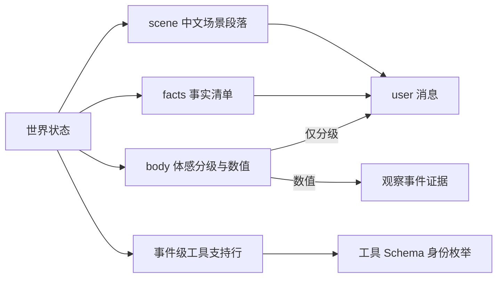

# WorldMock 接口合同

> 状态：FROZEN
> 范围：LifeEnv 与 LifeAgent 适配接口、数字足迹事件与存储、语料内容目录、LabelKit 输入输出与交付格式、命令行与运行状态。
> 权威：记录引擎的事件、素材、存储与导出合同统一在[记录引擎设计](design/05-recording-engine.md)定义；其余接口签名、字段名、枚举值、Schema、文件格式与命令行参数在本文件定义。其他文档只引用所属合同，代码变更先更新对应合同。

## LifeEnv 状态字段

### 状态归属

| 状态 | 内容 | 修改权限 |
| --- | --- | --- |
| 世界 | `simulation_time`, `locations`, `weather`, `corpus_version`, `calendar`, `scheduled_events` | 环境规则 |
| 人物身体 | `available_energy_kcal`, `sleep_deficit_hours`, `entertainment_need`, `recent_activities`, `physiological_state` | 时间推进、进食、睡眠和活动结算 |
| 人物资产 | `account_balance`, `inventory`, `consumables_count`, `access_rights` | 交易、交付、使用与合同结算 |
| 人物活动 | `activity_type`, `start_time`, `progress`, `next_decision_time`, `occupied_resources`, `pause_reason`, `end_reason` | 人物申请，环境验证并执行 |
| 工作 | `task`, `materials`, `deadline`, `deliverable`, `review_result`, `contract`, `payment_status` | 任务来源、人物交付与独立验收规则 |
| 内容接触 | `visible_catalog`, `read_emails`, `played_segments`, `game_state`, `material_ranges` | 实际接触行为与内容提供过程 |
| 记忆 | AS2 人物记忆及其版本、`source_event`, `retrieval_results` | 人物记忆流程 |

人物身体与资产的准确数值属于世界事实，只进入足迹与评估。人物实际收到的是确定性规则算出的体感分级与自然语言场景描述；训练数据导出再按目标系统的信息范围裁剪，不默认线上设备能读到环境隐藏状态。

### 资源与需求字段

| 量 | 类型 | 单位 | 说明 |
| --- | --- | --- | --- |
| `time` | UTC 整数秒 | seconds | 场景时区，同秒事件有严格序号 |
| `money` | 整数 | 最小货币单位 (分) | 避免浮点累计误差 |
| `available_energy` | 浮点 | kcal | 实验中的可用能量状态 |
| `sleep_deficit` | 浮点 | hours | 与食品能量独立 |
| `entertainment_need` | 浮点 | 归一化 [0,1] | 随生活积累 |
| `work_need` | 复合对象 | - | `deadline`, `contract`, `task`, `economic_goal` |

### 生命周期

| 接口 | 签名 | 行为 |
| --- | --- | --- |
| `__init__` | `(scenario_path: str \| None = None)` | 仅保存配置路径和建立资源句柄，尚不创建世界 |
| `init` | `(start_datetime: datetime)` | 核验内容目录、规则、初始世界与时间；初始化数据库和事件计划 |
| `step` | `(tick: int, t: int)` | `tick` 为推进秒数，`t` 统一为结束时间；满足 `t = 上次已确认时刻 + tick` |
| `to_workspace` | `(workspace_path: str \| None = None)` | 遵循 AS2 签名；无参时使用已绑定工作区，持久化必要状态与检查点引用；错误必须传播 |
| `restore` | `(workspace_path: str)` | 读取明确指定的有效检查点，核对代码、规则、数据、时间和人物状态版本 |
| `close` | `()` | 关闭数据库等资源，保留运行终态与未完成活动 |

AS2 的环境扫描要求自定义环境类直接定义在 `custom/envs/*.py`；`LifeEnv` 在该文件定义，业务逻辑导入普通模块。正式实例通过现有 AS2 环境参数传入场景路径；`init` 缺少场景时明确失败，不生成默认世界继续运行。无参检查只用于注册与工具 Schema 发现，运行测试必须传入真实场景参数。

### 人物工具与管理接口

所有模型工具经 `submit_action(call)` 统一登记，宿主附加 `agent_id`、`decision_id`、`action_id`、观察版本与本轮顺序；这些上下文由 runner 与路由绑定，不出现在模型可填写的参数中。工具 Schema 由对应 Pydantic 请求模型直接生成，全部字段必填，没有缺省参数或条件可选字段，数组数量边界由同一模型的本地校验器完整执行，不能静默截取。LifeEnv 不为每个模型工具另建同名 RPC 方法。

| 工具 | 参数 | 返回 |
| --- | --- | --- |
| `observe` | `context` (宿主只读 RPC) | 当前可见状态、已到达通知和已完成的内容接触结果 |
| `start_basic_activity` | `activity_type`, `planned_duration_seconds` | `status: "submitted"`, `action_id` |
| `start_targeted_activity` | `target_id`, `activity_type`, `planned_duration_seconds`, `playback_speed` | `status: "submitted"`, `action_id` |
| `start_travel` | `destination_id`, `travel_mode`, `planned_duration_seconds` | `status: "submitted"`, `action_id` |
| `set_activity_state` | `activity_id`, `operation` (`pause`/`resume`/`cancel`) | `status: "submitted"` |
| `change_playback_speed` | `activity_id`, `playback_speed` | `status: "submitted"` |
| `continue_activity` | `activity_id` | `status: "submitted"` (只安排后续反馈，不额外推进时间) |
| `discover_places` | `product_id`, `business_kind`, `travel_mode`, `max_travel_seconds`, `cursor`（全部必填，可空边界见下文） | `status: "submitted"`, `action_id`；发现结果结算后进入下一次观察 |
| `purchase` | `items: List[{supply_id, quantity, price_version}]` (1–5 件), `fulfillment`, `destination_id` | `status: "submitted"`, `action_id` |
| `consume` | `items: List[{product_id, quantity}]` (食品 1–3 件，非食品使用仅 1 件), `use_mode`, `duration_seconds` | `status: "submitted"` |
| `submit_work` | `task_id`, `deliverable` | `status: "submitted"` |
| `game_action` | `game_session_id`, `command` | `status: "submitted"` |
| `browse_activities` | `category` (活动品类摘要的键，取值闭集由当前观察绑定), `cursor` (必填可空，首屏显式为 `null`) | `status: "submitted"`, `action_id` (纯查询，不启动活动、不消耗内容；品类条目清单经 `action_result` 按下方「候选与呈现合同」的「下推返回体」返回) |
| `plan_day` | `segments: List[{start, end, intent_kind, note}]` (5–8 段) | `status: "submitted"` |
| `revise_day_plan` | `segments: List[{start, end, intent_kind, note}]` (1–8 段，只含尚未开始的段) | `status: "submitted"` |
| `send_message` | `recipient_id`, `text` | `status: "submitted"` |
| `start_social_activity` | `kind` (`chat`/`call`), `partner_id`, `duration_minutes`（1–120 分钟） | `status: "submitted"` |

#### 交互菜单声明与有效菜单

场景根对象必须显式包含 `interaction_menus_by_location_kind`，键集合恰好等于场景中
场景选中地点经地图目录解析后的 `kind` 不同值集合；每个人物也必须显式包含 `interaction_menu`。人物值可以为
`null`，表示不在地点菜单之外增加限制；地点菜单不能为 `null`。解析后的地点 `kind` 是交互菜单地点类，
与候选资格使用的 `location_kinds` 不是同一个字段或词表。

```python
InteractionMenu = {
    "allowed_tools": list[str],
    "allowed_activity_kinds": list[str],
}
```

两个数组都非空、无重复且只接受非空白字符串，菜单对象不接受未知字段。
`allowed_tools` 的闭集是 `worldmock.life.models.REQUEST_MODELS` 注册的工具名，包含 `discover_places`；
`allowed_activity_kinds` 的闭集是当前可供性注册表的 `kinds`。
场景地点类缺项或多项、人物字段缺失、未知名称、错误类型、重复、空数组或缺少保护项均拒绝加载。

| 保护集合 | 每个非空菜单必须显式包含 |
| --- | --- |
| 工具 | `start_basic_activity`、`plan_day`、`revise_day_plan`、`set_activity_state`、`continue_activity`、`change_playback_speed`、`game_action` |
| 活动类型 | `wait`、`sleep` |

当前有效菜单按人物权威位置取得地点类菜单，再与人物菜单逐字段求交集并确定性排序；人物菜单为
`null` 时直接使用地点类菜单。它是现有状态、阶段、能量、可见目标、日首计划和回合预算门控之前的
准入约束，只能继续收窄工具与参数，不能放宽既有规则。完整活动控制、下钻品类映射和恢复资格见
[交互菜单规格](dev/SPEC-interaction-menu.md#观察与人物工具)。菜单不得删除 `scene`、`facts`、
`affordance_contract` 或候选，也不得改变候选排除原因、呈现上限和轮转。

实际模型请求 Schema、本地决策校验和环境受理使用同一轮冻结菜单。环境在产生领域副作用前按权威
状态重验；违反工具、活动类型、下钻品类或恢复资格的请求返回 `INTERACTION_MENU_DENIED`，
并沿用 `action_rejected` 与 `action_result` 的公开结果通道。拒绝不得扣款、消费、启动或恢复活动、
推进游戏、发送消息或调用工作验收。只读人物查询不进入生活观察与菜单，只开放原有记忆工具及只读
`finish`。完整声明、失败关闭和验收要求以[冻结特性规格](dev/SPEC-interaction-menu.md)为准。

| 管理接口 (不向模型暴露) | 参数 | 返回 |
| --- | --- | --- |
| `scheduling_state` | - | `decidable_agents: List[str]`, `next_event_time: int` |
| `commit_decision_round` | `round_id: str` | 按预定顺序结算请求 |
| `checkpoint` | `request` | 保存共同检查点 |

模型工具名是 LifeAgent 的原生请求合同。删除旧的 `start_activity`、`change_activity` 工具名，不维护别名；领域执行函数可以共享已有活动实现。食物和耐用品使用始终走 `consume`，不能用缺少物品信息的通用活动请求模拟消费。余额调整、天气设定、地点瞬移、验收强制通过和全世界读取不向人物暴露，也不提供通用代码执行接口。`readonly=True` 表示调用不改变生活状态，观察调用本身仍需要留下证据。

### 日程骨架请求

`plan_day` 与 `revise_day_plan` 提交同一形状的段序列。请求模型层只要求 `intent_kind` 是非空白文本；意图闭集与骨架约束由当日骨架的构造与校验承担。

单位披露合同：`start`/`end` 是绝对 Unix epoch 秒（UTC）。工具描述与 `PlanSegmentInput.start`/`end` 字段描述必须写明该单位（"absolute Unix epoch seconds (UTC), never minutes-of-day"）；scene 与 facts 在 `current_time`（ISO 本地时间）旁并排披露 `current_epoch`（当前时刻）、`day_start_epoch`（当日本地 00:00）、`day_end_epoch`（当日结束，即次日 00:00）与 `bedtime_epoch`（当日就寝锚点，人物特有），模型据此直接换算、不必猜单位。提示只给 ISO 本地时间时模型曾以"当日分钟数"提交（1/20/470/1350），烧掉约四成模型调用直至预算耗尽（runs/deepseek-day-openrouter 实证）。

边界披露合同：`day_end_epoch` 与当日骨架校验的拒绝边界同源——同一 `day_end_seconds(now, timezone)`（场景时区次日零点），段 `end` 超过它即 `PLAN_SEGMENTS_INVALID`（"segment ends after day_end"）。披露值即校验值，模型不再需要猜"当日还剩多久"；就寝窗口跨午夜（末端 >24h）的人物，其就寝锚点被钳制不超过 `day_end_epoch`（见 `bedtime_anchor`）。只披露两个起点锚点而不披露终点上界时，模型规划末段"看到睡觉"只能猜边界值，猜过线即拒且拒绝消息不含边界值，run10 一日模拟 agent 2 因此连续 10 次被拒触发 fail-closed 死亡（decision `a85e7c73…:agent:2`，segment 7 ends after day_end）。`bedtime_epoch` 与当日骨架校验的就寝覆盖边界同源——同一 `bedtime_anchor(now, timezone, declared_end_hour)`（`AgentConfig.bedtime_window` 末端小时，未声明走 persona-mapping 缺省，跨午夜钳制 ≤ `day_end_epoch`；`engine._plan_day` 对同一人物取同一末端），最末段 `end` 低于它即 `PLAN_SEGMENTS_INVALID`（"plan does not cover until bedtime"），`revise_day_plan` 修订结果经同一校验。披露值即校验值，就寝不跨午夜的人物（锚点严格早于 `day_end_epoch`）规划"最后一段到就寝"时不再需要猜就寝时刻。

| 字段 | 类型 | 说明 |
| --- | --- | --- |
| `start` | 整数，UTC 纪元秒，大于零 | 段起点 |
| `end` | 整数，UTC 纪元秒，大于零 | 段终点，必须晚于 `start`，不得超过披露的 `day_end_epoch`（越过即 `PLAN_SEGMENTS_INVALID`），且最末段的 `end` 须到达披露的 `bedtime_epoch`（低于即 `PLAN_SEGMENTS_INVALID`） |
| `intent_kind` | 文本 | 段意图，取下方闭集十一项之一 |
| `note` | 文本 | 一句话说明，允许空串，上限 300 字符（与消息文本同限；请求模型与当日骨架持久层同限执行，超出即拒绝） |

| 约束 | `plan_day` | `revise_day_plan` |
| --- | --- | --- |
| 段数 | 5–8 段；下限由首次提交的骨架构造承载，上限由当日骨架承载 | 不设段数下限，下限只约束首次提交，修订后剩余段数允许少于 5；替换全部未开始段后的总段数不超过 8 |
| 段起点 | 不得早于当前时刻 | 不得早于当前时刻；已开始的段（`start` 不晚于当前时刻）原样保留为前缀，改写已开始的段即拒绝 |
| 骨架 | 段按起点升序、不重叠，末段覆盖到当日就寝，任何段不越过当日结束 | 同左 |
| 提交条件 | 当日已提交过或当日计划仍有效时拒绝重复提交 | 当日计划不存在时拒绝 |


段意图闭集（`intent_kind`）：

```python
IntentKind = Literal[
    "睡眠", "晨间例程", "通勤", "工作", "用餐", "休息",
    "娱乐", "社交", "家务", "运动", "外出",
]
```

段意图到实际活动家族的对应关系是照做判定的判据：段区间内时间加权主导家族属于该意图的家族闭集即判定为照做。未覆盖秒数计入 `idle`，`idle` 不属于任何意图家族。

| `intent_kind` | 活动家族闭集 |
| --- | --- |
| 睡眠 | `sleep` |
| 晨间例程 | `lifestyle:wellness`, `wait` |
| 通勤 | `travel` |
| 工作 | `work` |
| 用餐 | `consume` |
| 休息 | `wait`, `lifestyle:wellness` |
| 娱乐 | `watch`, `play_game`, `browse`, `lifestyle:hobby` |
| 社交 | `chat`, `call`, `lifestyle:social` |
| 家务 | `lifestyle:household`, `lifestyle:pet` |
| 运动 | `lifestyle:sport` |
| 外出 | `travel`, `lifestyle:outdoor` |

家族令牌取活动类型文本，生活活动为 `lifestyle:<category>`（`category` 取生活活动目录的类别闭集）。

工具面与生命周期：当天第一次醒来（`run_start` 或 `wake_from_sleep`）且当日尚无计划时，动作工具面只保留 `plan_day`；`plan_day` 在当日尚无计划时开放，`revise_day_plan` 只在存在尚未开始的段时开放。计划跨日残留（当前时刻越过计划自带的当日结束时刻）即归零，使次日的首次提交重新成立。计划进入观察的 `day_plan`，就寝时刻之后对观察隐藏。环境不执行计划步，登记成功只表示计划成为人物的自我承诺。

| 结算拒绝错误码 | 触发条件 |
| --- | --- |
| `PLAN_ALREADY_SUBMITTED` | 当日已提交过计划，或当日计划仍有效 |
| `PLAN_SEGMENTS_INVALID` | 段数、段跨度或骨架约束不满足 |
| `PLAN_SEGMENT_ALREADY_STARTED` | 试图改写已经开始或早于当前时刻的段 |
| `PLAN_NOT_FOUND` | 当日计划不存在时发起改写 |
| `ACTION_REQUEST_INVALID` | 请求载荷未通过引擎边界再验证（任何工具的通用兜底；如绕过构造期校验的超长 `note`） |

### 请求字段与结算检查

| 请求 | 主要业务字段 | 结算时的关键检查 |
| --- | --- | --- |
| 启动活动 | `activity_type`, `target_id`, `planned_duration_seconds`, `playback_speed`；出行另有 `destination_id`、`travel_mode` | 内容已可访问、位置合法、没有冲突占用；持续时间取 60–86400 秒 |
| 修改活动 | `activity_id`, `operation` (`pause`/`resume`/`cancel`)；变速走独立的 `change_playback_speed` 请求，字段为 `activity_id`, `playback_speed` | 活动属于调用者，转换合法；倍速在已声明范围内 |
| 发现地点 | `product_id`, `business_kind`, `travel_mode`, `max_travel_seconds` | 选择范围、地图身份、道路状态和实际返回信息；只登记生活动作 |
| 购买 | `items: List[{supply_id, quantity, price_version}]`, `fulfillment`, `destination_id` | 同地点同卖方、无重复供给、有效报价、资金、供给库存、营业、资格和履约范围 |
| 使用 | `items: List[{product_id, quantity}]`, `use_mode`, `duration_seconds` | 物品已取得、数量足够、用途符合物品定义 |
| 提交工作 | `task_id`, `deliverable` | 任务归属、进度、截止规则、素材存在及未重复结算 |
| 游戏动作 | `game_session_id`, `command` | 会话归属、当前局面和游戏进度 |
| 浏览活动品类 | `category` | 品类是当前观察活动品类摘要的键，未知品类拒绝 |

### 请求模型的闭集与字面边界

工具 Schema 由请求模型直接生成，全部字段必填。下列闭集与字面边界在请求模型层声明，与结算检查相互独立；文本身份字段（`target_id`、`destination_id`、`activity_id`、`product_id`、`supply_id`、`task_id`、`game_session_id`、`partner_id`、`recipient_id`、`price_version`）一律要求非空白。

| 请求 | 字段 | 闭集或边界 |
| --- | --- | --- |
| `start_basic_activity` | `activity_type` | 模式 `^(?:wait\|sleep\|lifestyle:[a-z0-9][a-z0-9-]*)$` |
| `start_basic_activity`、`start_targeted_activity`、`start_travel` | `planned_duration_seconds` | 60–86400 秒 |
| `start_targeted_activity` | `activity_type` | `work`、`watch`、`play_game`、`read_mail`、`browse` |
| `start_targeted_activity`、`change_playback_speed` | `playback_speed` | 0.5–2 |
| `start_travel` | `travel_mode` | `driving`、`walking` |
| `discover_places` | `product_id`、`business_kind` | 必填可空字符串；非空时不得全为空白，`null` 表示不按该条件筛选 |
| `discover_places` | `travel_mode` | `driving`、`walking`，必须显式提供 |
| `discover_places` | `max_travel_seconds` | 必填可空正整数，上限 86400 秒；`null` 表示不加道路时间上限 |
| `discover_places` | `cursor` | 必填可空字符串；首次为 `null`，后续原样使用 `next_cursor`，不得伪造或跨筛选条件/地图/起点复用 |
| `purchase` | `items[].supply_id` | 必须是实际呈现过且仍可见的供给身份，整单不得重复 |
| `purchase` | `items[].quantity` | 1–100 |
| `purchase` | `fulfillment` | `delivery`、`pickup` |
| `consume` | `items[].quantity` | 大于零且不超过 100 |
| `consume` | `use_mode` | `eat`、`use` |
| `consume` | `duration_seconds` | 60–14400 秒 |
| `game_action` | `command` | 不超过 200 字符 |
| `browse_activities` | `category` | 模式 `^[a-z][a-z0-9_]*$` |
| `browse_activities` | `cursor` | 可空文本；字符串 `"null"`/`"None"` 与纯空白按首屏 `null` 归一；其余非空时必须是上一页返回的 `next_cursor` 原值，不解析其内部结构；载荷不合形状时该次调用以 `BROWSE_CURSOR_INVALID` 拒绝 |
| `send_message` | `text` | 不超过 300 字符 |
| `start_social_activity` | `duration_minutes` | 1–120 分钟 |
| `submit_work` | `deliverable` | 会议纪要结构：`summary`、`decisions`、`action_items`，三者均不得为空白 |

**可空与缺省不同**：`browse_activities.cursor` 和发现动作的可空筛选字段都必须显式填写。首屏游标为 `null`，后续屏提交上一页 `next_cursor` 原值；发现筛选的 `null` 表示不增加该筛选。缺字段仍拒绝，不生成隐含条件。首屏游标若被写成字符串 `"null"`/`"None"`（browse_activities 另含纯空白），环境在请求边界归一为 `null`；解析不了的非空游标文本按业务错误拒绝该次调用（browse_activities 为 `BROWSE_CURSOR_INVALID`，发现动作为 `DISCOVERY_CURSOR_INVALID`），不静默从首页重读。

请求不能指定任意文件路径让环境读取；引用只允许已经登记且对人物可见的素材，实际文本交付由宿主保存成新素材。请求校验失败返回明确业务错误，环境不自动修改数量、替换商品、改变目的地或选择其他行动。

### 动作状态与动作结果

```python
ActionStatus = Literal[
    "submitted",      # 已提交待结算
    "accepted",       # 已接受
    "in_progress",    # 进行中
    "completed",      # 完成
    "rejected",       # 拒绝
    "cancelled",      # 取消
    "failed",         # 失败
    "unknown"         # 结果未知
]
```

人物工具在决策阶段登记请求并返回已提交状态；资产检查和世界修改在收齐本轮提案后由环境执行。模型和游戏外部调用结果不明时，结果状态使用 `unknown`。登记成功不等于购买成功，也不等于活动完成：开始一个三十分钟的活动只代表它已开始，结果中不能立即包含三十分钟后的剧情或交付成果。已接受动作带活动标识、起始时间和下一次反馈时间；完成事件带实际执行区间、结果及可追溯的结算。正常业务拒绝回给人物继续选择；记录失败或程序错误终止运行，不能伪装成业务拒绝。人物记录的「已提交」必须引用实际登记的动作请求，决定想做、请求已登记与动作已完成分别表达。

模型的 `finish` 必须单独返回，不能与购买、游戏或其他工具出现在同一批调用中。生活决策开始时只开放生活动作和记忆查询；实际提交一个生活动作后，才开放 `finish`，并撤下生活动作工具，结束前仍可查询记忆。显式只读人物查询保持其独立的只读结束合同；当前未开放的工具必须拒绝执行。冲突响应保存原文和协议错误，整批不执行，在现有 ReAct 剩余回合内把错误反馈给模型自行重新提交。每次非法响应消耗一个回合，预算耗尽才终止人物决策。

### 领域枚举

活动类型与状态、活动变更、履约方式、出行方式与计酬方式在源码中以 `StrEnum` 声明，取值如下。

```python
ActivityKind = Literal[
    "wait", "sleep", "work", "watch", "play_game", "travel",
    "read_mail", "browse", "consume", "lifestyle", "chat", "call",
]

ActivityStatus = Literal[
    "active", "paused", "completed", "cancelled", "failed", "truncated",
]

ActivityChange = Literal["pause", "resume", "cancel", "change_speed"]

TravelMode = Literal["driving", "walking"]

FulfillmentKind = Literal["delivery", "pickup"]

ContractKind = Literal["package", "hourly", "piece"]
```

`lifestyle` 是生活活动子类型的统一活动类型，具体条目放 `target_id`，令牌形式为 `lifestyle:<activity_id>`；`chat` 与 `call` 是交谈与通话的前台活动类型，不在可供性注册表内。

| 接口 | 取值 |
| --- | --- |
| 订单状态 `DeliveryState.status` | `pending`、`ready`、`delivered`、`cancelled` |
| 决策轮状态 `DecisionRoundState.status` | `open`、`committed`、`aborted` |
| 世界状态结构版本 `WorldState.schema_version` | 4 |

环境自主到期事件（世界状态 `pending_events`）的类型闭集：

```python
ScheduledKind = Literal[
    "mail_arrival", "delivery_arrival", "work_available",
    "task_expired", "calendar_flag", "bill_due", "payroll",
    "price_change", "supply_quote_change", "product_release",
]
```

| `ScheduledEvent` 字段 | 说明 |
| --- | --- |
| `scheduled_id`, `kind`, `due_at`, `sequence` | 事件身份、类型、到期模拟时刻与确定序号 |
| `agent_id`, `data` | 相关人物（可为空）与事件载荷 |

## 地图与门店供给合同

本节定义 [地图与门店供给规格](dev/SPEC-map-and-storefront.md) 的字段面。记录正文和恢复材料由
[记录引擎](design/05-recording-engine.md)定义；实现与验收状态独立记录。

### 冻结地图与场景引用

| 结构 | 字段 | 约束 |
| --- | --- | --- |
| `MapDatasetReference` | `dataset_id`、`version`、`path`、`sha256` | 稳定非空身份、整数版本、冻结文件位置及 SHA-256；文件身份与语料清单一致 |
| 场景 `locations` | 每项仅 `location_id` | 引用地图地点，不复制名称、坐标、营业或路线 |
| 场景 `products` | 每项仅 `product_id` | 引用商品定义，不携带卖方、报价或门店库存 |
| 场景 `supplies` | `supply_id`、可选 `initial_stock` | 引用冻结供给，可显式覆盖实例库存初值 |
| 运行时场景 | 完整 `map_dataset`、`locations`、`routes`、`products`、`supplies` | 只解析场景选中的范围；引用之外不得行动 |
| 人物声明 | `qualifications` | 显式资格集合；到达与购买分别验证，不能从画像推断 |

地图元数据固定 WGS84、时区、区域、来源时间、许可及通知。地点同时具有 `kind`、`business_kind`、
`location_kinds`，分别服务交互菜单、经营业态和活动环境；品牌可以缺失。供给以 `supply_id` 标识，
`(location_id, product_id, seller_account_id)` 唯一；多个卖方账户允许共享经营角色。
商品没有卖方、门店、购买报价、库存或配送处理时长；商品效果与取得后的持有仍按 `product_id`。
运行时 `ProductConfig` 继承 `InventoryItemConfig`，共享 `category_id`、`inventory_unit` 和使用语义；购买可供性由独立供给补充。

当前版本边界为地图文件结构 1、商品目录 major 4、品类契约版本 2、交换规则绑定版本 2、场景结构 3、世界状态结构 4。
这些版本分别约束不同输入，不能相互替代。旧商品门店字段、旧场景内嵌地点和旧世界状态直接拒绝，
不保留迁移脚本、兼容解析或回退数据源。

### 营业与报价声明

| 结构 | 字段 | 约束 |
| --- | --- | --- |
| `QuoteConfig` | `price_version`、`price_fen` | 非空报价版本与正整数分价格，取值由供给声明 |
| 时态声明共有字段 | `effective_from`、`effective_to`、`reviewed_on`、`still_valid_on`、`source` | 生效时刻带时区，结束可空；适用区间左闭右开，核对日期不得晚于可信截止日；来源保留事实或假设依据 |
| `OpeningCalendar` | 时态共有字段、`weekly`、`exceptions` | 周声明与日期例外使用同一时间口径 |
| `weekly` | 周一至周日的字符串键 `"0".."6"` 到开放区间映射，七天全部声明 | 每段以分钟 `opens`/`closes` 表示；跨午夜的 `closes` 大于 1440 |
| `exceptions` | 日期到开放区间映射 | 优先于每周声明；空区间明确闭店，不能继承前日跨夜营业 |
| 营业结果 | `open`、`closed`、`unknown` | 未生效、声明间隙与未知资料保持未知，不默认全天开放 |

同类生效声明不得重叠。所有营业消费者使用同一解释入口；运行例外覆盖和日历边界进入事件时钟。
报价未定义时不能购买，不使用零价或最后一次旧值。核对有效性在发布时校验，不把近期资料冒充实验日期事实。
`source` 严格使用 `DataSource`：`kind`、`url`、`retrieved_at`、`license`、`notice`、`fact_cutoff`、`applicability`。
当前报价状态恢复也校验该结构；空对象不能充当来源。显式调价和补货声明使用自身的场景假设来源。

### 地点发现与购买身份

`discover_places` 接受 `product_id: str | null`、`business_kind: str | null`、
`travel_mode: walking | driving`、`max_travel_seconds: int | null` 与 `cursor: str | null`，五个字段均必填。
分页以实际呈现条数为界，返回 `total/returned/returned_places/next_cursor`；游标绑定地图、选区、筛选与起点，
时间推进或世界版本更新不使同一查询失效。越界或篡改游标明确拒绝，不自动重启首屏。
道路范围使用分时路线预计秒数。已知超范围、不可达和资料未知分别表达，未知结果保留地点身份与原因。
路线状态为 `reachable/unreachable/unknown`；成功和已证不可达记录必须绑定原始响应及哈希。
每个所选有向端点与方式组合都必须有记录；`unknown` 可仅有来源解释且禁止出行。真正缺记录属于发布错误，
既不能伪造 `unreachable`，也不能用漏项隐式表达 `unknown`。

发现结果经 `action_result` 和下一次观察返回，包含实际筛选条件及有序地点/供给结果。
成功发现登记 `discovery_result` 唤醒，在下一秒合法决策回灌；同轮不允许再选择生活动作。
每行公开实际返回的路线、分时路程和费用、营业、资格、报价及版本、库存、履约和来源；不得注入未返回供给。
完整记录结构见[地图与门店供给证据](design/05-recording-engine.md#地图与门店供给证据)。

公开供给行保留原始 `price_fen`、`price_version` 与 `quote`，同时提供 `purchase_pairing_state`、`purchase_coefficient` 和 `purchase_price_fen`。
配对为 `defined` 时，系数来自冻结声明，`purchase_price_fen` 通过同一 `purchase_amount` 入口计算购买一份的实际金额；报价未知时金额为 `null`。
配对不是 `defined` 时保留原始报价和配对状态，系数及实际金额均为 `null`，`purchase_allowed=false`；动机跳过该供给，但不隐藏已持有物品。
人物的余额判断和价格排序也使用该入口计算的一份金额。多份请求必须用原始报价、数量和系数重新求整行金额，不能把已取整的一份金额乘以数量。
原始报价保持正整数分；明确的 `defined` 配对可以有零系数并产生零额付款，仍正常扣供给库存和履约，不能把 `no_effect` 当作零价购买。

购买每行只用 `supply_id`、`quantity`、`price_version`；整单一至五项，同一地点、同一卖方且无重复供给。
消费每行仍用 `product_id`、`quantity`。自提必须在所选门店，不要求配送路线；配送按供给支持、范围及路径验证。
每个订单行调用 `evaluate_purchase(quote.price_fen, quantity, coefficient)`，以 Decimal 对整行乘积向上取整分，形成该行的 `total_price_fen`；整单 `total_price_fen` 为各行金额之和。不得先对单价取整再乘数量。
报价身份和值保持原声明，付款账户取人物账户、收款账户取供给 `seller_account_id`；品类配对继续校验，禁止静态商品转账边替代。
错误字段继续使用既有 `error_code`；未知营业、闭店、资格不足、无报价、旧报价、库存不足、履约不支持、
路径不可达和资料未知必须可区分，不能统一归成“未找到商品”。英文错误与日志不得泄露凭据。

### 持久化当下事实

| 世界字段 | 身份与语义 |
| --- | --- |
| `supply_stock` | 供给身份到非负库存；替代按商品共用的门店库存 |
| `supply_quotes` | 供给身份到当前报价状态或 `null`；未知保留空值，不从初始目录补回 |
| `opening_exceptions` | 地点身份到日期开放区间的世界覆盖；与冻结定义共同求值 |
| `presentation_state` | 购买呈现按人物与供给身份记录，持有使用保留商品身份 |

世界结构版本为 `4`，旧购买请求、旧场景和旧检查点直接拒绝。人物的 `visible_supply_ids`、
`supply_browsed_at`、`supply_browsed_location` 分别保存实际可见供给集合及逐供给的呈现时刻、呈现地点映射。
三者的供给键集必须一致；只更新本次实际呈现行，不延长未呈现供给的可见期。资格、库存、
报价、营业例外和轮转状态随共同检查点往返；地图或代码身份改变后不能打开或恢复为同一运行。

### 供给结算与事件载荷

`price_change` 携带 `supply_id/price_version/amount_fen/source`，显式调价必须用新版本和自己的场景假设来源。
调价要求到期时存在有效报价，新的起点为 `due_at`，终点保留原报价到期或下一声明边界；无有效声明不能凭空生成永久价格。
`supply_quote_change` 在声明生效与失效边界完整替换报价，声明间隙写入 `null`；同一边界先切换声明，再执行该秒显式调价。
`product_release` 携带 `supply_id/stock/source`，仅把该供给库存设置为声明数量，允许明确置零；来源必须标为场景假设。

一次配送使用单个 `delivery_arrival` 事件，其 `order_ids` 列表引用整单全部项目。结果的 `orders` 保存各项实际交付状态，
`inventory_changes` 仅记录本次新增数量；重复到期不再增加库存且该列表为空。订单保留 `supply_id/product_id/location_id/`
`seller_account_id/price_version/route_id/source` 与金额，人物持有仍以目的地和商品身份合并。

## 社交接口

社交在 `LifeEnv` 内实现，复用现有消息通道与事件类型，不装配 AS2 社交空间。行为规则归 `docs/dev/SPEC-life-runtime.md`「社交最小可行版」，本节定义字段面、闭集与数值边界。

### 场景联系人

联系人按人物在场景中声明，允许缺省为空；同一人物内 `contact_id` 唯一。

| 字段 | 类型 | 说明 |
| --- | --- | --- |
| `contact_id` | 文本 | 联系人身份，同一人物内唯一 |
| `salutation` | 文本 | 称谓 |
| `relation` | 文本 | 关系 |
| `closeness` | 整数，0–30 | 亲密度 |
| `channels` | 文本数组 | 可用联系渠道，元素非空；引擎据此约束可达性 |
| `reply_policy` | 枚举 | 回复策略，取下方闭集 |

```python
ReplyPolicy = Literal["none", "template", "model"]
```

### 消息与收件箱

```python
MessageKind = Literal["direct", "chat_invite"]
```

| 量 | 值 |
| --- | --- |
| 消息信封字段 | `message_id`, `kind`, `sender_id`, `recipient_id`, `text`, `created_at` |
| 消息正文上限 | 300 字符，按字符数计，超出即拒绝，不截断；直发消息与交谈邀请同一上限 |
| 交谈邀请文本 | 由引擎生成，携带发起方姓名与邀约时长 |
| 送达记录 | `environment_event` 的 `data.kind` 取 `message_arrival`，携带 `message_id`、`recipient_id`、`occurred_at` |

### 交谈与通话

| 量 | 值 |
| --- | --- |
| 交谈请求 | `kind=chat`，要求双方共同在场且对方可交谈（对方清醒且未在主动游戏） |
| 交谈时长 | 请求模型取 1–120 分钟；域只要求时长为正，活动通道另要求折算后不少于 60 秒 |
| 通话请求 | `kind=call`，`partner_id` 取场景联系人身份 |
| 通话时长 | 10–60 分钟闭区间，越界即拒绝 |
| 社交需要缓解速率 | 交谈被接受：双方各 0.5/小时；交谈被拒绝：发起方 0.2/小时；通话：0.4/小时 |
| 接受判定 | 对方存在以发起方为伙伴标识的进行中交谈活动 |
| 资源占用 | 交谈与通话恒占位置与注意力；不可暂停，取消任意时刻允许并保留已结算进度 |

### 联系人回复

| 量 | 值 |
| --- | --- |
| 策略行为 | `none` 不回复；`template` 落一条占位回复文本；`model` 触发一次独立模型调用 |
| 幂等 | 每条收到的消息最多回复一次，幂等键为收件消息的 `message_id` |
| `model` 回复请求字段 | `contact_id`, `reply_to_message_id`, `recipient_id`, `incoming_text`；`thinking` 固定 `disabled`，`max_chars` 固定 200 |
| 回复文本上限 | 200 字符 |
| 回复消息身份 | `reply-<被回复消息身份>` |
| 回复影响 | 只进入收件方收件箱，不改变任何资源或任务 |
| 回复落库标记 | 域记录的 `source_kind` 为 `model_npc`；足迹事件的 `source_kind` 闭集取 `environment`、`model`、`scenario`、`external`，不含该值，落库映射为 `model`，原值保留在事件 `data.source_kind` |

| 回复事件 | 形状 |
| --- | --- |
| 待回复登记 | `environment_event`，`data.kind` 取 `model_npc_reply_pending`，携带 `request`（`model` 回复请求字段面） |
| 回复完成 | `environment_event`，`data.kind` 取 `model_npc_reply`，携带 `source_kind`、`reply_to_message_id`、`request`、`response`、`usage`、`reply` |

### 社交拒绝错误码

| 错误码 | 触发条件 |
| --- | --- |
| `RECIPIENT_NOT_FOUND` | 消息收件人既非同世界人物也非本人声明的联系人 |
| `MESSAGE_TEXT_TOO_LONG` | 消息文本超过 300 字符 |
| `CHAT_PARTNER_NOT_AVAILABLE` | 发起交谈时对方不在同一地点或不可交谈（睡眠/主动游戏中） |
| `SOCIAL_PARTNER_NOT_FOUND` | 交谈对象不在世界人物中 |
| `CONTACT_NOT_FOUND` | 通话对象不是本人声明的联系人 |
| `CALL_DURATION_OUT_OF_RANGE` | 通话时长超出 10–60 分钟 |
| `CONTACT_REPLY_NOT_MODEL` | 对非 `model` 策略的联系人登记模型回复 |
| `RESOURCE_CONFLICT` | 本人已有进行中的前台活动时发起交谈或通话 |
| `SOCIAL_ACTIVITY_CANNOT_PAUSE` | 对交谈或通话发起暂停 |
| `SOCIAL_ACTIVITY_OPERATION_UNKNOWN` | 交谈或通话的变更操作不在取消与恢复之内 |
| `ACTIVITY_TOO_SHORT` | 折算后的社交活动时长不足 60 秒 |

## 观察投影字段

引擎在每个观察边界装配一棵观察字典，供宿主渲染提示与生成工具身份枚举。它分三层：进入提示的两层投影 `scene` 与 `facts`、只进事件证据的 `body`、以及只供宿主工具面使用的行数据。三段投影的内容规则、上限与呈现细节归 `docs/dev/SPEC-life-runtime.md`「观察投影与提示合同」，本节定义字段面。

### 场景段落与事实清单



| 层 | 字段 | 说明 |
| --- | --- | --- |
| `scene` | `current_time`, `current_epoch`, `day_start_epoch`, `day_end_epoch`, `bedtime_epoch`, `location`, `people_here`, `felt`, `current_activity`, `paused_activities`, `day_plan`, `inbox_head`, `inbox_has_older_unread`, `todos_summary`, `reachable_places`, `inventory`, `recent_action_results` | 中文自然语言场景段落的渲染输入；`people_here` 是姓名列表，`day_plan` 是 `{summary, current_segment}`，活动行是 `{title, progress}`；`current_epoch`/`day_start_epoch`/`day_end_epoch`/`bedtime_epoch` 是当前时刻、当日本地 00:00、当日结束（次日 00:00）与当日就寝锚点（人物特有）的 Unix epoch 秒（「日程骨架请求」单位与边界披露合同，时间句内并排渲染） |
| `facts` | `current_time`, `current_epoch`, `day_start_epoch`, `day_end_epoch`, `bedtime_epoch`, `location_id`, `people_here`, `contacts`, `inbox`, `tasks`, `routes`, `products`, `inventory`, `day_plan`, `felt`, `drive_summary`, `recent_action_results` | 工具需要的事实清单；`day_plan` 是 `{segments, current_segment}`；`current_epoch`/`day_start_epoch`/`day_end_epoch`/`bedtime_epoch` 语义同 scene 行 |

| `scene` 行 | 字段 |
| --- | --- |
| `reachable_places` | 地点名称及 `open/closed/unknown` 营业状态；路线分钟数只保留在 facts 与工具支持行，不把未知写为闭店 |
| `inbox_head` | 按 `created_at`、`id` 排序后最近 3 条收件头，展示保持时间先后 |
| `inbox_has_older_unread` | bool；未展示集合存在未读项时为 true |
| `todos_summary` | 待办一句话，无待办时为空串 |

| `facts` 行 | 字段 |
| --- | --- |
| `people_here` | `person_id`（不透明身份，工具身份锚点）、`name`、`activity_family`、`can_talk` |
| `contacts` | `contact_id`, `salutation`, `relation`；联系人是本人的通讯录，亲密度、渠道与回复策略是引擎结算内部参数，不进提示 |
| `inbox` | `id`, `kind`, `sender_id`, `head`, `read`, `created_at` |
| `tasks` | `task_id`, `title`, `due_at`, `remaining_contract_seconds`, `new_material_ranges` |
| `products` | 实际呈现的购买供给包含 `supply_id`、`product_id`、商品名称、地点与卖方身份、原始 `price_fen`/`price_version`/`quote`、`purchase_pairing_state`、`purchase_coefficient`、购买一份的 `purchase_price_fen`、供给库存、营业/资格/履约和来源；同次结果已有该供给时可使用 `supply_id/based_on_action_id/changes` 表达当前差异；持有物使用商品身份与商品效果 |
| `routes` | `destination`, `mode`, `minutes`, `fare`, `feasible` |
| `day_plan` | `segments`（每项为 `{start, end, intent_kind, note}`）与 `current_segment`（处于段间空隙时为 `null`）；就寝时刻之后整项为 `null` |
| `recent_action_results` | `action_id`, `occurred_at`, `status`, `error_code`, `message`；包含上次观察后全部公开结果，事件顺序，不设条数裁剪；存在工作公开评审时附 `work_review`；旅行终态公开 `arrival` 的实际地点、进入状态、缺少资格和来源 |
| `drive_summary` | 由体感分级、今日工作缺口与待办拼成的一句中文，不含数字权重 |

供给差异行的 `based_on_action_id` 引用同次公开结果中的完整供给行，`changes` 按键替换原行对应值。
`null` 是应替换的实际值，不表示删除或省略；嵌套对象整体替换，不能递归合并旧来源或旧报价。
无变化的当前行不重复呈现。发现与浏览结果优先占用共同供给窗口，当前事实仅补剩余身份名额；
差异形式必须能还原完整当前比较事实，原始观察及结算证据仍保存完整行。

事件级工具支持行必须包含 `interaction_menu`，字段形状就是当前人物有效的 `InteractionMenu`。
它与该观察一起冻结并进入观察事件证据，供实际模型请求 Schema、本地决策校验和宿主派发共用；
不把所有人物或地点的原始声明送入当前人物的 user 消息。地点变化只影响下一次观察。

`work_review` 仅包含公开汇总、必需事实判断和交付项判断；嵌套字段也按显式清单选择。
两类判断的 `rationale` 不得包含本次评审任一内部参考身份或 SHA-256 摘要。
解析阶段将此类输出作为协议错误，按既有评审预算纠错并保存原始响应；公开投影入口重复验证该边界。
合法理由完整保留，不截短、不生成替代理由。内部身份、摘要与完整评审证据只留在宿主侧。

### 活动控制行

观察顶层的 `active_activity` 是事件级工具支持行，供 LifeAgent 冻结本轮活动控制合同（继续/暂停/取消的身份枚举），不进 scene/facts 提示。人物活动槽位为空时整体为 `null`；非空时控制行是恰好 7 键的字段闭集：

| 字段 | 说明 |
| --- | --- |
| `activity_id` | 活动不透明身份 |
| `kind` | 活动类型字符串（`ActivityKind` 枚举值） |
| `status` | 恒为 `"active"`：槽位不变量保证 `current_activity_id` 非空时指向的活动必为 ACTIVE——完成、暂停、取消与截断都先离开 ACTIVE 并清空槽位，不存在非 active 活动留在槽内的路径 |
| `title` | 关联内容或任务标题，无关联时为 `null` |
| `progress` | 中文进度短语，与 scene 活动行同源 |
| `elapsed_seconds` | 已进行整数秒 |
| `planned_duration_seconds` | 计划整数秒 |

同顶层的 `paused_activities` 为暂停活动列表，每项是活动完整 `model_dump`（含 `status="paused"`）加 `remaining_duration_seconds`、`minimum_energy_cost_kcal`、`resume_energy_feasible` 三键。两个顶层字段的 `status` 均由 LifeAgent 控制合同校验：缺键或非闭集值时本轮决策明确失败，不静默降级。

### 体感与动机证据

`body` 分两组：`levels` 是进入提示的体感分级短语，`values` 是只进事件的数值，含 `appetite`、`sleepiness`、`entertainment_need`、`social_need`、`mood_valence`、`sleep_pressure`、`energy_kcal`、`sleep_deficit_hours`。动机评分器继续计算并写入 `motivation_internal`，只供评估与研究，不进提示。

人物身体常量 `chronotype_midsleep` 与 `sleep_need_hours` 属于人物状态与人物档案，只驱动世界层结算，不是观察投影字段；确定性口味权重 `taste_weights` 属于人物状态，由卡片口味与内容题材匹配得到，只供内部评分器与浏览排序使用，不进提示。

### 可见期与提示预算

| 量 | 值 |
| --- | --- |
| 门店供给可见期 | 只覆盖实际呈现的供给；逐供给记录后超过 1800 秒或离开呈现地点失效，人在门店也不能自动授权未呈现供给 |
| 工作材料单次揭示上限 | 每任务 2000 字符，只揭示自上次决策以来的新读区间 |
| 收件箱头展示条数 | 3 |
| 最近动作结果摘要条数 | 不截断；全部新结果受 user 消息整体预算约束 |
| user 消息字符预算 | 40000 |
| system 消息字符预算 | 3000 |
| 场景段落汉字上限 | 800 |
| 人物卡片汉字上限 | 600 |
| 决策自述汉字上限 | 200 |

user、最终 system、场景与人物卡超出预算即运行故障并记录英文错误日志：不截断、不删字段。
system 在追加权威回合预算块后检查。决策自述的空与超长属于可重试一次的协议错误；
收件头是展示选择，材料揭示是增量窗口，门店供给可见期是可见性条件，不属于消息预算故障。

工作公开评审只取 `public_work_review` 定义的字段：`accepted`、`required_fact_total`、
`required_fact_passed`、`required_fact_missing`、`missing_content_categories`、
`required_fact_assessments`、`delivery_assessments`。逐项判断只含公开内容品类、判断、
理由与经来源核实的原文片段，不含内部参考身份、答案、哈希、资源账户或完整活动快照。
具体时序与无损回灌行为见 [决策上下文规格](dev/SPEC-decision-context.md#登记确认与结算结果)。

### 候选与呈现合同

候选的生成、资格、排序与轮转是行为规则，归 `docs/dev/SPEC-life-runtime.md`「候选契约与呈现规则」；本节只定义该章的字段面、闭集、返回体结构、场景常量名与派生量字段。

### 候选对象与来源

```python
CandidateKind = Literal["product", "lifestyle", "content", "game", "task"]

CandidateSource = Literal["on_site", "browsed", "carried", "activated"]
```

`CandidateKind` 保持原闭集。购买候选 `kind=product` 的 `object_id` 取 `supply_id`，并保留商品引用 `product_id`；
持有与使用候选仍按商品身份。用途区分购买与使用，排序、游标、排除统计及轮转不能把不同门店供给合并。
浏览或发现只授予实际呈现供给的可见资格，不能把整份商品目录变成购买凭据。

| 来源 | 含义 |
| --- | --- |
| `on_site` | 当前地点的常驻对象 |
| `browsed` | 浏览或激活过、且仍在时效内的对象 |
| `carried` | 在当前位置手边持有的对象 |
| `activated` | 由画像激活集在本次场景中激活的对象 |

### 排除原因码

被排除项携带的原因码取下列闭集；原因码是稳定标识，不得按人类可读文案替代。

```python
ExclusionReason = Literal[
    "ELIGIBILITY_LOCATION_ABSENT",        # 人物不在该对象要求的商家或使用地点
    "ELIGIBILITY_LOCATION_KIND_MISMATCH",  # 地点类交集为空
    "ELIGIBILITY_CLOSED_HOURS",           # 不在营业时段
    "ELIGIBILITY_OPENING_UNKNOWN",        # 当前营业声明未知，不能当作闭店
    "ELIGIBILITY_OUT_OF_STOCK",           # 库存为零
    "ELIGIBILITY_DELISTED",               # 目录级下架（墓碑语义，保留可读）
    "ELIGIBILITY_RESOURCE_CONFLICT",      # 资源占用冲突
    "ELIGIBILITY_ENERGY_INSUFFICIENT",    # 能量不允许
    "ELIGIBILITY_DURATION_OUT_OF_RANGE",  # 时长越界
    "ELIGIBILITY_DISABLED",               # 不在本人启用集内
    "ROTATION_DEFERRED",                  # 本次呈现名额已满
]
```

`ROTATION_DEFERRED` 在闭集内，计为一个排除项，能取到稳定的原因码；它与其他排除项的差别在于作用范围：只影响本次呈现的结果，不改变对象状态、不写目录。

### 排序键与游标

| 量 | 字段 | 说明 |
| --- | --- | --- |
| 排序键 | `taste_weight`（定点整数，四位小数口径与 `taste_weights` 一致）、`attention_prior`（定点整数）、`object_id`（决胜键） | 主键为口味 × 注意力先验；决胜键取对象标识，保证全序 |
| 游标 | `cursor` | 上一页返回的稳定游标；首屏显式为 `null`，后续原样传回，不解析内部结构 |
| 排序键版本 | `order_key_version` | 排序键口径的版本号，参与游标的身份 |

游标身份由（冻结目录摘要、世界状态版本、`order_key_version`、游标）四项决定。

### 下推返回体

图鉴与下推类工具（当前为 `browse_activities`）的 `action_result.data` 返回体：

| 字段 | 类型 | 说明 |
| --- | --- | --- |
| `tool` | 文本 | 工具名 |
| `category` | 文本 | 品类键 |
| `returned` | 整数 | 本次返回条数 |
| `total` | 整数 | 该分区过滤后的候选总数 |
| `next_cursor` | 文本或 `null` | 下一页游标，最后一页为 `null` |
| `items` | 数组 | 本次返回的条目行 |
| `excluded` | 数组 | 原始结果逐项保存 `{object_id, kind, reason}` 及存在的其他排除属性，`reason` 取 `ExclusionReason`；公开投影按全部非 `object_id` 属性分组，以 `object_ids` 保留各项身份 |

`returned` 取代此前的 `count` 告知值；`count` 不再作为返回体字段。
公开排除分组必须能够逐项还原原始排除行，不能只按原因码合并后丢失其他属性。
直接下钻和有时长浏览完成共用这条投影规则，原始事件仍保留逐项行。

### 场景常量

下列常量在场景层声明（不放 `catalog/manifest.json`，避免一次增量即触发目录版本 major 变更）：

| 常量 | 含义 | 默认值 |
| --- | --- | --- |
| `candidate_presentation_limit` | 单次呈现上限 | 20 |
| `candidate_pool_limit` | 单个检索分区池上限，只用于计数与下推 | 1000 |
| `rotation_quota_ratio` | 每次呈现留给长期未呈现对象的换新名额比例 | 0.15 |
| `rotation_stale_seconds` | "长期未呈现"的判定阈值 | 无缺省，必须声明 |
| `retrieval_index_threshold` | 单一品类池超过该规模时启用倒排与 facet | 1000 |

### 派生量字段

轮转判据与曝光留痕所需的派生量；它们是时刻或计数，不含偏好推断。

| 字段 | 类型 | 说明 |
| --- | --- | --- |
| `last_presented_at` | 整数，UTC 纪元秒 | 按（人物、对象标识）记录的上次呈现时刻；键为人物与对象标识，值为时刻 |

`WorldState` 新增字段 `presentation_state`，承载 `last_presented_at`。轮转状态按对象逐个记录时刻，不按检索分区记游标：游标位置以后的对象优先与「哪些对象长期未被呈现」不是同一个判据，未访问分区里刚被呈现过的对象会被误当成长期未呈现。地图与门店供给特性再次更新 `WorldState.schema_version`，新增供给状态并严格拒绝旧结构；具体版本与状态字段见「地图与门店供给合同」。

### 地点类词表

地点类取生活活动地点类的单一封闭集，地点声明与条目声明同名同值：

```python
LocationKind = Literal["home", "office", "outdoor", "fitness", "venue", "anywhere"]
```

| 字段 | 位置 | 含义 |
| --- | --- | --- |
| `location_kinds` | 唯一地图地点目录，场景通过地点身份引用 | 该地点满足哪些活动环境，必填、非空且为实际环境闭集子集；不由经营业态推断，地点侧禁止 `anywhere` |
| `location_kinds` | 内容品类与生活活动条目声明 | 该条目需要哪些地点类；含 `anywhere` 表示恒可行 |
| `required_location_id` | 目录对象 | 具体地点实例要求；与地点类判定并列，取交集即可行 |

准入要求与品类覆盖要求归 `docs/dev/SPEC-life-realism.md`「世界素材品类要求」；交集判定的运行期行为归 `docs/dev/SPEC-life-runtime.md`「候选契约与呈现规则」。

### 禁止进入提示的字段

观察字典中不得进入提示的字面键：`world_state_version`、`end_time`、`affordance_contract`、
`interaction_menu`、`interaction_menus_by_location_kind`、`energy_feasibility`、`observation_event_id`、
`motivation_hints`、`game_catalog`、
完整活动快照（`activity_snapshot`、`activities`），以及嵌套的 `profile.motivation` 与
`profile.entertainment_preferences`。`routes` 条目只保留目的地、方式、分钟、票价与是否可行，
发现结果只提供实际返回地点和供给的公开事实，不能复制全量地图或世界库存。
路线坐标与几何不得进入提示。事件级工具支持行（当前有效菜单、完整任务、路线、商品、门店供给、库存物品使用合同、
可供性合同、游戏目录、内容进度、工作进度、邮件头、能量可行性、日历与地点目录）只供宿主生成工具
身份枚举与公开名称说明，不随提示下发。

事件级 `inventory_items` 为当前地点正数持有物的使用合同，覆盖在售商品和独立库存物品；
每行只含 `product_id`、`name`、`use_modes`、`use_duration_seconds`、`required_location_id`。
持有数量仍以 `available_inventory` 和人物可见的 `facts.inventory` 为准，不复制到使用合同。
宿主据此约束 `consume` 的身份、使用方式、时长和地点，并在动态工具说明中关联物品身份与公开名称。
`purchase` 读取实际门店 `supplies` 的当前报价与供给库存；商品定义和 `inventory_items` 只提供规格与使用合同，不能为持有物虚构供给、报价或可购买性。
`consume.items[].quantity` 是请求份数，配方实际输入还要按冻结规则与配对系数缩放。
人物侧保持请求模型的数量范围与数组边界校验，不直接把份数与物品持有量比较；
实际库存是否足够由环境结算路径检查，拒绝结果在下一次观察返回。

结果投影同样递归禁止内部评审字段（`reference_id`、`reference_assessments`、`oracle`、`oracle_path`、
`input_path`、`expected`）、摘要字段、完整 `activity`、账户及资源变化字段，以及数值身体状态、
身体常量与 `taste_weights`。体感分级文字仍可见；不能把禁止的数值换一个嵌套位置重新送入提示。

## 人物决策提示与生成参数

每次提供决策机会时，人物先决策自述，再进入可多回合的行动循环；正常无查询无纠错需要自述、动作、finish 三次请求。
每次请求都经同一证据路径保存完整请求与响应。请求模板与生成参数在本节定义，
上下文与工具通道的行为归 [决策上下文规格](dev/SPEC-decision-context.md)，其他人物行为归 `docs/dev/SPEC-life-realism.md`。

### 请求组成

| 阶段 | 消息 | 工具 |
| --- | --- | --- |
| 决策自述 | system 身份前言与一至三句第一人称中文自述的生成要求；user 依次为人物卡片、场景段落、记忆摘要 | 不带工具 |
| 行动 | 初始 user 同左，再追加事实清单与一句「你刚才心里想的是：<决策自述>」 | 动作前为生活动作与预算允许的记忆查询；动作后为记忆查询与 `finish` |

身份前言与只读前言是固定的中文模板。只读决策不启用决策自述阶段，其 user 消息由人物卡片、记忆摘要与外部只读问题组成。

每次决策只向环境读取一次观察；自述与行动分别渲染所需内容，行动循环的初始 user 只构造一次并逐字节固定。
宿主 observations 随工具调用增长，
其中的完整审计记录不再整体序列化进提示；实际模型消息以原生 assistant/tool 配对承载交互历史。

### 工具返回通道

| 返回语义 | 宿主证据 | 人物模型可见内容 |
| --- | --- | --- |
| 生活动作登记 | 完整 `ActionReceipt`，含请求身份与哈希 | 保留 `tool_call_id` 配对的固定登记确认，正文不含登记回执字段；不代表世界动作成功 |
| 即时记忆查询 | 实际查询输入与结果 | 当轮返回的记忆内容 |
| 已结算世界结果 | 完整动作结算事件 | 下一次观察的公开结果投影；不在提交时提前回流 |

工作验收可在提交期间准备，仍只在批量结算后对人物可见。原生工具配对身份不属于内部世界身份，
不能为删除句柄而删除 `tool_call_id`。登记回执在 observation 与 data 两处均不得进入模型正文。

### 回合预算

行动阶段的 ReAct 请求在 system 消息尾部附加一段权威回合预算（阶段、总回合、已用回合、剩余回合与是否仍开放记忆工具）；剩余回合不超过 2 时先附加一句话低预算提示，预算 JSON 始终作为消息尾部的可解析块。

### 生成参数

| 阶段 | `thinking` | `temperature` | `max_tokens` | `reasoning` 上限 | `tool_choice` | `tools` |
| --- | --- | --- | --- | --- | --- | --- |
| 决策自述 | `disabled` | 1.0 | 8000 | 1500 | 不发送 | 不发送 |
| 行动 | `enabled` | 不发送 | 不发送 | 不发送 | `auto` | 原生生活工具 |
| 工作验收 | `disabled` | 不发送 | 不发送 | 不发送 | `required` | 单个验收工具 |
| 联系人回复 | `disabled` | 不发送 | 8000 | 1500 | 不发送 | 不发送 |
| 画像抽取 | 不发送 | 0.3 | 8000 | 3000 | 不发送 | 不发送 |

`thinking` 经请求的扩展体发送；三个有界生成调用点（决策自述、联系人回复、画像抽取）的 `reasoning` 上限同为 OpenRouter 扩展参数——前两者经扩展体发送，画像抽取是独立 requests 客户端、直接进请求体顶层。思考模式的服务端拒绝 `tool_choice=required`，行动阶段的工具选择因此固定为 `auto`，模型不产出工具调用时由 ReAct 协议纠错回合兜底。决策自述以 `temperature=1.0` 与 `max_tokens=8000` 作为形状标识：记忆巩固与反思的模型调用既不带工具也不带这两个参数，因此可与决策自述请求区分。`max_tokens` 预算覆盖 OpenRouter `deepseek-v4.1-flash` 每响应必带的 reasoning 耗量（抽取阶段实测峰值 4925-6916），不足则 content 为空；reasoning 上限（决策自述/联系人回复 1500、画像抽取 3000）防偶发 reasoning 思考螺旋烧穿全部 `max_tokens`（`finish=length`、content 为空）——只截断思考不伤内容、只切病理尾部（健康 reasoning 分布 100-2000、抽取重尾 4916-6916），但属软限制：temp 1.3 病态样本实测 reasoning 3587 超 1500 上限，不可依赖为硬保障；`reasoning.effort` 实测破坏输出（content 为空），不发送。决策自述温度 1.0 的依据：模型更换后 temp 1.3 偶发采样脱轨（reasoning 螺旋烧穿/多语言乱码/超长输出，均发于一日模拟 07:30 最富上下文轮次，累计 12 发 5 发病态），同请求 temp 1.0 与 0.8 各 4 发全部正常（8/8），故 1.3→1.0。

### 模型身份

| 键 | 值 |
| --- | --- |
| `provider` | `openai_compatible` |
| `base_url` | `https://openrouter.ai/api/v1` |
| `requested_model` | `deepseek-v4.1-flash` |
| `max_retries` | 0 |
| 工具声明 | 每个函数声明 `strict=true` |
| `reasoning_effort` | 不发送 |

运行凭据来自唯一私密文件 `~/.config/worldmock/deepseek.env`，schema 仅允许 `DEEPSEEK_NODE_KEYS` 一个键：值为逗号分隔的至少一个非空密钥段，读取时逐段去除首尾空白、按出现顺序去重后以逗号连接传给仿真 LLM 与 CODER 角色；拒绝符号链接、未知键、空值与空段。多把密钥在 LiteLLM Router 中按 deployment 负载分摊。

阶段键为 `decision_statement`、`action`、`work_review`。逐阶段参数、重试次数、模型身份、提示指纹与工具 Schema 指纹一起冻结进运行清单，运行中不变更；`validate` 复核该身份一致，不一致即拒绝新运行。新建、打开既有运行、恢复及从工作区加载均拒绝旧阶段名称，不提供别名或迁移。显式无模型身份的引擎直驱路径不生成替代模型身份。

### 思考回传

思考模式下的 assistant 工具消息必须完整回传模型给出的 `reasoning_content`，与 `content`、`tool_calls` 一起进入后续带工具的请求。被拒绝的工具调用整批不执行，在现有 ReAct 剩余回合内把协议错误反馈给模型自行重新提交。

### 决策自述证据

决策自述文本写入 `decision_started.data.decision_statement`，并作为该决策的 `model_request` 与 `model_response` 事件保存。决策自述只允许 dreaming 任务读取，不进入动作与意图任务的可见输入，公开来源也不携带它。
质量计数使用 `decision_started_with_decision_statement` 和 `decision_started_missing_decision_statement`。

## 记录引擎接口导航

记录引擎的接口、行为和格式统一维护于[记录引擎设计](design/05-recording-engine.md)。
下列入口只用于跨模块定位，不重复定义合同。

### 数字足迹事件结构

见[事件字段与类型](design/05-recording-engine.md#数字足迹事件结构)、
[保存边界](design/05-recording-engine.md#保存边界)和[来源与可见性](design/05-recording-engine.md#来源与可见性)。

### 数字足迹存储接口

见[存储调用与行为](design/05-recording-engine.md#数字足迹存储接口)。

### 资金事件字段

见[资金守恒验证](design/05-recording-engine.md#资金守恒验证)。

### 共同检查点与恢复

见[保存共同检查点](design/05-recording-engine.md#保存共同检查点)与[恢复与反事实分支](design/05-recording-engine.md#恢复与反事实分支)。

### 持久化结构

见[运行目录与数据表](design/05-recording-engine.md#持久化结构)。

## 品类契约与目录字段

行为规则由 [品类契约规格](dev/SPEC-category-contract.md) 定义；本节固定文件字段与命令输入。
当前原生目录为 `4.0`，品类契约及交换规则的 `contract_version` 均为 `2`；格式版本与运行结构版本分别校验。
原始对象声明、解析后的运行视图与人物浏览使用的活动品类是不同层次，不能混用其字段。

| 文件 | 顶层字段 |
| --- | --- |
| `category-contract.json` | `format_version: 1`、正整数 `contract_version`、`categories`、`pairings`、`sources`、`review` |
| `exchange-rules.json` | `format_version: 1`、相同 `contract_version`、`rules`、`sources`、`review` |
| `objects.jsonl` 每行 | `object_id`、`name`、`category_id`、`values`、`provenance`、正整数 `version` |
| `manifest.json` | `version_major`、`version_minor`、`category_requirements` 和下方四个内容身份字段 |

| 声明 | 字段与闭集 |
| --- | --- |
| 品类节点 | `category_id`、`name`、`parent_id`、`kind`、`slots`、`values`；形态为 `entity`、`person`、`product`、`service`、`contract` |
| 属性槽 | 槽名映射到 `schema`（JSON Schema）、`required`、`unit`；子类与祖先约束同时成立 |
| 属性值 | `absolute`、`relative`、`proportional` 三个槽名映射；同层同槽只选一种 |
| 有向配对 | `actor_category_id`、`target_category_id`、`action`、`state`、`rule_id`、`coefficient`、`review` |
| 配对状态 | `defined` 必须有规则和显式系数；`no_effect` 必须有审核；`undefined` 表示未定义。后二者不携带生效规则或系数 |
| 来源 | `source_id`、`type`、`producer`、`source`、`artifact`、`method`、`paths`、`note`；`paths` 为绝对 JSON Pointer 数组 |
| 来源种类 | `fact`、`anchored`、`assumption`、`scenario`；生产者为 `human`、`data_source`、`model` |
| 审核 | `reviewer`、`reviewer_type`、`evidence`、`reason`、`authorization`；人工为 `human`，委托审查为 `delegated_agent`，两种身份都必须记录非空授权来源 |

动作闭集为 `purchase`、`consume:eat`、`consume:use`、`work:settle`、`travel:walking`、`travel:driving`。
规则共同字段为 `rule_id`、`category_id`、`action`、`operator`、`resource_id`、`unit`、`conservation`。
`conservation` 只取 `open` 或 `closed`，必须与资源定义一致。

| `operator` | 专属字段 |
| --- | --- |
| `purchase_transfer` | `from_role`、`to_role`；不接受 `price_slot` |
| `food_energy_source` | `energy_slot`、`duration_slot` |
| `durable_use` | 可选 `effect_slot` |
| `travel_fare` | `minimum_fen`、`fen_per_meter` |
| `work_hourly` | `rate_slot`、`maximum_duration_slot` |
| `work_piece` | `rate_slot` |
| `work_package` | `amount_slot` |
| `inventory_transform` | `input_category_id`、`output_category_id`、`input_quantity`、`output_quantity`、`inventory_unit` |

购买规则的 `from_role` 必须为 `buyer`，不允许声明另一付款人而仍从人物账户扣款。
`merchant` 是购买规则的收款角色，运行时绑定所选供给的 `seller_account_id`；不再从商品 `merchant_role` 或场景角色唯一性推断卖方。
购买规则编译为 `RuleEdge`，报价在结算时传入，商品不得编译静态购买 `TransferEdge`。
库存仍使用 `kind=level` 的资源定义，不增加第三种资源形态。
场景 `recipe_output_bindings` 为输出品类身份到输出对象身份的映射；没有配方的场景使用空对象。
库存配方按实际缩放数量检查库存，保留可表示的微量变化，不固定保留小数位，也不以库存容差放行不足输入。
正数量若下溢为零、超出有限数值范围或无法形成实际库存变化，以
`INVENTORY_RECIPE_QUANTITY_UNREPRESENTABLE` 拒绝，不扣加库存或推进配方活动；
受理拒绝仍正常记录 `action_rejected` 与 `action_result`。配方完成提交失败时，
库存、活动进度和该次足迹事务保持原值。
原始对象不得写 `edges`、公式或旧的 `object_kind` 字段。

目录和运行清单共享 `category_contract_version`、`category_contract_sha256`、
`exchange_rules_sha256`、`catalog_content_sha256`。前三者绑定契约版本及两个原始文件的字节；
最后一项绑定对象、资源、墓碑、契约、交换规则、可供性与规则文件，以及排除该摘要自身的规范化清单。
检查点与导出继续保存原始运行清单，字段的持久化责任见 [记录引擎](design/05-recording-engine.md)。

## 语料内容目录字段

| 字段 | 含义 |
| --- | --- |
| `item_id`, `kind` | 稳定内容标识与食品、节目、游戏、工作、邮件、商品、路线等类别 |
| `source` | 数据集、版本、原始记录标识与文件哈希 |
| `language`, `region`, `valid_time` | 语言、适用地区和数据时间 |
| `assets` | 原始文字、图像、音视频、任务附件等文件引用及哈希 |
| `segments` | 内容区间、媒体起止位置、顺序与是否具有可靠时间依据 |
| `attributes` | 营养、类别、技能要求等已核对属性及单位；原始语料可保留历史价格依据，当前成交报价属于门店供给 |
| `access` | 人物、地点、时间、持有权和前置事件等访问条件 |
| `evaluation_refs` | 参考答案或评价依据，仅验收端可用 |
| `usage_rights` | 可用于内部处理、再分发和训练的条件及核对结果 |

## LifeAgent 人格与记忆字段

### 人格与卡片字段

| 字段 | 类型 | 说明 |
| --- | --- | --- |
| `background_story` | str | 人物背景故事；正式人物的作息、消费与风险倾向写在各自的背景里并由卡片承载 |
| `PersonaCard` | 编译产物 | 由 `background_story` 确定性渲染出的结构化人物卡片 |
| 卡片长度 | - | 不超过 600 汉字的中文文本进入实际模型请求 |
| 删除字段 | - | `occupation`, `routine_preference`, `consumption_preference`, `risk_preference` 模板字段与 `entertainment_preferences` 随机浮点删除 |

| `PersonaCard` 字段 | 类型 | 说明 |
| --- | --- | --- |
| `identity` | `Identity` | 身份：`age` 取 16–100，`occupation` 不超过 20 字，`living_arrangement` 不超过 30 字 |
| `relationships` | `Relationship[]`，1–4 条 | 关系：`name_or_appellation` 不超过 12 字、`role` 不超过 12 字、`intimacy` 取 0–30 整数、`channels` 取 1–3 项非空文本 |
| `situation` | `Situation` | 当下处境：`busy_this_week`（本周在忙什么）与 `cares_about`（在意什么），各不超过 60 字 |
| `time_anchors` | `TimeAnchors` | 时间锚点：`wake`、`leave_home`、`lunch`、`dinner`、`bedtime` 五个时间窗口，按起点排列为起床 < 出门 < 午餐 < 晚餐 < 就寝；递增序列后的回绕小值构造时确定性 +24 归一为次日锚点（1.0→25.0，落在字段值里），归一后仍不单调的（同日乱序，如 8→7）拒绝 |
| `chronotype_midsleep` | 浮点，小时 | 时型（自由日睡眠中点），取 [0, 24)，吸附 0.25 小时格点 |
| `sleep_need_hours` | 浮点，小时 | 睡眠需要，取 7.0–9.0，吸附 0.25 小时格点，默认 7.5 |
| `habits` | `HabitSignature[]`，至多 5 条 | 习惯签名：`trigger` 不超过 30 字、`response` 不超过 40 字、`time_window` |
| `tastes` | `Tastes` | 口味：`content_genres` 至多 6 项、`food_preferences` 至多 6 项、`media` 至多 4 项，条目非空且去重；内容题材与内容条目 `genre[]` 确定性匹配得到 `taste_weights`，只供内部评分器与浏览排序使用 |
| `coping` | 文本 | 应对方式（压力时做什么），不超过 60 字 |

时间窗口（`TimeWindow`）取自午夜起的小时数，半开区间：`start_hour` 取 [0, 30)，`end_hour` 取 (0, 30]，两者吸附 0.5 小时格点，跨度不超过 12 小时。就寝窗口允许跨午夜：`end_hour` 可大于 24（如 23–25 表示到次日 01:00）；锚点回绕归一后 `start_hour` 亦可大于 24（25 表示次日 01:00），上限为次日 06:00 地平线（30 小时）。当日计划骨架的就寝锚点取场景人物声明的就寝窗口末端；未声明时走画像映射配置的默认锚点窗口末端。

编译产物（`CompiledPersona`）除卡片外还包含 `big_five`（大五五维各取 1–7 整数）、`world_dynamics`（大五到世界层动力学参数）、`source`（`background_story` 指纹、抽取模型、提示版本，以及三次一致性的运行次数与逐字段平均众数占比）、`schema_version` 与 `warnings`。抽取提示版本为 `card-v1`，卡片结构版本为 2。出现 `occupation`、`routine_preference`、`consumption_preference`、`risk_preference` 四个已删除模板字段的旧档案明确报错，不静默兼容。

| `CompiledPersona` 附属字段 | 字段面 |
| --- | --- |
| `schema_version` | 固定 2 |
| `big_five` | `openness`、`conscientiousness`、`extraversion`、`agreeableness`、`neuroticism`，各取 1–7 整数 |
| `source` | `background_story_sha256`（指纹，64 位小写十六进制）、`model`、`prompt_version`，以及 `consensus`（`runs` 不小于 1、`agreement` 取 0–1） |
| `warnings` | 文本数组，默认为空 |

| `world_dynamics` 参数 | 类型 | 说明 |
| --- | --- | --- |
| `mood_pulse_amplitude` | 浮点 [0, 1] | 情绪脉冲幅度 |
| `mood_halflife_minutes` | 浮点 [10, 180] | 情绪半衰期，分钟 |
| `social_need_growth_per_hour` | 浮点 (0, 0.5] | 社交需要每小时增长率 |
| `conversation_relief_per_hour` | 浮点 [0, 1] | 交谈每小时缓解量 |
| `diversity_weight` | 浮点 [0, 1] | 内部评分器多样性权重 |
| `invitation_acceptance` | 浮点 [0, 1] | 接受邀约倾向 |
| `reply_tendency` | 浮点 [0, 1] | 回复消息倾向 |
| `present_preference` | 浮点 [0, 1] | 内部评分器现时偏好 |

大五分数、九参数与任何权重不进入模型提示。

### 记忆字段

`finish` 的 `memories` 为 0–8 条，没有值得记录的新事件时允许空列表。每条的字段面：

| 字段 | 类型 | 说明 |
| --- | --- | --- |
| `type` | 枚举 | 记忆类型，取下方闭集十项之一 |
| `importance` | 浮点，0–1 | 重要度 |
| `keywords` | 文本数组，至多 12 项 | 供后续检索的关键词 |
| `text` | 文本 | 记忆正文，不超过 1000 字符；不得为空，也不得包含 8 位以上的十六进制身份 |
| `source` | 文本 | 来源标签，取值固定为 `decision_observation`，表示该条来自本次决策的观察 |
| `refs` | 文本数组，1–8 项 | 来源引用；每项必须是本轮实际可见的来源身份（当前观察事件、已到达的动作结果事件，或本次决策展示过的记忆身份） |

记忆类型闭集：

```python
MemoryEpisodeType = Literal[
    "commitment", "relationship", "preference", "goal", "conflict",
    "resolution", "identity", "event", "observation", "routine",
]
```

写入的持久记录另带元数据：`id`、`agent_id`、`tick`、`tick_duration_sec`、`step_index`、`time`、`step_count`、`merge_count`。其中 `time` 是该条记忆的形成时刻，`id` 形如 `m_<决策跨度八位>_<序号六位>`。

写入前按相似度合并：新记忆与最近 24 小时内、同 `type`、正文 bigram Jaccard 相似度不低于 0.6 的既有记录合并。合并只把 `merge_count` 加一、把 `time` 刷新为新时刻，不追加文本。每条输入记忆必须落库或合并，落库失败即报错，不静默丢弃。

巩固（重写长期记忆文件）由三选一触发：自上次巩固以来 `importance` 累计达到 3.0、待巩固条数达到 10 条、人物进入睡眠后的第一个边界。进入巩固的候选为 `identity`、`preference`、`relationship`、`conflict`、`resolution` 五类，加上 `importance` 不低于 0.6 的 `commitment`、`goal`、`event`、`observation`；`routine` 不进入巩固候选。巩固产出的长期记忆文件固定六个章节：关于我、关系与常联系的人、近期在意的事、最近发生的重要事情、稳定的习惯与偏好、约束。

反思在就寝后的巩固中同时执行一次：由三个问题引导生成至多五条洞见，每条必须引用至少一个输入记忆身份。写入的洞见记忆类型为 `observation`、`importance` 为 0.8、`source` 为 `reflection`；无有效文本或引用不存在的记忆即报错。

| 字段 | 合同 |
| --- | --- |
| 检索结果 | 保存每次决策实际检索到的记忆，不仅保存最后一份 `MEMORY.md` |
| 引用错误 | 记忆来源引用错误记录为模型产物问题，不修改原事件 |

## LabelKit 输入结构与窗口编码

### 输入结构示例

下列为设计示例，不是已采集经历。

```json
{
  "sample_id": "string",
  "run_id": "string",
  "agent_id": "string",
  "source_event_ids": ["string"],
  "task": "action_sequence" | "intent" | "dreaming" | "rule_test",
  "evidence": {
    "window_start": "ISO8601",
    "window_end": "ISO8601",
    "boundary": "activity_completed" | "interrupted" | "time_cutoff",
    "events": [
      {
        "event_id": "string",
        "time": "ISO8601",
        "type": "EventType",
        "content": "string"
      }
    ]
  }
}
```

JSONL 实际每个对象一行；`input.text_field = "evidence"` 使用 LabelKit 已有的对象序列化能力，顶层来源字段配置透传。不使用 LabelKit 保留的 `_meta.event` 冒充其内部生成 stream。

### 窗口声明与字段字典编码

每个输入窗口声明起止、知识截止、活动身份、边界类型与必要前置状态；上下文超限明确失败，不自动裁正文。文字、动作和意图窗口按请求人物核对其 decision/action 组的可见来源；同一不透明标识关联到其他人物时明确拒绝。

模型输入统一采用窗口内字段字典表示，普通窗口和真实重执行窗口经过同一编码入口。字典与表示版本始终显式存在，未共享的字段保留原值。仅同一窗口内重复出现的完整字段值可以共享；是否共享按 canonical JSON 的实际字节计算，只有重复原值的总字节大于全部指针与一份字典项的总字节时才选入，整体收益不足以抵消字典项与指针开销时清空字典、保留字段原值，不裁剪任何内容。

| 编码合同 | 规定 |
| --- | --- |
| 引用形式 | RFC 6901 JSON Pointer，在本记录内单跳取得完整字段值 |
| 字典项 | 保存字段名、完整 SHA-256 与原值 |
| 拒绝条件 | 外部或跨记录引用、字段不符、摘要不符、嵌套引用、未使用字典项 |
| 依赖 | `jsonpointer==3.0.0`，在根依赖中直接声明 |
| 身份 | 逻辑 `window_id` 绑定解码后的完整输入；LabelKit 记录身份绑定实际读取的编码行，来源索引另存模型输入摘要 |
| 隔离 | 未来目标及其他人物、窗口的数据不得成为共享来源 |

## LabelKit 训练记录与交付格式

### 交付格式

| 产物 | 最小字段 |
| --- | --- |
| 动作训练记录 | `task`, `input` (允许看到的历史), `target` (下一动作及参数), `provenance` (来源引用), `terminal` / `truncated` |
| 意图训练记录 | `input` (允许看到的足迹), `target` (意图标签), `evidence_events`, `annotation_source`, `ambiguity_state` |
| dreaming 训练记录 | `input` (截止时刻的经历), `target` (归纳或反思目标), `hypothesis`, `branch_source` |
| 规则测试夹具 | `initial_state`, `events` (有序输入), `expected` (预期命中或不命中), `rule_version`, `trigger_time`, `state_assertions`, `provenance` |
| 交付清单 | `input_hash`, `output_hash`, `schema_version`, `rule_version`, `model_version`, `count`, `rejection_reasons`, `source_groups`, `loader_result` |

标注 Schema 的完整候选只包含 `target`；`task`、`input`、`provenance` 和 `target.facts` 由 WorldMock 在语义评审通过后一次性组装，评审前不复制这些字段，也不向模型暴露原始真值。动作目标保留在原始行的独立 `target` 中，不能发送给模型充当动作前的历史。

### 数据集字段与划分

训练正式记录使用 `task`、`input`、`target`、`provenance`，其中 `provenance` 保存来源组、事件、运行和模型身份；目标加载器在保持这些事实字段的同时输出明确的 `prompt` / `completion` 消息结构。规则夹具使用 `initial_state`、`events`、`expected`、`provenance`，表达式、预期和输入分别冻结。

`input`、`target`、`provenance` 三列使用 Datasets 原生 `Json(decode=False)` 保存 JSON 文本，以标准 `json.loads` 逐记录核对原值，保留缺失与 `null` 的区别和浮点数；`prompt`、`completion` 使用已核验的 JSON 文本。所有来源连通组只能进入一个 split；只有一个连通组时允许全部进入同一 split。

### 反事实与重演字段

`deliver --replay-export` 接受实际完成的反事实分支导出。父检查点之前的事件必须逐字相同，分支清单、一次真实干预的摘要和父检查点内的可见来源必须匹配。余额条件干预使用 `set_balance_fen`，应用于子分支首次决策之前，随后由人物自主选择。

| 字段 | 取值与含义 |
| --- | --- |
| `world_kind` | `observed` 表示普通反事实输入，其事实只属于原世界；`resimulated` 只用于实际执行并认证过的环境分支 |
| `environment_replay` | 没有环境重演的普通反事实材料为 `null`，不能声称已经执行或观察到想象结果 |
| dreaming 记录绑定 | 声明假设条件与 `resimulated` 世界，绑定父运行、父检查点、干预事件、实际结果事件和最终检查点 |
| dreaming 材料字段 | 来源事件、知识截止时刻、生成模型与规则版本；任务可为经验归纳、反思或反事实推演 |

规则扰动单独使用 LabelKit 现有 sequence generation，覆盖缺失、乱序和超时；消费前验证其成功 manifest、运行身份、main/stream 行数与哈希，模型不生成夹具的预期结论。

### 运行报告

足迹导出的 `quality.json` 字段与核验规则统一见[记录引擎的质量报告](design/05-recording-engine.md#质量报告)。

最终交付清单绑定全部加工输入、输出、评审轨迹、日志、规则及实际 DatasetDict 文件；DatasetDict 必须经 `save_to_disk` 后重新 `load_from_disk` 验证行守恒。

## LabelKit 语义候选与标签值

| 字段 | 上限 |
| --- | --- |
| `claims` | 最多 32 条 |
| claim 正文 | 最多 512 字符 |
| claim 引用 | 最多 64 个引用，单个引用标识最多 64 字符 |
| `intent_candidates` | 最多 8 个且不重复 |
| `uncertainty` | 最多 1024 字符 |

三十二条是上限而非目标数量。数组超过 `maxItems` 时，错误包含字段路径、允许的最大数量和实际数量，候选全文只放在返工提示的原始输出中。每条只引用直接支持正文所需的真实事件，不为了完整保存原始材料穷举全部引用身份。

| 标签 | 取值与含义 |
| --- | --- |
| `fact` | 正文中的每个独立断言都由该 claim 所列来源直接支持；来源已明确给出的类别、持续性与因果关系仍可标为 `fact` |
| `inference` | 具有可追溯依据，明确区别于已证实结果 |
| `hypothesis` | 假设条件为未执行的动作与可见触发情境（含触发时刻的可见数值）；可能结果用推测措辞陈述且不得标为 `fact`，其 `evidence_event_ids` 只须支持假设条件 |
| `intent` | 可见证据不能支持具体意图时取 `unknown`；`basis=uncertain` 与 `intent=unknown` 是合法组合 |
| `uncertainty` | 只保留「假设结果未在观察世界发生、无法验证」的一般性声明，不复述 hypothesis claim 已回答的具体反事实问题 |

身份字段视为不透明标识，除非可见输入明确说明其组成语义，否则不得从数字或片段解释步骤、时间或结果。命名布尔字段的 `false` 只否定该字段表达的命题，不能据此推出未提供的上位类别或其反面。

## LabelKit 调用配置

动作、意图和 dreaming 使用 LabelKit 普通 process，固定输入文件且关闭去重、重新语义分段和分类。

| 配置项 | 值 |
| --- | --- |
| 生成与独立评审 `context_window` | `1000000` |
| 语义候选输出 | `thinking=disabled`，`max_tokens=131072` |
| 独立评审输出 | `thinking=enabled`，`max_tokens=65536`，使用单独 judge 角色 |
| 语义返工 | `verify.policy=repair`，最多三轮，每轮返工后重新独立评审 |
| 传输重试 | `max_retries=0`，每次实际 HTTP attempt 只发送一次请求 |
| 请求截止 | `timeout_s` 为总墙钟截止，持续收到响应字节不延长截止；同时保留 HTTPX 连接、读取、写入和连接池超时 |
| 失败归类 | 总截止归类为明确的 provider 请求失败 |
| 响应校验 | 2xx 响应先通过 JSON 顶层对象校验，再调用供应商字段解析器；非对象响应记录 `malformed provider response` 与类型，不记录响应原文或敏感内容，也不合成空结果 |

## 人物卡片覆盖率产出

人物卡片覆盖率校验把人物卡片的习惯反应与口味条目逐个映射到世界里实际可执行的目标或条目，防止卡片写了世界里没有的东西。

| 项 | 合同 |
| --- | --- |
| 产出文件 | `persona_coverage.json`，默认写在场景文件同目录，可由参数改写路径 |
| 触发命令 | `worldmock validate` 与 `worldmock profile validate` 都执行该校验 |
| 可执行比例阈值 | 0.8；任一人物低于阈值即校验失败并列出缺失项，此时不写出文件 |
| 文件结构版本 | 1 |
| 匹配规则 | 口味条目与目标品类集精确相等；习惯反应与目标关键词互为子串 |

下列为产出示例。文件只在全部人物通过时写出，因此 `passed` 为真、`missing` 为空。

```json
{
  "schema_version": 1,
  "scenario_id": "string",
  "threshold": 0.8,
  "agents": [
    {
      "agent_id": 1,
      "schema_version": 1,
      "total_items": 12,
      "covered_items": 12,
      "executable_ratio": 1.0,
      "passed": true,
      "missing": []
    }
  ]
}
```

| 逐人物报告字段 | 说明 |
| --- | --- |
| `agent_id` | 人物编号，与逐人物报告的其他字段平级展开 |
| `total_items` | 参与校验的条目数，即习惯反应与三类口味条目之和 |
| `covered_items` | 命中世界可执行目标的条目数 |
| `executable_ratio` | 可执行比例，保留四位小数；无条目时为 1.0 |
| `passed` | 比例是否达到阈值 |
| `missing` | 未命中的条目，每条含 `kind` 与 `value`；失败时随错误消息与返回值列出 |

`missing[].kind` 取 `habit_response`（习惯反应）、`content_genre`（内容题材）、`food_preference`（饮食喜好）或 `media`（媒介）。目标集由场景、目录与语料确定性派生：习惯反应关键词取生活活动目录条目名与场景地点名，内容题材取内容语料条目的题材闭集，饮食喜好取正餐语料名与目录中可进食商品名，媒介取世界实际可观看或可游玩的品类词。

## CLI 命令接口

对外命令统一使用 `worldmock`。命令失败返回非零状态并记录英文错误，不能创建看似成功的 manifest。

| 命令 | 参数 | 行为 |
| --- | --- | --- |
| `prepare-corpora` | - | 获取明确来源子集、核对文件、形成规范化目录与来源清单 |
| `validate` | `scenario_path` | 校验场景、语料、依赖、规则和目标数据合同，不启动人物 |
| `run` | `scenario_path`, `output_dir` | 从明确场景新建运行目录，经 AS2 执行到场景终点；已存在的运行目录不能被覆盖 |
| `resume` | `parent_checkpoint`, `output_dir` | 指定父运行和完整检查点，在新的运行目录恢复；不允许隐式新建 |
| `replay` | `parent_checkpoint`, `intervention`, `output_dir` | 指定父运行、共同检查点及一次余额条件干预，在新反事实分支实际执行 |
| `status` | `run_dir` | 只读显示已确认模拟时间、阶段、人物活动与调用统计 |
| `export` | `run_dir`, `cutoff_event`, `output_dir` | 固定截止事件和活动边界，形成完整证据 JSONL、来源索引与哈希 |
| `deliver` | `export_dir`, `labelkit_project`, `output_dir` | 执行 LabelKit、独立校验、训练加载与规则执行，最后发布成功清单 |
| `evaluate` | `baseline_dir`, `experiment_dir`, `output_dir` | 核对两套数据身份与可比范围，产出机器报告、图表和中文结论 |
| `profile compile` | `text`, `runs`, `out` | 编译指定文本的人物卡片、大五与世界层动力学，输出卡片、渲染文本与溯源 |
| `profile check` | `text`, `runs` | 重复编译并断言卡片一致性与大五众数稳定 |
| `profile validate` | `scenario_path`, `coverage_out` | 校验场景人物卡片的世界可执行覆盖并写 `persona_coverage.json` |
| `category check` | `--catalog`，可选 `--queries`、`--run-dir` | 严格加载目录，报告三态配对查询与真实规则触达次数 |
| `category refine` | `--catalog`、`--candidate`、`--parent-category`，可选 `--run-dir` | 列出对象归属建议、规则与配对变化；不改旧目录 |
| `category publish` | `--catalog`、`--candidate`、`--output`、`--assignments`、可重复的 `--scenario` | 检查完整候选与场景，将递增版本原子发布到新路径 |

`category check --queries` 读取 JSON 数组，每项恰含 `actor_category_id`、`target_category_id`、`action`。
`category publish --assignments` 读取对象身份到品类身份的 JSON 映射；没有改挂时显式传空对象。
维护命令成功向标准输出写一个 JSON 对象，发布命令至少要求一份真实场景。

### 运行状态枚举

运行生命周期由模拟引擎的运行编排维护；记录引擎只读呈现已确认的状态。

```python
RunStatus = Literal[
    "created",      # 已创建
    "running",      # 运行中
    "completed",    # 完成
    "failed",       # 失败
    "interrupted"   # 中断
]

RunPhase = Literal[
    "deciding",     # 决策中
    "resolving",    # 结算中
    "advancing",    # 推进中
    "checkpointing",# 检查点中
    "stopped"       # 已停止
]
```

运行状态使用 `created`、`running`、`completed`、`failed`、`interrupted`；运行阶段使用 `deciding`、`resolving`、`advancing`、`checkpointing`、`stopped`，正常睡眠属于活动状态。不得把已提交请求序号作为已完成活动或支付的证明。

### 运行诊断输出

运行宿主与各模块负责自身日志埋点，公共输出约定如下。

持久足迹是审计事实；运行日志帮助定位问题，两者不能互相充当完成证据。

| 输出 | 当前格式与用途 |
| --- | --- |
| 标准错误流 | Python 标准 logging 输出英文运行错误及诊断信息；日志级别用于排查问题 |
| `logs/ops-YYYYMMDD.jsonl` | 按场景时区的模拟日追加操作日志，字段为 `at`、`sim_time`、`component`、`level`、`code`、`detail` 及可用关联键 |
| `status.json` | 运行边界写入的 `status`、`phase`、`error_type`，不是世界状态快照 |
| `worldmock status` | 从已提交数据库汇总 `run_id`、`state_version`、`current_time`、`active_activities`、`event_counts`、`recent_checkpoints`、`runtime`、`token_stats`、`observed_model_usage`、`people` 与 `wall_time` |

操作日志的 `at` 为程序 UTC 时刻；模拟时间戳按场景时区显示，datetime 输入保留其自身时区。
现有组件常量为 `engine`、`agent_runtime`、`memory`、`review`、`commerce`、`travel`、`checkpoint`、`runtime`；
级别常量为 `info`、`warn`、`error`。当前 `OpsLogger` 不在运行时验证组件或事件码闭集，不能把示例码当成强制 Schema。
实际埋点包括 `DECISION_ROUND_COMMITTED`、`ACTION_ACCEPTED`、`ACTION_REJECTED`、`FUNDS_CHANGED`、
`MODEL_EXCHANGE`、`MEMORY_UPDATED` 与 `CHECKPOINT_COMMITTED`，它们和持久事件类型是不同字段。

操作日志逐条 flush，未作逐条 fsync；写入或关闭失败只报告到 stderr，属于当前诊断输出行为。
必要模型留证、记忆或数据库写入失败仍按[模拟引擎的失败处理](design/04-simulation-engine.md#失败处理)停止运行，不因诊断日志的处理方式而放宽。

## 版本表

| 版本 | 日期 | 修订内容 |
| --- | --- | --- |
| 2026-09-18 | 2026-09-18 | 建立为接口唯一权威：涵盖 LifeEnv 状态与工具、动作状态与动作结果、数字足迹事件与存储、共同检查点与恢复、语料内容目录、LifeAgent 人格与记忆字段、LabelKit 输入窗口与交付字段、语义候选上限与标签值、调用配置和命令行接口 |
| 2026-09-18-revision-0 | 2026-09-18 | 按代码补齐接口面：修正 `plan_day` 与 `revise_day_plan` 的段字段并新增日程骨架请求节；补 `PersonaCard` 字段名、类型与取值；补记忆条数上限、字段面、类型闭集、合并阈值、巩固触发与反思；新增观察投影字段节、人物决策提示与生成参数节、人物卡片覆盖率产出节；命令行补画像编译三个子命令 |
| 2026-09-18-revision-1 | 2026-09-18 | 补入社交接口节（场景联系人字段与回复策略闭集、消息种类与字数上限、交谈与通话时长与缓解速率、联系人回复事件与拒绝错误码）、领域枚举节、请求模型的闭集与字面边界节、编译产物附属字段面；修正 `revise_day_plan` 的段数下限表述与存储调用签名（`commit`、`checkpoint`、`restore` 按源码为准），并补 `AssetStore.put_json`、`FootprintStore.read_agent_events` |
| 2026-09-18-revision-2 | 2026-09-18 | 按源码修正事件字段表的来源与可见性字段名、闭集与默认值，补 `artifact_refs` 字段组与存储分配字段的类型边界；新增决策节律增量字段节并登记唤醒原因冻结闭集；覆盖率产出节以「人物卡片覆盖率」统一概念词 |
| 2026-09-18-revision-3 | 2026-09-18 | 事件字段节补观察记录的字段形态合同：`observation` 事件的 `data` 即结构化观察投影本身，人物决策提示里的观察记录以 `turn`、`action`、`ok` 与 `data` 四个键承载，不另写入 JSON 字符串副本 |
| 2026-09-20-recording | 2026-09-20 | 记录引擎的事件、存储、检查点、运行状态与足迹质量报告归入单一设计文档，本文件保留接口导航 |
| 2026-09-20-boundaries | 2026-09-20 | 运行状态与公共日志合同由运行宿主管理，记录引擎仅提供已保存事实的查询与完整性诊断 |
| `2026-09-20-decision-context` | 2026-09-20 | 对齐决策上下文特性规格：统一决策自述命名，明确登记与结算结果的通道、场景信息和预算边界 |
| `2026-09-20-interaction-menu` | 2026-09-20 | 冻结地点类与人物交互菜单声明、观察证据、模型与宿主共同门控及环境拒绝合同 |
| 2026-09-20-category | 2026-09-20 | 冻结品类、对象增量、来源审核、闭集交换算子、库存输出绑定、维护命令与内容身份字段 |
| 2026-09-20-max-tokens | 2026-09-20 | 决策自述生成参数 `max_tokens` 400→2000：OpenRouter `deepseek-v4.1-flash` 每响应必带 reasoning 耗 token，400 预算下 content 必空（冒烟实证） |
| 2026-09-20-statement-budget | 2026-09-20 | 决策自述生成参数 `max_tokens` 2000→8000：抽取阶段实测 reasoning 峰值 4925-6916，2000 预算下复杂决策 content 被 reasoning 烧穿（一日模拟 07:30 中断实证）；联系人回复代码常量同步 8000（合同无独立条目） |
| 2026-09-20-reasoning-cap | 2026-09-20 | 三个有界生成调用点加 reasoning 上限（决策自述 1500、联系人回复 1500、画像抽取 3000，OpenRouter 扩展参数 `reasoning.max_tokens`）：temp 1.3 偶发 reasoning 思考螺旋烧穿全部 `max_tokens`（`finish=length`、content 为空，两次一日模拟 07:30 实测）；上限实测被尊重且只截断思考不伤内容；`reasoning.effort` 实测破坏输出，禁用。生成参数表新增 `reasoning` 上限列与联系人回复、画像抽取两行 |
| 2026-09-20-temp-1-0 | 2026-09-20 | 决策自述生成参数 `temperature` 1.3→1.0：模型更换后旧温度偶发采样脱轨（reasoning 螺旋烧穿/多语言乱码/超长输出，均发于一日模拟 07:30 最富上下文轮次，累计 12 发 5 发病态；乱码样本 reasoning 3587 超 1500 上限，证实 `reasoning.max_tokens` 为软限制、正文中「实测被尊重」表述同步修正）；同请求 temp 1.0 与 0.8 各 4 发全部正常（8/8）。联系人回复请求不带 `temperature`（表载「不发送」），无变更 |
| 2026-09-20-active-activity | 2026-09-20 | 观察投影字段节新增活动控制行合同：`active_activity` 控制行冻结为 7 键闭集（含 `status`，槽位不变量下恒 `"active"`），`paused_activities` 为完整 dump 加恢复可行性三键。迁移到极简控制行时丢 `status` 键曾致 LifeAgent 控制合同构建崩溃（runs/deepseek-day-openrouter 一日模拟 08:00 轮实证）；字段闭集防两侧再漂移 |
| `2026-09-20-killpoint-conversions` | 2026-09-20 | 模型可控输入的引擎严格路径全部转为业务拒绝：`note` 上限 300 字符进日程骨架字段表（请求模型与持久层同限）；社交拒绝错误码表补 `MESSAGE_TEXT_TOO_LONG` 与 `CHAT_PARTNER_NOT_AVAILABLE`（交谈共同在场/可交谈校验）；结算拒绝错误码表补通用兜底 `ACTION_REQUEST_INVALID`（引擎边界请求再验证）。此前四条路径以裸异常穿透 `commit_decision_round` 杀死整个 run（unit-15 审计 E1-E3 探针复现），agent 侧记忆工具幻觉 id 改为可重试失败反馈（E4） |
| `2026-09-20-plan-epoch-disclosure` | 2026-09-20 | 日程骨架单位披露合同：schema 一直要求 epoch 秒但提示只给 ISO 本地时间，模型猜成"当日分钟数"烧掉 33/83≈40% 模型调用直至 ReAct 预算耗尽（unit-11 审计 §6）。plan_day/revise_day_plan 工具描述与 `PlanSegmentInput.start/end` 字段描述写明绝对 Unix epoch 秒（UTC）；scene/facts 在 `current_time` 旁披露 `current_epoch` 与 `day_start_epoch`，时间句内并排渲染。工具 Schema 指纹随之重钉（`life_prompt_sha256` 输入不含工具描述，不变） |
| `2026-09-20-day-end-disclosure` | 2026-09-20 | 日程骨架披露第三个锚点 `day_end_epoch`（当日结束，即场景时区次日 00:00）：与 `day_end_seconds`/DayPlan 校验拒绝边界同源（段 `end` 越过即 `PLAN_SEGMENTS_INVALID`）。此前只披露 `current_epoch`/`day_start_epoch`，模型规划末段只能猜当日结束边界，猜过线即拒且拒绝消息不含边界值，run10 一日模拟 agent 2 连续 10 次被拒触发 fail-closed 死亡（unit-18）。scene/facts 键表、时间句、`PlanSegmentInput.end` 字段描述与 plan_day/revise_day_plan 工具描述硬规则同步；工具 Schema 指纹随之重钉（`life_prompt_sha256` 输入不含工具描述，不变） |
| `2026-09-20-bedtime-epoch-disclosure` | 2026-09-20 | 日程骨架披露第四个锚点 `bedtime_epoch`（当日就寝锚点，人物特有）：与 `bedtime_anchor`/DayPlan 校验就寝覆盖边界同源（最末段 `end` 低于它即 `PLAN_SEGMENTS_INVALID` "plan does not cover until bedtime"，修订同校验）。`day_end_epoch` 只救跨午夜钳制型；就寝不跨午夜的人物（陈曦型 bedtime 23.5 < day_end）在"最后一段规划到就寝"路径仍要猜就寝时刻（unit-18 残余风险）。per-agent 注入经 `AgentConfig.bedtime_window` 末端（与 `engine._plan_day` 同一取值链）；scene/facts 键表、时间句、`PlanSegmentInput.end` 字段描述与 plan_day/revise_day_plan 工具描述硬规则同步；工具 Schema 指纹随之重钉（`life_prompt_sha256` 输入不含工具描述，不变） |
