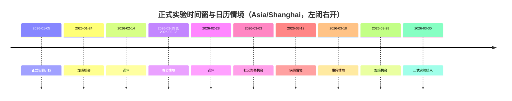
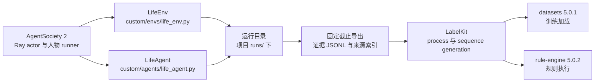

# WorldMock 实验设置

> 状态：FROZEN。本文件是实验身份、时间窗、依赖、场景参数、内容语料、样本划分与外部参照的冻结口径。
> 日期：2026-09-18
> 范围：单人物 84 天正式实验，上海张江白领，时区 Asia/Shanghai。
> 接口签名、字段与目录结构见 `docs/CONTRACTS.md`；行为规则见 `docs/dev/SPEC-*.md`；验收门禁见 `docs/VERIFICATION.md`。

## 实验身份与范围

本次实验运行在 AgentSociety 2（下称 AS2）之上：由 AS2 调度进程并提供模型服务，驱动一个数字人过日常生活；这一过程产生的可追溯记录构成数字足迹，再由 LabelKit 加工成训练输入与规则引擎夹具。首个城市、职业、日期、模型、内容、身体参数、训练加载器和规则消费者全部由本文件绑定。

| 项目 | 冻结值 |
| --- | --- |
| 仿真类型 | 单机 AS2 原生 Ray actor 与人物 runner；正式单人物十二周，同时交付多人测试与实际短运行 |
| 正式日期 | Asia/Shanghai，2026-01-05 00:00:00 到 2026-03-30 00:00:00，左闭右开，共 84 天 |
| 人物共同背景 | 白领；生活区为上海张江生活区，工作园区为张江高科技园区；与基线数据对齐到可证明的程度 |
| 未共同定义的属性 | 年龄、工资、初始存款、身体参数单独声明为新实验假设，不能当作基线数据已匹配条件 |
| 场景定义 | `scenarios/white-collar-12-weeks.json` |

本文件绑定的全部能力均属于本次交付：不使用占位实现、跳过测试、延期清单或旧入口维持表面可用；接口穿刺是实现顺序，不是缩小最终范围。正式仿真不预设与基线数据相同的事件数量或意图比例——人物根据可见内容、需求、合同和记忆做出选择，世界日历只约束营业、工作机会和消息到达，不编写人物每天必须执行的活动序列。依赖导入、原生工具调用和一个完整决策必须真实通过，才允许进入后续完整链路。

## 时间窗与日历情境

正式时间窗为 Asia/Shanghai 的 2026-01-05 00:00:00 到 2026-03-30 00:00:00，左闭右开，共 84 天；场景定义文件的 `start_at` 与 `end_at` 与该窗口一致。

日历情境只改变机会与约束，不保证人物执行；春节情境同样只改变机会与约束。

## 依赖冻结

### 人物生成模型

| 组件 | 版本或端点 | 冻结要求 |
| --- | --- | --- |
| 人物生成模型 | DeepSeek 官方 OpenAI-compatible 端点，`deepseek-flash` | 保存实际返回模型名、fingerprint、请求参数和 token 使用 |
| 模型冻结 | - | 固定端点、角色、提示、Pydantic 基础工具合同、枚举绑定算法和模型参数；每轮枚举来自场景交互菜单与当前观察，运行中不切换模型或代选行动 |

### 交互菜单与运行身份

正式场景中的 `interaction_menus_by_location_kind` 与每个人物的 `interaction_menu` 是实验条件。
具体允许的工具及活动类型以 `scenarios/white-collar-12-weeks.json` 的显式声明为准；地点类与人物
声明求交集后，现有状态、阶段、能量和可见目标规则继续收窄本轮实际工具。字段形状、保护项和拒绝语义
统一见[交互菜单规格](dev/SPEC-interaction-menu.md)，本文件不另复制一份菜单。

菜单声明属于场景原始 JSON 字节，因而进入 `scenario_sha256`。地点或人物菜单不同就是不同实验条件，
不得因静态提示与工具模板哈希相同而合并比较。删除工具描述中的固定办公室偏好会改变
`tool_schema_sha256`，不会改变 `prompt_sha256`；源码修改仍进入代码身份。运行时按地点和人物生成的动态
Schema 不单独改写静态模板哈希，而是随冻结观察留证。新建、打开既有运行、恢复及反事实分支继续核对
场景、工具模板和代码身份，任一不匹配即拒绝，不补写旧运行或迁移旧场景。

### AS2 基线与框架依赖

| 组件 | 版本 | 位置 |
| --- | --- | --- |
| AS2 基线 | 基于 `670c94fff7c64c4f79b632125f2ccf968155e746` | `vendor/agentsociety2` 的维护分支 `worldmock-life` |
| MCP | 1.26.0 | 取自 AS2 上游提交所锁定的版本 |
| LiteLLM | 1.89.2 | 取自 AS2 上游提交所锁定的版本 |
| Ray | 2.55.1 | 取自 AS2 上游提交所锁定的版本 |
| 新增依赖 | - | 由 WorldMock 锁文件统一锁定 |

### 自定义模块位置

| 模块 | 路径 |
| --- | --- |
| AS2 环境扩展 | `custom/envs/life_env.py` |
| AS2 人物扩展 | `custom/agents/life_agent.py` |
| 运行目录 | 项目 `runs/` 下 |

## 运行绑定与消费

### 数据流与依赖

### 命令入口

对外入口只有 `worldmock`；每个命令的参数、行为、失败语义与运行状态枚举见 `docs/CONTRACTS.md`「CLI 命令接口」，本文件只绑定本次实验用哪几个命令以及怎么用。

本次实验使用 `prepare-corpora`、`validate`、`run`、`resume`、`replay`、`status`、`export`、`deliver`、`evaluate`：正式窗口由 `run` 从 `scenarios/white-collar-12-weeks.json` 新建运行目录并执行到场景终点，`export` 的固定截止导出是全部加工的输入，`deliver` 是链路终点，`replay` 产生的反事实分支必须保留来源，`evaluate` 的结果与基线数据对照后交付。

### 运行目录约定

每次运行在项目 `runs/` 下独占一个运行目录，既有运行目录不得被覆盖；正式窗口运行、反事实分支运行与交付运行各自独占一个运行目录。运行目录的内容清单见 `docs/design/05-recording-engine.md`「持久化结构」。

### 训练与规则消费

| 组件 | 版本 | 消费方式 |
| --- | --- | --- |
| `datasets` | 5.0.1 | 训练加载：`load_dataset("json", features=...)`，实际加载全部成功样本并形成 DatasetDict |
| `rule-engine` | 5.0.2 | 规则消费：严格 Context 读取时序事实并执行冻结表达式 |

LabelKit 侧的两种处理模式与调用参数以 `docs/CONTRACTS.md`「LabelKit 调用配置」为准；字段级格式与交付格式以 `docs/CONTRACTS.md`「LabelKit 训练记录与交付格式」为准。

本次实验的消费者绑定：

- 动作、意图以及 dreaming 走 LabelKit 普通 process。
- 规则扰动走 LabelKit 现有 sequence generation，覆盖的变体与消费前的核验项以 `docs/CONTRACTS.md`「反事实与重演字段」为准。

## 场景参数

正式实验由 `scenarios/white-collar-12-weeks.json` 定义。参数的单位口径、来源类型与合法区间见 `docs/dev/SPEC-life-runtime.md`「身体参数与单位」；表内数值是本次实验的初始假设，之后只被时间与动作规则改动。

### 身体初始值

| 参数 | 取值 | 单位 | 依据 |
| --- | --- | --- | --- |
| 体重 | 65 | kg | 用于基础消耗计算 |
| 初始可用能量 | 1600 | kcal | 实验假设 |
| 可用能量上限 | 2400 | kcal | 实验假设 |
| 初始睡眠不足 | 0 | hours | 实验假设 |
| 基础消耗率 | 65 | kcal/hour | 按体重 |
| 数值精度 | 1e-9 | kcal | 累计舍入容差 |

### 两过程睡眠

| 参数 | 取值 | 单位 | 依据 |
| --- | --- | --- | --- |
| `sleep_pressure` 上升时间常数 | 18.2 | hours | 清醒时趋近 1 |
| `sleep_pressure` 下降时间常数 | 4.2 | hours | 睡眠时衰减 |
| 入睡阈值 | 0.67 | - | 按昼夜相位振幅 0.12 摆动 |
| 醒来阈值 | 0.17 | - | 按昼夜相位振幅 0.12 摆动 |
| `sleep_deficit_hours` 清醒累积率 | ~0.45 | hours/hour | `sleep_need` 为 7.5 小时时 |
| `sleep_deficit_hours` 睡眠恢复率 | 1.0 | hours/hour | - |
| `sleep_deficit_hours` 下限 | 0 | hours | - |
| `sleep_deficit_hours` 上限 | 24 | hours | - |

### 效率曲线

| 曲线 | 输入 | 节点 | 插值 |
| --- | --- | --- | --- |
| 工作效率 | `sleep_deficit_hours` | (0, 1.0)、(8, 1.0)、(16, 0.85)、(24, 0.65) | 线性 |
| 食品利用效率 | `sleep_deficit_hours` | (0, 0.90)、(8, 0.90)、(16, 0.85)、(24, 0.80) | 线性 |

### 需求状态

| 需求 | 范围 | 变化 |
| --- | --- | --- |
| 饥饿阈值 | - | 800 kcal 为饥饿，400 kcal 为紧急 |
| 娱乐需要 | [0, 1] | 清醒每小时 +0.08；按偏好和实际接触时长减少 |
| 社交需要 | [0, 1] | 清醒每小时 +0.04；交谈、通话与共同用餐按明确规则减少 |

人物读到的是体感分级而非数值——分级只描述状态，不替人物挑动作；接触次数与效果一并写进足迹。增减规则与留痕口径见 `docs/dev/SPEC-life-runtime.md`「场景与身体规则」。

### 经济参数

| 账户 | 初始余额 | 币种 |
| --- | --- | --- |
| 人物 | 800000 | 分（CNY） |
| 雇主 | 4000000 | 分（CNY） |
| 商家 A | 10000000 | 分（CNY） |
| 商家 B | 10000000 | 分（CNY） |
| 交通服务 | 10000000 | 分（CNY） |

工作合同（结算与计酬口径见 `docs/dev/SPEC-life-runtime.md`「资金与合同」）：

- 主合同按工作包计酬，一个验收通过的包 60000 分。
- 工作机会每个工作日发放一次，单个机会的上限是八小时。
- 补充场景的覆盖面要求：计时与计件两种合同类型、不同技能、内容独立验收，以及无资金、延期与返工三种边界。

地图冻结路线实例的 `fare_fen` 与 `fare_source_kind=scenario`，场景选择引用后准入要求金额与
`catalog/exchange-rules.json` 的 `travel_fare` 闭集算子求值一致。
当前 driving 最低 500 分、每米 0.2 分；walking 费率为零。数值来源、系数与取整规则统一归
[品类契约规格](dev/SPEC-category-contract.md)和[接口合同](CONTRACTS.md#品类契约与目录字段)。

### 工作参数

| 参数 | 取值 | 单位 | 依据 |
| --- | --- | --- | --- |
| 工作速率 | 该场景下工作技能对应的等级 | - | 直接使用 |
| 工作笔记倍率 | 1.10 | - | `body.work_notes_multiplier` |
| 工作评审最大调用次数 | 3 | 次 | 初次调用加最多两次输出协议纠正 |

### 活动节奏与拒绝边界

| 参数 | 取值 | 单位 | 依据 |
| --- | --- | --- | --- |
| 活动反馈间隔 | 900 | 秒 | 场景冻结，即 15 分钟 |
| 最大连续业务拒绝 | 10 | 次 | 实验冻结上限；达到上限后的处理见 `docs/dev/SPEC-life-runtime.md`「时间推进与并发活动」 |
| 最小活动持续时间 | 60 | 秒 | - |

### 决策点节奏

轮转与候选上限的闭式上界按「每天决策点数 `D`」计算，所以 `D` 是**观测量而非假设值**。

| 量 | 取值 | 单位 | 依据 |
| --- | --- | --- | --- |
| 决策点中位数 | 71 | 次/人物/天 | 34 个既有 run 的足迹实测（`runs/*/footprints.sqlite` 的 `decision_started` 计数 ÷ 人物数 ÷ 模拟跨度天数） |
| 决策点区间 | 9 – 112.5 | 次/人物/天 | 同上；四分位为 49 与 81.5 |
| 保守取值 | 60 | 次/人物/天 | 定参数时取中位数偏保守一侧；验收断言不得硬编码该值 |

**口径**：`D` 只计**实际提供了决策机会**的边界。静默边界不产生 `decision_started`，因此不计入。

**为什么远高于"每 90 分钟重新考虑一次"给出的下限**：决策边界取多个触发点里**最早**的那个——计划活动结束、体感分级跨越、到达地点、计划块起点、营业状态变化，而 `reconsideration_interval_seconds`（5400 秒）只是其中最迟的一个兜底。所以 `5400` 秒不是决策间隔，是决策间隔的**上界**。

**与轮转断言的关系**：最大未呈现间隔的闭式上界写作 `⌈N ÷ k⌉ ÷ D`，其中 `D` 取本节的实测区间而非单一估计值；池只在人物身处该地点时可达时，有效决策点按 `D × 可达率` 折算。判据与失败口径见 `docs/VERIFICATION.md`「工程门禁」。

## 内容与语料绑定

| 内容类型 | 本次确定方案 |
| --- | --- |
| 食品 | Open Food Facts 具备已验证营养、计量单位的实际产品；冻结条码白名单 |
| 节目 | Blender Sintel 官方完整 SRT 与影片身份；记录为字幕体验 |
| 游戏 | TextWorld 1.7.0，固定 30 个种子 1201–1230 |
| 工作 | AMI ES2002a–d 连续会议材料 |
| 邮件 | 48 个冻结场景线程，明确标为场景创作 |
| 商品与门店供给 | 食品规格事实来自商品目录；门店供给报价、库存、营业及资格按来源明确标为场景假设；耐用品效果和使用条件单独声明 |
| 地图与路线 | 固定张江地点资料与逐方式道路记录；每个选中有向端点和方式显式为可达、不可达或未知，正式运行只读，不能用驾车响应证明步行 |
| 交通与天气 | 静态道路条件和明确标为场景假设的天气、准备、排队参数 |

本次实验的语料取值以 `corpora/manifest.json` 为准：哪些产品入选、地点的坐标取值、每份素材的哈希，都在取得完成后冻结；正式运行启动前逐项核验，缺内容不允许起跑。来源准入与失败语义见 `docs/dev/SPEC-life-runtime.md`「来源与准入」。

### 地图与门店供给的实验身份

正式场景通过 `map_dataset` 的 `dataset_id/version/path/sha256` 固定地图，只选择地点、商品和供给身份及实例初值。
地点名称、坐标、营业和路线只有地图目录一份定义。地点 `kind`、`business_kind` 和 `location_kinds`
分别表达菜单分类、经营业态及活动环境，人物资格为显式实验条件。

已有张江资料的审查基线是二百二十份按方式命名的路线响应；一百零四份步行响应复用了同端点驾车响应，
必须在准入前修正来源或显式标为未知，不将数量视为可用性证明。真实路线的取得时刻、profile 和事实截止日
与模拟日期分别保存，近期道路资料不能冒充历史路网；供给、库存和营业假设不能标成真实门店事实。

同一商品至少有两个独立门店供给，形成可实际比较的道路、报价和营业差异。人物仍自行选择，验收不强制某店胜出。
自提与配送均属于正式行为；会员购买、预约办理、排队和物品搬运没有动作入口，取得物保留在取得地点。
地图或供给资料变化改变运行身份，当前报价、库存和营业例外属于可恢复状态，不能用初始定义覆盖。
当前组合的目录为 `4.0`，品类契约和交换规则绑定版本为 `2`；地图结构 `1`、场景结构 `3`、世界结构 `4` 独立冻结。
比较条件同时记录原始供给报价、品类购买系数及实际计价口径；余额判断、价格排序与购买结算共用闭集算子。
逐来源许可与通知随运行及导出清单保留；公开交付按实际来源和数据关系判断，署名不是许可义务的替代物。

## 样本编码与来源分组

| 项目 | 冻结做法 |
| --- | --- |
| 训练数据编码与核对 | 见 `docs/CONTRACTS.md`「数据集字段与划分」 |
| 来源分组 | 划分与来源组字段以 `docs/CONTRACTS.md`「数据集字段与划分」为准；本实验不另立分组规则 |
| 划分比例立场 | 不能为了比例而制造泄漏 |

## 基线数据参照

基线数据指 Dataset-Person 中更早的一次张江白领十二周运行，只作为外部参照，不构成对本次仿真的事先约束。

| 项目 | 值 |
| --- | --- |
| 基线数据来源 | Dataset-Person 的 `archive/white-collar-12-weeks-deepseek16-glm52/repaired/` |
| 基线数据验证 | 原 manifest、修复报告和最终审计共同验证 |
| 基线数据身份 | run `ec5742eff472d320dac4f98c6d1fd478`；main 4,380 行、stream 16,320 行、84 个自然日 |

## 实验假设声明

以下参数为实验假设，不宣称来自已验证的人类生理或心理模型：

- 睡眠对食品利用效率的影响。
- 工作效率与睡眠不足的关系。
- 娱乐需要增长与减少规则。
- 社交需要增长与减少规则。
- 重复接触对娱乐效果的影响。

## 验收范围与外部参照

最后的验收对象包括 AS2、LifeEnv、完整数据生产及真实性评估。外部参照的人群适用性、模型自身选择与来源数据的局限都要如实交代，不得掩盖缺失的实现。

## 版本表

| 版本 | 日期 | 修订内容 |
| --- | --- | --- |
| `2026-09-18` | 2026-09-18 | 实验身份与范围、时间窗与日历情境、依赖冻结、运行绑定与消费、场景参数、内容与语料绑定、样本编码与来源分组、基线数据参照从主设计单体拆分并冻结为本文件 |
| `2026-09-18-revision-1` | 2026-09-18 | 样本编码与来源分组删除对 `docs/CONTRACTS.md`「数据集字段与划分」的逐字复述：训练数据编码与编码核对合并为引用行，连通组约束行只留实验侧划分比例立场并加章节指针 |
| `2026-09-18-revision-2` | 2026-09-18 | 样本编码与来源分组的章节指针收敛为一处（删除与引用行重复的文档级指针，连通组约束不再重复列出）；命令入口与运行目录约定两处与接口合同逐字重合的表述改为本文件措辞 |
| `2026-09-18-revision-3` | 2026-09-18 | 消除与其他文档的逐字重复：项目身份句改为实验侧措辞，与 `docs/INDEX.md` 的项目陈述不再逐字相同；语料冻结核验、工作合同参数、需求状态留痕、身体参数校验四处改为实验侧表述并指向 `docs/dev/SPEC-life-runtime.md` 对应章节；划分句改为指向 `docs/CONTRACTS.md`「数据集字段与划分」，本文件不再复述连通组约束；三处接口指针的句子框架改为本文件措辞 |
| `2026-09-18-revision-4` | 2026-09-18 | 消除与 `docs/dev/SPEC-life-runtime.md`、`docs/ARCHITECTURE.md`、`docs/CONTRACTS.md`、`docs/dev/SPEC-as2-integration.md` 之间 8–11 汉字的条款级逐字回声：工作速率取值、补充场景合同类型、身体参数口径、需求状态留痕、上游锁文件与运行目录覆盖、指针句框架与实验假设声明改为本文件措辞；拒绝上限一行不再复述行为规则，改为指向 `docs/dev/SPEC-life-runtime.md`「时间推进与并发活动」 |
| `2026-09-20-interaction-menu` | 2026-09-20 | 将地点类与人物交互菜单绑定为场景实验条件，明确场景、静态模板、动态 Schema 与恢复身份的边界 |
