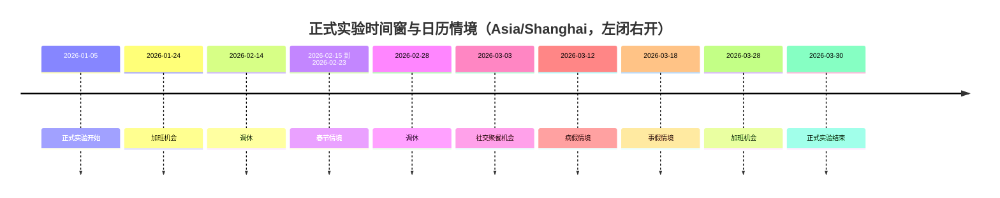
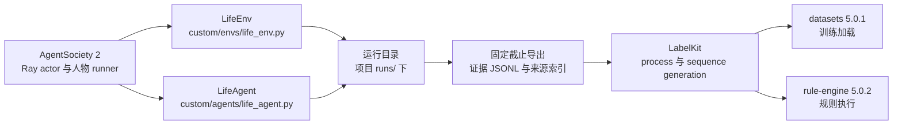

# WorldMock 实验设置

> 状态：FROZEN。本文件是实验身份、时间窗、依赖、场景参数、内容语料、样本划分与外部参照的冻结口径。按人物 Prompt 规格修订，修订部分已实现并通过离线验收（证据见[人物 Prompt 验收记录](dev/persona-prompt-verification.md)）。按[一日运行保真规格](dev/SPEC-dayrun-fidelity.md#冻结条款修订)「冻结条款修订」第 1、13、25 行修订（一日运行保真 EXP1）：两个指纹再变、困意档界、娱乐与社交口径、名称类拒绝、轮转上界按分区，并登记该规格的实验假设；登记的实验假设与口径已随实现生效，两个指纹的变化（含工具层 `callable_index` 使 `prompt_sha256`、`start_activity` 的 `prefer` 与方式「购买」使 `tool_schema_sha256` 再变）已随实现落地。
> 工具交互修订：按[工具交互规格](dev/SPEC-tool-interaction.md)冻结目标实验身份；本次修订已实现，发布身份与行为、变异证据见[工具交互验收记录](dev/tool-interaction-verification.md)。
> 个人事务与工作安排修订：按[个人事务与工作安排规格](dev/SPEC-errands-workday.md#冻结条款修订)「冻结条款修订」第 1、5、7、11、14、15、16、17 行修订（个人事务与工作安排 EX2–EX18）：工作安排作为场景声明的事实、各阶段指纹与结构版本的目标身份、就寝反思的身份绑定、事务提醒进入决策边界、个人事务容量上限登记为实验假设。阶段 1（运行修复入库，只改变 `code_sha256`）已随代码落地，阶段 2–4 未实现，见个人事务与工作安排规格阶段 2–4。
> 日期：2026-10-03
> 范围：单人物 84 天正式实验，上海张江白领，时区 Asia/Shanghai。
> 接口签名、字段与目录结构见 `docs/CONTRACTS.md`；行为规则见 `docs/dev/SPEC-*.md`；验收门禁见 `docs/VERIFICATION.md`。

## 实验身份与范围

本次实验运行在 AgentSociety 2（下称 AS2）之上：由 AS2 调度进程并提供模型服务，驱动一个数字人过日常生活；这一过程产生的可追溯记录构成数字足迹，再由 LabelKit 加工成训练输入与规则引擎夹具。首个城市、职业、日期、模型、内容、身体参数、训练加载器和规则消费者全部由本文件绑定。

| 项目 | 冻结值 |
| --- | --- |
| 仿真类型 | 单机 AS2 原生 Ray actor 与人物 runner；正式单人物十二周，同时交付多人测试与实际短运行 |
| 正式日期 | Asia/Shanghai，2026-01-05 00:00:00 到 2026-03-30 00:00:00，左闭右开，共 84 天 |
| 人物共同背景 | 白领；生活区为上海张江生活区，工作园区为张江高科技园区；与基线数据对齐到可证明的程度 |
| 未共同定义的属性 | 年龄、工资、初始存款、身体参数单独声明为新实验假设，不能当作基线数据已匹配条件 |
| 场景定义 | `scenarios/white-collar-12-weeks.json` |

本文件绑定的全部能力均属于本次交付：不使用占位实现、跳过测试、延期清单或旧入口维持表面可用；接口穿刺是实现顺序，不是缩小最终范围。正式仿真不预设与基线数据相同的事件数量或意图比例——人物根据可见内容、需求、合同和记忆做出选择，世界日历只约束营业、工作机会和消息到达，不编写人物每天必须执行的活动序列。场景可以按人物声明工作安排（每周班次、日期例外与休息时段）：它由环境按世界时钟求值后作为事实呈现，不新增拒绝，也不编写班内必须执行的活动。依赖导入、原生工具调用和一个完整决策必须真实通过，才允许进入后续完整链路。

## 时间窗与日历情境

正式时间窗为 Asia/Shanghai 的 2026-01-05 00:00:00 到 2026-03-30 00:00:00，左闭右开，共 84 天；场景定义文件的 `start_at` 与 `end_at` 与该窗口一致。

日历情境只改变机会与约束，不保证人物执行；春节情境同样只改变机会与约束。

## 依赖冻结

### 人物生成模型

| 组件 | 版本或端点 | 冻结要求 |
| --- | --- | --- |
| 人物生成模型 | DeepSeek 官方 OpenAI-compatible 端点，`deepseek-flash` | 保存实际返回模型名、fingerprint、请求参数和 token 使用 |
| 模型冻结 | - | 固定端点、角色、提示（系统层与七层模板）、Pydantic 基础工具合同和模型参数；原生工具定义整次运行不变（只剩最后一个回合时与输出截断后的那次重试时去掉全部只读查询工具），不逐轮绑定名称枚举，本轮可选的目标与动作只在工具层列出；运行中不切换模型或代选行动 |

### 交互菜单与运行身份

正式场景中的 `interaction_menus_by_location_kind` 与每个人物的 `interaction_menu` 是实验条件。
具体允许的对象动作以 `scenarios/white-collar-12-weeks.json` 的显式声明为准；地点类与人物
声明求交集后，可见目标、决策阶段、回合预算与同刻上限的受限轮收窄本轮实际动作；不按人物状态或能量隐藏，
当前不可行的动作照常列出并附说明；没有日首计划阶段。字段形状、保护项和拒绝语义统一见[交互菜单规格](dev/SPEC-interaction-menu.md)，本文件不另复制一份菜单。

菜单声明属于场景原始 JSON 字节，因而进入 `scenario_sha256`。地点或人物菜单不同就是不同实验条件，
不得因静态提示与工具模板哈希相同而合并比较。删除工具描述中的固定办公室偏好会改变
`tool_schema_sha256`，不会改变 `prompt_sha256`；源码修改仍进入代码身份。原生工具定义整次运行不变，不再按地点和人物
生成动态 Schema；菜单对本轮动作的收窄体现在工具层，随冻结观察留证。新建、打开既有运行、恢复及反事实分支继续核对
场景、工具模板和代码身份，任一不匹配即拒绝，不补写旧运行或迁移旧场景。
人物配置的 `work_schedule`、`leave_work_window`、`arrive_home_window` 同属场景字节，声明不同即不同实验条件，不得合并比较；
仓库三份场景在个人事务与工作安排规格阶段 3 随场景结构升 5 显式写出 `work_schedule: null`，`scenario_sha256` 随之改变。
是否给正式十二周场景声明班次另行裁决，裁决后在「实验假设声明」登记取值与依据。

代码身份 `code_sha256` 覆盖 `src`、`custom`、`pyproject.toml`、`uv.lock` 与实际导入的 AS2 包（包目录内除
`__pycache__` 外的全部文件，与安装位置无关）。AS2 包目录为空、导入失败或与下节登记的源码摘要不符时，
`run`、`resume`、`replay`、`validate` 拒绝启动。运行清单另记 Git 提交 `git_commit` 与未提交标志 `git_dirty`
（非 Git 检出时为 null），二者只记录，不参与恢复比对。提示或工具面变化会改变 `prompt_sha256`、
`tool_schema_sha256`，这样的运行与旧运行不可合并比较：七层模板、只写用途的工具 description 与 `start_activity` 新增的
`from`、`to`、`answering` 都改变这两个指纹。[一日运行保真规格](dev/SPEC-dayrun-fidelity.md)再次改变它们：系统层 18 条规则、待办层的
`around_time` 与工具层的 `callable_index` 改变 `prompt_sha256`，三个控制工具改为 `items`、`revise_day_plan` 的 `around_time` 与
`start_activity` 的请求级 `prefer`、方式「购买」改变 `tool_schema_sha256`；该规格实施前后的运行不可合并比较，运行清单另增 `input_warnings`。
[个人事务与工作安排规格](dev/SPEC-errands-workday.md)分阶段再次改变它们，各阶段前后的运行不可合并比较：阶段 1 的四项运行修复只改变 `code_sha256`；
阶段 2 的系统层第 1、4、6 条与待办层、进度层 Schema 改变 `prompt_sha256`，三个控制工具的用途句、请求级 `errands` 及其八个键的字段说明与
`items[].memories` 的字段说明改变 `tool_schema_sha256`。阶段 3 的系统层第 1、14 条与人设层、环境层 Schema 再次改变 `prompt_sha256`，工具面不变；
零点计划模板与输入不在 `prompt_sha256` 内，只由 `code_sha256` 绑定。阶段 4 的 `query_world` 六键请求（`name`、`way`、`category`、`from`、
`available_only`、`offset`）与用途句改变 `tool_schema_sha256`，系统层与层 Schema 不变；四键旧请求按缺字段拒绝。
运行清单的阶段身份 `stage_model_identity` 只有 `action` 与 `work_review` 两个阶段键，
含 `decision_statement` 的旧清单被拒绝；同秒续接开关 `same_second_continuation`（`worldmock run --same-second-continuation on|off`，
缺省 `on`）冻结进 `stages.action` 与人物配置，恢复与重放继承父清单的值，不能覆盖，恢复时人物配置与父清单不符即拒绝。
开与关两臂的对比用只读子命令 `scripts/inspect_run.py continuation --baseline`，两份清单除运行身份与该开关外必须相同。
就寝反思是记忆运行时的后台调用：只带严格工具 `submit_reflection`（`tool_choice=required`、思考关闭、不带 `purpose`）；
该工具不进 `tool_schema_sha256`，反思文案不进 `prompt_sha256`，二者与 `submit_day_plan` 一样只由 `code_sha256` 绑定，`stage_model_identity` 不增阶段键。

工具交互特性删除模型 `actions` 参数，增加固定 `query_world`，任务回看改为只读，错误位置与候选、
任务合同元信息、操作备忘及紧凑工具层都改变提示或工具身份，必须重新计算两个指纹并冻结进新运行清单。
请求采用 `start_activity.items[]` 的一至两项 `{target, way, from, to}`，本人消费两端与本人收货的 `to` 为 null；
含购买时 `prefer` 必须取「最快拿到」或「到手价最低」，不含购买时必须为 null。
只读查询不作为世界动作或同刻轮数，调用所在模型回复仍计十六回合预算；不添加查询试点开关或旧请求兼容层。
按错误接口、任务、供给价格、料理、查询、操作备忘与紧凑呈现分别形成端到端实验收据，
每阶段身份和独立行为、变异门禁见[工具交互特性门禁](VERIFICATION.md#工具交互特性门禁)。不同阶段的代码、数据和提示身份不可合并当成同一实验。

### AS2 基线与框架依赖

| 组件 | 版本 | 位置 |
| --- | --- | --- |
| AS2 基线 | 基于 `670c94fff7c64c4f79b632125f2ccf968155e746` | `vendor/agentsociety2` 的维护分支 `worldmock-life`，锁定提交 `8768e14`（子模块指针） |
| AS2 源码摘要 | `65a902ec66df42296d4e4c85e424bce3512e437133fc6be9fa597766fc30a334` | `8768e14` 的源码摘要，运行身份按它比对 |
| MCP | 1.26.0 | 取自 AS2 上游提交所锁定的版本 |
| LiteLLM | 1.89.2 | 取自 AS2 上游提交所锁定的版本 |
| Ray | 2.55.1 | 取自 AS2 上游提交所锁定的版本 |
| 新增依赖 | - | 由 WorldMock 锁文件统一锁定 |

### 自定义模块位置

| 模块 | 路径 |
| --- | --- |
| AS2 环境扩展 | `custom/envs/life_env.py` |
| AS2 人物扩展 | `custom/agents/life_agent.py` |
| AS2 环境 actor 与代理扩展（只读查询转发） | `src/worldmock/life/read_query_runtime.py` |
| 运行目录 | 项目 `runs/` 下 |

## 运行绑定与消费

### 数据流与依赖

### 命令入口

对外入口只有 `worldmock`；每个命令的参数、行为、失败语义与运行状态枚举见 `docs/CONTRACTS.md`「CLI 命令接口」，本文件只绑定本次实验用哪几个命令以及怎么用。

本次实验使用 `prepare-corpora`、`validate`、`run`、`resume`、`replay`、`status`、`export`、`deliver`、`evaluate`：正式窗口由 `run` 从 `scenarios/white-collar-12-weeks.json` 新建运行目录并执行到场景终点，`export` 的固定截止导出是全部加工的输入，`deliver` 是链路终点，`replay` 产生的反事实分支必须保留来源，`evaluate` 的结果与基线数据对照后交付。

### 运行目录约定

每次运行在项目 `runs/` 下独占一个运行目录，既有运行目录不得被覆盖；正式窗口运行、反事实分支运行与交付运行各自独占一个运行目录。运行目录的内容清单见 `docs/design/05-recording-engine.md`「持久化结构」。

### 训练与规则消费

| 组件 | 版本 | 消费方式 |
| --- | --- | --- |
| `datasets` | 5.0.1 | 训练加载：`load_dataset("json", features=...)`，实际加载全部成功样本并形成 DatasetDict |
| `rule-engine` | 5.0.2 | 规则消费：严格 Context 读取时序事实并执行冻结表达式 |

LabelKit 侧的两种处理模式与调用参数以 `docs/CONTRACTS.md`「LabelKit 调用配置」为准；字段级格式与交付格式以 `docs/CONTRACTS.md`「LabelKit 训练记录与交付格式」为准。

本次实验的消费者绑定：

- 动作、意图以及 dreaming 走 LabelKit 普通 process。
- 规则扰动走 LabelKit 现有 sequence generation，覆盖的变体与消费前的核验项以 `docs/CONTRACTS.md`「反事实与重演字段」为准。

## 场景参数

正式实验由 `scenarios/white-collar-12-weeks.json` 定义。参数的单位口径、来源类型与合法区间见 `docs/dev/SPEC-life-runtime.md`「身体参数与单位」；表内数值是本次实验的初始假设，之后只被时间与动作规则改动。

### 身体初始值

| 参数 | 取值 | 单位 | 依据 |
| --- | --- | --- | --- |
| 体重 | 65 | kg | 用于基础消耗计算 |
| 初始可用能量 | 1600 | kcal | 实验假设 |
| 可用能量上限 | 2400 | kcal | 实验假设 |
| 初始睡眠不足 | 0 | hours | 实验假设 |
| 初始睡眠压力 | 按惯常起床时刻反推 | - | 实验假设 |
| 基础消耗率 | 65 | kcal/hour | 按体重 |
| 数值精度 | 1e-9 | kcal | 累计舍入容差 |

初始睡眠压力的反推见 `docs/dev/SPEC-time-and-energy.md`「作息初值」：起点落在惯常睡眠时段内或接近它时，人物以困倦开始。

### 两过程睡眠

| 参数 | 取值 | 单位 | 依据 |
| --- | --- | --- | --- |
| `sleep_pressure` 上升时间常数 | 18.2 | hours | 清醒时趋近 1 |
| `sleep_pressure` 下降时间常数 | 4.2 | hours | 睡眠时衰减 |
| 入睡阈值 | 0.67 | - | 按昼夜相位振幅 0.12 摆动 |
| 醒来阈值 | 0.17 | - | 按昼夜相位振幅 0.12 摆动 |
| 困意档界 | 0.80 / 0.93 / 1.07 / 1.18 | - | 「有点乏」「困」「很困」「撑不住」的下界；按 KSS 等价刻度标定，见「实验假设声明」 |
| `sleep_deficit_hours` 清醒累积率 | ~0.45 | hours/hour | `sleep_need` 为 7.5 小时时 |
| `sleep_deficit_hours` 睡眠恢复率 | 1.0 | hours/hour | - |
| `sleep_deficit_hours` 下限 | 0 | hours | - |
| `sleep_deficit_hours` 上限 | 24 | hours | - |

### 效率曲线

| 曲线 | 输入 | 节点 | 插值 |
| --- | --- | --- | --- |
| 工作效率 | `sleep_deficit_hours` | (0, 1.0)、(8, 1.0)、(16, 0.85)、(24, 0.65) | 线性 |
| 食品利用效率 | `sleep_deficit_hours` | (0, 0.90)、(8, 0.90)、(16, 0.85)、(24, 0.80) | 线性 |
| 工作效率（能量） | `energy_kcal` | (0, 0.5)、(399.9, 0.5)、(400, 0.8)、(800, 1.0) | 线性 |

### 需求状态

| 需求 | 范围 | 变化 |
| --- | --- | --- |
| 饥饿阈值 | - | 800 kcal 为饥饿，400 kcal 为紧急；低于 400 kcal 时至少「饿得难受」，不受昼夜项与餐时项影响；低于 100 kcal 为「饿得发慌」 |
| 娱乐需要 | [0, 1] | 清醒每小时 +0.08，有缓解的活动进行时不累积；按有效偏好 `f + (1 − f)·w` 和实际接触时长减少，不喜欢的内容也有下限缓解（下限偏好 `f` 见「实验假设声明」） |
| 社交需要 | [0, 1] | 清醒每小时 +0.04，清醒按本区间共同身体结算所用的活动集合判定（在边界结束的睡眠不计清醒）；交谈、通话与共同用餐按明确规则减少；睡眠中不读消息 |

人物读到的是体感分级而非数值——分级只描述状态，不替人物挑动作；接触次数与效果一并写进足迹。增减规则与留痕口径见 `docs/dev/SPEC-life-runtime.md`「场景与身体规则」。

### 能量感知标签

| 标签 | 取值 | 依据 |
| --- | --- | --- |
| 商品热量 | 食品每份热量按 5 进位取整到 10 千卡；不足 5 千卡写「几乎不含热量」 | 实验假设 |
| 路线费力 | 按出行方式的 MET 分三档：< 2 为「轻松」，2 ≤ MET < 3 为「一般」，≥ 3 为「费力」 | 实验假设 |

标签只给可读事实，不给身体数值；呈现规则见 `docs/dev/SPEC-time-and-energy.md`「商品热量与路线费力」。

### 经济参数

| 账户 | 初始余额 | 币种 |
| --- | --- | --- |
| 人物 | 800000 | 分（CNY） |
| 雇主 | 4000000 | 分（CNY） |
| 商家 A | 10000000 | 分（CNY） |
| 商家 B | 10000000 | 分（CNY） |
| 交通服务 | 10000000 | 分（CNY） |

工作合同（结算与计酬口径见 `docs/dev/SPEC-life-runtime.md`「资金与合同」）：

- 主合同按工作包计酬，一个验收通过的包 60000 分。
- 工作机会每个工作日发放一次，单个机会的上限是八小时。
- 场景按人物声明的工作安排与机会发放相互独立：不参与任务开放时刻的编译，不改变开工、恢复、提交与迟交判定，不延长或缩短截止；班前到岗可以开工，班后可以继续做未到截止的任务；班次与任务工时的差距只由行为评估的工作负荷如实报告。
- 补充场景的覆盖面要求：计时与计件两种合同类型、不同技能、内容独立验收，以及无资金、延期与返工三种边界。

每项合同必须至少有一封关联通知；每封非空 `related_task_id` 邮件均引用存在任务，收件人为该任务受派人物。
正式素材在通知前有效。输入 `appointment` 必填，普通工作为 null，
真实预约为 `{starts_at, reason}`，两键必填，时刻带时区且原因非空。输入删除 `available_at`、`availability_kind`、`appointment_reason`。
普通工作的内部 `RuntimeWorkTask.available_at` 从最早本人关联通知 `sent_at` 编译，到要求地点即可开始，不再等上班钟点；
预约的内部开放时刻取 `starts_at`，最早关联通知不得晚于它；后续提醒可以在开始之后送达且不改变开放时刻。
提前通知只使任务可知，真实约定时刻才开放。
运行开始前已送达的通知与已开放事实在首次观察前一并初始化；合同截止必须晚于运行起点及开放时刻。
该特性不添加前序任务依赖配置，也不把尚未准备好的材料伪装成预约等待。

地图冻结路线实例的 `fare_fen` 与 `fare_source_kind=scenario`，场景选择引用后准入要求金额与
`catalog/exchange-rules.json` 的 `travel_fare` 闭集算子求值一致。
当前 driving 最低 500 分、每米 0.2 分；walking 费率为零。数值来源、系数与取整规则统一归
[品类契约规格](dev/SPEC-category-contract.md)和[接口合同](CONTRACTS.md#品类契约与目录字段)。

### 工作参数

| 参数 | 取值 | 单位 | 依据 |
| --- | --- | --- | --- |
| 工作速率 | 该场景下工作技能对应的等级 | - | 直接使用 |
| 工作笔记倍率 | 1.10 | - | `body.work_notes_multiplier` |
| 工作评审最大调用次数 | 3 | 次 | 初次调用加最多两次输出协议纠正 |

### 活动节奏与同刻决策上限

| 参数 | 取值 | 单位 | 依据 |
| --- | --- | --- | --- |
| 活动反馈间隔 | 900 | 秒 | 场景冻结，即 15 分钟 |
| 同刻决策上限 `max_same_moment_decisions` | 3 | 轮/人物/模拟秒 | 场景缺省值；达到上限后的受限轮见 `docs/dev/SPEC-life-runtime.md`「时间推进与并发活动」 |
| 名称类拒绝的免计次数 | 2 | 次/人物/模拟秒 | 名称类拒绝在此之内不计同刻轮数、不施加情绪脉冲，第 3 次起照常；实验假设，见「实验假设声明」 |
| 最小活动持续时间 | 60 | 秒 | - |

### 决策点节奏

轮转与候选上限的闭式上界按「每天决策点数 `D`」计算，所以 `D` 是**观测量而非假设值**。

| 量 | 取值 | 单位 | 依据 |
| --- | --- | --- | --- |
| 决策点中位数 | 71 | 次/人物/天 | 实施前快照（时间与能量规格实施前）：34 个既有 run 的足迹实测（`runs/*/footprints.sqlite` 的 `decision_started` 计数 ÷ 人物数 ÷ 模拟跨度天数） |
| 决策点区间 | 9 – 112.5 | 次/人物/天 | 同上；四分位为 49 与 81.5 |
| 保守取值 | 60 | 次/人物/天 | 定参数时取中位数偏保守一侧；验收断言不得硬编码该值 |

**口径**：`D` 按 `decision_started` 逐次计：每次决策在其首个行动请求时写入一条，同一秒的多次决策（含同秒续接的各次）各计一次；静默边界不产生 `decision_started`，因此不计入。

**为什么远高于"每 90 分钟重新考虑一次"给出的下限**：决策边界取多个触发点里**最早**的那个——计划活动结束、体感分级跨越、到达地点、营业状态变化、计划提醒、个人事务提醒、进行中活动的 30 分钟播报，而重估间隔只是其中最迟的一个兜底；没有进行中活动时还在同一秒再决策（同刻决策）。所以重估间隔不是决策间隔，是决策间隔的**上界**：有在手承诺时取 `reconsideration_interval_seconds`（5400 秒）（未完成的个人事务不算在手承诺，不改变常规与空闲重估间隔及闭店预警）；只在等待且没有其他在手承诺时取 `idle_reconsideration_interval_seconds`（缺省 10800 秒）；睡眠不受重估间隔约束。个人事务提醒（`errand_reminder_due`）不在睡眠允许集合内：清醒人物的未提醒时刻进入下一边界与下一次决策机会的候选，精确在该时刻到点，只提供一次决策机会；同一边界到期的多条事务合并为一次机会，该原因只计一次；睡眠中的人物不计入候选、不形成静默边界、不交付也不消耗，错过的提醒在醒来的那个边界交付，不另起边界。`D` 的既有实测为该特性实施前快照。工作安排的班次起止不是触发点：清醒且有进行中活动时，边界后的首个决策机会不晚于一个播报间隔；睡眠中不适用。

**与轮转断言的关系**：最大未呈现间隔的闭式上界写作 `⌈N ÷ k⌉ ÷ D`，按检索分区成立（`N`、`k` 取该分区自己的池规模与换新名额），其中 `D` 取本节的实测区间而非单一估计值；池只在人物身处该地点时可达时，有效决策点按 `D × 可达率` 折算。判据与失败口径见 `docs/VERIFICATION.md`「工程门禁」。同一秒各轮沿用该秒首轮的呈现窗口（`docs/dev/SPEC-time-and-energy.md` 第一章），轮转上界中的有效决策点按有 `decision_started` 的不同模拟秒计；同刻轮次出现前两种计法相同。

## 内容与语料绑定

| 内容类型 | 本次确定方案 |
| --- | --- |
| 食品 | Open Food Facts 具备已验证营养、计量单位的实际产品；冻结条码白名单 |
| 节目 | Blender Sintel 官方完整 SRT 与影片身份；记录为字幕体验 |
| 游戏 | TextWorld 1.7.0，固定 30 个种子 1201–1230 |
| 工作 | AMI ES2002a–d 连续会议材料 |
| 邮件 | 48 个冻结场景线程，明确标为场景创作 |
| 商品与门店供给 | 食品规格事实来自商品目录；门店供给报价、库存、营业及资格按来源明确标为场景假设；耐用品效果和使用条件单独声明 |
| 地图与路线 | 固定张江地点资料与逐方式道路记录；每个选中有向端点和方式显式为可达、不可达或未知，正式运行只读，不能用驾车响应证明步行 |
| 交通与天气 | 静态道路条件和明确标为场景假设的天气、准备、排队参数 |

本次实验的语料取值以 `corpora/manifest.json` 为准：哪些产品入选、地点的坐标取值、每份素材的哈希，都在取得完成后冻结；正式运行启动前逐项核验，缺内容不允许起跑。来源准入与失败语义见 `docs/dev/SPEC-life-runtime.md`「来源与准入」。

### 地图与门店供给的实验身份

正式场景通过 `map_dataset` 的 `dataset_id/version/path/sha256` 固定地图，只选择地点、商品和供给身份及实例初值。
地点名称、坐标、营业和路线只有地图目录一份定义。地点 `kind`、`business_kind` 和 `location_kinds`
分别表达菜单分类、经营业态及活动环境，人物资格为显式实验条件。

已有张江资料的审查基线是二百二十份按方式命名的路线响应；一百零四份步行响应复用了同端点驾车响应，
必须在准入前修正来源或显式标为未知，不将数量视为可用性证明。真实路线的取得时刻、profile 和事实截止日
与模拟日期分别保存，近期道路资料不能冒充历史路网；供给、库存和营业假设不能标成真实门店事实。

同一商品至少有两个独立门店供给，形成可实际比较的道路、报价和营业差异。人物仍自行选择，验收不强制某店胜出。
自提与配送均属于正式行为；会员购买、预约办理、排队和物品搬运没有动作入口，取得物保留在取得地点。
地图或供给资料变化改变运行身份，当前报价、库存和营业例外属于可恢复状态，不能用初始定义覆盖。
任务阶段仅发布场景结构 `4`；供给价格阶段触及形状时分别发布地图结构 `3`、品类契约和规则绑定 `3` 及新目录，首次目标目录为 `5.0`。
错误接口、查询与提示派生不要求上述数据同次升版，世界结构 `8` 保持；后续目录内容变化按版本规则另发不可变版本。
个人事务与工作安排规格阶段 2 发布世界结构 `9` 与质量报告结构 `4`，各只升一次，版本 `8` 的检查点与导出按版本拒绝；
地图 `3`、目录 `5.3`、品类契约与规则绑定 `3`、导出清单 `2`、运行清单 `2` 与 AS2 锁定摘要不变。
阶段 3 发布场景结构 `5` 与卡片结构 `3`（抽取提示 `card-v3`）：旧场景按版本拒绝，缺 `leave_work`、`arrive_home` 两个必填键的旧结构化卡片被拒；
仓库三份场景的 `scenario_sha256` 随结构升版改变。
每个独立阶段使用自己的代码、输入、工具和提示身份复验，正式认证记录实际已发布身份，不能预先宣称最终组合通过。
当前发布为目录 `5.3`、品类绑定 `3`、地图结构 `3`、场景结构 `4`。
类别供给声明由地图摘要和语料清单共同钉定，单一 `category-assignment.json` 保存 kind 准入池与逐店
`{location_id, category_ids, object_ids, price_position_percent, source}`。每店实际集合为本店类别后代对象全集与显式对象并集，
都须属于 kind 池；不将根池复制到每店，也不随机抽样。门店价格位置必须为 5–95 的整数，
`digest` 是现有 canonical JSON `[seed, location_id, object_id]` 的 UTF-8 SHA-256 大端整数，
`jitter=digest%11-5`，`quote=min+((max-min)*(price_position_percent+jitter)+50)//100`。
该整数公式在品类范围内生成一次报价，不使用每店独立均匀抽价；
运行中的观察、查询、受理与恢复均不重抽价格。
白领场景保留 `random_seed=20260105`，两份多人物场景保留 `random_seed=20260106`；
分别发布这两个种子的地图，场景只引用种子相符的发布物，不能为共享地图修改既有运行种子。
随机种子与地图类别声明哈希参与发布身份，错配时加载拒绝；所有构建与引用路径使用相对路径。
比较条件同时记录原始供给报价、品类购买系数及实际计价口径；余额判断、价格排序与购买结算共用闭集算子。
逐来源许可与通知随运行及导出清单保留；公开交付按实际来源和数据关系判断，署名不是许可义务的替代物。

供给丰富度与门店价位关系属于有来源的本场景假设。餐馆至少八个正餐，每对餐馆的菜单双方各至少有三个不同菜；
便利店至少四十个商品、六个最终品类，超市至少八十个、八个最终品类，商户至少四十个、六个最终品类且含日用品，
菜市场至少八个真实原料、两个子品类。同区域便利店的价格位置至少比普通超市高十个点，来源声明说明其假设依据。
以上供给、价格位置与种子在各自发布阶段冻结，不能在运行中补足门禁或修改已发布 Quote。

## 样本编码与来源分组

| 项目 | 冻结做法 |
| --- | --- |
| 训练数据编码与核对 | 见 `docs/CONTRACTS.md`「数据集字段与划分」 |
| 来源分组 | 划分与来源组字段以 `docs/CONTRACTS.md`「数据集字段与划分」为准；本实验不另立分组规则 |
| 划分比例立场 | 不能为了比例而制造泄漏 |

## 基线数据参照

基线数据指 Dataset-Person 中更早的一次张江白领十二周运行，只作为外部参照，不构成对本次仿真的事先约束。

| 项目 | 值 |
| --- | --- |
| 基线数据来源 | Dataset-Person 的 `archive/white-collar-12-weeks-deepseek16-glm52/repaired/` |
| 基线数据验证 | 原 manifest、修复报告和最终审计共同验证 |
| 基线数据身份 | run `ec5742eff472d320dac4f98c6d1fd478`；main 4,380 行、stream 16,320 行、84 个自然日 |

## 实验假设声明

以下参数为实验假设，不宣称来自已验证的人类生理或心理模型：

- 睡眠对食品利用效率的影响。
- 工作效率与睡眠不足的关系。
- 娱乐需要增长与减少规则。
- 社交需要增长与减少规则。
- 重复接触对娱乐效果的影响。
- 低能量显示：能量低于 100 kcal（`APPETITE_STARVING_KCAL`）为「饿得发慌」。
- 路线费力的 MET 分界与商品热量的取整（见「能量感知标签」）。
- 能量对工作效率的影响（见「效率曲线」）。
- 初始睡眠压力按惯常起床时刻反推。
- 联系人回复延迟 `CONTACT_REPLY_DELAY_SECONDS`，缺省 300 秒。
- 思考只在同一秒的连续决策之间回传，时间推进后丢弃。
- 记忆层 JSON 至多 8000 字符的窗口。
- 本人位于联系人的收货地点即视为与该联系人同处（给予的同处条件）。
- 受限轮用完仍无进行中活动或仍有待收尾活动时的技术停顿，身体按静息结算。
- 娱乐缓解的下限偏好 `f = 0.5`（敏感区间 0.3–0.7；文献只能确定 0 < f < 1）：实际缓解按有效偏好 `f + (1 − f)·w`，排序仍用原始口味权重 `w`；
  取值由场景层身体实例字段 `entertainment_relief_preference_floor` 声明（缺省 0.5，取值 (0, 1)），目录与数据集不变（[一日运行保真规格](dev/SPEC-dayrun-fidelity.md) 1.2，裁决 D3）。
- 困意档界的 KSS 等价刻度标定：`K = 7 + 7.6 · (困意 − 1)`，斜率 7.6 由 Shochat 等 2021 的两个锚点对三个人物的工作日稳态拟合（得 7.47–7.81）；
  在 K = 5.5、6.5、7.5、8.4 处切出档界 0.80、0.93、1.07、1.18（该规格 1.4）。
- 饥饿为「饿」时，离平常饭点一小时以内可以提前准备或下单：一小时覆盖外卖 20–40 分钟的送达，敏感区间 30–120 分钟（该规格 2.2，系统层第 15 条）。
- 名称类拒绝每人每秒至多 2 次不计同刻轮数、不施加情绪脉冲，第 3 次起照常（该规格 3.4）。
- 当日目标大致时刻的推进容差为前后 90 分钟（`GOAL_TIME_TOLERANCE_SECONDS = 5400`），敏感区间 60–120 分钟，复跑后按数据校准（该规格 8.2）。
- 个人事务的容量上限：每人未完成事务至多 8 条，一次请求至多 4 条变更，名称至多 30 字符，备注与取消原因各至多 120 字符，数量 1 至 9；
  待办层不浓缩，上限由校验执行，不静默截取、不自动合并（[个人事务与工作安排规格](dev/SPEC-errands-workday.md) 2.1）。

## 验收范围与外部参照

工具交互修订已实现，必须按[工具交互特性门禁](VERIFICATION.md#工具交互特性门禁)补齐生产行为与独立变异证据。
错误、查询、完整通知、类别供给和两份种子地图的确定性验收不能用真实模型的个别成功调用替代，
跨时刻重复拒绝、提示容量与任务等待时间只按冻结报告口径统计，不追加未经支持的数值门槛。

个人事务与工作安排修订按[个人事务与工作安排特性门禁](VERIFICATION.md#个人事务与工作安排特性门禁)验收；
个人事务、收尾记忆、工作负荷、作息偏离与查询成本只按冻结报告口径统计，不追加数值门槛，配对全天复跑只报告。

最后的验收对象包括 AS2、LifeEnv、完整数据生产及真实性评估。外部参照的人群适用性、模型自身选择与来源数据的局限都要如实交代，不得掩盖缺失的实现。

## 版本表

| 版本 | 日期 | 修订内容 |
| --- | --- | --- |
| `2026-09-18` | 2026-09-18 | 实验身份与范围、时间窗与日历情境、依赖冻结、运行绑定与消费、场景参数、内容与语料绑定、样本编码与来源分组、基线数据参照从主设计单体拆分并冻结为本文件 |
| `2026-09-18-revision-1` | 2026-09-18 | 样本编码与来源分组删除对 `docs/CONTRACTS.md`「数据集字段与划分」的逐字复述：训练数据编码与编码核对合并为引用行，连通组约束行只留实验侧划分比例立场并加章节指针 |
| `2026-09-18-revision-2` | 2026-09-18 | 样本编码与来源分组的章节指针收敛为一处（删除与引用行重复的文档级指针，连通组约束不再重复列出）；命令入口与运行目录约定两处与接口合同逐字重合的表述改为本文件措辞 |
| `2026-09-18-revision-3` | 2026-09-18 | 消除与其他文档的逐字重复：项目身份句改为实验侧措辞，与 `docs/INDEX.md` 的项目陈述不再逐字相同；语料冻结核验、工作合同参数、需求状态留痕、身体参数校验四处改为实验侧表述并指向 `docs/dev/SPEC-life-runtime.md` 对应章节；划分句改为指向 `docs/CONTRACTS.md`「数据集字段与划分」，本文件不再复述连通组约束；三处接口指针的句子框架改为本文件措辞 |
| `2026-09-18-revision-4` | 2026-09-18 | 消除与 `docs/dev/SPEC-life-runtime.md`、`docs/ARCHITECTURE.md`、`docs/CONTRACTS.md`、`docs/dev/SPEC-as2-integration.md` 之间 8–11 汉字的条款级逐字回声：工作速率取值、补充场景合同类型、身体参数口径、需求状态留痕、上游锁文件与运行目录覆盖、指针句框架与实验假设声明改为本文件措辞；拒绝上限一行不再复述行为规则，改为指向 `docs/dev/SPEC-life-runtime.md`「时间推进与并发活动」 |
| `2026-09-20-interaction-menu` | 2026-09-20 | 将地点类与人物交互菜单绑定为场景实验条件，明确场景、静态模板、动态 Schema 与恢复身份的边界 |
| `2026-09-20-category-contract` | 2026-09-20 | 补登 `c582330`：「经济参数」的交通报价公式改为引用品类契约与 `catalog/exchange-rules.json` 的 `travel_fare` 闭集算子；内容表「商品」行改为目录、品类契约与场景实例的归属 |
| `2026-09-20-map-and-storefront` | 2026-09-20 | 补登 `2bce358`、`70af9a7`：新增「地图与门店供给的实验身份」节；内容表「商品」行改为「商品与门店供给」，「地图与路线」行改为逐方式道路记录与显式可达状态；合并时交通报价改由地图冻结路线实例提供，补当前目录 `4.0`、品类契约与交换规则 `2`、地图结构 `1`、场景结构 `3`、世界结构 `4` 与比较计价口径 |
| `2026-09-24-activity-execution` | 2026-09-24 | 补登 `2913546`：「交互菜单与运行身份」的「工具及活动类型」改为「对象动作」，收窄对象由工具改为动作 |
| `2026-09-24-time-and-energy` | 2026-09-24 | 按[时间与能量规格](dev/SPEC-time-and-energy.md)「冻结条款修订」第 28 行修订：交互菜单只由可见目标、决策阶段、回合预算与同刻上限的受限轮收窄，不按状态或能量隐藏，没有日首计划阶段；身体初始值增初始睡眠压力；效率曲线增能量工作效率；需求状态增两条低能量显示规则，新增「能量感知标签」；「活动节奏与拒绝边界」改为「活动节奏与同刻决策上限」，最大连续业务拒绝 10 换为同刻决策上限 3；决策点 `D` 按 `decision_started` 逐轮计，实测值注为实施前快照，重估间隔分常规与空闲，轮转上界按不同模拟秒计；实验假设声明补登新增假设（联系人回复延迟按裁决 #21 采纳）。代码身份与 AS2 源码摘要、世界结构版本、目录版本随对应实施阶段落地，届时另追加版本行 |
| `2026-09-25-time-and-energy-stage-0` | 2026-09-25 | 时间与能量规格阶段 0：「地图与门店供给的实验身份」的世界结构改为 7，与接口合同版本边界一致 |
| `2026-09-25-time-and-energy-stage-4` | 2026-09-25 | 时间与能量规格阶段 4（裁决 #25）：可供性注册表修改后目录升为 `4.1`，「地图与门店供给的实验身份」的当前目录版本同步；三份仓库场景与数据集场景的 `catalog_version` 随之同步 |
| `2026-09-25-time-and-energy-stage-6` | 2026-09-25 | 时间与能量规格阶段 6（运行身份）：「交互菜单与运行身份」写明代码身份覆盖实际导入的 AS2，AS2 缺失、为空或与源码摘要不符即拒绝启动，运行清单另记 Git 提交与未提交标志且不参与恢复比对，提示或工具面变化的运行不可与旧运行合并比较；「AS2 基线与框架依赖」位置列补锁定提交 `8768e14`（子模块指针），新增「AS2 源码摘要」行，值与代码常量 `AS2_LOCKED_SOURCE_SHA256` 逐字相同 |
| `2026-09-27-persona-prompt` | 2026-09-27 | 按[人物 Prompt 七层规格](dev/SPEC-persona-prompt.md)「冻结条款修订」第 29 行修订，修订部分待实现：「交互菜单与运行身份」写明七层模板、只写用途的工具 description 与 `start_activity` 新增的 `from`、`to`、`answering` 改变两个指纹，阶段身份 `stage_model_identity` 只有 `action` 与 `work_review`，含 `decision_statement` 的旧清单被拒绝，同秒续接开关冻结进 `stages.action` 且恢复与重放继承；原生工具定义整次运行不变，「模型冻结」行与动态 Schema 一句随之改写（裁决 #26）；「决策点节奏」的 `D` 按首个行动请求写入的 `decision_started` 逐次计，同秒续接的各次各计一次；「地图与门店供给的实验身份」的世界结构改为 8；「实验假设声明」删吃饭途径句的 3600 秒，登记思考只在同一秒内回传、记忆层 8000 字符窗口、联系人在其收货地点即视为同处、预算耗尽的技术停顿按静息结算；「AS2 基线与框架依赖」经核对不改（锁定 `8768e14` 不变）；文件头状态句补修订说明，日期改写 |
| `2026-09-28-persona-prompt-implemented` | 2026-09-28 | 人物 Prompt 七层规格实现后文档（人物 Prompt 台账阶段 8，按最终代码 `f798ea7` 核对）：状态头改为修订部分已实现并通过离线验收；「模型冻结」行注明原生工具只在本次决策剩最后一个回合时去掉记忆查询工具；「交互菜单与运行身份」补同秒续接开关的命令行参数、冻结进人物配置与恢复核对，以及两臂对比用 `scripts/inspect_run.py continuation --baseline`；「实验假设声明」的技术停顿补「或仍有待收尾活动」 |
| `2026-09-29-dayrun-fidelity` | 2026-09-29 | 按[一日运行保真规格](dev/SPEC-dayrun-fidelity.md#冻结条款修订)「冻结条款修订」第 1、13、25 行修订（一日运行保真 EXP1，随该规格冻结）：「交互菜单与运行身份」写明该规格的系统层 18 条、待办层 `around_time`、工具层 `callable_index` 改变 `prompt_sha256`，控制工具 `items`、`revise_day_plan` 的 `around_time` 与 `start_activity` 的 `prefer`、方式「购买」改变 `tool_schema_sha256`，实施前后的运行不可合并比较，清单另增 `input_warnings`；「两过程睡眠」增困意档界一行；「需求状态」娱乐按有效偏好且有缓解时不累积，社交的清醒按共同身体结算的活动集合判定、睡眠中不读消息；「活动节奏与同刻决策上限」增名称类拒绝的免计次数；「决策点节奏」注明 `⌈N ÷ k⌉` 按分区成立；「实验假设声明」登记下限偏好 `f = 0.5`（0.3–0.7）及其场景层字段、困意档界的 KSS 标定（斜率 7.6，档界 0.80、0.93、1.07、1.18）、「饿」时提前一小时（30–120 分钟）、名称类拒绝每秒 2 次、目标大致时刻容差 ±90 分钟（60–120）；文件头补修订说明，日期改写 |
| `2026-09-29-dayrun-fidelity-implemented` | 2026-09-29 | 一日运行保真规格实现后（按 `e377669` 的代码核对）：「地图与门店供给的实验身份」的版本事实改为地图结构 `2`（随可选字段 `branch_label` 由 `1` 升级，冻结时漏改）；「人物生成模型」的模型冻结行补输出截断后的那次重试同样去掉记忆查询工具（该规格 7.2）；文件头改为登记的实验假设、口径与两个指纹的变化已随实现落地 |
| `2026-10-01-tool-interaction` | 2026-10-01 | 工具交互目标身份冻结并已实现：`items[]`与固定只读查询改变指纹，普通工作完整通知且收件即开放，预约需现实依据；目录 5.0、品类绑定 3、地图 3、场景 4、世界 8；保持既有两种运行种子并分别发布地图，类别完整供给与构建一次定价，新增行为和变异验收 |
| `2026-10-02-errands-workday` | 2026-10-02 | 按[个人事务与工作安排规格](dev/SPEC-errands-workday.md#冻结条款修订)「冻结条款修订」第 1、5、7、11、14、15、16、17 行修订（个人事务与工作安排 EX2–EX18，随该规格冻结），修订部分未实现，见该规格阶段 1–4：「实验身份与范围」补场景可声明工作安排、只作事实呈现；「交互菜单与运行身份」补 `work_schedule` 与两个作息窗口属场景字节、各阶段对两个指纹的改变、就寝反思只由 `code_sha256` 绑定；「经济参数」补工作安排不参与任务开放与截止；「决策点节奏」补个人事务提醒、未完成事务不算在手承诺、班次起止不是触发点；「地图与门店供给的实验身份」登记阶段 2 的世界结构 9 与质量报告结构 4、阶段 3 的场景结构 5 与卡片结构 3；「实验假设声明」登记个人事务容量上限；「验收范围与外部参照」补本特性验收口径；「AS2 基线与框架依赖」经核对不改（锁定 `8768e14` 不变）；顺带更正文件头工具交互一行（「当前发布」句尾的历史身份说法同批删去）与版本表顺序；世界与场景结构版本随对应实施阶段落地，届时另追加版本行；文件头补修订说明，日期改写 |
| `2026-10-03-errands-workday-stage-1` | 2026-10-03 | 按[个人事务与工作安排规格](dev/SPEC-errands-workday.md)阶段 1（运行修复入库）与配套实施计划的【同】作业 EX8 修订，随阶段 1 的代码落地（按 `a1f680b` 核对）：「自定义模块位置」增 AS2 环境 actor 与代理扩展（只读查询转发）一行，指向 `src/worldmock/life/read_query_runtime.py`；阶段 1 的四项运行修复只改变 `code_sha256`，两个指纹、各结构版本与 AS2 锁定摘要不变（锁定 `8768e14` 不变），本文其余冻结值不动；文件头改为阶段 1 已随代码落地、阶段 2–4 未实现，日期改写 |
