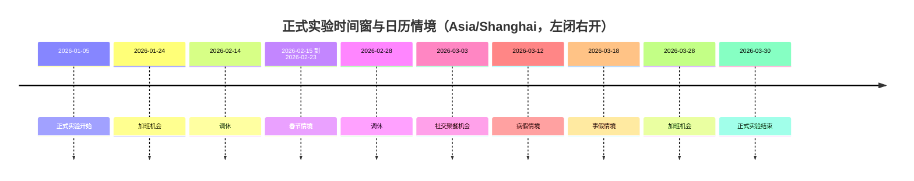
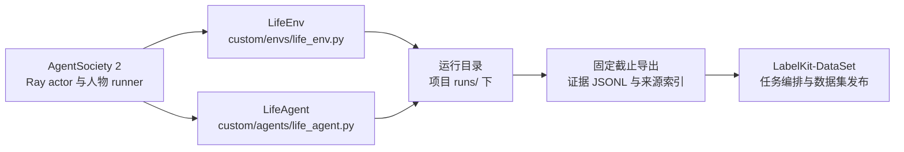

# WorldMock 实验设置

> 按[动作与内容简化规格](dev/SPEC-action-and-content-simplification.md#spec-acs-动作与内容简化开发规格)修订「固定规则、目录格式与加载边界、收货结算」（阶段 1、2）。

> 2026-10-07：按资源与规则引擎简化规格同步剩余系统规则、最终提示身份与查看器（阶段 6）。

> 2026-10-07：按[资源与规则引擎简化规格](dev/SPEC-resource-and-rule-simplification.md#spec-rrs-资源与规则引擎简化开发规格)同步阶段 5 的工作主题实验参数。

> 按[资源与规则引擎简化规格](dev/SPEC-resource-and-rule-simplification.md#spec-rrs-资源与规则引擎简化开发规格)修订「环境发布与运行身份、经济参数、能量感知标签、身体初始值、效率曲线、需求状态、实验假设声明」（阶段 1）；「地图与门店供给的实验身份」（阶段 2）；「内容与语料绑定、实验身份与范围」（阶段 3）；再次修订「交互菜单与运行身份、内容与语料绑定、决策点节奏、实验假设声明」（阶段 4）。

> 状态：FROZEN。本文件是实验身份、时间窗、依赖、场景参数、内容语料与外部参照的冻结口径。按人物 Prompt 规格修订，修订部分已实现并通过离线验收（证据见[人物 Prompt 验收记录](archive/persona-prompt/persona-prompt-verification.md)）。按[一日运行保真规格](VERIFICATION.md#verification-incremental-evidence)「冻结条款修订」第 1、13、25 行修订（一日运行保真 EXP1）：两个指纹再变、困意档界、娱乐与社交口径、名称类拒绝、轮转上界按分区，并登记该规格的实验假设；登记的实验假设与口径已随实现生效，两个指纹的变化（含工具层 `callable_index` 使 `prompt_sha256`、`start_activity` 的 `prefer` 与方式「购买」使 `tool_schema_sha256` 再变）已随实现落地。
> 工具交互修订：按[工具交互规格](dev/SPEC-life-runtime.md#tool-interaction-工具请求)冻结目标实验身份；本次修订已实现，发布身份与行为、变异证据见[工具交互验收记录](archive/tool-interaction/tool-interaction-verification.md)。
> 个人事务与工作安排修订：按[个人事务与工作安排规格](VERIFICATION.md#verification-incremental-evidence)「冻结条款修订」第 1、5、7、11、14、15、16、17 行修订（个人事务与工作安排 EX2–EX18）：工作安排作为场景声明的事实、各阶段指纹与结构版本的目标身份、就寝反思的身份绑定、事务提醒进入决策边界、个人事务容量上限登记为实验假设。登记的实验假设、口径与各阶段的指纹、结构版本变化已随实现落地（证据见[个人事务与工作安排验收记录](archive/errands-workday/errands-workday-verification.md)）：阶段 1（运行修复入库，只改变 `code_sha256`）、阶段 2（个人事务与提示分工：世界结构 `9`、质量报告结构 `4`，两个指纹改变）、阶段 3（作息与工作安排：场景结构 `5`、卡片结构 `3`，`prompt_sha256` 与当时三份场景的 `scenario_sha256` 改变）与阶段 4（查询筛选与返回精简：只改变 `tool_schema_sha256` 与 `code_sha256`）。
> 让「等待」成为例外修订：按[让「等待」成为例外规格](dev/SPEC-idle-fillers.md#spec-idle-fillers-让等待成为例外开发规格)修订「交互菜单与运行身份」「决策点节奏」（阶段 1）与「交互菜单与运行身份」（阶段 2、3）。
> 同时做两件事修订：按[同时做两件事规格](dev/SPEC-parallel-activities.md#spec-parallel-activities-同时做两件事开发规格)修订「交互菜单与运行身份」「地图与门店供给的实验身份」（阶段 2）；「交互菜单与运行身份」（阶段 3）。
> 日期：2026-10-07
> 范围：单人物 84 天正式实验，上海张江白领，时区 Asia/Shanghai。
> 接口签名、字段与目录结构见 `docs/CONTRACTS.md#contracts-worldmock-接口合同`；行为规则见 `docs/dev/SPEC-*.md`；验收门禁见 `docs/VERIFICATION.md#verification-worldmock-验收标准`。

## 实验身份与范围

本次实验运行在 AgentSociety 2（下称 AS2）之上：由 AS2 调度进程并提供模型服务，驱动一个数字人过日常生活；这一过程产生的可追溯记录构成数字足迹，认证导出交给 LabelKit-DataSet 加工。本文件只绑定城市、职业、日期、模型、内容、身体参数和评估参照。

| 项目 | 冻结值 |
| --- | --- |
| 仿真类型 | 单机 AS2 原生 Ray actor 与人物 runner；正式单人物十二周，同时交付多人测试与实际短运行 |
| 正式日期 | Asia/Shanghai，2026-01-05 00:00:00 到 2026-03-30 00:00:00，左闭右开，共 84 天 |
| 人物共同背景 | 白领；生活区为上海张江生活区，工作园区为张江高科技园区；与基线数据对齐到可证明的程度 |
| 未共同定义的属性 | 年龄、工资、初始存款、身体参数单独声明为新实验假设，不能当作基线数据已匹配条件 |
| 场景定义 | `../WorldMock-Dataset/environment/zhangjiang-baseline/scenarios/single-person.json` |

本文件绑定的全部能力均属于本次交付：不使用占位实现、跳过测试、延期清单或旧入口维持表面可用；接口穿刺是实现顺序，不是缩小最终范围。正式仿真不预设与基线数据相同的事件数量或意图比例——人物根据可见内容、需求、合同和记忆做出选择，消息等预排事件只陈述真实到达边界，食品店铺固定全天服务，不编写人物每天必须执行的活动序列。场景可以按人物声明工作安排（每周班次、日期例外与休息时段）：它由环境按世界时钟求值后作为事实呈现，不新增拒绝，也不编写班内必须执行的活动。依赖导入、原生工具调用和一个完整决策必须真实通过，才允许进入后续完整链路。

### 环境发布与运行身份

现行身份是目录格式 2、`RULES_VERSION = 2`、场景结构 8、世界结构 11、运行清单 4。
运行、检查点与恢复使用五字段 `environment_identity`：`environment_id`、`environment_version`、
`rules_version`、`catalog_content_sha256`、`map_sha256`。
规则文件只从引擎包读取，环境不发布副本，也不添加规则哈希；`code_sha256` 额外覆盖 `src/worldmock/data/` 下每个文件。
旧格式与旧结构号直接拒绝，不迁移、不双读。

环境由数据仓发布，WorldMock 只保留人工环境；完整回归显式传入重制环境的 `--environment-root`。
类别、使用方式、效果与供给表由系统固定，内容标题与摘要来自目录。历史模型运行和导出不改写，也不证明当前版本的新运行。

## 时间窗与日历情境

正式时间窗为 Asia/Shanghai 的 2026-01-05 00:00:00 到 2026-03-30 00:00:00，左闭右开，共 84 天；场景定义文件的 `start_at` 与 `end_at` 与该窗口一致。

日历情境只改变机会与约束，不保证人物执行；春节情境同样只改变机会与约束。

## 依赖冻结

### 人物生成模型

| 组件 | 版本或端点 | 冻结要求 |
| --- | --- | --- |
| 人物生成模型 | DeepSeek 官方 OpenAI-compatible 端点，`deepseek-flash` | 保存实际返回模型名、fingerprint、请求参数和 token 使用 |
| 模型冻结 | - | 固定端点、角色、提示（系统层与七层模板）、Pydantic 基础工具合同和模型参数；原生工具定义整次运行不变（只剩最后一个回合时与输出截断后的那次重试时去掉全部只读查询工具），不逐轮绑定名称枚举，本轮可选的目标与动作只在工具层列出；运行中不切换模型或代选行动 |

### 交互菜单与运行身份

正式场景中的 `interaction_menus_by_location_kind` 与每个人物的 `interaction_menu` 是实验条件。
具体允许的对象动作以 `../WorldMock-Dataset/environment/zhangjiang-baseline/scenarios/single-person.json` 的显式声明为准；地点类与人物
声明求交集后，可见目标、决策阶段、回合预算与同刻上限的受限轮收窄本轮实际动作；不按人物状态或能量隐藏，
当前不可行的动作照常列出并附说明；没有日首计划阶段。字段形状、保护项和拒绝语义统一见[交互菜单规格](dev/SPEC-interaction-menu.md#spec-interaction-menu-特性规格交互菜单)，本文件不另复制一份菜单。

菜单声明属于场景原始 JSON 字节，因而进入 `scenario_sha256`。地点或人物菜单不同就是不同实验条件，
不得因静态提示与工具模板哈希相同而合并比较。删除工具描述中的固定办公室偏好会改变
`tool_schema_sha256`，不会改变 `prompt_sha256`；源码修改仍进入代码身份。原生工具定义整次运行不变，不再按地点和人物
生成动态 Schema；菜单对本轮动作的收窄体现在工具层，随冻结观察留证。新建、打开既有运行、恢复及反事实分支继续核对
场景、工具模板和代码身份，任一不匹配即拒绝，不补写旧运行或迁移旧场景。
人物配置的 `work_schedule`、`leave_work_window`、`arrive_home_window` 同属场景字节，声明不同即不同实验条件，不得合并比较；
当时三份场景在个人事务与工作安排规格阶段 3 随场景结构升 5 显式写出 `work_schedule: null`，`scenario_sha256` 随之改变。
是否给正式十二周场景声明班次另行裁决，裁决后在「实验假设声明」登记取值与依据。
[让「等待」成为例外规格](dev/SPEC-idle-fillers.md#spec-idle-fillers-让等待成为例外开发规格)的班次与休息时段起止唤醒只改变 `code_sha256`：
`prompt_sha256`、`tool_schema_sha256`、世界结构 9、质量报告结构 4、场景结构与 AS2 锁定摘要都不变；声明了班次的场景其决策点因这些起止而增加，
没有声明班次的场景行为不变。

代码身份 `code_sha256` 覆盖 `src`、`custom`、`pyproject.toml`、`uv.lock` 与实际导入的 AS2 包（包目录内除
`__pycache__` 外的全部文件，与安装位置无关）。AS2 包目录为空、导入失败或与下节登记的源码摘要不符时，
`run`、`resume`、`replay`、`validate` 拒绝启动。运行清单另记 Git 提交 `git_commit` 与未提交标志 `git_dirty`
（非 Git 检出时为 null），二者只记录，不参与恢复比对。提示或工具面变化会改变 `prompt_sha256`、
`tool_schema_sha256`，这样的运行与旧运行不可合并比较：七层模板、只写用途的工具 description 与 `start_activity` 新增的
`from`、`to`、`answering` 都改变这两个指纹。[一日运行保真规格](dev/SPEC-life-runtime.md#dayrun-fidelity-身体与需要)再次改变它们：系统层 18 条规则、待办层的
`around_time` 与工具层的 `callable_index` 改变 `prompt_sha256`，三个控制工具改为 `items`、`revise_day_plan` 的 `around_time` 与
`start_activity` 的请求级 `prefer`、方式「购买」改变 `tool_schema_sha256`；该规格实施前后的运行不可合并比较，运行清单另增 `input_warnings`。
[个人事务与工作安排规格](dev/SPEC-as2-integration.md#errands-workday-运行修复入库)分阶段再次改变它们，各阶段前后的运行不可合并比较：阶段 1 的四项运行修复只改变 `code_sha256`；
阶段 2 的系统层第 1、4、6 条与待办层、进度层 Schema 改变 `prompt_sha256`，三个控制工具的用途句、请求级 `errands` 及其八个键的字段说明与
`items[].memories` 的字段说明改变 `tool_schema_sha256`。阶段 3 的系统层第 1、14 条与人设层、环境层 Schema 再次改变 `prompt_sha256`，工具面不变；
零点计划模板与输入不在 `prompt_sha256` 内，只由 `code_sha256` 绑定。阶段 4 的 `query_world` 六键请求（`name`、`way`、`category`、`from`、
`available_only`、`offset`）与用途句改变 `tool_schema_sha256`，系统层与层 Schema 不变；四键旧请求按缺字段拒绝。
[让「等待」成为例外规格](dev/SPEC-idle-fillers.md#spec-idle-fillers-让等待成为例外开发规格)把系统层第 7、14、15、16 条原位改写（仍为 18 条），改变 `prompt_sha256`，
工具面与各层 Schema 不变，`tool_schema_sha256` 不变；该改写实施前后的运行不可合并比较；零点计划模板第三、五、六条的改写只改变 `code_sha256`。
[同时做两件事规格](dev/SPEC-parallel-activities.md#spec-parallel-activities-占用声明)重列可供性占用声明（只有同一种动作互斥）：`tool_schema_sha256` 绑定引擎包资源 `src/worldmock/data/affordances.toml` 的字节，因而与 `code_sha256` 一起改变，`prompt_sha256`、世界结构 9、质量报告结构 4、场景结构 6 不变；活动占用随世界状态保存并在恢复时与注册表逐项核对，此前的检查点与运行不能再恢复或重放，实施前后的运行不可合并比较。

[动作与内容简化规格](dev/SPEC-action-and-content-simplification.md#spec-acs-观察与工具面)统一动作执行与显式 app、导航 app、购物 app 和付款 app；可调用索引为 goods、navigation_apps、payment_apps、query_categories。活动快照、推送动作、内容进度与分配工作内容共同决定当前提示和工具身份。原生工具 Schema、十八条系统规则、层 Schema 与代码摘要分别冻结，改写前后的运行不能合并比较或恢复为当前结构。

当前启动项恰有 `target`、`way`、`app`、`to`、`pay_app`，世界查询使用六键 `name`、`way`、`category`、`app`、`available_only`、`offset`。一次性闹钟新增为原生工具，驿站领取通过 start_activity 的「领取」方式执行；动作通信方式明确区分文字与语音，内容不含分类；这些字段、十二项原生工具与系统层改写共同改变工具和提示身份。上文 `from`、`prefer` 等仅描述历史指纹变更，不是当前输入。

[同时做两件事规格](dev/SPEC-parallel-activities.md#spec-parallel-activities-同时做两件事开发规格)把系统层第 8 条原位改写（阶段 3，仍为 18 条），改变 `prompt_sha256`，
工具面与各层 Schema 不变，`tool_schema_sha256` 不变；该改写实施前后的运行不可合并比较。
运行清单的阶段身份 `stage_model_identity` 只有 `action` 一个阶段键，
含 `decision_statement` 的旧清单被拒绝；同秒续接开关 `same_second_continuation`（`worldmock run --same-second-continuation on|off`，
缺省 `on`）冻结进 `stages.action` 与人物配置，恢复与重放继承父清单的值，不能覆盖，恢复时人物配置与父清单不符即拒绝。
开与关两臂的对比用只读子命令 `scripts/inspect_run.py continuation --baseline`，两份清单除运行身份与该开关外必须相同。
就寝反思是记忆运行时的后台调用：只带严格工具 `submit_reflection`（`tool_choice=required`、思考关闭、不带 `purpose`）；
该工具不进 `tool_schema_sha256`，反思文案不进 `prompt_sha256`，二者与 `submit_day_plan` 一样只由 `code_sha256` 绑定，`stage_model_identity` 不增阶段键。

工具交互特性删除模型 `actions` 参数，增加固定 `query_world`，任务回看改为只读，错误位置与候选、
任务合同元信息、操作备忘及紧凑工具层都改变提示或工具身份，必须重新计算两个指纹并冻结进新运行清单。
请求采用 `start_activity.items[]` 的一至两项 `{target, way, app, to, pay_app}`，未使用字段写 null；本人收货的 to 为 null，远程购物与付款应用均由人物明确选择。
只读查询不作为世界动作或同刻轮数，调用所在模型回复仍计十六回合预算；不添加查询试点开关或旧请求兼容层。
按错误接口、分配工作内容、实际购买与收货、查询、操作备忘与紧凑呈现分别形成端到端实验收据，
每阶段身份和独立行为、变异门禁见[工具交互特性门禁](VERIFICATION.md#verification-工具交互特性门禁)。不同阶段的代码、数据和提示身份不可合并当成同一实验。

剩余系统规则已按冻结合同同步：推送时机、并行活动、名称、购买来源与工作主题。
这次改写只更新最终 `prompt_sha256` 与代码身份，`tool_schema_sha256` 沿用工作阶段已验收的工具面；
改写前后的运行不能恢复、重放或合并比较。运行中的系统层与工具定义始终保持各自冻结字节。

### AS2 基线与框架依赖

| 组件 | 版本 | 位置 |
| --- | --- | --- |
| AS2 基线 | 基于 `670c94fff7c64c4f79b632125f2ccf968155e746` | `patches/agentsociety2/SERIES` 固定基线与有序补丁，源码由引导重建 |
| AS2 源码摘要 | `bb655cb3b4d7a68c725431a507192389b4e6770015e9673d6f5e9ef92dba1c46` | `SERIES` 中最终补丁源码摘要，运行身份按它比对 |
| MCP | 1.26.0 | 取自 AS2 上游提交所锁定的版本 |
| LiteLLM | 1.89.2 | 取自 AS2 上游提交所锁定的版本 |
| Ray | 2.55.1 | 取自 AS2 上游提交所锁定的版本 |
| 新增依赖 | - | 由 WorldMock 锁文件统一锁定 |

### 自定义模块位置

| 模块 | 路径 |
| --- | --- |
| AS2 环境扩展 | `custom/envs/life_env.py` |
| AS2 人物扩展 | `custom/agents/life_agent.py` |
| WorldMock 记忆业务扩展 | `src/worldmock/agents/life_memory.py` 及同目录存储扩展 |
| AS2 环境 actor 与代理扩展（只读查询转发） | `src/worldmock/life/read_query_runtime.py` |
| 运行目录 | 项目 `runs/` 下 |

## 运行绑定与消费

### 数据流与依赖

### 命令入口

对外入口只有 `worldmock`；每个命令的参数、行为、失败语义与运行状态枚举见 `docs/CONTRACTS.md#contracts-worldmock-接口合同`「CLI 命令接口」，本文件只绑定本次实验用哪几个命令以及怎么用。

环境由 WorldMock-Dataset 发布，数据采集和制作按数据仓工具说明执行。
本次实验使用 `validate`、`run`、`resume`、`replay`、`status`、`export`、`evaluate`：正式窗口由 `run` 从 `../WorldMock-Dataset/environment/zhangjiang-baseline/scenarios/single-person.json` 新建运行目录并执行到场景终点，`export` 的固定截止完整导出是与 LabelKit-DataSet 的交接边界，`replay` 产生的反事实分支必须保留来源，`evaluate` 的结果与基线数据对照后交付。

### 运行目录约定

每次运行在项目 `runs/` 下独占一个运行目录，既有运行目录不得被覆盖；正式窗口运行与反事实分支运行各自独占一个运行目录。运行目录的内容清单见 `docs/design/05-recording-engine.md#recording-engine-worldmock-产品设计说明书-记录引擎`「持久化结构」。

### 数据加工归属

完整认证导出交给 LabelKit-DataSet；任务输入、模型配置、训练数据格式、加载器与规则测试数据由该仓库维护。
WorldMock 不声明这些下游依赖，也不安装或调用 LabelKit。来源快照已交接并核对摘要，新消费验收仍待所属仓库完成。

## 场景参数

正式实验由 `../WorldMock-Dataset/environment/zhangjiang-baseline/scenarios/single-person.json` 定义。参数的单位口径、来源类型与合法区间见 `docs/dev/SPEC-life-runtime.md#spec-life-runtime-特性规格lifeenv-运行时行为与结算规则`「身体参数与单位」；表内数值是本次实验的初始假设，之后只被时间与动作规则改动。

### 身体初始值

| 参数 | 取值 | 单位 | 依据 |
| --- | --- | --- | --- |
| 体重 | 65 | kg | 用于基础消耗计算 |
| 初始可用能量 | 1600 | kcal | 实验假设 |
| 可用能量上限 | 2400 | kcal | 实验假设 |
| 初始睡眠不足 | 0 | hours | 实验假设 |
| 初始睡眠压力 | 按惯常起床时刻反推 | - | 实验假设 |
| 基础消耗率 | 65 | kcal/hour | 按体重 |
| 数值精度 | 1e-9 | kcal | 累计舍入容差 |

初始睡眠压力的反推见 `docs/dev/SPEC-life-runtime.md#time-and-energy-决策不耗时时间只在做事时流动`「作息初值」：起点落在惯常睡眠时段内或接近它时，人物以困倦开始。

体重、初始能量和睡眠债为场景初值；上限、基础耗能与身体演化常数来自 `worldmock.exchange.body.BODY_CONSTANTS`，来源为 `worldmock:<RULES_VERSION>`，环境不能覆盖。

### 两过程睡眠

| 参数 | 取值 | 单位 | 依据 |
| --- | --- | --- | --- |
| `sleep_pressure` 上升时间常数 | 18.2 | hours | 清醒时趋近 1 |
| `sleep_pressure` 下降时间常数 | 4.2 | hours | 睡眠时衰减 |
| 入睡阈值 | 0.67 | - | 按昼夜相位振幅 0.12 摆动 |
| 醒来阈值 | 0.17 | - | 按昼夜相位振幅 0.12 摆动 |
| 困意档界 | 0.80 / 0.93 / 1.07 / 1.18 | - | 「有点乏」「困」「很困」「撑不住」的下界；按 KSS 等价刻度标定，见「实验假设声明」 |
| `sleep_deficit_hours` 清醒累积率 | ~0.45 | hours/hour | `sleep_need` 为 7.5 小时时 |
| `sleep_deficit_hours` 睡眠恢复率 | 1.0 | hours/hour | - |
| `sleep_deficit_hours` 下限 | 0 | hours | - |
| `sleep_deficit_hours` 上限 | 24 | hours | - |

### 效率曲线

| 曲线 | 输入 | 节点 | 插值 |
| --- | --- | --- | --- |
| 收货当秒的食品利用效率 | `sleep_deficit_hours` | (0, 0.90)、(8, 0.90)、(16, 0.85)、(24, 0.80) | 线性 |

收货当秒的食品利用效率与能量上限保留为 WorldMock 身体常数，来源 `worldmock:<RULES_VERSION>`。分配工作内容按真实秒数积累，现行运行消费者不读取工作效率或计酬曲线。

### 需求状态

| 需求 | 范围 | 变化 |
| --- | --- | --- |
| 饥饿阈值 | - | WorldMock `BODY_CONSTANTS` 的 800 kcal 为饥饿、400 kcal 为紧急；低于 400 kcal 时至少「饿得难受」，不受昼夜项与餐时项影响；低于 100 kcal 为「饿得发慌」 |
| 娱乐需要 | [0, 1] | 清醒每小时 +0.08，有缓解的活动进行时不累积；实际娱乐按固定 ENTERTAINMENT_RELIEF_PER_HOUR = 0.3 每小时减少，画像偏好不参与数值规则 |
| 社交需要 | [0, 1] | 清醒每小时 +0.04，清醒按本区间共同身体结算所用的活动集合判定（在边界结束的睡眠不计清醒）；交谈、通话按明确规则减少；睡眠中不读消息 |

人物读到的是体感分级而非数值——分级只描述状态，不替人物挑动作；接触次数与效果一并写进足迹。增减规则与留痕口径见 `docs/dev/SPEC-life-runtime.md#spec-life-runtime-特性规格lifeenv-运行时行为与结算规则`「场景与身体规则」。

本节身体常数来自 `worldmock.exchange.body`；app 按类型缓解在阶段 4 原位切换，当前不提前宣称新娱乐运行机制已经完成。

### 能量感知标签

| 标签 | 取值与来源 |
| --- | --- |
| 食品热量 | 按 `GoodsCategory` 每份固定：零食 200、饮品 100、正餐 600 千卡；`GOODS_ENERGY_KCAL` |
| 出行费力 | 按身体常数中的出行 MET 分档，保留既有体感呈现 |

标签仅给可读事实，人物不读取身体准确数值。食品常数与实际摄入、身体利用效率分别留证，不用真实营养数据掩盖固定仿真假设。

### 经济参数

| 量 | 当前仿真假设 |
| --- | --- |
| 人物与外部账户初值 | 场景显式声明，人物账户由 `initial_balance_fen` 建立 |
| 商品价格（含非食品） | `goods.json.price_fen` 正整数分，同商品全店同价 |
| 驾车车费 | `max(500, ceil(Decimal("0.2") × 图距离米))` 分；步行 0 |
| 配送费 | 500 分/单，货款与配送费同一笔付给 `merchant:<store_id>` |
| 配送时间 | 备餐 600 秒加 `ceil(图距离米 / 5.0)` 秒 |
| 出行时间 | 步行 1.2 米/秒，驾车 7.0 米/秒，向上取整 |

费用与速度常数归 `worldmock.exchange`，由 `RULES_VERSION = 2` 绑定。无工作包、计时或计件交换；工作内容由场景分配，工资仅来自明确登记的薪资事件。数值是仿真假设，不能当作具体真实门店的报价事实。

### 工作参数

| 参数 | 当前合同 |
| --- | --- |
| 工作内容 | `contents.json` 登记工作与学习内容，人物通过 `agents[].work_content_ids` 分配 |
| 目标工时 | 分配内容的 `duration_seconds`，单位秒，登记下限 60 |
| 工作安排 | `work_schedule` 指定工作地点、每周班次与日期例外 |
| 加载供给 | 有排班就至少分配一条内容，全部分配时长不少于运行区间内的排班秒数 |

工资只来自场景登记的 `payrolls[]`，不从内容完成或目标时长推导。

### 活动节奏与同刻决策上限

| 参数 | 取值 | 单位 | 依据 |
| --- | --- | --- | --- |
| 活动反馈间隔 | 900 | 秒 | 场景冻结，即 15 分钟 |
| 同刻决策上限 `max_same_moment_decisions` | 3 | 轮/人物/模拟秒 | 场景缺省值；达到上限后的受限轮见 `docs/dev/SPEC-life-runtime.md#spec-life-runtime-特性规格lifeenv-运行时行为与结算规则`「时间推进与并发活动」 |
| 名称类拒绝的免计次数 | 2 | 次/人物/模拟秒 | 名称类拒绝在此之内不计同刻轮数、不施加情绪脉冲，第 3 次起照常；实验假设，见「实验假设声明」 |
| 最小活动持续时间 | 60 | 秒 | - |

### 决策点节奏

轮转与候选上限的闭式上界按「每天决策点数 `D`」计算，所以 `D` 是**观测量而非假设值**。

| 量 | 取值 | 单位 | 依据 |
| --- | --- | --- | --- |
| 决策点中位数 | 71 | 次/人物/天 | 实施前快照（时间与能量规格实施前）：34 个既有 run 的足迹实测（`runs/*/footprints.sqlite` 的 `decision_started` 计数 ÷ 人物数 ÷ 模拟跨度天数） |
| 决策点区间 | 9 – 112.5 | 次/人物/天 | 同上；四分位为 49 与 81.5 |
| 保守取值 | 60 | 次/人物/天 | 定参数时取中位数偏保守一侧；验收断言不得硬编码该值 |

**口径**：`D` 按 `decision_started` 逐次计：每次决策在其首个行动请求时写入一条，同一秒的多次决策（含同秒续接的各次）各计一次；静默边界不产生 `decision_started`，因此不计入。

**为什么远高于"每 90 分钟重新考虑一次"给出的下限**：决策边界取多个触发点里**最早**的那个——计划活动结束、体感分级跨越、到达地点、app 推送、计划提醒、个人事务提醒、班次与休息时段的起止、进行中活动的 30 分钟播报，而重估间隔只是其中最迟的一个兜底；没有进行中活动时还在同一秒再决策（同刻决策）。娱乐类动作的当前内容完成是静默结算边界：它更新共享内容进度并接续下一条，不增加 `decision_started`，因此不计入 `D`；其余类别完成单条即完成活动并提供决策。进行中活动按 `progress_report_due` 常设询问，闹钟可唤醒睡眠。所以重估间隔不是决策间隔，是决策间隔的**上界**：有在手承诺时取 `reconsideration_interval_seconds`（5400 秒）（未完成的个人事务不算在手承诺，不改变常规与空闲重估间隔）；只在等待且没有其他在手承诺时取 `idle_reconsideration_interval_seconds`（缺省 10800 秒）；睡眠不受重估间隔约束。个人事务提醒（`errand_reminder_due`）不在睡眠允许集合内：清醒人物的未提醒时刻进入下一边界与下一次决策机会的候选，精确在该时刻到点，只提供一次决策机会；同一边界到期的多条事务合并为一次机会，该原因只计一次；睡眠中的人物不计入候选、不形成静默边界、不交付也不消耗，错过的提醒在醒来的那个边界交付，不另起边界。`D` 的既有实测为该特性实施前快照。工作安排的班次与休息时段起止是触发点（`shift_start`、`shift_end`、`break_start`、`break_end` 四个成员）：清醒的人物精确在该时刻获得一次决策机会，进行中的活动继续；睡眠中的人物不计入候选、不形成静默边界，睡过的起止醒来后不补。声明了工作安排的人物每个当班日由起止直接新增的提供决策的边界至多 2 + 2 × 休息时段数 个，与既有机会同秒的不另计；这些边界上同一秒的再决策，以及人物在此所作选择引出的后续边界，照常计入 `D`。该特性实施基线的三份场景未声明工作安排，因而班次边界唤醒不改变它们的行为。当前正式输入由数据仓冻结，按实际声明核对。

**与轮转断言的关系**：最大未呈现间隔的闭式上界写作 `⌈N ÷ k⌉ ÷ D`，按检索分区成立（`N`、`k` 取该分区自己的池规模与换新名额），其中 `D` 取本节的实测区间而非单一估计值；池只在人物身处该地点时可达时，有效决策点按 `D × 可达率` 折算。判据与失败口径见 `docs/VERIFICATION.md#verification-worldmock-验收标准`「工程门禁」。同一秒各轮沿用该秒首轮的呈现窗口（`docs/dev/SPEC-life-runtime.md#time-and-energy-决策不耗时时间只在做事时流动` 第一章），轮转上界中的有效决策点按有 `decision_started` 的不同模拟秒计；同刻轮次出现前两种计法相同。

## 内容与语料绑定

| 内容类型 | 本次确定方案 |
| --- | --- |
| 食品 | 登记目录保留真实食品名称，类别仅 snack、drink、meal；价格显式为合成假设，热量来自固定类别常数 |
| app 内容 | `contents.json` 登记真实作品名、完整摘要、摘要来源、时长、动作与合规 app 绑定；内容绑定一个动作，不登记分类、字幕、音轨、分段资产或评估引用 |
| 工作 | `contents.json` 登记工作内容与 duration_seconds；人物经 work_content_ids 分配，工作安排与分配时长在加载时核对 |
| 邮件 | 48 个冻结场景线程，明确标为场景创作 |
| 商品与门店供给 | 同类型食品店铺共享完整菜单，食品全店同价；app 绑定与固定每单配送费分别登记，不声明店铺库存、营业或资格 |
| 地图与路线 | 真实地点名称与合成连通加权图边长分别说明；完整路径、最短距离和固定方式费用由已发布图与规则计算 |
| 交通与天气 | 出行方式速度与费用是包内固定规则，天气属于明确场景假设，不表示实时路况 |

本次实验对象取值以 WorldMock-Dataset 发布的 catalog/manifest.json 为准，消息与联系人在场景声明，引擎不读语料。食品、app、内容、发布图边长与每份文件的摘要在发布后冻结；正式运行启动前逐项核验。内容摘要的 `summary_source.kind` 区分事实、来源整理与合成，来源需要链接时写 `url`，合成时写明确说明。来源准入与失败语义见 `docs/dev/SPEC-life-runtime.md#spec-life-runtime-特性规格lifeenv-运行时行为与结算规则`「数据进入环境的过程」。

### 地图与门店供给的实验身份

| 实验输入 | 冻结身份与含义 |
| --- | --- |
| 环境 | 场景结构 8 的 `environment` 钉目录清单身份与版本；运行使用五字段 `environment_identity` |
| 图 | `map.json` 的整数 `seed`、`generator_rule_version=1`、排序节点、规范边与正整数米；同输入跨机器同字节 |
| 地点 | 名称、分店标签与类型来自目录，场景只选择地点身份；不输入坐标、道路或营业状态 |
| 菜单 | 按店铺类型共享菜单，商品价格全店相同；`"all"` 只绑定类型能供给该类别的店铺，住宅不出售食品 |
| 出行与配送 | 最短距离和完整路径决胜，方式速度、车费与配送常数来自 WorldMock 固定规则 |
| 记录与恢复 | 世界 11、运行清单 4；图与目录内容变化改变环境身份，恢复逐字段核对 |

图由 WorldMock 生成、Dataset 发布，运行不重生成；等长最短路比较完整路径元组，不依赖边插入次序。场景选择不裁切图，路径可以经过未被选择地点。
图种子决定发布字节，与运行随机状态分别记录；环境发布以实际清单为准，不在文档里假定尚未发布的正式版本或数量。三份人工场景用于纯加载和所属行为验证，正式 Dataset 重制与平台回执按所属阶段验收。
地点选择可以比较图上距离、到手价与等待时间，但人物仍自主选择，不强制某家店胜出。同类菜单和合成数值是实验条件，不能作为真实门店供给或真实道路证据。
规则文件只从包读取，环境没有副本；规则变化升 `RULES_VERSION`，对象或图变化发布新环境版本，旧运行和历史输入字节不重写。

## 基线数据参照

基线数据指 Dataset-Person 中更早的一次张江白领十二周运行，只作为外部参照，不构成对本次仿真的事先约束。

| 项目 | 值 |
| --- | --- |
| 基线数据来源 | Dataset-Person 的 `archive/white-collar-12-weeks-deepseek16-glm52/repaired/` |
| 基线数据验证 | 原 manifest、修复报告和最终审计共同验证 |
| 基线数据身份 | run `ec5742eff472d320dac4f98c6d1fd478`；main 4,380 行、stream 16,320 行、84 个自然日 |

## 实验假设声明

以下参数为实验假设，不宣称来自已验证的人类生理或心理模型：

- 睡眠对食品利用效率的影响。
- 工作效率与睡眠不足的关系。
- 娱乐需要增长与减少规则。
- 社交需要增长与减少规则。
- 重复接触对娱乐效果的影响。
- 低能量显示：能量低于 100 kcal（`APPETITE_STARVING_KCAL`）为「饿得发慌」。
- 路线费力的 MET 分界与商品热量的取整（见「能量感知标签」）。
- 能量对工作效率的影响（见「效率曲线」）。
- 初始睡眠压力按惯常起床时刻反推。
- 联系人回复延迟 `CONTACT_REPLY_DELAY_SECONDS`，缺省 300 秒。
- 思考只在同一秒的连续决策之间回传，时间推进后丢弃。
- 记忆层 JSON 至多 8000 字符的窗口。
- 本人位于联系人的收货地点即视为与该联系人同处（给予的同处条件）。
- 受限轮用完仍无进行中活动或仍有待收尾活动时的技术停顿，身体按静息结算。
- app 使用的娱乐缓解只取当前内容类型的固定每小时速率，不乘人物口味、不设下限，也不按接触次数递减。
- 困意档界的 KSS 等价刻度标定：`K = 7 + 7.6 · (困意 − 1)`，斜率 7.6 由 Shochat 等 2021 的两个锚点对三个人物的工作日稳态拟合（得 7.47–7.81）；
  在 K = 5.5、6.5、7.5、8.4 处切出档界 0.80、0.93、1.07、1.18（该规格 1.4）。
- 饥饿为「饿」时，离平常饭点一小时以内可以提前准备或下单：一小时覆盖外卖 20–40 分钟的送达，敏感区间 30–120 分钟（该规格 2.2，系统层第 15 条）。
- 名称类拒绝每人每秒至多 2 次不计同刻轮数、不施加情绪脉冲，第 3 次起照常（该规格 3.4）。
- 当日目标大致时刻的推进容差为前后 90 分钟（`GOAL_TIME_TOLERANCE_SECONDS = 5400`），敏感区间 60–120 分钟，复跑后按数据校准（该规格 8.2）。
- 个人事务的容量上限：每人未完成事务至多 8 条，一次请求至多 4 条变更，名称至多 30 字符，备注与取消原因各至多 120 字符，数量 1 至 9；
  待办层不浓缩，上限由校验执行，不静默截取、不自动合并（[个人事务与工作安排规格](dev/SPEC-as2-integration.md#errands-workday-运行修复入库) 2.1）。

| 简化规格新增假设 | 当前值或生效边界 |
| --- | --- |
| 食品类别常数 | snack 200 千卡，drink 100 千卡，meal 600 千卡每份；没有食用秒数 |
| 出行速度与车费 | 步行 1.2、驾车 7.0 米/秒；驾车至少 500 分、每米 0.2 分向上取整 |
| 配送 | 5.0 米/秒、备餐 600 秒、500 分/单 |
| 地图生成器 | 至少两节点，先树后补 ⌊(n−1)/2⌋ 边，边长 200–2000 米，规则版本 1 |
| 推送窗口 | 当地时间每日 08:00 至 21:00 的每个整点；重复当地小时取 `fold=0`，不同网格点映射到同一绝对秒时两项都保留 |
| 娱乐缓解 | ENTERTAINMENT_RELIEF_PER_HOUR 固定 0.3 娱乐需要单位/小时 |

这些数值以 `RULES_VERSION` 冻结，依据见[资源与规则引擎简化规格](dev/SPEC-resource-and-rule-simplification.md#spec-rrs-常数表)。

| 动作与内容简化新增假设 | 固定值 |
| --- | --- |
| `GOODS_RECEIPT_EFFECTS` | leisure 每条订单行缓解娱乐需要 0.10，daily 每条订单行情绪 +0.05 |
| `CATEGORY_MET` | exercise 5.0、daily_care 2.0；其他类别取现有代谢值 |
| `CONTENT_MIN_SECONDS` | 60 秒，内容登记下限，无上限 |
| `FUEL_DRIVING_DAYS` | 本人现场加油每笔实际收货增加 7 个驾车可用日；每个有正驾驶秒数的本地日期扣 1 日，同日不重复扣 |
| 长途运送边界 | 完整报价严格大于 86400 秒时到家庭最近驿站；到站只通知，本人领取才收货。环境声明 shipping_seconds 或明确为 null，不重算末端报价 |

## 验收范围与外部参照

工具交互修订已实现，必须按[工具交互特性门禁](VERIFICATION.md#verification-工具交互特性门禁)补齐生产行为与独立变异证据。
错误、查询、完整通知、类别供给和两份种子地图的确定性验收不能用真实模型的个别成功调用替代，
跨时刻重复拒绝、提示容量与任务等待时间只按冻结报告口径统计，不追加未经支持的数值门槛。

个人事务与工作安排修订按[个人事务与工作安排特性门禁](VERIFICATION.md#verification-个人事务与工作安排特性门禁)验收；
个人事务、收尾记忆、工作负荷、作息偏离与查询成本只按冻结报告口径统计，不追加数值门槛，配对全天复跑只报告。

最后的验收对象包括 AS2、LifeEnv、完整数据生产及真实性评估。外部参照的人群适用性、模型自身选择与来源数据的局限都要如实交代，不得掩盖缺失的实现。

## 版本表

| 版本 | 日期 | 修订内容 |
| --- | --- | --- |
| `2026-09-18` | 2026-09-18 | 实验身份与范围、时间窗与日历情境、依赖冻结、运行绑定与消费、场景参数、内容与语料绑定、样本编码与来源分组、基线数据参照从主设计单体拆分并冻结为本文件 |
| `2026-09-18-revision-1` | 2026-09-18 | 样本编码与来源分组删除对 `docs/CONTRACTS.md#contracts-worldmock-接口合同`「数据集字段与划分」的逐字复述：训练数据编码与编码核对合并为引用行，连通组约束行只留实验侧划分比例立场并加章节指针 |
| `2026-09-18-revision-2` | 2026-09-18 | 样本编码与来源分组的章节指针收敛为一处（删除与引用行重复的文档级指针，连通组约束不再重复列出）；命令入口与运行目录约定两处与接口合同逐字重合的表述改为本文件措辞 |
| `2026-09-18-revision-3` | 2026-09-18 | 消除与其他文档的逐字重复：项目身份句改为实验侧措辞，与 `docs/INDEX.md#index-worldmock-文档入口` 的项目陈述不再逐字相同；语料冻结核验、工作合同参数、需求状态留痕、身体参数校验四处改为实验侧表述并指向 `docs/dev/SPEC-life-runtime.md#spec-life-runtime-特性规格lifeenv-运行时行为与结算规则` 对应章节；划分句改为指向 `docs/CONTRACTS.md#contracts-worldmock-接口合同`「数据集字段与划分」，本文件不再复述连通组约束；三处接口指针的句子框架改为本文件措辞 |
| `2026-09-18-revision-4` | 2026-09-18 | 消除与 `docs/dev/SPEC-life-runtime.md#spec-life-runtime-特性规格lifeenv-运行时行为与结算规则`、`docs/ARCHITECTURE.md#architecture-worldmock-架构设计`、`docs/CONTRACTS.md#contracts-worldmock-接口合同`、`docs/dev/SPEC-as2-integration.md#spec-as2-integration-特性规格agentsociety-2-集成与改动` 之间 8–11 汉字的条款级逐字回声：工作速率取值、补充场景合同类型、身体参数口径、需求状态留痕、上游锁文件与运行目录覆盖、指针句框架与实验假设声明改为本文件措辞；拒绝上限一行不再复述行为规则，改为指向 `docs/dev/SPEC-life-runtime.md#spec-life-runtime-特性规格lifeenv-运行时行为与结算规则`「时间推进与并发活动」 |
| `2026-09-20-interaction-menu` | 2026-09-20 | 将地点类与人物交互菜单绑定为场景实验条件，明确场景、静态模板、动态 Schema 与恢复身份的边界 |
| `2026-09-20-category-contract` | 2026-09-20 | 补登 `c582330`：「经济参数」的交通报价公式改为引用品类契约与 `catalog/exchange-rules.json` 的 `travel_fare` 闭集算子；内容表「商品」行改为目录、品类契约与场景实例的归属 |
| `2026-09-20-map-and-storefront` | 2026-09-20 | 补登 `2bce358`、`70af9a7`：新增「地图与门店供给的实验身份」节；内容表「商品」行改为「商品与门店供给」，「地图与路线」行改为逐方式道路记录与显式可达状态；合并时交通报价改由地图冻结路线实例提供，补当前目录 `4.0`、品类契约与交换规则 `2`、地图结构 `1`、场景结构 `3`、世界结构 `4` 与比较计价口径 |
| `2026-09-24-activity-execution` | 2026-09-24 | 补登 `2913546`：「交互菜单与运行身份」的「工具及活动类型」改为「对象动作」，收窄对象由工具改为动作 |
| `2026-09-24-time-and-energy` | 2026-09-24 | 按[时间与能量规格](dev/SPEC-life-runtime.md#time-and-energy-决策不耗时时间只在做事时流动)「冻结条款修订」第 28 行修订：交互菜单只由可见目标、决策阶段、回合预算与同刻上限的受限轮收窄，不按状态或能量隐藏，没有日首计划阶段；身体初始值增初始睡眠压力；效率曲线增能量工作效率；需求状态增两条低能量显示规则，新增「能量感知标签」；「活动节奏与拒绝边界」改为「活动节奏与同刻决策上限」，最大连续业务拒绝 10 换为同刻决策上限 3；决策点 `D` 按 `decision_started` 逐轮计，实测值注为实施前快照，重估间隔分常规与空闲，轮转上界按不同模拟秒计；实验假设声明补登新增假设（联系人回复延迟按裁决 #21 采纳）。代码身份与 AS2 源码摘要、世界结构版本、目录版本随对应实施阶段落地，届时另追加版本行 |
| `2026-09-25-time-and-energy-stage-0` | 2026-09-25 | 时间与能量规格阶段 0：「地图与门店供给的实验身份」的世界结构改为 7，与接口合同版本边界一致 |
| `2026-09-25-time-and-energy-stage-4` | 2026-09-25 | 时间与能量规格阶段 4（裁决 #25）：可供性注册表修改后目录升为 `4.1`，「地图与门店供给的实验身份」的当前目录版本同步；三份仓库场景与数据集场景的 `catalog_version` 随之同步 |
| `2026-09-25-time-and-energy-stage-6` | 2026-09-25 | 时间与能量规格阶段 6（运行身份）：「交互菜单与运行身份」写明代码身份覆盖实际导入的 AS2，AS2 缺失、为空或与源码摘要不符即拒绝启动，运行清单另记 Git 提交与未提交标志且不参与恢复比对，提示或工具面变化的运行不可与旧运行合并比较；「AS2 基线与框架依赖」位置列补锁定提交 `8768e14`（子模块指针），新增「AS2 源码摘要」行，值与代码常量 `AS2_LOCKED_SOURCE_SHA256` 逐字相同 |
| `2026-09-27-persona-prompt` | 2026-09-27 | 按[人物 Prompt 七层规格](dev/SPEC-life-realism.md#persona-prompt-七层请求)「冻结条款修订」第 29 行修订，修订部分待实现：「交互菜单与运行身份」写明七层模板、只写用途的工具 description 与 `start_activity` 新增的 `from`、`to`、`answering` 改变两个指纹，阶段身份 `stage_model_identity` 只有 `action` 与 `work_review`，含 `decision_statement` 的旧清单被拒绝，同秒续接开关冻结进 `stages.action` 且恢复与重放继承；原生工具定义整次运行不变，「模型冻结」行与动态 Schema 一句随之改写（裁决 #26）；「决策点节奏」的 `D` 按首个行动请求写入的 `decision_started` 逐次计，同秒续接的各次各计一次；「地图与门店供给的实验身份」的世界结构改为 8；「实验假设声明」删吃饭途径句的 3600 秒，登记思考只在同一秒内回传、记忆层 8000 字符窗口、联系人在其收货地点即视为同处、预算耗尽的技术停顿按静息结算；「AS2 基线与框架依赖」经核对不改（锁定 `8768e14` 不变）；文件头状态句补修订说明，日期改写 |
| `2026-09-28-persona-prompt-implemented` | 2026-09-28 | 人物 Prompt 七层规格实现后文档（人物 Prompt 台账阶段 8，按最终代码 `f798ea7` 核对）：状态头改为修订部分已实现并通过离线验收；「模型冻结」行注明原生工具只在本次决策剩最后一个回合时去掉记忆查询工具；「交互菜单与运行身份」补同秒续接开关的命令行参数、冻结进人物配置与恢复核对，以及两臂对比用 `scripts/inspect_run.py continuation --baseline`；「实验假设声明」的技术停顿补「或仍有待收尾活动」 |
| `2026-09-29-dayrun-fidelity` | 2026-09-29 | 按[一日运行保真规格](VERIFICATION.md#verification-incremental-evidence)「冻结条款修订」第 1、13、25 行修订（一日运行保真 EXP1，随该规格冻结）：「交互菜单与运行身份」写明该规格的系统层 18 条、待办层 `around_time`、工具层 `callable_index` 改变 `prompt_sha256`，控制工具 `items`、`revise_day_plan` 的 `around_time` 与 `start_activity` 的 `prefer`、方式「购买」改变 `tool_schema_sha256`，实施前后的运行不可合并比较，清单另增 `input_warnings`；「两过程睡眠」增困意档界一行；「需求状态」娱乐按有效偏好且有缓解时不累积，社交的清醒按共同身体结算的活动集合判定、睡眠中不读消息；「活动节奏与同刻决策上限」增名称类拒绝的免计次数；「决策点节奏」注明 `⌈N ÷ k⌉` 按分区成立；「实验假设声明」登记下限偏好 `f = 0.5`（0.3–0.7）及其场景层字段、困意档界的 KSS 标定（斜率 7.6，档界 0.80、0.93、1.07、1.18）、「饿」时提前一小时（30–120 分钟）、名称类拒绝每秒 2 次、目标大致时刻容差 ±90 分钟（60–120）；文件头补修订说明，日期改写 |
| `2026-09-29-dayrun-fidelity-implemented` | 2026-09-29 | 一日运行保真规格实现后（按 `e377669` 的代码核对）：「地图与门店供给的实验身份」的版本事实改为地图结构 `2`（随可选字段 `branch_label` 由 `1` 升级，冻结时漏改）；「人物生成模型」的模型冻结行补输出截断后的那次重试同样去掉记忆查询工具（该规格 7.2）；文件头改为登记的实验假设、口径与两个指纹的变化已随实现落地 |
| `2026-10-01-tool-interaction` | 2026-10-01 | 工具交互目标身份冻结并已实现：`items[]`与固定只读查询改变指纹，普通工作完整通知且收件即开放，预约需现实依据；目录 5.0、品类绑定 3、地图 3、场景 4、世界 8；保持既有两种运行种子并分别发布地图，类别完整供给与构建一次定价，新增行为和变异验收 |
| `2026-10-02-errands-workday` | 2026-10-02 | 按[个人事务与工作安排规格](VERIFICATION.md#verification-incremental-evidence)「冻结条款修订」第 1、5、7、11、14、15、16、17 行修订（个人事务与工作安排 EX2–EX18，随该规格冻结），修订部分在冻结时未随文实现（该规格阶段 1–4 实现后的核对见其后各阶段行与 `2026-10-04-errands-workday-implemented` 行）：「实验身份与范围」补场景可声明工作安排、只作事实呈现；「交互菜单与运行身份」补 `work_schedule` 与两个作息窗口属场景字节、各阶段对两个指纹的改变、就寝反思只由 `code_sha256` 绑定；「经济参数」补工作安排不参与任务开放与截止；「决策点节奏」补个人事务提醒、未完成事务不算在手承诺、班次起止不是触发点；「地图与门店供给的实验身份」登记阶段 2 的世界结构 9 与质量报告结构 4、阶段 3 的场景结构 5 与卡片结构 3；「实验假设声明」登记个人事务容量上限；「验收范围与外部参照」补本特性验收口径；「AS2 基线与框架依赖」经核对不改（锁定 `8768e14` 不变）；顺带更正文件头工具交互一行（「当前发布」句尾的历史身份说法同批删去）与版本表顺序；世界与场景结构版本随对应实施阶段落地，届时另追加版本行；文件头补修订说明，日期改写 |
| `2026-10-03-errands-workday-stage-1` | 2026-10-03 | 按[个人事务与工作安排规格](dev/SPEC-as2-integration.md#errands-workday-运行修复入库)阶段 1（运行修复入库）与配套实施计划的【同】作业 EX8 修订，随阶段 1 的代码落地（按 `a1f680b` 核对）：「自定义模块位置」增 AS2 环境 actor 与代理扩展（只读查询转发）一行，指向 `src/worldmock/life/read_query_runtime.py`；阶段 1 的四项运行修复只改变 `code_sha256`，两个指纹、各结构版本与 AS2 锁定摘要不变（锁定 `8768e14` 不变），本文其余冻结值不动；文件头改为阶段 1 已随代码落地、阶段 2–4 未实现，日期改写 |
| `2026-10-03-errands-workday-stage-2` | 2026-10-03 | 按[个人事务与工作安排规格](dev/SPEC-as2-integration.md#errands-workday-运行修复入库)阶段 2（个人事务与提示分工）与配套实施计划的【同】作业 EX15 修订，随阶段 2 的代码落地（按 `d09d574` 核对）：世界结构升为 9、质量报告结构升为 4，「地图与门店供给的实验身份」中工具交互一句的「世界结构 `8` 保持」注明为工具交互各阶段的身份、现行为 `9`；系统层第 1、4、6 条与待办层、进度层 Schema 使 `prompt_sha256` 改变，三个控制工具的用途句、请求级 `errands` 及其字段说明与 `items[].memories` 的字段说明使 `tool_schema_sha256` 改变；场景结构 `4`、地图 `3`、目录 `5.3`、品类契约与规则绑定 `3`、导出清单 `2`、运行清单 `2` 与 AS2 锁定摘要不变（锁定 `8768e14` 不变）；「实验假设声明」的个人事务容量上限与代码常量核对一致，本文其余冻结值不动；文件头改为阶段 1、2 已随代码落地、阶段 3–4 未实现 |
| `2026-10-03-errands-workday-stage-4` | 2026-10-03 | 个人事务与工作安排规格阶段 4（查询筛选与返回精简）随与阶段 2 的合并落地（本特性没有阶段 4 的 EX 作业）：「交互菜单与运行身份」冻结时登记的阶段 4 身份（`query_world` 六键请求与用途句只改变 `tool_schema_sha256`，系统层与层 Schema 不变，四键旧请求按缺字段拒绝）与实现一致，正文不改；文件头改为阶段 1、2、4 已随代码落地、阶段 3 未实现 |
| `2026-10-03-errands-workday-stage-3` | 2026-10-03 | 按[个人事务与工作安排规格](dev/SPEC-as2-integration.md#errands-workday-运行修复入库)阶段 3（作息与工作安排）与配套实施计划的【同】作业 EX16 修订，随阶段 3 的代码落地（按 `56451b4` 核对）：场景结构升为 5（人物配置增必填可空的 `work_schedule` 与可选的 `leave_work_window`、`arrive_home_window`，三份仓库场景显式写出 `work_schedule: null`，`scenario_sha256` 改变）、卡片结构升为 3、抽取提示 `card-v3`，「地图与门店供给的实验身份」的当前发布句同步；系统层第 1、14 条与人设层、环境层 Schema 使 `prompt_sha256` 再变，`tool_schema_sha256` 不变；地图 3、目录 5.3、品类契约与规则绑定 3、导出清单 2、运行清单 2、行为评估结构标识与 AS2 锁定摘要不变；阶段 3 在自己的分支上从阶段 2 的中途开发，文件头当时改为阶段 1、3 已随代码落地，并入主线（阶段 2、4 之后）时改为阶段 1–4 已随代码落地，世界结构 `9`、质量报告结构 `4` 与阶段 4 的工具指纹照主线不变 |
| `2026-10-04-errands-workday-implemented` | 2026-10-04 | 个人事务与工作安排规格实现后（个人事务与工作安排 EX22、EX23，按 `d8a41d3` 的代码核对）：文件头改为登记的实验假设、口径与各阶段的指纹、结构版本变化已随实现落地，并链接[个人事务与工作安排验收记录](archive/errands-workday/errands-workday-verification.md)；「自定义模块位置」已含 `src/worldmock/life/read_query_runtime.py`；「地图与门店供给的实验身份」的现行身份为世界结构 9、场景结构 5、卡片结构 3、质量报告结构 4，目录 `5.3`、品类绑定 `3`、地图结构 `3` 与 AS2 锁定摘要不变（锁定 `8768e14` 不变）；「实验假设声明」的个人事务容量上限与代码常量一致；`2026-10-02-errands-workday` 行里的冻结期状态注记改为指向各阶段行与本行；正文冻结值不动。配对全天复跑（该规格阶段 6）未执行：它是计费的真实运行，只在用户明确要求时启动，且只报告、不作门禁；本特性的证据为离线测试，「决策点节奏」中 `D` 的既有实测仍是该特性实施前的快照 |
| `2026-10-05-environment-data-ownership` | 2026-10-05 | 正式环境身份归 Dataset；当前单人物文件 single-person.json、场景结构 6、显式标题及三项活动效果；通用规则包资源与冻结副本逐字节一致；历史运行证据不改写，最终组合放行另核对实际收据 |
| `2026-10-05-idle-fillers-c` | 2026-10-05 | 按[让「等待」成为例外规格](dev/SPEC-idle-fillers.md#spec-idle-fillers-让等待成为例外开发规格)阶段 1（班次与休息时段起止的唤醒）修订：「决策点节奏」的触发点清单补班次与休息时段的起止，四个成员（`shift_start`、`shift_end`、`break_start`、`break_end`）是触发点，清醒的人物精确在该时刻获得一次决策机会、进行中的活动继续，睡眠中的人物不计入候选、睡过的不补；声明了工作安排的人物每个当班日由起止直接新增的提供决策的边界至多 2 + 2 × 休息时段数 个，与既有机会同秒的不另计，这些边界上同一秒的再决策与其后引出的边界照常计入 `D`，仓库三份场景不受影响；「交互菜单与运行身份」写明班次边界唤醒只改变 `code_sha256`，两个指纹、世界结构 9、质量报告结构 4、场景结构与 AS2 锁定摘要都不变，没有声明班次的场景行为不变；文件头补该规格的修订说明，日期改为 2026-10-05 |
| `2026-10-05-idle-fillers-a` | 2026-10-05 | 按[让「等待」成为例外规格](dev/SPEC-idle-fillers.md#spec-idle-fillers-让等待成为例外开发规格)阶段 2（系统层第 7、14、15、16 条）修订：「交互菜单与运行身份」写明系统层这四条原位改写（仍为 18 条）改变 `prompt_sha256`，工具面与各层 Schema 不变、`tool_schema_sha256` 不变，该改写实施前后的运行不可合并比较；文件头修订说明补本阶段 |
| `2026-10-05-idle-fillers-b` | 2026-10-05 | 按[让「等待」成为例外规格](dev/SPEC-idle-fillers.md#spec-idle-fillers-让等待成为例外开发规格)阶段 3（零点计划模板第三、五、六条）修订：「交互菜单与运行身份」在系统层改写一句之后写明零点计划模板第三、五、六条的改写只改变 `code_sha256`，`prompt_sha256`、`tool_schema_sha256` 与各层 Schema 不受影响；文件头修订说明补本阶段 |
| 环境归属与等待行为整合 | 2026-10-06 | 保留已实施的班次唤醒、系统层与零点计划文本；现行场景结构 6 与显式数据仓输入，完整日核验实际工件，历史两份证明不改；跨平台方案仍未实施 |
| `2026-10-06-parallel-activities-claims` | 2026-10-06 | 按[同时做两件事规格](dev/SPEC-parallel-activities.md#spec-parallel-activities-同时做两件事开发规格)阶段 2（乙）修订：「交互菜单与运行身份」补一段：可供性占用声明重列为只有同一种动作互斥，`tool_schema_sha256` 绑定引擎包资源 `src/worldmock/data/affordances.toml` 的字节而与 `code_sha256` 一起改变，`prompt_sha256` 与各结构版本不变，此前的检查点与运行不能再恢复或重放；「地图与门店供给的实验身份」补一句：环境冻结的副本须与包资源逐字节一致，仍带旧占用名的已发布环境在加载时拒绝，须由 Dataset 按新占用名重新发布 |
| `2026-10-06-parallel-activities-rule8` | 2026-10-06 | 按[同时做两件事规格](dev/SPEC-parallel-activities.md#spec-parallel-activities-同时做两件事开发规格)阶段 3（系统层第 8 条）修订：「交互菜单与运行身份」写明系统层第 8 条原位改写（仍为 18 条）改变 `prompt_sha256`，工具面与各层 Schema 不变、`tool_schema_sha256` 不变，该改写实施前后的运行不可合并比较；文件头补该规格的修订说明 |
| `2026-10-06-rrs-rules` | 2026-10-07 | 阶段 1：固定规则与 RULES_VERSION、七份环境目录、真实环境命令和五字段运行身份；旧品类合同归档，后续消费者按阶段闭合 |
| `2026-10-06-rrs-map` | 2026-10-07 | 随机连通加权图、最短距离出行与环境恢复身份；对应正文按资源与规则引擎简化规格地图阶段修订 |
| `2026-10-06-rrs-store` | 2026-10-07 | 食品、店铺 app 来源、固定价格与单订单结算；类别消费、六个输入警告和目录覆盖率，删除本阶段退役正文 |
| `2026-10-06-rrs-app` | 2026-10-07 | 阶段 4：内容改为五类 app 内容与摘要来源；推送窗口固定为当地 08:00–21:00 整点，app 使用固定 1800 秒并按内容类型缓解；两个指纹随 app 协议变化，工作协议仍待阶段 5。 |
| `2026-10-06-rrs-work` | 2026-10-07 | 同步工作主题与目标工时实验参数 |
| `2026-10-06-rrs-prompt` | 2026-10-07 | 剩余系统规则与提示身份、当前 app 和工作主题查看器；工具身份保持已验收形状 |
| `2026-10-07-repository-ownership` | 2026-10-07 | 按用户裁决收敛目录与职责：WorldMock 保留模拟、记录、完整认证足迹与评估；下游加工、模型任务、训练和规则数据归 LabelKit-DataSet，源码快照已接收，新消费验收另记实际证据 |
| `2026-10-07-acs-rules` | 2026-10-07 | 固定规则版本 2；目录格式 2、场景结构 8、世界结构 11、运行清单 4；环境仅发布目录与场景，规则只从包读取。 |
| `2026-10-07-acs-receipt` | 2026-10-07 | 付款与收货分别留证，收货由唯一函数恰好结算一次，效果与证据归收货人；个人事务七键，用餐目标按本人 meal 收货推进。 |
