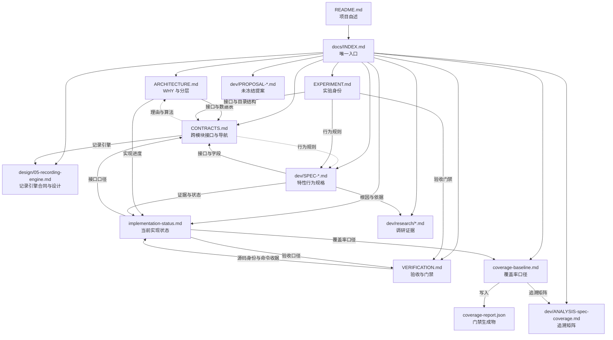

# WorldMock 文档入口

> 状态：文档集整体处于实现中——确定性代码与测试层已就绪，三项真实验收（正式十二周运行、三次隔离盲评、LabelKit 完整自然日交付）未完成。
> 日期：2026-09-18
> 范围：文档地图、按任务阅读路径、权威层级与文件归属。本文件不定义任何接口与行为，只回答「该读哪一份」。

## 这是什么

WorldMock 用 AgentSociety 2（下称 AS2）驱动数字人的日常生活，把生活过程写成可追溯的数字足迹，再交给 LabelKit 生产模型训练数据与规则引擎测试数据。正式实验是上海张江白领的单人物十二周（2026-01-05 至 2026-03-30）。**数字足迹**指一次生活过程留下的、可追溯的观察、决策、执行、状态变化、结果、记忆与相互关系。

文档集按职责分工：`ARCHITECTURE.md` 写分层理由，`CONTRACTS.md` 提供跨模块接口定义与导航，
`docs/dev/SPEC-*.md` 写对应特性的行为，`VERIFICATION.md` 写通过条件，`implementation-status.md` 写当前状态。
记录引擎的接口、行为与格式统一维护在[记录引擎设计](design/05-recording-engine.md)，
其他文档引用所属合同，不再重复定义。

## 文档地图

### 主文档

| 文档 | 职责 | 状态 |
| --- | --- | --- |
| `docs/INDEX.md` | 本文件：文档地图、阅读路径、权威层级与文件归属 | 入口 |
| `docs/ARCHITECTURE.md` | 系统分层、职责边界、数据流与核心决策的理由 | FROZEN |
| `docs/CONTRACTS.md` | 跨模块接口合同与导航；记录引擎定义引用所属设计，其余接口在本文件维护 | FROZEN |
| `docs/EXPERIMENT.md` | 实验身份：时间窗与日历情境、依赖冻结、运行绑定、场景参数、内容与语料绑定、样本划分与外部参照 | FROZEN |
| `docs/VERIFICATION.md` | 放行门禁（最终门禁、协议门禁、工程门禁、报告项）、交付阶段与通过条件、测试矩阵、验收原则与结论边界 | NOT-COMPLETE |
| `docs/dev/implementation-status.md` | 当前实现状态：确定性范围与测试基线实测、覆盖率口径、规格追溯与突变守卫、未完成项与阻塞 | NOT-COMPLETE |
| `docs/dev/coverage-baseline.md` | 覆盖率门禁的判定口径、测量与排除范围、失败关闭约定与基线记录（最近一次门禁顶层判定不通过） | 现行口径 |
| `docs/dev/coverage-report.json` | 门禁生成物：分支覆盖率、未覆盖公共接口与逐文件分项，由 `scripts/coverage_gate.py` 写入 | 生成物 |

### 特性规格与提案

| 文档 | 职责 | 状态 |
| --- | --- | --- |
| `docs/dev/SPEC-as2-integration.md` | 选用 AS2 的理由与复用边界、分层职责，以及 AS2 核心链路为本次场景必须发生的确定性改动 | FROZEN |
| `docs/dev/SPEC-life-runtime.md` | LifeEnv 的状态归属与生命周期、共享时钟与并发活动、身体语义与体感分级、消费生产与需求模型、语料准入与内容提供、场景与身体规则、观察投影与提示合同、候选契约与呈现规则、社交最小可行版 | FROZEN |
| `docs/dev/SPEC-life-realism.md` | 人物的两阶段决策调用、记忆写入与巩固、动机层、日程骨架、世界素材品类准入、素材可达性与呈现轮转、候选与呈现、画像编译、商品数量合同、运行呈现与导出投影 | FROZEN |
| `docs/dev/SPEC-decision-context.md` | 决策自述、冻结上下文、动作登记与结果通道、场景信息、预算、修改清单与验收台账 | FROZEN |
| `docs/dev/SPEC-labelkit-delivery.md` | 数字足迹接入 LabelKit 的输入范围与加工责任、证据窗口与来源关联、交付产物与发布边界、长序列与数据划分、真实调用的生产与验证步骤 | FROZEN |
| `docs/dev/PROPOSAL-category-contract.md` | 品类契约与交换规则分层：品类契约作为资源引擎与交换引擎之间的第三方冻结产物、规则在品类树上的继承与覆盖、未定义配对的一等地位与逐节点细化 | 未冻结提案 |
| `docs/dev/PROPOSAL-decision-context.md` | 已裁决的心智模型与取舍记录；行为与开发验收由 `SPEC-decision-context.md` 承载 | 调研证据 |
| `docs/dev/ANALYSIS-spec-coverage.md` | 规格条款与测试用例的覆盖率追溯矩阵 | 现行追溯矩阵 |

### 资源引擎设计

[资源引擎设计](design/03-resource-engine.md)统一承载资源定义、内容与语料、目录发布、检索和提供，
状态为 DRAFT；交换条件与投入产出引用交换引擎，实际变化与结算引用模拟引擎，接口和行为仍遵循冻结合同及规格。

### 模拟引擎设计

[模拟引擎设计](design/04-simulation-engine.md)承载运行初始化、观察与决策机会、动作受理、共享时钟、
活动推进、结算、唤醒和恢复编排，状态为 DRAFT；人物算法、资源提供、记录保存和离线交付引用所属模块。

### 交换引擎设计

[交换引擎设计](design/02-exchange-engine.md)统一承载维护交换规则、查询适用规则、校验交换条件、计算投入产出、
校验资源分录与返回规则结果，状态为 DRAFT。接口与行为仍以对应冻结合同和规格为准.

### 记录引擎设计

[记录引擎设计](design/05-recording-engine.md)统一承载事件、素材、事务、检查点、恢复与反事实分支、
导出、质量报告和运行诊断，承接原已冻结的接口与行为约束；待实现设计与已知差距在文内单列。

### 调研证据

| 文档 | 职责 | 状态 |
| --- | --- | --- |
| `docs/dev/research/as2-feasibility.md` | AS2 接入可行性与核心改动独立审查 | 调研证据 |
| `docs/dev/research/decision-context-feasibility.md` | 原生工具配对、动态工具、批量同步结算与记忆查询的官方依据和采纳边界 | 调研证据 |
| `docs/dev/research/bob-mutation-plan.md` | 核心合同语义突变计划与历史突变台账 | 调研证据 |
| `docs/dev/research/code-refute-2026-09-17.md` | 编码模块对抗审计：确认的缺陷、被驳倒的发现与未完成复核的缺口 | 调研证据 |
| `docs/dev/research/delivery-final-audit.md` | 足迹与数据交付的最终独立审查与缺口修复复核 | 调研证据 |
| `docs/dev/research/life-data-feasibility.md` | LifeEnv、真实内容与 LabelKit 交付可行性审查 | 调研证据 |
| `docs/dev/research/life-final-audit.md` | LifeEnv 最终规格审计（修复前快照，不描述当前状态） | 调研证据 |
| `docs/dev/research/realism-evaluation.md` | 十二周数字足迹真实性评估合同：指标、可比性与结论边界 | 调研证据 |
| `docs/dev/research/realism-root-cause-2026-09-17.md` | 人物行为「不像人」的根因分析，七视角综合报告 | 调研证据 |

## 按任务读

| 你想做的事 | 从这里读 | 接着读 |
| --- | --- | --- |
| 了解系统怎么分层、为什么这样设计 | `docs/ARCHITECTURE.md` | 对应 `docs/dev/SPEC-*.md` 看具体行为 |
| 实现或修改某个特性的行为 | `docs/dev/SPEC-*.md` 中对应那一份 | `docs/CONTRACTS.md` 取接口，`docs/VERIFICATION.md` 取门禁 |
| 找某个接口、字段、枚举、目录结构、命令行参数或提示词模板 | `docs/CONTRACTS.md` | 设计理由在 `docs/ARCHITECTURE.md` 与对应 SPEC |
| 知道现在跑到哪一步、已有哪些实测证据 | `docs/dev/implementation-status.md` | `docs/dev/coverage-baseline.md` 与 `docs/dev/coverage-report.json` |
| 判断能不能放行、本次要交哪些证据 | `docs/VERIFICATION.md` | `docs/dev/implementation-status.md` 取源码身份与命令收据 |
| 复现实验：依赖版本、场景参数、时间窗、样本划分 | `docs/EXPERIMENT.md` | `docs/CONTRACTS.md` 取运行接口与目录结构 |
| 查历史调研、审计与根因结论 | `docs/dev/research/` | 对应 SPEC 看结论如何落地为条款 |
| 查看资源、内容与语料的统一设计 | `docs/design/03-resource-engine.md` | 资源定义、来源、版本、内容提供与实现差距 |
| 查看模拟引擎如何组织并推进实际运行 | `docs/design/04-simulation-engine.md` | 初始化、观察与动作受理、时钟与活动、结算、唤醒和恢复编排 |
| 查看交换引擎设计与尚未闭合的实现差距 | `docs/design/02-exchange-engine.md` | 当前实现与验收 |
| 查看记录引擎的接口、行为与实现差距 | `docs/design/05-recording-engine.md` | 同一文档内的存储、恢复、导出、诊断与验收章节 |
| 找某个文件归谁管、代码在哪 | 本文件「文件归属」 | `docs/ARCHITECTURE.md` 看该模块的职责边界 |

## 权威层级

同一件事出现两份说法时，按下面的归属判定，不按文档新旧、不按篇幅长短。

- **记录引擎的接口、行为与格式**看 `docs/design/05-recording-engine.md`，原冻结约束继续有效，待实现项单列。
- **其他接口、字段、枚举、Schema、目录结构、命令行参数与提示词模板**看 `docs/CONTRACTS.md`；代码变更先更新所属合同，再改代码。
- **其他行为规则与算法**（怎么结算、怎么推进、怎么决策）看 `docs/dev/SPEC-*.md`。
- **设计理由与职责边界**看 `docs/ARCHITECTURE.md`。
- **实验身份**（依赖、场景、时间窗、样本、外部参照）看 `docs/EXPERIMENT.md`。
- **验收**（什么算通过、门禁键、测试矩阵、证据层级、report-only 边界）看 `docs/VERIFICATION.md`。
- **实现状态**（现在到哪一步、已有哪些证据、还剩哪些阻塞）看 `docs/dev/implementation-status.md`；它只写现状，变更过程由 Git 承载。
- **覆盖率口径与基线**看 `docs/dev/coverage-baseline.md` 与它写出的 `docs/dev/coverage-report.json`。
- **未裁决方向**看尚未裁决的 `docs/dev/PROPOSAL-*.md`。提案在被单独裁决为冻结以前，任何 `CONTRACTS`、代码、测试与验收结论不得依赖其未冻结内容。已裁决的决策上下文提案仅保留设计记录，实施依据为对应 `SPEC-decision-context.md`。
- **历史证据**看 `docs/dev/research/`。这些文件是当时快照下的依据，不构成当前规范。

图中实线是从引用方指向被引用方，虚线是从实现指向它所依据的规范。未冻结提案刻意不画指向任何文档的边：它不构成规范。

## 文件归属

### 核心系统

| 路径 | 职责 |
| --- | --- |
| `custom/envs/life_env.py` | AS2 环境适配层（LifeEnv） |
| `custom/agents/life_agent.py` | AS2 人物适配层（LifeAgent） |
| `src/worldmock/life/` | 生活规则、身体、活动、社交、叙述 |
| `src/worldmock/footprints/` | 事件存储、检查点与导出 |
| `src/worldmock/profile/` | 人物卡片编译 |
| `src/worldmock/corpora/` | 语料整理 |
| `src/worldmock/delivery/` | LabelKit 交付 |
| `src/worldmock/evaluation/` | 行为指标与协议门禁 |
| `src/worldmock/catalog/` | 可供性注册表 |

### 测试

| 路径 | 职责 |
| --- | --- |
| `tests/life/` | 生活规则与运行时行为 |
| `tests/footprints/` | 事件存储、检查点与恢复 |
| `tests/integration/` | 跨模块集成与协议 |
| `tests/delivery/` | LabelKit 交付行为 |
| `tests/evaluation/` | 行为指标与协议门禁 |
| `tests/catalog/` | 可供性注册表与目录数据 |

### 场景与配置

| 路径 | 职责 |
| --- | --- |
| `scenarios/` | 实验场景定义 |
| `corpora/` | 固化语料素材 |
| `catalog/` | 目录注册表 |
| `labelkit-projects/` | LabelKit 项目配置 |

## 状态与变更约定

文档地图「状态」列只用下表八个取值，表外取值不得出现在该列：

| 状态词 | 含义 |
| --- | --- |
| `入口` | 本文件：文档集的唯一入口 |
| `FROZEN` | 条款已裁决并冻结，是当前实现合同，改动必须走版本表并说明理由 |
| `NOT-COMPLETE` | 实现或验收尚未收口，任何场合都不得把它当作完成态引用 |
| `现行口径` | 该文件是当前生效的判定口径 |
| `生成物` | 由脚本覆盖重写的产物，内容随每次运行变化 |
| `未冻结提案` | 方向尚未裁决，使用边界见「权威层级」节 |
| `现行追溯矩阵` | 随规格条款与测试同步维护的当前映射 |
| `调研证据` | 当时快照下的裁决依据，不单独构成当前行为合同 |

接口或行为变更先更新所属合同再改代码；记录引擎统一修改模块设计，其他特性修改对应合同与 SPEC，并在本文件登记阅读入口。

## 版本表

| 版本 | 日期 | 修订内容 |
| --- | --- | --- |
| 1.0 | 2026-09-18 | 文档入口重写：文档地图覆盖全部文档，给出按任务阅读路径、权威层级、引用关系图与文件归属 |
| 1.1 | 2026-09-18 | 状态列词表补全为文档地图实际使用的八个取值并逐条定义，地图取值与词表对齐；位置指代改为章节标题名 |
| 1.2 | 2026-09-19 | 文档地图职责列补登两份规格新增的章：`SPEC-life-runtime.md` 补「候选契约与呈现规则」，`SPEC-life-realism.md` 补「素材可达性与呈现轮转」与「候选与呈现」 |
| 1.3 | 2026-09-20 | 记录引擎的接口与行为集中维护，更新文档地图、权威归属和引用关系 |
| `2026-09-20-decision-context` | 2026-09-20 | 对齐决策上下文特性规格：统一决策自述命名，明确登记与结算结果的通道、场景信息和预算边界 |
