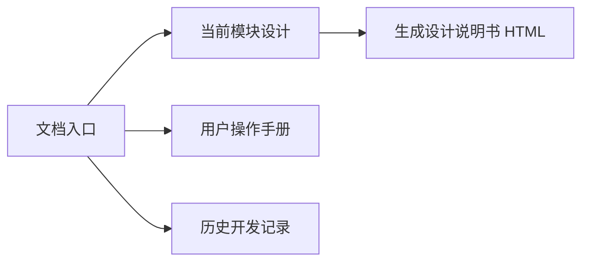

# WorldMock 文档入口

WorldMock 模拟数字人的生活，保存可追溯的数字足迹，提供完整导出与真实性评估。
当前系统按模块维护在 `design/`；配置和操作步骤在 `manual/`；开发过程与历史证据在 `dev/`。

## 当前系统设计

模块正文共同组成一份设计说明书。每个接口、字段、规则和约束只在所属模块定义，其他章节引用它。
需要修改系统时，先改所属模块设计，再随同实现与行为测试一起合入。

| 模块 | 阅读内容 |
| --- | --- |
| [概述](design/00-overview.md) | 目标、边界、术语与设计原则 |
| [总体架构](design/01-architecture.md) | 职责、数据流、状态归属、依赖方向与工程验证 |
| [交换引擎](design/02-exchange-engine.md) | 固定类型、身体模型、数值和结算规则 |
| [资源引擎](design/03-resource-engine.md) | 环境目录、对象绑定、登记错误、地图与发布身份 |
| [模拟引擎](design/04-simulation-engine.md) | 工具接口、共享时钟、活动、交易、计划与事务 |
| [记录引擎](design/05-recording-engine.md) | 事件、素材、事务、检查点、认证导出与查看器 |
| [人物](design/06-agent.md) | 画像、记忆、七层提示、模型请求和纠错 |
| [行为评估](design/07-evaluation.md) | 指标、对比、盲评、报告与结论边界 |
| [配置](design/08-configuration.md) | 单人人设、工作安排、运行配置、模型身份与加载检查 |
| [状态与序列化](design/09-io-formats.md) | 世界与人物状态、严格字段和编码规则 |
| [运行与框架集成](design/10-runtime.md) | AgentSociety 装配、生命周期、命令行、安装和恢复 |

在仓库根执行 `python scripts/build_design_doc.py`，得到 `.work/docs/design/worldmock-design.html`。
HTML 是阅读附件，只从模块正文生成，不直接编辑、不进入版本控制。

## 用户手册

从[准备自己的第一个环境](manual/README.md)开始。
手册回答怎样配置和运行；字段与规则以对应模块设计为准。

| 目标 | 手册 |
| --- | --- |
| 配置人物 | [编写 persona.toml](manual/personas.md#personas-编写-persona-toml) |
| 配置运行 | [编写 config.toml](manual/runtime.md#runtime-编写-config-toml) |
| 准备环境 | [设计环境数据集](manual/resources.md#resources-设计环境数据集) |
| 理解固定规则 | [规则配置](manual/rules.md) |
| 安装、运行和恢复 | [运行配置](manual/runtime.md) |
| 比较与评审 | [真实性评估](manual/evaluation.md) |

## 开发记录

`dev/` 保存提案、开发规格、进度、评审、实验与验收结果。这些文件反映当时的实现过程，
完成后不再随新功能或重构更新，也不作为当前系统设计的补充权威。
历史记录中的路径、代码和测试结果按记录声明的提交理解；之后发现的问题记在新的开发记录中。

新工作按 `dev/<主题>/` 组织，仅建立需要的记录。简单修复直接更新模块设计、代码和测试。
无需为每个变更建立全套 proposal、spec、progress、verification，不维护全局阶段完成表、
规格追溯矩阵、章节所有权表或历史验收机器副本。

`dev/` 保留设计与评审文字、说明所需的 schema 和 examples；机器执行报告不作为历史文档长期上库。
测试报告、耗时明细和运行回执写到 `.work/`。CI 自动上传 JUnit、覆盖率和设计 HTML，
从 PR 检查进入 workflow 摘要查看结果，并在 Artifacts 下载附件；
测试实际消费的输入、期望结果与回归基线保留在 `tests/`。
