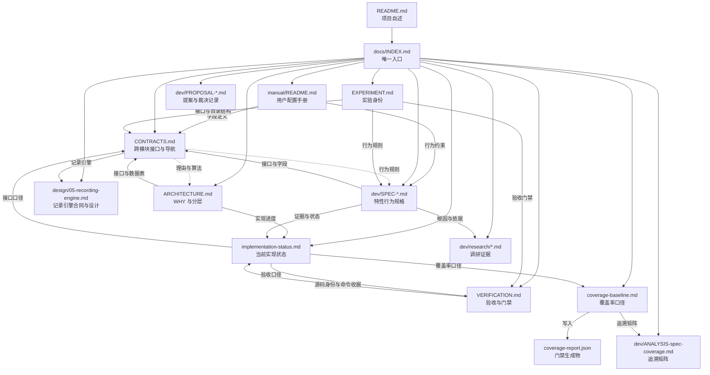

# WorldMock 文档入口

> 状态：文档集整体处于实现中——此前确定性基线已有验收，新特性以各自实施台账为准，三项真实验收（正式十二周运行、三次隔离盲评、LabelKit 完整自然日交付）未完成。
> 日期：2026-10-04
> 范围：文档地图、按任务阅读路径、权威层级与文件归属。本文件不定义任何接口与行为，只回答「该读哪一份」。

## 这是什么

WorldMock 用 AgentSociety 2（下称 AS2）驱动数字人的日常生活，把生活过程写成可追溯的数字足迹，再交给 LabelKit 生产模型训练数据与规则引擎测试数据。正式实验是上海张江白领的单人物十二周（2026-01-05 至 2026-03-30）。**数字足迹**指一次生活过程留下的、可追溯的观察、决策、执行、状态变化、结果、记忆与相互关系。

文档集按职责分工：`ARCHITECTURE.md` 写分层理由，`CONTRACTS.md` 提供跨模块接口定义与导航，
`docs/dev/SPEC-*.md` 写对应特性的行为，`VERIFICATION.md` 写通过条件，`implementation-status.md` 写当前状态。
[用户配置手册](manual/README.md)面向使用者，说明如何编写、修改和校验当前支持的配置。
记录引擎的接口、行为与格式统一维护在[记录引擎设计](design/05-recording-engine.md)，
其他文档引用所属合同，不再重复定义。

## 文档地图

### 主文档

| 文档 | 职责 | 状态 |
| --- | --- | --- |
| `docs/INDEX.md` | 本文件：文档地图、阅读路径、权威层级与文件归属 | 入口 |
| `docs/ARCHITECTURE.md` | 系统分层、职责边界、数据流与核心决策的理由 | FROZEN |
| `docs/CONTRACTS.md` | 跨模块接口合同与导航；记录引擎定义引用所属设计，其余接口在本文件维护 | FROZEN |
| `docs/EXPERIMENT.md` | 实验身份：时间窗与日历情境、依赖冻结、运行绑定、场景参数、内容与语料绑定、样本划分与外部参照 | FROZEN |
| `docs/VERIFICATION.md` | 放行门禁（最终门禁、协议门禁、工程门禁、报告项）、交付阶段与通过条件、测试矩阵、验收原则与结论边界 | NOT-COMPLETE |
| `docs/dev/implementation-status.md` | 当前实现状态：确定性范围与测试基线实测、覆盖率口径、规格追溯与突变守卫、未完成项与阻塞 | NOT-COMPLETE |
| `docs/dev/coverage-baseline.md` | 覆盖率门禁的判定口径、测量与排除范围、失败关闭约定与基线记录（最近一次完整门禁通过） | 现行口径 |
| `docs/dev/coverage-report.json` | 门禁生成物：分支覆盖率、未覆盖公共接口与逐文件分项，由 `scripts/coverage_gate.py` 写入 | 生成物 |

### 用户配置手册

从[创建自己的第一个场景](manual/README.md#创建自己的第一个场景)开始，再按修改目标阅读对应页面。
手册提供使用步骤和示例，接口与行为定义仍引用所属合同和规格。

| 页面 | 使用目标 |
| --- | --- |
| [手册入口](manual/README.md) | 文件分类、一天自定义场景、加载检查与运行 |
| [人物画像](manual/personas.md) | 编写背景故事、作息、关系与人物初值，预览和校验卡片 |
| [生活场景](manual/scenarios.md) | 自定义日期、人数、账户、菜单、任务、消息及预排事件 |
| [世界素材](manual/resources.md) | 准备地图、门店供给、商品、内容、语料和目录输入 |
| [规则配置](manual/rules.md) | 编写品类与交换规则，调整身体、动机和画像映射 |
| [运行配置](manual/runtime.md) | 模型凭据、新建运行、恢复和反事实干预文件 |
| [数据生成](manual/delivery.md) | LabelKit 项目、生成设置与规则测试数据 |
| [真实性评估](manual/evaluation.md) | 评估配置、人工参照和评审输入 |

### 特性规格与提案

工具交互相关规格已同步2026-10-01目标设计，新增条款已实现，使用本次独立验收证据；下表旧特性的“已实现”只描述此前源码身份。

| 文档 | 职责 | 状态 |
| --- | --- | --- |
| [工具交互规格](dev/SPEC-tool-interaction.md) | 逐项请求与精确错误、逐店完整供给和定位价格、通知派生开放、品类分页查询；含设计及生产清单、独立阶段和行为/变异门禁；条款已实现；任务回看的执行位置、重复意图的逐条定位、失败阶段码、控制工具的请求级 `errands`，以及 `query_world` 的四键请求、逐项候选与来源写法由个人事务与工作安排规格修订（「行为验收」表不增删改行，新增的查询验收写在该规格验收台账），修订条款已实现 | FROZEN |
| [工具交互验收记录](dev/tool-interaction-verification.md) | 工具交互规格的发布身份、实际生产实现、行为测试与独立源码变异结果 | 验收记录 |
| [未完成任务、人物行为约束与运行修复提案](dev/PROPOSAL_2026-10-02_TASK_MEMORY_AND_RUNTIME_FIXES.md) | 白领与商务两个人物全天运行证据（计数见 `docs/dev/research/2026-10-02-dayrun-review-evidence.json`）、业界研究、待办与作息方案、运行期间修复的入库建议及过时预检审查；已收敛为冻结规格 `docs/dev/SPEC-errands-workday.md`，本文只保留设计背景、运行证据与取舍依据 | 已裁决 |
| [个人事务与工作安排规格](dev/SPEC-errands-workday.md) | 由上述提案收敛的开发规格：运行修复入库（严格反思工具、只读查询转发、计划重复意图定位、异常日志）、个人事务（登记入口、完成依据与结算、提醒、待办层呈现、事件与检查点）、提示信息分工（系统层第 1、4、6 条）、作息补全与工作安排（下班与到家锚点、`work_schedule`、环境层 `duty`、系统层第 14 条）、查询筛选与返回精简（`query_world` 六键）、度量与各阶段发布身份；2026-10-02 冻结，「裁决记录」二十二项全部按推荐定稿（含标 † 的 R1、E1、E4、W1、Q2）；冻结条款修订随文，逐文档的文档同步作业与逐阶段的文件修改清单见配套实施计划 `docs/dev/research/errands-workday-implementation-plan.md`（实施台账）；条款已全部实现 | FROZEN |
| [个人事务与工作安排验收记录](dev/errands-workday-verification.md) | 源码身份与发布身份（各阶段提交、结构版本与两个指纹）、实施过程与各阶段测试结果、评审与修复、两轮独立源码变异审查、全量门禁与覆盖率、验收台账逐行登记（证据节点来自 `tests/errands_workday_acceptance.py`）、代码与规格的出入与裁定（含全量门禁之后由 `1346e0d`、`6c81126` 补齐的查看器事务显示）、文档一致性、环境敏感项；证据层级为离线测试，配对全天复跑（阶段 6，只报告）与 strict 端点探针未执行 | 验收记录 |
| [个人事务与工作安排实施计划](dev/research/errands-workday-implementation-plan.md) | 个人事务与工作安排实施计划：实施阶段与门禁之外的逐文档逐条款的文档同步作业、逐阶段的文件修改清单与被钉点；随规格冻结后作为实施台账维护 | 实施台账 |
| [个人事务与工作安排提案设计评审记录](dev/research/2026-10-02-errands-workday-design-review.md) | 七路源码映射、十路现行规格与设计文档扫描、六个视角评审与逐条复核的结论，以及草稿规格对每条结论的处置 | 调研证据 |
| [工具交互定稿方案](dev/PROPOSAL_2026-09-30_TOOL_INTERACTION.md) | 并发源码核对与最终取舍；行为引用工具交互规格 | 已裁决 |
| `docs/dev/SPEC-as2-integration.md` | 选用 AS2 的理由与复用边界、分层职责，以及 AS2 核心链路为本次场景必须发生的确定性改动；「AS2 基线与分支」补登一日运行保真规格的三个 LifeAgent 覆写点，修订条款已实现；覆写点清单补登 `LifeAgent.step` 的异常日志、记忆运行时的严格反思与 `LifeEnvActor`、`LifeEnvProxy` 的只读查询转发，控制请求的请求级 `errands` 与 `query_world` 六键的覆写边界由个人事务与工作安排规格修订，修订条款已实现 | FROZEN |
| `docs/dev/SPEC-life-runtime.md` | LifeEnv 的状态归属与生命周期、共享时钟与并发活动、身体语义与体感分级、消费生产与需求模型、语料准入与内容提供、场景与身体规则、观察投影与提示合同、候选契约与呈现规则、社交最小可行版；困意档界、社交与娱乐口径、睡眠中不读消息、名称类拒绝、按名调用、候选资格与轮转、可调用索引与购买渠道由一日运行保真规格修订，修订条款已实现；唤醒原因增 `errand_reminder_due`、待办层与环境层投影、场景的 `work_schedule`、决策异常日志、任务回看的执行位置与 `query_world` 六键由个人事务与工作安排规格修订，修订条款已实现 | FROZEN |
| [查看器对象名称](dev/SPEC-run-viewer-names.md) | 地点、活动及内容名称的运行内关联、缺失提示与验证；工作、通话与交谈的活动标题由一日运行保真规格补充，修订条款已实现；个人事务名称的来源、控制请求须带 `errands` 的现行形状、请求摘要写事务变更、事务事件与事务提醒写事务名称与商品名称由个人事务与工作安排规格修订，商品名称的补缺来源（`errand_item_bindings`）、事务变更的逐条读取规则与个人事务的缺失提示按查看器实现的独立核对补充，修订条款已实现（查看器的请求摘要与事务名称由 `1346e0d`、`6c81126` 实现） | FROZEN |
| [查看器名称验收](dev/run-viewer-names-verification.md) | 真实运行、回归测试与独立语义变异闭合 | 验收记录 |
| [查看器上下文解析](dev/SPEC-run-viewer-context.md) | 模型请求的选择与关联、输入结构与原文、相邻调用对比与验证边界；按 `layer` 分段与续接识别由人物 Prompt 七层规格修订，修订条款已实现；待办层的个人事务、进度层的两种事务记录与环境层 `duty` 的增长与退出由个人事务与工作安排规格修订，查看器的待办层、环境层、进度层规则文字与工具定义条目已同步（进度层规则文字与工具定义条目由 `1346e0d` 补齐，夹具与补测为 `6c81126`），修订条款已实现 | FROZEN |
| [查看器上下文验收](dev/run-viewer-context-verification.md) | 要求到证据、实际运行验证、测试命令与语义变异审查 | 验收记录 |
| [一日运行行为设计](dev/PROPOSAL-dayrun-behavior.md) | 等待、通勤、进食、记忆和持续活动的事实核查与采纳依据 | 已裁决 |
| [一日行为特性规格](dev/SPEC-dayrun-behavior.md) | 并行生命周期、共同身体区间、餐食、音频、已核验经历与主观记忆、预警交付；到店指名购买的口径由一日运行保真规格修订，修订条款已实现；就寝反思的严格工具、主观文字不改变世界事实一句、控制请求携带的个人事务变更、事务提醒与 `query_world` 六键由个人事务与工作安排规格修订，修订条款已实现 | FROZEN |
| [一日行为实施台账](dev/research/dayrun-behavior/verification.md) | 文件修改责任、逐条生产与测试映射、完整自然日及独立审查证据 | 实施台账 |
| [一日运行修复核查与验收](dev/research/dayrun-reconciliation/verification.md) | dayrun 清单到主线修复、回归与独立突变证据 | 验收记录 |
| [一日运行保真修复方案](dev/PROPOSAL-dayrun-fidelity.md) | `4a5b0e6` 白领与商务全天运行暴露的系统问题：睡眠计费、下限缓解与注入警告、困意档界、守作息规则、卡片作息、按名调用与指名购买、App 与门店、错误合同、呈现排序、控制工具改形、中文摘录、输出上限、联系人回复、strict 端点，另含不适脉冲与睡眠中读消息、浏览与提示的可达性、英文与内部名称外泄、当日目标推进、场景加载校验、工作材料正文（范围外），共 G1–G22；数据集侧见 WorldMock-Dataset 的 `PROPOSAL_2026-09-29_DATASET_FIXES.md`；已收敛为冻结规格 `docs/dev/SPEC-dayrun-fidelity.md`，本文只保留设计背景、运行证据与取舍依据 | 已裁决 |
| [一日运行保真特性规格](dev/SPEC-dayrun-fidelity.md) | 由保真修复方案收敛的开发规格：区间事实单一来源、下限缓解与输入警告、困意档界、系统层守作息、场景作息优先、按名调用与指名购买的分段匹配、购买渠道、更简单的购买请求（请求级 `prefer` 与方式「购买」）、错误合同、呈现资格与轮转、可调用索引、控制工具改形、中文摘录、截断处理、联系人守卫、加载校验与目标大致时刻；2026-09-29 冻结，「裁决记录」D2–D7、D9–D11、D14–D17、D19、S1、S3–S10 按推荐定稿（S10 采纳）；冻结条款修订、文档同步作业与文件修改清单随文（作实施台账）；条款已全部实现；系统层第 1、4、6、14 条、控制工具的请求级 `errands`、场景作息覆盖字段、零点计划模板与购买来源的写法由个人事务与工作安排规格修订（裁决 S11 由该规格 4.6 收窄），修订条款已实现 | FROZEN |
| [一日运行保真验收记录](dev/dayrun-fidelity-verification.md) | 一日运行保真验收记录：源码身份与提交、评审与修复、全量门禁与覆盖率、验收台账逐行登记（证据节点来自 `tests/dayrun_fidelity_acceptance.py`）、三路独立语义突变审查、strict 端点探针结论、代码与规格的出入、文档一致性与锚点核对；真实复验（阶段 7）未执行 | 验收记录 |
| `docs/dev/SPEC-life-realism.md` | 人物的两阶段决策调用、记忆写入与巩固、动机层、当日目标、世界素材品类准入、素材可达性与呈现轮转、候选与呈现、画像编译、商品数量合同、运行呈现与导出投影；两阶段决策改为单一行动阶段，卡片与记忆的提示呈现改为人设层与记忆层，由人物 Prompt 七层规格修订，修订条款已实现；候选决胜键与轮转、按名调用、画像编译（场景作息优先、覆盖率运行只警告）与时间线标题由一日运行保真规格修订，修订条款已实现；就寝反思改经严格工具 `submit_reflection`、个人事务与控制请求的请求级 `errands`、画像作息增下班与到家锚点、`query_world` 六键由个人事务与工作安排规格修订，修订条款已实现 | FROZEN |
| `docs/dev/SPEC-day-plan-goals.md` | 当日目标、实际推进证据、修订、环境威胁、三层质量报告与完整验收；生成方式、提醒与部分节律由时间与能量规格修订；目标大致时刻 `around_time`、推进口径与例行意图由一日运行保真规格修订，修订条款已实现；重复意图的逐条定位、零点计划输入与质量报告结构 4 由个人事务与工作安排规格修订，修订条款已实现 | FROZEN |
| `docs/dev/PROPOSAL-day-plan-goals.md` | 目标与时间职责分离的裁决依据，现行行为引用最终规格 | 已裁决 |
| `docs/dev/research/day-plan-semantics.md` | 当日目标学科调研与核实限制 | 调研证据 |
| `docs/dev/research/day-plan-goals-verification.md` | 独立 worktree 基线、逐要求验证、实际修改清单与独立变异证据 | 验收记录 |
| `docs/dev/research/day-plan-goals-main-verification.md` | 当日目标与 main 新增手册的组合验收、依赖发布与源码身份 | 验收记录 |
| `docs/dev/research/day-plan-goals-bob-domain.md` | 当日目标领域、节律与午夜结算的独立源码突变证据 | 审查记录 |
| `docs/dev/research/day-plan-goals-bob-interface.md` | 当日目标工具、观察与叙述的独立源码突变证据 | 审查记录 |
| `docs/dev/research/day-plan-goals-bob-metrics.md` | 三层统计及导出首次审查，保留三个初次存活结论 | 审查记录 |
| `docs/dev/research/day-plan-goals-bob-metrics-recheck.md` | 三个存活补丁在新增行为断言后的原样复验 | 审查记录 |
| `docs/dev/SPEC-decision-context.md` | 决策自述、冻结上下文、动作登记与结果通道、场景信息、预算、修改清单与验收台账；决策自述与场景信息由人物 Prompt 七层规格取代（决策就是所选世界请求，场景信息改为七层归属），冻结上下文、预算、修改清单与验收台账由其修订，登记与结果通道约束保留，修订条款已实现；按名调用、指名购买口径与公开结果键由一日运行保真规格修订，修订条款已实现；任务回看的执行位置、同秒续接 `changes` 与 `events` 的口径、公开结果 `details.errands` 与 `query_world` 六键由个人事务与工作安排规格修订，修订条款已实现 | FROZEN |
| `docs/dev/SPEC-interaction-menu.md` | 地点类与人物交互菜单、工具和活动类型准入、冻结观察、模型与环境共同门控、运行身份及验收台账；按名调用与控制工具的参数形状由一日运行保真规格修订，修订条款已实现；控制工具的请求级 `errands` 与 `query_world` 六键由个人事务与工作安排规格修订，修订条款已实现 | FROZEN |
| `docs/dev/SPEC-labelkit-delivery.md` | 数字足迹接入 LabelKit 的输入范围与加工责任、证据窗口与来源关联、交付产物与发布边界、长序列与数据划分、真实调用的生产与验证步骤；意图与 dreaming 窗口裁去 `errands`、缺 `errands` 的旧控制请求被拒、含就寝反思的决策其窗口提示仍取行动请求由个人事务与工作安排规格修订（决策提示的选取保持现行实现），修订条款已实现 | FROZEN |
| `docs/dev/PROPOSAL-agent-interaction.md` | **已裁决并冻结**：数字人交互的原始问题、心智模型逐条对账与取舍记录；行为定义已由 `SPEC-agent-interaction.md` 承载 | FROZEN |
| `docs/dev/SPEC-agent-interaction.md` | **FROZEN**：三级结构（当日目标、地点会话、活动）、七层上下文与进度层、稳定工具面、决策轮循环与播报节律、前置条件前置、活动名额、午夜浓缩；显式修订七条既有冻结条款并随冻结生效；工具面、会话与记忆写入点由时间与能量规格修订；七层上下文与进度层由人物 Prompt 七层规格取代（进度层只含当前 session），修订条款已实现；控制工具的参数形状、按名调用、名称类拒绝与公开结果键由一日运行保真规格修订，修订条款已实现；控制工具的请求级 `errands`、待办层的个人事务与新增唤醒成员 `errand_reminder_due` 的同步、环境层 `duty` 与 `query_world` 六键由个人事务与工作安排规格修订，修订条款已实现 | FROZEN |
| `docs/dev/research/agent-interaction-document-impact.md` | 文档影响与文件修改清单：爆炸半径实测、五处词表同步点、导出重建约束、冻结规格与设计文档修订清单 | 调研证据 |
| `docs/dev/SPEC-time-and-energy.md` | 时间与能量特性规格：决策不耗时与同刻再决策、饥饿低能量显示与商品热量及路线费力、能量不阻断而让人物趁早吃、零点计划与计划提醒、五个动词与并行准入、动作照常列出并带条件说明、派生时长上限、常驻「怎样过一天」提示、地点会话与两个活动名额、`finish` 并入 `conclude_activity`、提示不含内部身份、本机运行修复与 issue #1 复核；列出对既有冻结条款的修订，随冻结生效；常驻「怎样过一天」提示与吃饭途径句由人物 Prompt 七层规格的系统层与工具层取代，修订条款已实现；名称类拒绝、睡眠中不读消息、按档位与饭点吃、目标大致时刻、按名调用与购买请求、控制工具形状与配送原因由一日运行保真规格修订，修订条款已实现；就寝反思的严格工具、事务提醒不叫醒睡眠、零点计划模板与输入、`query_world` 六键由个人事务与工作安排规格修订，修订条款已实现 | FROZEN |
| `docs/dev/research/time-and-energy-implementation-plan.md` | 时间与能量实施计划：实施阶段与门禁、逐文档逐条款的文档同步作业、文件修改清单与工程约束；随规格冻结后作为实施台账维护 | 实施台账 |
| `docs/dev/research/time-and-energy-verification.md` | 时间与能量验收记录：源码身份与各阶段评审修复、验收台账逐行登记、全量门禁与覆盖率、VF4 语义突变、无新增故障、文档一致性与锚点核对；真实复验（阶段 8）本机未执行，记录执行步骤与对照基线 | 验收记录 |
| `docs/dev/PROPOSAL-decision-context.md` | 人物 Prompt 七层与交互修复方案：七层 JSON 与唯一出现原则、已确认的交互语义、统一修复的程序错误、需修订的现行条款；已收敛为冻结规格 `docs/dev/SPEC-persona-prompt.md`，本文只保留设计背景与取舍依据 | 已裁决 |
| `docs/dev/SPEC-persona-prompt.md` | 人物 Prompt 七层与交互修复特性规格：七层请求与唯一出现、单一行动阶段与同秒续接、进度层与记忆层、预算、来源与去向、指名购买与代点关联、统一修复的程序错误、下游、冻结条款修订、实施计划与验收台账；2026-09-27 冻结，「裁决记录」#21–#38 按推荐定稿，修订条款已实现；人设层、进度层、来源与去向、指名购买、联系人往来、名称类拒绝与下游由一日运行保真规格修订（系统层 18 条规则随代码同批改写），修订条款已实现；系统层第 1、4、6、14 条、待办层与进度层的个人事务、环境层 `duty`、人设层 `rhythm` 与 `query_world` 六键由个人事务与工作安排规格修订（系统层编号列表随阶段 2、3 的代码同批改写），修订条款已实现 | FROZEN |
| `docs/dev/research/persona-prompt-implementation-plan.md` | 人物 Prompt 七层实施计划：实施阶段与门禁、逐文档逐条款的文档同步作业、文件修改清单与工程约束；规格冻结后作为实施台账维护 | 实施台账 |
| `docs/dev/persona-prompt-verification.md` | 人物 Prompt 七层验收记录：源码身份与提交、评审与修复、验收台账逐行登记（证据节点来自 `tests/persona_prompt_acceptance.py`）、独立语义突变审查、全量门禁与覆盖率、与规格的出入、文档一致性与锚点核对；真实复验（阶段 7）未执行 | 验收记录 |
| `docs/dev/research/persona-prompt-seven-layers.md` | 七层字段、差距的代码依据与字段取值依据；配套七份 Schema、完整示例与交互图示 | 调研证据 |
| `docs/dev/research/white-collar-dayrun-root-cause-2026-09-28.md` | 白领全天模拟重复下单、给予、进食与强制等待的运行证据与根因分析 | 调研证据 |
| `docs/dev/research/decision-context-proposal-2026-09-20.md` | 决策上下文 2026-09-20 已裁决的心智模型与取舍记录原文；行为与开发验收由 `SPEC-decision-context.md` 承载 | 归档 |
| `docs/dev/PROPOSAL-interaction-menu.md` | 交互菜单的原始问题、方案比较与取舍记录；行为与验收由 `SPEC-interaction-menu.md` 承载 | 调研证据 |
| `docs/dev/SPEC-category-contract.md` | 品类树、属性增量、三态配对、闭集交换、库存转换、细化发布和运行内容身份 | FROZEN |
| `docs/dev/category-contract-verification.md` | 品类契约逐要求实施、测试与独立突变证据 | 实施台账 |
| `docs/dev/category-contract-main-verification.md` | 合入决策上下文主分支、模型库存路径补修、全仓门禁与独立复验 | 验收记录 |
| `docs/dev/category-contract-files.md` | 对照开发基线逐文件核对真实 Git diff 与功能责任 | 实施台账 |
| `docs/dev/category-contract-bob-review.md` | 独立语义突变、原始证据及修复复审结果 | 审查记录 |
| `docs/dev/PROPOSAL-category-contract.md` | 品类契约提案裁决记录；规范已收敛到对应 SPEC | 已裁决 |
| `docs/dev/SPEC-map-and-storefront.md` | 地图唯一来源、地点发现、独立门店供给、营业与报价时态、原子购买、自提配送、恢复和完整验收；挑店可交给系统（`prefer`）、`branch_label`、配送路线只警告与浏览结果完整标签由一日运行保真规格修订，修订条款已实现；`query_world` 六键、来源与可执行筛选由个人事务与工作安排规格修订，修订条款已实现 | FROZEN |
| `docs/dev/PROPOSAL-map-and-storefront.md` | 已裁决的地图与门店供给心智模型、采纳机制和审查基线差距；行为以开发规格为准 | 调研证据 |
| `docs/dev/ANALYSIS-map-model.md` | 原始问题与已纠正的历史判断，连接现行开发规格和研究证据 | 调研证据 |
| `docs/dev/research/map-and-storefront-feasibility.md` | 商品与供给、路线方式、营业、AS2 复用和许可的一手资料核验 | 调研证据 |
| `docs/dev/research/map-and-storefront-document-impact.md` | 地图与门店供给的要求、文档、测试影响及审查基线 | 调研证据 |
| `docs/dev/research/map-and-storefront-verification.md` | 独立地图分支源码身份、要求到行为测试、全量门禁、独立变异和补测复验；保留原始收据 | 验收记录 |
| `docs/dev/research/map-and-storefront-main-verification.md` | 地图与品类主线组合的固定源码、完整工程门禁、计价及状态提交审查、原存活突变闭合和数据准入 | 验收记录 |
| `docs/dev/ANALYSIS-spec-coverage.md` | 规格条款与测试用例的覆盖率追溯矩阵 | 现行追溯矩阵 |
| `docs/dev/research/decision-context-verification.md` | 决策上下文完整修改清单、条款到测试、独立审查与工程门禁证据 | 验收记录 |
| `docs/dev/research/decision-context-bob-protocol.md` | 决策协议与预算的隔离源码突变、补充验证与恢复证据 | 验收记录 |
| `docs/dev/research/decision-context-bob-projection.md` | 结果投影、场景、事件与恢复入口的隔离源码突变及恢复证据 | 验收记录 |
| `docs/dev/research/interaction-menu-feasibility.md` | 动态工具、场景可供性、服务端重验与运行身份的业界机制核查及采纳边界 | 调研证据 |
| `docs/dev/research/interaction-menu-verification.md` | 交互菜单修改清单、条款到测试、固定源码门禁与 Uncle Bob 突变证据 | 验收记录 |
| `docs/dev/research/interaction-menu-main-verification.md` | 交互菜单与品类、库存及决策上下文的主线合并、冲突裁决和完整工程门禁 | 验收记录 |
| `docs/dev/research/interaction-menu-bob-environment.md` | 菜单声明、交集、观察与环境执行的隔离源码突变、补强复验及恢复证据 | 验收记录 |
| `docs/dev/research/interaction-menu-bob-host.md` | 人物工具与参数、恢复身份和提示字段的隔离源码突变、补强复验及恢复证据 | 验收记录 |

### 汇编版设计说明书

[汇编版设计说明书](design/worldmock-design.html)是 `docs/design/` 十章（概述、总体架构、交换引擎、资源引擎、模拟引擎、记录引擎、数据交付、
行为评估、配置规格、输入输出格式）加附录 A（从 `docs/CONTRACTS.md` 逐字摘录的人物工具、请求与拒绝码、七层输入、请求组成与生成参数、模型身份、命令行十五节）
汇编成的单文件，由 `scripts/build_design_doc.py` 生成，状态为 `生成物`：想一次看完整个系统的现行设计与工具接口先读它；
它不另立权威，接口与字段仍看 `docs/CONTRACTS.md`，行为规则仍看对应 `docs/dev/SPEC-*.md`。章节改动后必须重新汇编并一并提交，
`scripts/build_design_doc.py --check` 是工程门禁的一部分。

### 资源引擎设计

[资源引擎设计](design/03-resource-engine.md)统一承载资源定义、内容与语料、目录发布、检索和提供，
状态为 DRAFT；交换条件与投入产出引用交换引擎，实际变化与结算引用模拟引擎，接口和行为仍遵循冻结合同及规格。

### 模拟引擎设计

[模拟引擎设计](design/04-simulation-engine.md)承载运行初始化、观察与决策机会、动作受理、共享时钟、
活动推进、结算、唤醒和恢复编排，状态为 DRAFT；人物算法、资源提供、记录保存和离线交付引用所属模块。

### 交换引擎设计

[交换引擎设计](design/02-exchange-engine.md)统一承载维护交换规则、查询适用规则、校验交换条件、计算投入产出、
校验资源分录与返回规则结果，状态为 DRAFT。接口与行为仍以对应冻结合同和规格为准.

### 记录引擎设计

[记录引擎设计](design/05-recording-engine.md)统一承载事件、素材、事务、检查点、恢复与反事实分支、
导出、质量报告和运行诊断，承接原已冻结的接口与行为约束；待实现设计与已知差距在文内单列。

### 调研证据

| 文档 | 职责 | 状态 |
| --- | --- | --- |
| `docs/dev/research/category-contract-feasibility.md` | 品类契约的第一方业界依据、排除理由与实施前代码差距及验证目标 | 调研证据 |
| `docs/dev/research/as2-feasibility.md` | AS2 接入可行性与核心改动独立审查 | 调研证据 |
| `docs/dev/research/decision-context-feasibility.md` | 原生工具配对、动态工具、批量同步结算与记忆查询的官方依据和采纳边界 | 调研证据 |
| `docs/dev/research/bob-mutation-plan.md` | 核心合同语义突变计划与历史突变台账 | 调研证据 |
| `docs/dev/research/code-refute-2026-09-17.md` | 编码模块对抗审计：确认的缺陷、被驳倒的发现与未完成复核的缺口 | 调研证据 |
| `docs/dev/research/delivery-final-audit.md` | 足迹与数据交付的最终独立审查与缺口修复复核 | 调研证据 |
| `docs/dev/research/life-data-feasibility.md` | LifeEnv、真实内容与 LabelKit 交付可行性审查 | 调研证据 |
| `docs/dev/research/life-final-audit.md` | LifeEnv 最终规格审计（修复前快照，不描述当前状态） | 调研证据 |
| `docs/dev/research/realism-evaluation.md` | 十二周数字足迹真实性评估合同：指标、可比性与结论边界 | 调研证据 |
| `docs/dev/research/realism-root-cause-2026-09-17.md` | 人物行为「不像人」的根因分析，七视角综合报告 | 调研证据 |
| `docs/dev/research/exogenous-incidents.md` | 非脚本化外生事件的生成机制与可复现随机性：三种中介方式、十个系统的选择器与复现手段、可迁移结论与引证核实记录 | 调研证据 |
| `docs/dev/research/dayrun-toolbox-design-audit.md` | 一日双人运行的表达层审计：结算侧自洽、表达侧把内部记账口径直接端给模型；含对前份评估五处判断的修正 | 调研证据 |
| `docs/dev/research/dayrun-two-agent-realism-and-friction.md` | 一日双人运行的真实性与交互摩擦评估：独白与事件脱钩、交互面未建立、工具返回错误率的原始结论 | 调研证据 |

## 按任务读

| 你想做的事 | 从这里读 | 接着读 |
| --- | --- | --- |
| 一份文件看完整个系统的现行设计与工具接口 | [汇编版设计说明书](design/worldmock-design.html)（`scripts/build_design_doc.py` 生成；附录 A 为接口合同摘录） | 合同其余各节在 `docs/CONTRACTS.md`，行为细节跳到对应 `docs/dev/SPEC-*.md`，章节源在 `docs/design/` |
| 编写自己的配置、自定义人物与生活环境 | [用户配置手册](manual/README.md) | 对应手册页的示例、字段说明与校验命令 |
| 了解系统怎么分层、为什么这样设计 | `docs/ARCHITECTURE.md` | 对应 `docs/dev/SPEC-*.md` 看具体行为 |
| 实现或修改某个特性的行为 | `docs/dev/SPEC-*.md` 中对应那一份 | `docs/CONTRACTS.md` 取接口，`docs/VERIFICATION.md` 取门禁 |
| 找某个接口、字段、枚举、目录结构、命令行参数或提示词模板 | `docs/CONTRACTS.md` | 设计理由在 `docs/ARCHITECTURE.md` 与对应 SPEC |
| 知道现在跑到哪一步、已有哪些实测证据 | `docs/dev/implementation-status.md` | `docs/dev/coverage-baseline.md` 与 `docs/dev/coverage-report.json` |
| 判断能不能放行、本次要交哪些证据 | `docs/VERIFICATION.md` | `docs/dev/implementation-status.md` 取源码身份与命令收据 |
| 复现实验：依赖版本、场景参数、时间窗、样本划分 | `docs/EXPERIMENT.md` | `docs/CONTRACTS.md` 取运行接口与目录结构 |
| 理解地图、门店供给与交易 | `docs/dev/SPEC-map-and-storefront.md` | `docs/CONTRACTS.md` 取字段，各引擎设计取定义、判断、结算和记录；研究核验说明路线与许可边界 |
| 配置或修改地点类与人物交互菜单 | `docs/dev/SPEC-interaction-menu.md` | `docs/design/08-configuration.md` 取配置，`docs/design/04-simulation-engine.md` 取执行链路 |
| 查历史调研、审计与根因结论 | `docs/dev/research/` | 对应 SPEC 看结论如何落地为条款 |
| 了解数字人交互的设计依据与取舍 | `docs/dev/PROPOSAL-agent-interaction.md` | 已裁决：行为定义看 `docs/dev/SPEC-agent-interaction.md`；差距审计引用 `docs/CONTRACTS.md` 与各 SPEC 取证 |
| 审查时间与能量（已实现）：同刻决策、能量不阻断、零点计划与提醒、五个动词、地点会话与活动名额 | `docs/dev/SPEC-time-and-energy.md` | 「冻结条款修订」取被改写的既有冻结条款，`docs/dev/research/time-and-energy-implementation-plan.md` 取实施阶段、文档同步作业与文件修改清单，`docs/dev/research/time-and-energy-verification.md` 取验收证据 |
| 实现或审查数字人交互（会话、上下文分层、稳定工具面） | `docs/dev/SPEC-agent-interaction.md` | `docs/dev/research/agent-interaction-document-impact.md` 取文件清单与爆炸半径，`docs/CONTRACTS.md` 取字段与 Schema；「上下文分层」已被人物 Prompt 七层规格取代，见 `docs/dev/SPEC-persona-prompt.md` |
| 实现或审查人物 Prompt 七层（已实现）：七层请求、同秒续接、记忆层、来源与去向、指名购买 | `docs/dev/SPEC-persona-prompt.md` | 「裁决记录」取已定裁决，「冻结条款修订」取被改写的冻结条款，`docs/dev/research/persona-prompt-implementation-plan.md`（实施台账）取阶段、文档同步作业与文件修改清单，`docs/VERIFICATION.md`「人物 Prompt 七层特性门禁」取门禁，`docs/dev/persona-prompt-verification.md` 取验收证据；设计依据见已裁决的 `docs/dev/PROPOSAL-decision-context.md` |
| 设计突发事件类世界事件（事故、疾病、升迁、丧亲） | `docs/dev/research/exogenous-incidents.md` | `docs/dev/SPEC-life-realism.md` 取现有行为边界，`docs/design/05-recording-engine.md` 取事件闭集，`docs/dev/SPEC-life-runtime.md` 取唤醒闭集 |
| 查看资源、内容与语料的统一设计 | `docs/design/03-resource-engine.md` | 资源定义、来源、版本、内容提供与实现差距 |
| 查看模拟引擎如何组织并推进实际运行 | `docs/design/04-simulation-engine.md` | 初始化、观察与动作受理、时钟与活动、结算、唤醒和恢复编排 |
| 查看交换引擎设计与尚未闭合的实现差距 | `docs/design/02-exchange-engine.md` | 当前实现与验收 |
| 查看记录引擎的接口、行为与实现差距 | `docs/design/05-recording-engine.md` | 同一文档内的存储、恢复、导出、诊断与验收章节 |
| 实现或审查一日运行保真（已冻结、已实现）：睡眠与社交账、下限缓解与输入警告、困意档界、系统层守作息、按名调用与指名购买（含请求级 `prefer` 与方式「购买」）、错误合同、呈现与可调用索引、控制工具改形、截断与联系人守卫、加载校验与目标大致时刻 | `docs/dev/SPEC-dayrun-fidelity.md` | 「裁决记录」取已定裁决，3.5「收敛」取购买请求的定稿，「冻结条款修订」取被改写的冻结条款，「文档同步作业」「文件修改清单」（实施台账）取各阶段作业与影响面，`docs/VERIFICATION.md`「一日运行保真特性门禁」取门禁，`docs/dev/ANALYSIS-spec-coverage.md`「一日运行保真增量映射」取验收台账逐行到测试的追溯，`docs/dev/dayrun-fidelity-verification.md` 取验收证据（源码身份、门禁、突变审查与 strict 端点探针）；设计依据与运行证据见已裁决的 `docs/dev/PROPOSAL-dayrun-fidelity.md`，数据集侧见 WorldMock-Dataset 的 `PROPOSAL_2026-09-29_DATASET_FIXES.md` 与 `RUN_REPORT_2026-09-29.md` |
| 实现或审查个人事务与工作安排（已冻结、已实现）：运行修复入库、个人事务、提示信息分工、下班与到家作息、场景工作安排、查询筛选 | `docs/dev/SPEC-errands-workday.md` | 「裁决记录」取已定裁决，「冻结条款修订」取被改写的冻结条款，`docs/dev/research/errands-workday-implementation-plan.md`（实施台账）取逐文档的文档同步作业、逐阶段的文件修改清单与被钉点，规格「实施计划」「验收台账」取阶段、身份与验收，`docs/VERIFICATION.md`「个人事务与工作安排特性门禁」取门禁，`docs/dev/ANALYSIS-spec-coverage.md`「个人事务与工作安排增量映射」取验收台账逐行到测试的追溯，`docs/dev/errands-workday-verification.md` 取验收证据（源码身份、门禁与突变审查）；评审逐条结论见 `docs/dev/research/2026-10-02-errands-workday-design-review.md`，设计背景与运行证据见已裁决的提案 |
| 找某个文件归谁管、代码在哪 | 本文件「文件归属」 | `docs/ARCHITECTURE.md` 看该模块的职责边界 |

## 权威层级

同一件事出现两份说法时，按下面的归属判定，不按文档新旧、不按篇幅长短。

- **用户配置步骤与示例**看 `docs/manual/README.md` 及其分册；手册不新增配置能力或改变所属合同。
- **记录引擎的接口、行为与格式**看 `docs/design/05-recording-engine.md`，原冻结约束继续有效，待实现项单列。
- **其他接口、字段、枚举、Schema、目录结构、命令行参数与提示词模板**看 `docs/CONTRACTS.md`；代码变更先更新所属合同，再改代码。
- **其他行为规则与算法**（怎么结算、怎么推进、怎么决策）看 `docs/dev/SPEC-*.md`。
- **设计理由与职责边界**看 `docs/ARCHITECTURE.md`。
- **实验身份**（依赖、场景、时间窗、样本、外部参照）看 `docs/EXPERIMENT.md`。
- **验收**（什么算通过、门禁键、测试矩阵、证据层级、report-only 边界）看 `docs/VERIFICATION.md`。
- **实现状态**（现在到哪一步、已有哪些证据、还剩哪些阻塞）看 `docs/dev/implementation-status.md`；它只写现状，变更过程由 Git 承载。
- **覆盖率口径与基线**看 `docs/dev/coverage-baseline.md` 与它写出的 `docs/dev/coverage-report.json`。
- **汇编版设计说明书**（`docs/design/worldmock-design.html`）是设计章节的生成物，不构成新的权威；与章节源不一致时以源为准并重新汇编。
- **未裁决方向**看状态仍为未冻结提案的 `docs/dev/PROPOSAL-*.md`（含按日期命名的 `PROPOSAL_<日期>_*.md`）、草稿规格及其实施计划。它们在被单独裁决为冻结以前，任何 `CONTRACTS`、代码、测试与验收结论不得依赖其未冻结内容。已裁决的交互菜单、品类契约及地图与门店供给提案仅保留设计记录，实施依据为对应冻结规格；已裁决的决策上下文提案原文归档于 `docs/dev/research/decision-context-proposal-2026-09-20.md`，同名提案路径现为人物 Prompt 七层方案：已裁决，实施依据为冻结规格 `docs/dev/SPEC-persona-prompt.md`。一日运行保真修复方案已裁决，实施依据为 2026-09-29 冻结的 `docs/dev/SPEC-dayrun-fidelity.md`；其「冻结条款修订」随冻结生效，标【同】的文档作业已随各阶段的代码落地，`docs/CONTRACTS.md` 与 `docs/design/` 描述现行实现。未完成任务、人物行为约束与运行修复提案已裁决，实施依据为 2026-10-02 冻结的 `docs/dev/SPEC-errands-workday.md` 与其实施台账 `docs/dev/research/errands-workday-implementation-plan.md`；其「冻结条款修订」随冻结生效。被测试逐字比对或被守卫按表解析的文本（人物 Prompt 规格的系统层编号列表、接口合同的系统层块、零点计划模板与反思文案登记块、工具交互规格的行为验收表与各规格的验收台账表）以及 `docs/design/` 与 `docs/CONTRACTS.md` 的字段条款已随各阶段的代码落地，冻结时加的修订指针已按各文档的实现后作业处理，`docs/CONTRACTS.md` 与 `docs/design/` 描述现行实现。
- **历史证据**看 `docs/dev/research/`。这些文件是当时快照下的依据，不构成当前规范。

图中实线是从引用方指向被引用方，虚线是从实现指向它所依据的规范。未冻结提案刻意不画指向任何文档的边：它不构成规范。

## 文件归属

### 核心系统

| 路径 | 职责 |
| --- | --- |
| `custom/envs/life_env.py` | AS2 环境适配层（LifeEnv） |
| `custom/agents/life_agent.py` | AS2 人物适配层（LifeAgent） |
| `src/worldmock/life/` | 生活规则、身体、活动、社交、叙述 |
| `src/worldmock/footprints/` | 事件存储、检查点与导出 |
| `src/worldmock/profile/` | 人物卡片编译 |
| `src/worldmock/corpora/` | 语料整理 |
| `src/worldmock/delivery/` | LabelKit 交付 |
| `src/worldmock/evaluation/` | 行为指标与协议门禁 |
| `src/worldmock/catalog/` | 可供性注册表 |

### 测试

| 路径 | 职责 |
| --- | --- |
| `tests/life/` | 生活规则与运行时行为 |
| `tests/footprints/` | 事件存储、检查点与恢复 |
| `tests/integration/` | 跨模块集成与协议 |
| `tests/delivery/` | LabelKit 交付行为 |
| `tests/evaluation/` | 行为指标与协议门禁 |
| `tests/catalog/` | 可供性注册表与目录数据 |

### 场景与配置

| 路径 | 职责 |
| --- | --- |
| `scenarios/` | 实验场景定义 |
| `docs/manual/` | 当前可用配置的用户编写手册与校验示例 |
| `corpora/` | 固化语料素材 |
| `catalog/` | 目录注册表 |
| `labelkit-projects/` | LabelKit 项目配置 |

## 状态与变更约定

文档地图「状态」列只用下表取值，表外取值不得出现在该列：

| 状态词 | 含义 |
| --- | --- |
| `入口` | 本文件：文档集的唯一入口 |
| `FROZEN` | 条款已裁决并冻结，是当前实现合同，改动必须走版本表并说明理由 |
| `NOT-COMPLETE` | 实现或验收尚未收口，任何场合都不得把它当作完成态引用 |
| `现行口径` | 该文件是当前生效的判定口径 |
| `生成物` | 由脚本覆盖重写的产物，内容随每次运行变化 |
| `未冻结提案` | 方向或条款尚未冻结（含草稿规格及其实施计划），使用边界见「权威层级」节 |
| `已裁决` | 提案已收敛为冻结规格，只保留决策背景，不再承载实现要求 |
| `实施台账` | 逐项记录当前实现、对应测试与验收结论 |
| `审查记录` | 保留独立审查、问题修复与复审证据，不替代冻结规格 |
| `现行追溯矩阵` | 随规格条款与测试同步维护的当前映射 |
| `调研证据` | 当时快照下的裁决依据，不单独构成当前行为合同 |
| `验收记录` | 固定源码身份下的实际命令、测试结果和审查证据，不定义新行为 |

接口或行为变更先更新所属合同再改代码；记录引擎统一修改模块设计，其他特性修改对应合同与 SPEC，并在本文件登记阅读入口。
设计章节（`docs/design/0*.md`）或接口合同改动后运行 `scripts/build_design_doc.py` 重新汇编 `docs/design/worldmock-design.html`，与源同一提交。

## 版本表

| 版本 | 日期 | 修订内容 |
| --- | --- | --- |
| 1.0 | 2026-09-18 | 文档入口重写：文档地图覆盖全部文档，给出按任务阅读路径、权威层级、引用关系图与文件归属 |
| 1.1 | 2026-09-18 | 状态列词表补全为文档地图实际使用的八个取值并逐条定义，地图取值与词表对齐；位置指代改为章节标题名 |
| 1.2 | 2026-09-19 | 文档地图职责列补登两份规格新增的章：`SPEC-life-runtime.md` 补「候选契约与呈现规则」，`SPEC-life-realism.md` 补「素材可达性与呈现轮转」与「候选与呈现」 |
| 1.3 | 2026-09-20 | 记录引擎的接口与行为集中维护，更新文档地图、权威归属和引用关系 |
| `2026-09-20-decision-context` | 2026-09-20 | 对齐决策上下文特性规格：统一决策自述命名，明确登记与结算结果的通道、场景信息和预算边界 |
| `2026-09-20-interaction-menu` | 2026-09-20 | 登记交互菜单冻结规格、研究与验收入口，将原提案状态改为裁决记录并补实现阅读路径 |
| `2026-09-21-exogenous-incidents` | 2026-09-21 | 登记突发事件机制调研：外生事件的选择与结算分层、可复现随机性手段及引证核实结果，供后续设计裁决引用 |
| `2026-09-22-agent-interaction` | 2026-09-22 | 登记数字人交互未冻结提案：上下文分层与稳定工具面心智模型、骨架/血肉边界，以及十七类表达层失配与门禁缺口审计 |
| `2026-09-22-agent-interaction-spec` | 2026-09-22 | 登记数字人交互特性规格（2026-09-22 提交冻结）：会话层、七层上下文与进度层、稳定工具面（7 个工具，`action` 按对象绑定）、播报节律、前置条件前置、并发上限、午夜浓缩；显式修订四条既有冻结条款；登记文档影响与文件修改清单 |
| `2026-09-24-time-and-energy` | 2026-09-24 | 登记时间与能量特性规格（未冻结）：同刻再决策、能量不阻断、跨日当日计划与提醒、五个动词、地点会话与两个活动名额、`finish` 并入 `conclude_activity`；列出对既有冻结条款的修订，随冻结生效；补实现阅读路径；「未冻结提案」同时适用于草稿规格 |
| `2026-09-24-time-and-energy-plan` | 2026-09-24 | 规格修订至 0.12 并登记实施计划（未冻结）：计划列出实施阶段与门禁、文档同步作业与文件修改清单；登记行改称零点计划；阅读路径改为审查入口并指向实施计划；「未冻结提案」同时适用于草稿规格的实施计划 |
| `2026-09-24-time-and-energy-freeze` | 2026-09-24 | 冻结时间与能量特性规格：用户指示按规格实现，裁决 #19–#23、#25 按推荐定稿，规格状态改 `FROZEN`，实施计划改 `实施台账`；数字人交互规格一行不写工具个数，改为修订七条冻结条款、三级结构与活动名额，并注明由时间与能量规格修订；当日目标规格一行注明生成方式、提醒与部分节律被修订、待实现；文档地图中词表外的状态值改为词表取值（`FROZEN`、`验收记录`、`审查记录`）；突发事件阅读入口的事件闭集改指记录引擎设计，唤醒闭集改指 life-runtime 规格 |
| `2026-09-26-time-and-energy-verification` | 2026-09-26 | 时间与能量实现后文档（IX5）：文档地图登记本特性验收记录（`验收记录`）；「按任务读」时间与能量一行改为已实现并补验收记录入口；当日目标规格一行删去冻结时加入的「，修订条款待实现」 |
| `2026-09-27-persona-prompt-spec` | 2026-09-27 | 登记人物 Prompt 七层特性规格与实施计划（均为未冻结提案）并补审查阅读路径；提案一行的状态由词表外的「审阅稿」改为 `未冻结提案`，并指向草稿规格；「权威层级」注明草稿规格路径 |
| `2026-09-27-persona-prompt-freeze` | 2026-09-27 | 冻结人物 Prompt 七层特性规格：用户指示实施本方案、不延后任何待实现项，裁决 #21–#38 按推荐定稿，规格状态改 `FROZEN`，实施计划改 `实施台账`，提案改 `已裁决`；`SPEC-life-realism.md`、`SPEC-decision-context.md`、`SPEC-agent-interaction.md` 与 `SPEC-time-and-energy.md` 各行注明被该规格取代或修订的部分、修订条款待实现；「按任务读」数字人交互一行注明「上下文分层」被取代，人物 Prompt 一行改为实现与审查入口并指向实施台账与验收门禁；「权威层级」改为提案已裁决、实施依据为该规格；补登既有漂移：查看器上下文解析规格（`FROZEN`）及其验收记录（`验收记录`） |
| `2026-09-28-persona-prompt-verification` | 2026-09-28 | 人物 Prompt 七层实现后文档（人物 Prompt 台账 IX8）：文档地图登记本特性验收记录 `docs/dev/persona-prompt-verification.md`（`验收记录`）；查看器上下文解析、人物规格、决策上下文规格、数字人交互规格、时间与能量规格与人物 Prompt 规格六行的「修订条款待实现」改为已实现；「按任务读」人物 Prompt 一行改为已实现并补验收记录入口；文件头日期改写 |
| `2026-09-29-dayrun-fidelity-spec` | 2026-09-29 | 登记一日运行保真特性规格 `docs/dev/SPEC-dayrun-fidelity.md`（未冻结提案）并补审查阅读路径；提案一行的状态由词表外的「提案，待裁决」改为 `未冻结提案`，职责列补齐 G1–G22；「权威层级」注明草稿规格路径；文件头日期改写 |
| `2026-09-29-design-aio` | 2026-09-29 | 登记汇编版设计说明书 `docs/design/worldmock-design.html`（`scripts/build_design_doc.py` 生成，状态 `生成物`）：文档地图新增小节、「按任务读」首行、「权威层级」注明生成物不另立权威、「状态与变更约定」补重新汇编的要求；附录 A 从接口合同摘录人物工具、模型请求与命令行 |
| `2026-09-29-dayrun-fidelity-freeze` | 2026-09-29 | 冻结一日运行保真特性规格（IX1 的冻结部分）：用户指示实施该规格、不延后任何尚未完成的工作并采纳全部推荐，「裁决记录」D2–D7、D9–D11、D14–D17、D19、S1、S3–S10 按推荐定稿（S10 采纳），规格状态改 `FROZEN`，文档同步作业与文件修改清单留在规格内作实施台账；提案改 `已裁决` 并注明已收敛为冻结规格；AS2 集成、life-runtime、查看器对象名称、一日行为、人物规格、当日目标、决策上下文、交互菜单、数字人交互、时间与能量、人物 Prompt、地图与门店十二行注明被该规格修订的部分，并注明这些修订当时尚未落地；「按任务读」一日运行保真一行改为实现与审查入口并指向 3.5「收敛」、实施台账与验收门禁；「权威层级」改为提案已裁决、实施依据为该规格，【同】作业落地前接口合同与设计文档的对应条款仍为 `4a5b0e6` 文本 |
| `2026-09-29-dayrun-fidelity-implemented` | 2026-09-29 | 一日运行保真实现后文档（IX1 的【后】部分，按 `e377669` 核对）：文档地图中 AS2 集成、life-runtime、查看器对象名称、一日行为、人物规格、当日目标、决策上下文、交互菜单、数字人交互、时间与能量、人物 Prompt、地图与门店十二行冻结时注明的修订改为已实现，规格一行改为条款已全部实现；「按任务读」一日运行保真一行改为已实现并补 `docs/dev/ANALYSIS-spec-coverage.md`「一日运行保真增量映射」；「权威层级」改为【同】作业已随代码落地、`docs/CONTRACTS.md` 与 `docs/design/` 描述现行实现 |
| `2026-09-29-dayrun-fidelity-verification` | 2026-09-29 | 一日运行保真实现后文档（IX1 的验收记录入口）：文档地图登记本特性验收记录 `docs/dev/dayrun-fidelity-verification.md`（`验收记录`）；「按任务读」一日运行保真一行补验收记录入口 |
| 工具交互定稿 | 2026-10-01 | 登记最终规格、定稿提案与设计同步；目标功能已实现 |
| `2026-10-02-errands-workday-spec` | 2026-10-02 | 登记 2026-10-02 提案（状态由词表外的「待裁决」改为 `未冻结提案`，职责列注明已收敛为草稿规格）、草稿规格 `docs/dev/SPEC-errands-workday.md` 及其实施计划 `docs/dev/research/errands-workday-implementation-plan.md`（均为 `未冻结提案`）与设计评审记录（`调研证据`），补审查阅读路径；「权威层级」的未裁决方向写明按日期命名的提案路径与当前未冻结的规格，并注明工作树里的运行修复代码在冻结前不得入库；顺带更正既有漂移：工具交互规格一行的状态由词表外的「FROZEN，已实现」改为 `FROZEN`（已实现写入职责列），补登此前未登记的工具交互验收记录 `docs/dev/tool-interaction-verification.md`（`验收记录`）；文件头日期改写 |
| `2026-10-02-errands-workday-freeze` | 2026-10-02 | 冻结个人事务与工作安排规格（IX1 的冻结部分）：用户指示实施该规格、不延后任何尚未完成的工作并采纳全部推荐，「裁决记录」二十二项全部按推荐定稿（含标 † 的 R1、E1、E4、W1、Q2），规格状态改 `FROZEN`，配套实施计划改 `实施台账`（逐文档同步作业与文件修改清单在实施计划内）；提案改 `已裁决` 并注明已收敛为冻结规格；工具交互、AS2 集成、life-runtime、查看器对象名称、查看器上下文、一日行为、一日运行保真、人物规格、当日目标、决策上下文、交互菜单、LabelKit 交付、数字人交互、时间与能量、人物 Prompt、地图与门店供给十六行注明被该规格修订的部分与对应阶段；「按任务读」该行改为实现与审查入口并指向实施台账与验收门禁；「权威层级」改为提案已裁决、实施依据为该规格与其实施台账，被测试锁定的文本、设计章节与接口合同字段条款落地前仍为 `3b4afe5` 文本 |
| `2026-10-04-errands-workday-implemented` | 2026-10-04 | 个人事务与工作安排实现后文档（IX1 的【后】部分，按 `d8a41d3` 核对）：文档地图中冻结时注明被该规格修订的工具交互、AS2 集成、life-runtime、查看器对象名称、查看器上下文、一日行为、一日运行保真、人物规格、当日目标、决策上下文、交互菜单、LabelKit 交付、数字人交互、时间与能量、人物 Prompt、地图与门店供给十六行改为已实现（人物 Prompt 一行同批删去括注里冻结时的说法；查看器对象名称、查看器上下文两行另写明条款与查看器代码的出入），规格一行改为条款已全部实现；「按任务读」该行改为已实现并补 `docs/dev/ANALYSIS-spec-coverage.md`「个人事务与工作安排增量映射」；「权威层级」改为【同】作业与被测试锁定的文本已随代码落地 |
| `2026-10-04-errands-workday-verification` | 2026-10-04 | 个人事务与工作安排实现后文档（IX1 的验收记录入口）：文档地图登记本特性验收记录 `docs/dev/errands-workday-verification.md`（`验收记录`），该行写明配对全天复跑（阶段 6，只报告）未执行；「按任务读」该行补验收记录入口；文件头日期改写 |
| `2026-10-04-errands-viewer` | 2026-10-04 | 运行查看器补齐个人事务条款之后（`1346e0d`、`6c81126`）：文档地图中查看器对象名称、查看器上下文两行由「另写明条款与查看器代码的出入」改为修订条款已实现（两行的改写随 `6c81126` 提交，本行补登并写明实现提交）；个人事务与工作安排验收记录一行补「全量门禁之后补齐的查看器事务显示」。查看器的三处出入由最终全量运行（`a7e2fdc`）之后的实现后文档核对查出，其后随查看器测试补齐（`tests/tools/` 的 Node 用例由 62 个增至 75 个，全部通过），经过见该验收记录 |
