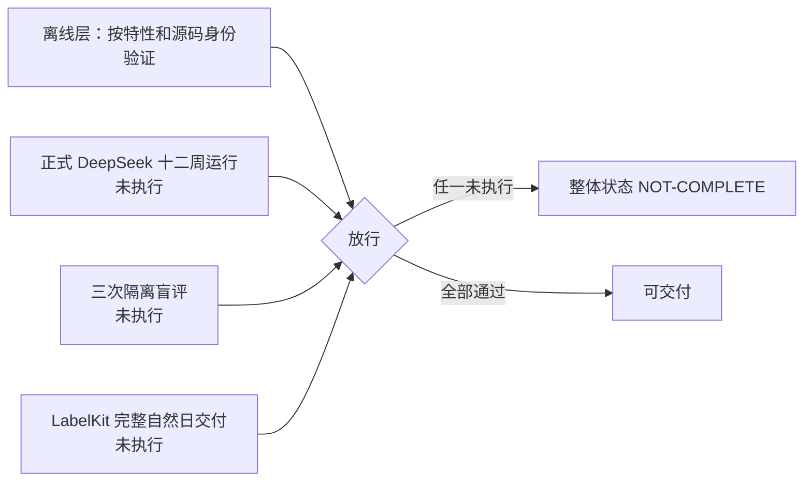
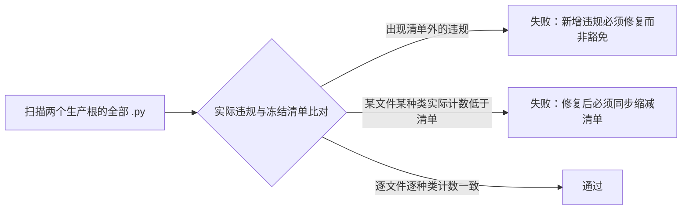
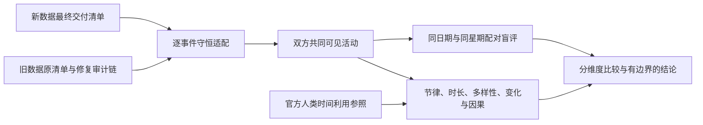

# WorldMock 验收标准

> 引用出处：`docs/dev/SPEC-labelkit-delivery.md` @ `490ae4bb0ab226c0cf90e77531ccafffcca38f97`

> 按[资源与规则引擎简化规格](dev/SPEC-resource-and-rule-simplification.md#spec-rrs-资源与规则引擎简化开发规格)修订「资源与规则简化门禁、测试矩阵、发布身份与证据边界」（阶段 8）；此前阶段的修订并入同一现行合同。

> 状态：整体实现 **NOT-COMPLETE**。正式 DeepSeek 十二周运行、三次隔离盲评与 LabelKit 完整自然日交付尚未完成，未完成项不得以离线测试通过替代。各特性及合并后的工程门禁按具体源码身份留证。按人物 Prompt 规格修订，修订部分已实现并通过离线验收（证据见[人物 Prompt 验收记录](archive/persona-prompt/persona-prompt-verification.md)）。按[一日运行保真规格](VERIFICATION.md#verification-incremental-evidence)「冻结条款修订」第 26 行修订（一日运行保真 VF1）：新增「一日运行保真特性门禁」，测试矩阵中补入该规格条款的十四行；该规格已全部实现并通过离线验收（证据见[一日运行保真验收记录](archive/dayrun-fidelity/dayrun-fidelity-verification.md)），这十四行已按实现改回 `离线覆盖`。
> 个人事务与工作安排修订：随[个人事务与工作安排规格](VERIFICATION.md#verification-incremental-evidence)冻结，按其「实施计划」的冻结约定修订（个人事务与工作安排台账 VF2）：新增「个人事务与工作安排特性门禁」；该规格阶段 1–4（运行修复入库、个人事务与提示分工、作息与工作安排、查询筛选与返回精简）已实现，阶段 5 的全量测试、覆盖率门禁与独立源码变异审查已完成，离线验收的结果与证据见[个人事务与工作安排验收记录](archive/errands-workday/errands-workday-verification.md)；阶段 6 配对全天复跑未执行（只报告，不作门禁）。测试矩阵已补入该规格条款。
> 让「等待」成为例外修订：按[让「等待」成为例外规格](dev/SPEC-idle-fillers.md#spec-idle-fillers-让等待成为例外开发规格)修订「协议门禁」「报告项（Report-Only）」「测试矩阵」与「度量与下游」的「行为评估」（阶段 1）、「测试矩阵」（阶段 2）、「度量与下游」的「首次受影响发布身份」（阶段 3）。
> 日期：2026-10-07
> 范围：放行门禁、report-only 边界、测试矩阵、验收原则、交付阶段与结论边界
> 记录位置：实际通过的源码身份、命令与收据集中记录在 `docs/dev/implementation-status.md#implementation-status-worldmock-实现状态`；本文件只定义判定方式与当前状态，不重复断言其通过

放行需要离线层（确定性代码与测试）与真实运行层同时成立。行为分布指标只进报告，不参与放行。

三项真实验收各自对应「最终门禁」表中的一行：正式十二周运行对应「十二周」，三次隔离盲评对应「比较」，
LabelKit 完整自然日交付对应「真实端到端」。三行状态均未达到通过，整体实现状态保持 NOT-COMPLETE。

## 资源与规则引擎简化特性门禁

[冻结规格](dev/SPEC-resource-and-rule-simplification.md#spec-rrs-门禁与平台)的逐行范围由 `tests/fixtures/rrs-acceptance.json`、`tests/rrs_acceptance.py` 登记，`tests/test_rrs_acceptance.py` 检查完整性、实际节点和完成阶段。当前九个现行特性守卫及归属守卫共同执行，不能用旧统计、空壳节点、跳过或缩小收集代替。

| 验收对象 | 必需证据与边界 |
| --- | --- |
| 人工完整日 | 同场景同种子在获授权的 macOS 跑两次完整日，逐项一致后通过唯一入口原子冻结第三基线；旧两份 JSON 与原基线实现字节不改 |
| 标准、全量和覆盖率 | 同一最终源码及人工环境的统一入口回执；分支至少 85%、未覆盖公共接口为零；标准耗时取真实墙钟，不相加分片 |
| 语义变异 | 未变异源码先通过基线，隔离执行登记行为变异并由真正语义断言检出；删枚举的导入失败不算；独立审查另留证 |
| 文档与汇编 | 实际执行 `python scripts/documentation_gate.py` 与 `python scripts/build_design_doc.py --check`，条款、引用、版本和机器登记一致 |
| 平台及依赖 | OS、架构、CPython 3.12.13、`.python-version`、实际依赖锁与同步 uv 锁身份；不从 macOS 推定其他平台 |
| 正式环境交接 | 数据仓发布后才跑正式 full、覆盖率、完整日及换目录恢复；未执行项如实登记，不能归入人工环境通过 |

实际执行见[实施状态](dev/implementation-status.md#implementation-status-资源与规则引擎简化开发状态)，逐行节点见[机器追溯](dev/ANALYSIS-spec-coverage.md#analysis-spec-coverage-资源与规则简化映射)。生成[覆盖率](dev/coverage-report.json)与[测试耗时](dev/test-durations.json)按其源码、环境及平台身份解释，报告只证明记录的输入环境，不将历史身份或人工环境结果改称新正式环境通过。

## 共享规则与可重建环境特性门禁

[冻结规格](dev/SPEC-shared-rules-and-rebuildable-env.md)的共享规则、漂移修复、源码重建、引导、
环境收据、平台边界和设计文档同步属于同一完整特性；逐项证据见
[本特性验收记录](dev/shared-rules-and-rebuildable-env-verification.md)。
多消费者测试必须证明调用同一规则，AST 守卫必须实际拒绝新复制实现。
AS2 先复现旧源码身份，再完成 WorldMock 记忆与观察业务的移出；最终只有一套补丁来源与源码摘要。

工程放行使用当前解释器的 `python scripts/coverage_gate.py --shards N` 调用唯一 full runner；
按实测文件权重调度完整文件，预收集节点恰跑一次，进程与覆盖数据隔离。`--from-json` 必须核验同次 collection、
summary、worker 选择与完成回执的同一运行身份和覆盖数据摘要；选择、收集与完成节点的全局多重集
必须精确相等且无重复，每个全量节点的 setup、call、teardown 三阶段完整且均为 passed。
拒绝未知结果、空集合、失败、跳过、缺失或失效收据以及真实输入字节变化；输入包括根 `.gitattributes`
和引擎人工测试环境。要求测试、风格、文档链接、
设计汇编、整体分支覆盖率至少 85% 和未覆盖公共接口为零；跳过、预期失败、空运行均不能取得通过。
新机器检查必须真实引导固定源码与哈希依赖。资源与规则引擎简化特性的当前平台证据只登记本次 macOS
本机双跑、地图生成与 app 资源校验的真实结果；Windows 回执尚未执行，不能由 macOS 结果推定。
平台边界以[冻结规格](dev/SPEC-shared-rules-and-rebuildable-env.md#shared-rules-门禁可选部件与操作系统)为准。
所有新规则必须经干净提交的隔离 worktree 源码变异审查，存活变异补测后原样复验。
本特性工程证据不替代现有正式模型、十二周、盲评和完整自然日交付门禁。

## 品类契约特性门禁

## 一日行为可信性特性门禁

[冻结规格](dev/SPEC-dayrun-behavior.md#spec-dayrun-behavior-一日行为可信性特性开发规格)全部条款同批实现和验收；逐条证据与文件清单见
[实施台账](dev/research/dayrun-behavior/verification.md)。允许的并行活动组合、独立控制、共同身体结算、
餐馆实际进食、app 内内容抽取与共享进度、app 推送、已核验经历、主观记忆和持续威胁去重均不能延期。
必须经真实人物工具入口运行至少两人、不同种子的多个完整自然日，包含非法模型输出扰动与共同检查点恢复。
该确定性运行、全仓覆盖门禁、目录语料身份、文档一致性及隔离源码语义突变审查共同构成特性验收。
它们不替代本页定义的真实供应商、十二周、盲评和 LabelKit 交付要求。

## 数据加工验收边界

LabelKit 模型任务、训练数据加载和规则测试数据已归 LabelKit-DataSet，其验收不在本仓库运行或声明。
WorldMock 验收模拟行为、持久记录、完整认证导出和真实性评估；评估候选数据只作为待认证输入。
历史 LabelKit 验收与未完成项保留原身份，不能证明整合后的新消费者通过。
本次来源快照接收并核对摘要已完成，新消费验收尚未取得。

## 放行门禁

放行门禁分三层判定，互不替代：最终门禁（交付前必须全部满足）、协议门禁（机器判定）、工程门禁（确定性测试层判定）。
行为分布指标不属于门禁，见「报告项」节。

### 最终门禁

| 门禁 | 必需证据 | 状态 |
| --- | --- | --- |
| 规范闭合 | 全部规范要求映射到生产入口和行为测试；不存在 stub、TODO、skip、xfail 或只检查接口存在的替代验收 | 离线判定 |
| 正常和异常 | 每个生活模块覆盖正常、拒绝、边界、中断与重复请求；故障传播覆盖真实 actor/runner 边界 | 离线判定 |
| 真实端到端 | AS2 → DeepSeek LifeAgent → LifeEnv → SQLite → 完整认证足迹导出与真实性评估实际读取通过 | 部分 |
| 并发与恢复 | 多人实际运行；颠倒到达顺序不改变结算；共同检查点损坏拒绝；新分支父目录不变 | 部分 |
| Uncle Bob | 干净本地提交的隔离 worktree，基线通过后进行源码语义突变，逐条记录 killed/survived；修复测试缺口后原样复测 | 离线判定 |
| 十二周 | DeepSeek 真实选择，已确认时钟达到结束边界、足迹与模型证据完整、正式输出和完整窗口交付通过 | 未执行 |
| 比较 | 两套真实输入认证、全部必需指标、外部参照限制、实际盲评与报告完成 | 未执行 |
| 行为节律 | 正式十二周启动前，同一代码摘要的双人 24 小时验证运行至少三次，全部通过《人物真实性修订合同》的协议门禁；行为分布指标如实报告，不作为放行条件 | UNVERIFIABLE |
| 路径清理 | 旧手机生产文件、测试、配置、依赖、experiments、旧 runtime 及旧环境删除；只保留经验档案和新工程 | 离线判定 |

「状态」列取值只表达该门禁当前的判定层次：

- `离线判定`：由本地仓库状态或确定性测试层判定，通过记录见 `docs/dev/implementation-status.md#implementation-status-worldmock-实现状态`。
- `部分`：真实运行的短窗口或小时级收据已存在，门禁要求的完整窗口或完整自然日尚未通过。
- `未执行`：该门禁要求的真实运行尚未启动，不得以离线证据替代。
- `UNVERIFIABLE`：执行记录未能在仓库现有台账中核实。

`UNVERIFIABLE` 行说明：「行为节律」要求的三次同代码双人 24 小时验证运行，其通过记录未在仓库现有收据与台账中核实到。
本文件不据离线测试推定该行已通过，也未将其记为已执行；该行的真实状态需要执行方补充收据，或由编排方重新派发核实。

三项真实验收的未完成状态逐项写明：

- 正式十二周运行：窗口为上海时区 2026-01-05 零点至 2026-03-30 零点，共 84 天；场景已冻结，实际运行尚未启动。
- 三次隔离盲评：现有盲评包为 smoke 包，不构成实际盲评；三个隔离模型评审会话尚未产生实际评审记录。
- LabelKit 完整自然日交付：真实运行中尚无完整自然日的最终交付清单。

### 随机地图与共享菜单

现行图与菜单行为以[资源与规则引擎简化规格](dev/SPEC-resource-and-rule-simplification.md#spec-rrs-资源与规则引擎简化开发规格)为准。旧地图分支和品类组合的[分支记录](dev/research/map-and-storefront-verification.md)、[组合记录](dev/research/map-and-storefront-main-verification.md)保留原始执行事实，不覆盖本次随机图与共享菜单。

| 门禁 | 必须观察到的结果 |
| --- | --- |
| 图结构与连通 | 少节点、非法边与两个分量以对应登记码拒绝；发布图不含道路状态或坐标 |
| 生成复现 | 同地点和种子跨机器同字节；篡改边长后生成检查及环境校验报 `MAP_NOT_REGENERATED`，运行加载不重生成 |
| 最短路 | 手算长度和路径一致，等长比较完整路径元组，颠倒边插入次序不改变结果；路径可以经过未选择节点 |
| 同类共享菜单 | 一个食品绑定某种食品店铺的全部成员或完全不绑定，部分成员绑定拒绝；价格全店一致 |
| `"all"` 范围 | 只展开到食品店铺类型，不包含住宅、办公室、公园或健身场所 |
| 全图外卖 | 备餐加图最短距离除配送速度，没有配送区域或不可达原因；重复到期不重复交付 |
| app 绑定 | 非食品店铺不能绑定 app，空绑定只允许到店；app 必须至少绑定店铺或内容 |
| 出行证据与恢复 | 秒数和费用按固定规则，付款给 `transport:service`；活动与事件保存 `trip_id`、路径、距离和实际地点；恢复核对环境身份 |
| 实际集成边界 | 纯所有者入口与完整 LifeEngine 入口分别留真实结果；共同集成波次闭合后才宣称引擎可运行 |

定向测试、真实源码变异、文档门禁与设计汇编按固定源码身份留证。图与出行阶段的纯节点不代替食品、app、工作、导出和正式环境的后续验收，也不继承旧测试数字。
完整门禁和新功能的独立 Uncle Bob 审查以真实干净提交执行，平台和正式环境回执按实际执行登记。

### 协议门禁

协议门禁由 `worldmock.evaluation.behavior_metrics.behavior_metrics_report` 计算：以冻结足迹事件为输入，
按事件顶层 `code_sha256` 分组，返回 `{"schema_version": "behavior-metrics-1", "gates": ..., "reports": ..., "notes": ...}`。
`gates` 是放行门禁，`reports` 是只报告项。既有四项门禁的键名、比较符与阈值以源码为唯一依据：

| 门禁键 | 判定对象 | 比较 | 阈值 | 失败含义 |
| --- | --- | --- | --- | --- |
| `observation_repetition` | 同一 user 观察文本出现于不同（人物，模拟秒）续接链的决策请求中的最大数目（同一续接链内各次决策复用链首 user 合法，只计一次，同一决策内重发同样只计一次；排除带 `purpose="plan_day"` 的系统请求；带工具的请求只在工具中有 `start_activity` 时计入，所以只带 `submit_reflection` 的就寝反思及其校验重试不计，它们的附回消息不带时刻与人物内容，不是观察；不带工具的记忆巩固照计） | `==` | 1 | 同一观察被重复序列化进不同秒或不同人物的决策请求 |
| `silent_boundary_ratio` | 每人唯一共同身体结算的清醒边界中 `decision_offered=false` 的占比，sleep 边界与缺失该字段的边界都不进分母 | `>=` | 0.5 | 静默续行边界占比过低：提供决策的边界过密 |
| `memory_repetition_ratio` | 同类型记忆两两之间 bigram Jaccard ≥ 0.6 的对数占比 | `<=` | 0.2 | 记忆内容重复 |
| `memory_md_identity_residue` | 调用方传入的各人物工作区 `MEMORY.md` 文本命中示例身份或示例编号的人物数（`MEMORY.md` 不再进人物提示，门禁仍检查它） | `==` | 0 | 示例身份残留进入人物记忆 |

证据缺失即门禁不通过，不是跳过：事件缺 `decision_offered`、缺记忆文本或未提供 MEMORY.md 时，
该门禁的 `value` 为 `null`、`pass` 为 `false`。四个门禁的取值与阈值各有测试守卫：
`tests/evaluation/test_behavior_metrics.py` 的 `test_observation_repetition_gate_pass_and_fail`
（续接链内复用与跨秒、跨人物重复另由 `test_observation_gate_allows_same_second_continuation_chain_reuse`、
`test_observation_gate_fails_on_cross_second_or_cross_agent_duplicate` 守卫，就寝反思及其校验重试不计由
`test_reflection_requests_and_their_retries_are_not_decision_requests` 与真实日运行
`tests/integration/test_dayrun_complete_days.py` 中反思经一次校验重试改正的种子守卫）、
`test_silent_boundary_ratio_exact_values`、`test_memory_repetition_gate_values`、`test_memory_md_identity_residue_gate`；
分组与可复现性由 `test_report_groups_by_code_sha256`、`test_same_input_produces_byte_identical_report` 守卫。

键名与阈值的当前口径（与源码一致，以下三点为易误读项）：

- 静默边界占比的分母是携带 `decision_offered` 字段的清醒边界数；缺失该字段的边界只计入 `boundaries_without_field`，不进分母；同刻轮次不写共同身体结算，不进分母。
- 记忆重复率与记忆层身份残留同属协议门禁，不属于只报告项。
- 决策 token 中位数的 15000 是报告项内的 `target_reference` 对照值，不是门禁阈值。

既有四项协议门禁未整体接入生产质量导出。
当日目标新增的三层度量及外部约束门禁单独进入 `quality.json.day_plan_metrics`；
其接线不改变既有记忆协议的额外证据要求。
个人事务与收尾记忆的度量最初随质量报告结构 4 引入，当前在结构 5 中继续作为 `quality.json` 的
`errand_metrics` 与 `conclusion_memories` 两个顶层分组（紧随 `day_plan_metrics`），只报告；不写进
`day_plan_metrics`，不使用当日目标指标的键名，不以目标数为分母。
导出里没有任何事务新增事件时 `errand_metrics` 整组为 null（有事务时各计数没有命中记 0），没有收尾记忆时 `conclusion_memories` 整组为 null。

认证导出另要求 `quality.json.schema_version == 5`，并从同批事件与活动独立重算三组当前事实：

| 质量键 | 必须存在的字段 |
| --- | --- |
| `content_contact` | `by_app`, `by_kind`, `repeat_watch` |
| `app_pushes` | `pushed`, `opened_in_session`, `consumed_pinned`, `released_by_completion`, `expired_with_session`, `outside_window_violations` |
| `work_topics` | `topics`, `completed`, `worked_seconds_by_topic`, `reports` |

推送按唯一 `push_id` 与真实 session 转换计数；主题工时只累计各人物、主题的非失败唯一工作活动实际区间，不相加累计进度快照；缺失或无法重算即拒绝。
唤醒原因分桶读取当前 22 个名字。阶段 7 的实际执行状态由回执登记，不以正文替代。

### 当日目标特性门禁

完整范围见 [当日目标特性规格](dev/SPEC-day-plan-goals.md#spec-day-plan-goals-当日目标特性开发规格)。同一被测源码必须覆盖目标输入闭集、
空计划与跨日、修订证据保留、正时长首次推进、重复活动和恢复防重、午夜最后结算、
两档重估与精确任务/闭店威胁、真实人物工具（限 `revise_day_plan`）与引擎闭环、三层度量与实际质量导出；
还须覆盖 `remind_time` 的换算与拒绝（`PLAN_REMIND_TIME_INVALID`）、零点计划同一本地日只生成一次、提醒只触发一次、
修订取消旧提醒、恢复后不重复生成与提醒。
删除旧时段合同，不保留兼容、迁移、占位或本特性 skip/xfail。

工程放行要求全量测试、分支与公共接口覆盖、风格、文档链接通过；
还要在同一干净提交的隔离 worktree 上用 Uncle Bob 语义突变检验空计划门控（日首计划门控已由时间与能量规格删除，
本项只对应当日目标特性验收时的源码）、修订保护、活动证据、防重复脉冲、威胁与间隔、报告分母和质量接线。
存活突变必须补测后以原补丁复验。证据统一见 [本特性验收记录](dev/research/day-plan-goals-verification.md)。

### 时间与能量特性门禁

完整判据见 [时间与能量特性规格](VERIFICATION.md#verification-incremental-evidence)的验收台账，本节不复述。
issue #1 绿色基线是实施前置：`python scripts/run_tests.py --tier full` 全量无失败之后，才开始该规格第一章以后的改动。
工程放行要求全量测试、分支与公共接口覆盖、风格、文档链接通过；还要在同一干净提交的隔离 worktree 上
用 Uncle Bob 语义突变检验同刻上限、能量截断、唤醒闭集、提醒只触发一次、名额释放与内部身份不进提示。
存活突变必须补测后以原补丁复验。练秋湖与 r14 场景的真实复验只报告，不作门禁。
证据统一见 [本特性验收记录](archive/time-and-energy/time-and-energy-verification.md)。

### 人物 Prompt 七层特性门禁

完整主题与判据登记在 `tests/fixtures/acceptance_requirements.json`，行为测试登记在
`tests/persona_prompt_acceptance.py::LEDGER`；每行须有实际运行证据，纯结构匹配不能替代真实请求或环境结算路径。

最小完整路径必须在真实 `LifeEnv` 与 SQLite 上，通过脚本化模型连起同一代点场景的请求、下单、实际送达或给予、后续决策。
后续决策必须在进度层或记忆层看到订单与送达事实，不再重复下单；只核对订单关联字段不能替代这条完整行为链。
工程放行要求全量测试（含风格门禁与查看器回归）、分支与公共接口覆盖、文档链接通过；还要在同一干净提交的隔离 worktree 上
用 Uncle Bob 语义突变独立检验唯一出现、时间推进时思考消失、续接断链、给予不计摄入、进食丢弃不计摄入、指名购买不替换、
恢复不越截止、消息全文、订单去重与预算耗尽不造活动。
存活突变必须补测后以原补丁复验。白领全天、双人半日与续接开关两臂对比的真实复验只报告，不作门禁。
验收台账各行的证据测试登记在 `tests/persona_prompt_acceptance.py`，由 `tests/test_persona_prompt_acceptance.py` 逐行判定；
证据统一见 [本特性验收记录](archive/persona-prompt/persona-prompt-verification.md)。

当前七层提示与查看器按剩余系统规则同步；推送、并行、名称、购买来源和主题工时按真实验收节点验证。

### 一日运行保真特性门禁

完整判据见 [一日运行保真特性规格](VERIFICATION.md#verification-incremental-evidence)的验收台账，本节不复述；每行须有实际运行证据，
纯结构匹配不能替代真实请求或环境结算路径；「复跑指标（只报告）」一行只报告，不作门禁。
工程放行要求全量测试（含风格门禁与查看器回归）、`scripts/coverage_gate.py`（分支覆盖率不低于 85%，未覆盖公共接口为零）、
`scripts/documentation_gate.py` 与 `scripts/build_design_doc.py --check` 都通过；还要在同一干净提交的隔离 worktree 上
用 Uncle Bob 语义突变独立检验该规格「阶段 6 突变审查的目标」所列各项：睡眠计费的清醒分类、食品类别常数与 BODY_CONSTANTS 效率、档界常数、
系统层条数与档位名、名称归一唯一才受理、候选不替换、分段匹配的段序、名称类拒绝不计轮、错误结构键闭集、固定活动环境交集、哈希决胜、轮转判据、
控制工具的上限校验与 `views`→`subject`、摘录字数门槛、截断回合丢弃、守卫命中即重试、加载拒绝与推进的开始时刻，另加按 `prefer` 选定与其决胜（3.5）。
存活突变必须补测后以原补丁复验。质量报告新增的 `input_warnings`、`truncations`、`timeline_labels`、`contact_reply_guard`、`name_rejections`
五节只报告、不放行；运行输入警告永不让运行失败。白领与商务全天的真实复跑只报告，不作门禁。
验收台账各行与已定裁决的证据测试登记在 `tests/dayrun_fidelity_acceptance.py`，由 `tests/test_dayrun_fidelity_acceptance.py` 逐行判定；
证据统一见 [本特性验收记录](archive/dayrun-fidelity/dayrun-fidelity-verification.md)。

食品购买来源改为目录 app 绑定，消费请求 `product_id` 保留而事件 `food_id`；六警告闭集与真实目录覆盖率由本阶段节点验证。原已裁决历史行为与执行收据保留其原身份。

### 工具交互特性门禁

本特性已实现，新增行为与源码变异使用本次独立门禁；完整范围见
[工具交互规格](VERIFICATION.md#verification-incremental-evidence)，不能用文档一致或历史全绿替代生产行为验收。

| 门禁 | 必须证明的结果 |
| --- | --- |
| 请求与错误 | `start_activity.items[]` 每项含 target、way、from、to，整组原子受理；旧平行数组和 `actions` 被拒；购买偏好必填中文闭集，非购买为 null，本人收货 to=null；每次接口错误含完整位置、全部合法值及完整候选 |
| 查询与预算 | 世界查询必填 name、way、category、offset（该特性验收时的四键口径；现行为六键 `name`、`way`、`category`、`from`、`available_only`、`offset`，四键旧请求按缺字段拒绝，判据见「个人事务与工作安排特性门禁」），冻结观察内分页无重无漏，返回 matches、total_count、next_offset；与任务回看及记忆查询可同批，不写世界动作或进度 events、不推进时间、不计同刻轮数；查询回复计十六回合，最终回合和截断重试无查询 |
| 工作通知 | 输入只声明 appointment=null 或 {starts_at,reason}，普通开放由最早本人关联邮件编译，旧 available_at 输入被拒；每封关联邮件引用存在任务且收件人为该任务受派人物，每任务至少一封通知，素材预先有效；八点收件后到公司即可开始；预约最早通知不晚于开始，后续提醒可晚于开始且不改开放时刻；正文只在阅读结果呈现 |
| 状态与证据 | 当日拒绝备忘跨时刻和会话存在、次日清空，紧凑工具层无损，查询与真实执行证据分开，恢复不重复告知或交付 |
| 发布身份 | 每个阶段只发布自己实际改变的输入身份；首次任务场景 4、首次供给地图 3与品类规则绑定 3及目录 5.0，世界 8保持（该特性验收时的身份；现行世界结构见 `docs/CONTRACTS.md#contracts-worldmock-接口合同`「领域枚举」）；后续目录内容另发不可变版本，旧输入拒绝，无迁移或兼容读取 |

每条新增行为必须有生产入口行为测试，并由独立语义变异证明其约束生效。变异覆盖删掉错误位置、
截短合法枚举、查询计成世界动作、普通工作延到九点、读完才告知、预约通知误唤醒、已有合法通知时漏验另一封错配邮件、
任务跨人物泄露、错误拒绝预约开始后的提醒、后续提醒改写开放时刻、
同类菜单遗漏、固定价格误算、app 绑定漏验、订单重复扣款和送达重复交付，以及恢复重复事件。
行为证据与变异收据按精确源码和输入身份登记在开发状态，新增验收使用现行接口与本次独立证据。

工具交互按以下纵向阶段依次实施，每个阶段都从真实输入经生产工具与引擎到持久证据形成完整闭环。
各阶段独立冻结代码、输入、工具和提示身份，可在自己的固定身份上复验；只有触及相应形状时才发布新版本。
每阶段删除退役格式并完成自身行为测试与独立语义变异测试，不引入双格式分支，也不等待全部特性完成才验收。

| 独立实施阶段 | 生产入口必须完成的行为闭环 | 身份及通过条件 |
| --- | --- | --- |
| 错误接口 | 真实模型工具请求的 items 选择、购买偏好、本人收货；结构、枚举、名称和业务错误精准定位，候选可照填且整组原子 | 更新代码、工具与提示身份；旧请求被拒，错误位置、枚举删减及部分执行变异被检测；不强制数据四种版本升级 |
| 任务 | 新场景加载、素材预检、逐封通知校验、内部开放编译、到公司开工、预约真实唤醒及开始后提醒、截止、检查点恢复 | 场景首次升 4；不提前泄露或重复告知，删除重复 available_at 输入；九点延迟、读完才知、错配邮件漏验、缺通知、预约假唤醒及错误拒绝后续提醒或改写开放时刻变异被检测 |
| 查询 | name、way、category、offset（该特性验收时的四键口径；现行为六键 `name`、`way`、`category`、`from`、`available_only`、`offset`，四键旧请求按缺字段拒绝，判据见「个人事务与工作安排特性门禁」）的真实只读批次、逐页取尽、纠错、预算用尽、后续世界受理与证据导出 | 更新代码、工具和提示身份；分页无重无漏且不扩大权限，查询写世界、漏页、越过十六回合及误记动作变异被检测 |
| 操作备忘与紧凑呈现 | 拒绝后跨时刻、跨地点及恢复的操作备忘，次日清空；真实模型请求分组、展开与同秒 changes | 更新代码与提示身份；五字段、英文 why≤60字符且非人物记忆，false、零值与不同字段守恒；漏备忘、混记忆和有损压缩变异被检测 |

阶段收据登记实际发布版本与摘要；同版本内容不可改写。新身份完成验收不会授权恢复旧运行，旧产物仍按原身份拒绝。

旧地点供给、供给价格与料理验收行退出当前合同；同类食品菜单、固定价格、app 来源、单订单结算与真实消费由资源与规则引擎简化阶段三的实际节点和独立变异留证，不沿用旧执行数字。

### 个人事务与工作安排特性门禁

完整主题与判据登记在 `tests/fixtures/acceptance_requirements.json`，行为测试登记在
`tests/errands_workday_acceptance.py::LEDGER`；每行须有经真实请求、引擎与 SQLite 路径的证据，
只断言辅助函数不算；「复跑指标（只报告）」一行只报告，不作门禁。

跨夜可见必须验证零点后、零点计划后与修订计划后，个人事务仍在待办层；记忆层超过字符窗口或上下文浓缩时仍保留事务。
实际行动请求的待办层必须含该事务，本决策无需记忆查询即可看到它；零点计划的输入必须包含个人事务。
零点计划模板与输入说明的模型常量只与 `docs/CONTRACTS.md#contracts-model-request` 的唯一权威文本比对。

运行修复入库、个人事务与提示分工、作息与工作安排、查询筛选与精简四部分均已验收；
各自独立提交、独立验收与独立冻结身份的要求用于保留历史提交及身份记录。当前统一采用已完成的合同并删除旧形状，
不加运行开关、双读、兼容或迁移。版本 8 的检查点与导出、结构 4 的场景、
缺下班与到家两键的旧结构化卡片、四键旧查询与缺 `errands` 的旧控制请求按版本或缺字段拒绝。

工程放行要求全量测试（含风格门禁与查看器回归）、`scripts/coverage_gate.py`（分支覆盖率不低于 85%，未覆盖公共接口为零）、
`scripts/documentation_gate.py` 与 `scripts/build_design_doc.py --check` 都通过；还要在同一干净提交的隔离 worktree 上
用 Uncle Bob 语义突变独立检验该规格验收台账之后「源码变异必须覆盖」一段所列各项：反思接受自由文本、跳过未知引用校验、
失败返回空列表、重试不设上限；运行装配改回 AS2 原类；代理不等待远端结果；重复意图只报笼统错误；日志后吞掉异常；
零点清空事务、修订计划丢事务、待办层不投影事务、记忆层超窗或上下文浓缩时丢掉待办层事务；业务拒绝时事务变更照落；
事务名近似时取第一个候选；请求可把状态置为完成；把受理、未送达订单、活动开始、`progressed` 或自述当完成；
把记下之前的证据（含同一提交内排在新增事件之前的）或记下前开始的进度区间计入；当面给予不计入取得；
按事件人物字段而非收货人判归属；读取逐项结果里的重复订单；一次提交结算两次；检查点漏存事务；
取消后仍提醒；提醒即置完成；提醒叫醒睡眠；事务计入在手承诺；新唤醒原因漏登足迹词表；提醒与办成事件写成系统可见；
结算事件沿用证据事件的决策身份；事务文字写进进度层参数或 `self_notes`；意图或 dreaming 投影带出请求级 `errands`；
投影原地修改原事件；事务指标以目标数为分母；版本 8 检查点被放行；
抽取或人设层投影丢掉故事写明的下班、到家锚点；抽取对下班锚点取缺省；新锚点并入回绕归一；乱序时整卡失败；
场景声明的下班、到家窗口不进零点计划输入；按星期推断休息日；所有人物套班次；计划修订后 `duty` 消失；休息时段显示为当班中；
分配工作主题却允许缺少工作安排；把主题地点解释为班次状态；忽略例外日期；宿主在人设层重复渲染工作安排；
忽略来源；来源解析另写一套；「购买」不展开；可执行筛选放到切页之后或在未命中方式的动作上判定；
精简时按真假值丢掉 false 或零；查询写世界；四键旧请求被受理。
变异只登记在主进程内执行的生产代码上；每个非等价变异必须被行为测试杀死，存活、未执行或基础测试失败都不放行，
存活突变必须补测后以原补丁复验。

质量报告新增的 `errand_metrics`、`conclusion_memories` 两组，行为评估新增的 `workload`、`routine_deviation`，
以及查询成本统计只报告、不放行；白领与商务的配对全天复跑只报告，不作门禁，也不构成「行为节律」行或十二周验收的证据。

验收台账各行的证据测试与「源码变异必须覆盖」逐句的登记变异都登记在 `tests/errands_workday_acceptance.py`，
由 `tests/test_errands_workday_acceptance.py` 逐行、逐句判定：阶段 1–4 的二十五行各列出行为测试节点；
「工程门禁」一行列出门禁自身的测试（风格门禁零新增违规、覆盖率门禁的阈值与未覆盖公共接口判定、文档链接门禁），
全量测试与覆盖率门禁在最终代码上的运行结果、独立源码变异审查的结果不是测试节点，记在验收记录；
「文档一致性」一行列出文档链接门禁、设计说明书汇编检查与带锚点链接、临时状态词两项文档扫描的测试；
「复跑指标（只报告）」一行不登记测试节点，由复跑报告承载。
阶段 6 配对全天复跑是计费的真实运行，只在用户要求时启动，本特性验收时未执行；少于每臂三次时验收记录写明未达复跑要求。
证据统一见[本特性验收记录](archive/errands-workday/errands-workday-verification.md)。

### 工程门禁

工程门禁与协议门禁一样失败即不放行，由确定性测试层判定。

**决策上下文**

本次特性的完整条款与验收台账见 [决策上下文规格](dev/SPEC-decision-context.md#spec-decision-context-特性规格决策上下文与工具结果)。
必须检验实际模型请求、原生人物执行入口、真实环境提交与下一次观察；只检查辅助函数不能代替调用路径。
登记凭据与已结算结果使用不同公开边界，理由文本也必须防止泄漏内部身份或摘要。
决策自述阶段已由[人物 Prompt 七层规格](dev/SPEC-life-realism.md#persona-prompt-七层请求)删除：含 `decision_statement` 阶段键的清单须在新建、打开、恢复、
反事实重放与校验五个入口被拒绝；行动纠错不得增加环境观察次数。
通过全量测试、分支覆盖率、源码风格、文档链接门禁后，还需在干净提交的独立工作树进行源码语义突变，
按条款记录被检测与未被检测的反例。存在本特性相关的 skip、xfail 或未完成项即不能宣称特性完成。
实际提供商连通性和长期人物行为依旧按真实运行门禁另行留证。
本次固定源码下的执行结果见 [决策上下文验收记录](dev/research/decision-context-verification.md)。

**交互菜单**

完整合同与验收台账见[交互菜单规格](dev/SPEC-interaction-menu.md#spec-interaction-menu-特性规格交互菜单)。本门禁要求同时观察到声明准入、
冻结观察、人物实际模型请求、本地决策校验、环境权威重验与跨轮结果，任何一层单独通过都不能替代
完整路径。

| 门禁 | 必须观察到的结果 |
| --- | --- |
| 声明闭集 | 正式场景全部显式声明；地点类覆盖恰好完整，人物字段存在；`null` 只表示人物不追加限制；未知、重复、空集合、坏类型、缺字段与缺保护项均失败关闭并留英文错误 |
| 地点与人物 | 地点菜单和人物菜单逐字段取交集并确定性排序；同内容换地点、同地点换人物都产生预期差异，菜单不能增加任一来源未允许的工具或活动类型 |
| 冻结观察 | `observation.data.interaction_menu` 保存本轮有效菜单；同一决策重试不重取，换地点后只在下一次观察更新；原始人物和地点声明不进入 user 消息 |
| 菜单执行 | 实际模型 Schema、本地校验、直接宿主派发与环境结算落实同一菜单资格；工具、活动类型、下钻品类及恢复请求不能绕过；宿主本地校验与直接派发以英文 `RuntimeError` 失败关闭并留错误日志，环境菜单拒绝返回 `INTERACTION_MENU_DENIED` |
| 既有门控 | 单动作阶段、回合预算、可见目标与活动控制照常收窄；不按人物状态与能量隐藏动作，没有日首计划；有待收尾活动时先收尾；只有同刻上限的受限轮另行收窄；休息、睡眠与既有活动收尾可用，禁止的暂停活动仍可取消但不能恢复 |
| 副作用 | 菜单拒绝不扣款、不消费、不启动或恢复活动、不推进 app 内容、不发送消息；被禁工作不调用独立评审；幂等重放不重做领域动作、不重复增加拒绝计数，重放轮计入同刻轮数，重放证据标记 `reused=true` |
| 候选不变 | 菜单不删除候选、事实或 `affordance_contract`，不改变排除原因计数、呈现上限、游标及轮转；只影响下钻入口和启动资格 |
| 身份与恢复 | 菜单变化改变场景身份；固定办公室散文删除改变静态工具模板身份而不改变 system 模板身份；场景、代码或工具身份漂移均拒绝打开和恢复 |
| 真实边界 | LifeAgent、LifeEngine、SQLite 与跨轮观察实际贯通，含允许动作、禁止直接请求和到达新地点后的菜单刷新 |

工程放行还要求相关定向测试、全量测试、分支与公共接口覆盖、源码风格和文档链接门禁通过，且在同一
干净源码身份的隔离工作树完成 Uncle Bob 语义突变。突变至少尝试并集替代交集、`null` 当空集合、
缺字段静默放行、未知值忽略、保护项自动补齐、只隐藏模型 Schema、跳过环境重验、菜单删除候选、
遗漏观察证据和恢复接受身份漂移等反例。执行前不得把验收记录写成已通过；固定源码身份、命令、精确
结果与突变存活情况统一进入[交互菜单验收记录](dev/research/interaction-menu-verification.md)。

**接口完整性**

接口合同见 `docs/CONTRACTS.md#contracts-worldmock-接口合同`「人物工具与管理接口」。本门禁要求观察到的是：

- 每个 LifeEnv 工具都有对应的 Pydantic 请求模型，工具 Schema 由该模型直接生成，不存在绕开请求模型的接口路径。
- 模型侧只能填写业务参数；身份、决策标识与动作标识由宿主补齐。
- 超出数组数量边界的输入在校验阶段被拒绝，不出现被悄悄截断后照常落库的路径。

验证：`tests/integration/`。

**数据一致性**

提交边界与素材发布按 `docs/design/05-recording-engine.md#recording-engine-worldmock-产品设计说明书-记录引擎`「事务与失败处理」判定，资金记账口径按 `docs/design/05-recording-engine.md#recording-engine-worldmock-产品设计说明书-记录引擎`「资金守恒验证」判定。本门禁要求观察到的是：

- 同一生活状态变化牵动的资金结算、动作状态与结果事件要么同时进库、要么都不进库，不存在只提交其中一部分的中间态。
- 素材引用在被引用之前已经落盘并通过哈希核对，数据库里没有指向残缺素材的记录。
- 账户余额可由初始注资与后续资金事件重算出来，结果与最终共同检查点一致；仅逐条自检合计为零不算通过。

验证：`tests/footprints/test_ledger.py`；完整导出对账在真实 export 上执行，收据见 `docs/dev/implementation-status.md#implementation-status-worldmock-实现状态`。

**失败传播**

故障与业务拒绝的分类见[模拟引擎的失败处理](design/04-simulation-engine.md#simulation-engine-失败处理)，存储失败处理见[记录引擎](design/05-recording-engine.md#recording-engine-失败分类)。本门禁要求观察到的是：

- 命中运行故障时运行停住并保留已确认部分，不带着故障继续推进。
- 致命故障与普通拒绝的错误类型不同，且经过工具层与批量返回后这个区别仍然可辨。
- 故障路径保留英文错误文本与关联事件，不被通用异常处理吸收后重新交给模型试错；人物决策失败时写一条带完整异常链的英文 error 日志后原样上抛（异常对象与类型不变），工具分发失败先写一条带完整异常链的英文 error 日志、再照现行实现以失败阶段码 `TOOL_SERVICE_FAILED` 抛出（四个失败阶段码 `MODEL_SERVICE_FAILED`、`EVIDENCE_WRITE_FAILED`、`MEMORY_QUERY_FAILED`、`TOOL_SERVICE_FAILED` 登记在 `docs/CONTRACTS.md#contracts-worldmock-接口合同`「工具返回通道」的宿主错误码表，只标失败阶段与调用位置，不是对请求参数的协议纠错；其中只有 `MEMORY_QUERY_FAILED` 作为失败的查询结果回给模型）；日志不是持久证据。
- 归纳记忆或写盘失败同样按运行故障处理；框架不得把运行报告成成功。
- 就寝反思的输出不合合同属于协议违约：附回英文校验错误重新请求，首次之外至多三次（连同首次至多四次模型调用），与传输重试分开计数；每次尝试是 AS2 记忆调度下的一次独立模型调用，请求与响应照常留证，校验错误随下一次请求的附回消息留证；耗尽即运行故障，最后一次错误写进故障原因，本轮中止、不提交，不写入任何洞见、不登记 `memory_updated`，也不降级为空反思。

验证：`tests/integration/test_life_agent_protocol.py`、`tests/integration/test_host_failure_stages.py`、`tests/integration/test_agent_branch_coverage.py`、`tests/integration/test_strict_reflection.py`、AS2 vendor `test_direct_runner_failures.py`。

**来源可追溯**

完整导出保留原始事件、人物、运行、素材与共同检查点关系；固定截止之外的事实不进入该导出。
导出认证独立重算活动、已核验经历、购买与 app 使用，拒绝重新计算文件摘要后伪造的足迹。
实际反事实分支保留父检查点与干预身份，不冒充父运行中的既有事实。
合同见[记录引擎的导出认证](design/05-recording-engine.md#recording-engine-导出认证)，
验证使用 `tests/footprints/test_validation.py`、`tests/life/test_counterfactual.py` 与 `tests/life/test_export_integration.py`。
下游窗口、训练划分、模型加工与规则测试数据由 LabelKit-DataSet 独立验收。

**源码硬规范**

适用于本项目自有的生产源码：`src/worldmock` 与 `custom` 下全部 `.py` 文件（不含 `__pycache__` 缓存）。
测试文件不在扫描范围内；第三方上游未被修改的实现保留其项目约定，被修改的接口与新增辅助模块适用下表限制。

| 规范 | 判定对象 | 阈值 | 违规种类 |
| --- | --- | --- | --- |
| 行宽 | 每个物理行去掉行尾空白后的字符数 | 至多 120 字符 | `WIDTH` |
| 函数长度 | 每个 `def` 与 `async def` 的函数体，含声明行与末行 | 至多 50 行 | `FUNCLEN` |
| 入参个数 | 每个函数的可调用者视角入参：位置参数、仅关键字参数、`*args` 与 `**kwargs` 各计一个；方法首位 `self` 与 `cls` 不计 | 至多 5 个 | `PARAMS` |
| 文件长度 | 每个生产文件的物理行数 | 至多 2000 行 | `FILELEN` |
| 注释语言 | 每个生产函数的 docstring | 必须含中文（Doxygen 口径） | `DOCSTRING` |

下划线私有函数同受约束，不作豁免；模块级与类级 docstring 不在判定对象内。
注释使用中文，代码、日志与所有报错文本使用英文；面向模型的 `reason`、`fix`、`why`、`expected` 和候选 `note`
同样属于报错输出，不设中文原因例外。中文对象名称保留原文，非错误的世界描述与人物自述保持原语言。
每次接口报错带完整位置数组 `path` 与全部合法 `allowed_values`；无闭集时为 `[]`，格式或条件由 `expected` 说明。
机器判定只覆盖注释语言一项，
英文代码与日志的证据落在各自失败路径的行为测试上（场景组装失败以稳定英文原因拒绝，见 `tests/life/test_scenario.py`）。

违规处理采用棘轮口径，不设一次性豁免：

存量违规按「文件 × 种类」冻结记账于门禁测试的 `_OUTSTANDING`，只允许各所有权单元修复后同步把对应计数清零。
实际计数与清单不一致（新增违规或清单腐化）同样失败。清单清空后本门禁即为纯全量门禁，
存量既不豁免新代码，也不构成降级判定的理由。

本节的唯一机器证据是 `tests/test_style_gate.py::test_style_gate_admits_no_new_violations`。

**候选与呈现一致性**

条款来源为 `docs/dev/SPEC-life-realism.md#spec-life-realism-特性规格人物决策与画像`「画像编译」「素材可达性」「素材淘汰与检索机制的禁止项」「候选与呈现」。
候选闭集只有 `product`、`lifestyle`、`task`；app 是始终列出的工具层目标，不是候选、不轮转、
不进 `callable_index`。本节门禁判定候选生成、排序、呈现、轮转和 app 目标列出的确定性，
全部由离线确定性测试层判定。
实现和执行证据见 `docs/dev/implementation-status.md#implementation-status-worldmock-实现状态`；本节保留统一判据，不因既有通过记录而放宽。
被判定对象及运行期接线已经落地；当前源码身份仍须按本表执行对应测试，历史通过记录不能替代重跑。

| 门禁 | 读到什么算通过 | 读到什么算失败 | 层级 |
| --- | --- | --- | --- |
| 候选确定性 | 同一（世界状态、人物、场景）两次生成 `product`、`lifestyle`、`task` 候选，得到逐字节相同的候选集与相同顺序；两次投影的序列化结果逐字节相同；同分时以冻结哈希键决胜 | 两次结果顺序不同；出现闭集外候选种类；排序键依赖内建 `hash()`、运行时刻、缓存或模型输出 | 协议门禁（放行条件） |
| app 始终列出 | 环境登记的全部 app 都作为 `kind=app` 的工具层目标列出；没有绑定内容的 app 仍列出，但 `available=false` 且原因是 `APP_CONTENT_EMPTY`；app 不受候选上限、游标或轮转影响 | app 被放进候选或 `callable_index`；因内容为空而消失；候选上限、游标或轮转改变 app 目标集合 | 协议门禁（放行条件） |
| 排除留痕 | 每个被排除项携带原因码，原因码取自闭集；地点不可行与资源冲突是两个可区分的原因码；被地点门挡下的条目在观察里带原因码出现；生活活动窗口在生成时施加地点类资格，地点类不符的条目以 `ELIGIBILITY_LOCATION_KIND_MISMATCH` 记为排除项、不进窗口 | 任一条目被排除而不带原因码；原因码自由拼字符串、非常量；被挡项从列表里静默消失；「没显示」与「不存在」在观察里不可区分 | 协议门禁（放行条件） |
| 呈现上限 | 单次呈现条数不超过场景常量；池规模上限与单次呈现上限是两个独立的量，池上限不直接充当呈现条数 | 呈现条数超限而未被判为运行故障；超限时静默截断到上限；呈现条数直接取池规模上限或更大的数 | 协议门禁（放行条件） |
| 下推游标 | 逐页取尽后的序列与一次性全量取出的有序序列逐项相同，无重无漏；游标只由 `(冻结目录, 世界状态版本, 排序键版本, 游标)` 决定，游标身份含 `order_key_version` 2（排序键加相关度、决胜键改哈希后升版，在途游标失效） | 分页出现重复项或缺项；游标是偏移量式页码且在深分页时不稳定；游标依赖运行时刻或缓存 | 协议门禁（放行条件） |
| 最大未呈现间隔 | 给定池规模 `N`、每次名额 `k`、每天决策点 `D`（有 `decision_started` 的不同模拟秒数，每人物每天；同一秒的多轮沿用首轮呈现窗口，只计一次，见 `docs/EXPERIMENT.md#experiment-worldmock-实验设置`「决策点节奏」；同刻轮次出现前两种计法相同），实测最坏未展示间隔不超过 `⌈N ÷ k⌉ ÷ D`，上界按检索分区成立（`N`、`k` 取该分区自己的池规模与换新名额，轮转按每个对象的 `last_presented_at`）；断言使用该精确形式上界，可达率小于一的分区按有效决策点 `D × 可达率` 计算 | 实测最坏间隔超过闭式上界；断言写成连续松弛 `N ÷ (k × D)` 或硬编码天数；只按理论决策点计算而忽略可达率 | 协议门禁（放行条件） |
| 轮转非破坏性 | 轮转前后目录逐字节不变；世界状态里对象状态不变；不产生下架事件；两次投影里同一会话内可乱序，但同一输入两次投影逐字节相同 | 轮转产生目录变更或下架事件；轮转改写任一对象状态；轮转结果不可复现；轮转判据读取互动次数或任何偏好估计量 | 协议门禁（放行条件） |
| 工具描述与提示黑名单一致 | `use_app` 只要求人物填写可见 app 名；工具描述文本里的字段引用全部不在观察黑名单内，不要求填写内部 `content_id` | 工具描述引用人物不可见的内容标识或旧娱乐目录；描述与观察合同指向的字段不一致 | 协议门禁（放行条件） |
| 文档链接可解析 | 仓库内文档互相引用的路径全部存在 | 任一被引用的仓库内路径不存在；引用指向已删除的文件 | 协议门禁（放行条件） |
| 设计说明书汇编与源一致 | `scripts/build_design_doc.py --check` 通过：已提交的 `docs/design/worldmock-design.html` 与 `docs/design/0*.md` 十章及 `docs/CONTRACTS.md#contracts-worldmock-接口合同` 摘录节重新汇编的结果逐字节相同（行尾归一后）；机器证据为 `tests/test_design_doc_build.py` | 章节改了而汇编文件没有重建，或汇编文件被直接编辑 | 协议门禁（放行条件） |

app 内容可达性按 `docs/dev/SPEC-life-realism.md#spec-life-realism-特性规格人物决策与画像`「素材可达性」执行：
每条内容至少绑定一个登记 app 即可达，没有检索分区。未绑定 app 的内容逐条列出并拒绝启动，
**不设比例阈值，不因条目数少而放行**。它与画像对 app 名的覆盖率是两项独立判定；
一项通过不蕴含另一项通过，也不得用其中一项的通过推断另一项。

依据：`.work/object-model-reanalysis/REPORT.md`「可达性：池变大后靠什么被看到」「被裁掉的对象怎么办」「曝光轮转」
与同目录 `LOCATION-GRANULARITY.md`「4.4 可写成测试的断言」。

### 报告项（Report-Only）

报告项只进报告，不参与放行，也不反馈成行动脚本。全部键名取自同一份 `reports` 输出。`workload` 与
`routine_deviation` 需要事件之外的输入：各人物的工作安排、住处、覆盖后的下班与到家窗口与播报间隔，打包为
`behavior_metrics_report` 的一个可选关键字参数 `workday`；没有它时两项为 null 并写一条说明，报告结构标识
`behavior-metrics-1` 不变，不进 `quality.json`，不解析任何提示文本。`workday --scenario <场景文件>` 的场景摘要须等于运行清单的
`scenario_sha256`；班次、住处与播报间隔取场景，作息窗口取人物工作区的结构化卡片。

| 报告项键 | 说明 |
| --- | --- |
| `decision_prompt_token_median` | 不带 `purpose` 的人物决策请求的 prompt token 中位数；行动请求含同秒续接与截断重试，不带工具的记忆巩固计入，只带 `submit_reflection` 的就寝反思及校验重试不计；排除 `purpose="plan_day"`；`target_reference` 15000 只作对照 |
| `effective_autonomous_decision_rate` | 最终动作既非 continue 也非等待的决策占比；continue 与等待算被动，等待按结果活动 `kind=wait` 判定；只做结束、暂停或修订的控制轮单列 |
| `wake_reason_distribution` | 各 `wake_reason` 计数，分两份：边界取共同身体结算，决策轮取 `decision_started` |
| `wait_minutes` | wait 活动总分钟 |
| `early_arrival_minutes` | 到达地点早于开门的分钟 |
| `sleep_schedule` | 就寝与起床时刻、睡眠时长，与人物卡片就寝窗口比较 |
| `meal_diversity` | 本人进食（`consume` 指向自己）商品的 Simpson 集中度与 24 小时重复率；给予不计入 |
| `activity_distribution` | 十类活动日时间分布与外部参照的 JS 距离 |
| `persona_distinguishability` | 同代码 ≥3 次运行中两人物活动分布的留一最近邻准确率 |
| `social` | 交谈与通话分钟、发送与收到的消息数 |
| `habitual_consistency` | 相同可观测情境的活动家族一致率；只报告，不声称识别心理习惯 |
| `deliberate_goals` | 家族活动证据支持的目标推进率，含修订丢弃项；带大致时刻 `around_time` 的目标只被该时刻前后 90 分钟内（当日内裁剪）进行的同家族活动推进；推进率只计非例行意图的目标，例行意图（睡眠、晨间例程、通勤、用餐）另计（一日运行保真规格 2.3、8.2）；只报告，缺外部参照为 null |
| `external_constraints` | 受阻错误码分布与已判定动作接受率；受阻次数另进入质量门禁 |
| `workload` | `{agents: {<人物>: …}}`，只统计有工作安排的人物与当班日；每个人物汇总 `shift_seconds`、`at_workplace_seconds`、`work_activity_seconds`、`idle_at_workplace_seconds`、`break_seconds`、`declared_exception_seconds`、`absence_seconds`、`early_leave_seconds`。工作秒数取班次内非失败工作活动的真实区间；没有有效工时、效率折扣或任务外出，声明例外只含休息时段；不设阈值 |
| `routine_deviation` | `{tolerance_seconds, agents: {<人物>: {days: […]}}}`，每个人物在观察区间内每个本地日一行：`date`、离开工作地点的时刻 `left_workplace_at` 及其对班次结束 `leave_vs_shift_end_minutes` 与对下班窗口 `leave_vs_window_minutes` 的偏离、到家时刻 `arrived_home_at` 及其对到家窗口 `arrive_home_vs_window_minutes` 的偏离（早于窗口为负、晚于为正、窗口内为零，参照或时刻为 null 时该项为 null）、班次起止时刻人物是否在睡 `asleep_at_shift_start`、`asleep_at_shift_end`，与证据事件身份 `evidence_event_ids`；参照物是覆盖后的作息窗口或场景班次，不是当日计划，不使用已删除的计划偏离指标及其字段名。容差 `tolerance_seconds` 等于播报间隔，是没有班次边界唤醒的运行里清醒且有进行中活动的人物在班次结束后首个决策机会的滞后上界；同一份评估代码读修订前后两臂的导出，这个定义对两臂都成立；它只写进报告，不作用于偏离值。没有工作安排的人物其离开工作地点各项为 null；没有班次的日子（不当班或没有工作安排）对班次结束的偏离与两个在睡标注为 null，班次端点不在观察区间内时该端的在睡标注也为 null；缺输入的人物为 null 并写说明 |
| `partition_reachability` | 逐条目的可检索分区归属与不可达条目清单；准入判定本身是全有或全无的门禁（见「工程门禁」的候选与呈现一致性），本键只是把判定过程留在报告里，不额外判定 |
| `rotation_wait_interval` | 每个检索分区的实测最坏未展示间隔、闭式上界 `⌈N ÷ k⌉ ÷ D` 与可达率取值，`D` 为有 `decision_started` 的不同模拟秒数（每人物每天；同一秒的多轮沿用首轮呈现窗口，只计一次，见 `docs/EXPERIMENT.md#experiment-worldmock-实验设置`「决策点节奏」；同刻轮次出现前两种计法相同）；上界对照的门禁判定见「工程门禁」，本键只把逐分区取值留在报告里 |

三层的分组、分母、去重和缺样本合同见 [当日目标规格](dev/SPEC-day-plan-goals.md#spec-day-plan-goals-度量输出合同)。
`external_constraint_block_count` 是新增运行质量门禁：完整证据且受阻次数等于零才通过；
正确的环境拒绝也是运行受阻，不能因此报告为引擎实现错误。目标推进不证明文字目标已完成。
引导性拒绝码 `ACTIVITY_PRECONDITION_UNMET`、`ACTIVITY_CONCLUSION_REQUIRED`、`SESSION_LIMIT_EXCEEDED` 计入
`other_rejections`，不计外部约束受阻。

查询成本只报告：`scripts/inspect_run.py` 的只读子命令 `queries` 按运行打印
`{run_id, calls, failures, returned_chars, filtered_calls, empty_after_filter, model_calls_to_purchase, reflection_retries}`
（查询调用数、失败数、返回字符数、带筛选的调用数、筛选后为空的次数、从首次查询到购买结算的模型调用数，
以及反思校验重试次数：工具只有 `submit_reflection` 且带附回消息的模型请求数），口径取已落库的模型工具交换证据；
对照运行同时报告协议错误，降低返回量不能以购买失败为代价。

活动分布的口径固定为：外出并入通勤，wait 计入休息，consume 仅在有 eat 正实际进度时计入用餐，use 模式未归类，
参照的看电视与休闲娱乐合并为屏幕娱乐 165 分钟，休息与家务并入无参照桶。

外部参照仅为 2018 年全国时间利用调查公报，各项口径不同、均为居民均值：
睡觉休息 9 小时 13 分钟、个人卫生护理 50 分钟、用餐 1 小时 44 分钟、就业参与者工作日 7 小时 40 分钟、
城镇交通 44 分钟、工作日社会交往 21 分钟、城镇健身锻炼 41 分钟、看电视 100 分钟、休闲娱乐 65 分钟。
比较时逐项注明口径，只作方向对照，不当作目标人物真值。

## 交付阶段与通过条件

| 交付阶段 | 完整结果 | 通过条件 |
| --- | --- | --- |
| 接口验证 | LifeAgent → LifeEnv → 数字足迹 → 完整认证导出 | 使用真实 AS2 与模型路径；来源关联完整；导出可重算 |
| 基础生活 | 工作、进食、睡眠及消费，包含拒绝、中断与恢复 | 资源与时间结算正确，人物自主选择，异常不会静默通过 |
| 内容与出行 | app 使用、内容消费、推送、邮件、食品、地点与图上出行 | `app-usage.jsonl` 五种事实与真实活动、推送状态一致；路线保留 `trip_id`、路径、距离与方式 |
| 完整足迹导出 | 事件、活动、已核验经历、购买与 app 使用 | 导出清单 3 的五个工件可独立重算；质量报告 5  通过结构和来源门禁，无未来泄漏 |
| 长时间与多人 | 多天、多人物、多活动与故障恢复 | 稳定运行和完整导出均通过；有实际性能与行为分布报告 |

最小端到端阶段包含真实模型选择、持久记录与完整认证导出。手工 JSON、模拟模型响应或仅解析成功不能替代该阶段。
每阶段保留可运行路径，随后扩充内容和规模；不为尚未实现的复杂度拆除已验证链路。

阶段 7 的导出、重算、质量与交付是否通过，只看同一源码身份的实际回执；本文同步合同，不预写标准层、
全量层、覆盖率或平台通过。「长时间与多人」依赖的正式十二周运行尚未启动，「数据生产」尚无完整自然日的最终交付清单。真实运行收据见 `docs/dev/implementation-status.md#implementation-status-worldmock-实现状态`。

## 测试矩阵

下表各特性的新验收不能由历史行的离线覆盖替代；生产入口的行为证据与独立变异收据登记在各自的验收记录。

| 本次特性 | 新验收 | 当前状态 |
| --- | --- | --- |
| 资源与规则引擎简化 | 固定规则和目录、图上出行、食品外卖、app 内容与推送、主题工时、当前提示工具面、认证五工件和交付 | 阶段 1–8 修订条款已实现，macOS 人工完整日双跑一致并冻结；工程门禁结果及阶段 9 未执行项按[实施状态](dev/implementation-status.md#implementation-status-资源与规则引擎简化开发状态)登记，不由旧特性记录替代 |
| 工具交互 | `items[]` 请求、英文完整错误、只读批次与十六回合预算、工作主题累计、同类型食品菜单、固定价格与店铺 app 绑定、操作备忘、无损紧凑呈现、交付证据边界及发布身份 | 已实现部分与阶段 5 工作主题定向证据分别以对应验收记录为准；不以历史工具交互收据替代阶段 5 收据 |
| 个人事务与工作安排 | 严格反思、只读查询转发、计划重复意图定位与故障日志；个人事务的记下、更新与取消，完成依据与结算、提醒、检查点与交付边界；系统层第 1、4、6、14 条与工具用途句；下班与到家锚点、场景工作安排与环境层 `duty`；`query_world` 六键筛选与返回精简；当前质量报告保留事务和收尾记忆分组，行为评估保留两项 | 已实现（阶段 1–4），阶段 5 的全量门禁与独立源码变异审查已完成；阶段 6 配对全天复跑未执行、只报告；实际结果见[个人事务与工作安排验收记录](archive/errands-workday/errands-workday-verification.md)，验收口径见[个人事务与工作安排特性门禁](VERIFICATION.md#verification-个人事务与工作安排特性门禁) |

「证据位置」列中的 `AS2 vendor` 指 `vendor/agentsociety2/packages/agentsociety2/tests/`，其余路径均在仓库根下。

「状态」列只说明该观察由哪一层判定：`离线覆盖` 表示已有确定性测试覆盖，位置见同行；
`离线覆盖，真实运行待执行` 表示该观察的完全通过还需要真实模型运行、完整窗口或盲评收据。
`离线验收待执行` 表示本次新增确定性实现与测试仍须在最终源码身份运行并登记结果；人物 Prompt 七层修订的各行已按[人物 Prompt 验收记录](archive/persona-prompt/persona-prompt-verification.md)改回 `离线覆盖`。
一日运行保真规格冻结时补入该规格条款的十四行同样在重新验收之前另记待验收一档，其中十二行在 `34a41ee`、「观察投影」「指名购买」两行在 `e377669` 的代码与测试上重新验收，都已改回 `离线覆盖`（证据测试写在各行；判据见[该规格验收台账](VERIFICATION.md#verification-incremental-evidence)，台账逐行的证据测试见 `docs/dev/ANALYSIS-spec-coverage.md#analysis-spec-coverage-规格测试用例覆盖率追溯矩阵`「一日运行保真增量映射」）。
个人事务与工作安排规格的条款在实现后补入下表：改写十行（决策协议、共同恢复、完整导出、决策节律、七层提示、同秒续接、记忆层、工作主题累计、画像编译、行为指标），新增「个人事务」「工作安排」「世界查询」三行，特性表增一行；证据测试写在各行，判据见[该规格验收台账](VERIFICATION.md#verification-incremental-evidence)，台账逐行的证据测试见 `docs/dev/ANALYSIS-spec-coverage.md#analysis-spec-coverage-规格测试用例覆盖率追溯矩阵`「个人事务与工作安排增量映射」。「LabelKit 输入」「七层提示」「记忆层」三行原先记在状态词表之外，同批改回 `离线覆盖`，工具交互的证据指向[工具交互验收记录](archive/tool-interaction/tool-interaction-verification.md)。
[让「等待」成为例外规格](dev/SPEC-idle-fillers.md#spec-idle-fillers-让等待成为例外开发规格)改写「决策节律」「工作安排」（C：班次与休息时段起止的唤醒）与「七层提示」（A：系统层第 7、14、15、16 条）三行，证据写在各行，判据见该规格「验收台账」。
实测通过记录一律引 `docs/dev/implementation-status.md#implementation-status-worldmock-实现状态`，本表不重复断言。

| 要求 | 必须通过的观察 | 证据位置 | 状态 |
| --- | --- | --- | --- |
| AS2 接入 | 真实注册、实例化、工具 Schema、人物观察和动作调用 | `tests/integration/`、AS2 vendor `test_direct_router.py` 与真实短窗口运行 | 离线覆盖，真实运行待执行 |
| 时间一致 | 更早结束与多人睡眠、同秒事件、app 内容完成的静默边界、实验截断、决策不耗时、同秒多轮不推进 | `tests/life/test_engine_feedback.py`、`tests/life/test_activities.py`、`tests/life/test_app_progress.py`、AS2 vendor `test_society_decision_round.py` | 离线覆盖 |
| 自主选择 | 拒绝不改写人物选择的 app；环境在所选 app 内抽取内容，命中同会话推送时优先；反馈后继续或退出 | `tests/life/test_engine_round.py`、`tests/life/test_engine_feedback.py`、`tests/life/test_app_progress.py`、`tests/life/test_app_push.py` | 离线覆盖 |
| 资源结算 | 固定食品价格、类别热量、固定配送费、真实份量守恒和一次账本转账；请求 product_id，事件 food_id；app 内容按类型固定缓解速率结算 | `tests/life/test_body.py`、`tests/life/test_commerce.py`、`tests/life/test_export_integration.py`、`tests/footprints/test_ledger.py`、`tests/life/test_meal_outcome.py`、`tests/life/test_giving.py`、`tests/life/test_app_progress.py` | 离线覆盖 |
| 内容知识 | 内容标题、摘要、来源、时长与 app 绑定通过目录准入；人物只选 app；全局 `ContentProgress` 跨 app 保存位置和完成轮数，暂停先写回、恢复读最新位置；真实完成才增加轮数并解除推送 | `tests/catalog/test_loader.py`、`tests/life/test_app_progress.py`、`tests/life/test_app_push.py`、`tests/life/test_content_catalog_titles.py` | 离线覆盖 |
| 存储完整 | 素材损坏、事务中断、保存失败、模型未知结果 | `tests/footprints/`、`tests/integration/test_life_agent_protocol.py`、AS2 vendor `test_direct_runner_failures.py` | 离线覆盖 |
| 决策协议 | 有限回合错误反馈、原子拒绝、世界请求登记即结束且登记后不追加 tool 消息、没有决策自述请求、`decision_started` 与首个行动请求同批且在前、记忆无 refs 且查询结果只序列化一次、完整证据、致命异常不返工；宿主纠错与环境拒绝共用错误结构 `error_code`、`reason`、`fix`、`items`、`unmet`，纠错不含 Pydantic 转储与网址；输出截断的回合丢弃、纠错替换不叠加，重试关闭思考并 `tool_choice=required`；控制工具 `items` 形状的本地上限校验；三个控制工具带请求级必填 `errands`（可为空数组，回执也是空数组），结构、枚举、交叉约束、名称与状态相关错误由宿主纠错并给完整 `path`（与活动名、参数结构错误并入同一次纠错，不带候选），环境用同一函数复核、失败合并为一次 `ACTION_REQUEST_INVALID`，被业务拒绝的请求其事务变更一并不生效（被拒的收尾其记忆照常入库、事务未记下、没有事务事件），每条被受理的变更恰好一条事件，成功结果在 `details.errands` 按请求顺序给回执 | `tests/integration/test_life_agent_protocol.py`、`tests/integration/test_grounded_evidence.py`、`tests/integration/test_seven_layer_request.py`、AS2 vendor `test_agent_react_validation.py`、`test_llm_dispatcher_no_retry.py`；错误结构见 `tests/life/test_error_contract.py`、`tests/integration/test_host_feedback.py`，截断见 `tests/integration/test_output_truncation.py`，控制工具见 `tests/integration/test_conclude_memories.py`、`tests/life/test_control_items.py`，个人事务变更见 `tests/life/test_errand_requests.py`、`tests/life/test_errand_names.py`、`tests/life/test_errand_completion.py`、`tests/integration/test_activity_schema.py`（另含上列 `test_life_agent_protocol.py`、`test_conclude_memories.py`）；另见[一日运行保真规格](VERIFICATION.md#verification-incremental-evidence)验收台账「错误合同」「截断处理」「控制工具」、[个人事务与工作安排规格](VERIFICATION.md#verification-incremental-evidence)验收台账「事务变更与原子受理」「事务名称与错误」 | 离线覆盖 |
| 共同恢复 | 世界 10、人物、记忆、全局 app 内容进度、会话推送及实际工作累计一致，坏快照拒绝，父目录不变；未完成的个人事务随共同检查点保存，恢复后待办层逐字节相同，不重复记下、完成与提醒，旧结构检查点与导出被拒 | `tests/integration/test_runtime.py`、`tests/life/test_counterfactual.py`、`tests/footprints/test_store.py`、`tests/life/test_app_progress.py`、`tests/life/test_app_push.py` 与实际 resume／replay；个人事务见 `tests/integration/test_errand_checkpoint.py`、`tests/life/test_session_state.py`，另见[个人事务与工作安排规格](VERIFICATION.md#verification-incremental-evidence)验收台账「检查点」 | 离线覆盖，真实运行待执行 |
| 长期有效性 | 84 天、多人、行为、失败、吞吐、成本和盲评 | `tests/evaluation/`、`tests/footprints/test_quality.py`、实际十二周 export／quality 与评估报告 | 离线覆盖，真实运行待执行 |
| 决策节律 | 无唤醒条件的边界不调用人物决策模型；`WakeReason` 最终 22 项，`ScheduledKind` 最终 7 项，睡眠允许集合仍为 4 项；app 内容完成静默接续，推送只给清醒人物机会；工作主题可见、累计与完成不产生旧任务唤醒；事务提醒、计划提醒及班次与休息时段边界沿现行规则各触发一次 | `tests/life/test_wake_reasons.py`、`tests/life/test_scheduling.py`、`tests/scheduling/test_branch_coverage.py`、`tests/life/test_app_push.py`、`tests/life/test_errand_reminder.py`、`tests/life/test_shift_edge_runs.py` | 阶段 5 定向证据待最终收据 |
| 同刻决策 | 运行开始、活动结束、瞬时动作与业务拒绝之后同秒再决策；同秒轮数不超过上限加三；受限轮逐级开放，收尾、结束与等待不被业务拒绝；时钟推进时人人有进行中活动且没有待收尾活动；重放轮计入同刻轮数；同一秒各轮的呈现窗口不变；名称类拒绝不计同刻轮数、不施加情绪脉冲，每人每秒至多 2 次，第 3 次起照常 | `tests/life/test_same_moment_decisions.py`、`tests/life/test_name_resolution.py`；另见[一日运行保真规格](VERIFICATION.md#verification-incremental-evidence)验收台账「名称类预算」 | 离线覆盖 |
| 身体语义 | 两过程常数与阈值、睡眠不足账、体感分级以上次决策为参照的滞回、饥饿昼夜因子、社交需要与情绪衰减、低能量两档饥饿显示、作息初值；困意档界 0.80、0.93、1.07、1.18 且两份常数一致；社交账的清醒按本区间共同身体结算的活动集合判定，边界结束的睡眠不计清醒；不适脉冲的门槛只判一次；app 使用按内容类型固定速率缓解，与人物偏好无关 | `tests/life/test_sleep_two_process.py`、`tests/life/test_felt_states.py`、`tests/life/test_body.py`、`tests/life/test_sleep_billing.py`、`tests/life/test_app_progress.py`、`tests/life/test_discomfort_and_sleep_messages.py`；另见[一日运行保真规格](VERIFICATION.md#verification-incremental-evidence)验收台账「睡眠计费」「困意档界」「不适脉冲与消息」 | 离线覆盖 |
| 观察投影 | 食品目标类别与固定热量、完整店铺标签和全部 app 名；工具层目标始终列出 app，`callable_index` 只有 `lifestyle`、`goods`、`query_categories` 三键；食品持有和订单仍属真实世界状态；`app_push` 是唯一有公开投影的环境事件，事件判别键保持 `kind=app_push`，内容类型另列 | `tests/life/test_narration.py`、`tests/integration/test_life_agent_protocol.py`、`tests/life/test_public_observation_contract.py`、`tests/life/test_app_ui.py`、`tests/life/test_app_push.py`、`tests/life/test_callable_index.py`、`tests/integration/test_seven_layer_request.py` | 离线覆盖 |
| 七层提示 | 原生工具共 11 项、稳定面 8 项且没有 `submit_work`；工具层任务 `contract` 恰含 `topic`、`target`、`done`、`remaining`，工作活动另有 `last_report`；进度层含 `work_completed`，邮件结果不引用工作主题；阶段身份恰为 `{action}`，拒绝 `work_review`。系统层第 2 条随阶段 5 同步；第 7、8、12、13、17 条与最终提示指纹归阶段 6，阶段 5 不宣称其已通过 | `tests/integration/test_seven_layer_request.py`、`tests/integration/test_life_agent_protocol.py`、`tests/life/test_tool_layer.py`、`tests/life/test_progress_events.py`、`tests/life/test_prompt_layers.py` | 阶段 5 定向证据待最终收据 |
| 同秒续接 | 第二次决策的前缀等于上一决策末次请求的消息，assistant 原样带 `reasoning_content`，tool 消息含 `result`、`changes`、`events`，链首 user 字节不变；`changes` 含个人事务的 `added`（新增或内容有变的完整行）与 `removed`（名称），同秒办成的事务记录在 `events` 中恰好出现一次，`duty` 在续接链内不变、不进 `changes`；时间推进后请求中没有原生 assistant 与 tool 回合，上一秒的思考不出现；出发后同秒、反事实分支、缺思考与证据缺失时断链；从中秒检查点普通恢复与不中断运行一致；开关关闭时每次决策首个请求恰好两条消息，开关冻结进清单且恢复继承 | `tests/integration/test_same_second_continuation.py`、`tests/life/test_continuation_metrics.py`；个人事务的增删、同秒办成与 `duty` 同在 `tests/integration/test_same_second_continuation.py`，另见[个人事务与工作安排规格](VERIFICATION.md#verification-incremental-evidence)验收台账「提示与唯一出现」「上班安排呈现」 | 离线覆盖 |
| 记忆层 | 四种 session 结束方式与同秒归属；`settled` 句式的份数、金额与跨日写法；失败、重放、回看与查询不进入；空条目不出现；零点分区；未了结订单与消息处理后消失；反思归属日期；就寝反思经唯一严格工具 `submit_reflection` 提交，一至五条，引用非空、条内不重复且取自本次输入，正文同收尾记忆校验，校验重试（首次之外至多三次）耗尽即运行故障且不写入洞见；8000 字符窗口的删减顺序与豁免；恢复前后逐字节相同；`views` 写入的记忆带 `subject`，现行 `items` 请求不通过旧控制形状解释；操作备忘不写人物记忆；个人事务不进记忆层、不占 8000 字符窗口，事务变更不产生 `memory_updated` | `tests/life/test_memory_layer.py`、`tests/integration/test_conclude_memories.py`；就寝反思与个人事务见 `tests/integration/test_strict_reflection.py`、`tests/integration/test_verified_memory.py`、`tests/life/test_errand_overnight.py`、`tests/integration/test_errand_prompt_separation.py`，另见[个人事务与工作安排规格](VERIFICATION.md#verification-incremental-evidence)验收台账「严格反思」「跨夜可见」「提示与唯一出现」；工具交互的证据见[工具交互验收记录](archive/tool-interaction/tool-interaction-verification.md) | 离线覆盖 |
| 工作主题累计 | 已分配主题自运行开始可见，未分配主题拒绝；主题只在人物工作地点开始；非失败工作活动按实际经过秒数跨活动累计，暂停、休息与并行非工作活动不计；剩余不足一分钟按固定原因与下一步拒绝；四键 `contract`、活动 `last_report`、`details.work[]`、`activity_progress.data.work` 与一次性 `work_topic_completed` / `work_completed` 一致；完成主题不再列出，按名重启仍走时长拒绝；没有 `submit_work`、工作评审、材料、截止、预约或任务付款 | `tests/life/test_work_topics.py`、`tests/life/test_work_protocol.py`、`tests/life/test_workload_report.py`；阶段 5 最终收据由资源与规则引擎简化验收台账登记 | 阶段 5 定向证据待最终收据 |
| 指名购买 | 目录店铺与 app 名来源、绑定 M3、固定到手价与图 ETA、路途中自送拒绝 | `tests/life/test_named_purchase.py`、`tests/life/test_request_linking.py`、`tests/integration/test_minimum_complete_path.py`；全部目录类按名调用与可照填候选见 `tests/life/test_name_resolution.py`，`from` 约束、分段匹配与方式「购买」见 `tests/life/test_purchase_stages.py`、`tests/life/test_wc_named_purchase_replay.py`，按 `prefer` 选定与渠道见 `tests/life/test_purchase_channels.py`、`tests/footprints/test_purchases.py`；另见[一日运行保真规格](VERIFICATION.md#verification-incremental-evidence)验收台账「名称解析」「指名购买」「购买渠道」 | 离线覆盖 |
| 个人事务 | 完成只由环境按结算证据写入，请求里无法自报完成；远程下单受理后未完成、送达的同一提交完成；到店同一秒先记下后买下当场完成（物品留在门店，取得不含地点条件）；数量 2 只取得 1 件仍未完成并记累计量；记下前已持有与记下前开始的进度区间不算；他人买给本人、当面给予本人算，本人买给他人不算；进食按实际食用量；不在场、app 不绑定或买不起被拒后事务与累计量不变；多人同轮先给予后取消时证据不落到已取消的事务；重放动作、重复到期配送与并行开始的合并结果不重复计数，一次提交只结算一次；同一请求内按取消、更新、新增求值，取消旧事务并以原名、新数量新增同商品事务被受理；零点后、零点计划后、修订计划后事务仍在待办层，记忆层超过字符窗口与上下文浓缩时仍在 | `tests/life/test_errand_completion.py`、`tests/life/test_errand_settlement_idempotence.py`、`tests/life/test_errand_names.py`、`tests/life/test_errand_requests.py`、`tests/life/test_errand_overnight.py`、`tests/integration/test_errand_prompt_separation.py`、`tests/life/test_day_planning.py`、`tests/integration/test_life_agent_protocol.py`、`tests/integration/test_activity_schema.py`、`tests/integration/test_conclude_memories.py`，即登记表 `tests/errands_workday_acceptance.py` 中「完成依据」「结算幂等」「事务名称与错误」「事务变更与原子受理」「跨夜可见」各行的测试文件；另见[个人事务与工作安排规格](VERIFICATION.md#verification-incremental-evidence)验收台账 | 离线覆盖 |
| 工作安排 | 每个人物显式声明 `work_schedule` 或 null；分配工作主题的人物必须声明非空安排，主题地点等于 `workplace_location_id`；非法地点、班次与休息时段被拒；`duty` 由时钟与安排呈现，主题完成与修订计划不改变它；班内离岗照常受理；班次与休息时段起止只给清醒人物决策机会 | `tests/life/test_scenario.py`、`tests/life/test_load_checks.py`、`tests/life/test_work_schedule.py`、`tests/life/test_work_topics.py`、`tests/life/test_shift_edge_runs.py` | 阶段 5 定向证据待最终收据 |
| 世界查询 | 冻结固定菜单、类别标签与 app 绑定，紧凑结果、完整分页及原执行位置，不揭示店铺库存或报价 | `tests/life/test_world_query.py`、`tests/life/test_world_query_filters.py`、`tests/life/test_purchase_channels.py`、`tests/life/test_tool_protocol.py`、`tests/life/test_tool_interaction_runtime.py`、`tests/life/test_query_cost_report.py`、`tests/integration/test_read_query_runtime.py`、`tests/integration/test_output_truncation.py`、`tests/integration/test_tool_description_references.py`，即登记表中「只读查询转发」「查询请求」「来源筛选」「可执行筛选」「分页与返回」「查询只读」各行的测试文件；另见[个人事务与工作安排规格](VERIFICATION.md#verification-incremental-evidence)验收台账 | 离线覆盖 |
| 社交 | 在场可见、消息送达顺序、联系人回复来源标记、社交需要结算；交谈要求双方在场且都不在途中，对发起人选择交谈即接受、不再发邀请，一方结束时对方同秒结束，重复发起以 `CHAT_ALREADY_ACTIVE` 拒绝；清醒收件人同秒获得机会；给 `none` 策略联系人的消息照常送达、不回复，`template` 策略落占位回复；联系人回复预排送达；直接消息全文进入进度层，全文呈现才记为已读；联系人回复请求带双方往来（至多 20 条）与对方实际收到的物品；联系人按 `receive_location_id` 收货，为空时不能收实物；睡眠中送达的消息醒来后的第一个边界才读；联系人回复请求带 `sender_name`、`now`、`presence`，守卫命中即重试一次，两次都命中用兜底句并带 `guard_applied` | `tests/life/test_social.py`、`tests/life/test_social_rounds.py`、`tests/life/test_progress_events.py`、`tests/life/test_giving.py`、`tests/life/test_contact_exchange.py`、`tests/life/test_discomfort_and_sleep_messages.py`、`tests/life/test_contact_reply_guard.py`；另见[一日运行保真规格](VERIFICATION.md#verification-incremental-evidence)验收台账「不适脉冲与消息」「联系人回复」 | 离线覆盖 |
| 画像编译 | 卡片字段完备、关系与时间锚点、覆盖率不足拒绝、大五与随机浮点不进提示；人设层不含 `situation`，卡片关系与场景联系人按名称合并，刻钟时刻写对，同一对象后写的看法替换先写的；首次购买后只写「明天还想吃」时 `preferences` 为空；场景显式声明的作息字段覆盖卡片、冲突保留卡片值并记警告（覆盖字段七项，含下班与到家窗口；新槽沿用同一冲突规则：场景窗口落下后违反顺序约束或写不成合法窗口时该槽保留卡片值（可以是 null）并记 `CARD_FIELD_CONFLICT`；卡片槽为 null 时覆盖与告警不崩溃，覆盖结果仍是不动点）；创建运行时逐条发出输入警告、不失败，覆盖率不按 App 名子串计；故事写明固定下班或到家时刻时产出 `leave_work`、`arrive_home`，未提及为 null 且不取缺省，下班锚点的摇摆不改变其余五个锚点；单次采样与共识后的卡片乱序时按同一组顺序约束降级为 null（单次采样只为放行校验、不写回也不触发解析重试，格式错误仍走重试；三次采样各自乱序而共识合法时不降级），整卡不失败，降级说明经 `PERSONA_AGREEMENT_LOW` 透传；人设层 `rhythm` 按合同键序含两个新键，画像文本对各自非空的新锚点各追加一个分句、都为 null 时逐字节不变；场景声明的下班、到家时段进零点计划的人物输入，只来自卡片的不进；卡片结构 3，缺两键的旧结构化卡片被拒 | `tests/profile/`（含 `tests/profile/test_injection.py`）、`tests/integration/test_persona_profile.py`、`tests/life/test_persona_layer.py`、`tests/integration/test_input_warnings.py`、`tests/life/test_scenario.py`；另见[一日运行保真规格](VERIFICATION.md#verification-incremental-evidence)验收台账「场景作息」「输入警告」、[个人事务与工作安排规格](VERIFICATION.md#verification-incremental-evidence)验收台账「作息锚点」 | 离线覆盖 |
| 行为指标 | 质量报告结构 5 含 `work_topics{topics, completed, worked_seconds_by_topic, reports}`，没有 `conversion_efficiency.work` 或 `model_usage.by_purpose.work_review`；`workload` 只按班次内真实工作秒数报告八项，不含有效工时或任务外出；`routine_deviation`、事务与收尾记忆指标保持只报告 | `tests/footprints/test_quality.py`、`tests/evaluation/test_workload_metrics.py`、`tests/life/test_workload_report.py` | 阶段 5 定向证据待最终收据 |
| 候选与呈现一致性 | 候选种类恰为 `product`、`lifestyle`、`task`；候选确定性、排除留痕、呈现上限、下推游标与轮转非破坏性照常；app 始终作为工具层目标列出，不是候选、不轮转、不进 `callable_index`，没有内容时仍列出并以 `APP_CONTENT_EMPTY` 标为不可用；内容可达当且仅当至少绑定一个 app，没有内容检索分区 | `tests/life/test_candidates.py`、`tests/life/test_candidate_wiring.py`、`tests/life/test_candidate_contract_boundaries.py`、`tests/life/test_retrieval.py`、`tests/catalog/test_reachability_admission.py`、`tests/life/test_app_ui.py`、`tests/life/test_presentation_fidelity.py`、`tests/test_documentation_gate.py` | 离线覆盖 |
| 交互菜单 | 声明闭集、地点与人物交集、冻结观察、动态 Schema、本地与环境重验、控制保护、候选不变、身份恢复和真实跨轮刷新 | 本文件「交互菜单」门禁的对应测试与 `docs/dev/research/interaction-menu-main-verification.md` | 历史组合与本次地图主线组合均已通过离线验收，保留各自固定源码证据 |
| 地图与门店供给 | 发布连通图、同类型完整食品菜单、全店同价、一个配送事件与恢复不重复交付 | 本文件「地图与门店供给」及对应完整开发规格 | 独立特性与本次主线组合均已通过离线验收；本次证据见 `docs/dev/research/map-and-storefront-main-verification.md` |

状态为「真实运行待执行」的行不构成通过。三项真实验收（十二周运行、三次隔离盲评、完整自然日交付）对应的观察，
其未执行状态见「最终门禁」表。

当前七层提示与查看器按剩余系统规则同步；推送、并行、名称、购买来源和主题工时按真实验收节点验证。

## 度量与下游

### 质量报告

个人事务特性当时把 `quality.json.schema_version` 从 3 升为 4；当前结构为 5，保留该特性引入的两个顶层分组，登记落点为记录引擎设计；沿用质量报告现有的分组与空值约定，只读同批已认证事件与冻结清单，可逐值重算，全部只报告。

`errand_metrics`（不使用任何当日目标指标的键名，不以目标数为分母，不写进 `day_plan_metrics`）。没有任何新增事件时整组为 null；有事务时各计数键没有命中记 0。

| 键 | 定义 |
| --- | --- |
| `registered_count` | 有新增事件的不同事务数，是完成、取消、截止时未完成与跨夜四项的分母 |
| `completed_count`、`cancelled_count`、`open_at_cutoff_count` | 三者之和恒等于 `registered_count` |
| `carried_overnight_count` | 记下后跨过至少一个本地零点仍未完成的事务数 |
| `visible_observation_count`、`expected_observation_count` | 事务未完成期间本人各次观察中待办层含该事务的次数，与同期观察数；二者应相等 |
| `reminded_errand_count`、`acted_after_reminder_count` | 至少被提醒过一次的事务数；其中提醒后到下一个本地零点或终态前，本人有被受理且指向同一食品的购买或进食请求的事务数 |
| `completed_without_evidence_count` | 完成事件缺证据引用或证据不可复核的条数；完整性计数，应恒为 0 |

`conclusion_memories`：`total_count`、`routine_count`（类型为 `routine` 的收尾记忆条数）、`errand_overlap_count`（文字包含同决策观察里某条未完成事务的名称或其商品名称的收尾记忆条数；事务名称取该观察的待办层，商品名称取同一观察的私有绑定）。没有收尾记忆时整组为 null。
「自述完成而没有证据」没有可判定字段，不计量。

### 行为评估

`behavior_metrics` 的 `reports` 保留 `workload` 与 `routine_deviation` 两个只报告键；它们需要事件之外的输入，
不进 `quality.json`，报告结构标识 `behavior-metrics-1` 不变。

- `workload` 只统计有工作安排的人物与当班日，汇总班次秒数、班次内在工作地点秒数、真实工作活动秒数、
  在岗空闲秒数、休息时段、声明例外、缺勤与早退。工作活动秒数取非失败工作活动的实际区间，
  没有有效工时、效率折扣或任务外出；声明例外只含班次内休息时段。
- `routine_deviation` 继续报告离开工作地点与到家的时刻、对班次或作息窗口的偏离、睡眠端点与证据事件；
  它不读取当日计划或工作主题文本。
- 可选打包输入只含各人物的工作安排、住处、覆盖后的作息窗口与播报间隔；缺输入的人物报告 null 并写说明。
- `scripts/inspect_run.py workday --scenario <场景文件>` 先核对场景摘要，再输出
  `{run_id, workload, routine_deviation, notes}`。这些结果不构成正式环境发布或长期运行通过。

### 查询成本（只报告）

`scripts/inspect_run.py` 的只读子命令 `queries` 按运行打印 `{run_id, calls, failures, returned_chars, filtered_calls, empty_after_filter, model_calls_to_purchase, reflection_retries}`：查询调用数、失败数、返回字符数、带筛选的调用数、筛选后为空的次数、从首次查询到购买结算的模型调用数，以及反思校验重试次数（工具只有 `submit_reflection` 且带附回消息的模型请求数）。
口径取已落库的模型工具交换证据；决策 token 用量取质量报告既有的模型用量分组。降低返回量不能以购买失败为代价，对照运行同时报告协议错误。

### 首次受影响发布身份

本特性当前身份为世界 10、场景 7、运行与导出清单 3、质量 5；十一项原生工具与最终系统提示分别由 `tool_schema_sha256`、`prompt_sha256` 在运行中计算，不保存字面摘要。环境身份绑定实际目录与地图字节，正式发布路径待数据仓回执。

生产代码变更由 `code_sha256` 绑定；原生工具签名与查询字段变更由 `tool_schema_sha256` 绑定；
两份系统层与七层 Schema 的变更由 `prompt_sha256` 绑定，零点计划与就寝反思的后台模板不在其内，只由 `code_sha256` 绑定；
仓库场景输入变更由 `scenario_sha256` 绑定。
提示和工具指纹由新建运行时的函数计算，不在仓库保存固定摘要常量。接口和字段形状改动同批更新键集、条数与版本断言。

世界状态、场景、卡片与抽取提示、质量报告的当前结构边界以
`docs/CONTRACTS.md#contracts-冻结地图与场景引用`、`docs/CONTRACTS.md#contracts-人格与卡片字段` 为准。
每项结构只在首次改变其形状时升级；单纯分层搬移不改变业务结构版本。
旧检查点、旧场景、旧卡片、旧四键查询与缺少 `errands` 的旧控制请求直接按版本或必填字段拒绝，
不写迁移、不保留旧结构读取分支。首次发布的逐阶段变化表保存在固定提交原文归档，作为历史身份记录。

## 验收原则

### 证据层级

| 层级 | 内容 |
| --- | --- |
| 短窗口测试 | 与规范双向对应的行为、反例、故障和真实边界测试 |
| 测试夹具 | 使用真实场景参数的完整功能测试 |
| 语义评审 | 真实模型调用的独立验证 |
| 完整十二周交付 | 实际性能与行为分布报告 |

短窗口、测试夹具、语义评审和完整十二周交付各自记录，不能相互替代。
这些入口规定验收方式；实际通过的源码身份、命令与收据集中记录在 `docs/dev/implementation-status.md#implementation-status-worldmock-实现状态`。

### 源码突变审查

生产功能按明确接口与规则规范执行 Uncle Bob 源码突变审查，覆盖改变时钟顺序、提前暴露内容、重复结算、
吞掉保存错误、丢失来源和混合分支等真实行为破坏。

### 最终报告构成

最终报告分别列出实现证据、结构验证证据、真实模型运行证据、语义质量证据、数据加载证据和规则执行证据。

## 真实性评估与结论边界

评估实现统一位于 `worldmock.evaluation`，对外入口为 `worldmock evaluate`（准备与定稿两个阶段）。
详细统计口径见 `docs/dev/research/realism-evaluation.md`；与本文件冲突时以本文件为准。
工具接受任意完整声明时间窗口以支持一天的端到端验证，本次正式比较固定上述 84 天。

适配保留的层次依次为证据事件、活动（评估代码名 `ActivitySession`，与地点会话无关）与自然日，每条原始事件恰好映射一次。不把一项活动里的多个屏幕帧当成多个生活行为，
不把没有记录直接认定为睡眠。缺失渠道与未知类别进入明确的支持掩码和覆盖分母，不能计为零质量，更不能自动补齐。
WorldMock 内部模型思考、私有记忆与隐藏身体值不进入共同评分或盲评。

盲评每侧同时提供活动区间和公开结构证据，分别保留时长统计与即时状态事实。公开证据只含时间、活动类别、交互、
对象类型、已证实状态、匿名对象引用和双方共同支持的闭集属性。共同支持按「类别 × 字段」求交集，
逐侧报告实际存在数和适用数；某行缺字段保留缺失，不能填造取值。订单、付款、交付、邮件到达与阅读等状态
必须由对应结构事件证明。商品使用依据实际 `use_mode` 区分进食与非食品使用；活动时长和公开证据使用相同分类。
活动控制后的状态读取真实活动快照；app 使用读取 `app_use` 与 `content_consumed` 的实际位置和完成状态，
推送漏斗读取交付、打开、消费绑定、完成释放及 session 到期事实。动作回执只证明该次请求执行结果。
工作主题完成事件只证明实际累计工时首次达到目标；播报与工资仍各由独立事实证明。旧数据的 `actionInfo` 只证明声明的行动，
不能直接证明导航已经到达或订单已经提交。会话标识只证明属于同一会话，不能当作真实订单、内容或跨日对象的身份；
没有对象身份就不制造因果链。

原文、品牌、应用名、商品名、地点名、坐标、原始身份、裸摘要及任何私有事件均不进入盲评包。
对象引用使用冻结种子派生密钥的 HMAC，包含真实候选、评审会话、对象类型和已证实对象身份；
同一候选在同一评审包跨日期稳定，候选之间与评审会话之间隔离，左右随机交换不改变引用。
共享人物只声明三项已经核实的事实：单人、白领、所在时区；评审不能从该粗画像推断消费偏好等未共享事实。

| 结论项 | 规则 |
| --- | --- |
| 六维可判定性 | 每个评审单元声明六维可判定性，并在导入评审时强制执行；缺少证据的维度必须选择 `unjudgeable` |
| 行动与后果 | 需要公开的真实对象状态变化 |
| 长期结果 | 需要多日范围和真实跨日对象证据；订单、消息、app 推送 session、全局内容进度和工作主题累计发生真实状态变化才算，重复访问同一路线或地点仅证明重复活动 |
| 证据替代 | 重复屏幕或时间相邻的类别不能替代对象链；单侧提供较丰富的链只说明可观测性差异，不自动获得真实性优势 |
| 节律与例行 | 时间节律、例行与变化、缺失活动和粗画像一致性分别依据活动覆盖、重复与日历范围决定是否可判定 |
| 身份不合法 | 返回 `invalid_input` |
| 共同观察不足 | 返回 `not_comparable` |
| 硬错误 | 存在有证据支持的因果硬错误时，该候选不能被宣布为优胜者；另一方不会因此自动获得人类真实性证明 |
| 冲突与互有优劣 | 量化与盲评冲突、维度互有优劣或区间不足时，明确报告混合结果，不强行选胜者 |
| 缺少人类参照 | 没有匹配的人类微观参照时结果状态为 `comparative_plausibility_only`，仍必须完成本次指标和盲评比较，说明哪些活动特性更合理、各自缺陷和证据局限，不能声称已经验证目标人群的人类相似度 |

必需指标为星期小时节律、工作日/周末差异、活动数量与时长分布、有限样本修正爆发性、相邻间隔相关、
类别熵与有效类别数、类别转换、十分钟活动向量的日间距离及跨周漂移、因果与资源连续性。
统计报告逐维度输出原值、适用日/周、缺失原因与置信区间，不合成一个任意加权总分。
正式 84 天以十二个完整自然周为配对重抽样单位，固定种子执行 10000 次，报告 95% 区间；不把事件行当独立样本。

盲评包覆盖十二个自然周、全部特殊日期；每周在对应日期存在时，分别按日期哈希选择一个普通工作日和普通周末日，
左右顺序随机。春节整周等不存在普通日期的情况明确记录缺失，不伪造日历类别。
包内只保留共享可见内容，不出现模型、provider、文件路径、运行标识或解盲 key。
本次运行使用三个隔离的模型评审会话，均只读取盲评包，并标为 `reviewer_kind=model`；
同模型的不同会话不能称为独立真人，同源模型相关性必须在报告中说明。工具也接受真实人工评审记录，
计算偏好、无法判断比例及 Krippendorff's alpha，不能把可靠性不足包装成确定胜者。

评估产物包括输入与因果校验、映射报告、`metrics.json`、官方参照、盲评包、独立解盲 key、评审记录、图表和 `report.md`。
固定输入哈希、配置和随机种子时，确定性统计与抽样逐字节相同；模型评审原始响应作为证据保存，不承诺重新调用逐字一致。

## 重放与外部调用边界

重放只能复原已经记录下来的结果；再次调用模型时，模型不一定给出相同选择。
本设计不对同一外部服务调用承诺恰好一次，也不以重新调用模型冒充精确重放。恢复与重放的协议与证据见 `docs/design/05-recording-engine.md#recording-engine-worldmock-产品设计说明书-记录引擎`「重放与重新调用的区别」。

## 实施顺序

| 阶段 | 内容 |
| --- | --- |
| 提示与投影 | 观察投影与提示合同、七层提示与单次行动请求、记忆合同、动机层不进提示、运行检视修正——改动范围限于提示层、投影层与 AS2 分支；正式十二周启动前，先在同一份代码上跑满三次双人 24 小时验证运行并全部通过协议门禁，见「最终门禁」的行为节律行 |
| 引擎与状态 | 决策节律、身体语义、商务与进食、当日目标——改引擎与状态结构，使用当前世界状态版本（见 `docs/CONTRACTS.md#contracts-worldmock-接口合同`「领域枚举」），旧格式直接拒绝 |
| 场景与素材 | 画像编译 v2、社交最小可行版、世界素材品类——本阶段改动场景 Schema、目录与语料，并重新生成两个场景 |
| 指标与门禁 | 行为指标与门禁接入质量报告与 `worldmock evaluate`；本阶段完成后才放行正式十二周运行 |

每个阶段都要留下可运行的路径，并通过该阶段的全部现有测试；不得为了推进后一阶段而拆掉前一阶段已经验证过的链路。

## 结论边界

数据来源真实不代表数字人行为已经符合人类分布。行为真实性需要独立样本、参数校准与人工复核。

本设计不以程序运行时长或 JSON 能被解析作为最终成功条件。

整体实现状态为 NOT-COMPLETE：正式 DeepSeek 十二周运行、三次隔离盲评与 LabelKit 完整自然日交付尚未完成。
离线绿证、短窗口运行、测试夹具或单条语义通过都不能改变这一状态，也不能替代这三项真实验收。
「最终门禁」表中状态为 `部分`、`未执行` 与 `UNVERIFIABLE` 的行，在取得对应真实运行收据之前都不得记为通过。

## 已验收增量的当前证据边界

时间与能量、人物 Prompt、一日运行保真、工具交互、个人事务与工作安排的生产行为及离线验收已经并回当前正文与机器登记；原始规格、实施、审查和验收过程在 `docs/archive/` 保留。代码与测试引用当前所属正文，不读取归档散文作为行为权威。

| 验收内容 | 当前状态与证据边界 |
| --- | --- |
| 五项既有生产行为及离线行为测试 | 已有历史离线证据；本次职责搬移须重新执行当前全量门禁与源码突变审查 |
| 时间与能量真实复验、人物 Prompt 真实复验、一日运行保真真实复验 | 原记录未执行；不因归档或离线测试通过而成为完成 |
| 工具交互真实完整日 | 原真实 CLI 调用以 ConnectionError 失败；无成功真实完整日认证 |
| 个人事务与工作安排配对全天复跑及 strict 端点探针 | 原记录未执行；配对全天复跑只报告，不作工程门禁 |
| 真实十二周、隔离盲评与 LabelKit 交付 | 项目当前 NOT-COMPLETE 状态继续有效，需各自实际证据 |

## 快速、标准与全量的统一工程入口

`scripts/run_tests.py` 使用当前解释器，按文件调度；全量回执节点并集必须恰等于全部预收集节点。worker 先收集目录自身文件，再连续收集各子目录文件，保持 pytest 局部 fixture 的正常目录作用域。快速层不加入源码变异、完整日或外部执行；标准层包括外部执行。自动标记来自真实 fixture 依赖及调用边界，新增用例也受约束，登记格式检查不误归变异执行。
覆盖率沿用分支不少于 85% 与公共接口零缺口。文档门禁检查全部当前文档的稳定章节和源码定义、生产与测试当前权威引用、历史完整提交来源；失效白名单删除。汇编附录按相同稳定标识选取，重新生成文件必须与源逐字节一致。任何门禁失败均非零退出。
全量运行生成 `docs/dev/test-durations.json`，登记节点、标记、阶段耗时、文件汇总、默认快速层超过一秒的用例以及标准层合计和墙钟耗时，报告实测环境与超目标提醒。
标准层墙钟必须来自源码内容、节点集合、执行环境与 worker 数相同的标准层实际运行；已有匹配回执可以复用。
没有匹配回执时，全量入口先实际运行标准层，不能将全量运行中部分文件的耗时拼成标准层墙钟。

## 版本表

| 版本 | 日期 | 修订内容 |
| --- | --- | --- |
| `2026-09-18` | 2026-09-18 | 章节改为概念命名；四项协议门禁的键名、比较符与阈值改以 `src/worldmock/evaluation/behavior_metrics.py` 的 `gates` 输出为准并补齐 report-only 边界；测试矩阵补全可核实的证据位置与状态；删除来源行号引用 |
| `2026-09-18-revision-1` | 2026-09-18 | 「工程门禁」补「源码硬规范」节：适用范围、逐条阈值（行宽、函数长度、入参个数、文件长度、注释语言）、棘轮违规处理与唯一机器证据 |
| `2026-09-18-revision-2` | 2026-09-18 | 消除与其他文档的逐字复述：合同与条款原文改为按章节名引用（`docs/CONTRACTS.md#contracts-worldmock-接口合同`「人物工具与管理接口」「资金事件字段」「数据集字段与划分」、`docs/design/05-recording-engine.md#recording-engine-worldmock-产品设计说明书-记录引擎`「事务与失败处理」「失败分类」「导出认证」「重放与重新调用的区别」、`docs/dev/SPEC-labelkit-delivery.md#spec-labelkit-delivery-特性规格数字足迹接入-labelkit`「来源关联」），验收判据改用本文件自己的可观察表述；门禁集合、阈值、测试矩阵的证据位置与状态列语义不变 |
| `2026-09-19-revision-1` | 2026-09-19 | 「工程门禁」补「候选与呈现一致性」节：候选确定性、软偏好不出局、排除留痕、呈现上限、下推游标、最大未呈现间隔、轮转非破坏性、工具描述与提示黑名单一致、文档链接可解析九项判据逐条给出通过与失败判据并标为协议门禁；补素材可达性与画像覆盖率的独立判定说明；「报告项」补 `partition_reachability` 与 `rotation_wait_interval` 两个报告键；测试矩阵补一行。依据为 `.work/object-model-reanalysis/REPORT.md`「可达性：池变大后靠什么被看到」「被裁掉的对象怎么办」「曝光轮转」与同目录 `LOCATION-GRANULARITY.md` |
| `2026-09-20-interaction-menu` | 2026-09-20 | 新增交互菜单完整工程门禁与测试矩阵；按现有实现及追溯证据移除候选与呈现“待落地”的过期状态 |
| `2026-09-20-decision-context` | 2026-09-20 | 补登 `32e815e`、`f8a55e2`、`6659b00`：「工程门禁」新增「决策上下文」门禁并链接其验收记录；文件头状态句与日期改写；测试矩阵「两阶段决策」行的「独白」改为「决策自述」 |
| `2026-09-20-category-contract` | 2026-09-20 | 补登 `c582330`、`02a54dd`：新增「品类契约特性门禁」；文件头状态句改为各特性工程门禁的执行结果以对应验证记录为准，日期改写 |
| `2026-09-20-interaction-menu-verified` | 2026-09-20 | 补登 `b9e0dc2`：测试矩阵「交互菜单」行状态改为离线验收通过，证据改指主线验收记录 |
| `2026-09-20-map-and-storefront` | 2026-09-20 | 补登 `2bce358`、`7c634a7`、`70af9a7`、`761241c`：新增「地图与门店供给」门禁及其验收记录链接；合并时补「品类与供给组合」行；主线组合验收后补「提交失败与重试」行与主线组合验收链接；放行图离线层改为按特性和源码身份验证；测试矩阵增「地图与门店供给」行，「交互菜单」行状态随组合验收改写；「实施顺序」的世界状态版本改为 4 并拒绝旧格式 |
| `2026-09-21-day-plan-goals` | 2026-09-21 | 补登 `2d97d3d`：新增「当日目标特性门禁」；协议门禁说明改为既有四项未整体接入生产质量导出，当日目标度量进入 `quality.json.day_plan_metrics`；报告项删 `plan_actual_deviation`，增 `habitual_consistency`、`deliberate_goals`、`external_constraints` 与外部约束门禁说明；测试矩阵「决策节律」行与「实施顺序」的日程骨架改为当日目标口径 |
| `2026-09-21-dayrun-behavior` | 2026-09-21 | 补登 `d998a31`：新增「一日行为可信性特性门禁」；`silent_boundary_ratio` 判定对象改为每人唯一共同身体结算的清醒边界；「地图与门店供给」与「实施顺序」的世界版本改为 5；文件头日期改写 |
| `2026-09-24-time-and-energy` | 2026-09-24 | 按[时间与能量规格](dev/SPEC-life-runtime.md#time-and-energy-决策不耗时时间只在做事时流动)冻结：当日目标特性门禁补 `remind_time`、零点计划与提醒的覆盖面，人物工具闭环限 `revise_day_plan`，空计划门控注明只对应当时源码；新增「时间与能量特性门禁」；交互菜单「既有门控」改为不按状态与能量隐藏、无日首计划、待收尾先收尾、只有同刻上限的受限轮另行收窄，重放轮计入同刻轮数；报告项的决策统计排除零点计划请求，被动轮与控制轮分列，唤醒原因分边界与决策轮两份，引导性拒绝计入 `other_rejections`，consume 用餐口径对齐源码；轮转上界的 `D` 按有 `decision_started` 的不同模拟秒计；测试矩阵按新行为改写并增「同刻决策」行，改动行记离线验收待执行（联系人回复按裁决 #21 预排送达）；真实性评估的「活动会话」改为「活动」。协议门禁口径、「地图与门店供给」与「实施顺序」的版本措辞随对应实施阶段落地，届时另追加版本行 |
| `2026-09-25-time-and-energy-stage-0` | 2026-09-25 | 时间与能量规格阶段 0：「地图与门店供给」的世界版本 5 与目录 4.0 注明为该特性验收时的身份，现行版本见接口合同「领域枚举」；「实施顺序」的引擎与状态行改为使用当前世界状态版本，不写死数字 |
| `2026-09-25-time-and-energy-stage-1` | 2026-09-25 | 时间与能量规格阶段 1（VF2）：「协议门禁」的观察重复门禁改按 `decision_id` 计，同一 user 观察文本出现于不同决策请求中的最大数目，同一决策内重发只计一次；静默边界占比注明同刻轮次不写共同身体结算，不进分母 |
| `2026-09-25-time-and-energy-stage-5` | 2026-09-25 | 时间与能量规格阶段 5（VF2）：「协议门禁」的观察重复门禁排除带 `purpose` 的系统请求，除 `purpose="work_review"` 外也排除零点计划 `purpose="plan_day"` 的请求，与源码 `behavior_metrics._decision_model_requests` 一致 |
| `2026-09-26-time-and-energy-stage-9` | 2026-09-26 | 时间与能量规格阶段 9（VF12）：「时间与能量特性门禁」末尾补「证据统一见本特性验收记录」并链接该记录；测试矩阵中冻结时改写或新增、记为离线验收待执行的「时间一致」「资源结算」「决策协议」「LabelKit 输入」「同刻决策」「身体语义」「观察投影」「两阶段决策」「社交」九行按本特性验收记录改回离线覆盖，其中「LabelKit 输入」的证据位置补 （检查点结构版本不符时交付被拒），「观察投影」补 `tests/life/test_public_observation_contract.py`（商品热量与路线费力标签）与 `tests/life/test_dayrun_restaurants.py`（饿时吃饭途径句）；「决策节律」行当时补过浏览结果不产生 `discovery_result` 的引擎级用例；该旧节点已随原浏览行为退役，当前可执行证据 `tests/life/test_same_moment_decisions.py::test_same_second_results_stay_in_the_progress_layer` 只覆盖浏览结果在同秒后续观察中置顶，原验收记录保留当时结论，证据位置另含 `tests/life/test_day_planning.py`、`tests/life/test_same_moment_decisions.py`；文件头日期改写 |
| `2026-09-27-persona-prompt` | 2026-09-27 | 按[人物 Prompt 七层规格](dev/SPEC-life-realism.md#persona-prompt-七层请求)冻结，修订部分待实现：新增「人物 Prompt 七层特性门禁」，引该规格验收台账并列出独立语义突变的检验点；「决策上下文」门禁删自述重试，含 `decision_statement` 阶段键的清单在五个入口被拒绝；「地图与门店供给」的可见供给行注明只授权实际呈现是该特性验收时的口径；协议门禁的观察重复改按（人物，模拟秒）的续接链计并补两个测试名，MEMORY.md 身份残留改为检查记忆层 JSON；报告项的 prompt token 中位数按单次行动请求（含续接）计，用餐多样性只计本人进食、给予排除；测试矩阵删「两阶段决策」行与观察投影中的吃饭途径句，「资源结算」「决策协议」「LabelKit 输入」「观察投影」「社交」「画像编译」「候选与呈现一致性」按新行为改写，增「七层提示」「同秒续接」「记忆层」「工作截止与提交」「指名购买」五行，改动行记离线验收待执行；「实施顺序」的两阶段决策改为七层提示与单次行动请求；文件头状态句补修订说明，日期改写 |
| `2026-09-28-persona-prompt-implemented` | 2026-09-28 | 人物 Prompt 七层规格实现后文档（人物 Prompt 台账阶段 8，按最终代码 `f798ea7` 核对）：人物 Prompt 实现后文档（VF10）：状态头改为修订部分已实现并通过离线验收；「人物 Prompt 七层特性门禁」补验收登记表与完整性守卫，并链接本特性验收记录；测试矩阵中冻结时记离线验收待执行的「资源结算」「决策协议」「LabelKit 输入」「观察投影」「七层提示」「同秒续接」「记忆层」「工作截止与提交」「指名购买」「社交」「画像编译」「候选与呈现一致性」十二行按验收记录改回离线覆盖，状态说明注明当前没有该状态的行；按最终代码核对：协议门禁 `memory_md_identity_residue` 仍检查调用方传入的 `MEMORY.md` 文本（冻结时误写为记忆层 JSON，改回），报告项 `decision_prompt_token_median` 按不带 `purpose` 的全部请求计，「七层提示」行注明最后一个回合去掉记忆查询工具，「LabelKit 输入」行写明裁去记忆只作用于动作请求事件的投影并补 dreaming 的层 JSON 字段，「社交」行补 `tests/life/test_contact_exchange.py` |
| `2026-09-29-design-aio` | 2026-09-29 | 「工程门禁」增「设计说明书汇编与源一致」一行：`scripts/build_design_doc.py --check`，机器证据 `tests/test_design_doc_build.py` |
| `2026-09-29-dayrun-fidelity` | 2026-09-29 | 按[一日运行保真规格](VERIFICATION.md#verification-incremental-evidence)「冻结条款修订」第 26 行修订（一日运行保真 VF1，随该规格冻结）：新增「一日运行保真特性门禁」，指向该规格验收台账，列出工程放行门禁与独立语义突变的检验点（含 `prefer` 的选定与决胜），质量报告新增五节只报告；「源码硬规范」注明英文报错文本的规定只约束日志、异常与内部错误串，面向模型的原因与候选不在其内；候选与呈现一致性的「候选确定性」改为哈希决胜，「排除留痕」补生活活动的地点类资格，「下推游标」写明游标身份含 `order_key_version` 2，「最大未呈现间隔」按分区与逐对象 `last_presented_at`；报告项 `deliberate_goals` 补大致时刻窗口与只计非例行意图；「地图与门店供给」的可见供给行不变（可见性不放宽）；测试矩阵同刻决策、身体语义、资源结算、决策协议、LabelKit 输入、观察投影、七层提示、记忆层、工作截止与提交、指名购买、社交、画像编译、行为指标、候选与呈现一致性十四行补该规格条款，标注尚待本规格实现后重新验收，状态说明随之改写；文件头补修订说明，日期改写 |
| `2026-09-29-dayrun-fidelity-implemented` | 2026-09-29 | 一日运行保真规格实现后（按 `e377669` 的代码与测试核对）：测试矩阵中由 VF1 补入该规格条款的资源结算、决策协议、LabelKit 输入、同刻决策、身体语义、观察投影、七层提示、记忆层、工作截止与提交、指名购买、社交、画像编译、行为指标、候选与呈现一致性十四行重新验收（十二行在 `34a41ee`，观察投影与指名购买在 `e377669`），改回 `离线覆盖`，证据位置补实际守卫的测试文件；「七层提示」补输出截断后的那次重试同样去掉记忆查询工具；状态说明与文件头随之改写 |
| `2026-09-29-dayrun-fidelity-verification` | 2026-09-29 | 一日运行保真实现后文档（随该特性的[验收记录](archive/dayrun-fidelity/dayrun-fidelity-verification.md)）：「一日运行保真特性门禁」末尾补验收登记表 `tests/dayrun_fidelity_acceptance.py` 与完整性守卫 `tests/test_dayrun_fidelity_acceptance.py`，并链接本特性验收记录；文件头状态句补证据链接 |
| `2026-10-01-tool-interaction` | 2026-10-01 | 工具交互门禁冻结并已实现：英文所有报错无中文例外，精确位置与完整合法值，`items[]`和只读查询预算，任务通知与普通即时开放，完整类别供给及独立种子地图；冻结新发布身份，补行为和独立变异门禁，不复用历史通过声明 |
| `2026-10-02-errands-workday` | 2026-10-02 | 随[个人事务与工作安排规格](VERIFICATION.md#verification-incremental-evidence)冻结，按其「实施计划」的冻结约定修订（个人事务与工作安排台账 VF2），冻结变更集只含文档、代码由该规格阶段 1–4 随后落地：新增「个人事务与工作安排特性门禁」，指向该规格验收台账，列出各阶段独立验收、工程放行门禁、独立语义突变的检验点与只报告项；测试矩阵（导语、特性表与要求表）在冻结时不动，实现后补；版本表顺序顺带更正；协议门禁、报告项与工具交互门禁的口径随对应实施阶段落地，届时另追加版本行；文件头补修订说明，日期改写 |
| `2026-10-03-errands-workday-stage-1` | 2026-10-03 | 按[个人事务与工作安排规格](dev/SPEC-as2-integration.md#errands-workday-运行修复入库)阶段 1（运行修复入库）与配套实施计划的【同】作业 VF5–VF7 修订，随阶段 1 的代码落地：「工程门禁」「失败传播」补就寝反思输出不合合同的有界校验重试（首次之外至多三次，与传输重试分开计数，耗尽即运行故障，不写入洞见、不登记 `memory_updated`、不降级为空反思），补人物决策失败与工具分发失败的英文 error 日志及四个失败阶段码的登记位置，验证行补「故障传播」「严格反思」两行登记的测试文件；「报告项」`decision_prompt_token_median` 注明就寝反思经严格工具提交、其校验重试请求同样不带 `purpose` 并各计一个值；协议门禁四项的键名、口径与阈值不变；文件头改为阶段 1 已随代码落地、阶段 2–4 未实现，日期改写 |
| `2026-10-03-errands-workday-stage-1-review` | 2026-10-03 | 按[个人事务与工作安排规格](dev/SPEC-as2-integration.md#errands-workday-运行修复入库)阶段 1 的独立复核修订（规格 1.1「身份与判定」：凡以「不带 `purpose` 且带工具」筛选人物请求的读者按工具中有 `start_activity` 判定）：就寝反思校验重试的附回消息不带时刻与人物内容，两次同类失败在两条（人物，秒）续接链里逐字相同，原口径会使正确运行的 `observation_repetition` 门禁取 2；协议门禁 `observation_repetition` 与报告项 `decision_prompt_token_median` 改为带工具的请求只在工具中有 `start_activity` 时计入，就寝反思及其校验重试都不计，不带工具的记忆巩固与截断重试照计；门禁键名、比较符与阈值不变，守卫用例补两处；取代 `2026-10-03-errands-workday-stage-1` 行「其校验重试请求同样不带 `purpose` 并各计一个值」与「协议门禁四项的口径不变」两句 |
| `2026-10-03-errands-workday-stage-2` | 2026-10-03 | 按[个人事务与工作安排规格](dev/SPEC-as2-integration.md#errands-workday-运行修复入库)阶段 2（个人事务与提示分工）与配套实施计划的【同】作业 VF8、VF9 修订，随阶段 2 的代码落地（按 `d09d574` 核对）：「协议门禁」末段补个人事务与收尾记忆的度量单独进入 `quality.json` 的 `errand_metrics`、`conclusion_memories` 两个顶层分组（质量报告结构 4，紧随 `day_plan_metrics`），只报告，不写进 `day_plan_metrics`、不借用当日目标指标的键名与分母，没有事务新增事件或没有收尾记忆时该组整组为 null（台账写「各项为 null」，按该规格 6.1 与实现改为整组）；「工具交互特性门禁」「发布身份」行的「世界 8保持」注明为该特性验收时的身份，现行世界结构见接口合同「领域枚举」；协议门禁四项的键名、口径与阈值不变；文件头改为阶段 1、2 已随代码落地、阶段 3–4 未实现 |
| `2026-10-03-errands-workday-stage-4` | 2026-10-03 | 按[个人事务与工作安排规格](dev/SPEC-as2-integration.md#errands-workday-运行修复入库)阶段 4（查询筛选与返回精简）与配套实施计划的【同】作业 VF11、VF12 修订，按该规格「实施计划」的先后约束先于阶段 4 的代码提交：「工具交互特性门禁」「查询与预算」行与阶段表「查询」行在 name、way、category、offset 之后括注该特性验收时的四键口径与现行六键（增 `from`、`available_only`），四键旧请求按缺字段拒绝，判据见「个人事务与工作安排特性门禁」，其余文字不改；「报告项」表后补查询成本只报告一段：`scripts/inspect_run.py queries` 按运行打印该规格 6.3 的八个键（含反思校验重试次数 `reflection_retries`；实施计划 VF12 原文列七键，以规格为准），口径取已落库的模型工具交换证据；报告项表、协议门禁与工程门禁不变；阶段 4 的代码随后落地，与阶段 2 合并时文件头改为阶段 1、2、4 已随代码落地、阶段 3 未实现 |
| `2026-10-03-errands-workday-stage-3` | 2026-10-03 | 按[个人事务与工作安排规格](dev/SPEC-as2-integration.md#errands-workday-运行修复入库)阶段 3（作息与工作安排）与配套实施计划的【同】作业 VF10 修订，随阶段 3 的代码落地（按 `56451b4` 核对）：「报告项」增 `workload` 与 `routine_deviation` 两行并登记各自的键名；声明例外按该规格 4.5、6.2 只有两种（班次内声明的休息时段、本人已开放且未结清的任务要求地点的外出），当日不当班不产生班次、不计入任何秒数；容差等于播报间隔、写进报告而不作用于偏离值；表前说明补可选的打包输入、缺输入为 null 并写中文说明、报告结构标识不变、只读子命令 `workday --scenario` 及其场景摘要核对；`sleep_schedule`、`habitual_consistency`、`deliberate_goals` 三行不改；文件头改为阶段 1、3 已随代码落地 |
| `2026-10-04-errands-workday-stage-3-review` | 2026-10-04 | 按[个人事务与工作安排规格](dev/SPEC-as2-integration.md#errands-workday-运行修复入库)阶段 3 的复核更正（规格 4.5「含预约任务」与 6.2 的输入「任务的预约与要求地点」）：「报告项」`workload` 的任务外出写明起算——普通任务从开放时刻，预约任务从约定开始那一天的当地零点（赴约前的路上与提前到达的等候也算，不等约定开始），都到首次付款结清为止；原实现只从约定开始算起，约定开始前出发赴约被记成缺勤与早退。键名、只报告的边界与其余口径不变；文件头日期改写；阶段 3 并入主线（阶段 2、4 之后）时文件头改为阶段 1–4 已随代码落地 |
| `2026-10-04-errands-workday-implemented` | 2026-10-04 | 个人事务与工作安排规格实现后（配套实施计划的【后】作业 VF3、VF4、VF13–VF26、VF29，按 `d8a41d3` 的代码与测试、`a7e2fdc` 的登记表 `tests/errands_workday_acceptance.py` 核对；生产代码自 `59b81a3` 起到最终代码与测试提交 `a7e2fdc` 没有变化）：测试矩阵决策协议、共同恢复、LabelKit 输入、决策节律、七层提示、同秒续接、记忆层、工作截止与提交、画像编译、行为指标十行补该规格条款并写实际守卫的测试文件，新增「个人事务」「工作安排」「世界查询」三行；「LabelKit 输入」「七层提示」「记忆层」三行的状态由词表外写法改回 `离线覆盖`，工具交互的证据改指其验收记录；特性表增「个人事务与工作安排」一行并写已实现；测试矩阵导语的工具交互句顺带更正；门禁节补验收登记表、完整性守卫与验收记录链接，写明阶段 1–4 的二十五行各有行为测试节点，「工程门禁」「文档一致性」两行登记门禁与文档检查自身的测试，「复跑指标（只报告）」一行不登记节点；状态说明与文件头随之改写。与实施计划原文不同、以规格与登记表为准的几处：台账行名取「事务变更与原子受理」「事务与收尾记忆指标」（计划写「事务登记与原子受理」「事务指标」）；「画像编译」行的场景作息覆盖按该规格 4.2 写新槽沿用现行冲突规则（计划 VF22 的「场景值照常落下」已被规格 0.3 撤销）；「同秒续接」行只写同秒办成的事务在 `events` 中出现一次（到点提醒由边界交付，登记表没有续接链内提醒的用例）；「决策节律」行写醒来的边界交付；「行为指标」行写没有样本时整组为 null；变更枚举写「新增」；「七层提示」「个人事务」等行的证据位置按登记表补「跨夜可见」「作息锚点」「事务变更与原子受理」各行的测试文件。阶段 5 的全量测试、覆盖率门禁与独立源码变异审查已完成，阶段 6 配对全天复跑未执行（只报告，不作门禁），文件头与特性表照此写明；最终门禁运行的数字只记在验收记录，本文件不重复；版本表 `2026-10-02-errands-workday`、`2026-10-03-errands-workday-stage-4` 两行里冻结期的未落地注记改写为当时的事实（冻结变更集只含文档、代码随后落地） |
| `2026-10-05-layering-and-test-tiers` | 2026-10-05 | 五项已验收增量行为并回所属正文；提示唯一文本、机器验收登记与稳定引用同步，历史过程归档 |
| `2026-10-05-layering-and-test-tiers` | 2026-10-05 | 全量失败关闭、分层入口、完整节点回执、显式章节/源码定义及归档后真实验收状态 |
| `2026-10-05-idle-fillers-c` | 2026-10-05 | 按[让「等待」成为例外规格](dev/SPEC-idle-fillers.md#spec-idle-fillers-让等待成为例外开发规格)阶段 1（班次与休息时段起止的唤醒）修订：「协议门禁」`silent_boundary_ratio` 的失败含义为静默续行边界占比过低、提供决策的边界过密，口径与阈值不变；「报告项（Report-Only）」的 `routine_deviation` 与「行为评估」写明容差 `tolerance_seconds` 等于播报间隔，是没有班次边界唤醒的运行里清醒且有进行中活动的人物在班次结束后首个决策机会的滞后上界，对修订前后两臂都成立，只写进报告、不作用于偏离值；测试矩阵「决策节律」「工作安排」两行补班次与休息时段起止的判据（清醒人物起止当秒得到机会、活动不被结束、不写事件、睡着的人没有因此产生的边界）与证据，表前说明补该规格改写的三行；文件头补该规格的修订说明；版本表并回此前被空行隔开的两行 |
| `2026-10-05-idle-fillers-a` | 2026-10-05 | 按[让「等待」成为例外规格](dev/SPEC-idle-fillers.md#spec-idle-fillers-让等待成为例外开发规格)阶段 2（系统层第 7、14、15、16 条）修订：测试矩阵「七层提示」一行的括注写明第 7、14、15、16 条随等待例外原位改写（仍为 18 条，实际请求与接口合同唯一文本逐字相同），证据补 `tests/integration/test_seven_layer_request.py`、`tests/life/test_activity_wake_facts.py`、`tests/tools/test_run_viewer.py` 与该规格验收台账「系统层逐字」「第 7 条的事实有引擎证据」「旧读法不再出现」「夹具与查看器」；文件头修订说明补本阶段 |
| `2026-10-05-idle-fillers-b` | 2026-10-05 | 按[让「等待」成为例外规格](dev/SPEC-idle-fillers.md#spec-idle-fillers-让等待成为例外开发规格)阶段 3（零点计划模板第三、五、六条）修订「度量与下游」的「首次受影响发布身份」：`prompt_sha256` 只绑定两份系统层与七层 Schema 的变更，零点计划与就寝反思的后台模板不在其内、只由 `code_sha256` 绑定，零点计划模板第三、五、六条的改写因此只改变 `code_sha256`；文件头修订说明补本阶段 |
| `2026-10-06-rrs-rules` | 2026-10-07 | 阶段 1：固定规则与 RULES_VERSION、七份环境目录、真实环境命令和五字段运行身份；旧品类合同归档，后续消费者按阶段闭合 |
| `2026-10-06-rrs-map` | 2026-10-07 | 随机连通加权图、最短距离出行与环境恢复身份；对应正文按资源与规则引擎简化规格地图阶段修订 |
| `2026-10-06-rrs-store` | 2026-10-07 | 食品、店铺 app 来源、固定价格与单订单结算；类别消费、六个输入警告和目录覆盖率，删除本阶段退役正文 |
| `2026-10-06-rrs-app` | 2026-10-07 | app 使用、跨 app 内容进度与会话推送的阶段 4 验收口径；候选闭集改为三种并把 app 作为始终列出的目标；当前阶段 `WakeReason` 为 25 个，三个工作原因保留到阶段 5，未宣称完整引擎或跨平台放行 |
| `2026-10-06-rrs-work` | 2026-10-07 | 同步工作主题、实际工作秒数与最终工具闭集验收口径 |
| `2026-10-06-rrs-prompt` | 2026-10-07 | 剩余系统规则、提示身份与当前查看器验收 |
| `2026-10-06-rrs-record` | 2026-10-07 | 阶段 7：内容、出行、质量报告 5、交付清单 3 与真实性证据边界；执行结论按实际回执登记 |
| `2026-10-06-rrs-docs` | 2026-10-07 | 资源与规则简化人工环境门禁、当前恢复和发布身份；正式环境及平台回执按实际范围登记 |
| `2026-10-07-repository-ownership` | 2026-10-07 | 按用户裁决收敛目录与职责：WorldMock 保留模拟、记录、完整认证足迹与评估；下游加工、模型任务、训练和规则数据归 LabelKit-DataSet，源码快照已接收，新消费验收另记实际证据 |
