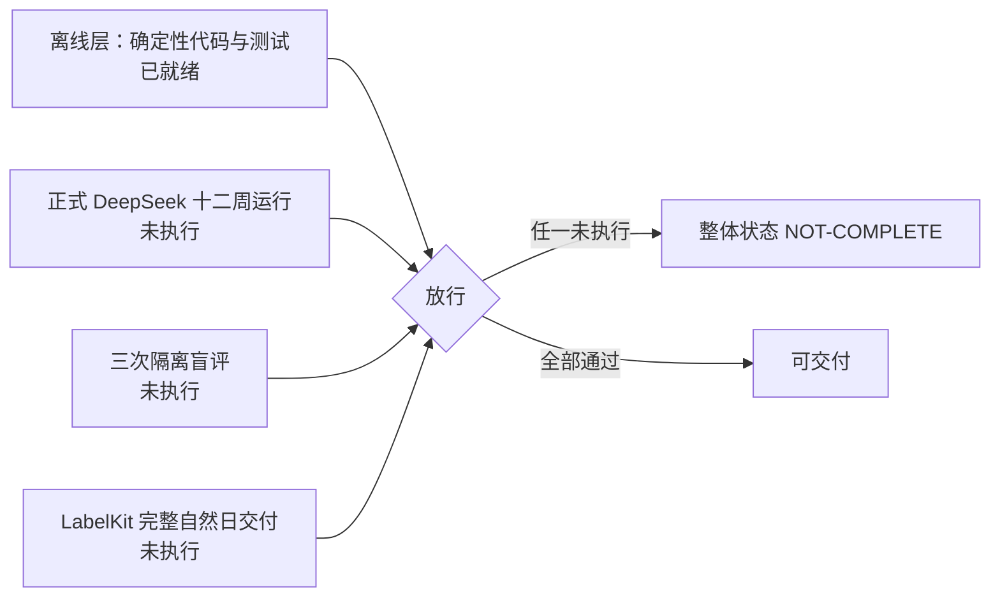
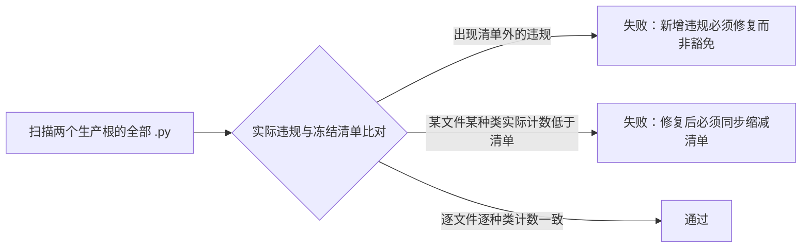
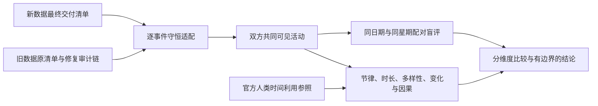

# WorldMock 验收标准

> 状态：整体实现 **NOT-COMPLETE**。正式 DeepSeek 十二周运行、三次隔离盲评与 LabelKit 完整自然日交付尚未完成，未完成项不得以离线测试通过替代。各特性及合并后的工程门禁按具体源码身份留证。
> 日期：2026-09-20
> 范围：放行门禁、report-only 边界、测试矩阵、验收原则、交付阶段与结论边界
> 记录位置：实际通过的源码身份、命令与收据集中记录在 `docs/dev/implementation-status.md`；本文件只定义判定方式与当前状态，不重复断言其通过

放行需要离线层（确定性代码与测试）与真实运行层同时成立。行为分布指标只进报告，不参与放行。

三项真实验收各自对应「最终门禁」表中的一行：正式十二周运行对应「十二周」，三次隔离盲评对应「比较」，
LabelKit 完整自然日交付对应「真实端到端」。三行状态均未达到通过，整体实现状态保持 NOT-COMPLETE。

## 品类契约特性门禁

`docs/dev/SPEC-category-contract.md` 的验收表全部属于本次确定性功能要求，逐行证据归
`docs/dev/category-contract-verification.md`。静态结构测试、真实 LifeEngine 动作、恢复与冻结导出、
目录再生成、文档链接和整体覆盖率均需通过；独立 Uncle Bob 在干净提交的隔离工作树中执行。
不得以原始对象格式兼容、无关配对的全矩阵要求、表达式兜底或未接线算子缩减验收范围。
现有三项真实整体验收继续独立判定，不能用本特性离线通过替代。

## 放行门禁

放行门禁分三层判定，互不替代：最终门禁（交付前必须全部满足）、协议门禁（机器判定）、工程门禁（确定性测试层判定）。
行为分布指标不属于门禁，见「报告项」节。

### 最终门禁

| 门禁 | 必需证据 | 状态 |
| --- | --- | --- |
| 规范闭合 | 全部规范要求映射到生产入口和行为测试；不存在 stub、TODO、skip、xfail 或只检查接口存在的替代验收 | 离线判定 |
| 正常和异常 | 每个生活模块覆盖正常、拒绝、边界、中断与重复请求；故障传播覆盖真实 actor/runner 边界 | 离线判定 |
| 真实端到端 | AS2 → DeepSeek LifeAgent → LifeEnv → SQLite → LabelKit → DatasetDict 和 rule-engine 实际调用通过 | 部分 |
| 并发与恢复 | 多人实际运行；颠倒到达顺序不改变结算；共同检查点损坏拒绝；新分支父目录不变 | 部分 |
| Uncle Bob | 干净本地提交的隔离 worktree，基线通过后进行源码语义突变，逐条记录 killed/survived；修复测试缺口后原样复测 | 离线判定 |
| 十二周 | DeepSeek 真实选择，已确认时钟达到结束边界、足迹与模型证据完整、正式输出和完整窗口交付通过 | 未执行 |
| 比较 | 两套真实输入认证、全部必需指标、外部参照限制、实际盲评与报告完成 | 未执行 |
| 行为节律 | 正式十二周启动前，同一代码摘要的双人 24 小时验证运行至少三次，全部通过《人物真实性修订合同》的协议门禁；行为分布指标如实报告，不作为放行条件 | UNVERIFIABLE |
| 路径清理 | 旧手机生产文件、测试、配置、依赖、experiments、旧 runtime 及旧环境删除；只保留经验档案和新工程 | 离线判定 |

「状态」列取值只表达该门禁当前的判定层次：

- `离线判定`：由本地仓库状态或确定性测试层判定，通过记录见 `docs/dev/implementation-status.md`。
- `部分`：真实运行的短窗口或小时级收据已存在，门禁要求的完整窗口或完整自然日尚未通过。
- `未执行`：该门禁要求的真实运行尚未启动，不得以离线证据替代。
- `UNVERIFIABLE`：执行记录未能在仓库现有台账中核实。

`UNVERIFIABLE` 行说明：「行为节律」要求的三次同代码双人 24 小时验证运行，其通过记录未在仓库现有收据与台账中核实到。
本文件不据离线测试推定该行已通过，也未将其记为已执行；该行的真实状态需要执行方补充收据，或由编排方重新派发核实。

三项真实验收的未完成状态逐项写明：

- 正式十二周运行：窗口为上海时区 2026-01-05 零点至 2026-03-30 零点，共 84 天；场景已冻结，实际运行尚未启动。
- 三次隔离盲评：现有盲评包为 smoke 包，不构成实际盲评；三个隔离模型评审会话尚未产生实际评审记录。
- LabelKit 完整自然日交付：真实运行中尚无完整自然日的最终交付清单。

### 协议门禁

协议门禁由 `worldmock.evaluation.behavior_metrics.behavior_metrics_report` 计算：以冻结足迹事件为输入，
按事件顶层 `code_sha256` 分组，返回 `{"schema_version": "behavior-metrics-1", "gates": ..., "reports": ..., "notes": ...}`。
`gates` 是放行门禁，`reports` 是只报告项。四项门禁的键名、比较符与阈值以源码为唯一依据：

| 门禁键 | 判定对象 | 比较 | 阈值 | 失败含义 |
| --- | --- | --- | --- | --- |
| `observation_repetition` | 决策类 `model_request` 中同一 user 观察文本的最大出现次数（排除 `purpose=work_review`） | `==` | 1 | 同一观察在一次决策请求中被重复序列化 |
| `silent_boundary_ratio` | 清醒活动结算边界中 `decision_offered=false` 的占比，sleep 边界与缺失该字段的边界都不进分母 | `>=` | 0.5 | 静默续行边界占比过低，人物没有得到足够决策机会 |
| `memory_repetition_ratio` | 同类型记忆两两之间 bigram Jaccard ≥ 0.6 的对数占比 | `<=` | 0.2 | 记忆内容重复 |
| `memory_md_identity_residue` | MEMORY.md 命中示例身份或示例编号的人物数 | `==` | 0 | 示例身份残留进入人物记忆 |

证据缺失即门禁不通过，不是跳过：事件缺 `decision_offered`、缺记忆文本或未提供 MEMORY.md 时，
该门禁的 `value` 为 `null`、`pass` 为 `false`。四个门禁的取值与阈值各有测试守卫：
`tests/evaluation/test_behavior_metrics.py` 的 `test_observation_repetition_gate_pass_and_fail`、
`test_silent_boundary_ratio_exact_values`、`test_memory_repetition_gate_values`、`test_memory_md_identity_residue_gate`；
分组与可复现性由 `test_report_groups_by_code_sha256`、`test_same_input_produces_byte_identical_report` 守卫。

键名与阈值的当前口径（与源码一致，以下三点为易误读项）：

- 静默边界占比的分母是携带 `decision_offered` 字段的清醒边界数；缺失该字段的边界只计入 `boundaries_without_field`，不进分母。
- 记忆重复率与 MEMORY.md 身份残留同属协议门禁，不属于只报告项。
- 决策 token 中位数的 15000 是报告项内的 `target_reference` 对照值，不是门禁阈值。

截至 2026-09-18，生产导出链路的 `build_quality_report`（`worldmock export`）未把 `gates` 与 `reports` 落盘进 `quality.json`；
本节键名与阈值因此直接以 `src/worldmock/evaluation/behavior_metrics.py` 为唯一依据，不转述为已接线。

### 工程门禁

工程门禁与协议门禁一样失败即不放行，由确定性测试层判定。

**决策上下文**

本次特性的完整条款与验收台账见 [决策上下文规格](dev/SPEC-decision-context.md)。
必须检验实际模型请求、原生人物执行入口、真实环境提交与下一次观察；只检查辅助函数不能代替调用路径。
登记凭据与已结算结果使用不同公开边界，理由文本也必须防止泄漏内部身份或摘要。
旧阶段清单须在新建和全部恢复入口被拒绝；自述重试或行动纠错不得增加环境观察次数。
通过全量测试、分支覆盖率、源码风格、文档链接门禁后，还需在干净提交的独立工作树进行源码语义突变，
按条款记录被检测与未被检测的反例。存在本特性相关的 skip、xfail 或未完成项即不能宣称特性完成。
实际提供商连通性和长期人物行为依旧按真实运行门禁另行留证。
本次固定源码下的执行结果见 [决策上下文验收记录](dev/research/decision-context-verification.md)。

**交互菜单**

完整合同与验收台账见[交互菜单规格](dev/SPEC-interaction-menu.md)。本门禁要求同时观察到声明准入、
冻结观察、人物实际模型请求、本地决策校验、环境权威重验与跨轮结果，任何一层单独通过都不能替代
完整路径。

| 门禁 | 必须观察到的结果 |
| --- | --- |
| 声明闭集 | 正式场景全部显式声明；地点类覆盖恰好完整，人物字段存在；`null` 只表示人物不追加限制；未知、重复、空集合、坏类型、缺字段与缺保护项均失败关闭并留英文错误 |
| 地点与人物 | 地点菜单和人物菜单逐字段取交集并确定性排序；同内容换地点、同地点换人物都产生预期差异，菜单不能增加任一来源未允许的工具或活动类型 |
| 冻结观察 | `observation.data.interaction_menu` 保存本轮有效菜单；同一决策重试不重取，换地点后只在下一次观察更新；原始人物和地点声明不进入 user 消息 |
| 菜单执行 | 实际模型 Schema、本地校验、直接宿主派发与环境结算落实同一菜单资格；工具、活动类型、下钻品类及恢复请求不能绕过；宿主本地校验与直接派发以英文 `RuntimeError` 失败关闭并留错误日志，环境菜单拒绝返回 `INTERACTION_MENU_DENIED` |
| 既有门控 | 日首计划、单动作阶段、回合预算、可见目标、能量和活动控制继续收窄；休息、睡眠与既有活动收尾可用，禁止的暂停活动仍可取消但不能恢复 |
| 副作用 | 菜单拒绝不扣款、不消费、不启动或恢复活动、不推进游戏、不发送消息；被禁工作不调用独立评审；幂等重放不重做领域动作、不重复增加拒绝计数，重放证据标记 `reused=true` |
| 候选不变 | 菜单不删除候选、事实或 `affordance_contract`，不改变排除原因计数、呈现上限、游标及轮转；只影响下钻入口和启动资格 |
| 身份与恢复 | 菜单变化改变场景身份；固定办公室散文删除改变静态工具模板身份而不改变 system 模板身份；场景、代码或工具身份漂移均拒绝打开和恢复 |
| 真实边界 | LifeAgent、LifeEngine、SQLite 与跨轮观察实际贯通，含允许动作、禁止直接请求和到达新地点后的菜单刷新 |

工程放行还要求相关定向测试、全量测试、分支与公共接口覆盖、源码风格和文档链接门禁通过，且在同一
干净源码身份的隔离工作树完成 Uncle Bob 语义突变。突变至少尝试并集替代交集、`null` 当空集合、
缺字段静默放行、未知值忽略、保护项自动补齐、只隐藏模型 Schema、跳过环境重验、菜单删除候选、
遗漏观察证据和恢复接受身份漂移等反例。执行前不得把验收记录写成已通过；固定源码身份、命令、精确
结果与突变存活情况统一进入[交互菜单验收记录](dev/research/interaction-menu-verification.md)。

**接口完整性**

接口合同见 `docs/CONTRACTS.md`「人物工具与管理接口」。本门禁要求观察到的是：

- 每个 LifeEnv 工具都有对应的 Pydantic 请求模型，工具 Schema 由该模型直接生成，不存在绕开请求模型的接口路径。
- 模型侧只能填写业务参数；身份、决策标识与动作标识由宿主补齐。
- 超出数组数量边界的输入在校验阶段被拒绝，不出现被悄悄截断后照常落库的路径。

验证：`tests/integration/`。

**数据一致性**

提交边界与素材发布按 `docs/design/05-recording-engine.md`「事务与失败处理」判定，资金记账口径按 `docs/design/05-recording-engine.md`「资金守恒验证」判定。本门禁要求观察到的是：

- 同一生活状态变化牵动的资金结算、动作状态与结果事件要么同时进库、要么都不进库，不存在只提交其中一部分的中间态。
- 素材引用在被引用之前已经落盘并通过哈希核对，数据库里没有指向残缺素材的记录。
- 账户余额可由初始注资与后续资金事件重算出来，结果与最终共同检查点一致；仅逐条自检合计为零不算通过。

验证：`tests/footprints/test_ledger.py`；完整导出对账在真实 export 上执行，收据见 `docs/dev/implementation-status.md`。

**失败传播**

故障与业务拒绝的分类见[模拟引擎的失败处理](design/04-simulation-engine.md#失败处理)，存储失败处理见[记录引擎](design/05-recording-engine.md#失败分类)。本门禁要求观察到的是：

- 命中运行故障时运行停住并保留已确认部分，不带着故障继续推进。
- 致命故障与普通拒绝的错误类型不同，且经过工具层与批量返回后这个区别仍然可辨。
- 故障路径保留英文错误文本与关联事件，不被通用异常处理吸收后重新交给模型试错。
- 归纳记忆或写盘失败同样按运行故障处理；框架不得把运行报告成成功。

验证：`tests/integration/test_life_agent_protocol.py`、AS2 vendor `test_direct_runner_failures.py`。

**来源可追溯**

来源关联的合同见 `docs/design/05-recording-engine.md`「导出认证」与 `docs/dev/SPEC-labelkit-delivery.md`「来源关联」，划分口径见 `docs/CONTRACTS.md`「数据集字段与划分」。本门禁要求观察到的是：

- 导出物保留样本到原始事件的关联，逐事件导出另存输入文件与行号、人物和出现位置，回溯链路能够逐条核对。
- 后处理只搬运已经存在的事实，不新增事件标识，也不靠模型补出关联。
- 生成分支产出的事件不被当作已经发生过的原始经历；同一来源组的材料不跨训练、验证与测试。

验证：`tests/delivery/test_windows.py`、`tests/delivery/test_replay.py`、`tests/footprints/test_validation.py`。

**源码硬规范**

适用于本项目自有的生产源码：`src/worldmock` 与 `custom` 下全部 `.py` 文件（不含 `__pycache__` 缓存）。
测试文件不在扫描范围内；第三方上游未被修改的实现保留其项目约定，被修改的接口与新增辅助模块适用下表限制。

| 规范 | 判定对象 | 阈值 | 违规种类 |
| --- | --- | --- | --- |
| 行宽 | 每个物理行去掉行尾空白后的字符数 | 至多 120 字符 | `WIDTH` |
| 函数长度 | 每个 `def` 与 `async def` 的函数体，含声明行与末行 | 至多 50 行 | `FUNCLEN` |
| 入参个数 | 每个函数的可调用者视角入参：位置参数、仅关键字参数、`*args` 与 `**kwargs` 各计一个；方法首位 `self` 与 `cls` 不计 | 至多 5 个 | `PARAMS` |
| 文件长度 | 每个生产文件的物理行数 | 至多 2000 行 | `FILELEN` |
| 注释语言 | 每个生产函数的 docstring | 必须含中文（Doxygen 口径） | `DOCSTRING` |

下划线私有函数同受约束，不作豁免；模块级与类级 docstring 不在判定对象内。
注释使用中文，代码、日志与报错文本使用英文。机器判定只覆盖注释语言一项，
英文代码与日志的证据落在各自失败路径的行为测试上（场景组装失败以稳定英文原因拒绝，见 `tests/life/test_scenario.py`）。

违规处理采用棘轮口径，不设一次性豁免：

存量违规按「文件 × 种类」冻结记账于门禁测试的 `_OUTSTANDING`，只允许各所有权单元修复后同步把对应计数清零。
实际计数与清单不一致（新增违规或清单腐化）同样失败。清单清空后本门禁即为纯全量门禁，
存量既不豁免新代码，也不构成降级判定的理由。

本节的唯一机器证据是 `tests/test_style_gate.py::test_style_gate_admits_no_new_violations`。

**候选与呈现一致性**

条款来源为 `docs/dev/SPEC-life-realism.md`「画像编译」「素材可达性」「素材淘汰与检索机制的禁止项」「候选与呈现」。
本节九项门禁的判定对象是候选生成、排序、呈现与轮转的确定性，全部由离线确定性测试层判定。
实现和执行证据见 `docs/dev/implementation-status.md`；本节保留统一判据，不因既有通过记录而放宽。

| 门禁 | 读到什么算通过 | 读到什么算失败 | 层级 |
| --- | --- | --- | --- |
| 候选确定性 | 同一（世界状态、人物、场景）两次调用候选生成得到逐字节相同的候选集与相同顺序；两次投影的序列化结果逐字节相同 | 两次结果顺序不同；同分时排序依赖字典序、插入序或内存地址；排序键依赖内建 `hash()`；候选函数读时间戳、缓存或模型输出 | 协议门禁（放行条件） |
| 软偏好不出局 | 对卡片未声明题材的条目，候选集里仍然出现该条目，只是排在非零权重条目之后；`taste_weights` 取值为零的条目其候选存在性为真 | 任何条目因偏好权重为零而不生成候选；娱乐候选的入选条件里存在「偏好权重为正」这一支；零权重被实现成「不可选」 | 协议门禁（放行条件） |
| 排除留痕 | 每个被排除项携带原因码，原因码取自闭集；地点不可行与资源冲突是两个可区分的原因码；被地点门挡下的条目在观察里带原因码出现 | 任一条目被排除而不带原因码；原因码自由拼字符串、非常量；被挡项从列表里静默消失；「没显示」与「不存在」在观察里不可区分 | 协议门禁（放行条件） |
| 呈现上限 | 单次呈现条数不超过场景常量；池规模上限与单次呈现上限是两个独立的量，池上限不直接充当呈现条数 | 呈现条数超限而未被判为运行故障；超限时静默截断到上限；呈现条数直接取池规模上限或更大的数 | 协议门禁（放行条件） |
| 下推游标 | 逐页取尽后的序列与一次性全量取出的有序序列逐项相同，无重无漏；游标只由 `(冻结目录, 世界状态版本, 排序键版本, 游标)` 决定 | 分页出现重复项或缺项；游标是偏移量式页码且在深分页时不稳定；游标依赖运行时刻或缓存 | 协议门禁（放行条件） |
| 最大未呈现间隔 | 给定池规模 `N`、每次名额 `k`、每天决策点 `D`，实测最坏未展示间隔不超过 `⌈N ÷ k⌉ ÷ D`；断言使用该精确形式上界，可达率小于一的分区按有效决策点 `D × 可达率` 计算 | 实测最坏间隔超过闭式上界；断言写成连续松弛 `N ÷ (k × D)` 或硬编码天数；只按理论决策点计算而忽略可达率 | 协议门禁（放行条件） |
| 轮转非破坏性 | 轮转前后目录逐字节不变；世界状态里对象状态不变；不产生下架事件；两次投影里同一会话内可乱序，但同一输入两次投影逐字节相同 | 轮转产生目录变更或下架事件；轮转改写任一对象状态；轮转结果不可复现；轮转判据读取互动次数或任何偏好估计量 | 协议门禁（放行条件） |
| 工具描述与提示黑名单一致 | 工具描述文本里出现的字段引用（形如 `名称.字段`）全部不在观察黑名单内 | 工具描述里出现黑名单字段引用（当前实存一例：`play_game uses game_catalog[].game_id`，而 `game_catalog` 在黑名单里）；描述与观察合同指向的字段不一致 | 协议门禁（放行条件） |
| 文档链接可解析 | 仓库内文档互相引用的路径全部存在 | 任一被引用的仓库内路径不存在；引用指向已删除的文件 | 协议门禁（放行条件） |

素材可达性与地点类声明的准入校验按 `docs/dev/SPEC-life-realism.md`「素材可达性」执行，判定为全有或全无：
分区键缺省、或分区在场景里恒不可行的条目逐条列出并拒绝启动，**不设比例阈值，不因条目数少而放行**。
它与画像覆盖率是两项独立判定——覆盖率是比例门禁（阈值见 `docs/dev/SPEC-life-realism.md`「画像编译」），
可达性是准入门禁；一项通过不蕴含另一项通过，也不得用其中一项的通过推断另一项。

依据：`.work/object-model-reanalysis/REPORT.md`「可达性：池变大后靠什么被看到」「被裁掉的对象怎么办」「曝光轮转」
与同目录 `LOCATION-GRANULARITY.md`「4.4 可写成测试的断言」。

### 报告项（Report-Only）

报告项只进报告，不参与放行，也不反馈成行动脚本。全部键名取自同一份 `reports` 输出：

| 报告项键 | 说明 |
| --- | --- |
| `decision_prompt_token_median` | 决策 `model_request` 的 prompt token 中位数；随附 `target_reference` 15000 只作对照 |
| `effective_autonomous_decision_rate` | 最终动作既非 continue 也非 wait 的决策占比 |
| `wake_reason_distribution` | 各 `wake_reason` 计数 |
| `wait_minutes` | wait 活动总分钟 |
| `early_arrival_minutes` | 到达地点早于开门的分钟 |
| `sleep_schedule` | 就寝与起床时刻、睡眠时长，与人物卡片就寝窗口比较 |
| `meal_diversity` | consume 商品的 Simpson 集中度与 24 小时重复率 |
| `activity_distribution` | 十类活动日时间分布与外部参照的 JS 距离 |
| `persona_distinguishability` | 同代码 ≥3 次运行中两人物活动分布的留一最近邻准确率 |
| `social` | 交谈与通话分钟、发送与收到的消息数 |
| `plan_actual_deviation` | 计划-实际偏离（分钟），逐人物逐日与汇总；**report-only**，不作门禁 |
| `partition_reachability` | 逐条目的可检索分区归属与不可达条目清单；准入判定本身是全有或全无的门禁（见「工程门禁」的候选与呈现一致性），本键只是把判定过程留在报告里，不额外判定 |
| `rotation_wait_interval` | 每个检索分区的实测最坏未展示间隔、闭式上界 `⌈N ÷ k⌉ ÷ D` 与可达率取值；上界对照的门禁判定见「工程门禁」，本键只把逐分区取值留在报告里 |

`plan_actual_deviation` 单独说明：计划口径取当日最后一次完成的 `plan_day`／`revise_day_plan` 动作结果携带的段
（修订覆盖初版），实际分钟由 `activity_progress` 结算区间按本地零点切分累加，偏离为实际减计划。
它是报告项，既不参与放行，也不反馈成行动脚本。

活动分布的口径固定为：外出并入通勤，wait 计入休息，consume 计入用餐（含 use 模式），
参照的看电视与休闲娱乐合并为屏幕娱乐 165 分钟，休息与家务并入无参照桶。

外部参照仅为 2018 年全国时间利用调查公报，各项口径不同、均为居民均值：
睡觉休息 9 小时 13 分钟、个人卫生护理 50 分钟、用餐 1 小时 44 分钟、就业参与者工作日 7 小时 40 分钟、
城镇交通 44 分钟、工作日社会交往 21 分钟、城镇健身锻炼 41 分钟、看电视 100 分钟、休闲娱乐 65 分钟。
比较时逐项注明口径，只作方向对照，不当作目标人物真值。

## 交付阶段与通过条件

| 交付阶段 | 完整结果 | 通过条件 |
| --- | --- | --- |
| 接口验证 | LifeAgent → LifeEnv → 数字足迹 → LabelKit → 一个训练样本与一个规则夹具 | 使用真实 AS2 与 LabelKit 路径；来源关联完整；真实加载器能够读取 |
| 基础生活 | 工作、进食、睡眠及消费，包含拒绝、中断与恢复 | 资源与时间结算正确，人物自主选择，异常不会静默通过 |
| 内容与出行 | 连续节目、游戏、邮件、商品、地点、导航与变化的配送时间 | 内容只在接触后可见，时间依据和缺口明确 |
| 数据生产 | 完整动作、意图和 dreaming 项目，正反规则测试 | 独立语义与结构验收，来源分组、无未来泄漏 |
| 长时间与多人 | 多天、多人物、多活动与故障恢复 | 稳定运行和数据交付均通过；有实际性能与行为分布报告 |

最小端到端阶段包含真实模型选择和真实 LabelKit 加工。手工 JSON、模拟模型响应或仅解析成功不能替代该阶段。
每阶段保留可运行路径，随后扩充内容和规模；不为尚未实现的复杂度拆除已验证链路。

阶段的当前状态：前四个阶段的离线层已就绪；「长时间与多人」依赖的正式十二周运行尚未启动，
「数据生产」在真实运行中尚无完整自然日的最终交付清单。真实运行收据见 `docs/dev/implementation-status.md`。

## 测试矩阵

「证据位置」列中的 `AS2 vendor` 指 `vendor/agentsociety2/packages/agentsociety2/tests/`，其余路径均在仓库根下。

「状态」列只说明该观察由哪一层判定：`离线覆盖` 表示已有确定性测试覆盖，位置见同行；
`离线覆盖，真实运行待执行` 表示该观察的完全通过还需要真实模型运行、完整窗口或盲评收据。
`离线验收待执行` 表示本次新增确定性实现与测试仍须在最终源码身份运行并登记结果。
实测通过记录一律引 `docs/dev/implementation-status.md`，本表不重复断言。

| 要求 | 必须通过的观察 | 证据位置 | 状态 |
| --- | --- | --- | --- |
| AS2 接入 | 真实注册、实例化、工具 Schema、人物观察和动作调用 | `tests/integration/`、AS2 vendor `test_direct_router.py` 与真实短窗口运行 | 离线覆盖，真实运行待执行 |
| 时间一致 | 更早结束与多人睡眠、同秒事件、媒体倍速、实验截断 | `tests/life/test_engine_feedback.py`、`tests/life/test_activities.py`、AS2 vendor `test_society_decision_round.py` | 离线覆盖 |
| 自主选择 | 拒绝不改写选择、重复观看、反馈后继续或退出 | `tests/life/test_engine_round.py`、`tests/life/test_engine_feedback.py`、`tests/life/test_content_game.py` | 离线覆盖 |
| 资源结算 | 余额、库存、睡眠与食物、部分消费、重复付款 | `tests/life/test_body.py`、`tests/life/test_commerce.py`、`tests/life/test_export_integration.py`、`tests/footprints/test_ledger.py` | 离线覆盖 |
| 工作生产 | 原始材料、独立语义验收、有限协议纠正、返工、套餐、计时与计件 | `tests/life/test_work_review.py`、`tests/life/test_work_review_protocol.py`、`tests/life/test_work_contracts.py` 与真实 DeepSeek 正反工作审阅收据 | 离线覆盖，真实运行待执行 |
| 内容知识 | 邮件到达、未来字幕隔离、隐藏参考、游戏恢复 | `tests/life/test_content_game.py`、`tests/corpora/test_corpora.py` | 离线覆盖 |
| 存储完整 | 素材损坏、事务中断、保存失败、模型未知结果 | `tests/footprints/`、`tests/integration/test_life_agent_protocol.py`、AS2 vendor `test_direct_runner_failures.py` | 离线覆盖 |
| 决策协议 | 有限回合错误反馈、原子拒绝、合法 finish、非法引用、完整证据、致命异常不返工 | `tests/integration/test_life_agent_protocol.py`、`tests/integration/test_grounded_evidence.py`、AS2 vendor `test_agent_react_validation.py`、`test_llm_dispatcher_no_retry.py` | 离线覆盖 |
| 共同恢复 | 世界、人物、记忆和游戏一致，坏快照拒绝，父目录不变 | `tests/integration/test_runtime.py`、`tests/life/test_counterfactual.py`、`tests/footprints/test_store.py` 与实际 resume／replay | 离线覆盖，真实运行待执行 |
| LabelKit 输入 | 前置状态、知识截止、活动和自然日边界 | `tests/delivery/test_windows.py`、`tests/delivery/test_replay.py`、`tests/footprints/test_validation.py` | 离线覆盖 |
| 语义质量 | 独立 verify、目标盲审、原始事实守恒、失败不发布 | `tests/delivery/test_labelkit_process.py`、`tests/delivery/test_training.py` 和真实模型 trace | 离线覆盖，真实运行待执行 |
| 目标数据 | DatasetDict 保存重载、独立规则预期、来源分组 | `tests/delivery/test_training.py`、`tests/delivery/test_generation.py`、`tests/delivery/test_rules.py` 和完整真实 deliver | 离线覆盖，真实运行待执行 |
| 长期有效性 | 84 天、多人、行为、失败、吞吐、成本和盲评 | `tests/evaluation/`、`tests/footprints/test_quality.py`、实际十二周 export／quality 与评估报告 | 离线覆盖，真实运行待执行 |
| 决策节律 | 无唤醒条件的边界不调用模型且留痕、每类唤醒条件各触发一次、重估间隔、计划段边界、睡眠不被打断 | `tests/life/test_wake_reasons.py`、`tests/life/test_engine_feedback.py` | 离线覆盖 |
| 身体语义 | 两过程常数与阈值、睡眠不足账、体感分级以上次决策为参照的滞回、饥饿昼夜因子、社交需要与情绪衰减 | `tests/life/test_sleep_two_process.py`、`tests/life/test_felt_states.py`、`tests/life/test_body.py` | 离线覆盖 |
| 观察投影 | 观察不重复序列化、引擎字段不进提示、商品可见期、材料增量、字幕只交付新跨过区间、字符预算超限失败 | `tests/life/test_narration.py`、`tests/integration/test_life_agent_protocol.py` | 离线覆盖 |
| 两阶段决策 | 决策自述阶段无工具且落库、行动阶段回传 `reasoning_content`、决策自述进入行动请求、finish 允许空记忆 | `tests/integration/test_life_agent_protocol.py`、AS2 vendor `test_agent_react_validation.py` | 离线覆盖 |
| 社交 | 在场可见、消息送达顺序、联系人回复来源标记、交谈需共同在场、社交需要结算 | `tests/life/test_social.py` | 离线覆盖 |
| 画像编译 | 卡片字段完备、关系与时间锚点、覆盖率不足拒绝、大五与随机浮点不进提示 | `tests/profile/`、`tests/integration/test_persona_profile.py` | 离线覆盖 |
| 行为指标 | 指标可复现、按代码摘要分组、协议门禁阈值、行为分布只报告不裁定 | `tests/evaluation/test_behavior_metrics.py` | 离线覆盖 |
| 候选与呈现一致性 | 候选确定性、软偏好不出局、排除留痕、呈现上限、下推游标、最大未呈现间隔、轮转非破坏性、工具描述与提示黑名单一致、文档链接可解析、素材可达性 | 本文件「工程门禁」的候选与呈现一致性节所列判据的对应测试 | 离线覆盖 |
| 交互菜单 | 声明闭集、地点与人物交集、冻结观察、动态 Schema、本地与环境重验、控制保护、候选不变、身份恢复和真实跨轮刷新 | 本文件「交互菜单」门禁的对应测试与 `docs/dev/research/interaction-menu-main-verification.md` | 离线验收通过 |

状态为「真实运行待执行」的行不构成通过。三项真实验收（十二周运行、三次隔离盲评、完整自然日交付）对应的观察，
其未执行状态见「最终门禁」表。

## 验收原则

### 证据层级

| 层级 | 内容 |
| --- | --- |
| 短窗口测试 | 与规范双向对应的行为、反例、故障和真实边界测试 |
| 测试夹具 | 使用真实场景参数的完整功能测试 |
| 语义评审 | 真实模型调用的独立验证 |
| 完整十二周交付 | 实际性能与行为分布报告 |

短窗口、测试夹具、语义评审和完整十二周交付各自记录，不能相互替代。
这些入口规定验收方式；实际通过的源码身份、命令与收据集中记录在 `docs/dev/implementation-status.md`。

### 源码突变审查

生产功能按明确接口与规则规范执行 Uncle Bob 源码突变审查，覆盖改变时钟顺序、提前暴露内容、重复结算、
吞掉保存错误、丢失来源和混合分支等真实行为破坏。

### 最终报告构成

最终报告分别列出实现证据、结构验证证据、真实模型运行证据、语义质量证据、数据加载证据和规则执行证据。

## 真实性评估与结论边界

评估实现统一位于 `worldmock.evaluation`，对外入口为 `worldmock evaluate`（准备与定稿两个阶段）。
详细统计口径见 `docs/dev/research/realism-evaluation.md`；与本文件冲突时以本文件为准。
工具接受任意完整声明时间窗口以支持一天的端到端验证，本次正式比较固定上述 84 天。

适配保留的层次依次为证据事件、活动会话与自然日，每条原始事件恰好映射一次。不把一个会话里的多个屏幕帧当成多个生活行为，
不把没有记录直接认定为睡眠。缺失渠道与未知类别进入明确的支持掩码和覆盖分母，不能计为零质量，更不能自动补齐。
WorldMock 内部模型思考、私有记忆与隐藏身体值不进入共同评分或盲评。

盲评每侧同时提供活动区间和公开结构证据，分别保留时长统计与即时状态事实。公开证据只含时间、活动类别、交互、
对象类型、已证实状态、匿名对象引用和双方共同支持的闭集属性。共同支持按「类别 × 字段」求交集，
逐侧报告实际存在数和适用数；某行缺字段保留缺失，不能填造取值。订单、付款、交付、邮件到达与阅读等状态
必须由对应结构事件证明。商品使用依据实际 `use_mode` 区分进食与非食品使用；活动时长和公开证据使用相同分类。
活动控制后的状态读取真实活动快照，游戏终局读取实际 `done`，动作回执仅证明该次请求执行结果。
工作截止事件只证明截止时间到达，已验收付款任务仍保留其真实完成状态。旧数据的 `actionInfo` 只证明声明的行动，
不能直接证明导航已经到达或订单已经提交。会话标识只证明属于同一会话，不能当作真实订单、内容或跨日对象的身份；
没有对象身份就不制造因果链。

原文、品牌、应用名、商品名、地点名、坐标、原始身份、裸摘要及任何私有事件均不进入盲评包。
对象引用使用冻结种子派生密钥的 HMAC，包含真实候选、评审会话、对象类型和已证实对象身份；
同一候选在同一评审包跨日期稳定，候选之间与评审会话之间隔离，左右随机交换不改变引用。
共享人物只声明三项已经核实的事实：单人、白领、所在时区；评审不能从该粗画像推断消费偏好等未共享事实。

| 结论项 | 规则 |
| --- | --- |
| 六维可判定性 | 每个评审单元声明六维可判定性，并在导入评审时强制执行；缺少证据的维度必须选择 `unjudgeable` |
| 行动与后果 | 需要公开的真实对象状态变化 |
| 长期结果 | 需要多日范围和真实跨日对象证据；持续结果语义的对象（订单、任务、消息、游戏会话）发生真实状态变化才算，重复访问同一路线或地点仅证明重复活动 |
| 证据替代 | 重复屏幕或时间相邻的类别不能替代对象链；单侧提供较丰富的链只说明可观测性差异，不自动获得真实性优势 |
| 节律与例行 | 时间节律、例行与变化、缺失活动和粗画像一致性分别依据活动覆盖、重复与日历范围决定是否可判定 |
| 身份不合法 | 返回 `invalid_input` |
| 共同观察不足 | 返回 `not_comparable` |
| 硬错误 | 存在有证据支持的因果硬错误时，该候选不能被宣布为优胜者；另一方不会因此自动获得人类真实性证明 |
| 冲突与互有优劣 | 量化与盲评冲突、维度互有优劣或区间不足时，明确报告混合结果，不强行选胜者 |
| 缺少人类参照 | 没有匹配的人类微观参照时结果状态为 `comparative_plausibility_only`，仍必须完成本次指标和盲评比较，说明哪些活动特性更合理、各自缺陷和证据局限，不能声称已经验证目标人群的人类相似度 |

必需指标为星期小时节律、工作日/周末差异、活动数量与时长分布、有限样本修正爆发性、相邻间隔相关、
类别熵与有效类别数、类别转换、十分钟活动向量的日间距离及跨周漂移、因果与资源连续性。
统计报告逐维度输出原值、适用日/周、缺失原因与置信区间，不合成一个任意加权总分。
正式 84 天以十二个完整自然周为配对重抽样单位，固定种子执行 10000 次，报告 95% 区间；不把事件行当独立样本。

盲评包覆盖十二个自然周、全部特殊日期；每周在对应日期存在时，分别按日期哈希选择一个普通工作日和普通周末日，
左右顺序随机。春节整周等不存在普通日期的情况明确记录缺失，不伪造日历类别。
包内只保留共享可见内容，不出现模型、provider、文件路径、运行标识或解盲 key。
本次运行使用三个隔离的模型评审会话，均只读取盲评包，并标为 `reviewer_kind=model`；
同模型的不同会话不能称为独立真人，同源模型相关性必须在报告中说明。工具也接受真实人工评审记录，
计算偏好、无法判断比例及 Krippendorff's alpha，不能把可靠性不足包装成确定胜者。

评估产物包括输入与因果校验、映射报告、`metrics.json`、官方参照、盲评包、独立解盲 key、评审记录、图表和 `report.md`。
固定输入哈希、配置和随机种子时，确定性统计与抽样逐字节相同；模型评审原始响应作为证据保存，不承诺重新调用逐字一致。

## 重放与外部调用边界

重放只能复原已经记录下来的结果；再次调用模型时，模型不一定给出相同选择。
本设计不对同一外部服务调用承诺恰好一次，也不以重新调用模型冒充精确重放。恢复与重放的协议与证据见 `docs/design/05-recording-engine.md`「重放与重新调用的区别」。

## 实施顺序

| 阶段 | 内容 |
| --- | --- |
| 提示与投影 | 观察投影与提示合同、两阶段决策、记忆合同、动机层不进提示、运行检视修正——改动范围限于提示层、投影层与 AS2 分支；正式十二周启动前，先在同一份代码上跑满三次双人 24 小时验证运行并全部通过协议门禁，见「最终门禁」的行为节律行 |
| 引擎与状态 | 决策节律、身体语义、商务与进食、日程骨架——改引擎与状态结构，为世界状态增加 `schema_version=2` |
| 场景与素材 | 画像编译 v2、社交最小可行版、世界素材品类——本阶段改动场景 Schema、目录与语料，并重新生成两个场景 |
| 指标与门禁 | 行为指标与门禁接入质量报告与 `worldmock evaluate`；本阶段完成后才放行正式十二周运行 |

每个阶段都要留下可运行的路径，并通过该阶段的全部现有测试；不得为了推进后一阶段而拆掉前一阶段已经验证过的链路。

## 结论边界

数据来源真实不代表数字人行为已经符合人类分布。行为真实性需要独立样本、参数校准与人工复核。

本设计不以程序运行时长或 JSON 能被解析作为最终成功条件。

整体实现状态为 NOT-COMPLETE：正式 DeepSeek 十二周运行、三次隔离盲评与 LabelKit 完整自然日交付尚未完成。
离线绿证、短窗口运行、测试夹具或单条语义通过都不能改变这一状态，也不能替代这三项真实验收。
「最终门禁」表中状态为 `部分`、`未执行` 与 `UNVERIFIABLE` 的行，在取得对应真实运行收据之前都不得记为通过。

## 版本表

| 版本 | 日期 | 修订内容 |
| --- | --- | --- |
| `2026-09-18` | 2026-09-18 | 章节改为概念命名；四项协议门禁的键名、比较符与阈值改以 `src/worldmock/evaluation/behavior_metrics.py` 的 `gates` 输出为准并补齐 report-only 边界；测试矩阵补全可核实的证据位置与状态；删除来源行号引用 |
| `2026-09-18-revision-1` | 2026-09-18 | 「工程门禁」补「源码硬规范」节：适用范围、逐条阈值（行宽、函数长度、入参个数、文件长度、注释语言）、棘轮违规处理与唯一机器证据 |
| `2026-09-18-revision-2` | 2026-09-18 | 消除与其他文档的逐字复述：合同与条款原文改为按章节名引用（`docs/CONTRACTS.md`「人物工具与管理接口」「资金事件字段」「数据集字段与划分」、`docs/design/05-recording-engine.md`「事务与失败处理」「失败分类」「导出认证」「重放与重新调用的区别」、`docs/dev/SPEC-labelkit-delivery.md`「来源关联」），验收判据改用本文件自己的可观察表述；门禁集合、阈值、测试矩阵的证据位置与状态列语义不变 |
| `2026-09-19-revision-1` | 2026-09-19 | 「工程门禁」补「候选与呈现一致性」节：候选确定性、软偏好不出局、排除留痕、呈现上限、下推游标、最大未呈现间隔、轮转非破坏性、工具描述与提示黑名单一致、文档链接可解析九项判据逐条给出通过与失败判据并标为协议门禁；补素材可达性与画像覆盖率的独立判定说明；「报告项」补 `partition_reachability` 与 `rotation_wait_interval` 两个报告键；测试矩阵补一行。依据为 `.work/object-model-reanalysis/REPORT.md`「可达性：池变大后靠什么被看到」「被裁掉的对象怎么办」「曝光轮转」与同目录 `LOCATION-GRANULARITY.md` |
| `2026-09-20-interaction-menu` | 2026-09-20 | 新增交互菜单完整工程门禁与测试矩阵；按现有实现及追溯证据移除候选与呈现“待落地”的过期状态 |
