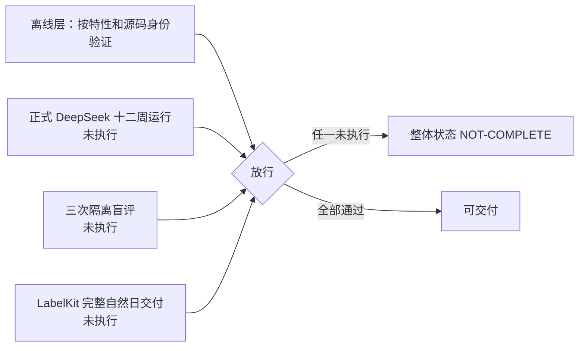
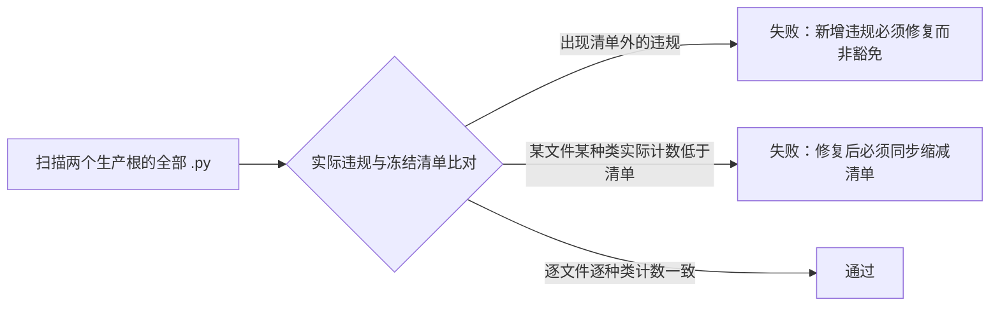
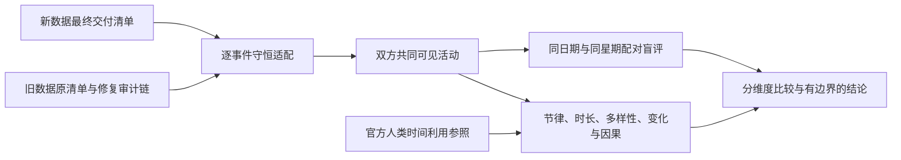

# WorldMock 验收标准

> 状态：整体实现 **NOT-COMPLETE**。正式 DeepSeek 十二周运行、三次隔离盲评与 LabelKit 完整自然日交付尚未完成，未完成项不得以离线测试通过替代。各特性及合并后的工程门禁按具体源码身份留证。按人物 Prompt 规格修订，修订部分已实现并通过离线验收（证据见[人物 Prompt 验收记录](dev/persona-prompt-verification.md)）。按[一日运行保真规格](dev/SPEC-dayrun-fidelity.md#冻结条款修订)「冻结条款修订」第 26 行修订（一日运行保真 VF1）：新增「一日运行保真特性门禁」，测试矩阵中补入该规格条款的十四行；该规格已全部实现并通过离线验收（证据见[一日运行保真验收记录](dev/dayrun-fidelity-verification.md)），这十四行已按实现改回 `离线覆盖`。
> 工具交互修订：按[工具交互规格](dev/SPEC-tool-interaction.md)冻结新增门禁；本次修订已实现，历史通过证据不覆盖新行为。
> 个人事务与工作安排修订：随[个人事务与工作安排规格](dev/SPEC-errands-workday.md#实施计划)冻结，按其「实施计划」的冻结约定修订（个人事务与工作安排台账 VF2）：新增「个人事务与工作安排特性门禁」；阶段 1（运行修复入库）已随代码落地，阶段 2–4 未实现，见个人事务与工作安排规格阶段 2–4。测试矩阵在冻结时不动，特性表与各行在实现后补。
> 日期：2026-10-03
> 范围：放行门禁、report-only 边界、测试矩阵、验收原则、交付阶段与结论边界
> 记录位置：实际通过的源码身份、命令与收据集中记录在 `docs/dev/implementation-status.md`；本文件只定义判定方式与当前状态，不重复断言其通过

放行需要离线层（确定性代码与测试）与真实运行层同时成立。行为分布指标只进报告，不参与放行。

三项真实验收各自对应「最终门禁」表中的一行：正式十二周运行对应「十二周」，三次隔离盲评对应「比较」，
LabelKit 完整自然日交付对应「真实端到端」。三行状态均未达到通过，整体实现状态保持 NOT-COMPLETE。

## 品类契约特性门禁

`docs/dev/SPEC-category-contract.md` 的验收表全部属于本次确定性功能要求，逐行证据归
`docs/dev/category-contract-verification.md`。静态结构测试、真实 LifeEngine 动作、恢复与冻结导出、
目录再生成、文档链接和整体覆盖率均需通过；独立 Uncle Bob 在干净提交的隔离工作树中执行。
不得以原始对象格式兼容、无关配对的全矩阵要求、表达式兜底或未接线算子缩减验收范围。
现有三项真实整体验收继续独立判定，不能用本特性离线通过替代。

## 一日行为可信性特性门禁

[冻结规格](dev/SPEC-dayrun-behavior.md)全部条款同批实现和验收；逐条证据与文件清单见
[实施台账](dev/research/dayrun-behavior/verification.md)。允许的并行活动组合、独立控制、共同身体结算、
餐馆实际进食、官方播客时轴、已核验经历、主观记忆和持续威胁去重均不能延期。
必须经真实人物工具入口运行至少两人、不同种子的多个完整自然日，包含非法模型输出扰动与共同检查点恢复。
该确定性运行、全仓覆盖门禁、目录语料身份、文档一致性及隔离源码语义突变审查共同构成特性验收。
它们不替代本页定义的真实供应商、十二周、盲评和 LabelKit 交付要求。

## 放行门禁

放行门禁分三层判定，互不替代：最终门禁（交付前必须全部满足）、协议门禁（机器判定）、工程门禁（确定性测试层判定）。
行为分布指标不属于门禁，见「报告项」节。

### 最终门禁

| 门禁 | 必需证据 | 状态 |
| --- | --- | --- |
| 规范闭合 | 全部规范要求映射到生产入口和行为测试；不存在 stub、TODO、skip、xfail 或只检查接口存在的替代验收 | 离线判定 |
| 正常和异常 | 每个生活模块覆盖正常、拒绝、边界、中断与重复请求；故障传播覆盖真实 actor/runner 边界 | 离线判定 |
| 真实端到端 | AS2 → DeepSeek LifeAgent → LifeEnv → SQLite → LabelKit → DatasetDict 和 rule-engine 实际调用通过 | 部分 |
| 并发与恢复 | 多人实际运行；颠倒到达顺序不改变结算；共同检查点损坏拒绝；新分支父目录不变 | 部分 |
| Uncle Bob | 干净本地提交的隔离 worktree，基线通过后进行源码语义突变，逐条记录 killed/survived；修复测试缺口后原样复测 | 离线判定 |
| 十二周 | DeepSeek 真实选择，已确认时钟达到结束边界、足迹与模型证据完整、正式输出和完整窗口交付通过 | 未执行 |
| 比较 | 两套真实输入认证、全部必需指标、外部参照限制、实际盲评与报告完成 | 未执行 |
| 行为节律 | 正式十二周启动前，同一代码摘要的双人 24 小时验证运行至少三次，全部通过《人物真实性修订合同》的协议门禁；行为分布指标如实报告，不作为放行条件 | UNVERIFIABLE |
| 路径清理 | 旧手机生产文件、测试、配置、依赖、experiments、旧 runtime 及旧环境删除；只保留经验档案和新工程 | 离线判定 |

「状态」列取值只表达该门禁当前的判定层次：

- `离线判定`：由本地仓库状态或确定性测试层判定，通过记录见 `docs/dev/implementation-status.md`。
- `部分`：真实运行的短窗口或小时级收据已存在，门禁要求的完整窗口或完整自然日尚未通过。
- `未执行`：该门禁要求的真实运行尚未启动，不得以离线证据替代。
- `UNVERIFIABLE`：执行记录未能在仓库现有台账中核实。

`UNVERIFIABLE` 行说明：「行为节律」要求的三次同代码双人 24 小时验证运行，其通过记录未在仓库现有收据与台账中核实到。
本文件不据离线测试推定该行已通过，也未将其记为已执行；该行的真实状态需要执行方补充收据，或由编排方重新派发核实。

三项真实验收的未完成状态逐项写明：

- 正式十二周运行：窗口为上海时区 2026-01-05 零点至 2026-03-30 零点，共 84 天；场景已冻结，实际运行尚未启动。
- 三次隔离盲评：现有盲评包为 smoke 包，不构成实际盲评；三个隔离模型评审会话尚未产生实际评审记录。
- LabelKit 完整自然日交付：真实运行中尚无完整自然日的最终交付清单。

### 地图与门店供给

[开发规格](dev/SPEC-map-and-storefront.md) 中全部行为均属于本次完整交付，以下门禁不能用历史测试数字代替。
独立地图分支固定提交的行为断言、完整门禁和独立变异审查已通过，证据见 [本特性验收记录](dev/research/map-and-storefront-verification.md)。
本次与品类主线组合也已独立通过离线验收，完整门禁、组合计价及状态提交突变复验见
[主线组合验收](dev/research/map-and-storefront-main-verification.md)，不继承该分支的通过数字。三项项目级真实验收仍按前文判定。

| 门禁 | 必须观察到的结果 |
| --- | --- |
| 唯一冻结资料 | 正式场景只引用地图、地点、商品和供给；旧重复字段、篡改摘要、坏引用、空活动环境及过期声明拒绝 |
| 路线方式与覆盖 | 每个选中有向端点和方式都有显式状态；成功和已证不可达有正确方式原始响应；未知带来源且禁止出行，漏项拒绝 |
| 地点与供给分离 | 品牌可缺失；经营业态、菜单分类、活动环境不互相推导；同商品两店独立库存、报价和卖方 |
| 时态营业与报价 | 分钟级分段、跨午夜、日期例外、半开端点、时区、重叠和间隙；未知不开放或免费；报价和营业变化进入事件时钟 |
| 发现与选择 | 实际模型请求遵循菜单及单动作，结果结算后回灌；道路范围和未知状态清楚；关店仍能发现，环境不代选门店 |
| 可见供给 | 只授权实际呈现供给（该特性验收时的口径；现行指名购买不受轮转与可见期限制，见「人物 Prompt 七层特性门禁」）；同商品不同门店的浏览、可见期、排序、分页、轮转与购买凭据互不覆盖 |
| 执行重验 | 到达重验资格，购买重验营业、报价、库存、余额与履约；到达后失败保留旅行和费用事实 |
| 原子订单 | 同地点同卖方且无重复供给；任意一项失败，账户、库存、订单、交付事件与人物持有物均无购买副作用 |
| 品类与供给组合 | 当前报价进入已解析购买配对，卖方取供给；公开原价、配对状态、系数与一份实际金额，余额和排序共用计价；非作用供给保留报价但拒绝购买，已定义零系数正常零额履约；非整数系数及多份数量仅对整行取整；准备与运行交通费共用闭集算子；目录 4.0（该特性验收时的身份）、契约及规则绑定 2 身份正确 |
| 自提与配送 | 自提在所选门店且不检查配送路线；配送范围、方式与路径正确，同单一次配送，交付前不可消费，重复交付不重复增加 |
| 状态与来源 | 世界版本 5（该特性验收时的版本，现行版本见 `docs/CONTRACTS.md`「领域枚举」）；当前报价、库存、营业例外、可见供给和轮转完整恢复；地图身份不符拒绝，分支不改父运行；来源与许可贯穿导出 |
| 提交失败与重试 | 真实 SQL 失败后权威世界、持久状态、事件序号和待提交呈现及供给缓存不变；重试成功后同时清空两种缓存，实际库存只结算一次 |
| 正式完整流程 | 正式冻结地图和场景经真实生活动作入口、LifeEngine、SQLite 完成发现、比较、出行、自提、配送、消费、共同检查点与恢复；实际 LifeAgent 工具与回灌按发现与选择门禁验证 |
| 规范一致 | 合同、四引擎设计、配置、状态格式、关联规格、实验条件与具体测试一致；不存在本特性延期项 |

在整合后的固定源码运行定向测试、目录复现、正式场景准入、素材可达性、全量测试、源码风格与文档门禁。
覆盖率门仍要求分支至少 85% 且未覆盖公共接口为零；规格到行为测试覆盖率必须全部闭合。
干净提交的独立工作树执行 Uncle Bob 源码语义突变，至少破坏供给库存隔离、同地点检查、营业、报价版本、
可见凭据、路线方式、交付幂等和恢复报价，逐项证明被测例检出并恢复至零 diff。
二百二十份方式命名响应与历史测试绿证均不证明本次路线或功能通过；执行结果按真实源码身份单独登记。

### 协议门禁

协议门禁由 `worldmock.evaluation.behavior_metrics.behavior_metrics_report` 计算：以冻结足迹事件为输入，
按事件顶层 `code_sha256` 分组，返回 `{"schema_version": "behavior-metrics-1", "gates": ..., "reports": ..., "notes": ...}`。
`gates` 是放行门禁，`reports` 是只报告项。既有四项门禁的键名、比较符与阈值以源码为唯一依据：

| 门禁键 | 判定对象 | 比较 | 阈值 | 失败含义 |
| --- | --- | --- | --- | --- |
| `observation_repetition` | 同一 user 观察文本出现于不同（人物，模拟秒）续接链的决策请求中的最大数目（同一续接链内各次决策复用链首 user 合法，只计一次，同一决策内重发同样只计一次；排除带 `purpose` 的系统请求，即 `purpose="work_review"` 与 `purpose="plan_day"`；带工具的请求只在工具中有 `start_activity` 时计入，所以只带 `submit_reflection` 的就寝反思及其校验重试不计，它们的附回消息不带时刻与人物内容，不是观察；不带工具的记忆巩固照计） | `==` | 1 | 同一观察被重复序列化进不同秒或不同人物的决策请求 |
| `silent_boundary_ratio` | 每人唯一共同身体结算的清醒边界中 `decision_offered=false` 的占比，sleep 边界与缺失该字段的边界都不进分母 | `>=` | 0.5 | 静默续行边界占比过低，人物没有得到足够决策机会 |
| `memory_repetition_ratio` | 同类型记忆两两之间 bigram Jaccard ≥ 0.6 的对数占比 | `<=` | 0.2 | 记忆内容重复 |
| `memory_md_identity_residue` | 调用方传入的各人物工作区 `MEMORY.md` 文本命中示例身份或示例编号的人物数（`MEMORY.md` 不再进人物提示，门禁仍检查它） | `==` | 0 | 示例身份残留进入人物记忆 |

证据缺失即门禁不通过，不是跳过：事件缺 `decision_offered`、缺记忆文本或未提供 MEMORY.md 时，
该门禁的 `value` 为 `null`、`pass` 为 `false`。四个门禁的取值与阈值各有测试守卫：
`tests/evaluation/test_behavior_metrics.py` 的 `test_observation_repetition_gate_pass_and_fail`
（续接链内复用与跨秒、跨人物重复另由 `test_observation_gate_allows_same_second_continuation_chain_reuse`、
`test_observation_gate_fails_on_cross_second_or_cross_agent_duplicate` 守卫，就寝反思及其校验重试不计由
`test_reflection_requests_and_their_retries_are_not_decision_requests` 与真实日运行
`tests/integration/test_dayrun_complete_days.py` 中反思经一次校验重试改正的种子守卫）、
`test_silent_boundary_ratio_exact_values`、`test_memory_repetition_gate_values`、`test_memory_md_identity_residue_gate`；
分组与可复现性由 `test_report_groups_by_code_sha256`、`test_same_input_produces_byte_identical_report` 守卫。

键名与阈值的当前口径（与源码一致，以下三点为易误读项）：

- 静默边界占比的分母是携带 `decision_offered` 字段的清醒边界数；缺失该字段的边界只计入 `boundaries_without_field`，不进分母；同刻轮次不写共同身体结算，不进分母。
- 记忆重复率与记忆层身份残留同属协议门禁，不属于只报告项。
- 决策 token 中位数的 15000 是报告项内的 `target_reference` 对照值，不是门禁阈值。

既有四项协议门禁未整体接入生产质量导出。
当日目标新增的三层度量及外部约束门禁单独进入 `quality.json.day_plan_metrics`；
其接线不改变既有记忆协议的额外证据要求。

### 当日目标特性门禁

完整范围见 [当日目标特性规格](dev/SPEC-day-plan-goals.md)。同一被测源码必须覆盖目标输入闭集、
空计划与跨日、修订证据保留、正时长首次推进、重复活动和恢复防重、午夜最后结算、
两档重估与精确任务/闭店威胁、真实人物工具（限 `revise_day_plan`）与引擎闭环、三层度量与实际质量导出；
还须覆盖 `remind_time` 的换算与拒绝（`PLAN_REMIND_TIME_INVALID`）、零点计划同一本地日只生成一次、提醒只触发一次、
修订取消旧提醒、恢复后不重复生成与提醒。
删除旧时段合同，不保留兼容、迁移、占位或本特性 skip/xfail。

工程放行要求全量测试、分支与公共接口覆盖、风格、文档链接通过；
还要在同一干净提交的隔离 worktree 上用 Uncle Bob 语义突变检验空计划门控（日首计划门控已由时间与能量规格删除，
本项只对应当日目标特性验收时的源码）、修订保护、活动证据、防重复脉冲、威胁与间隔、报告分母和质量接线。
存活突变必须补测后以原补丁复验。证据统一见 [本特性验收记录](dev/research/day-plan-goals-verification.md)。

### 时间与能量特性门禁

完整判据见 [时间与能量特性规格](dev/SPEC-time-and-energy.md#验收台账)的验收台账，本节不复述。
issue #1 绿色基线是实施前置：`uv run pytest tests` 全量无失败之后，才开始该规格第一章以后的改动。
工程放行要求全量测试、分支与公共接口覆盖、风格、文档链接通过；还要在同一干净提交的隔离 worktree 上
用 Uncle Bob 语义突变检验同刻上限、能量截断、唤醒闭集、提醒只触发一次、名额释放与内部身份不进提示。
存活突变必须补测后以原补丁复验。练秋湖与 r14 场景的真实复验只报告，不作门禁。
证据统一见 [本特性验收记录](dev/research/time-and-energy-verification.md)。

### 人物 Prompt 七层特性门禁

完整判据见 [人物 Prompt 七层特性规格](dev/SPEC-persona-prompt.md#验收台账)的验收台账，本节不复述；
每行须有实际运行证据，纯结构匹配不能替代真实请求或环境结算路径。
工程放行要求全量测试（含风格门禁与查看器回归）、分支与公共接口覆盖、文档链接通过；还要在同一干净提交的隔离 worktree 上
用 Uncle Bob 语义突变独立检验唯一出现、时间推进时思考消失、续接断链、给予不计摄入、进食丢弃不计摄入、指名购买不替换、
恢复不越截止、消息全文、订单去重与预算耗尽不造活动。
存活突变必须补测后以原补丁复验。白领全天、双人半日与续接开关两臂对比的真实复验只报告，不作门禁。
验收台账各行的证据测试登记在 `tests/persona_prompt_acceptance.py`，由 `tests/test_persona_prompt_acceptance.py` 逐行判定；
证据统一见 [本特性验收记录](dev/persona-prompt-verification.md)。

### 一日运行保真特性门禁

完整判据见 [一日运行保真特性规格](dev/SPEC-dayrun-fidelity.md#验收台账)的验收台账，本节不复述；每行须有实际运行证据，
纯结构匹配不能替代真实请求或环境结算路径；「复跑指标（只报告）」一行只报告，不作门禁。
工程放行要求全量测试（含风格门禁与查看器回归）、`scripts/coverage_gate.py`（分支覆盖率不低于 85%，未覆盖公共接口为零）、
`scripts/documentation_gate.py` 与 `scripts/build_design_doc.py --check` 都通过；还要在同一干净提交的隔离 worktree 上
用 Uncle Bob 语义突变独立检验该规格「阶段 6 突变审查的目标」所列各项：睡眠计费的清醒分类、有效偏好的单调性与下限、档界常数、
系统层条数与档位名、名称归一唯一才受理、候选不替换、分段匹配的段序、名称类拒绝不计轮、错误结构键闭集、地点类资格、哈希决胜、轮转判据、
控制工具的上限校验与 `views`→`subject`、摘录字数门槛、截断回合丢弃、守卫命中即重试、加载拒绝与推进的开始时刻，另加按 `prefer` 选定与其决胜（3.5）。
存活突变必须补测后以原补丁复验。质量报告新增的 `input_warnings`、`truncations`、`timeline_labels`、`contact_reply_guard`、`name_rejections`
五节只报告、不放行；运行输入警告永不让运行失败。白领与商务全天的真实复跑只报告，不作门禁。
验收台账各行与已定裁决的证据测试登记在 `tests/dayrun_fidelity_acceptance.py`，由 `tests/test_dayrun_fidelity_acceptance.py` 逐行判定；
证据统一见 [本特性验收记录](dev/dayrun-fidelity-verification.md)。

### 工具交互特性门禁

本特性已实现，新增行为与源码变异使用本次独立门禁；完整范围见
[工具交互规格](dev/SPEC-tool-interaction.md#实施与验收)，不能用文档一致或历史全绿替代生产行为验收。

| 门禁 | 必须证明的结果 |
| --- | --- |
| 请求与错误 | `start_activity.items[]` 每项含 target、way、from、to，整组原子受理；旧平行数组和 `actions` 被拒；购买偏好必填中文闭集，非购买为 null，本人收货 to=null；每次接口错误含完整位置、全部合法值及完整候选 |
| 查询与预算 | 世界查询必填 name、way、category、offset，冻结观察内分页无重无漏，返回 matches、total_count、next_offset；与任务回看及记忆查询可同批，不写世界动作或进度 events、不推进时间、不计同刻轮数；查询回复计十六回合，最终回合和截断重试无查询 |
| 工作通知 | 输入只声明 appointment=null 或 {starts_at,reason}，普通开放由最早本人关联邮件编译，旧 available_at 输入被拒；每封关联邮件引用存在任务且收件人为该任务受派人物，每任务至少一封通知，素材预先有效；八点收件后到公司即可开始；预约最早通知不晚于开始，后续提醒可晚于开始且不改开放时刻；正文只在阅读结果呈现 |
| 地点供给 | 同一 category-assignment 保存 kind 准入池与逐店类别、对象、价格位置和来源；每店集合等于自身选定类别后代对象与显式对象的并集且均在 kind 池；不复制根池、不随机抽样，菜单差异和丰富度满足场景假设；门店位置加确定性偏移构建一次报价，两种种子地图分别匹配场景 |
| 状态与证据 | 当日拒绝备忘跨时刻和会话存在、次日清空，紧凑工具层无损，查询与真实执行证据分开，恢复不重复告知或抽价 |
| 发布身份 | 每个阶段只发布自己实际改变的输入身份；首次任务场景 4、首次供给地图 3与品类规则绑定 3及目录 5.0，世界 8保持；后续目录内容另发不可变版本，旧输入拒绝，无迁移或兼容读取 |

每条新增行为必须有生产入口行为测试，并由独立语义变异证明其约束生效。变异覆盖删掉错误位置、
截短合法枚举、查询计成世界动作、普通工作延到九点、读完才告知、预约通知误唤醒、已有合法通知时漏验另一封错配邮件、
任务跨人物泄露、错误拒绝预约开始后的提醒、后续提醒改写开放时刻、
逐店集合遗漏对象或复制根池、菜单差异不足、低于丰富度、忽略门店价格位置、运行期重抽价格、地图种子错配被放行，以及恢复重复事件。
行为证据与变异收据按精确源码和输入身份登记在开发状态，新增验收使用现行接口与本次独立证据。

工具交互按以下纵向阶段依次实施，每个阶段都从真实输入经生产工具与引擎到持久证据形成完整闭环。
各阶段独立冻结代码、输入、工具和提示身份，可在自己的固定身份上复验；只有触及相应形状时才发布新版本。
每阶段删除退役格式并完成自身行为测试与独立语义变异测试，不引入双格式分支，也不等待全部特性完成才验收。

| 独立实施阶段 | 生产入口必须完成的行为闭环 | 身份及通过条件 |
| --- | --- | --- |
| 错误接口 | 真实模型工具请求的 items 选择、购买偏好、本人收货；结构、枚举、名称和业务错误精准定位，候选可照填且整组原子 | 更新代码、工具与提示身份；旧请求被拒，错误位置、枚举删减及部分执行变异被检测；不强制数据四种版本升级 |
| 任务 | 新场景加载、素材预检、逐封通知校验、内部开放编译、到公司开工、预约真实唤醒及开始后提醒、截止、检查点恢复 | 场景首次升 4；不提前泄露或重复告知，删除重复 available_at 输入；九点延迟、读完才知、错配邮件漏验、缺通知、预约假唤醒及错误拒绝后续提醒或改写开放时刻变异被检测 |
| 供给价格 | 正式构建两份种子地图、逐店类别和对象并集、丰富度与菜单差异、门店位置及范围报价、加载、浏览、原生购买结算和恢复 | 相应地图、品类与规则形状首次升 3，首次新目录目标 5.0；复制根池、遗漏或随机抽样、错误整数公式、种子错配和重抽报价变异被检测 |
| 料理 | 正式目录输入和输出绑定、取得食材、库存制作、产出入库、本人食用及恢复 | 目录或规则内容改变另发新版本；品类结构未变可保持现版；虚假产出、漏扣材料或错误输出绑定变异被检测 |
| 查询 | name、way、category、offset 的真实只读批次、逐页取尽、纠错、预算用尽、后续世界受理与证据导出 | 更新代码、工具和提示身份；分页无重无漏且不扩大权限，查询写世界、漏页、越过十六回合及误记动作变异被检测 |
| 操作备忘与紧凑呈现 | 拒绝后跨时刻、跨地点及恢复的操作备忘，次日清空；真实模型请求分组、展开与同秒 changes | 更新代码与提示身份；五字段、英文 why≤60字符且非人物记忆，false、零值与不同字段守恒；漏备忘、混记忆和有损压缩变异被检测 |

阶段收据登记实际发布版本与摘要；同版本内容不可改写。新身份完成验收不会授权恢复旧运行，旧产物仍按原身份拒绝。

供给价格阶段另核验下列有来源的场景假设；“最终品类”按实际叶级归属计数，不能用祖先重复计数凑够门槛。

| 门店 | 必须满足的丰富度与差异 |
| --- | --- |
| 餐馆 | 至少八个正餐；每对菜单双方各至少三个不同菜 |
| 便利店 | 至少四十个商品、六个最终品类 |
| 超市 | 至少八十个商品、八个最终品类 |
| 商户 | 至少四十个商品、六个最终品类，含日用品 |
| 菜市场 | 至少八个真实原料、两个子品类 |

逐店 `price_position_percent` 为 5–95 整数，同区域便利店至少比普通超市高十个点。
报价对 canonical JSON `[seed, location_id, object_id]` 的 UTF-8 SHA-256 取大端整数，偏移为 `digest%11-5`，
按 `min+((max-min)*(price_position_percent+jitter)+50)//100` 构建，收据必须核验完整公式与范围边界。
价格位置、丰富度与差异均为场景假设，来源归逐店声明；发布后查询、购买或恢复不重抽 Quote。

### 个人事务与工作安排特性门禁

完整判据见[个人事务与工作安排规格](dev/SPEC-errands-workday.md#验收台账)的验收台账，本节不复述；
每行须有经真实请求、引擎与 SQLite 路径的证据，只断言辅助函数不算；「复跑指标（只报告）」一行只报告，不作门禁。

阶段 1 运行修复入库、阶段 2 个人事务与提示分工、阶段 3 作息与工作安排、阶段 4 查询筛选与精简各自独立提交、独立验收、独立冻结身份；
进入下一阶段后直接采用新合同并删除旧形状，不加运行开关、双读、兼容或迁移。对应阶段落地后，版本 8 的检查点与导出、结构 4 的场景、
缺下班与到家两键的旧结构化卡片、四键旧查询与缺 `errands` 的旧控制请求按版本或缺字段拒绝。

工程放行要求全量测试（含风格门禁与查看器回归）、`scripts/coverage_gate.py`（分支覆盖率不低于 85%，未覆盖公共接口为零）、
`scripts/documentation_gate.py` 与 `scripts/build_design_doc.py --check` 都通过；还要在同一干净提交的隔离 worktree 上
用 Uncle Bob 语义突变独立检验该规格验收台账之后「源码变异必须覆盖」一段所列各项：反思接受自由文本、跳过未知引用校验、
失败返回空列表、重试不设上限；运行装配改回 AS2 原类；代理不等待远端结果；重复意图只报笼统错误；日志后吞掉异常；
零点清空事务、修订计划丢事务、待办层不投影事务、记忆层超窗或上下文浓缩时丢掉待办层事务；业务拒绝时事务变更照落；
事务名近似时取第一个候选；请求可把状态置为完成；把受理、未送达订单、活动开始、`progressed` 或自述当完成；
把记下之前的证据（含同一提交内排在新增事件之前的）或记下前开始的进度区间计入；当面给予不计入取得；
按事件人物字段而非收货人判归属；读取逐项结果里的重复订单；一次提交结算两次；检查点漏存事务；
取消后仍提醒；提醒即置完成；提醒叫醒睡眠；事务计入在手承诺；新唤醒原因漏登足迹词表；提醒与办成事件写成系统可见；
结算事件沿用证据事件的决策身份；事务文字写进进度层参数或 `self_notes`；意图或 dreaming 投影带出请求级 `errands`；
投影原地修改原事件；事务指标以目标数为分母；版本 8 检查点被放行；
抽取或人设层投影丢掉故事写明的下班、到家锚点；抽取对下班锚点取缺省；新锚点并入回绕归一；乱序时整卡失败；
场景声明的下班、到家窗口不进零点计划输入；按星期推断休息日；所有人物套班次；计划修订后 `duty` 消失；休息时段显示为当班中；
班次并入任务开放判定；忽略例外日期；宿主在人设层重复渲染工作安排；
忽略来源；来源解析另写一套；「购买」不展开；可执行筛选放到切页之后或在未命中方式的动作上判定；
精简时按真假值丢掉 false 或零；查询写世界；四键旧请求被受理。
变异只登记在主进程内执行的生产代码上；每个非等价变异必须被行为测试杀死，存活、未执行或基础测试失败都不放行，
存活突变必须补测后以原补丁复验。

质量报告新增的 `errand_metrics`、`conclusion_memories` 两组，行为评估新增的 `workload`、`routine_deviation`，
以及查询成本统计只报告、不放行；白领与商务的配对全天复跑只报告，不作门禁，也不构成「行为节律」行或十二周验收的证据。

### 工程门禁

工程门禁与协议门禁一样失败即不放行，由确定性测试层判定。

**决策上下文**

本次特性的完整条款与验收台账见 [决策上下文规格](dev/SPEC-decision-context.md)。
必须检验实际模型请求、原生人物执行入口、真实环境提交与下一次观察；只检查辅助函数不能代替调用路径。
登记凭据与已结算结果使用不同公开边界，理由文本也必须防止泄漏内部身份或摘要。
决策自述阶段已由[人物 Prompt 七层规格](dev/SPEC-persona-prompt.md)删除：含 `decision_statement` 阶段键的清单须在新建、打开、恢复、
反事实重放与校验五个入口被拒绝；行动纠错不得增加环境观察次数。
通过全量测试、分支覆盖率、源码风格、文档链接门禁后，还需在干净提交的独立工作树进行源码语义突变，
按条款记录被检测与未被检测的反例。存在本特性相关的 skip、xfail 或未完成项即不能宣称特性完成。
实际提供商连通性和长期人物行为依旧按真实运行门禁另行留证。
本次固定源码下的执行结果见 [决策上下文验收记录](dev/research/decision-context-verification.md)。

**交互菜单**

完整合同与验收台账见[交互菜单规格](dev/SPEC-interaction-menu.md)。本门禁要求同时观察到声明准入、
冻结观察、人物实际模型请求、本地决策校验、环境权威重验与跨轮结果，任何一层单独通过都不能替代
完整路径。

| 门禁 | 必须观察到的结果 |
| --- | --- |
| 声明闭集 | 正式场景全部显式声明；地点类覆盖恰好完整，人物字段存在；`null` 只表示人物不追加限制；未知、重复、空集合、坏类型、缺字段与缺保护项均失败关闭并留英文错误 |
| 地点与人物 | 地点菜单和人物菜单逐字段取交集并确定性排序；同内容换地点、同地点换人物都产生预期差异，菜单不能增加任一来源未允许的工具或活动类型 |
| 冻结观察 | `observation.data.interaction_menu` 保存本轮有效菜单；同一决策重试不重取，换地点后只在下一次观察更新；原始人物和地点声明不进入 user 消息 |
| 菜单执行 | 实际模型 Schema、本地校验、直接宿主派发与环境结算落实同一菜单资格；工具、活动类型、下钻品类及恢复请求不能绕过；宿主本地校验与直接派发以英文 `RuntimeError` 失败关闭并留错误日志，环境菜单拒绝返回 `INTERACTION_MENU_DENIED` |
| 既有门控 | 单动作阶段、回合预算、可见目标与活动控制照常收窄；不按人物状态与能量隐藏动作，没有日首计划；有待收尾活动时先收尾；只有同刻上限的受限轮另行收窄；休息、睡眠与既有活动收尾可用，禁止的暂停活动仍可取消但不能恢复 |
| 副作用 | 菜单拒绝不扣款、不消费、不启动或恢复活动、不推进游戏、不发送消息；被禁工作不调用独立评审；幂等重放不重做领域动作、不重复增加拒绝计数，重放轮计入同刻轮数，重放证据标记 `reused=true` |
| 候选不变 | 菜单不删除候选、事实或 `affordance_contract`，不改变排除原因计数、呈现上限、游标及轮转；只影响下钻入口和启动资格 |
| 身份与恢复 | 菜单变化改变场景身份；固定办公室散文删除改变静态工具模板身份而不改变 system 模板身份；场景、代码或工具身份漂移均拒绝打开和恢复 |
| 真实边界 | LifeAgent、LifeEngine、SQLite 与跨轮观察实际贯通，含允许动作、禁止直接请求和到达新地点后的菜单刷新 |

工程放行还要求相关定向测试、全量测试、分支与公共接口覆盖、源码风格和文档链接门禁通过，且在同一
干净源码身份的隔离工作树完成 Uncle Bob 语义突变。突变至少尝试并集替代交集、`null` 当空集合、
缺字段静默放行、未知值忽略、保护项自动补齐、只隐藏模型 Schema、跳过环境重验、菜单删除候选、
遗漏观察证据和恢复接受身份漂移等反例。执行前不得把验收记录写成已通过；固定源码身份、命令、精确
结果与突变存活情况统一进入[交互菜单验收记录](dev/research/interaction-menu-verification.md)。

**接口完整性**

接口合同见 `docs/CONTRACTS.md`「人物工具与管理接口」。本门禁要求观察到的是：

- 每个 LifeEnv 工具都有对应的 Pydantic 请求模型，工具 Schema 由该模型直接生成，不存在绕开请求模型的接口路径。
- 模型侧只能填写业务参数；身份、决策标识与动作标识由宿主补齐。
- 超出数组数量边界的输入在校验阶段被拒绝，不出现被悄悄截断后照常落库的路径。

验证：`tests/integration/`。

**数据一致性**

提交边界与素材发布按 `docs/design/05-recording-engine.md`「事务与失败处理」判定，资金记账口径按 `docs/design/05-recording-engine.md`「资金守恒验证」判定。本门禁要求观察到的是：

- 同一生活状态变化牵动的资金结算、动作状态与结果事件要么同时进库、要么都不进库，不存在只提交其中一部分的中间态。
- 素材引用在被引用之前已经落盘并通过哈希核对，数据库里没有指向残缺素材的记录。
- 账户余额可由初始注资与后续资金事件重算出来，结果与最终共同检查点一致；仅逐条自检合计为零不算通过。

验证：`tests/footprints/test_ledger.py`；完整导出对账在真实 export 上执行，收据见 `docs/dev/implementation-status.md`。

**失败传播**

故障与业务拒绝的分类见[模拟引擎的失败处理](design/04-simulation-engine.md#失败处理)，存储失败处理见[记录引擎](design/05-recording-engine.md#失败分类)。本门禁要求观察到的是：

- 命中运行故障时运行停住并保留已确认部分，不带着故障继续推进。
- 致命故障与普通拒绝的错误类型不同，且经过工具层与批量返回后这个区别仍然可辨。
- 故障路径保留英文错误文本与关联事件，不被通用异常处理吸收后重新交给模型试错；人物决策失败时写一条带完整异常链的英文 error 日志后原样上抛（异常对象与类型不变），工具分发失败先写一条带完整异常链的英文 error 日志、再照现行实现以失败阶段码 `TOOL_SERVICE_FAILED` 抛出（四个失败阶段码 `MODEL_SERVICE_FAILED`、`EVIDENCE_WRITE_FAILED`、`MEMORY_QUERY_FAILED`、`TOOL_SERVICE_FAILED` 登记在 `docs/CONTRACTS.md`「工具返回通道」的宿主错误码表，只标失败阶段与调用位置，不是对请求参数的协议纠错；其中只有 `MEMORY_QUERY_FAILED` 作为失败的查询结果回给模型）；日志不是持久证据。
- 归纳记忆或写盘失败同样按运行故障处理；框架不得把运行报告成成功。
- 就寝反思的输出不合合同属于协议违约：附回英文校验错误重新请求，首次之外至多三次（连同首次至多四次模型调用），与传输重试分开计数；每次尝试是 AS2 记忆调度下的一次独立模型调用，请求与响应照常留证，校验错误随下一次请求的附回消息留证；耗尽即运行故障，最后一次错误写进故障原因，本轮中止、不提交，不写入任何洞见、不登记 `memory_updated`，也不降级为空反思。

验证：`tests/integration/test_life_agent_protocol.py`、`tests/integration/test_host_failure_stages.py`、`tests/integration/test_agent_branch_coverage.py`、`tests/integration/test_strict_reflection.py`、AS2 vendor `test_direct_runner_failures.py`。

**来源可追溯**

来源关联的合同见 `docs/design/05-recording-engine.md`「导出认证」与 `docs/dev/SPEC-labelkit-delivery.md`「来源关联」，划分口径见 `docs/CONTRACTS.md`「数据集字段与划分」。本门禁要求观察到的是：

- 导出物保留样本到原始事件的关联，逐事件导出另存输入文件与行号、人物和出现位置，回溯链路能够逐条核对。
- 后处理只搬运已经存在的事实，不新增事件标识，也不靠模型补出关联。
- 生成分支产出的事件不被当作已经发生过的原始经历；同一来源组的材料不跨训练、验证与测试。

验证：`tests/delivery/test_windows.py`、`tests/delivery/test_replay.py`、`tests/footprints/test_validation.py`。

**源码硬规范**

适用于本项目自有的生产源码：`src/worldmock` 与 `custom` 下全部 `.py` 文件（不含 `__pycache__` 缓存）。
测试文件不在扫描范围内；第三方上游未被修改的实现保留其项目约定，被修改的接口与新增辅助模块适用下表限制。

| 规范 | 判定对象 | 阈值 | 违规种类 |
| --- | --- | --- | --- |
| 行宽 | 每个物理行去掉行尾空白后的字符数 | 至多 120 字符 | `WIDTH` |
| 函数长度 | 每个 `def` 与 `async def` 的函数体，含声明行与末行 | 至多 50 行 | `FUNCLEN` |
| 入参个数 | 每个函数的可调用者视角入参：位置参数、仅关键字参数、`*args` 与 `**kwargs` 各计一个；方法首位 `self` 与 `cls` 不计 | 至多 5 个 | `PARAMS` |
| 文件长度 | 每个生产文件的物理行数 | 至多 2000 行 | `FILELEN` |
| 注释语言 | 每个生产函数的 docstring | 必须含中文（Doxygen 口径） | `DOCSTRING` |

下划线私有函数同受约束，不作豁免；模块级与类级 docstring 不在判定对象内。
注释使用中文，代码、日志与所有报错文本使用英文；面向模型的 `reason`、`fix`、`why`、`expected` 和候选 `note`
同样属于报错输出，不设中文原因例外。中文对象名称保留原文，非错误的世界描述与人物自述保持原语言。
每次接口报错带完整位置数组 `path` 与全部合法 `allowed_values`；无闭集时为 `[]`，格式或条件由 `expected` 说明。
机器判定只覆盖注释语言一项，
英文代码与日志的证据落在各自失败路径的行为测试上（场景组装失败以稳定英文原因拒绝，见 `tests/life/test_scenario.py`）。

违规处理采用棘轮口径，不设一次性豁免：

存量违规按「文件 × 种类」冻结记账于门禁测试的 `_OUTSTANDING`，只允许各所有权单元修复后同步把对应计数清零。
实际计数与清单不一致（新增违规或清单腐化）同样失败。清单清空后本门禁即为纯全量门禁，
存量既不豁免新代码，也不构成降级判定的理由。

本节的唯一机器证据是 `tests/test_style_gate.py::test_style_gate_admits_no_new_violations`。

**候选与呈现一致性**

条款来源为 `docs/dev/SPEC-life-realism.md`「画像编译」「素材可达性」「素材淘汰与检索机制的禁止项」「候选与呈现」。
本节九项门禁的判定对象是候选生成、排序、呈现与轮转的确定性，全部由离线确定性测试层判定。
实现和执行证据见 `docs/dev/implementation-status.md`；本节保留统一判据，不因既有通过记录而放宽。
被判定对象及运行期接线已经落地；当前源码身份仍须按本表执行对应测试，历史通过记录不能替代重跑。

| 门禁 | 读到什么算通过 | 读到什么算失败 | 层级 |
| --- | --- | --- | --- |
| 候选确定性 | 同一（世界状态、人物、场景）两次调用候选生成得到逐字节相同的候选集与相同顺序；两次投影的序列化结果逐字节相同；同分时以 `sha256(场景、人物、日期、对象)` 的哈希决胜，零口味时顺序不是字母序且随日期变化（一日运行保真规格 5.1） | 两次结果顺序不同；同分时排序依赖对象标识、字典序、插入序或内存地址；排序键依赖内建 `hash()`；候选函数读时间戳、缓存或模型输出 | 协议门禁（放行条件） |
| 软偏好不出局 | 对卡片未声明题材的条目，候选集里仍然出现该条目，只是排在非零权重条目之后；`taste_weights` 取值为零的条目其候选存在性为真 | 任何条目因偏好权重为零而不生成候选；娱乐候选的入选条件里存在「偏好权重为正」这一支；零权重被实现成「不可选」 | 协议门禁（放行条件） |
| 排除留痕 | 每个被排除项携带原因码，原因码取自闭集；地点不可行与资源冲突是两个可区分的原因码；被地点门挡下的条目在观察里带原因码出现；生活活动窗口在生成时施加地点类资格，地点类不符的条目以 `ELIGIBILITY_LOCATION_KIND_MISMATCH` 记为排除项、不进窗口 | 任一条目被排除而不带原因码；原因码自由拼字符串、非常量；被挡项从列表里静默消失；「没显示」与「不存在」在观察里不可区分 | 协议门禁（放行条件） |
| 呈现上限 | 单次呈现条数不超过场景常量；池规模上限与单次呈现上限是两个独立的量，池上限不直接充当呈现条数 | 呈现条数超限而未被判为运行故障；超限时静默截断到上限；呈现条数直接取池规模上限或更大的数 | 协议门禁（放行条件） |
| 下推游标 | 逐页取尽后的序列与一次性全量取出的有序序列逐项相同，无重无漏；游标只由 `(冻结目录, 世界状态版本, 排序键版本, 游标)` 决定，游标身份含 `order_key_version` 2（排序键加相关度、决胜键改哈希后升版，在途游标失效） | 分页出现重复项或缺项；游标是偏移量式页码且在深分页时不稳定；游标依赖运行时刻或缓存 | 协议门禁（放行条件） |
| 最大未呈现间隔 | 给定池规模 `N`、每次名额 `k`、每天决策点 `D`（有 `decision_started` 的不同模拟秒数，每人物每天；同一秒的多轮沿用首轮呈现窗口，只计一次，见 `docs/EXPERIMENT.md`「决策点节奏」；同刻轮次出现前两种计法相同），实测最坏未展示间隔不超过 `⌈N ÷ k⌉ ÷ D`，上界按检索分区成立（`N`、`k` 取该分区自己的池规模与换新名额，轮转按每个对象的 `last_presented_at`）；断言使用该精确形式上界，可达率小于一的分区按有效决策点 `D × 可达率` 计算 | 实测最坏间隔超过闭式上界；断言写成连续松弛 `N ÷ (k × D)` 或硬编码天数；只按理论决策点计算而忽略可达率 | 协议门禁（放行条件） |
| 轮转非破坏性 | 轮转前后目录逐字节不变；世界状态里对象状态不变；不产生下架事件；两次投影里同一会话内可乱序，但同一输入两次投影逐字节相同 | 轮转产生目录变更或下架事件；轮转改写任一对象状态；轮转结果不可复现；轮转判据读取互动次数或任何偏好估计量 | 协议门禁（放行条件） |
| 工具描述与提示黑名单一致 | 工具描述文本里出现的字段引用（形如 `名称.字段`）全部不在观察黑名单内 | 工具描述里出现黑名单字段引用（当前实存一例：`play_game uses game_catalog[].game_id`，而 `game_catalog` 在黑名单里）；描述与观察合同指向的字段不一致 | 协议门禁（放行条件） |
| 文档链接可解析 | 仓库内文档互相引用的路径全部存在 | 任一被引用的仓库内路径不存在；引用指向已删除的文件 | 协议门禁（放行条件） |
| 设计说明书汇编与源一致 | `scripts/build_design_doc.py --check` 通过：已提交的 `docs/design/worldmock-design.html` 与 `docs/design/0*.md` 十章及 `docs/CONTRACTS.md` 摘录节重新汇编的结果逐字节相同（行尾归一后）；机器证据为 `tests/test_design_doc_build.py` | 章节改了而汇编文件没有重建，或汇编文件被直接编辑 | 协议门禁（放行条件） |

素材可达性与地点类声明的准入校验按 `docs/dev/SPEC-life-realism.md`「素材可达性」执行，判定为全有或全无：
分区键缺省、或分区在场景里恒不可行的条目逐条列出并拒绝启动，**不设比例阈值，不因条目数少而放行**。
它与画像覆盖率是两项独立判定——覆盖率是比例门禁（阈值见 `docs/dev/SPEC-life-realism.md`「画像编译」），
可达性是准入门禁；一项通过不蕴含另一项通过，也不得用其中一项的通过推断另一项。

依据：`.work/object-model-reanalysis/REPORT.md`「可达性：池变大后靠什么被看到」「被裁掉的对象怎么办」「曝光轮转」
与同目录 `LOCATION-GRANULARITY.md`「4.4 可写成测试的断言」。

### 报告项（Report-Only）

报告项只进报告，不参与放行，也不反馈成行动脚本。全部键名取自同一份 `reports` 输出：

| 报告项键 | 说明 |
| --- | --- |
| `decision_prompt_token_median` | 不带 `purpose` 的人物决策请求（行动请求含同秒续接与截断重试的请求，另含不带工具的记忆巩固请求；带工具的请求只在工具中有 `start_activity` 时计入，所以经严格工具 `submit_reflection` 提交的就寝反思及其校验重试不计）的 prompt token 中位数，每次 `phase=request` 的 `model_request` 计一个值，排除 `purpose="work_review"` 与 `purpose="plan_day"` 的请求；随附 `target_reference` 15000 只作对照 |
| `effective_autonomous_decision_rate` | 最终动作既非 continue 也非等待的决策占比；continue 与等待算被动，等待按结果活动 `kind=wait` 判定；只做结束、暂停或修订的控制轮单列 |
| `wake_reason_distribution` | 各 `wake_reason` 计数，分两份：边界取共同身体结算，决策轮取 `decision_started` |
| `wait_minutes` | wait 活动总分钟 |
| `early_arrival_minutes` | 到达地点早于开门的分钟 |
| `sleep_schedule` | 就寝与起床时刻、睡眠时长，与人物卡片就寝窗口比较 |
| `meal_diversity` | 本人进食（`consume` 指向自己）商品的 Simpson 集中度与 24 小时重复率；给予不计入 |
| `activity_distribution` | 十类活动日时间分布与外部参照的 JS 距离 |
| `persona_distinguishability` | 同代码 ≥3 次运行中两人物活动分布的留一最近邻准确率 |
| `social` | 交谈与通话分钟、发送与收到的消息数 |
| `habitual_consistency` | 相同可观测情境的活动家族一致率；只报告，不声称识别心理习惯 |
| `deliberate_goals` | 家族活动证据支持的目标推进率，含修订丢弃项；带大致时刻 `around_time` 的目标只被该时刻前后 90 分钟内（当日内裁剪）进行的同家族活动推进；推进率只计非例行意图的目标，例行意图（睡眠、晨间例程、通勤、用餐）另计（一日运行保真规格 2.3、8.2）；只报告，缺外部参照为 null |
| `external_constraints` | 受阻错误码分布与已判定动作接受率；受阻次数另进入质量门禁 |
| `partition_reachability` | 逐条目的可检索分区归属与不可达条目清单；准入判定本身是全有或全无的门禁（见「工程门禁」的候选与呈现一致性），本键只是把判定过程留在报告里，不额外判定 |
| `rotation_wait_interval` | 每个检索分区的实测最坏未展示间隔、闭式上界 `⌈N ÷ k⌉ ÷ D` 与可达率取值，`D` 为有 `decision_started` 的不同模拟秒数（每人物每天；同一秒的多轮沿用首轮呈现窗口，只计一次，见 `docs/EXPERIMENT.md`「决策点节奏」；同刻轮次出现前两种计法相同）；上界对照的门禁判定见「工程门禁」，本键只把逐分区取值留在报告里 |

三层的分组、分母、去重和缺样本合同见 [当日目标规格](dev/SPEC-day-plan-goals.md#度量输出合同)。
`external_constraint_block_count` 是新增运行质量门禁：完整证据且受阻次数等于零才通过；
正确的环境拒绝也是运行受阻，不能因此报告为引擎实现错误。目标推进不证明文字目标已完成。
引导性拒绝码 `ACTIVITY_PRECONDITION_UNMET`、`ACTIVITY_CONCLUSION_REQUIRED`、`SESSION_LIMIT_EXCEEDED` 计入
`other_rejections`，不计外部约束受阻。

活动分布的口径固定为：外出并入通勤，wait 计入休息，consume 仅在有 eat 正实际进度时计入用餐，use 模式未归类，
参照的看电视与休闲娱乐合并为屏幕娱乐 165 分钟，休息与家务并入无参照桶。

外部参照仅为 2018 年全国时间利用调查公报，各项口径不同、均为居民均值：
睡觉休息 9 小时 13 分钟、个人卫生护理 50 分钟、用餐 1 小时 44 分钟、就业参与者工作日 7 小时 40 分钟、
城镇交通 44 分钟、工作日社会交往 21 分钟、城镇健身锻炼 41 分钟、看电视 100 分钟、休闲娱乐 65 分钟。
比较时逐项注明口径，只作方向对照，不当作目标人物真值。

## 交付阶段与通过条件

| 交付阶段 | 完整结果 | 通过条件 |
| --- | --- | --- |
| 接口验证 | LifeAgent → LifeEnv → 数字足迹 → LabelKit → 一个训练样本与一个规则夹具 | 使用真实 AS2 与 LabelKit 路径；来源关联完整；真实加载器能够读取 |
| 基础生活 | 工作、进食、睡眠及消费，包含拒绝、中断与恢复 | 资源与时间结算正确，人物自主选择，异常不会静默通过 |
| 内容与出行 | 连续节目、游戏、邮件、商品、地点、导航与变化的配送时间 | 内容只在接触后可见，时间依据和缺口明确 |
| 数据生产 | 完整动作、意图和 dreaming 项目，正反规则测试 | 独立语义与结构验收，来源分组、无未来泄漏 |
| 长时间与多人 | 多天、多人物、多活动与故障恢复 | 稳定运行和数据交付均通过；有实际性能与行为分布报告 |

最小端到端阶段包含真实模型选择和真实 LabelKit 加工。手工 JSON、模拟模型响应或仅解析成功不能替代该阶段。
每阶段保留可运行路径，随后扩充内容和规模；不为尚未实现的复杂度拆除已验证链路。

阶段的当前状态：前四个阶段的离线层已就绪；「长时间与多人」依赖的正式十二周运行尚未启动，
「数据生产」在真实运行中尚无完整自然日的最终交付清单。真实运行收据见 `docs/dev/implementation-status.md`。

## 测试矩阵

工具交互新增目标行为已实现，历史行的离线覆盖不能替代下面的新验收；实现后须登记生产入口的行为证据与独立变异收据。

| 本次特性 | 新验收 | 当前状态 |
| --- | --- | --- |
| 工具交互 | `items[]`请求、英文完整错误、只读批次与十六回合预算、完整任务通知和预约例外、完整类别供给与两份种子地图、操作备忘、无损紧凑呈现、交付证据边界及发布身份 | 已实现；实际结果见[工具交互验收记录](dev/tool-interaction-verification.md)，验收口径见[工具交互特性门禁](#工具交互特性门禁) |

「证据位置」列中的 `AS2 vendor` 指 `vendor/agentsociety2/packages/agentsociety2/tests/`，其余路径均在仓库根下。

「状态」列只说明该观察由哪一层判定：`离线覆盖` 表示已有确定性测试覆盖，位置见同行；
`离线覆盖，真实运行待执行` 表示该观察的完全通过还需要真实模型运行、完整窗口或盲评收据。
`离线验收待执行` 表示本次新增确定性实现与测试仍须在最终源码身份运行并登记结果；人物 Prompt 七层修订的各行已按[人物 Prompt 验收记录](dev/persona-prompt-verification.md)改回 `离线覆盖`。
一日运行保真规格冻结时补入该规格条款的十四行同样在重新验收之前另记待验收一档，其中十二行在 `34a41ee`、「观察投影」「指名购买」两行在 `e377669` 的代码与测试上重新验收，都已改回 `离线覆盖`（证据测试写在各行；判据见[该规格验收台账](dev/SPEC-dayrun-fidelity.md#验收台账)，台账逐行的证据测试见 `docs/dev/ANALYSIS-spec-coverage.md`「一日运行保真增量映射」）。
实测通过记录一律引 `docs/dev/implementation-status.md`，本表不重复断言。

| 要求 | 必须通过的观察 | 证据位置 | 状态 |
| --- | --- | --- | --- |
| AS2 接入 | 真实注册、实例化、工具 Schema、人物观察和动作调用 | `tests/integration/`、AS2 vendor `test_direct_router.py` 与真实短窗口运行 | 离线覆盖，真实运行待执行 |
| 时间一致 | 更早结束与多人睡眠、同秒事件、媒体倍速、实验截断、决策不耗时、同秒多轮不推进 | `tests/life/test_engine_feedback.py`、`tests/life/test_activities.py`、AS2 vendor `test_society_decision_round.py` | 离线覆盖 |
| 自主选择 | 拒绝不改写选择、重复观看、反馈后继续或退出 | `tests/life/test_engine_round.py`、`tests/life/test_engine_feedback.py`、`tests/life/test_content_game.py` | 离线覆盖 |
| 资源结算 | 余额、库存、睡眠与食物、部分消费、重复付款、能量 0 截断；开吃份量（暂停保留剩余，结束丢弃剩余且不补算摄入，其他份数不动）、不足一份可吃且时长按份量折算、给予只转移持有而不增加任何人的摄入；两条娱乐结算路径对同一内容净效果相同 | `tests/life/test_body.py`、`tests/life/test_commerce.py`、`tests/life/test_export_integration.py`、`tests/footprints/test_ledger.py`、`tests/life/test_meal_outcome.py`、`tests/life/test_giving.py`、`tests/life/test_relief_floor.py`；另见[一日运行保真规格](dev/SPEC-dayrun-fidelity.md#验收台账)验收台账「下限缓解」 | 离线覆盖 |
| 工作生产 | 原始材料、独立语义验收、有限协议纠正、返工、套餐、计时与计件 | `tests/life/test_work_review.py`、`tests/life/test_work_review_protocol.py`、`tests/life/test_work_contracts.py` 与真实 DeepSeek 正反工作审阅收据 | 离线覆盖，真实运行待执行 |
| 内容知识 | 邮件到达、未来字幕隔离、隐藏参考、游戏恢复 | `tests/life/test_content_game.py`、`tests/corpora/test_corpora.py` | 离线覆盖 |
| 存储完整 | 素材损坏、事务中断、保存失败、模型未知结果 | `tests/footprints/`、`tests/integration/test_life_agent_protocol.py`、AS2 vendor `test_direct_runner_failures.py` | 离线覆盖 |
| 决策协议 | 有限回合错误反馈、原子拒绝、世界请求登记即结束且登记后不追加 tool 消息、没有决策自述请求、`decision_started` 与首个行动请求同批且在前、记忆无 refs 且查询结果只序列化一次、完整证据、致命异常不返工；宿主纠错与环境拒绝共用错误结构 `error_code`、`reason`、`fix`、`items`、`unmet`，纠错不含 Pydantic 转储与网址；输出截断的回合丢弃、纠错替换不叠加，重试关闭思考并 `tool_choice=required`；控制工具 `items` 形状的本地上限校验 | `tests/integration/test_life_agent_protocol.py`、`tests/integration/test_grounded_evidence.py`、`tests/integration/test_seven_layer_request.py`、AS2 vendor `test_agent_react_validation.py`、`test_llm_dispatcher_no_retry.py`；错误结构见 `tests/life/test_error_contract.py`、`tests/integration/test_host_feedback.py`，截断见 `tests/integration/test_output_truncation.py`，控制工具见 `tests/integration/test_conclude_memories.py`、`tests/life/test_control_items.py`；另见[一日运行保真规格](dev/SPEC-dayrun-fidelity.md#验收台账)验收台账「错误合同」「截断处理」「控制工具」 | 离线覆盖 |
| 共同恢复 | 世界、人物、记忆和游戏一致，坏快照拒绝，父目录不变 | `tests/integration/test_runtime.py`、`tests/life/test_counterfactual.py`、`tests/footprints/test_store.py` 与实际 resume／replay | 离线覆盖，真实运行待执行 |
| LabelKit 输入 | 前置状态、知识截止、活动和自然日边界；意图与 `dreaming` 窗口中动作请求事件的投影不含 `conclude_activity.items[].memories`，动作窗口保留完整`items[]`请求，实际请求原文照原样保留；交付不调用提示渲染器，`self_note` 随实际请求进入动作与意图窗口，dreaming 读 `self_note` 与实际请求中的层 JSON（`input.decision_layers`，来源写 `provenance.decision_layer_sources`）；检查点结构版本、代码、输入和工具与提示身份不符时交付被拒；控制工具只接受现行 `items` 形状，意图与 dreaming 窗口裁去各项的 `memories` 与 `views`；只读查询原样留证而不生成世界动作目标 | 历史证据 `tests/delivery/test_windows.py`、`tests/delivery/test_replay.py`、`tests/footprints/test_validation.py`、`tests/delivery/test_publication.py`；新验收见[工具交互规格](dev/SPEC-tool-interaction.md)行为与变异门禁 | 历史离线覆盖；工具交互证据另列 |
| 语义质量 | 独立 verify、目标盲审、原始事实守恒、失败不发布 | `tests/delivery/test_labelkit_process.py`、`tests/delivery/test_training.py` 和真实模型 trace | 离线覆盖，真实运行待执行 |
| 目标数据 | DatasetDict 保存重载、独立规则预期、来源分组 | `tests/delivery/test_training.py`、`tests/delivery/test_generation.py`、`tests/delivery/test_rules.py` 和完整真实 deliver | 离线覆盖，真实运行待执行 |
| 长期有效性 | 84 天、多人、行为、失败、吞吐、成本和盲评 | `tests/evaluation/`、`tests/footprints/test_quality.py`、实际十二周 export／quality 与评估报告 | 离线覆盖，真实运行待执行 |
| 决策节律 | 无唤醒条件的边界不调用人物决策模型且留痕、每类有触发来源的唤醒条件各触发一次（`activity_infeasible`、`discovery_result` 保留在闭集中、当前无来源，验证其不产生）、常规与空闲间隔、精确威胁边界、睡眠只被睡眠允许原因打断、计划提醒与进行中活动的播报 | `tests/life/test_wake_reasons.py`、`tests/life/test_engine_feedback.py`、`tests/life/test_day_planning.py`、`tests/life/test_same_moment_decisions.py`；`discovery_result` 不产生见 `tests/life/test_wake_reasons.py::test_browse_results_return_in_observation_never_as_discovery_result` | 离线覆盖 |
| 同刻决策 | 运行开始、活动结束、瞬时动作与业务拒绝之后同秒再决策；同秒轮数不超过上限加三；受限轮逐级开放，收尾、结束与等待不被业务拒绝；时钟推进时人人有进行中活动且没有待收尾活动；重放轮计入同刻轮数；同一秒各轮的呈现窗口不变；名称类拒绝不计同刻轮数、不施加情绪脉冲，每人每秒至多 2 次，第 3 次起照常 | `tests/life/test_same_moment_decisions.py`、`tests/life/test_name_resolution.py`；另见[一日运行保真规格](dev/SPEC-dayrun-fidelity.md#验收台账)验收台账「名称类预算」 | 离线覆盖 |
| 身体语义 | 两过程常数与阈值、睡眠不足账、体感分级以上次决策为参照的滞回、饥饿昼夜因子、社交需要与情绪衰减、低能量两档饥饿显示、作息初值；困意档界 0.80、0.93、1.07、1.18 且两份常数一致；社交账的清醒按本区间共同身体结算的活动集合判定，边界结束的睡眠不计清醒；不适脉冲的门槛只判一次；娱乐按有效偏好 `f + (1 − f)·w` 缓解、有缓解时不累积，游戏走下限 | `tests/life/test_sleep_two_process.py`、`tests/life/test_felt_states.py`、`tests/life/test_body.py`、`tests/life/test_sleep_billing.py`、`tests/life/test_relief_floor.py`、`tests/life/test_discomfort_and_sleep_messages.py`；另见[一日运行保真规格](dev/SPEC-dayrun-fidelity.md#验收台账)验收台账「睡眠计费」「下限缓解」「困意档界」「不适脉冲与消息」 | 离线覆盖 |
| 观察投影 | 观察不重复序列化、引擎字段不进提示、商品可见期、材料增量、字幕只交付新跨过区间、字符预算超限失败、商品热量与路线费力标签、提示无内部身份；浏览结果列完整标签；工具层的可调用索引只列名称且都能按名调用；地点类不符的生活活动不进窗口；下一步提示只指向可达地点，两种配送原因分开 | `tests/life/test_narration.py`、`tests/integration/test_life_agent_protocol.py`、`tests/life/test_public_observation_contract.py`；浏览结果、可达提示与两种配送原因见 `tests/life/test_browse_and_hints.py`、`tests/life/test_wayfinding.py`，地点类资格见 `tests/life/test_presentation_fidelity.py`，工具层的可调用索引见 `tests/life/test_callable_index.py`（索引里的名称都能按名调用、不计入呈现上限、不含地点类不符的活动）与 `tests/integration/test_seven_layer_request.py`（计入容量）；另见[一日运行保真规格](dev/SPEC-dayrun-fidelity.md#验收台账)验收台账「呈现」「浏览与提示」 | 离线覆盖 |
| 七层提示 | 生活决策请求只有原生 `tools`、系统层 system 与六层 user（工具、人设、记忆、待办、环境、进度），各层通过 `prompt_schemas.py` 校验；system 与原生 `tools` 整次运行逐字节不变（只剩最后一个回合时与输出截断后的那次重试时去掉全部只读查询工具），description 只写用途、不含协议句；每项信息在整个请求中只出现一次；工具层紧凑分组展开无损，任务五键合同只在任务目标，邮件结果只引用任务名；工具层 `available=false` 的动作提交后拒绝原因与英文 `reason` 一字不差；进度层在本 session 内保留调用与结果，当日操作备忘跨时刻保留；请求中没有 `scene`、`facts`、身份前言、「怎样过一天」、预算附录与内部身份；系统层规则与规格、接口合同逐字相同，档位名与 `felt.py` 分级文本逐字一致；零点计划模板不重述作息；待办层写「HH:MM」；进度层结果的 `details` 可含 `fix`、`items`、`resolved`、`notes` | 历史证据 `tests/integration/test_seven_layer_request.py`、`tests/integration/test_tool_description_references.py`、`tests/life/test_tool_layer.py`、`tests/life/test_todo_layer.py`、`tests/life/test_environment_layer.py`、`tests/life/test_progress_events.py`、`tests/life/test_prompt_layers.py`、`tests/life/test_day_planning.py`；新验收见[工具交互规格](dev/SPEC-tool-interaction.md)验收计划 | 历史离线覆盖；工具交互证据另列 |
| 同秒续接 | 第二次决策的前缀等于上一决策末次请求的消息，assistant 原样带 `reasoning_content`，tool 消息含 `result`、`changes`、`events`，链首 user 字节不变；时间推进后请求中没有原生 assistant 与 tool 回合，上一秒的思考不出现；出发后同秒、反事实分支、缺思考与证据缺失时断链；从中秒检查点普通恢复与不中断运行一致；开关关闭时每次决策首个请求恰好两条消息，开关冻结进清单且恢复继承 | `tests/integration/test_same_second_continuation.py`、`tests/life/test_continuation_metrics.py` | 离线覆盖 |
| 记忆层 | 四种 session 结束方式与同秒归属；`settled` 句式的份数、金额与跨日写法；失败、重放、回看与查询不进入；空条目不出现；零点分区；未了结订单与消息处理后消失；反思归属日期；8000 字符窗口的删减顺序与豁免；恢复前后逐字节相同；`views` 写入的记忆带 `subject`，现行 `items` 请求不通过旧控制形状解释；操作备忘不写人物记忆 | 历史证据 `tests/life/test_memory_layer.py`、`tests/integration/test_conclude_memories.py`；新验收见[工具交互规格](dev/SPEC-tool-interaction.md)验收计划 | 历史离线覆盖；工具交互证据另列 |
| 工作截止与提交 | 恢复不越过合同截止，距截止不足 60 秒的恢复被业务拒绝；工时达标、正在工作与能否提交分开说明；未付款的逾期任务保留到截止当日结束，提交以 `WORK_SUBMISSION_LATE` 业务拒绝且无 `ProtocolError`；中文逐字摘录按字数核对：五个汉字拒、六个通过，纯英文逐位不变 | `tests/life/test_work_contracts.py`、`tests/life/test_work_review_excerpts.py`；另见[一日运行保真规格](dev/SPEC-dayrun-fidelity.md#验收台账)验收台账「中文摘录」 | 离线覆盖 |
| 指名购买 | 被轮转隐藏但存在的商品按名称可买并按当前报价结算；不存在时给至多 3 个近似候选且不替换；全部目录类对象按名调用，归一后唯一即受理、否则给可照填的可行候选；`from` 为可选约束，分段匹配 M0–M3 各报其码；方式「购买」由系统定到店或远程下单；多于一家可服务时按 `prefer` 选定并写进 `details.notes`，不报歧义；渠道称呼解析为成员门店，订单带 `channel_id`；同一消息、同一商品、同一收货人重复提交以 `REQUEST_ALREADY_HANDLED` 拒绝并指向原订单，新需求照常购买；代点场景从请求、下单到实际送达或给予连成一条链 | `tests/life/test_named_purchase.py`、`tests/life/test_request_linking.py`、`tests/integration/test_minimum_complete_path.py`；全部目录类按名调用与可照填候选见 `tests/life/test_name_resolution.py`，`from` 约束、分段匹配与方式「购买」见 `tests/life/test_purchase_stages.py`、`tests/life/test_wc_named_purchase_replay.py`，按 `prefer` 选定与渠道见 `tests/life/test_purchase_channels.py`、`tests/footprints/test_purchases.py`；另见[一日运行保真规格](dev/SPEC-dayrun-fidelity.md#验收台账)验收台账「名称解析」「指名购买」「购买渠道」 | 离线覆盖 |
| 社交 | 在场可见、消息送达顺序、联系人回复来源标记、社交需要结算；交谈要求双方在场且都不在途中，对发起人选择交谈即接受、不再发邀请，一方结束时对方同秒结束，重复发起以 `CHAT_ALREADY_ACTIVE` 拒绝；清醒收件人同秒获得机会；给 `none` 策略联系人的消息照常送达、不回复，`template` 策略落占位回复；联系人回复预排送达；直接消息全文进入进度层，全文呈现才记为已读；联系人回复请求带双方往来（至多 20 条）与对方实际收到的物品；联系人按 `receive_location_id` 收货，为空时不能收实物；睡眠中送达的消息醒来后的第一个边界才读；联系人回复请求带 `sender_name`、`now`、`presence`，守卫命中即重试一次，两次都命中用兜底句并带 `guard_applied` | `tests/life/test_social.py`、`tests/life/test_social_rounds.py`、`tests/life/test_progress_events.py`、`tests/life/test_giving.py`、`tests/life/test_contact_exchange.py`、`tests/life/test_discomfort_and_sleep_messages.py`、`tests/life/test_contact_reply_guard.py`；另见[一日运行保真规格](dev/SPEC-dayrun-fidelity.md#验收台账)验收台账「不适脉冲与消息」「联系人回复」 | 离线覆盖 |
| 画像编译 | 卡片字段完备、关系与时间锚点、覆盖率不足拒绝、大五与随机浮点不进提示；人设层不含 `situation`，卡片关系与场景联系人按名称合并，刻钟时刻写对，同一对象后写的看法替换先写的；首次购买后只写「明天还想吃」时 `preferences` 为空；场景显式声明的作息字段覆盖卡片、冲突保留卡片值并记警告；创建运行时逐条发出输入警告、不失败，覆盖率不按 App 名子串计 | `tests/profile/`（含 `tests/profile/test_injection.py`）、`tests/integration/test_persona_profile.py`、`tests/life/test_persona_layer.py`、`tests/integration/test_input_warnings.py`；另见[一日运行保真规格](dev/SPEC-dayrun-fidelity.md#验收台账)验收台账「场景作息」「输入警告」 | 离线覆盖 |
| 行为指标 | 指标可复现、按代码摘要分组、协议门禁阈值、行为分布只报告不裁定；目标推进按大致时刻前后 90 分钟判定，推进率只计非例行意图；质量报告新增五节只报告 | `tests/evaluation/test_behavior_metrics.py`、`tests/evaluation/test_goal_metrics.py`、`tests/footprints/test_goal_export.py`、`tests/footprints/test_quality.py`；另见[一日运行保真规格](dev/SPEC-dayrun-fidelity.md#验收台账)验收台账「目标推进」 | 离线覆盖 |
| 候选与呈现一致性 | 候选确定性、软偏好不出局、排除留痕、呈现上限、下推游标、最大未呈现间隔、轮转非破坏性、工具描述与提示黑名单一致、文档链接可解析、素材可达性；轮转与可见期只管展示与比较，不构成购买资格（见「指名购买」行）；决胜键为哈希、`order_key_version` 2，轮转按每个对象的 `last_presented_at`，`⌈N ÷ k⌉` 按分区 | `tests/life/test_candidates.py`、`test_rotation.py`、`test_candidate_wiring.py`、`test_candidate_contract_boundaries.py`、`test_retrieval.py`、`tests/catalog/test_reachability_admission.py`、`tests/test_documentation_gate.py`、`tests/life/test_presentation_fidelity.py`；另见[一日运行保真规格](dev/SPEC-dayrun-fidelity.md#验收台账)验收台账「呈现」 | 离线覆盖 |
| 交互菜单 | 声明闭集、地点与人物交集、冻结观察、动态 Schema、本地与环境重验、控制保护、候选不变、身份恢复和真实跨轮刷新 | 本文件「交互菜单」门禁的对应测试与 `docs/dev/research/interaction-menu-main-verification.md` | 历史组合与本次地图主线组合均已通过离线验收，保留各自固定源码证据 |
| 地图与门店供给 | 唯一资料、供给身份、时态条件、发现反馈、原子交易、履约、恢复和来源 | 本文件「地图与门店供给」及对应完整开发规格 | 独立特性与本次主线组合均已通过离线验收；本次证据见 `docs/dev/research/map-and-storefront-main-verification.md` |

状态为「真实运行待执行」的行不构成通过。三项真实验收（十二周运行、三次隔离盲评、完整自然日交付）对应的观察，
其未执行状态见「最终门禁」表。

## 验收原则

### 证据层级

| 层级 | 内容 |
| --- | --- |
| 短窗口测试 | 与规范双向对应的行为、反例、故障和真实边界测试 |
| 测试夹具 | 使用真实场景参数的完整功能测试 |
| 语义评审 | 真实模型调用的独立验证 |
| 完整十二周交付 | 实际性能与行为分布报告 |

短窗口、测试夹具、语义评审和完整十二周交付各自记录，不能相互替代。
这些入口规定验收方式；实际通过的源码身份、命令与收据集中记录在 `docs/dev/implementation-status.md`。

### 源码突变审查

生产功能按明确接口与规则规范执行 Uncle Bob 源码突变审查，覆盖改变时钟顺序、提前暴露内容、重复结算、
吞掉保存错误、丢失来源和混合分支等真实行为破坏。

### 最终报告构成

最终报告分别列出实现证据、结构验证证据、真实模型运行证据、语义质量证据、数据加载证据和规则执行证据。

## 真实性评估与结论边界

评估实现统一位于 `worldmock.evaluation`，对外入口为 `worldmock evaluate`（准备与定稿两个阶段）。
详细统计口径见 `docs/dev/research/realism-evaluation.md`；与本文件冲突时以本文件为准。
工具接受任意完整声明时间窗口以支持一天的端到端验证，本次正式比较固定上述 84 天。

适配保留的层次依次为证据事件、活动（评估代码名 `ActivitySession`，与地点会话无关）与自然日，每条原始事件恰好映射一次。不把一项活动里的多个屏幕帧当成多个生活行为，
不把没有记录直接认定为睡眠。缺失渠道与未知类别进入明确的支持掩码和覆盖分母，不能计为零质量，更不能自动补齐。
WorldMock 内部模型思考、私有记忆与隐藏身体值不进入共同评分或盲评。

盲评每侧同时提供活动区间和公开结构证据，分别保留时长统计与即时状态事实。公开证据只含时间、活动类别、交互、
对象类型、已证实状态、匿名对象引用和双方共同支持的闭集属性。共同支持按「类别 × 字段」求交集，
逐侧报告实际存在数和适用数；某行缺字段保留缺失，不能填造取值。订单、付款、交付、邮件到达与阅读等状态
必须由对应结构事件证明。商品使用依据实际 `use_mode` 区分进食与非食品使用；活动时长和公开证据使用相同分类。
活动控制后的状态读取真实活动快照，游戏终局读取实际 `done`，动作回执仅证明该次请求执行结果。
工作截止事件只证明截止时间到达，已验收付款任务仍保留其真实完成状态。旧数据的 `actionInfo` 只证明声明的行动，
不能直接证明导航已经到达或订单已经提交。会话标识只证明属于同一会话，不能当作真实订单、内容或跨日对象的身份；
没有对象身份就不制造因果链。

原文、品牌、应用名、商品名、地点名、坐标、原始身份、裸摘要及任何私有事件均不进入盲评包。
对象引用使用冻结种子派生密钥的 HMAC，包含真实候选、评审会话、对象类型和已证实对象身份；
同一候选在同一评审包跨日期稳定，候选之间与评审会话之间隔离，左右随机交换不改变引用。
共享人物只声明三项已经核实的事实：单人、白领、所在时区；评审不能从该粗画像推断消费偏好等未共享事实。

| 结论项 | 规则 |
| --- | --- |
| 六维可判定性 | 每个评审单元声明六维可判定性，并在导入评审时强制执行；缺少证据的维度必须选择 `unjudgeable` |
| 行动与后果 | 需要公开的真实对象状态变化 |
| 长期结果 | 需要多日范围和真实跨日对象证据；持续结果语义的对象（订单、任务、消息、游戏会话）发生真实状态变化才算，重复访问同一路线或地点仅证明重复活动 |
| 证据替代 | 重复屏幕或时间相邻的类别不能替代对象链；单侧提供较丰富的链只说明可观测性差异，不自动获得真实性优势 |
| 节律与例行 | 时间节律、例行与变化、缺失活动和粗画像一致性分别依据活动覆盖、重复与日历范围决定是否可判定 |
| 身份不合法 | 返回 `invalid_input` |
| 共同观察不足 | 返回 `not_comparable` |
| 硬错误 | 存在有证据支持的因果硬错误时，该候选不能被宣布为优胜者；另一方不会因此自动获得人类真实性证明 |
| 冲突与互有优劣 | 量化与盲评冲突、维度互有优劣或区间不足时，明确报告混合结果，不强行选胜者 |
| 缺少人类参照 | 没有匹配的人类微观参照时结果状态为 `comparative_plausibility_only`，仍必须完成本次指标和盲评比较，说明哪些活动特性更合理、各自缺陷和证据局限，不能声称已经验证目标人群的人类相似度 |

必需指标为星期小时节律、工作日/周末差异、活动数量与时长分布、有限样本修正爆发性、相邻间隔相关、
类别熵与有效类别数、类别转换、十分钟活动向量的日间距离及跨周漂移、因果与资源连续性。
统计报告逐维度输出原值、适用日/周、缺失原因与置信区间，不合成一个任意加权总分。
正式 84 天以十二个完整自然周为配对重抽样单位，固定种子执行 10000 次，报告 95% 区间；不把事件行当独立样本。

盲评包覆盖十二个自然周、全部特殊日期；每周在对应日期存在时，分别按日期哈希选择一个普通工作日和普通周末日，
左右顺序随机。春节整周等不存在普通日期的情况明确记录缺失，不伪造日历类别。
包内只保留共享可见内容，不出现模型、provider、文件路径、运行标识或解盲 key。
本次运行使用三个隔离的模型评审会话，均只读取盲评包，并标为 `reviewer_kind=model`；
同模型的不同会话不能称为独立真人，同源模型相关性必须在报告中说明。工具也接受真实人工评审记录，
计算偏好、无法判断比例及 Krippendorff's alpha，不能把可靠性不足包装成确定胜者。

评估产物包括输入与因果校验、映射报告、`metrics.json`、官方参照、盲评包、独立解盲 key、评审记录、图表和 `report.md`。
固定输入哈希、配置和随机种子时，确定性统计与抽样逐字节相同；模型评审原始响应作为证据保存，不承诺重新调用逐字一致。

## 重放与外部调用边界

重放只能复原已经记录下来的结果；再次调用模型时，模型不一定给出相同选择。
本设计不对同一外部服务调用承诺恰好一次，也不以重新调用模型冒充精确重放。恢复与重放的协议与证据见 `docs/design/05-recording-engine.md`「重放与重新调用的区别」。

## 实施顺序

| 阶段 | 内容 |
| --- | --- |
| 提示与投影 | 观察投影与提示合同、七层提示与单次行动请求、记忆合同、动机层不进提示、运行检视修正——改动范围限于提示层、投影层与 AS2 分支；正式十二周启动前，先在同一份代码上跑满三次双人 24 小时验证运行并全部通过协议门禁，见「最终门禁」的行为节律行 |
| 引擎与状态 | 决策节律、身体语义、商务与进食、当日目标——改引擎与状态结构，使用当前世界状态版本（见 `docs/CONTRACTS.md`「领域枚举」），旧格式直接拒绝 |
| 场景与素材 | 画像编译 v2、社交最小可行版、世界素材品类——本阶段改动场景 Schema、目录与语料，并重新生成两个场景 |
| 指标与门禁 | 行为指标与门禁接入质量报告与 `worldmock evaluate`；本阶段完成后才放行正式十二周运行 |

每个阶段都要留下可运行的路径，并通过该阶段的全部现有测试；不得为了推进后一阶段而拆掉前一阶段已经验证过的链路。

## 结论边界

数据来源真实不代表数字人行为已经符合人类分布。行为真实性需要独立样本、参数校准与人工复核。

本设计不以程序运行时长或 JSON 能被解析作为最终成功条件。

整体实现状态为 NOT-COMPLETE：正式 DeepSeek 十二周运行、三次隔离盲评与 LabelKit 完整自然日交付尚未完成。
离线绿证、短窗口运行、测试夹具或单条语义通过都不能改变这一状态，也不能替代这三项真实验收。
「最终门禁」表中状态为 `部分`、`未执行` 与 `UNVERIFIABLE` 的行，在取得对应真实运行收据之前都不得记为通过。

## 版本表

| 版本 | 日期 | 修订内容 |
| --- | --- | --- |
| `2026-09-18` | 2026-09-18 | 章节改为概念命名；四项协议门禁的键名、比较符与阈值改以 `src/worldmock/evaluation/behavior_metrics.py` 的 `gates` 输出为准并补齐 report-only 边界；测试矩阵补全可核实的证据位置与状态；删除来源行号引用 |
| `2026-09-18-revision-1` | 2026-09-18 | 「工程门禁」补「源码硬规范」节：适用范围、逐条阈值（行宽、函数长度、入参个数、文件长度、注释语言）、棘轮违规处理与唯一机器证据 |
| `2026-09-18-revision-2` | 2026-09-18 | 消除与其他文档的逐字复述：合同与条款原文改为按章节名引用（`docs/CONTRACTS.md`「人物工具与管理接口」「资金事件字段」「数据集字段与划分」、`docs/design/05-recording-engine.md`「事务与失败处理」「失败分类」「导出认证」「重放与重新调用的区别」、`docs/dev/SPEC-labelkit-delivery.md`「来源关联」），验收判据改用本文件自己的可观察表述；门禁集合、阈值、测试矩阵的证据位置与状态列语义不变 |
| `2026-09-19-revision-1` | 2026-09-19 | 「工程门禁」补「候选与呈现一致性」节：候选确定性、软偏好不出局、排除留痕、呈现上限、下推游标、最大未呈现间隔、轮转非破坏性、工具描述与提示黑名单一致、文档链接可解析九项判据逐条给出通过与失败判据并标为协议门禁；补素材可达性与画像覆盖率的独立判定说明；「报告项」补 `partition_reachability` 与 `rotation_wait_interval` 两个报告键；测试矩阵补一行。依据为 `.work/object-model-reanalysis/REPORT.md`「可达性：池变大后靠什么被看到」「被裁掉的对象怎么办」「曝光轮转」与同目录 `LOCATION-GRANULARITY.md` |
| `2026-09-20-interaction-menu` | 2026-09-20 | 新增交互菜单完整工程门禁与测试矩阵；按现有实现及追溯证据移除候选与呈现“待落地”的过期状态 |
| `2026-09-20-decision-context` | 2026-09-20 | 补登 `32e815e`、`f8a55e2`、`6659b00`：「工程门禁」新增「决策上下文」门禁并链接其验收记录；文件头状态句与日期改写；测试矩阵「两阶段决策」行的「独白」改为「决策自述」 |
| `2026-09-20-category-contract` | 2026-09-20 | 补登 `c582330`、`02a54dd`：新增「品类契约特性门禁」；文件头状态句改为各特性工程门禁的执行结果以对应验证记录为准，日期改写 |
| `2026-09-20-interaction-menu-verified` | 2026-09-20 | 补登 `b9e0dc2`：测试矩阵「交互菜单」行状态改为离线验收通过，证据改指主线验收记录 |
| `2026-09-20-map-and-storefront` | 2026-09-20 | 补登 `2bce358`、`7c634a7`、`70af9a7`、`761241c`：新增「地图与门店供给」门禁及其验收记录链接；合并时补「品类与供给组合」行；主线组合验收后补「提交失败与重试」行与主线组合验收链接；放行图离线层改为按特性和源码身份验证；测试矩阵增「地图与门店供给」行，「交互菜单」行状态随组合验收改写；「实施顺序」的世界状态版本改为 4 并拒绝旧格式 |
| `2026-09-21-day-plan-goals` | 2026-09-21 | 补登 `2d97d3d`：新增「当日目标特性门禁」；协议门禁说明改为既有四项未整体接入生产质量导出，当日目标度量进入 `quality.json.day_plan_metrics`；报告项删 `plan_actual_deviation`，增 `habitual_consistency`、`deliberate_goals`、`external_constraints` 与外部约束门禁说明；测试矩阵「决策节律」行与「实施顺序」的日程骨架改为当日目标口径 |
| `2026-09-21-dayrun-behavior` | 2026-09-21 | 补登 `d998a31`：新增「一日行为可信性特性门禁」；`silent_boundary_ratio` 判定对象改为每人唯一共同身体结算的清醒边界；「地图与门店供给」与「实施顺序」的世界版本改为 5；文件头日期改写 |
| `2026-09-24-time-and-energy` | 2026-09-24 | 按[时间与能量规格](dev/SPEC-time-and-energy.md)冻结：当日目标特性门禁补 `remind_time`、零点计划与提醒的覆盖面，人物工具闭环限 `revise_day_plan`，空计划门控注明只对应当时源码；新增「时间与能量特性门禁」；交互菜单「既有门控」改为不按状态与能量隐藏、无日首计划、待收尾先收尾、只有同刻上限的受限轮另行收窄，重放轮计入同刻轮数；报告项的决策统计排除零点计划请求，被动轮与控制轮分列，唤醒原因分边界与决策轮两份，引导性拒绝计入 `other_rejections`，consume 用餐口径对齐源码；轮转上界的 `D` 按有 `decision_started` 的不同模拟秒计；测试矩阵按新行为改写并增「同刻决策」行，改动行记离线验收待执行（联系人回复按裁决 #21 预排送达）；真实性评估的「活动会话」改为「活动」。协议门禁口径、「地图与门店供给」与「实施顺序」的版本措辞随对应实施阶段落地，届时另追加版本行 |
| `2026-09-25-time-and-energy-stage-0` | 2026-09-25 | 时间与能量规格阶段 0：「地图与门店供给」的世界版本 5 与目录 4.0 注明为该特性验收时的身份，现行版本见接口合同「领域枚举」；「实施顺序」的引擎与状态行改为使用当前世界状态版本，不写死数字 |
| `2026-09-25-time-and-energy-stage-1` | 2026-09-25 | 时间与能量规格阶段 1（VF2）：「协议门禁」的观察重复门禁改按 `decision_id` 计，同一 user 观察文本出现于不同决策请求中的最大数目，同一决策内重发只计一次；静默边界占比注明同刻轮次不写共同身体结算，不进分母 |
| `2026-09-25-time-and-energy-stage-5` | 2026-09-25 | 时间与能量规格阶段 5（VF2）：「协议门禁」的观察重复门禁排除带 `purpose` 的系统请求，除 `purpose="work_review"` 外也排除零点计划 `purpose="plan_day"` 的请求，与源码 `behavior_metrics._decision_model_requests` 一致 |
| `2026-09-26-time-and-energy-stage-9` | 2026-09-26 | 时间与能量规格阶段 9（VF12）：「时间与能量特性门禁」末尾补「证据统一见本特性验收记录」并链接该记录；测试矩阵中冻结时改写或新增、记为离线验收待执行的「时间一致」「资源结算」「决策协议」「LabelKit 输入」「同刻决策」「身体语义」「观察投影」「两阶段决策」「社交」九行按本特性验收记录改回离线覆盖，其中「LabelKit 输入」的证据位置补 `tests/delivery/test_publication.py`（检查点结构版本不符时交付被拒），「观察投影」补 `tests/life/test_public_observation_contract.py`（商品热量与路线费力标签）与 `tests/life/test_dayrun_restaurants.py`（饿时吃饭途径句）；「决策节律」行补 `discovery_result` 不产生的引擎级用例 `tests/life/test_wake_reasons.py::test_browse_results_return_in_observation_never_as_discovery_result`（浏览独自进行到计划结束、被本人提前结束、在进行中的等待旁进行，决策开始、观察与共同身体结算的唤醒原因都不含它，浏览结果置顶于随后的观察），证据位置补 `tests/life/test_day_planning.py`、`tests/life/test_same_moment_decisions.py`，同样改回离线覆盖；文件头日期改写 |
| `2026-09-27-persona-prompt` | 2026-09-27 | 按[人物 Prompt 七层规格](dev/SPEC-persona-prompt.md)冻结，修订部分待实现：新增「人物 Prompt 七层特性门禁」，引该规格验收台账并列出独立语义突变的检验点；「决策上下文」门禁删自述重试，含 `decision_statement` 阶段键的清单在五个入口被拒绝；「地图与门店供给」的可见供给行注明只授权实际呈现是该特性验收时的口径；协议门禁的观察重复改按（人物，模拟秒）的续接链计并补两个测试名，MEMORY.md 身份残留改为检查记忆层 JSON；报告项的 prompt token 中位数按单次行动请求（含续接）计，用餐多样性只计本人进食、给予排除；测试矩阵删「两阶段决策」行与观察投影中的吃饭途径句，「资源结算」「决策协议」「LabelKit 输入」「观察投影」「社交」「画像编译」「候选与呈现一致性」按新行为改写，增「七层提示」「同秒续接」「记忆层」「工作截止与提交」「指名购买」五行，改动行记离线验收待执行；「实施顺序」的两阶段决策改为七层提示与单次行动请求；文件头状态句补修订说明，日期改写 |
| `2026-09-28-persona-prompt-implemented` | 2026-09-28 | 人物 Prompt 七层规格实现后文档（人物 Prompt 台账阶段 8，按最终代码 `f798ea7` 核对）：人物 Prompt 实现后文档（VF10）：状态头改为修订部分已实现并通过离线验收；「人物 Prompt 七层特性门禁」补验收登记表与完整性守卫，并链接本特性验收记录；测试矩阵中冻结时记离线验收待执行的「资源结算」「决策协议」「LabelKit 输入」「观察投影」「七层提示」「同秒续接」「记忆层」「工作截止与提交」「指名购买」「社交」「画像编译」「候选与呈现一致性」十二行按验收记录改回离线覆盖，状态说明注明当前没有该状态的行；按最终代码核对：协议门禁 `memory_md_identity_residue` 仍检查调用方传入的 `MEMORY.md` 文本（冻结时误写为记忆层 JSON，改回），报告项 `decision_prompt_token_median` 按不带 `purpose` 的全部请求计，「七层提示」行注明最后一个回合去掉记忆查询工具，「LabelKit 输入」行写明裁去记忆只作用于动作请求事件的投影并补 dreaming 的层 JSON 字段，「社交」行补 `tests/life/test_contact_exchange.py` |
| `2026-09-29-design-aio` | 2026-09-29 | 「工程门禁」增「设计说明书汇编与源一致」一行：`scripts/build_design_doc.py --check`，机器证据 `tests/test_design_doc_build.py` |
| `2026-09-29-dayrun-fidelity` | 2026-09-29 | 按[一日运行保真规格](dev/SPEC-dayrun-fidelity.md#冻结条款修订)「冻结条款修订」第 26 行修订（一日运行保真 VF1，随该规格冻结）：新增「一日运行保真特性门禁」，指向该规格验收台账，列出工程放行门禁与独立语义突变的检验点（含 `prefer` 的选定与决胜），质量报告新增五节只报告；「源码硬规范」注明英文报错文本的规定只约束日志、异常与内部错误串，面向模型的原因与候选不在其内；候选与呈现一致性的「候选确定性」改为哈希决胜，「排除留痕」补生活活动的地点类资格，「下推游标」写明游标身份含 `order_key_version` 2，「最大未呈现间隔」按分区与逐对象 `last_presented_at`；报告项 `deliberate_goals` 补大致时刻窗口与只计非例行意图；「地图与门店供给」的可见供给行不变（可见性不放宽）；测试矩阵同刻决策、身体语义、资源结算、决策协议、LabelKit 输入、观察投影、七层提示、记忆层、工作截止与提交、指名购买、社交、画像编译、行为指标、候选与呈现一致性十四行补该规格条款，标注尚待本规格实现后重新验收，状态说明随之改写；文件头补修订说明，日期改写 |
| `2026-09-29-dayrun-fidelity-implemented` | 2026-09-29 | 一日运行保真规格实现后（按 `e377669` 的代码与测试核对）：测试矩阵中由 VF1 补入该规格条款的资源结算、决策协议、LabelKit 输入、同刻决策、身体语义、观察投影、七层提示、记忆层、工作截止与提交、指名购买、社交、画像编译、行为指标、候选与呈现一致性十四行重新验收（十二行在 `34a41ee`，观察投影与指名购买在 `e377669`），改回 `离线覆盖`，证据位置补实际守卫的测试文件；「七层提示」补输出截断后的那次重试同样去掉记忆查询工具；状态说明与文件头随之改写 |
| `2026-09-29-dayrun-fidelity-verification` | 2026-09-29 | 一日运行保真实现后文档（随该特性的[验收记录](dev/dayrun-fidelity-verification.md)）：「一日运行保真特性门禁」末尾补验收登记表 `tests/dayrun_fidelity_acceptance.py` 与完整性守卫 `tests/test_dayrun_fidelity_acceptance.py`，并链接本特性验收记录；文件头状态句补证据链接 |
| `2026-10-01-tool-interaction` | 2026-10-01 | 工具交互门禁冻结并已实现：英文所有报错无中文例外，精确位置与完整合法值，`items[]`和只读查询预算，任务通知与普通即时开放，完整类别供给及独立种子地图；冻结新发布身份，补行为和独立变异门禁，不复用历史通过声明 |
| `2026-10-02-errands-workday` | 2026-10-02 | 随[个人事务与工作安排规格](dev/SPEC-errands-workday.md#实施计划)冻结，按其「实施计划」的冻结约定修订（个人事务与工作安排台账 VF2），修订部分未实现，见该规格阶段 1–4：新增「个人事务与工作安排特性门禁」，指向该规格验收台账，列出各阶段独立验收、工程放行门禁、独立语义突变的检验点与只报告项；测试矩阵（导语、特性表与要求表）在冻结时不动，实现后补；版本表顺序顺带更正；协议门禁、报告项与工具交互门禁的口径随对应实施阶段落地，届时另追加版本行；文件头补修订说明，日期改写 |
| `2026-10-03-errands-workday-stage-1` | 2026-10-03 | 按[个人事务与工作安排规格](dev/SPEC-errands-workday.md)阶段 1（运行修复入库）与配套实施计划的【同】作业 VF5–VF7 修订，随阶段 1 的代码落地：「工程门禁」「失败传播」补就寝反思输出不合合同的有界校验重试（首次之外至多三次，与传输重试分开计数，耗尽即运行故障，不写入洞见、不登记 `memory_updated`、不降级为空反思），补人物决策失败与工具分发失败的英文 error 日志及四个失败阶段码的登记位置，验证行补「故障传播」「严格反思」两行登记的测试文件；「报告项」`decision_prompt_token_median` 注明就寝反思经严格工具提交、其校验重试请求同样不带 `purpose` 并各计一个值；协议门禁四项的键名、口径与阈值不变；文件头改为阶段 1 已随代码落地、阶段 2–4 未实现，日期改写 |
| `2026-10-03-errands-workday-stage-1-review` | 2026-10-03 | 按[个人事务与工作安排规格](dev/SPEC-errands-workday.md)阶段 1 的独立复核修订（规格 1.1「身份与判定」：凡以「不带 `purpose` 且带工具」筛选人物请求的读者按工具中有 `start_activity` 判定）：就寝反思校验重试的附回消息不带时刻与人物内容，两次同类失败在两条（人物，秒）续接链里逐字相同，原口径会使正确运行的 `observation_repetition` 门禁取 2；协议门禁 `observation_repetition` 与报告项 `decision_prompt_token_median` 改为带工具的请求只在工具中有 `start_activity` 时计入，就寝反思及其校验重试都不计，不带工具的记忆巩固与截断重试照计；门禁键名、比较符与阈值不变，守卫用例补两处；取代 `2026-10-03-errands-workday-stage-1` 行「其校验重试请求同样不带 `purpose` 并各计一个值」与「协议门禁四项的口径不变」两句 |
