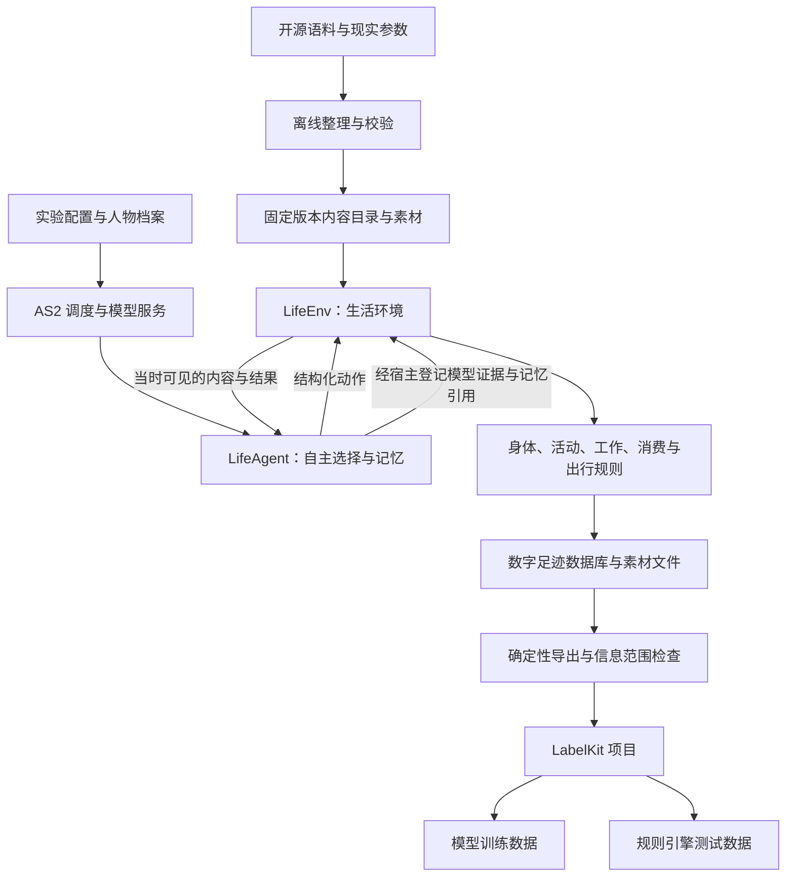

<!-- worldmock-doc: {"authority":"history","canonical_path":"docs/history/agentsociety2-design-v2.md","implementation_state":"NOT-COMPLETE","kind":"design","owner":"worldmock-core","replaces":[],"schema":"worldmock.document.metadata.v1","status":"SUPERSEDED","superseded_by":"docs/INDEX.md","version":"2026-09-18"} -->
**Status: SUPERSEDED** — superseded_by: docs/INDEX.md

# 基于 AgentSociety 2 的数字人生活模拟与数据生产特性规范

日期：2026-09-15；修订：2026-09-18。规格版本：life-realism-2026-09-18（取代 life-full-2026-09-15）。
状态：全量开发合同；实现与验收证据单独记录。本次修订新增文末《人物真实性修订合同（2026-09-18）》，
并就地修改与之冲突的原条款；原条款与修订合同不一致处以修订合同为准。

本设计整合从 AgentSociety 2 选型开始的讨论。用户已经明确最终目标：数字人在需求驱动下与环境交互，
留下完整数字足迹，供 LabelKit 生成动作序列、意图和 dreaming 语料，最终交付模型训练数据与规则引擎测试数据。
手机操作实验已停止，本设计采用直接环境交互。

## 快速导航

- **设计结论与边界** → 采用 AS2 作为基础，新增 LifeEnv 和 LifeAgent
- **整体架构** → 语料整理、生活环境、数字足迹、LabelKit 数据生产的完整链路
- **AS2 改动清单** → 需要修改的调度、工具调用、时间约定和失败处理
- **LifeEnv 接口** → 状态归属、生命周期、人物工具、管理接口
- **数字足迹协议** → 事件结构、持久化、事务与失败处理
- **LabelKit 接入** → 输入范围、加工责任、来源关联、最终交付格式
- **实验绑定** → 依赖版本、运行命令、场景参数、内容来源
- **验证矩阵** → 每类验收事项的具体测试方法
- **人物真实性修订合同** → 决策节律、身体语义、观察投影、两阶段决策、记忆、社交、日程

## 设计结论

采用 AgentSociety 2 作为人物、模型调用、记忆和运行管理基础；新增 `LifeEnv` 环境模块和 `LifeAgent` 人物类。
`LifeEnv` 是唯一负责生活规则、活动进度、资源结算和世界数字足迹的环境。
开源语料经过离线整理，成为环境里的节目、游戏、工作材料、邮件、商品与出行依据。
LabelKit 使用固定版本的经历文件完成标注和数据生产。

仅新增一个 `EnvBase` 子类不能满足全部要求。还需调整 AS2 的决策调度、结构化工具调用、时间约定和失败处理，
以及把人物工作区与世界状态关联为可恢复的检查点。这些改动复用现有 AS2 执行链，不另写一套 Agent 框架。

### 核心决策总结

| 设计范围 | 本设计决定 |
| --- | --- |
| 人物自主性 | 人物决定吃、睡、工作、娱乐、购买、出行与是否继续；环境执行可行性和资源约束 |
| 世界状态 | 由环境确定性代码维护，人物不能直接设置余额、饥饿值、睡眠效果或工作验收结论 |
| 时间 | 统一模拟时间；按下一次相关事件推进，程序速度与人物生活时间分开 |
| 内容 | 实际接触的内容逐段提供，保留原始来源、版本和区间 |
| 记录 | SQLite 保存结构化事件与结算，文件保存原始素材与模型证据 |
| 交付 | 固定 JSONL 输入 LabelKit；成品样本必须可追到原始事件 |
| 恢复 | 从完整检查点建立有父子关联的新运行分支；原运行的部分经历保留 |
| 实验变更 | 人格、模型、提示、规则和代码在正式运行前冻结；修复后使用新版本和新运行 |

## 目标、边界与验收对象

本设计的验收对象不是"程序能运行"或"JSON 能被解析"，而是以下具体行为能力：

**消费与生产能力** - 进食投入金钱和时间；工作投入时间和精力并获得合同报酬；睡眠投入时间并恢复状态。

**个体差异体现** - 职业、技能、工作机会和合同影响产出或报酬；睡眠状态影响明确配置的转换效率。

**需求驱动决策** - 饥饿、疲劳、娱乐需要及工作义务进入人物观察和决策，不由脚本替人物排序选择。

**内容丰富性** - 覆盖饮食、节目、游戏、工作记录、邮件、导航和购物。

**日常与社交** - 人物能看见同处一地的他人、与他人和联系人通讯、在家完成晨间例程与用餐、按自己生成的当日计划安排活动；机会由世界提供，不由脚本安排。

**可控场景** - 可定义地点、日历、天气、交通条件和模拟速度。

**真实反馈依据** - 明确区分来源数据、规则算出的结果、模型生成的文本和实际外部服务返回。

**完整数字足迹** - 保存观察、决策、执行、状态变化、结果、记忆和相互关系。

**LabelKit 接入** - 提供动作序列、意图、dreaming 的可加工输入与来源关联。

**最终可用性** - 训练加载器能够读取成品；规则测试程序能够读取夹具、执行并比较预期结果。

数据来源真实不代表数字人行为已经符合人类分布。行为真实性需要独立样本、参数校准与人工复核。
本设计不以程序运行时长或 JSON 能被解析作为最终成功条件。

## 已核对的基础与差距

AS2 源码基线为 `670c94fff7c64c4f79b632125f2ccf968155e746`；在线文档显示版本为 2.8.7。
LabelKit 本地基线为 `5a359cacd9927ad40eb0b8b96cc22799d721a069`。
下面的接口与行为判断来自该基线；实现前需锁定实际依赖版本并复核差异。

### AS2 现有能力评估

**可直接复用的部分：**
- `EnvBase`、`@tool`、`step`、`restore`、`to_workspace` 可直接承载自定义生活环境
- `PersonAgent` 的模型决策、工作区和记忆机制
- 共享环境 Ray actor 可作为世界状态的单一写入进程
- `replay`、`trace`、`workspace` 分别承担回放、调用诊断和工作状态

**需要修改或补充的部分：**
- 当前 `step` 调用所有人物再调用环境，不适合跨过新活动结束时刻 → 需要事件调度接口
- 文档称 `t` 为步结束时间，实际传入开始时间 → 必须统一约定并修复调用链
- `to_workspace` 捕获异常只告警 → 改为终止推进并记录失败
- ReAct 预算耗尽会合成结果 → 删除自动补造结果的出口
- 同批工具调用包含 `finish` 时只保留结束调用 → 禁止这种协议冲突
- 环境恢复错误被捕获后按新环境继续 → 改为指定完整检查点并校验

### 与本设计的关系

现有 AS2 `EconomySpace` 按日自动加收入减消费，本场景不装配该模块，资金改为实际活动与合同结算，避免重复记账。

WorldMock 现有 `trajectory.py` 已有原始事件、素材哈希引用和脱敏实现经验；当前 JSONL 追加不提供新的世界事务保证，需要改用 SQLite 事务。

LabelKit 文本输入、序列标注、反事实生成可复用；没有直接读取本仿真数据库或专用 dreaming 的现成入口，需要新增。

## 整体架构

`LifeEnv` 内部按身体、活动、内容、工作、消费和出行分文件组织。它们共享同一状态与事务，
不拆成各自维护时钟和余额的多个环境服务。模型调用、向量检索、Ray 进程管理继续由 AS2 承担。
首个完整版本采用本机或单机多进程；并行独立实验各有自己的数据库和运行标识。

## AS2 的改动清单

本设计需要对 AS2 进行两类改动：通过扩展模块完成的部分，以及需要修改 AS2 核心链路的部分。

### 通过扩展模块完成的改动

这些改动通过新增模块实现，不需要修改 AS2 核心代码：

**LifeEnv 环境模块** - 继承 `EnvBase`，负责观察、动作接收、活动推进、资源结算、内容提供、数字足迹。
复用边界为现有环境注册、工具声明、共享 actor 和生命周期接口。

**LifeAgent 人物扩展** - 继承 `PersonAgent`，负责人格与需求提示、生活动作工具、依据事件形成记忆。
复用边界为现有模型客户端、ReAct 执行和记忆检索；不重写人物循环。

**内容整理程序** - 将选定来源整理为固定目录、素材和参数。使用现有 JSON、Pydantic 和成熟数据读取工具。

**导出程序** - 读取确定事件范围，输出 LabelKit 输入及来源索引。只做字段选择、时间排序、素材展开、关联和校验。

**LabelKit 项目配置** - 动作与意图标注、dreaming、训练输出和测试夹具。使用既有 Schema、提示、分类、生成、后处理和验证能力。

### AS2 核心链路需要补充的改动

以下改动需要修改 AS2 源码，每项改动都说明了具体位置、必须修改的行为和验证重点。

**调度器的事件驱动改动**（位于 `society/society.py`）
- 必须修改的行为：根据环境给出的可决策人物执行既有 batch；收齐动作提案后有序结算，再确定下一时间边界；检查每个执行结果
- 验证重点：睡眠人物不反复调用模型；新活动的较早结束时间不会被跨过
- 这一改动让调度器支持按需唤醒人物，而不是每次 step 都调用所有人物

**环境路由的确定性工具调用**（位于 `env/router_base.py`、`env/env_router_actor.py`、`env/env_router_proxy.py`）
- 必须修改的行为：增加确定性工具调用和调度状态传递；同步时钟需要等待完成
- 验证重点：请求到达时钟一致；工具结果未经第二个模型改写
- 同一环境路由链需要由宿主绑定人物身份、决策标识和动作标识；工具参数不能改变调用者，确保人物不能指定他人身份读写其资源

**人物代理的工具清单与证据回调**（位于 `agent/base/agent.py` 与 `LifeAgent`）
- 必须修改的行为：提供明确的工具清单和调用证据回调；保留原模型调用与 ReAct 机制
- 验证重点：只暴露生活与记忆工具；原始请求、响应、失败和调用关联可记录

**ReAct 的结束条件改动**（位于 `agent/base/agent.py`）
- 必须修改的行为：决策预算耗尽明确失败；禁止 `finish` 与其他工具同批返回；删除合成结束结果和只保留 `finish` 的路径
- 验证重点：没有登记的动作不能变为成功记忆；协议冲突不静默丢动作
- 这一改动确保人物的每个生活动作都能被完整记录，不会因为框架的"自动修复"而丢失

**记忆运行时的错误传播**（位于 `agent/memory_runtime.py`）
- 必须修改的行为：记忆最终校验失败、必要归纳失败与保存失败向上传播；删除宽松转换后继续的路径
- 验证重点：不生成缺失必要记忆的成功检查点

**人物代理的异常处理**（位于 `agent/person.py` 及工具异常处理）
- 必须修改的行为：必要观察和证据保存的致命异常必须穿过原有 catch 分支传播
- 验证重点：不把空观察或持久化故障转换成可继续的普通工具结果

**调度器和路由的失败传播**（位于 `society/society.py`、`agent/runner.py`、`env/router_base.py`）
- 必须修改的行为：保存失败、必要观察失败、人物执行失败向上报告并停止此次运行；路由汇总保存异常后必须抛出
- 验证重点：不继续生成看似完整的轨迹
- 这确保了数字足迹的完整性：宁可明确失败，也不生成不完整的数据

**模型客户端生命周期管理**（位于 `config/llm_dispatcher.py`、`agent/service_proxy.py`、`agent/runner.py`）
- 必须修改的行为：使用 LiteLLM 官方 `Router.discard()` 结束任务内模型客户端的回调生命周期
- 验证重点：连续 worker 任务与事件循环不积累已结束 Router，正常及异常出口均清理

**工作区保存路径的共同检查点**（位于社会与人物工作区保存路径）
- 必须修改的行为：在一个完整推进边界形成共同检查点；恢复校验世界、人物和时钟
- 验证重点：不把较新的世界状态与较旧的记忆混合恢复

**恢复入口的严格校验**（位于 Society 恢复入口与 Router 初始化链）
- 必须修改的行为：接收父运行检查点与新的目标目录；全部恢复成功才启动；删除恢复失败后新建环境继续的路径
- 验证重点：缺少快照或校验失败立即终止，不写父运行目录

**观察记录的去重**（位于 `agent/person.py`）
- 必须修改的行为：观察记录只保留结构化 `data`，不再同时写入 JSON 字符串副本
- 验证重点：一次决策的 user 消息中同一观察只出现一次
- 这一改动解决了观察被序列化两遍的问题，显著减少了 token 消耗

**独白钩子与推理内容回传**（位于 `agent/agent_runtime.py`）
- 必须修改的行为：增加决策前的独白钩子（单次无工具调用）；后续请求保留 assistant 消息的 `reasoning_content`
- 验证重点：独白落库并进入行动请求；带 `tools` 的后续请求不因缺少 `reasoning_content` 被拒

**记忆巩固触发与合并**（位于 `agent/memory_runtime.py`、`agent/memory.py`）
- 必须修改的行为：允许 finish 提交空记忆列表；巩固触发改为重要性累计、就寝与待巩固数量；巩固提示传入人物卡片、使用人物语言、删除示例身份；写入前按相似度合并
- 验证重点：同一偏好不重复写入；MEMORY.md 不含示例身份残留

### 改动的维护方式

这些改动应作为一个可维护的 AS2 分支或上游补丁管理，锁定提交版本。
禁止用运行时 monkey patch、复制整个 AS2 调度器或保持两套人物决策循环完成接入。
已有 AS2 类中与本场景无关的框架功能不参与本次环境装配。

## LifeEnv 的状态与接口

### 状态归属与修改权限

LifeEnv 维护的状态按归属和修改权限分为以下几类：

**世界状态** - 包含模拟时钟、地点、天气、内容目录版本、营业与工作日历、待发生事件。
只能由环境规则改变；管理员只能在运行前配置或开启新实验分支。

**人物身体状态** - 包含可用能量、睡眠不足、娱乐需要、最近活动及必要生理模型状态。
只能由时间推进、进食、睡眠和实际活动结算改变。

**人物资产状态** - 包含账户余额、持有商品、消耗品数量、已取得的使用权。
只能由交易、交付、使用与合同结算改变。

**人物活动状态** - 包含活动类型、开始时间、进度、下一可决策时间、占用资源、暂停与结束原因。
人物申请动作，环境验证并执行。

**工作状态** - 包含任务、输入材料、截止时间、交付物、验收、合同及付款状态。
由任务来源、人物交付与独立验收规则决定。

**内容接触状态** - 包含可见目录、已读邮件、已播放片段、游戏状态及素材区间。
由实际接触行为与内容提供过程决定。

**记忆状态** - AS2 人物记忆及其版本、来源事件和检索结果。
由人物记忆流程决定；环境不代写"人物应当喜欢什么"。

**观察约定** - 人物身体和余额的准确数值属于世界事实。正式观察约定为：人物收到由确定性规则算出的体感分级与自然语言场景描述，
准确数值只进入足迹与评估（见《人物真实性修订合同》观察投影一节）。
训练数据导出再次按实际目标系统的信息范围裁剪，不能默认线上设备能够读到环境隐藏状态。

### 生命周期接口

**初始化接口 `__init__(scenario_path=None)`**
- 仅保存配置路径和建立资源句柄
- 允许注册器无参检查对象，尚不创建世界

**启动接口 `init(start_datetime)`**
- 核验内容目录、规则、初始世界与时间
- 初始化数据库和事件计划

**推进接口 `step(tick, t)`**
- `tick` 为推进秒数，`t` 统一为结束时间
- 处理区间内连续变化与到期事件
- 核验时间连续性

**保存接口 `to_workspace(workspace_path=None)`**
- 遵循 AS2 现有签名；无参时使用已绑定工作区
- 持久化必要状态与检查点引用
- 错误必须传播，不能被捕获为警告

**恢复接口 `restore(workspace_path)`**
- 读取明确指定的有效检查点
- 核对代码、规则、数据、时间和人物状态版本

**关闭接口 `close()`**
- 关闭数据库等资源
- 保留运行终态与未完成活动

**注册与运行的区别** - AS2 的环境扫描要求自定义类直接定义在 `custom/envs/*.py`。本项目用该文件定义 `LifeEnv`，业务逻辑导入普通模块。
正式实例通过现有 AS2 环境参数传入场景路径；`init` 缺少场景时明确失败，不生成默认世界继续运行。
无参检查只用于注册和工具 Schema 发现；运行测试必须传入真实场景参数，不能把仅能实例化当作环境可运行。

### 人物工具接口

人物通过以下工具与环境交互。所有工具都经过统一的 `submit_action(call)` 接收，其中宿主绑定人物身份、决策与动作标识。

**基础活动工具 `start_basic_activity`**（模型原生工具）
- 启动睡眠或等待
- 明确活动类别和计划持续时间
- 结算时检查：没有冲突占用；持续时间正数

**目标活动工具 `start_targeted_activity`**（模型原生工具）
- 启动观看、游戏、工作、浏览或阅读
- 明确可见目标、持续时间和播放速度
- 结算时检查：内容已可访问、位置合法、没有冲突占用；持续时间正数

**出行工具 `start_travel`**（模型原生工具）
- 明确计划持续时间、可见目的地和出行方式后提交出行
- 结算时检查：路线存在、能量足够、出行方式合法

**活动控制工具 `set_activity_state`**（模型原生工具）
- 显式暂停、恢复或退出指定活动
- 结算时检查：活动归属、转换合法

**播放速度工具 `change_playback_speed`**（模型原生工具）
- 显式改变指定活动的播放速度
- 结算时检查：倍速在已声明范围内

**继续活动工具 `continue_activity`**（模型原生工具）
- 在已到达的反馈边界继续当前活动
- 只安排后续反馈，不额外推进世界时间

**购买工具 `purchase`**（模型原生工具）
- 提交购买请求，一单可含多件商品
- 结算时检查：价格版本、资金、库存、营业和配送范围

**使用工具 `consume`**（模型原生工具）
- 登记使用请求，一餐可含至多三件持有食品
- 结算时检查：物品已取得、数量足够、用途符合物品定义

**提交工作工具 `submit_work`**（模型原生工具）
- 登记真实交付物引用
- 结算时检查：任务归属、进度、截止规则、素材存在及未重复结算

**游戏动作工具 `game_action`**（模型原生工具）
- 登记游戏动作
- 结算时检查：实例归属、当前局面和游戏进度

**日程计划工具 `plan_day`**（模型原生工具）
- 醒来后提交当日 5–8 段计划
- 只登记为人物自我承诺，环境不代为执行

**修订计划工具 `revise_day_plan`**（模型原生工具）
- 改写当日尚未开始的计划段

**消息工具 `send_message`**（模型原生工具）
- 向同一世界的人物或场景联系人发送文本
- 结算时登记，收件方下一次观察送达

**社交活动工具 `start_social_activity`**（模型原生工具）
- 与在场人物交谈或与联系人通话
- 明确对象与计划持续时间

**观察接口 `observe(context)`**（宿主只读 RPC，不列入模型工具）
- 返回当前可见状态、已到达通知和已完成的内容接触结果

### 管理接口

这些接口由调度器和管理员使用，不暴露给人物模型。

**调度状态接口 `scheduling_state()`**
- 返回可决策人物与下一个相关事件时间
- 调度器据此决定是否需要唤醒人物

**决策轮结算接口 `commit_decision_round(round_id)`**
- 在本轮全部人物决策完成后按预先确定的顺序结算请求
- 保证并发人物的公平性

**检查点接口 `checkpoint(request)`**
- LifeEnv 保存共同检查点
- 与 AS2 人物工作区形成一致的快照

**导出接口 CLI `export`**
- 从 FootprintStore 导出确定状态
- 用于 LabelKit 加工

### 工具请求与结果的约定

**模型工具名是 LifeAgent 的原生请求合同**；LifeEnv 通过统一 `submit_action(call)` 接收宿主绑定请求，
不为每个模型工具另建一个同名 RPC 方法。

**每个模型工具请求使用明确的 Pydantic 类型**，全部字段必填，没有缺省参数或条件可选字段。
模型只生成业务参数，宿主附加人物身份、决策与动作标识。工具 Schema 从实际请求模型直接生成，
服务支持的结构约束必须与运行校验一致；数组数量边界由同一模型的本地校验器完整执行，不能静默截取。

**删除旧的工具名**：删除旧的 `start_activity`、`change_activity` 模型工具名，不维护别名；领域执行函数可以共享已有活动实现。
食物和耐用品使用始终走 `consume`，不能用缺少物品信息的通用活动请求模拟消费。

**不暴露的能力**：余额调整、天气设定、地点瞬移、验收强制通过和全世界读取均不向人物暴露。
不使用通用代码执行来让人物直接操作数据库。

**只读工具的澄清**：`readonly=True` 表示不改变生活状态；观察调用本身仍需要留下证据。
浏览新目录、阅读正文和观看内容需要消耗注意力与时间，不能靠无限调用观察工具免费读取整套语料。

**请求校验**：请求不能指定任意文件路径让环境读取。引用只允许已经登记且对人物可见的素材，实际文本交付由宿主保存成新素材。
请求校验失败返回明确业务错误；环境不自动修改数量、替换商品、改变目的地或选择其他行动。

### 动作结果的语义

动作结果必须区分已提交待结算、已接受、进行中、完成、拒绝、取消、失败和结果未知。

**登记与结算的分离** - 人物工具在决策阶段登记请求，返回已提交状态；资产检查和世界修改在收齐本轮提案后由环境执行。
登记成功不等于购买成功，人物不能据此记忆为已付款或已取得商品；真实结果在后续观察中提供。

**时间语义** - 开始一个三十分钟的活动只代表它已开始，结果中不能立即包含三十分钟后的剧情或交付成果。
已接受动作带活动标识、起始时间和下一次反馈时间；完成事件带实际执行区间、结果及可追溯的结算。

**拒绝与失败的区别** - 正常业务拒绝回给人物继续选择；记录失败或程序错误终止运行，不能伪装成业务拒绝。

**工具可用性约定** - 模型的 `finish` 必须单独返回，不能与购买、游戏或其他工具出现在同一批调用中。
生活决策开始时只开放生活动作和记忆查询；实际提交一个生活动作后，才开放 `finish`，并撤下生活动作工具。
结束前仍可查询记忆。显式只读人物查询保持其独立的只读结束合同；当前未开放的工具必须拒绝执行。

**协议冲突处理** - 冲突响应保存原文和协议错误，整批不执行；在现有 ReAct 剩余回合内把错误反馈给模型自行重新提交。
每次非法响应消耗一个回合，预算耗尽才终止人物决策；不沿用上游只保留结束调用的行为。

**记忆的引用约定** - 人物记录的"已提交"必须引用实际登记的动作请求；决定想做、请求已登记与动作已完成分别表达。

