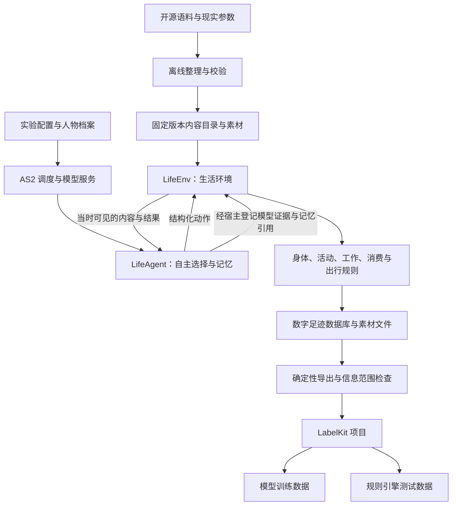
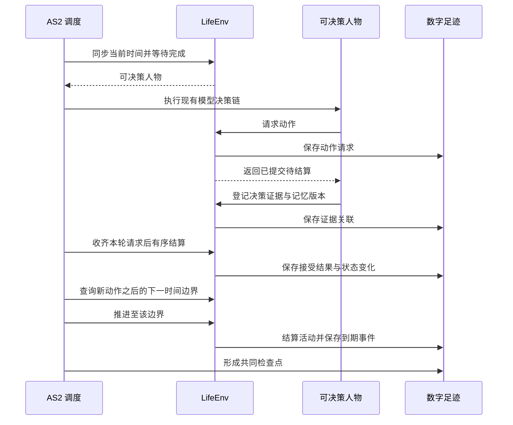
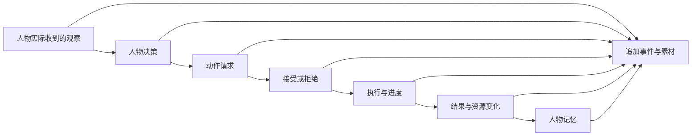
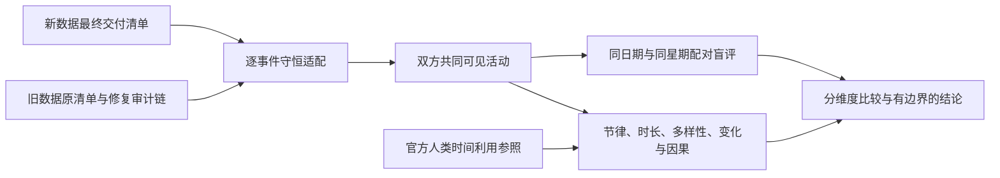

# 基于 AgentSociety 2 的数字人生活模拟与数据生产特性规范

日期：2026-09-15。规格版本：life-full-2026-09-15。状态：全量开发合同；实现与验收证据单独记录。

本设计整合从 AgentSociety 2 选型开始的讨论。用户已经明确最终目标：数字人在需求驱动下与环境交互，
留下完整数字足迹，供 LabelKit 生成动作序列、意图和 dreaming 语料，最终交付模型训练数据与规则引擎测试数据。
手机操作实验已停止，本设计采用直接环境交互。

## 设计结论

采用 AgentSociety 2 作为人物、模型调用、记忆和运行管理基础；新增 `LifeEnv` 环境模块和 `LifeAgent` 人物类。
`LifeEnv` 是唯一负责生活规则、活动进度、资源结算和世界数字足迹的环境。
开源语料经过离线整理，成为环境里的节目、游戏、工作材料、邮件、商品与出行依据。
LabelKit 使用固定版本的经历文件完成标注和数据生产。

仅新增一个 `EnvBase` 子类不能满足全部要求。还需调整 AS2 的决策调度、结构化工具调用、时间约定和失败处理，
以及把人物工作区与世界状态关联为可恢复的检查点。这些改动复用现有 AS2 执行链，不另写一套 Agent 框架。

| 范围 | 本设计决定 |
| --- | --- |
| 人物自主性 | 人物决定吃、睡、工作、娱乐、购买、出行与是否继续；环境执行可行性和资源约束 |
| 世界状态 | 由环境确定性代码维护，人物不能直接设置余额、饥饿值、睡眠效果或工作验收结论 |
| 时间 | 统一模拟时间；按下一次相关事件推进，程序速度与人物生活时间分开 |
| 内容 | 实际接触的内容逐段提供，保留原始来源、版本和区间 |
| 记录 | SQLite 保存结构化事件与结算，文件保存原始素材与模型证据 |
| 交付 | 固定 JSONL 输入 LabelKit；成品样本必须可追到原始事件 |
| 恢复 | 从完整检查点建立有父子关联的新运行分支；原运行的部分经历保留 |
| 实验变更 | 人格、模型、提示、规则和代码在正式运行前冻结；修复后使用新版本和新运行 |

## 目标、边界与验收对象

| 用户需求 | 必须达到的行为 |
| --- | --- |
| 消费与生产 | 进食投入金钱和时间；工作投入时间和精力并获得合同报酬；睡眠投入时间并恢复状态 |
| 个体差异 | 职业、技能、工作机会和合同影响产出或报酬；睡眠状态影响明确配置的转换效率 |
| 需求驱动 | 饥饿、疲劳、娱乐需要及工作义务进入人物观察和决策，不由脚本替人物排序选择 |
| 内容丰富 | 覆盖饮食、节目、游戏、工作记录、邮件、导航和购物 |
| 可控场景 | 可定义地点、日历、天气、交通条件和模拟速度 |
| 真实反馈依据 | 明确区分来源数据、规则算出的结果、模型生成的文本和实际外部服务返回 |
| 完整数字足迹 | 保存观察、决策、执行、状态变化、结果、记忆和相互关系 |
| LabelKit 接入 | 提供动作序列、意图、dreaming 的可加工输入与来源关联 |
| 最终可用性 | 训练加载器能够读取成品；规则测试程序能够读取夹具、执行并比较预期结果 |

数据来源真实不代表数字人行为已经符合人类分布。行为真实性需要独立样本、参数校准与人工复核。
本设计不以程序运行时长或 JSON 能被解析作为最终成功条件。

## 已核对的基础与差距

AS2 源码基线为 `670c94fff7c64c4f79b632125f2ccf968155e746`；在线文档显示版本为 2.8.7。
LabelKit 本地基线为 `5a359cacd9927ad40eb0b8b96cc22799d721a069`。
下面的接口与行为判断来自该基线；实现前需锁定实际依赖版本并复核差异。

| 当前能力或行为 | 与本设计的关系 |
| --- | --- |
| AS2 `EnvBase`、`@tool`、`step`、`restore`、`to_workspace` | 可直接承载自定义生活环境；自定义业务状态不会自动获得完整恢复能力 |
| AS2 `PersonAgent` 的模型决策、工作区和记忆 | 复用；需要按活动唤醒和限制可调用工具 |
| AS2 共享环境 Ray actor | 复用为世界状态的单一写入进程 |
| `EconomySpace` 按日自动加收入、减消费 | 本场景不装配该模块，资金改为实际活动与合同结算，避免重复记账 |
| `AgentSociety.step` 调用所有人物，再调用环境，最后增加时间 | 不适合直接跨过新启动活动的结束时刻；需要事件调度接口 |
| `step` 文档称 `t` 为步结束时间，实际调用传入当前开始时间 | 必须统一约定并修复调用链，不能让各模块分别猜测 |
| `to_workspace` 捕获环境保存异常并只告警 | 不满足采集完整性；改为终止本次推进并记录失败 |
| 人物 runner 返回 `ok=False`，Society 当前主要汇总 token 统计 | 调度器必须检查失败结果，不能把人物异常当作正常生活继续推进 |
| ReAct 预算耗尽会合成结果；部分记忆异常只告警或宽松转换 | 必须删除这些自动补造结果的出口，确保失败不会被 runner 标成成功 |
| 同批工具调用包含 `finish` 时，解析器只保留结束调用 | 必须拒绝这种协议冲突，不能静默丢弃人物请求的生活动作 |
| 环境恢复错误被捕获后按新环境继续；现有恢复入口复用原目录 | 必须改为指定完整检查点、新分支目录和全部必要状态校验 |
| AS2 replay、trace、workspace | 分别承担回放、调用诊断和工作状态；不能直接代替本设计的事务结算与数据谱系 |
| WorldMock 现有 `trajectory.py` | 已有原始事件、素材哈希引用和脱敏实现经验；当前 JSONL 追加不提供新的世界事务保证 |
| LabelKit 文本输入、序列标注、反事实生成 | 可复用；没有直接读取本仿真数据库或专用 dreaming 的现成入口 |

## 整体架构



`LifeEnv` 内部按身体、活动、内容、工作、消费和出行分文件组织。它们共享同一状态与事务，
不拆成各自维护时钟和余额的多个环境服务。模型调用、向量检索、Ray 进程管理继续由 AS2 承担。
首个完整版本采用本机或单机多进程；并行独立实验各有自己的数据库和运行标识。

## AS2 的改动清单

### 通过扩展模块完成的部分

| 模块 | 设计职责 | 复用边界 |
| --- | --- | --- |
| `LifeEnv(EnvBase)` | 观察、动作接收、活动推进、资源结算、内容提供、数字足迹 | 使用现有环境注册、工具声明、共享 actor 和生命周期 |
| `LifeAgent(PersonAgent)` | 人格与需求提示、生活动作工具、依据事件形成记忆 | 保留现有模型客户端、ReAct 执行和记忆检索；不重写人物循环 |
| 内容整理程序 | 将选定来源整理为固定目录、素材和参数 | 使用现有 JSON、Pydantic 和成熟数据读取工具 |
| 导出程序 | 读取确定事件范围，输出 LabelKit 输入及来源索引 | 只做字段选择、时间排序、素材展开、关联和校验 |
| LabelKit 项目 | 动作与意图标注、dreaming、训练输出和测试夹具 | 使用既有 Schema、提示、分类、生成、后处理和验证能力 |

### AS2 核心链路需要补充的部分

以下新增接口名为本设计建议，不是声称上游已经提供。

| 源码位置 | 必须修改的行为 | 验证重点 |
| --- | --- | --- |
| `society/society.py` | 根据环境给出的可决策人物执行既有 batch；收齐动作提案后有序结算，再确定下一时间边界；检查每个执行结果 | 睡眠人物不反复调用模型；新活动的较早结束时间不会被跨过 |
| `env/router_base.py`、`env/env_router_actor.py`、`env/env_router_proxy.py` | 增加确定性工具调用和调度状态传递；同步时钟需要等待完成 | 请求到达时钟一致；工具结果未经第二个模型改写 |
| 同一环境路由链 | 由宿主绑定人物身份、决策标识和动作标识；工具参数不能改变调用者 | 人物不能指定他人身份读写其资源 |
| `agent/base/agent.py` 与 `LifeAgent` | 提供明确的工具清单和调用证据回调；保留原模型调用与 ReAct 机制 | 只暴露生活与记忆工具；原始请求、响应、失败和调用关联可记录 |
| `agent/base/agent.py` 的结束条件与解析器 | 决策预算耗尽明确失败；禁止 `finish` 与其他工具同批返回；删除合成结束结果和只保留 `finish` 的路径 | 没有登记的动作不能变为成功记忆；协议冲突不静默丢动作 |
| `agent/memory_runtime.py` | 记忆最终校验失败、必要归纳失败与保存失败向上传播；删除宽松转换后继续的路径 | 不生成缺失必要记忆的成功检查点 |
| `agent/person.py` 及工具异常处理 | 必要观察和证据保存的致命异常必须穿过原有 catch 分支传播 | 不把空观察或持久化故障转换成可继续的普通工具结果 |
| `society/society.py`、`agent/runner.py`、`env/router_base.py` | 保存失败、必要观察失败、人物执行失败向上报告并停止此次运行；路由汇总保存异常后必须抛出 | 不继续生成看似完整的轨迹 |
| `config/llm_dispatcher.py`、`agent/service_proxy.py`、`agent/runner.py` | 使用 LiteLLM 官方 `Router.discard()` 结束任务内模型客户端的回调生命周期 | 连续 worker 任务与事件循环不积累已结束 Router，正常及异常出口均清理 |
| 社会与人物工作区保存路径 | 在一个完整推进边界形成共同检查点；恢复校验世界、人物和时钟 | 不把较新的世界状态与较旧的记忆混合恢复 |
| Society 恢复入口与 Router 初始化链 | 接收父运行检查点与新的目标目录；全部恢复成功才启动；删除恢复失败后新建环境继续的路径 | 缺少快照或校验失败立即终止，不写父运行目录 |

这些改动应作为一个可维护的 AS2 分支或上游补丁管理，锁定提交版本。
禁止用运行时 monkey patch、复制整个 AS2 调度器或保持两套人物决策循环完成接入。
已有 AS2 类中与本场景无关的框架功能不参与本次环境装配。

## LifeEnv 的状态与接口

### 状态归属

| 状态 | 内容 | 谁可以改变 |
| --- | --- | --- |
| 世界 | 模拟时钟、地点、天气、内容目录版本、营业与工作日历、待发生事件 | 环境规则；管理员只能在运行前配置或开启新实验分支 |
| 人物身体 | 可用能量、睡眠不足、娱乐需要、最近活动及必要生理模型状态 | 时间推进、进食、睡眠和实际活动结算 |
| 人物资产 | 账户余额、持有商品、消耗品数量、已取得的使用权 | 交易、交付、使用与合同结算 |
| 人物活动 | 活动类型、开始时间、进度、下一可决策时间、占用资源、暂停与结束原因 | 人物申请动作，环境验证并执行 |
| 工作 | 任务、输入材料、截止时间、交付物、验收、合同及付款状态 | 任务来源、人物交付与独立验收规则 |
| 内容接触 | 可见目录、已读邮件、已播放片段、游戏状态及素材区间 | 实际接触行为与内容提供过程 |
| 记忆 | AS2 人物记忆及其版本、来源事件和检索结果 | 人物记忆流程；环境不代写“人物应当喜欢什么” |

人物身体和余额的准确数值属于世界事实。人物可以收到对应数值或主观描述，由实验观察约定决定。
训练数据导出再次按实际目标系统的信息范围裁剪，不能默认线上设备能够读到环境隐藏状态。

### 生命周期

| 接口 | 设计行为 |
| --- | --- |
| `__init__(scenario_path=None)` | 仅保存配置路径和建立资源句柄；允许注册器无参检查对象，尚不创建世界 |
| `init(start_datetime)` | 核验内容目录、规则、初始世界与时间；初始化数据库和事件计划 |
| `step(tick, t)` | `tick` 为推进秒数，`t` 统一为结束时间；处理区间内连续变化与到期事件，核验时间连续性 |
| `to_workspace(workspace_path=None)` | 遵循 AS2 现有签名；无参时使用已绑定工作区，持久化必要状态与检查点引用；错误必须传播 |
| `restore(workspace_path)` | 读取明确指定的有效检查点，核对代码、规则、数据、时间和人物状态版本 |
| `close()` | 关闭数据库等资源，保留运行终态与未完成活动 |

AS2 的环境扫描要求自定义类直接定义在 `custom/envs/*.py`。本项目用该文件定义 `LifeEnv`，业务逻辑导入普通模块。
正式实例通过现有 AS2 环境参数传入场景路径；`init` 缺少场景时明确失败，不生成默认世界继续运行。
无参检查只用于注册和工具 Schema 发现；运行测试必须传入真实场景参数，不能把仅能实例化当作环境可运行。

### 人物工具与管理接口

| 接口 | 类型 | 行为 |
| --- | --- | --- |
| `observe(context)` | 宿主只读 RPC，不列入模型工具 | 返回当前可见状态、已到达通知和已完成的内容接触结果 |
| `start_basic_activity` | 模型原生工具，经 `submit_action` 登记 | 启动睡眠或等待，明确活动类别和计划持续时间 |
| `start_targeted_activity` | 模型原生工具，经 `submit_action` 登记 | 启动观看、游戏、工作、浏览或阅读，明确可见目标、持续时间和播放速度 |
| `start_travel` | 模型原生工具，经 `submit_action` 登记 | 明确计划持续时间、可见目的地和出行方式后提交出行 |
| `set_activity_state` | 模型原生工具，经 `submit_action` 登记 | 显式暂停、恢复或退出指定活动 |
| `change_playback_speed` | 模型原生工具，经 `submit_action` 登记 | 显式改变指定活动的播放速度 |
| `continue_activity` | 模型原生工具，经 `submit_action` 登记 | 在已到达的反馈边界继续当前活动，只安排后续反馈，不额外推进世界时间 |
| `purchase` | 模型原生工具，经 `submit_action` 登记 | 提交购买请求；本轮结算时校验余额、商品、地点与营业条件，扣款并安排交付 |
| `consume` | 模型原生工具，经 `submit_action` 登记 | 登记使用请求；结算时验证持有物，安排使用时间和效果 |
| `submit_work` | 模型原生工具，经 `submit_action` 登记 | 登记真实交付物引用；结算时触发验收和合同处理 |
| `game_action` | 模型原生工具，经 `submit_action` 登记 | 登记游戏动作；结算时安排引擎执行，在规定反馈时刻交付实际局面 |
| `scheduling_state()` | 管理接口，不作为人物工具 | 返回可决策人物与下一个相关事件时间 |
| `commit_decision_round(round_id)` | 管理接口，不作为人物工具 | 在本轮全部人物决策完成后按预先确定的顺序结算请求 |
| `checkpoint(request)`、CLI `export` | 宿主管理入口，不作为人物工具 | LifeEnv 保存共同检查点，CLI 从 FootprintStore 导出确定状态 |

模型工具名是 LifeAgent 的原生请求合同；LifeEnv 通过统一 `submit_action(call)` 接收宿主绑定请求，
不为每个模型工具另建一个同名 RPC 方法。

每个模型工具请求使用明确的 Pydantic 类型，全部字段必填，没有缺省参数或条件可选字段。
模型只生成业务参数，宿主附加人物身份、决策与动作标识。工具 Schema 从实际请求模型直接生成，
服务支持的结构约束必须与运行校验一致；数组数量边界由同一模型的本地校验器完整执行，不能静默截取。
删除旧的 `start_activity`、`change_activity` 模型工具名，不维护别名；领域执行函数可以共享已有活动实现。
食物和耐用品使用始终走 `consume`，不能用缺少物品信息的通用活动请求模拟消费。
余额调整、天气设定、地点瞬移、验收强制通过和全世界读取均不向人物暴露。
不使用通用代码执行来让人物直接操作数据库。

`readonly=True` 表示不改变生活状态；观察调用本身仍需要留下证据。
浏览新目录、阅读正文和观看内容需要消耗注意力与时间，不能靠无限调用观察工具免费读取整套语料。

| 请求 | 主要业务字段 | 结算时的关键检查 |
| --- | --- | --- |
| 启动活动 | 类型、目标内容或任务、计划持续时间；出行另有目的地和方式 | 内容已可访问、位置合法、没有冲突占用；持续时间正数 |
| 修改活动 | 活动标识、暂停或继续或退出或倍速、适用时的速度 | 活动属于调用者，转换合法；倍速在已声明范围内 |
| 购买 | 商品标识、数量、履约方式和收货地点 | 价格版本、资金、库存、营业和配送范围 |
| 使用 | 持有物品标识、数量、使用方式 | 物品已取得、数量足够、用途符合物品定义 |
| 提交工作 | 任务标识、实际交付内容或自己工作区内的交付物引用 | 任务归属、进度、截止规则、素材存在及未重复结算 |
| 游戏动作 | 游戏实例标识、游戏引擎允许的动作及参数 | 实例归属、当前局面和游戏进度 |

请求不能指定任意文件路径让环境读取。引用只允许已经登记且对人物可见的素材，实际文本交付由宿主保存成新素材。
请求校验失败返回明确业务错误；环境不自动修改数量、替换商品、改变目的地或选择其他行动。

### 动作结果

动作结果必须区分已提交待结算、已接受、进行中、完成、拒绝、取消、失败和结果未知。
人物工具在决策阶段登记请求，返回已提交状态；资产检查和世界修改在收齐本轮提案后由环境执行。
登记成功不等于购买成功，人物不能据此记忆为已付款或已取得商品；真实结果在后续观察中提供。
开始一个三十分钟的活动只代表它已开始，结果中不能立即包含三十分钟后的剧情或交付成果。
已接受动作带活动标识、起始时间和下一次反馈时间；完成事件带实际执行区间、结果及可追溯的结算。
正常业务拒绝回给人物继续选择；记录失败或程序错误终止运行，不能伪装成业务拒绝。

模型的 `finish` 必须单独返回，不能与购买、游戏或其他工具出现在同一批调用中。
生活决策开始时只开放生活动作和记忆查询；实际提交一个生活动作后，才开放 `finish`，并撤下生活动作工具。
结束前仍可查询记忆。显式只读人物查询保持其独立的只读结束合同；当前未开放的工具必须拒绝执行。
冲突响应保存原文和协议错误，整批不执行；在现有 ReAct 剩余回合内把错误反馈给模型自行重新提交。
每次非法响应消耗一个回合，预算耗尽才终止人物决策；不沿用上游只保留结束调用的行为。
人物记录的“已提交”必须引用实际登记的动作请求；决定想做、请求已登记与动作已完成分别表达。

## 消费、生产与需求模型

### 资源与需求

| 量 | 表达 | 解释 |
| --- | --- | --- |
| 时间 | UTC 整数秒及场景时区 | AS2 当前步长接口使用秒；同秒事件另有严格序号 |
| 金钱 | 币种与最小货币单位整数 | 初版一个场景一种币种；避免浮点累计误差 |
| 可用能量 | kcal | 实验中的可用能量状态，不等于人体全部储存热量 |
| 睡眠不足 | 小时 | 与食品能量独立，进食不会直接消除 |
| 娱乐需要 | 归一化状态与明确变化规则 | 随生活积累，实际娱乐可改变；需要考虑喜好、重复与时长 |
| 工作需要 | 截止时间、合同、任务与经济目标 | 从工作义务与人物经济处境产生，不设置固定“每小时必须工作”脚本 |

所有数值变化由明确规则计算。人物提示描述其处境与选项，允许拖延、过度娱乐、拒绝购买或再次观看。
规则只限制物理、经济和任务可行性，不替人物优化人生。

### 转换效率

建议采用简单可校准的函数与参数，避免通用规则语言或额外规则解释器。
以下表达式定义计算关系；参数值属于实验假设，正式运行前冻结并通过情景校验。

```text
能量变化 = 实际进食热量 × 食品利用效率(睡眠不足)
          − 基础消耗率 × 经过时间 − 活动额外消耗

睡眠不足变化 = 清醒期间累积 − 有效睡眠期间恢复

有效工作量 = 技能对应的工作速率 × 工作效率(睡眠不足)
            × 已生效工具效果 × 实际投入时间

计件收入 = 合同约定报酬，在交付验收和付款条件满足后结算
计时收入 = 合同费率 × 符合合同条件的实际工作时间
```

基础模型可以用分段线性曲线描述效率。不能同时降低计时工资和工作效率来重复惩罚睡眠，除非合同明确这样约定。
高收入通过职业、技能、机会与合同表现；不从人物初始财富反推能力。
睡眠期间仍有基础能量消耗；饥饿和睡眠不足不能互相替代。
睡眠影响食品利用效率是用户提出的仿真假设，应单独配置、校准和报告，不宣称是已经验证的生理关系。

规则参数集中在场景定义的身体与活动部分，包括基础能量消耗、活动额外消耗、清醒累积和睡眠恢复速度、
效率曲线节点、工作速率、娱乐需要变化及阅读和游戏动作的时间映射。
参数必须有单位、来源类型和有效范围；效率曲线的节点有序，结果有明确上下界。
饥饿等衍生需求从当前资源及必要历史计算，不允许额外自由写入一份会与资源状态矛盾的数值。

### 具体活动结算

| 活动 | 执行与结算 |
| --- | --- |
| 进食 | 必须已取得食品；实际消耗数量与进食进度相符；支付、取得食品和进食分别记录 |
| 工作 | 输入材料、投入时间、产出物和验收可追溯；失败、延期和返工保留 |
| 睡眠 | 持续恢复睡眠状态；按实际睡眠部分结算，中断后不直接恢复到满值 |
| 看节目 | 按实际播放区间提供内容；暂停不继续推进媒体；倍速改变媒体进度与注意力规则 |
| 游戏 | 游戏引擎执行动作；成功、失败和进度来自实际局面，不能由简介推断 |
| 购物 | 商品进入库存或配送队列；耐用品持有与使用分开，消耗品用后扣减 |
| 出行 | 按实际道路和方式计算时间、费用与消耗；改变当前位置及可访问内容 |
| 等待 | 可以由人物选择；世界其他事件照常发生，身体状态继续变化 |

工资与消费记录付款方和收款方。雇主、商家与人物账户之间的金额对应；实验初始资金和外部注入明确留痕。
任务报酬受合同与雇主资源约束，不能通过重复提交同一交付物无限取得工资。

工作质量由实际交付物评估；模型调用耗时不等于人物工作耗时。
有效工作量控制任务进度，模型产出的文本还必须通过内容验收，不能用累计时间替代真实生产结果。

## 时间推进与并发活动

### 一个共享时钟



先处理当前时刻已到期的通知或活动，再选出需要决策的人物。
人物完成本轮选择后，环境先结算本轮请求，调度器再计算下一边界：活动完成、内容反馈、通知到达、工作截止、需要重新评估的身体变化、
人物选择的等待结束或实验结束。不能在人物启动新活动之前就固定跳到几小时后。
每次推进严格大于零；即时事件在当前边界按稳定序号处理，避免零时间循环。
本轮业务拒绝在下一个合法决策时刻提供，最小反应间隔为当前一秒的时间粒度；不能无限占用同一时刻重新请求。
已接受瞬时动作同样安排下一秒反应边界。场景明确 `max_consecutive_rejections=10`；达到连续业务拒绝上限时
记录人物决策失败并停止，成功选择后计数重置，不自动替人物选择等待或其他动作。

时间接口统一为：人物决策收到当前时刻，环境 `step(tick, t)` 收到本次结束时刻，并满足
`t = 上次已确认时刻 + tick`。AS2 路由、Society 与 LifeEnv 的校验共享这一约定。
事件精度为秒；素材本身可保留更细的媒体时间，量化方式固定并记录。
数据库的模拟时间采用 UTC epoch 秒，交付文件可按合同编码为带时区的 ISO 8601；转换不能改变时刻或排序。

### 可决策时刻

观看、工作和睡眠由长期活动表示，不需要每秒运行模型。
看节目可以在内容片段结束或约定的观察间隔提供继续、暂停或退出机会；身体需求变化也可以触发重新评估。
睡眠不会为每次时间推进自动写一条模型记忆；只有实际形成的观察和记忆进入人物流程。
约定的决策机会是模拟粒度，应作为参数记录，不能声称未观察的间隔里发生了逐秒选择。

同一人物的一次决策只提交一个需要生活时间的主要行动；记忆检索不改变世界。
已接受后不能在同一时刻继续免费浏览、工作和进食。后续行为等待活动反馈或合法中断。
拒绝后的重新选择有有限决策预算，耗尽后记为人物决策失败；不能自动替它选一个行动。

### 并发与占用

注意力、身体位置和特定设备的占用由活动规则明确表达。
驾驶与主动游戏不能同时占用全部注意力；是否允许吃饭时听节目需要在场景中明确，且满足时长与效果分配。
不同人物可以并行活动，某人睡眠八小时不会让其他人物的八小时行动被跳过。

模型调用可并发；共享物品、任务与余额的修改由环境 actor 串行提交。
同一模拟时刻出现竞争时，宿主在决策前为就绪人物生成并记录顺序，固定随机种子，避免网络响应快慢决定分配。
同轮观察以共同的世界版本为准；人物提交的动作先进入待结算队列，全部决策正常结束后再按该顺序应用。
环境 actor 不等待尚未到达的早序请求而阻塞后续接收，因此可以保持现有单写入 actor。
该顺序只决定冲突处理，不选择人物动作；任务提交与其他不可逆结算使用稳定动作标识防止重试重复记账。
任何必要人物决策异常时不结算该轮尚未执行的提案，原请求和失败证据保留，运行终止。

### 加速

程序执行加速只减少现实等待。模拟中看二十分钟节目仍消耗二十分钟，其他人的邮件和送达事件照常发生。
人物选的媒体倍速与程序加速分开记录；跳过的内容不会进入其观察或记忆。
整体速度受模型调用、内容处理与写盘影响，必须通过实测给出加速比，不能预先保证。

### 运行观测

只读状态视图显示模拟时间、现实耗时、运行状态，以及每个人物当前活动、进度、最近动作结果和下一次决策时间。
正常等待、模型调用中、正在写盘和故障停止分别显示，避免把“人物正在睡眠”与“框架没有响应”混为一谈。
查看状态使用已确认事件与状态，不唤醒人物、不调用模型、不改变决策。
质量报告从同一份足迹统计完成、中断、拒绝、重复观看、内容接触时长、转换效率、记忆引用问题与模型成本。
这些统计用于运行后评估；正式实验期间不根据报告暗中修改提示或替人物选择行动。

## 开源语料与 LifeEnv 的结合

### 数据进入环境的过程


原始内容、环境参数、评估参考答案分开管理。答案与后续剧情不能随输入材料一起暴露给人物。
运行中只读取冻结的数据版本；不要临时重新下载变化中的数据集改变世界。
按完整剧集、邮件线程、会议或任务抽样，避免随机取行破坏上下文。

### 来源与接入行为

| 内容 | 首选来源 | 进入环境的方式 | 缺口与限制 |
| --- | --- | --- | --- |
| 食品 | [Open Food Facts](https://huggingface.co/datasets/openfoodfacts/product-database) | 食品目录、营养、份量与可消耗商品 | 份量和每百克标注需统一，缺字段不能随意补成事实 |
| 食价 | [Open Prices](https://huggingface.co/datasets/openfoodfacts/open-prices) | 带地点、日期、币种和单位的价格依据 | 不能直接当作当前中国外卖报价 |
| 电视节目 | [LongTVQA+](https://huggingface.co/datasets/longvideoagent/LongTVQA_plus)、[TVQA](https://github.com/jayleicn/TVQA) | 节目目录、剧情片段、字幕与可用媒体 | LongTVQA+ 字幕片段标记不是逐句时间轴；需核对原字幕或媒体时长 |
| 游戏目录 | [Steam Games Dataset](https://huggingface.co/datasets/FronkonGames/steam-games-dataset) | 简介、类型、历史价格、选择依据 | 聚合游玩统计不能直接当作单次活动时长 |
| 游戏反馈 | [Microsoft TextWorld](https://github.com/microsoft/TextWorld) | 游戏实例、玩家动作、局面、进度和输赢 | 初版代表文字游戏；游戏回合到生活时间的映射需明确 |
| 工作记录 | [AMIsum](https://huggingface.co/datasets/TalTechNLP/AMIsum)、[AMI-ME](https://huggingface.co/datasets/Liyht/AMI-ME) | 会议、议题、发言时间；整理纪要、提取待办等任务 | 需补充合同、截止时间和独立验收；不能代表全部职业 |
| 邮件 | [Enron](https://huggingface.co/datasets/corbt/enron-emails)、[原始来源](https://www.cs.cmu.edu/~enron/) | 收件箱、线程、日程与工作请求 | 人物和时间需一致改写；部分原始版本不含附件 |
| 购物 | [Amazon Reviews 2023](https://huggingface.co/datasets/McAuley-Lab/Amazon-Reviews-2023) | 商品描述、属性、评论、历史价格与选择 | 库存、使用效果、配送和耐用性需场景规则；评论不是人物已发生的体验 |
| 导航 | [OpenStreetMap 与 OSRM](https://project-osrm.org/docs/v5.24.0/api/) | 道路路径、距离、方式和预计耗时 | 静态速度不等于实时拥堵；道路不可达必须如实返回 |
| 出行与生活校验 | [GeoLife](https://www.microsoft.com/en-us/research/publication/geolife-gps-trajectory-dataset-user-guide/)、[ATUS](https://www.bls.gov/tus/data.htm) | 出行形态和时间使用的外部参照 | 样本人群、地区和年代有限，不能直接推断目标人口行为 |

素材不要求全在 Hugging Face 托管。地图与游戏引擎应使用其成熟来源，统一来源关联即可。
初版优先文本内容，记录为字幕、文本会议或文字游戏经历；实际没有输入画面时不标记为完整视觉观看。

### 内容目录契约

| 字段 | 含义 |
| --- | --- |
| `item_id`、`kind` | 稳定内容标识与食品、节目、游戏、工作、邮件、商品、路线等类别 |
| `source` | 数据集、版本、原始记录标识与文件哈希 |
| `language`、`region`、`valid_time` | 语言、适用地区和数据时间 |
| `assets` | 原始文字、图像、音视频、任务附件等文件引用及哈希 |
| `segments` | 内容区间、媒体起止位置、顺序与是否具有可靠时间依据 |
| `attributes` | 营养、价格、类别、技能要求等已核对属性及单位 |
| `access` | 人物、地点、时间、持有权和前置事件等访问条件 |
| `evaluation_refs` | 参考答案或评价依据，仅验收端可用 |
| `usage_rights` | 可用于内部处理、再分发和训练的条件及核对结果 |

各类别有独立属性 Schema，公共字段含义保持一致，不做任意万能字段映射平台。
模型生成的补充属性标记为合成；没有证据的价格、营养、路况与时长不能无标记混入来源字段。
原始素材文件按哈希复用；多个访问事件各有自己的标识和接触区间。

### 工作与邮件反馈

人物收到的任务应具备输入材料、交付要求、可用工具、截止时间、合同及验收条件。
实际输出纪要、回复或其他成果存成素材，验收结果单独记录。
来源数据的参考摘要用于检查，不提前提供；人物完成与否由交付和验收判定。
工作说明与交付格式先可见，正文随实际工作进度揭示；观察不能免费取得未接触的完整转写。
工作提交只用公开的 `task_id` 绑定合同、来源材料和验收；纪要包含摘要、决定与行动项，
不要求人物再次填写来源内部的 `meeting_id`，也不要求人物生成另一个全局唯一的 `submission_id`。
宿主动作身份记录每次提交，已付款任务集合防止重复付款，不维护重复的提交身份集合。
来源文件的原始会议标识仍保留为语料元数据。
自然语言成果的验收使用独立 DeepSeek 调用，结合完整来源、隐藏参考与实际交付判断事实支持、
必需内容覆盖和矛盾，接受同义改写。字符相等、词面相似度或工作时间均不能单独代替语义验收。
请求、原始响应、用量、模型身份和校验结果保存为证据；模型返回逐项判断，代码决定最终接受与付款。
验收模型的传输或结构错误终止运行，内容不合格作为可返工的业务结果；没有自动重试或替代验收。
接受与拒绝均向人物返回已留证评审的公开反馈：必需事实的覆盖统计，以及缺失内容和交付字段的具体改进依据。
事后反馈可包含已接触来源的摘录与评审理由，区分覆盖不足、不受来源支持和矛盾；不能只返回错误码或失败数量。
反馈不直接返回隐藏参考答案对象、内部参考身份、私有路径和哈希；原始完整评审继续作为系统证据保存。
若人物改变历史邮件的情节，不能继续把历史后续回复当作对新邮件的真实反应。
新的同事反馈来自其他模拟人物或明确环境规则，保留其生成来源。

### 导航与配送

经纬度只能直接给出球面距离；驾驶耗时使用道路路由与对应速度信息。
可沿实际路线和模拟时间生成定位轨迹，同时保存路线与采样规则。定位采样不是人物的一次决策。
路线总耗时应包含路由引擎计算的转弯等成本，不只累加可能缺少这些成本的片段字段。

预计配送时间由商家准备、排队、道路运输和交付过程组成。预计到达时间与实际到达事件分开保存，
不能为所有订单使用同一个固定时长；没有准备时间数据时采用明确标记的场景参数或分布，并记录随机抽样。
人物只看到当时的报价或预计时间，不提前看到隐藏的实际到达安排。
交通数据必须对应模拟日期和时段；[高德路径规划](https://lbs.amap.com/api/webservice/guide/api/newroute)可作为另一个数据来源，
但当前路况不能冒充任意模拟日期的路况。初次穿刺可明确限定为静态交通场景。

## 数字足迹的保存协议

### 保存边界



记录发生在模型与环境接口边界，不依靠人物自行写日志。
必要观察的实际正文、模型请求与响应、工具参数与返回、异常和记忆版本都需要可追溯。
凭据不写入证据；模型完整请求中必要的任务上下文保留，脱敏规则有版本与处理记录。

### 事件结构

| 字段组 | 必填信息与语义 |
| --- | --- |
| 记录身份 | `schema_version`、`run_id`、`event_id`、严格递增 `event_seq`、`event_type` |
| 参与与关联 | `agent_id`；适用时有 `decision_id`、`action_id`、`activity_id`；`caused_by` 连接直接相关事件 |
| 时间 | `occurred_at` 为模拟发生时间，观察事件有 `observed_at`；`recorded_at` 和 `wall_elapsed_ms` 为程序时间 |
| 观察 | 实际可见字段、内容引用与区间；包括观察集合版本，不含未来或未授权内容 |
| 请求与执行 | 动作名、参数、接受与执行状态、开始和结束、已完成进度及中断原因 |
| 结果 | 环境反馈、资源变化、交付物、对方账户或实体、验收与失败原因 |
| 状态关联 | `state_version_before`、`state_version_after`，可以回到检查点和事件重建状态 |
| 来源与可见性 | 来源类型、素材哈希、生成版本、人物可见与仅评估端可见字段的分离 |

事件类型至少覆盖观察交付、人物决策、动作请求、动作接受或拒绝、进度、结果、环境自主事件、记忆变化、
检查点、运行结束和运行异常。具体英文枚举在实现规范中冻结。
请求同一动作的重试沿用动作标识，真实重复观看或再次购买必须产生新动作标识。

完整原始事件保存世界事实、自述和推断的来源区别。环境准确值、人物表达的感受与设备可见痕迹并不等价。
既不删除重复行为，也不把相同素材的哈希当作事件标识。

### 持久化结构

```text
run/
  manifest.json                 运行身份与代码、模型、提示、规则、数据版本
  footprints.sqlite             事件、当前结算状态、素材索引与检查点
  assets/<sha256>                实际内容、模型证据、人物状态快照与交付物
  as2/                          AS2 人物工作区、trace 与 replay
  exports/<export-id>/           固定输入、来源索引和导出清单
  labelkit/<labelkit-run-id>/    配置、输出、报告及拒收记录
```

| 数据表 | 责任 |
| --- | --- |
| `events` | 不覆盖的事件序列；可按人物、活动、动作和时间查询 |
| `world_state` | 当前已确认世界、人物资源、活动与待发生事件；带状态版本 |
| `artifacts` | 哈希、文件位置、大小、模态、来源和使用条件 |
| `checkpoints` | 完整世界快照与 AS2 人物快照引用、时钟、随机状态和最后事件序号 |

运行环境 actor 是该数据库的唯一写入者。人物模型调用证据先形成持久化素材，再通过宿主提交证据引用。
不让多个 Ray worker 各自修改世界数据库。

### 事务与失败处理

一次生活状态变化、资金结算、动作状态与对应结果事件在同一个 SQLite 事务提交。
素材先写临时文件、完成持久化和哈希核对，再发布为稳定引用；数据库只能提交指向完整素材的记录。
数据库事务不覆盖外部模型调用、游戏进程或文件系统整体，因此外部调用有明确开始与结果事件。
外部结果不明时记录未知状态，不把重试宣称为只发生过一次。

环境中的业务拒绝是正常行为证据；数据库写失败、来源素材损坏、模型响应无法可靠留证、必要观察缺失，
或 ReAct 预算耗尽仍未形成合法结束结果，都是运行故障。
这类故障停止运行并保存已确认部分。AS2 默认仅告警继续的路径必须改正。
致命运行故障与普通业务拒绝采用不同的错误类型，经过环境工具、人物工具和 batch 返回时仍保留该区别。
故障路径记录英文错误与关联事件，不允许被通用异常捕获转换成“工具失败后让模型继续猜测”。
游戏引擎执行后、数据库提交前发生崩溃时，恢复使用完整检查点中的游戏状态，不能继续使用残留进程状态。
必要记忆归纳或写盘失败属于上述运行故障。模型提供的工具名、参数或结束记忆不符合协议时，
只能在剩余 ReAct 回合内反馈错误；预算用尽仍无合法结束结果时失败。
不能由框架补写一个“完成”结果或强制转换错误记忆，再让 runner 报告成功。

### 共同检查点与恢复

在所有本轮人物响应、记忆保存、环境推进和事件写入完成后创建检查点。
先把人物工作区和游戏状态等必要快照保存成不可变素材，再在数据库事务中提交世界快照、时钟与所有素材引用。
世界状态中的集合在 JSON 持久化时按元素排序编码；新进程和不同 Python 哈希种子必须产生逐字节相同的状态。
只有该记录存在且引用可验证，才算完整检查点；`SOCIETY_STEP.json` 单独写成功不构成证明。

中断后原运行标为中断，保留检查点之后已经发生的部分事件。恢复创建新的运行分支，
明确指向父运行、检查点与分支原因，从该检查点恢复世界、人物、内容进度、待发生事件和随机状态。
原运行尾部不会被覆盖，也不会被拼成子运行重新执行的同一段历史。
恢复分支、dreaming 分支和原始轨迹在数据划分中属于同一来源组。

恢复入口先验证指定共同检查点及全部引用，再创建新的分支目录并绑定环境和人物工作区。
AS2 现有直接复用父目录的恢复入口需要改造；环境恢复返回未恢复或抛出异常时，Router 与 Society 都必须终止启动。
新建实验与检查点恢复是明确的两种调用，恢复失败不能自动转为新建实验。
子运行只加载检查点对应状态，不复制父运行检查点之后的可变工作区；父目录始终保留原样。

重放已记录结果可以复原发生过什么；重新调用模型不保证得到相同选择。
本设计不承诺外部服务调用严格只执行一次，也不通过重新调用模型假装精确重放。

## LifeAgent 的人格、记忆与 dreaming 边界

人格档案包含职业与技能、生活作息倾向、内容偏好、消费习惯、风险倾向和可解释的初始状态。
职业由 `occupation` 保存，作息、消费与风险倾向分别使用 `routine_preference`、`consumption_preference`、
`risk_preference` 的明文描述，并随完整人物档案进入实际模型请求。正式人物偏好夜间睡眠、白天持续活动，
购买前比较可见价格与当下需要、避免无需求囤积，偏好成本与履约明确的选择；这些是 `experiment_assumption`，
不宣称来自旧数据中未提供的个体特征，也不规定行动时刻、数量或必须完成的日程。
人物收到自己可见的需求、资产、任务和内容，模型做出选择；不给固定的“先吃饭再工作”行为脚本。
模型选择和提示使用 AS2 现有配置，正式运行固定端点、模型版本与参数；具体可用模型通过真实预检确认。

沿用 AS2 记忆检索和归纳能力，补充每条记忆的来源事件与形成时刻。
保存每次决策实际检索到的记忆，不仅保存最后一份 `MEMORY.md`。
记忆没有提到某次观看不代表那次观看没有发生；原始数字足迹始终保留。
记忆来源引用错误需要记录为模型产物问题，不能反过来修改原事件。

人物运行中的记忆影响后续行为；LabelKit 离线生成的 dreaming 是后续训练材料，默认不自动写回仍在运行的人物。
dreaming 的任务可为经验归纳、反思或反事实推演，每条材料都有来源事件、知识截止时刻、生成模型与规则版本。
推演改变行动或世界条件时建立新分支；仅由模型想象的结果标明假设，经过环境执行的结果标明重新仿真。

## 数字足迹接入 LabelKit

### 确定输入范围

导出读取一个固定截止事件及对应状态，产出不可变 JSONL、文件哈希和来源索引。
只读导出不会修改原始轨迹；LabelKit 不直接读取持续追加的数据库或文件。
素材引用在导出阶段展开为该任务需要的实际证据，不能只放路径并假设 LabelKit 会自行读取。

| 输入方式 | 用途 | 处理方式 |
| --- | --- | --- |
| 每行一个事件 | 研究从连续足迹发现活动与意图 | 文本 stream 分段、分类、标注、验证；已知动作保留在正文 |
| 每行一个事件及其必要历史 | 已定义预测时刻的在线意图样本 | 普通 process；每行自带截止该时刻的上下文，不假设自动读取前文 |
| 每行一个有明确边界的活动或经历窗口 | 已知活动标识、完整工作过程、dreaming 与训练样本加工 | 普通 process，`evidence.events` 保存有序事件；不让语义分段重新定义权威动作归属 |
| 经历整理出的场景初态与规则配置 | 缺失、乱序、超时等规则测试扩展 | 进入已有 sequence generation；需要项目的场景目录与约束绑定 |

这些输入是面向不同任务的显式选择，不是失败时自动替换的处理路径。
AS2 活动关联作为来源事实；LabelKit 可以发现更高层的行为任务，但不能覆盖原始活动、动作和时间。
跨活动意图允许引用多段经历，并保留原时间位置与中间发生的其他活动。

### 输入结构示例

下列为设计示例，不是已采集经历。

```json
{
  "sample_id": "example-shopping-window",
  "run_id": "example-run",
  "agent_id": "example-person",
  "source_event_ids": ["example-observe", "example-buy"],
  "task": "action_sequence",
  "evidence": {
    "window_start": "2026-09-15T12:00:00+08:00",
    "window_end": "2026-09-15T12:00:30+08:00",
    "boundary": "activity_completed",
    "events": [
      {
        "event_id": "example-observe",
        "time": "2026-09-15T12:00:00+08:00",
        "type": "observation",
        "content": "商店展示一份售价八元的面包。"
      },
      {
        "event_id": "example-buy",
        "time": "2026-09-15T12:00:30+08:00",
        "type": "action_result",
        "action": "purchase",
        "status": "completed",
        "content": "付款八元，取得面包。"
      }
    ]
  }
}
```

JSONL 实际每个对象一行。`input.text_field = "evidence"` 使用 LabelKit 已有的对象序列化能力。
顶层来源字段配置透传；正文含需要标注的完整事件证据。
不能使用 LabelKit 保留的 `_meta.event` 冒充其内部生成 stream，这会触发另一套严格摄入约束。

### 加工责任

| 内容 | 负责人 |
| --- | --- |
| 真实动作名、参数、事件标识、时间、资源变化、状态 | WorldMock 确定性导出；语义评审通过后组装和验证 |
| 活动语义、任务类别、意图及证据选择 | LabelKit 模型标注与独立验证 |
| dreaming 的反思与假设 | LabelKit 相应项目生成，保留来源和分支 |
| 规则预期结果 | 冻结规范与独立检查器，不能取待测规则引擎自己的结果作为答案 |
| 最终字段和文件格式 | LabelKit 语义候选 Schema、WorldMock 组装与目标加载器合同 |

普通 process 的模型只生成含 `target` 的语义候选。LabelKit 以原始 `input` 和该候选
完成结构、引用与独立语义评审；评审通过后，WorldMock 才组装真实动作、时间和来源字段。
dreaming 的经验归纳与反思可由 `process + annotate` 输出结构化派生结果；不要求先启用 sequence generation。
需要机械时间约束和缺失、乱序、超时变体时，才使用独立的 sequence generation 项目。

现有 `extract` 仅适用于 UI 模态，本方案不使用它重新猜测已经知道的动作。
当前文本 stream 不直接保证按外部活动标识完成跨中断缝合；有权威边界的输入优先使用完整活动记录。
当有意研究纯足迹的语义分段时，单独比较推断结果与原始活动事实。

### 来源关联

每个导出保存 `sample_id → 原始 event_id`；逐事件导出同时保存输入文件、行号、人物和出现位置。
普通 process 用顶层来源透传；stream 用 LabelKit 的成员来源、成员位置回到输入文件，再回到原始事件。
不依赖主序列顶层 `raw` 透传所有成员字段，因为该序列本身没有原始行对象。
后处理只复制已存在的事实并检查关联，不通过模型生成新的事件标识。

sequence generation 的新事件属于生成分支，不能直接继承为已经发生的原始事件。
项目交付程序保存生成场景、分支、目录记录与原始经历之间的映射；实际成员取自该次成功交付的 main 与 stream。
生成序列的整体后处理没有完整原始行上下文，不能由它凭空恢复初始状态、成员和来源。

### 信息范围与标签

动作预测的输入截止于动作发生前；意图预测的输入截止于约定识别时刻；结果和未来内容只能放在目标或评估证据中。
人物自报目标作为一种标签来源，事后推断作为另一种；不把人物自述当成人类意图的无误答案。
若存在多个合理意图，按任务 Schema 表达多标签或无法确定，不能强迫模型选择不存在的唯一答案。
离线 dreaming 可以使用已发生的完整窗口，但需要声明其知识截止时间，不能污染更早时刻的预测样本。

### 最终交付格式

| 产物 | 最小内容 |
| --- | --- |
| 动作训练记录 | 任务名、允许看到的历史、下一动作及参数、来源引用和终态或截断标识 |
| 意图训练记录 | 允许看到的足迹、意图标签、证据事件、标注来源与歧义状态 |
| dreaming 训练记录 | 截止时刻的经历、归纳或反思目标、假设与分支来源 |
| 规则测试夹具 | 初始状态、有序输入事件、规则版本、预期命中或不命中、触发时间和状态断言 |
| 交付清单 | 输入与输出哈希、Schema 版本、规则与模型版本、数量、拒收原因、来源组划分和实际加载结果 |

训练项目建议统一输出 `task`、`input`、`target`、`provenance`，由目标训练加载器映射为其对话或张量格式。
规则项目建议统一输出 `initial_state`、`events`、`expected`、`provenance`。
这是本项目的交付合同建议，不宣称任意训练框架或任意规则引擎已经原生支持这些字段。
首个实现需要同时提供一个真实训练加载器和目标规则引擎的夹具读取器，通过实际读取与执行定义“直接可用”。

规则夹具由项目交付程序确定性组装：从冻结场景目录取得初始状态，从已确认的原始事件或生成分支取得有序输入，
从冻结规范和独立检查器取得预期结果，并关联规则、分支和来源。模型不负责重建这些事实。

消费 sequence generation 工件前，必须验证其成功 manifest 的提交标志、文件哈希、行数及运行身份，
不能用文件存在作为成功判断；普通 process 不自动具备同样的多文件提交保证。
项目训练数据、规则夹具、来源索引和报告全部通过校验后，最后发布不可变的交付清单。
下游只读取清单中通过身份、哈希和数量核验的文件；未完成或校验失败的集合不得交付。

### 长序列与数据划分

LabelKit 的固定文件、进程内跨计算组处理与跨独立执行恢复状态不同。
普通 process 的每行也必须装入一次请求，没有自动跨记录记忆；超限时明确失败，不自动缩短正文。
不能随意按小时独立运行 LabelKit，再声称跨小时任务一定被接起来。
长活动使用明确窗口、前置状态、来源事件与边界类型；上下文容量切断、实验结束和活动完成分别保存。
采集端不删除失败、取消、重复和无效选择；下游可以拒收，但保留拒收原因和来源。
相同原始内容、人物运行、恢复分支和 dreaming 派生数据按关联组划分训练、验证和测试，避免逐行随机分割泄漏。

## 一条完整生活经历如何形成数据


此图用于展示能力连接，不是强制人物执行的剧情。
人物可以拒绝任务、延期、买更便宜的食品、继续娱乐或取消购买；这些选择都形成足迹。

这段经历可以同时得到工作与购物动作序列、饮食或娱乐意图、工作报酬对后续消费的影响、
以及资金不足、重复付款、未到货先使用、超时交付、睡眠不足效率下降等规则测试。
dreaming 可以对已知经历做归纳，或提出“若未获得报酬是否还能购买”的假设。
经过环境分支执行得到的答案，与仅文本推演的答案采用不同来源标记。

## 实现组织与交付顺序

| 位置 | 责任 |
| --- | --- |
| AS2 维护分支 | 调度、确定性环境调用、身份绑定、失败传播和检查点接入 |
| `custom/envs/life_env.py` | AS2 可扫描的环境类定义 |
| `custom/agents/life_agent.py` | 人格与工具约束的 AS2 人物扩展 |
| `worldmock/life/` | 身体、活动、工作、消费、内容、出行与状态模型 |
| `worldmock/footprints/` | 事件、事务、素材、检查点和确定性导出 |
| `corpora/` | 选定子集、来源清单与规范化目录 |
| `labelkit-projects/` | 动作、意图、dreaming、规则测试的 Schema、提示、后处理和校验 |

这些路径的最终实现归属以文末本次开发合同为准。

| 交付阶段 | 完整结果 | 通过条件 |
| --- | --- | --- |
| 接口验证 | LifeAgent → LifeEnv → 数字足迹 → LabelKit → 一个训练样本与一个规则夹具 | 使用真实 AS2 与 LabelKit 路径；来源关联完整；真实加载器能够读取 |
| 基础生活 | 工作、进食、睡眠及消费，包含拒绝、中断与恢复 | 资源与时间结算正确，人物自主选择，异常不会静默通过 |
| 内容与出行 | 连续节目、游戏、邮件、商品、地点、导航与变化的配送时间 | 内容只在接触后可见，时间依据和缺口明确 |
| 数据生产 | 完整动作、意图和 dreaming 项目，正反规则测试 | 独立语义与结构验收，来源分组、无未来泄漏 |
| 长时间与多人 | 多天、多人物、多活动与故障恢复 | 稳定运行和数据交付均通过；有实际性能与行为分布报告 |

最小端到端阶段包含真实模型选择和真实 LabelKit 加工。手工 JSON、模拟模型响应或仅解析成功不能替代该阶段。
每阶段保留可运行路径，随后扩充内容和规模；不为尚未实现的复杂度拆除已验证链路。

## 验证矩阵

| 验收事项 | 必须覆盖的案例 | 实际验证入口 |
| --- | --- | --- |
| AS2 接入 | 真实注册、实例化、工具 Schema、人物观察和动作调用 | `tests/integration`、AS2 `tests/test_direct_router.py` 与真实短窗口运行 |
| 时间一致 | 更早结束、多人睡眠、同秒事件、媒体倍速、实验截断 | `test_engine_feedback.py`、`test_activities.py`、AS2 `test_society_decision_round.py` |
| 自主选择 | 拒绝不改写选择、重复观看、反馈后继续或退出 | `test_engine_round.py`、`test_engine_feedback.py`、`test_content_game.py` |
| 资源结算 | 余额、库存、睡眠与食物、部分消费、重复付款 | `test_body.py`、`test_commerce.py`、`test_export_integration.py`、`tests/footprints/test_ledger.py` |
| 工作生产 | 原始材料、独立语义验收、返工、套餐、计时与计件 | `test_work_review.py`、`test_work_contracts.py` 和真实 DeepSeek 正反工作审阅收据 |
| 内容知识 | 邮件到达、未来字幕隔离、隐藏参考、游戏恢复 | `test_content_game.py`、`tests/corpora/test_corpora.py` |
| 存储完整 | 素材损坏、事务中断、保存失败、模型未知结果 | `tests/footprints`、`test_life_agent_protocol.py`、AS2 `test_direct_runner_failures.py` |
| 决策协议 | 有限回合错误反馈、原子拒绝、合法 finish、非法引用、完整证据、致命异常不返工 | `test_life_agent_protocol.py`、`test_grounded_evidence.py`、AS2 `test_agent_react_validation.py`、`test_llm_dispatcher_no_retry.py` |
| 共同恢复 | 世界、人物、记忆和游戏一致，坏快照拒绝，父目录不变 | `test_runtime.py`、`test_counterfactual.py`、`test_store.py`、实际 resume/replay |
| LabelKit 输入 | 前置状态、知识截止、活动和自然日边界 | `tests/delivery/test_windows.py`、`test_replay.py`、`tests/footprints/test_validation.py` |
| 语义质量 | 独立 verify、目标盲审、原始事实守恒、失败不发布 | `test_labelkit_process.py`、`test_training.py` 和真实模型 trace |
| 目标数据 | DatasetDict 保存重载、独立规则预期、来源分组 | `test_training.py`、`test_generation.py`、`test_rules.py` 和完整真实 deliver |
| 长期有效性 | 84 天、多人、行为、失败、吞吐、成本和盲评 | `tests/evaluation`、`test_quality.py`、实际十二周 export/quality 与评估报告 |

这些入口规定验收方式；实际通过的源码身份、命令与收据集中记录在 `docs/implementation-status.md`。
短窗口、测试夹具、语义评审和完整十二周交付各自记录，不能相互替代。

生产功能按明确接口与规则规范执行 Uncle Bob 源码突变审查。
审查需要覆盖改变时钟顺序、提前暴露内容、重复结算、吞掉保存错误、丢失来源和混合分支等真实行为破坏。
最终报告分别列出实现、结构验证、真实模型运行、语义质量、数据加载及规则执行证据。

## 实验边界

首个城市、职业、日期、模型、内容、身体参数、训练加载器和规则消费者均由文末开发合同绑定。
全部能力均属于本次开发；外部参照的人群适用性、模型自身选择与来源数据的限制应如实报告，不能用来隐藏缺失实现。

## 依据与核对记录

- [AgentSociety 2 仓库](https://github.com/tsinghua-fib-lab/AgentSociety)。
- [AS2 环境扩展文档](https://agentsociety2.readthedocs.io/en/latest/env_modules.html)、[自定义模块](https://agentsociety2.readthedocs.io/en/latest/custom_modules.html)。
- [AS2 Society 时间与保存源码](https://github.com/tsinghua-fib-lab/AgentSociety/blob/670c94fff7c64c4f79b632125f2ccf968155e746/packages/agentsociety2/agentsociety2/society/society.py#L581)。
- [AS2 Router 时间传递](https://github.com/tsinghua-fib-lab/AgentSociety/blob/670c94fff7c64c4f79b632125f2ccf968155e746/packages/agentsociety2/agentsociety2/env/router_base.py#L376)。
- [AS2 PersonAgent 决策与记忆](https://github.com/tsinghua-fib-lab/AgentSociety/blob/670c94fff7c64c4f79b632125f2ccf968155e746/packages/agentsociety2/agentsociety2/agent/person.py#L392)。
- [AS2 人物执行结果](https://github.com/tsinghua-fib-lab/AgentSociety/blob/670c94fff7c64c4f79b632125f2ccf968155e746/packages/agentsociety2/agentsociety2/agent/runner.py#L109)。
- [AS2 ReAct 结束条件](https://github.com/tsinghua-fib-lab/AgentSociety/blob/670c94fff7c64c4f79b632125f2ccf968155e746/packages/agentsociety2/agentsociety2/agent/base/agent.py#L1719)、[结束调用解析](https://github.com/tsinghua-fib-lab/AgentSociety/blob/670c94fff7c64c4f79b632125f2ccf968155e746/packages/agentsociety2/agentsociety2/agent/base/agent.py#L2116)。
- [AS2 记忆校验与归纳](https://github.com/tsinghua-fib-lab/AgentSociety/blob/670c94fff7c64c4f79b632125f2ccf968155e746/packages/agentsociety2/agentsociety2/agent/memory_runtime.py#L318)、[环境恢复与保存](https://github.com/tsinghua-fib-lab/AgentSociety/blob/670c94fff7c64c4f79b632125f2ccf968155e746/packages/agentsociety2/agentsociety2/env/router_base.py#L405)。
- [AS2 Replay 与持久化说明](https://agentsociety2.readthedocs.io/en/latest/storage.html)。
- [SQLite 原子提交](https://sqlite.org/atomiccommit.html)。
- [RLDS 观察、动作与活动边界格式参考](https://github.com/google-research/rlds)；仓库已归档，仅借鉴数据语义。
- [LabelKit 实际输入解析](/Users/atishoo/Project/LabelKit/labelkit/operators/ingest.py:217)、[输入说明](/Users/atishoo/Project/LabelKit/docs/manual/05-data-preparation.md:6)。
- [LabelKit 文本流工程](/Users/atishoo/Project/LabelKit/examples/stream/project-text.toml:24)、[成员来源输出](/Users/atishoo/Project/LabelKit/labelkit/operators/emitter.py:623)。
- [LabelKit 反事实生成](/Users/atishoo/Project/LabelKit/docs/manual/27-sequence-generation.md:8)。
- [LabelKit 后处理上下文](/Users/atishoo/Project/LabelKit/labelkit/operators/annotation_finalization.py:150)、[生成工件成功清单](/Users/atishoo/Project/LabelKit/docs/manual/08-outputs.md:144)。
- 前期手机穿刺的实现和原始探查文件已作废删除，只保留 [经验档案](history/mobile-prototype-lessons.md)；当前方案的验证证据见本文末尾的独立审查依据。

本文经过 AS2 调度与持久化、LabelKit 加工与交付两个方向的独立静态审查，相关问题已补入设计。
文档结构与示例解析属于设计验证，不能代替真实模型、环境连续运行、训练加载或规则执行验收。

## 本次开发合同与实验绑定

本文的全部能力均属于本次交付，不使用占位实现、跳过测试、延期清单或旧入口维持表面可用。
接口穿刺是实现顺序，不是缩小最终范围。最后的验收对象包括 AS2、LifeEnv、完整数据生产及真实性评估。

### 实验与依赖

| 项目 | 冻结值与处理 |
| --- | --- |
| 仿真类型 | 单机 AS2 原生 Ray actor 与人物 runner；正式单人物十二周，同时交付多人测试与实际短运行 |
| 正式日期 | Asia/Shanghai，2026-01-05 00:00:00 到 2026-03-30 00:00:00，左闭右开，共 84 天 |
| 人物共同背景 | 上海张江生活区居住、张江高科技园区工作的白领；与旧数据对齐到可证明的程度 |
| 未共同定义的属性 | 年龄、工资、初始存款、身体参数单独声明为新实验假设，不能当作旧数据已匹配条件 |
| 人物生成模型 | DeepSeek 官方 OpenAI-compatible 端点，`deepseek-flash`；保存实际返回模型名、fingerprint、请求参数和 token 使用 |
| 模型冻结 | 固定端点、角色、提示、Pydantic 基础工具合同、枚举绑定算法和模型参数；每轮枚举只来自当前观察，运行中不切换模型或代选行动 |
| AS2 基线 | `vendor/agentsociety2` 的维护分支 `worldmock-life`，基于 `670c94fff7c64c4f79b632125f2ccf968155e746` |
| AS2 依赖 | 使用该上游提交的锁文件；MCP 1.26.0、LiteLLM 1.89.2、Ray 2.55.1。新增依赖统一进入 WorldMock 锁文件 |
| 自定义模块 | 项目根目录 `custom/envs/life_env.py`、`custom/agents/life_agent.py`；运行目录位于项目 `runs/` 下 |
| 旧数据 | Dataset-Person 的 `archive/white-collar-12-weeks-deepseek16-glm52/repaired/`，原 manifest、修复报告和最终审计共同验证 |
| 旧数据身份 | run `ec5742eff472d320dac4f98c6d1fd478`；main 4,380 行、stream 16,320 行、84 个自然日 |

正式仿真不预设与旧数据相同的事件数量或意图比例。人物根据可见内容、需求、合同和记忆做出选择。
世界日历约束营业、工作机会和消息到达，不编写人物每天必须执行的活动序列。
依赖导入、原生工具调用和一个完整决策必须真实通过，才允许进入后续完整链路。

### 运行与数据接口

对外命令统一使用 `worldmock`。命令失败返回非零状态并记录英文错误，不能创建看似成功的 manifest。

| 命令 | 行为 |
| --- | --- |
| `prepare-corpora` | 获取明确来源子集、核对文件、形成规范化目录与来源清单 |
| `validate` | 校验场景、语料、依赖、规则和目标数据合同，不启动人物 |
| `run` | 从明确场景新建运行目录，经 AS2 执行到场景终点；已存在的运行目录不能被覆盖 |
| `resume` | 指定父运行和完整检查点，在新的运行目录恢复；不允许隐式新建 |
| `replay` | 指定父运行、共同检查点及一次余额条件干预，在新反事实分支实际执行并保留来源 |
| `status` | 只读显示已确认模拟时间、阶段、人物活动与调用统计 |
| `export` | 固定截止事件和活动边界，形成完整证据 JSONL、来源索引与哈希 |
| `deliver` | 执行 LabelKit、独立校验、训练加载与规则执行，最后发布成功清单 |
| `evaluate` | 核对两套数据身份与可比范围，产出机器报告、图表和中文结论 |

运行目录必须包含冻结 manifest、footprints.sqlite、assets、as2、exports、labelkit 和运行日志。
运行状态使用 `created`、`running`、`completed`、`failed`、`interrupted`；运行阶段使用
`deciding`、`resolving`、`advancing`、`checkpointing`、`stopped`，正常睡眠属于活动状态。

事件类型冻结为 `observation`、`decision_started`、`model_request`、`model_response`、`action_requested`、
`action_accepted`、`action_rejected`、`activity_progress`、`action_result`、`environment_event`、`memory_updated`、
`checkpoint_created`、`run_ended`、`run_failed`。模型和游戏外部调用结果不明时，结果状态使用 `unknown`。
动作状态使用 `submitted`、`accepted`、`in_progress`、`completed`、`rejected`、`cancelled`、`failed`、`unknown`。
不得把已提交请求序号作为已完成活动或支付的证明。

Python 的共享存储边界为 `FootprintStore` 与 `AssetStore`。生活模型负责验证世界状态与封闭请求类型；
存储接收已验证的 JSON 状态与事件，不反向决定活动或资源规则。素材引用包含 sha256、字节数、模态与来源。
所有业务模块只通过同一个环境实例的存储句柄写入，人物 worker 不能自行修改 footprints.sqlite。

| 存储调用 | 合同 |
| --- | --- |
| `AssetStore.put(content, metadata)` | 内容先原子落盘并核验，返回不可变引用；相同内容复用文件，接触事件仍分别生成 |
| `AssetStore.read(reference)` | 验证引用、大小与 SHA-256；缺失或损坏立即失败，不返回空内容 |
| `FootprintStore.commit(state, events)` | 一次事务更新状态、资金与事件；事件序号由存储分配，状态版本由环境递增并验证连续性 |
| `FootprintStore.read_events(cutoff)` | 按确定事件序号读取固定截止范围，不隐式包含持续追加的新记录 |
| `FootprintStore.checkpoint(state, snapshots)` | 先校验全部人物、游戏及环境素材，再提交共同检查点；返回其身份和截止事件 |
| `FootprintStore.restore(checkpoint, destination, branch_metadata=None)` | 校验版本与全部素材后，在新目录恢复；反事实身份发布前冻结，父目录不变 |

权威资金变化只位于 `Event.data.resource_changes` 顶层，全部以整数分表示。同一支付只在一个实际结果事件中
声明，受理、再次观察与幂等回放不能重复记为新支付。每条转账有明确双方且金额合计为零，事务内各账户差额
必须与这些事件逐项一致。首个 `initial_funds_injected` 事件完整描述初始账户及外部对手方，之后禁止重复注资声明。
完整导出必须能够仅从初始注资与后续权威资金事件重建最终共同检查点账户；只检查每条事件自身合计为零不够。

AS2 的宿主调用上下文包含 agent_id、decision_id、action_id、观察版本与本轮顺序。
上下文由 runner 与路由绑定，不出现在模型可填写的参数中；只暴露声明的生活工具和必要记忆工具。
所有实际工具 Schema 必须由对应 Pydantic 请求模型生成；不在说明里声明一种类型而实际接收任意字典。

### 场景与身体规则

身体和活动参数必须携带单位、来源类型、允许范围，并在场景校验时检查。最初值属于实验假设，
随后仅由时间与动作规则改变。不能把“为了更像人”的运行后指标反馈成秘密行动脚本。

睡眠不足和可用能量是独立状态。睡眠恢复睡眠不足，同时继续基础热量消耗；食物经实际进食区间提供能量，
不能清除睡眠不足。分段线性效率曲线的输入节点严格递增，输出有界；每次资源结算记录实际参数与持续时间。
计时合同依据实际合格工作时长付款；技能和睡眠影响产出，除非合同明示，不再次降低时薪。
计件合同只有真实交付物通过独立验收才付款。任务延期、拒绝、返工和雇主无资金都必须产生实际结果。

活动使用明确的注意力、位置、设备占用。场景中声明是否允许搭配；不允许的组合作为业务拒绝，
不能自动退出旧活动或自动挑选替代行动。配送、消息到达与其他人物活动独立推进。
身体与活动进度按实际推进区间结算，暂停不计算活动产出，退出保留已完成部分，实验结束保留截断标识。

普通清醒活动的反馈间隔以场景 `activity_feedback_seconds=900` 秒冻结。到达反馈边界时活动仍连续存在，
人物根据实际进度选择继续、暂停或退出；继续请求不能造成零时间循环或把同一区间重复计入产出。
游戏沿用明确的回合反馈边界；睡眠只在计划结束或可唤醒事件到达时提供决策机会，不每十五分钟强行唤醒。

### 文件职责

| 路径 | 新实现或修改的职责 |
| --- | --- |
| `pyproject.toml`、`uv.lock`、`README.md`、`.gitignore` | 唯一依赖、安装、命令和用户入口；删除 Android 与 Concordia 入口 |
| `custom/envs/life_env.py`、`custom/agents/life_agent.py` | 实际注册的 AS2 扩展，委托普通业务模块 |
| `src/worldmock/errors.py` | 业务拒绝、协议错误、存储故障与版本错误 |
| `src/worldmock/footprints/models.py`、`assets.py`、`store.py`、`checkpoint.py`、`export.py`、`validation.py`、`quality.py`、`ledger.py` | 事件合同、素材、事务、共同恢复、不可变输入、消费认证、质量报告和逐账户对账 |
| `src/worldmock/life/models.py`、`scenario.py`、`body.py` | 封闭请求和状态类型、场景校验、身体转换规则 |
| `src/worldmock/life/activities.py`、`commerce.py`、`work.py`、`content.py`、`travel.py`、`game.py`、`rules.py`、`engine.py` | 全部生活活动、合同与验收、消费、内容揭示、道路与游戏引擎、统一环境执行 |
| `src/worldmock/life/work_review.py` | 固定工作语义验收请求、结构化逐项结论与完整模型证据；不直接修改世界或付款 |
| `src/worldmock/corpora/`、`corpora/` | 成熟数据读取程序、规范化材料、来源和许可清单；原文与参考答案分开 |
| `src/worldmock/delivery/`、`labelkit-projects/` | LabelKit 项目、事实透传、语义校验、训练加载、规则夹具与交付清单 |
| `src/worldmock/delivery/replay.py` | 认证实际反事实分支、父检查点及干预，并构造按日来源窗口 |
| `src/worldmock/evaluation/` | 两侧适配、覆盖检查、共同指标、外部参照、盲评、统计区间和报告 |
| `src/worldmock/evaluation/public_evidence.py` | 从认证数据提取公开结构事实，区分声明、请求结果与真实对象状态；盲评不包含私有内容 |
| `src/worldmock/cli.py`、`runtime.py`、`status.py` | 命令编排、真实 AS2 初始化、冻结与只读状态 |
| `scenarios/white-collar-12-weeks.json`、`scenarios/multi-person.json` | 正式十二周参数与多人验证场景 |
| `tests/footprints/`、`tests/life/`、`tests/integration/`、`tests/delivery/`、`tests/evaluation/` | 与规范双向对应的行为、反例、故障和真实边界测试 |
| `docs/history/mobile-prototype-lessons.md` | 唯一保留的手机穿刺经验；旧代码和其他旧文件删除 |
| `docs/research/`、`docs/implementation-status.md` | 当前可行性证据、实际修改清单和验收记录 |

AS2 维护分支的精确路径以本文 AS2 核心改动清单为基础；新增辅助模块只分离明确职责，
不能复制新的 ReAct 循环或 Society 调度器。实际新增文件在实现前登记到本表或对应审查报告。

### 本次内容与消费生产绑定

| 内容或消费者 | 本次确定方案 |
| --- | --- |
| 食品 | Open Food Facts 具备已验证营养、计量单位的实际产品；冻结条码白名单，不以未经验证的类别配额假定存在素材 |
| 节目 | Blender Sintel 官方完整 SRT 与影片身份；人物首版接触字幕，记录为字幕体验，不声称接收了视觉画面 |
| 游戏 | TextWorld 1.7.0，固定八个种子 1201–1208；游戏文件、选项、命令记录及公开状态哈希进入检查点 |
| 工作 | AMI ES2002a–d 连续会议材料；输入转写与参考决定、摘要分别存储，验收参考只对评估端可见 |
| 邮件 | 与工作、配送及生活日历一致的 48 个冻结场景线程，明确标为场景创作；不把 Enron 后续邮件冒充对新行为的反馈 |
| 商品 | 食品事实来自来源目录；报价、库存、耐用品效果和使用条件为有版本的场景规则 |
| 地图与路线 | 准备阶段调用明确 OSRM 来源获取冻结地点、方式之间的真实道路路线响应，保存总时长、距离、几何和完整响应；正式运行只读冻结路线 |
| 交通与天气 | 静态道路条件和明确标为场景假设的天气、准备、排队参数；不把今天路况称为 2026 年模拟日期实测 |
| 训练加载 | `datasets==5.0.1` 的 `load_dataset("json", features=...)`，实际加载全部成功样本并形成 DatasetDict |
| 规则消费 | `rule-engine==5.0.2`，严格 Context 读取时序事实并执行冻结表达式；不实现通用表达式解析器，不由待测引擎生成 expected |

内容取得不足、格式错误或哈希错误必须明确失败，不能更换来源、放宽必需字段或用模型补成来源事实。
具体产品白名单、地点坐标与全部素材哈希在 `corpora/manifest.json` 完成实际取得后冻结；
它们是已指定来源的数据身份，不是待选择的架构。正式运行启动前必须全量核验，不允许带缺失内容启动。

正式身体参数采用 65 kg、初始 1600 kcal、上限 2400 kcal、初始睡眠不足零小时。
基础消耗每小时 65 kcal；额外活动消耗按已声明的代谢当量扣除基础部分后计算，不能重复计数。
清醒每小时积累一小时睡眠不足，睡眠每小时恢复两小时，下限为零。
工作效率曲线节点为 `(0, 1.0)、(8, 1.0)、(16, 0.85)、(24, 0.65)`，食品利用效率节点为
`(0, 0.90)、(8, 0.90)、(16, 0.85)、(24, 0.80)`；节点之间线性插值，两端取边界值。
低于 800 kcal 和 400 kcal 分别给出饥饿及紧急提示，提示不替人物选择动作。
娱乐需要取零到一，清醒每小时增长 0.08，娱乐时按偏好和实际接触时长减少；重复接触次数与效果全部留痕。
全部系数作为实验假设记录；真实人类生理有效性不是既得结论。

币种 CNY；人物初始余额 800000 分、雇主预算 4000000 分、两商家各 10000000 分。
正式主合同按验收通过的工作包支付 60000 分，每个工作日提供一个最多八小时的工作机会。
补充场景与测试必须同时覆盖计时与计件合同、不同技能、独立内容验收、无资金、延期和返工。
重复任务付款通过稳定任务标识防止；资金注入及所有双方转账必须可对账。

正式日历包含春节情境 2026-02-15 至 02-23、调休 02-14 和 02-28、加班机会 01-24 和 03-28、
病假情境 03-12、事假情境 03-18、社交聚餐机会 03-03。这些只改变机会与约束，不保证人物执行对应动作。
正式场景禁止驾驶与主动游戏并发，允许后台配送与消息继续推进；主活动同时占用的资源由明确集合判定。
正式与多人验证场景均冻结为同一人物的前台主活动互斥，进食与观看也不同时执行；配送与消息属于独立后台过程。
人物观察同时提供当前活动及本人暂停活动；已完成、取消、失败和截断活动不进入可控制集合。
模型工具声明遵循环境当前合法动作：无当前活动时不提供继续、调速或游戏操作，有暂停活动时仍允许恢复或取消；
当前活动反馈边界只提供该活动允许的继续、暂停、取消、调速或游戏操作，不提供冲突的新活动与瞬时动作。
控制工具的活动身份、操作及游戏会话只来自本轮观察；本地再次核对身份与操作配对，错误沿有限协议回合反馈。
工具集合不替人物选择任何合法行动；业务拒绝上限与动作结算规则保持不变。
这一可见身份约束同样覆盖购买、使用、工作提交与出行：没有对应可见商品、本地持有物、已读完材料的可提交任务
或当前出发地路线时，不提供不存在合法身份的工具。身份枚举和必要配对校验使用同一份本轮观察，
数量、余额、合同等环境业务校验仍在结算边界执行，不把完整业务规则复制为另一套状态机。
商品观察只返回当前商家库存，不用配置中的初始库存冒充实时可购买数量；人物在后续观察中能看到售罄与库存变化。
观看目录公开本人已观看位置与剩余媒体时长，工作目录公开本人已投入工时、有效工时和合同剩余工时；
这些数值复用环境结算所用状态和计算，不能要求人物从私有状态或历史摘要猜测。
新活动工具的持续时间声明与环境相同，至少六十秒。观看目标只在剩余媒体时间容纳至少六十秒的合法倍速播放时开放，
合同剩余工时不足六十秒的任务不能再次开始工作，但已满足交付条件时仍允许提交成果。
这是当前场景完整的活动组合政策，不要求实现未开放的前台搭配或另设并行活动策略。
人物可以拒绝工作、继续娱乐、重复观看或不购物；正式轨迹不强制每一功能都出现。
所有功能的实现覆盖通过专项真实边界及正反测试证明，正式活动出现率另行如实统计。

工作速率直接使用任务所需技能的场景等级；已实际使用 `work_notes` 后的产出倍率
`body.work_notes_multiplier=1.10`。娱乐需要减少量为内容自身每小时效果乘人物偏好，再除以当前接触次数，
首次与重复接触采用相同公式。上述数值属于 `experiment_assumption`，不称为已测量的人类心理或生理参数。

交通服务使用独立 `transport:service` 账户，初始 10000000 分。每条 driving 路线的场景报价冻结为
`max(500, ceil(distance_meters * 0.2))` 分，walking 为零；报价标为 `fare_source_kind=scenario`，
OSRM 只提供道路、距离与时间。启程受理时按可见报价一次预付，取消不退；余额不足拒绝整个启程请求，
同一动作幂等重放不得重复扣款。每次收费保留付款方、收款方、报价、双边账本变化和来源。

### LabelKit 最终数据合同

动作、意图和 dreaming 使用 LabelKit 普通 process，固定输入文件且关闭去重、重新语义分段和分类。
标注 Schema 的完整候选只包含 `target`；模型与评审者各只读取一次完整可见 `input`。
候选先通过 LabelKit 结构、本地引用验证和独立评审，随后 WorldMock 一次性组装 `task`、`input`、
`provenance` 和 `target.facts`。评审前不复制这些字段，也不向模型暴露原始真值。
动作目标保留在原始行的独立 target 中，不能发送给模型充当动作前的历史。意图允许多个合理标签或无法确定。
dreaming 覆盖归纳、反思和反事实；每条都标明知识截止和事实、推断、假设的来源，环境重演使用新分支。

`deliver --replay-export` 接受实际完成的反事实分支导出。父检查点之前的事件必须逐字相同，分支清单、
一次真实干预的摘要和父检查点内的可见来源必须匹配。余额条件干预使用 `set_balance_fen`，应用于子分支
首次决策之前，随后由人物自主选择。按自然日产生的 dreaming 记录明确声明假设条件及 `resimulated` 世界，
绑定父运行、父检查点、干预事件、实际结果事件和最终检查点。实际重演中的事实不能冒充原世界发生的事实。
没有环境重演的普通反事实材料保留 `environment_replay=null`，不能声称已经执行或观察到想象结果。

规则扰动单独使用 LabelKit 现有 sequence generation，覆盖缺失、乱序和超时。
必须验证其成功 manifest、运行身份、main/stream 行数和哈希，然后才消费；模型不生成夹具的预期结论。
普通 process 的成品另由 WorldMock 交付 manifest 进行整体发布，不能假定 LabelKit 为所有项目原生发布同样清单。

训练正式记录使用 `task`、`input`、`target`、`provenance`，其中 provenance 保存来源组、事件、运行和模型身份。
目标加载器在保持这些事实字段的同时输出明确的 prompt/completion 消息结构；真实 DatasetDict 读取收据列出行数和 Features。
规则夹具使用 `initial_state`、`events`、`expected`、`provenance`；表达式、预期和输入分别冻结。
所有来源连通组只能进入一个 split；只有一个连通组时允许全部进入同一 split，不能为了比例而制造泄漏。

DatasetDict 的 `input`、`target`、`provenance` 使用 Datasets 原生 `Json(decode=False)` 保存 JSON 文本。
以标准 `json.loads` 逐记录核对原值，保留缺失与 null 的区别和浮点数；不使用会改变 `0.3` 的默认自动解码。
`prompt`、`completion` 使用已核验 JSON 文本。保存后实际重载并逐项核对；消费者读取原始嵌套值时显式使用
标准 JSON 解码。方法依据为 [Datasets 的 Json 类型](https://huggingface.co/docs/datasets/about_dataset_features)，
本次固定版本和真实记录的保存重载测试是实际通过证据。

每个 LabelKit 输入窗口声明起止、知识截止、活动身份、边界类型与必要前置状态；上下文超限明确失败，不自动裁正文。
生成与独立评审的 `context_window` 固定为官方 `deepseek-flash` 已声明的一百万 token；
使用 LabelKit 现有输入预算、输出预留和余量检查，不用较小的旧容量人为截断自然日窗口。
语义候选使用 `thinking=disabled` 和 `131072` token 的输出上限；该值限制最长输出，不要求每次生成达到这一长度。
LabelKit 独立评审使用现有单独 judge 角色，固定 `thinking=enabled`、输出上限 `32768` token，
保留零传输重试和既有输入预算检查。输出预算包含推理消耗；不把原来的短输出预算沿用于推理评审。
这一角色配置不改变 AS2 人物决策与工作验收的原生工具协议。配置依据为
[DeepSeek Thinking Mode](https://api-docs.deepseek.com/guides/thinking_mode/) 及本项目相同完整输入的实际对照调用。
候选必须聚合自然日证据，不逐事件复述：`claims` 最多 32 条，单条正文最多 512 字符、引用最多 64 个且
单个引用最多 64 字符，`intent_candidates` 最多 8 个且不重复，`uncertainty` 最多 1024 字符。
这些约束限制语义摘要，不删除或裁剪作为评审根据的任何原始事件。
提示必须明确原始事件由工程完整保存；模型的 `target` 是聚合摘要，不要求逐事实复述。
结构返工必须提供可执行的具体限制。数组超过 `maxItems` 时，错误包含字段路径、允许的最大数量和实际数量；
候选全文只放在返工提示的原始输出中，错误说明不能再次展开整个数组。
普通 process 的结构返工使用 LabelKit 现有完整上下文路径，保留首轮 system 任务与 Schema、可见 input、
assistant 候选和 user 违规反馈；完整 input 与候选各出现一次，未来目标仍不得进入任何请求。
动作、意图和 dreaming 均按活动阶段或因果主题合并，一个 claim 可以引用多个事件；不能逐事件、逐目录项、逐终态字段
或逐条未变化的起止状态复述。输出前由模型完成聚合以满足既定上限，工程不得裁剪原始事实或静默截取候选。
重复发生的活动通过共同阶段、发生次数或有意义的差异概括，不逐次建立同文 claim；完整逐次事件仍由工程保存。
每项只引用直接支持正文所需的真实事件，不为了完整保存原始材料穷举全部引用身份。
容量依据为 [DeepSeek 模型说明](https://api-docs.deepseek.com/quick_start/pricing/)，核验日期为 2026-09-15。
活动完成、容量截断和实验结束分别标记。每个产物字段必须追溯到原始事件或明确的语义派生。
引用身份存在只是结构检查。逐条语义评审还必须确认该 claim 所列事件能够支持正文中的全部事实、
数量、时间关系与因果描述；不能借用未列出的事件补全证据后判定引用正确。
正文可以在完整输入中为真，但所列引用不足时仍需返工，修正引用或收窄结论；不能以重复猜测替代支持证据。
逐条声明与来源的支持检查采用 [Ragas Faithfulness](https://docs.ragas.io/en/stable/concepts/metrics/available_metrics/faithfulness/)
公开的方法；本项目复用已有 LabelKit 评审入口，不因此新增评估框架依赖。
全部数据校验、语义校验、训练加载和规则执行通过后，才发布最后的不可变交付清单。

动作、意图和 dreaming 使用 LabelKit 现有 `verify.policy=repair`，最多两轮语义返工，每轮返工后重新独立评审。
每次语义返工包含本记录此前全部评审意见、完整可见输入与当前候选；不只传最后一轮意见，也不重复放入历史候选。
历史意见是待重新核对的要求，可能已经修复或存在误判；返工须依据当前候选与来源核验，不得机械恢复已删除的错误。
返工仍只输出既定 target，不增设整改说明字段。独立评审仍只看当前候选、完整可见输入与固定任务要求，
不以此前通过、失败或评审措辞代替本轮判断。
每轮评审必须完整检查主题聚合、逐项引用支持、fact/inference/hypothesis 分类及 intent/uncertainty 一致性，
一次列出发现的全部实质问题；发现一个问题不构成其他方面合格的证据。
身份字段视为不透明标识，除非可见输入明确说明其组成语义，否则不得从数字或片段解释步骤、时间或结果。
认识论上的“无法确定”归入 uncertainty，不仅靠增加“推测”或 hypothesis 标签保留无依据的身份解读。
没有历史进度不能由当前目录推出“从未开始”；没有可见阈值不能自行把数值分成高低，也不能在评审时要求这种分类。
累计反馈的依据是 [Self-Refine 作者公开方法](https://selfrefine.info/) 对可执行反馈和历史保留的使用。
本项目针对实际遗漏问题只累计评审意见并保留当前候选；这是既有 LabelKit 路径的修正，不宣称完整复现该研究。
初稿、评审意见、实际返工请求及复评全部留证；初稿、返工和评审均不能看到未来真实目标，目标只在最终通过后回填。
返工用尽仍不合格时整份交付失败，不发布部分成品。普通反事实输入明确标记 `world_kind=observed`，
其事实只属于原世界；只有实际执行并认证过的环境分支才能标记 `resimulated`，想象结果始终是未执行的假设。

完整足迹导出同时发布 `quality.json`，由冻结事件确定性计算动作结果、活动中断、内容接触、转化效率、
记忆引用、实际模型用量、官方价格快照估算与实测加速比。缺失测量明确未知，价格估算不称为供应商账单。
消费端必须验证报告字节摘要并从同一事件重算。最终训练交付清单绑定全部加工输入、输出、评审轨迹、日志、
规则及实际 DatasetDict 文件；DatasetDict 必须经 `save_to_disk` 后重新 `load_from_disk` 验证行守恒。

LabelKit 的每次实际 HTTP attempt 使用 `timeout_s` 作为总墙钟截止，持续收到响应字节不能延长截止。
同时保留 HTTPX 的连接、读取、写入和连接池超时。总截止归类为明确的 provider 请求失败；
`max_retries=0` 时只发送一次请求。2xx 响应必须先通过 JSON 顶层对象校验，再调用供应商字段解析器；
非对象响应记录 `malformed provider response` 与类型，不记录响应原文或敏感内容，也不合成空结果。
失败仍沿 LabelKit 既有拒绝与 WorldMock 最后发布清单边界传播，不能发布部分成功成品。

### 真实性评估及结论边界

评估实现统一位于 `worldmock.evaluation`，对外入口为 `worldmock evaluate`。
详细统计合同以 `docs/research/realism-evaluation.md` 为证据补充；与本节冲突时以本节为准。
工具接受任意完整声明时间窗口，以支持一天的端到端验证；本次正式比较固定上述 84 天。



适配保留证据事件、活动会话和自然日三个层次；原始每一事件恰好映射一次。
不把一个会话里的多个屏幕帧当成多个生活行为，不把没有记录直接认定为睡眠。
缺失渠道与未知类别进入明确的支持掩码和覆盖分母；不能计为零质量，更不能自动补齐。
WorldMock 内部模型思考、私有记忆与隐藏身体值不进入共同评分或盲评。

盲评每侧同时提供活动区间和公开结构证据，分别保留时长统计与即时状态事实。
公开证据只含时间、活动类别、交互、对象类型、已证实状态、匿名对象引用和双方共同支持的闭集属性。
共同支持按“类别 × 字段”求交集，逐侧报告实际存在数和适用数；某行缺字段保留缺失，不能填造取值。
订单、付款、交付、邮件到达与阅读等状态必须由对应结构事件证明。
商品使用依据实际 `use_mode` 区分进食与非食品使用；活动时长和公开证据使用相同分类。
活动控制后的状态读取真实活动快照，游戏终局读取实际 `done`，动作回执仅证明该次请求执行结果。
工作截止事件只证明截止时间到达，已验收付款任务仍保留其真实完成状态。
旧数据的 `actionInfo` 只证明声明的行动，不能直接证明导航已经到达或订单已经提交。
会话标识只证明属于同一会话，不能当作真实订单、内容或跨日对象的身份；没有对象身份就不制造因果链。

原文、品牌、应用名、商品名、地点名、坐标、原始身份、裸摘要及任何私有事件均不进入盲评包。
对象引用使用冻结种子派生密钥的 HMAC，包含真实候选、评审会话、对象类型和已证实对象身份；
同一候选在同一评审包跨日期稳定，候选之间与评审会话之间隔离，左右随机交换不改变引用。
共享人物只声明已核验的单人、白领和时区；评审不能从该粗画像推断消费偏好等未共享事实。

每个评审单元声明六维可判定性，并在导入评审时强制执行。
“行动与后果”需要公开的真实对象状态变化；“长期结果”需要多日范围和真实跨日对象证据。
长期结果须有持续结果语义的订单、任务、消息或游戏会话发生真实状态变化；日常重复访问同一路线或地点仅证明重复活动。
重复屏幕或时间相邻的类别不能替代对象链。缺少证据的维度必须选择 `unjudgeable`；
单侧提供较丰富的链只能说明可观测性差异，不能自动获得真实性优势。
时间节律、例行与变化、缺失活动和粗画像一致性分别依据活动覆盖、重复与日历范围决定是否可判定。

必需指标为星期小时节律、工作日/周末差异、活动数量与时长分布、有限样本修正爆发性、相邻间隔相关、
类别熵与有效类别数、类别转换、十分钟活动向量的日间距离及跨周漂移、因果与资源连续性。
统计报告逐维度输出原值、适用日/周、缺失原因与置信区间，不合成一个任意加权总分。
正式 84 天以十二个完整自然周为配对重抽样单位，固定种子执行 10000 次，报告 95% 区间；不把事件行当独立样本。

公共国家统计局时间利用聚合数据只作为地域更接近的外部参照，不当成目标白领的个体真值，不强行约束人物作息。
如果没有匹配的人类微观参照，结果状态是 `comparative_plausibility_only`，仍必须完成本次指标和盲评比较，
说明哪些活动特性更合理、各自缺陷和证据局限，不能声称已经验证目标人群的人类相似度。
工具同时实现 `human_reference_comparison` 输入与检验能力；获取真人数据不是本次功能交付的前置条件。

盲评包覆盖十二个自然周、全部特殊日期；每周在对应日期存在时，分别按日期哈希选择一个普通工作日和普通周末日，左右顺序随机。春节整周等不存在普通日期的情况明确记录缺失，不伪造日历类别。
包内只保留共享可见内容，不出现模型、provider、文件路径、运行标识或解盲 key。
本次运行使用三个隔离的模型评审会话，均只读取盲评包，并标为 `reviewer_kind=model`；
同模型的不同会话不能称为独立真人，同源模型相关性必须在报告中说明。
工具也接受真实人工评审记录，计算偏好、无法判断比例及 Krippendorff's alpha，不能把可靠性不足包装成确定胜者。

存在有证据支持的因果硬错误时，该候选不能被宣布为优胜者；另一方不会因此自动获得人类真实性证明。
输入身份不合法返回 `invalid_input`，共同观察范围不足返回 `not_comparable`。
量化与盲评冲突、维度互有优劣或区间不足时，明确报告混合结果，不强行选胜者。

评估产物包括 manifest、输入与因果校验、映射报告、metrics、盲评包、独立解盲 key、评审记录、图表和 report.md。
固定输入哈希、配置和随机种子时，确定性统计与抽样逐字节相同；模型评审原始响应作为证据保存，不承诺重新调用逐字一致。

### 最终门禁

| 门禁 | 必需证据 |
| --- | --- |
| 规范闭合 | 全部规范要求映射到生产入口和行为测试；不存在 stub、TODO、skip、xfail 或只检查接口存在的替代验收 |
| 正常和异常 | 每个生活模块覆盖正常、拒绝、边界、中断与重复请求；故障传播覆盖真实 actor/runner 边界 |
| 真实端到端 | AS2 → DeepSeek LifeAgent → LifeEnv → SQLite → LabelKit → DatasetDict 和 rule-engine 实际调用通过 |
| 并发与恢复 | 多人实际运行；颠倒到达顺序不改变结算；共同检查点损坏拒绝；新分支父目录不变 |
| Uncle Bob | 干净本地提交的隔离 worktree，基线通过后进行源码语义突变，逐条记录 killed/survived；修复测试缺口后原样复测 |
| 十二周 | DeepSeek 真实选择，已确认时钟达到结束边界、足迹与模型证据完整、正式输出和完整窗口交付通过 |
| 比较 | 两套真实输入认证、全部必需指标、外部参照限制、实际盲评与报告完成 |
| 路径清理 | 旧手机生产文件、测试、配置、依赖、experiments、旧.runtime及旧环境删除；只保留经验档案和新工程 |

所有新增或修改的生产代码遵循中文 Doxygen 注释、英文代码/日志/报错、每行至多 120 字符、
每个生产函数至多 50 行和 5 个入参、每个本项目生产文件至多 2000 行。
第三方上游未改动实现保留其项目约定；被修改的接口和新增辅助模块遵循上述限制，不为了格式重写整个依赖。
正式门禁命令与结果写入 `docs/implementation-status.md`，不可只用子任务的完成消息代替执行证据。

## 本次独立审查依据

- [AS2 核心和成熟方案](research/as2-feasibility.md)：固定源码、Ray 次序、事件调度和故障传播。
- [生活、内容与数据交付](research/life-data-feasibility.md)：实际依赖、来源选择和真实消费者。
- [旧数据与评估合同](research/realism-evaluation.md)：现场哈希、修复链、共同观察范围和统计方法。

上述报告中的建议经本文裁决后才成为规范。共同检查点仍以 SQLite 完整记录为唯一提交权威：
人物、游戏及必要文件先落为不可变素材，随后事务提交世界快照与全部引用；独立 JSON 只能作为可核验收据，
不能成为第二个检查点提交权威。不能对不断修改的 live 数据库计算一次哈希并把它当成永久快照。

### 决策轮共享接口冻结

`begin_decision_round(contexts)` 在人物并发前持久化共同观察版本和实际结算顺序。
`commit_decision_round(round_id)` 只在预期人物全部成功且证据完整后结算；任意人物失败则
`abort_decision_round(round_id, error)` 保留请求和失败证据，不改变本轮尚未执行的生活状态。
上下文为不可变 `DecisionContext`：run_id、round_id、decision_id、agent_id、observed_at、world_state_version。
每个原生工具调用另有宿主 action_id；同一 action_id 的重复提交复用已记录结果，参数冲突必须失败。
`scheduling_state()` 返回 current_time、ready_agent_ids、next_event_at、world_state_version；
Society 等待远程时钟同步，使用现有 runner 执行就绪人物，在动作结算后重新查询下一边界并推进。
不得通过复制 Society 或 ReAct 循环实现此接口；只在原有路径加明确钩子并抽取短小辅助函数。

### 语料最小可行性实证

本次实际取得了 Sintel 官方 SRT（26 个 cue）、AMI manual 1.6.2 标注包与张江 OSM 小区域。
官方 OSRM driving 对已测试张江坐标对返回 2774.4 米、216.3 秒；FOSSGIS walking 返回
2148.2 米、1718.2 秒。准备阶段分别固定对应服务和 profile，正式运行不等待在线路由。
Open Food Facts 查询能够取得带营养和份量的产品，但原先按六类各四项的建议没有数据支持，已经拒绝。
正式内容使用经实际单位与营养校验的条码白名单；ml 不自动换算成 g，异常热量不自动修正。
获取详情和完整哈希记录在内容 manifest 与独立研究报告中；素材取得成功仍不代替内容模块执行验收。

### LabelKit 进程与依赖边界

实际锁文件求解确认 AS2 的 pycityproto 需要 protobuf <6，而 LabelKit 的 OR-Tools 需要 protobuf 6.33，
两者不能安装进同一个 Python 环境。正式架构使用独立环境的 LabelKit CLI 处理固定文件，这是唯一接入方式。
WorldMock 锁定 AS2 生活仿真依赖，`vendor/labelkit` 固定已核验提交并使用其自己的锁文件和环境。
不降低任一依赖版本，不加兼容层，不在 WorldMock 进程内 import LabelKit；项目后处理保持普通同步纯函数。
CLI 的退出状态、产物、运行身份和哈希仍由交付程序严格验证。

### LabelKit 实测端点与规则消费者绑定

官方 DeepSeek 在本次预检中拒绝 `response_format=json_schema`。LabelKit 固定使用其已有文本 JSON 输出与完整 Schema 校验路径，显式配置 `supports_structured_output=false`；不在运行中切换方式或模型。动作和语义仍必须通过代码事实透传与独立 verify 调用。原始目标事实只在 verify 通过后回填最终样本，
不会出现在 annotate 或 verify 请求中。LabelKit 只生成和评审 target 语义候选；WorldMock 在全部校验通过后一次性组装原始输入、目标事实与来源。该 verify 与生成使用同一模型的不同调用，报告必须披露同源模型偏差。

序列规则夹具使用实际生活请求作为来源，另行声明六十秒的请求受理后登记回执规则。确认表示登记完成，不表示睡眠、出行或工作本身已完成。生成交互是合成分支，不能当作原生活环境的处理时限。正向、缺失受理、确认先于受理、超时四个分支的预期由规范固定；实际事件与时钟来自成功生成清单，交由 rule-engine 执行。

### 已实现的交付文件补充

共享消费者进一步分为 `delivery/windows.py`（知识截止与原始目标分离）、`semantics.py`（纯函数事实透传）、`generation.py`（生成分支认证）、`training.py`（真实 DatasetDict 与 NetworkX 来源连通组）、`rules.py`（严格规则执行）和 `pipeline.py`（最后发布清单）。`validation.py` 集中执行启动前场景、语料与消费者校验；不另建配置解释层。

### 真实模型请求与工作验收补充

AS2 人物原生决策和独立工作验收固定官方 DeepSeek `https://api.deepseek.com/beta`、`deepseek-flash`、
`thinking=disabled`、`tool_choice=required`、`max_retries=0`，每个函数声明 `strict=true`，不发送 `reasoning_effort`。
运行身份冻结完整 `base_url`，包含 `/beta`，不再仅保存 hostname。相同 AS2 Dispatcher 的严格工具调用已实际通过；
关闭思考是正式实验配置选择，运行中不变更参数。模型身份和实际响应版本分别记录。

严格工具使用 [DeepSeek 官方工具合同](https://api-docs.deepseek.com/guides/tool_calls/) 支持的 Schema 子集：
全部对象列出所有必填字段并禁止额外字段；文本约束使用 `pattern`，数值保留范围，身份使用明确枚举。
Pydantic 原生模型直接产生该合同，启动检查只验证 Schema，不能靠删除不支持的约束来转换或补值。
原生请求使用内联嵌套结构，Pydantic `WithJsonSchema` 直接引用同一子模型生成的 Schema，
不手抄第二套字段，不发送 `$ref` 或 `$def/$defs`，不在生成后做兼容转译。
服务不支持数组数量边界，长度限制继续由本地模型校验器拒绝；不能声称服务端保证了这些长度。
`finish` 引用只枚举当前真正可见的观察、结果和已经读到的持久记忆，未知引用必须拒绝，并受下述有限回合错误反馈合同约束。

`start_targeted_activity` 的活动类型和目标必须绑定本轮首条环境观察的实际目录。`prepare_react_loop`
严格读取并冻结 `observations[0].data`；缺少目录、目录类型错误或空白身份均为协议错误，不替换为空目录。

| 活动类型 | 唯一目标来源 |
| --- | --- |
| work | `tasks[].task_id` |
| watch | `content_catalog[].item_id` |
| play_game | `game_catalog[].game_id` |
| read_mail | `messages[].message_id` |
| browse | `browse_targets[]` |

空目录对应的活动类型从 `activity_type.enum` 移除；`target_id.enum` 为其余目录实际身份的排序去重集合，
参数描述明确活动类型与目录的对应关系。所有目录均为空时撤下整个工具，不发送空枚举。
记忆查询不改变这份本轮目录；动作提交后沿现有阶段规则撤下生活动作工具。
本地协议校验还必须核对活动类型与目标的准确配对，错误时不提交请求。
地点、技能、时长、冲突占用与并发状态仍由 LifeEnv 业务规则校验，连续业务拒绝上限保持不变。
暂停活动仍可通过现有 `set_activity_state` 恢复，不因启动目录变化失去控制权。
显式只读查询不要求环境目录，也不开放生活动作工具。

`tool_schema_sha256` 固定 Pydantic 基础合同，`code_sha256` 固定上述绑定算法；每轮最终实际工具 Schema
完整保存在 `model_request`。这采用 [DeepSeek 原生 enum](https://api-docs.deepseek.com/guides/tool_calls/)
和 [PettingZoo 从观察约束可用动作](https://pettingzoo.farama.org/tutorials/custom_environment/3-action-masking/)
的已验证接口方法；限制当前可见目标不规定人物应选择哪项行动。

模型返回未提供的工具名、无法解析的参数、违反 Pydantic 合同或当前阶段闭集的调用时，先完整保存
`model_response` 与校验错误，再向现有 ReAct 循环返回零个可执行调用，整批不得产生工具副作用。
下一回合使用当前阶段的真实工具声明重新请求模型，本轮冻结观察目录不刷新。
若原调用结构可以形成合法消息且调用身份非空、唯一，下一请求保留原 assistant 调用，并为每个身份附加
明确 `ok=false`、`executed=false` 的 tool 错误反馈；整批中看似有效的调用也必须注明未执行。
若响应缺少可配对的合法调用结构，则用宿主 user 消息说明协议错误，不向下一请求加入破损 tool_calls；
原始完整响应仍保存在事件中，不重复粘贴到错误说明里。
新请求使用新的 `call_id`，每次 `attempt=1`、`max_retries=0`；不递归调用模型，不新增重试计数或配置。
唯一总预算沿用 `_max_react_turns`，每次错误同样消耗回合，耗尽后不得再发请求或伪造 finish。
每次请求用现有实际模型调用序号计算剩余回合，并在实际发给模型的消息中明确当前剩余回合与决策阶段。
动作尚未提交时，预留一个模型回合提交动作、另一个后续回合提交 finish；动作已提交或显式只读查询时，
预留一个回合提交 finish。仅在剩余回合多于这些必需回合时提供记忆检索工具。
撤下检索工具后仍由模型选择当前允许的生活动作或提交结束结果；不得自动选行动、补写记忆或合成 finish。
当前工具声明与本地执行前校验使用同一预算边界；模型违反边界仍保存原始响应并消耗现有回合。
若剩余回合已经不足以完成当前阶段，明确终止本次决策，不发出注定无法完成的动作，也不另开预算或重试循环。
该边界按模型回合计算，同一响应含多个合法记忆查询仍只消耗一个回合；上一决策的计数不得带入下一决策。
预先检查剩余回合参考 [LangGraph RemainingSteps](https://docs.langchain.com/oss/python/langgraph/graph-api#proactive-recursion-handling)
的公开机制；本项目复用 AS2 现有计数，完成状态仍必须来自模型实际提交的合法 finish。
只有实际下一请求保存的消息才算已经发送的反馈，最后一回合后的本地消息不构成额外模型调用。
传输、超时、证据写入、环境执行、记忆保存、取消及内部身份不一致等异常立即传播，不进入模型返工。
Ray worker 的每次 step、query 和 questionnaire 任务结束时，通过 ServiceProxy 显式关闭该任务实际建立的
模型客户端。LLMClient 使用当前 LiteLLM 提供的 `Router.discard()` 移除该 Router 的全局回调，再释放运行时引用；
同一客户端切换事件循环并重建 Router 前也必须关闭旧实例。正常返回、任务异常与取消均经过清理路径。
需要返回的 token 统计先从客户端提取，清理不能丢失已测用量。未使用的角色不因此创建 Router，
也不得清空其他客户端或其他任务的全局回调。不得通过提高 `MAX_CALLBACKS` 或忽略警告代替关闭。
回归使用实际 LiteLLM 连续创建并关闭超过回调上限数量的实例，核对回调不增长、旧实例可回收、无上限警告；
同时验证 worker 正常与异常出口和用量保存，不以伪造 Router 的单次 close 断言代替实际生命周期验证。
资源清理调用与当前依赖一致的 [LiteLLM 1.89.2 Router.discard](https://github.com/BerriAI/litellm/blob/v1.89.2/litellm/router.py#L772)，
其源码明确负责移除属于当前 Router 的全局回调；核验日期为2026-09-15。
不为非法工具建立别名、不补参数、不自动选择行动，也不把业务拒绝改写为协议错误。
该错误反馈方式参考 [PydanticAI 模型自纠正](https://github.com/pydantic/pydantic-ai/blob/main/docs/retries.md)
和 [LangGraph 工具错误消息](https://github.com/langchain-ai/langgraph/blob/main/libs/prebuilt/langgraph/prebuilt/tool_node.py)，
复用 AS2 已有消息历史、模型证据和回合预算，不引入额外 Agent 框架。

记忆范围查询拆成 `memory_step_range(start_step, end_step, limit)`、
`memory_tick_range(start_tick, end_tick, limit)` 与 `memory_time_range(start_time, end_time, limit)`，
各自所有参数必填；删除含互斥可选字段的旧 `memory_range` 模型工具。
`memory_recent`、`memory_search` 的 `limit` 同样必填，`memory_read` 保留明确身份数组。
这些工具调用现有持久记忆实现，不维护第二套记忆存储或旧接口别名。

工作验收将模型判断视为需要留证的外部观察，代码仍负责合同、进度、去重、资金与付款。
使用参考答案不代表要求逐字复述；词面重叠不能证明事实正确。
方法依据包括 [QAFactEval](https://aclanthology.org/2022.naacl-main.187/) 对摘要事实一致性的验证，
以及 [G-Eval](https://aclanthology.org/2023.emnlp-main.153/) 的结构化模型评审方法。
本实现采用当前已接入模型的独立调用，不宣称复现这两篇论文，也不把同模型评审视为独立真人验收。

### 导出认证与语义评审修正

`footprints/validation.py` 在调用 LabelKit 前验证完成标志、运行与覆盖身份、全部主文件哈希和行数、
事件全序与因果引用、唯一结束、最终共同检查点及所有素材；不完整导出只能用于诊断，不能进入正式交付。
状态版本变化必须有至少一个事实事件，禁止静默改变时钟或资源。最终交付 manifest 的 `files` 绑定所有
LabelKit输入、输出、trace、report、规则表达式与结果、训练收据及保存后的 DatasetDict。

每个输入窗口包含 `prerequisite_state` 的实际观察来源和时刻；未观察过明确标为 `unobserved`。
当前可见观察若在 `recent_action_results` 中明确引用先前动作结果，窗口必须加入对应的原始事件记录。
引用只能由权威事件索引解析，且须为同一人物可见、位于知识截止以内的 `action_result`；
其他嵌套标识、其他人物事件、私有事件与未来事件均不能进入引用集合。较早结果作为当前决策前提，
不改变预测目标或知识截止。原始事件按顺序去重，并同步绑定 `source_event_ids`。
每个输入通过 `allowed_evidence_event_ids` 明示可引用事件闭集；生成提示、返工反馈与校验使用同一集合，
该集合与实际原始事实不符时拒绝输入。返工反馈列出非法引用与当前允许引用，不能携带未来目标。
动作的未来请求、结果、事件身份及结果数量都不能进入生成、评审或返工请求，包括公开 provenance。
公开 `window_id` 仅由任务、可见输入与已知生成模式决定；只替换未来目标时该身份不变，不同 dreaming
模式仍具有不同身份。未来目标及其来源只在语义评审通过后的 `attach_facts` 阶段加入最终成品。
`activity_boundaries` 保留当前知识截止内已看到的完成、取消、失败或截断及其原始原因，
不能为了标注活动结束而把未来真实目标泄漏到动作前窗口。窗口本身仍明确为决策或自然日范围。
