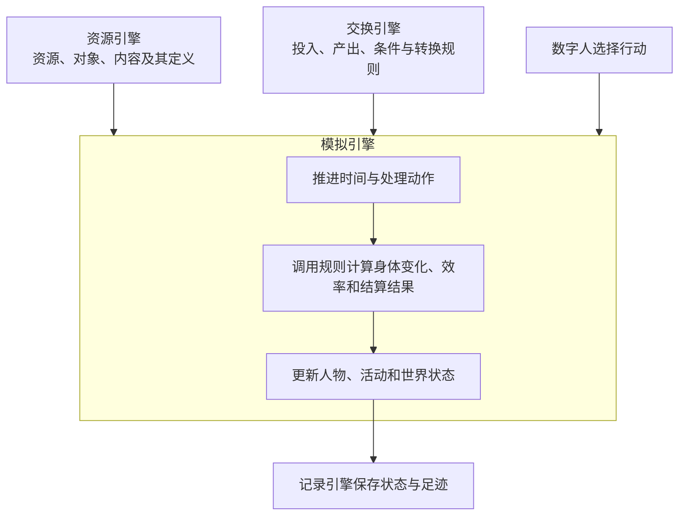

# WorldMock 产品设计说明书 — 概述

> 按[资源与规则引擎简化规格](../dev/SPEC-resource-and-rule-simplification.md#spec-rrs-资源与规则引擎简化开发规格)修订「地图中的消费行为」（阶段 2）；「地图中的消费行为」（阶段 3）。

> **状态**：DRAFT；按人物 Prompt 规格修订，修订部分已实现（证据见[人物 Prompt 验收记录](../archive/persona-prompt/persona-prompt-verification.md)） 
> **工具交互修订**：按[工具交互规格](../dev/SPEC-life-runtime.md#tool-interaction-工具请求)冻结本次设计；本次修订已实现，既有验收不覆盖新行为。
> **个人事务与工作安排修订**：按[个人事务与工作安排规格](../dev/SPEC-as2-integration.md#errands-workday-运行修复入库)分阶段同步（[实施计划](../archive/errands-workday/errands-workday-implementation-plan.md) D0 作业），已实现（离线验收，证据见[个人事务与工作安排验收记录](../archive/errands-workday/errands-workday-verification.md)）。
> **共享规则与可重建环境修订**：按[冻结规格](../dev/SPEC-shared-rules-and-rebuildable-env.md)同步框架职责、固定依赖与平台验收要求；实际证据见[本特性验收记录](../dev/shared-rules-and-rebuildable-env-verification.md)。
> **日期**：2026-10-07
> **版本**：v1.13
> **目标读者**：开发工程师、算法工程师、测试工程师、产品经理

具体环境及制作工具按[环境数据归属规格](../dev/SPEC-environment-data-ownership.md)归 WorldMock-Dataset，
正式环境为 `environment/zhangjiang-baseline/`；WorldMock 提供引擎及包内固定通用规则。
本章的 `catalog/`、`corpora/`、`scenarios/` 指外部环境目录，命令以 WorldMock 为当前工作目录并显式传路径。
当前场景结构 6，内容标题必填，活动效果随环境加载并在启动时冻结；新组合放行另核对实际收据。

## 文档定位

本文档是 WorldMock 设计文档集的概述章节，提供背景、目标、术语、设计原则与需求映射。
详细设计承接已有冻结规格：行为与算法以 [LifeEnv 运行时规格](../dev/SPEC-life-runtime.md#spec-life-runtime-特性规格lifeenv-运行时行为与结算规则)为准，
接口与字段以[接口合同](../CONTRACTS.md#contracts-worldmock-接口合同)为准。本目录仍为草稿，修订不改变冻结规格或实现状态。

## 1. 背景与目标

### 1.1 问题定义

大规模语言模型训练与规则引擎测试需要高质量的结构化数据，而人工标注存在以下问题：

- **成本高**：标注一个完整的多轮对话场景需要数小时人工
- **一致性差**：不同标注员对同一场景的理解存在差异
- **覆盖不全**：难以覆盖长时间跨度的复杂生活场景
- **溯源困难**：标注结果与原始数据的关联关系难以追踪

### 1.2 解决方案

WorldMock 通过**数字人生活模拟**生产高质量训练数据：

1. **AgentSociety 2 驱动**：复用成熟的 Agent 框架，数字人按自身需求与环境交互
2. **确定性规则引擎**：环境侧用确定性代码维护世界状态，保证数据可信
3. **完整数字足迹**：记录观察、决策、执行、状态变化、结果、记忆的完整过程
4. **LabelKit 交付**：数字足迹自动加工成模型训练数据与规则引擎测试数据

### 地图中的消费行为

数字人比较地点和图上最短距离，自主选择到店或配送。同类食品店铺共享菜单，食品全店同价；不同距离和履约时间仍形成真实的选择条件，系统不替人物选店。
资源引擎统一登记具体环境的对象、绑定与发布图；交换引擎提供固定速度、费用和公式；模拟引擎执行图上出行或配送；记录引擎保存实际看见的信息、完整路径、距离、付款与到达。四个引擎保持原职责。
地图由 WorldMock 生成、Dataset 发布，是合成连通加权图，不表达真实路网、GPS 或交通拥堵。等长最短路取完整路径元组字典序较小者，场景只选择地点，路径可以经过其他目录节点。
运行和恢复使用清单 `environment_identity`，只读发布图；旧道路资料和库存报价合同由现行图与菜单合同取代。真实名称不证明真实数值，合成输入与实际数字足迹分别留证。
开发范围见[资源与规则引擎简化规格](../dev/SPEC-resource-and-rule-simplification.md#spec-rrs-资源与规则引擎简化开发规格)，完整运行与平台结论按真实验收记录判定。

外卖来自店铺 app 绑定，每单只一次付款和一次送达；食品热量与完整食用时长按类别固定，数字足迹保留实际消费份额与身体效率。路途中自送须在出发前或到达后下单。

### 1.3 系统目标

| 目标维度 | 具体目标 |
| --- | --- |
| **覆盖范围** | 任意性格数字人的数字足迹模拟与记录 |
| **时间跨度** | 模拟时间跨度可配置，不限制长度 |
| **数据质量** | 可追溯、可验证、结构完整、来源明确 |
| **真实性** | 行为模式通过多维度评估，符合真实人类行为特征 |
| **可扩展性** | 支持多人物、多场景、反事实分支 |
| **下游对接** | LabelKit 可直接消费，生成模型训练与规则测试数据 |

### 1.4 非目标（明确不做）

- 不做物理仿真或 3D 渲染
- 不训练或托管本地模型
- 不做实时交互式界面
- 不做社会级宏观模拟（经济系统、政治系统）
- 不保证与任何特定真实个体的行为一致

## 2. 术语与缩写

### 2.1 核心术语

| 术语 | 定义 |
| --- | --- |
| **数字人（人物，`LifeAgent`）** | 被模拟的人，具有人格、需求、记忆与决策能力；`LifeAgent` 是其代码实现，继承 AgentSociety 2 的 `PersonAgent` |
| **[资源引擎](03-resource-engine.md#resource-engine-worldmock-产品设计说明书-资源引擎)** | 管理可计量资源、对象、内容及其固化语料的定义、属性、单位、版本与来源；按调用方给定的条件和范围提供目录查询、内容片段及素材引用 |
| **[交换引擎](02-exchange-engine.md#exchange-engine-worldmock-产品设计说明书-交换引擎)** | 维护注册表中的交换规则及其引用关系；运行时查询适用规则、校验交换条件、计算投入产出、校验资源分录并返回规则结果，例如判定购买条件、计算食品数量与付款金额、依合同计算报酬 |
| **[模拟引擎](04-simulation-engine.md#simulation-engine-worldmock-产品设计说明书-模拟引擎)** | 组织数字人与生活环境（`LifeEnv`）的交互，提供观察与决策机会，推进共享时钟和实际活动，计算身体变化与效率，调用交换规则并落实状态变化，编排恢复与实际反事实运行 |
| **[记录引擎](05-recording-engine.md#recording-engine-worldmock-产品设计说明书-记录引擎)** | 保存并关联模拟引擎提交的观察、决策、执行、状态变化、结果与记忆，核验记录一致性并导出数字足迹；保存共同检查点、构建分支存储并提供恢复材料，保留原分支与来源关系；恢复后的执行由模拟引擎编排 |
| **[数据交付](06-delivery.md#delivery-worldmock-产品设计说明书-数据交付)** | 消费记录引擎的认证导出，通过 LabelKit 加工训练数据与规则夹具；离线经历回顾、反思与假设推演（Dreaming）在此进行，默认不写回运行中的数字人 |

### 2.2 缩写

| 缩写 | 全称 |
| --- | --- |
| AS2 | AgentSociety 2 |
| LLM | Large Language Model |
| SQLite | 嵌入式关系数据库 |
| JSONL | JSON Lines，每行一个 JSON 对象的文本格式 |
| SHA-256 | 安全哈希算法 256 位 |

## 3. 设计原则

### 3.1 核心原则

| 原则 | 含义 | 来源/背书 |
| --- | --- | --- |
| **人物自主性** | 要不要做、做什么由人物决定，环境只判定可行性与施加资源约束；引导而不拦截；能量不阻断任何活动 | Agent 范式标准实践 |
| **确定性结算** | 世界状态由环境确定性代码维护，人物不能直接设置余额或状态 | 游戏引擎与经济模拟标准实践 |
| **唯一写入者** | 只有环境可写入数据库，避免并发冲突与状态不一致 | 事件溯源（Event Sourcing）模式 |
| **完整足迹** | 记录决策、执行、状态变化、结果的完整过程，不丢弃中间态 | 可审计系统设计原则 |
| **来源可追溯** | 每一条数据必须可追到原始来源：规则产生、模型生成或外部服务 | 数据血缘（Data Lineage）标准实践 |
| **离线语料** | 语料前置整理并固化版本，运行期只读，避免世界被动态改写 | 实验可复现性要求 |
| **检查点恢复** | 支持从任意检查点建立新分支，原运行保持不变 | 版本控制系统范式 |
| **失败即失败** | 故障不自动补造结果，状态异常立即中止 | Fail-fast 原则 |

### 3.2 数据质量原则

| 原则 | 含义 |
| --- | --- |
| **结构正确性** | 所有事件符合 Schema 定义，字段类型与约束严格校验 |
| **时序一致性** | 事件序号严格递增，状态版本连续，检查点可恢复 |
| **资源结算可核验** | 金钱转账两端守恒；能量与娱乐需要按流水和边界校验；睡眠按演化规则核对；共享时钟推进与实际结算时长一致 |
| **引用完整性** | 内容引用、记忆来源（由系统登记）、人际关系引用指向有效实体；relationship、preference 记忆的 `subject` 指向人设层中的对象（relationship 须是已知人物）；就寝反思每条洞见的 `refs` 非空、条内不重复且全部取自本次输入的记忆身份，不合合同的反思不写入任何洞见；个人事务的完成事件引用使它办成的结算证据事件，缺证据的完成计入质量报告的完整性计数（`errand_metrics.completed_without_evidence_count`）且应恒为 0 |
| **来源明确性** | 每条内容标记来源数据集、版本、区间与许可 |

## 4. 需求映射表

将原始需求逐条映射到设计文档集的承载章节：

| 原始需求 | 承载章节 | 状态 |
| --- | --- | --- |
| 数字人依据体感与处境自主选择活动，环境校验可行性 | [模拟引擎](04-simulation-engine.md#simulation-engine-worldmock-产品设计说明书-模拟引擎)「组织观察与决策机会」「收齐并有序受理动作」 | DRAFT |
| 人物只选对象与方式；查询不改变世界，可按购买来源与只看此刻能做的筛选，报错明确指出参数位置和合法选项 | [工具交互规格](../dev/SPEC-life-runtime.md#tool-interaction-工具请求)、[个人事务与工作安排规格](../dev/SPEC-as2-integration.md#errands-workday-运行修复入库)第五章、[模拟引擎](04-simulation-engine.md#simulation-engine-校验与占用安排) | 已实现，验收证据另列 |
| 普通工作收件即开放，到公司即可开始；现实预约活动按约定开放 | [模拟引擎](04-simulation-engine.md#simulation-engine-工作通知与开放时刻) | 已实现，验收证据另列 |
| 地点按 kind 池与逐店类别、对象声明提供不同完整供给，门店价格位置加确定性偏移后一次构建报价 | [资源引擎](03-resource-engine.md#resource-engine-worldmock-产品设计说明书-资源引擎)、[配置管理](08-configuration.md#configuration-worldmock-产品设计说明书-配置规格) | 已实现，验收证据另列 |
| 身体相关资源的变化影响体感和活动效率 | [模拟引擎](04-simulation-engine.md#simulation-engine-实际区间身体变化与效率)「实际区间、身体变化与效率」 | DRAFT |
| 工作消耗时间和能量，按有效工作量推进并依合同取得报酬 | [模拟引擎](04-simulation-engine.md#simulation-engine-推进实际活动)「推进实际活动」与[交换投入产出](02-exchange-engine.md#exchange-engine-计算投入产出) | DRAFT |
| 购买食品与实际进食分别结算，进食按热量与食品利用效率补充能量 | [模拟引擎](04-simulation-engine.md#simulation-engine-推进实际活动)「推进实际活动」与[交换投入产出](02-exchange-engine.md#exchange-engine-计算投入产出) | DRAFT |
| 睡眠改变睡眠压力并恢复睡眠不足，睡眠期间仍消耗能量 | [模拟引擎](04-simulation-engine.md#simulation-engine-实际区间身体变化与效率)「实际区间、身体变化与效率」 | DRAFT |
| 覆盖节目、游戏、邮件、导航、购物 | [资源引擎](03-resource-engine.md#resource-engine-交换对象与内容条目)「交换对象与内容条目」 | DRAFT |
| 内容来自固化的开源语料 | [资源引擎](03-resource-engine.md#resource-engine-整理与固化语料)「整理与固化语料」 | DRAFT |
| 人物画像影响行为偏好 | [人物决策与画像规格](../dev/SPEC-life-realism.md#spec-life-realism-画像编译)「画像编译」 | FROZEN |
| 决策不耗时，时间只在人人有进行中活动且没有待收尾活动时推进 | [模拟引擎](04-simulation-engine.md#simulation-engine-推进共享时钟)「推进共享时钟」与[时间与能量规格](../dev/SPEC-life-runtime.md#time-and-energy-决策不耗时时间只在做事时流动)第一章 | DRAFT |
| 零点计划：场景本地零点由运行时后台任务生成当日计划，不经人物；目标可带提醒 | [模拟引擎](04-simulation-engine.md#simulation-engine-接收当日目标并记录实际推进)「接收当日目标并记录实际推进」与[时间与能量规格](../dev/SPEC-day-plan-goals.md#time-and-energy-零点计划与计划提醒)第四章 | DRAFT |
| 人物提示为七层 JSON，每项信息只出现一次；同一秒的连续决策续接原生消息 | [模拟引擎](04-simulation-engine.md#simulation-engine-人物所见与可做之事)「人物所见与可做之事」与[人物 Prompt 规格](../dev/SPEC-life-realism.md#persona-prompt-七层请求)第一、二章 | DRAFT |
| 人物把以后要买到、拿到或吃掉的具体东西记成个人事务：跨日保留在待办层，办成只由环境按结算证据确认，人物只能取消并写原因 | [模拟引擎](04-simulation-engine.md#simulation-engine-人物所见与可做之事)「人物所见与可做之事」「依规则落实结算」「判断唤醒条件」与[个人事务与工作安排规格](../dev/SPEC-as2-integration.md#errands-workday-运行修复入库)第二、三章 | 已实现，验收证据另列 |
| 作息含下班与到家；场景按人物声明工作安排，环境层每轮写明今天的上班安排，今日计划改不了它，环境不因此拒绝请求 | [模拟引擎](04-simulation-engine.md#simulation-engine-人物所见与可做之事)「初始化运行世界」「人物所见与可做之事」「接收当日目标并记录实际推进」、[配置管理](08-configuration.md#configuration-worldmock-产品设计说明书-配置规格)与[个人事务与工作安排规格](../dev/SPEC-as2-integration.md#errands-workday-运行修复入库)第四章 | 已实现，验收证据另列 |
| 基于已有经历归纳、反思或进行假设推演 | [数据交付](06-delivery.md#delivery-dreaming-窗口提取规则)「dreaming 窗口提取规则」 | DRAFT |
| 完整记录观察、决策、执行、状态变化 | [记录引擎的事件结构](05-recording-engine.md#recording-engine-数字足迹事件结构) | 冻结约束已承接 |
| 支持检查点恢复与反事实分支 | [保存共同检查点](05-recording-engine.md#recording-engine-保存共同检查点)与[恢复与反事实分支](05-recording-engine.md#recording-engine-恢复与反事实分支) | 冻结约束已承接 |
| 交付给 LabelKit 生成训练数据 | `06-delivery.md` §LabelKit 接口与证据窗口 | DRAFT |
| 行为真实性多维度评估 | `07-evaluation.md` §指标定义与对比协议 | DRAFT |
| 场景可配置：地点、日历、天气、交通 | `08-configuration.md` §场景文件规格 | DRAFT |
| 明确区分规则产生、模型生成、外部服务 | [来源与可见性](05-recording-engine.md#recording-engine-来源与可见性) | 冻结约束已承接 |
| 运行过程可追踪、可调试 | [运行查询与诊断](05-recording-engine.md#recording-engine-运行查询与诊断) | 实现与缺口分列 |

## 5. 算法与工程背书总表

下表列出采用方案及依据；身体模型参数按冻结规格记录来源与仿真假设，不将参考模型等同于已验证的生理真实性：

| 功能点 | 采用方案 | 背书（论文/工业项目） |
| --- | --- | --- |
| Agent 框架 | AgentSociety 2 | 开源项目，已验证的多 Agent 调度与模型服务 |
| 能量与体感 | 进食热量、基础代谢与活动消耗决定可用能量；结合昼夜节律和餐时生成饥饿体感，低能量时饥饿分级不被昼夜项与餐时项压低，另设「饿得发慌」档；能量不阻断任何活动，最低为 0 | [运行时规格](../dev/SPEC-life-runtime.md#spec-life-runtime-特性规格lifeenv-运行时行为与结算规则)「其他体感分级」「转换效率算法」及其来源、假设标注；能量不阻断的依据见[时间与能量规格](../dev/SPEC-life-runtime.md#time-and-energy-能量不拦人)第三章；低能量分界是实验假设，见[实验定义](../EXPERIMENT.md#experiment-实验假设声明)「实验假设声明」 |
| 睡眠模型 | 两过程模型计算睡眠压力和困意；独立记录睡眠不足并计算效率 | [运行时规格](../dev/SPEC-life-runtime.md#spec-life-runtime-特性规格lifeenv-运行时行为与结算规则)「两过程睡眠模型」「睡眠不足账与效率曲线」；食品利用效率关系为仿真假设 |
| 工作验收 | 基于提交内容的 LLM 判定 | LLM-as-a-Judge 范式 |
| 内容呈现 | 确定性倒排索引与 facet | 信息检索标准实践（Lucene/Elasticsearch） |
| 数字足迹存储 | SQLite 事务 + 文件引用 | 事件溯源（Event Sourcing）模式 |
| 检查点恢复 | 完整状态快照 + 增量事件 | Git 的 snapshot + delta 模型 |
| 资源结算 | 货币双边转账；能量与娱乐需要单边流水；睡眠和时间按各自规则核验 | [交换引擎](02-exchange-engine.md#exchange-engine-校验资源分录)「校验资源分录」与[记录引擎](05-recording-engine.md#recording-engine-资金守恒验证)「资金守恒验证」 |
| 数据交付 | JSONL 批处理 | LabelKit 输入格式规范 |
| 行为评估 | 多维度指标 + 对比协议 | 社会模拟评估标准实践 |

## 6. 设计决策

系统采用以下设计：

| 设计点 | 设计决策 |
| --- | --- |
| 基础框架 | AgentSociety 2：复用模型调用、人物决策与记忆检索，保留任务生命周期、故障传播与检查点恢复；生活记忆合并和观察单写业务由 WorldMock 扩展承担 |
| 时间推进 | 决策不耗时；没有进行中活动或有待收尾活动者同一秒再决策，人人有事且无待收尾后按下一事件推进 |
| 世界状态 | 由环境集中维护，环境是唯一写入者 |
| 内容来源 | 离线整理并固化版本，运行期只读，保证实验可复现 |
| 语料检索 | 确定性索引：facet + 倒排，保证可复现与可追溯 |
| 存储方案 | SQLite 保存结构化数据并提供事务保证，素材以文件引用关联 |
| 人物并发 | 复用 AgentSociety 2 的 Ray 多进程机制 |
| 恢复策略 | 在新分支目录恢复，保留父运行 |
| 失败处理 | 故障立即中止，记录错误 |
| 人物数量 | v1.0 单人物 |

## 7. 非功能约束

| 约束类型 | 具体要求 |
| --- | --- |
| **性能** | 单人物 12 周模拟在 8 核 32GB 机器上 ≤ 24 小时完成 |
| **存储** | 单人物 12 周数字足迹 ≤ 10 GB（数据库 + 素材文件） |
| **可靠性** | 检查点恢复成功率 100%，状态版本连续性 100% |
| **可维护性** | 代码覆盖率 ≥ 85%，公共接口覆盖率 100% |
| **依赖** | Python 3.12，AgentSociety 2，LabelKit，SQLite 3.35+ |
| **平台** | Linux x86_64 / macOS；Windows 必须完成跨平台核心与重建验收，完整放行还须合并 Linux x86_64 TextWorld 语料成功证据。Linux ARM64/aarch64 不支持锁定的完整环境；平台边界以[共享规则与可重建环境规格](../dev/SPEC-shared-rules-and-rebuildable-env.md#shared-rules-门禁可选部件与操作系统)为准 |

## 8. 设计假设（若不成立需回到设计层）

| 假设 | 如果不成立的处理 |
| --- | --- |
| AS2 的模型调用、决策循环、记忆检索、任务生命周期与检查点机制可复用；生活记忆合并与观察单写业务由 WorldMock 扩展承担；同秒续接的消息由环境从已保存的模型证据重建，宿主在准备阶段之后注入，不改 AS2；回看任务的只读查询由 WorldMock 侧的 `LifeEnvActor`、`LifeEnvProxy` 两个子类转发到环境 actor，同样不改 AS2，对锁定提交三个私有成员（`DirectEnvActor._router`、`DirectRouter._environment()`、`EnvRouterProxy._actor`）的依赖随锁定提交验证 | 需重新评估 Agent 框架选型 |
| DeepSeek API 可稳定提供服务 | 记录并传播服务故障，保持固定模型身份，不替换模型 |
| 单人物场景足以验证系统可行性 | 需重新设计多人物协调机制 |
| 12 周时间跨度足以覆盖日常行为模式 | 需调整实验时长 |
| LabelKit 可消费 JSONL 格式的数字足迹 | 需重新设计交付格式 |
| 确定性索引足以支撑内容呈现需求 | 需评估向量检索的引入 |
| SQLite 事务性能足以支撑实时记录 | 需评估批量提交或其他数据库 |

## 9. 开放问题（后续版本议题）

| 问题 | 当前状态 | 计划 |
| --- | --- | --- |
| 多人物社交互动 | v1.0 单人物，社交最小可行版 | v2.0 考虑多人物完整社交 |
| 复杂情感模型 | v1.0 简化情感状态 | v2.0 考虑 OCC 情感模型 |
| 长期记忆压缩 | 提示中的记忆层按 session 派生、零点分区，限 8000 字符窗口；未完成的个人事务逐条留在待办层（每人至多 8 条），不占该窗口；记录全量保留 | v2.0 考虑记忆重要性评分与压缩 |
| 实时交互界面 | v1.0 纯批处理 | v3.0 考虑实时观察界面 |
| 模型微调反馈 | v1.0 固定模型 | v3.0 考虑在线学习 |
| 更多内容品类 | v1.0 覆盖基础品类 | v2.0 增加健身、医疗、教育等 |
| 更多地理区域 | v1.0 上海张江 | v2.0 支持多城市场景 |

## 10. 参考文献

1. AgentSociety 2 文档：https://github.com/OpenBMB/AgentSociety
2. [LabelKit 交付规格](../dev/SPEC-labelkit-delivery.md#spec-labelkit-delivery-特性规格数字足迹接入-labelkit)：独立进程、输入输出和交付验收合同
3. [LifeEnv 运行时规格](../dev/SPEC-life-runtime.md#spec-life-runtime-特性规格lifeenv-运行时行为与结算规则)：身体模型的算法、参数来源与仿真假设
4. Daan、Beersma 与 Borbély (1984)：两过程睡眠模型，采用方式见运行时规格
5. Event Sourcing Pattern - Martin Fowler
6. Git Internals - Scott Chacon
7. LLM-as-a-Judge: Zheng et al., NeurIPS 2023

## 当前实现与验收入口

人物行为、世界结算、事件顺序、提示、检查点、导出和交付合同保持不变。当前业务规则按基础规格的所属正文读取；五份已验收增量规格及其执行过程已归档，归档不改变真实十二周、隔离盲评、LabelKit 交付和真实模型复跑的未完成状态。
文档引用按显式稳定章节标识定位；代码依据按仓库相对的文件与实际定义定位。完整工程验收共用快速、标准、全量运行入口，以 `docs/VERIFICATION.md` 的工程门禁为准。

## 版本历史

| 版本 | 日期 | 修订内容 |
| --- | --- | --- |
| v1.0 | 2026-09-20 | 初版：背景目标、术语、设计原则、需求映射、背书总表、对齐决策 |
| v1.1 | 2026-09-20 | 统一资源术语；身体模型、体感、效率与结算规则承接冻结规格 |
| v1.2 | 2026-09-24 | 同步时间与能量规格：核心原则补引导而不拦截与能量不阻断；需求映射改为决策不耗时并增零点计划；背书补低能量显示；时间推进改为同刻再决策；记忆引用改为系统登记的记忆来源 |
| v1.3 | 2026-09-27 | 同步人物 Prompt 七层规格（人物 Prompt 台账 E0-1–E0-5）：文件头注明修订部分待实现；引用完整性补记忆 `subject` 指向人设层对象；需求映射增人物提示七层 JSON、唯一出现与同秒续接一行；设计假设注明续接从模型证据重建、不改 AS2；长期记忆改为按 session 派生、零点分区与 8000 字符窗口 |
| v1.4 | 2026-09-28 | 人物 Prompt 七层规格实现后文档：文件头注明修订部分已实现，链接人物 Prompt 验收记录；正文不变 |
| v1.5 | 2026-10-01 | 工具交互目标设计冻结并已实现：需求映射增加`items[]`选择与只读查询、英文逐位置错误、普通工作收件即开放与预约例外、类别完整供给及一次构建范围定价；新验收状态独立于历史通过记录 |
| v1.6 | 2026-10-03 | 同步个人事务与工作安排规格阶段 1（实施计划 D0-01–D0-03、D0-09）：引用完整性补就寝反思的引用核验；设计假设注明只读查询转发由 WorldMock 侧子类承载、不改 AS2；文件头增修订行；版本表改为末行最新 |
| v1.7 | 2026-10-03 | 同步个人事务与工作安排规格阶段 2（实施计划 D0-04–D0-06、D0-11，按 `d09d574` 的代码核对）：引用完整性补个人事务完成证据；需求映射增个人事务一行；长期记忆压缩注明未完成事务留在待办层、不占记忆窗口；文件头修订行改到阶段 2 |
| v1.8 | 2026-10-03 | 同步个人事务与工作安排规格阶段 4（实施计划 D0-08）：查询需求行补来源与可执行筛选；文件头修订行改为已落地阶段 1、2 与阶段 4（阶段 4 与阶段 2 并行开发，在阶段 2 之后并入） |
| v1.9 | 2026-10-03 | 同步个人事务与工作安排规格阶段 3（实施计划 D0-07）：需求映射增作息与工作安排一行；文件头修订行改为已落地阶段 1–4（阶段 3 在自己的分支上开发，在阶段 2、4 之后并入） |
| v1.10 | 2026-10-04 | 个人事务与工作安排规格实现后文档（实施计划 D0-14）：文件头修订行注明已实现并链接个人事务与工作安排验收记录（证据为离线测试，规格阶段 6 的配对全天复跑未执行）；正文不变 |
| 环境数据归属 | 2026-10-05 | 按环境数据归属规格同步双仓职责、包内通用规则与显式环境路径；场景结构 6、必填标题和冻结活动效果按正文说明，最终验收另记实际收据 |

| `2026-10-05-layering-and-test-tiers` | 2026-10-05 | 当前职责对象与依赖方向、五项行为正文归属、固定历史来源和稳定引用；业务与持久合同保持不变 |
| v1.11 | 2026-10-05 | 按共享规则与可重建环境规格同步 AS2 生命周期与 WorldMock 生活业务职责、Python 3.12、固定模型故障传播、相对交付引用、Windows 核心与重建验收要求及 Linux x86_64/TextWorld 与 aarch64 安装边界；验收要求不代表已经通过 |
| `2026-10-06-rrs-map` | 2026-10-07 | 随机连通加权图、最短距离出行与环境恢复身份；对应正文按资源与规则引擎简化规格地图阶段修订 |
| `2026-10-06-rrs-store` | 2026-10-07 | 食品、店铺 app 来源、固定价格与单订单结算；类别消费、六个输入警告和目录覆盖率，删除本阶段退役正文 |
