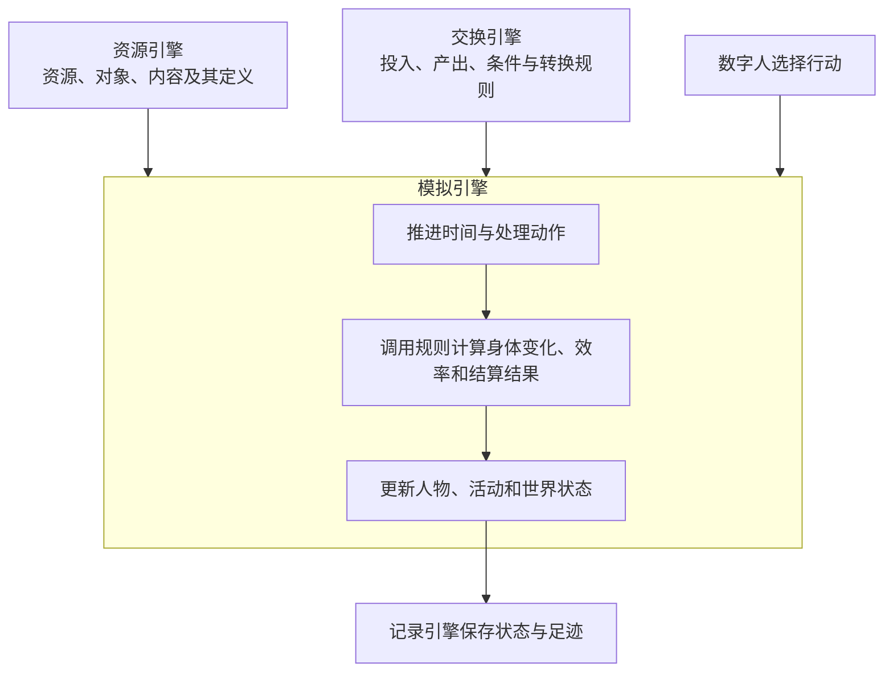

# WorldMock 产品设计说明书 — 概述

## 文档定位

本设计说明书按模块描述当前系统。模块正文是接口、状态、规则和约束的唯一维护位置；
`worldmock-design.html` 是同一正文生成的阅读附件。过程提案、开发规格和验收记录保存在 `docs/dev/`，
只解释当时的目标、取舍和结果，不参与当前行为的优先级判断。

## 背景与目标

### 问题定义

大规模语言模型训练与规则引擎测试需要高质量的结构化数据，而人工标注存在以下问题：

- **成本高**：标注一个完整的多轮对话场景需要数小时人工
- **一致性差**：不同标注员对同一场景的理解存在差异
- **覆盖不全**：难以覆盖长时间跨度的复杂生活场景
- **溯源困难**：标注结果与原始数据的关联关系难以追踪

### 解决方案

WorldMock 通过**数字人生活模拟**生产完整、连续、可追溯的数字足迹：

产出是动作与 app 使用的数字足迹，身体、资金、地图与工作为这些足迹提供处境。只有真实发生的 app 使用才写 app 事实：持续使用保留区间与逐条内容消费，线下辅助与导航只保留起止触点，没有 app 的动作不写 app 记录；每一行都能追到一个已提交的模拟事件。

- **AgentSociety 2 驱动**：复用成熟的 Agent 框架，数字人按自身需求与环境交互
- **确定性规则引擎**：环境侧用确定性代码维护世界状态，保证数据可信
- **完整数字足迹**：记录观察、决策、执行、状态变化、结果、记忆的完整过程
- **完整导出**：认证足迹交给 LabelKit-DataSet，由其完成数据加工和发布

### 地图中的消费行为

数字人选择现场购买或明确的购物 app；现场购买只在真实所在门店进行，远程购买由环境在该 app 绑定且供给商品的门店中选择预计送达最早者，同刻按店铺身份排序。同类型店铺共享菜单，同一商品跨店同价；距离、完整运输时长和配送费构成实际比较条件。
资源引擎统一登记具体环境的对象、绑定与发布图；交换引擎提供固定速度、费用和公式；模拟引擎执行图上出行或配送；记录引擎保存实际看见的信息、完整路径、距离、付款与到达。四个引擎保持原职责。
地图由 WorldMock 生成、Dataset 发布，是合成连通加权图，不表达真实路网、GPS 或交通拥堵。等长最短路取完整路径元组字典序较小者，场景只选择地点，路径可以经过其他目录节点。
运行和恢复使用清单 `environment_identity`，只读发布图；旧道路资料和库存报价合同由现行图与菜单合同取代。真实名称不证明真实数值，合成输入与实际数字足迹分别留证。
开发范围见[交换引擎](02-exchange-engine.md)，完整运行与平台结论按真实验收记录判定。

付款与实际收货分别留证：现场购买在同次提交收货，直送在配送到期时收货；完整运输时长严格大于 86400 秒的订单送往实际模拟收货人家庭地址最近且场景选中的驿站，恰为 86400 秒仍直送。到站只进入 `ready_for_pickup` 并通知收货人，没有商品效果。本人在站执行零秒领取，才结算本人全部可取订单。
每单由唯一收货函数恰好结算一次，写 `received_at`、订单终态、商品效果和本人 `goods_received`；不创建库存或持有物。食品按收货当秒的利用率与能量上限补充能量，其他商品按固定规则施加效果。字段、分录、幂等与唤醒边界统一见[请求字段与结算检查](04-simulation-engine.md)及[供给结算与事件载荷](09-io-formats.md)。

### 系统目标

| 目标维度 | 具体目标 |
| --- | --- |
| **覆盖范围** | 任意性格数字人的数字足迹模拟与记录 |
| **时间跨度** | 模拟时间跨度可配置，不限制长度 |
| **数据质量** | 可追溯、可验证、结构完整、来源明确 |
| **真实性** | 行为模式通过多维度评估，符合真实人类行为特征 |
| **可扩展性** | 支持完整环境数据集与反事实分支 |
| **下游对接** | 完整导出交给 LabelKit-DataSet；新消费验收仍待完成 |

### 非目标（明确不做）

- 不做物理仿真或 3D 渲染
- 不训练或托管本地模型
- 不做实时交互式界面
- 不做社会级宏观模拟（经济系统、政治系统）
- 不保证与任何特定真实个体的行为一致

## 术语与缩写

### 核心术语

| 术语 | 定义 |
| --- | --- |
| **数字人（人物，`LifeAgent`）** | 被模拟的人，具有人格、需求、记忆与决策能力；`LifeAgent` 是其代码实现，继承 AgentSociety 2 的 `PersonAgent` |
| **[资源引擎](03-resource-engine.md)** | 登记 app、地点、商品、动作、内容及其绑定；严格校验后提供冻结对象、反向索引与只读查询 |
| **[交换引擎](02-exchange-engine.md)** | 维护注册表中的交换规则及其引用关系；运行时查询适用规则、校验交换条件、计算投入产出、校验资源分录并返回规则结果，例如判定购买条件、计算食品数量与付款金额、依合同计算报酬 |
| **[模拟引擎](04-simulation-engine.md)** | 组织数字人与生活环境（`LifeEnv`）的交互，提供观察与决策机会，推进共享时钟和实际活动，计算身体变化与效率，调用交换规则并落实状态变化，编排恢复与实际反事实运行 |
| **[记录引擎](05-recording-engine.md)** | 保存并关联模拟引擎提交的观察、决策、执行、状态变化、结果与记忆，核验记录一致性并导出数字足迹；保存共同检查点、构建分支存储并提供恢复材料，保留原分支与来源关系；恢复后的执行由模拟引擎编排 |
| **LabelKit-DataSet 数据加工** | 消费记录引擎的认证导出，通过 LabelKit 加工训练数据与规则夹具；离线经历回顾、反思与假设推演（Dreaming）在此进行，默认不写回运行中的数字人 |
| **app** | 带固定用途、可被动作绑定的渠道；用途可为空，导航、购物与支付候选由目录用途确定 |
| **app 推送** | 当前地点会话内的一条 app 内容提醒；状态依次为 pending、opened、released，人物可以不打开 |
| **分配的工作内容** | 场景 `work_content_ids` 指向的工作与学习内容；目标工时来自内容时长 |
| **动作** | 数据集命名的行为，属于五个固定类别之一；可绑定 app 并取一种使用方式 |
| **内容** | 绑定恰好一个动作，带标题、摘要与时长；时长决定执行时间 |
| **商品** | 属于六个固定类别，按固定收货效果结算的目录对象；燃油只增加驾驶可用天数 |

### 缩写

| 缩写 | 全称 |
| --- | --- |
| AS2 | AgentSociety 2 |
| LLM | Large Language Model |
| SQLite | 嵌入式关系数据库 |
| JSONL | JSON Lines，每行一个 JSON 对象的文本格式 |
| SHA-256 | 安全哈希算法 256 位 |

## 设计原则

### 核心原则

| 原则 | 含义 | 来源/背书 |
| --- | --- | --- |
| **人物自主性** | 要不要做、做什么由人物决定，环境只判定可行性与施加资源约束；引导而不拦截；能量不阻断任何活动 | Agent 范式标准实践 |
| **确定性结算** | 世界状态由环境确定性代码维护，人物不能直接设置余额或状态 | 游戏引擎与经济模拟标准实践 |
| **唯一写入者** | 只有环境可写入数据库，避免并发冲突与状态不一致 | 事件溯源（Event Sourcing）模式 |
| **完整足迹** | 记录决策、执行、状态变化、结果的完整过程，不丢弃中间态 | 可审计系统设计原则 |
| **来源可追溯** | 每一条数据必须可追到原始来源：规则产生、模型生成或外部服务 | 数据血缘（Data Lineage）标准实践 |
| **离线语料** | 环境只经目录登记进入引擎，引擎不读语料；真实名称、合成或有出处的摘要与合成数值由数据仓目录提供 | 实验可复现性要求 |
| **检查点恢复** | 支持从任意检查点建立新分支，原运行保持不变 | 版本控制系统范式 |
| **失败即失败** | 故障不自动补造结果，状态异常立即中止 | Fail-fast 原则 |

### 数据质量原则

| 原则 | 含义 |
| --- | --- |
| **结构正确性** | 所有事件符合 Schema 定义，字段类型与约束严格校验 |
| **时序一致性** | 事件序号严格递增，状态版本连续，检查点可恢复 |
| **资源结算可核验** | 金钱转账两端守恒；能量与娱乐需要按流水和边界校验；睡眠按演化规则核对；共享时钟推进与实际结算时长一致 |
| **引用完整性** | 内容引用、记忆来源（由系统登记）、人际关系引用指向有效实体；relationship、preference 记忆的 `subject` 指向人设层中的对象（relationship 须是已知人物）；就寝反思每条洞见的 `refs` 非空、条内不重复且全部取自本次输入的记忆身份，不合合同的反思不写入任何洞见；个人事务的完成事件引用事务所有人自己的收货证据事件，缺证据的完成计入质量报告的完整性计数（`errand_metrics.completed_without_evidence_count`）且应恒为 0 |
| **来源明确性** | 每条内容标记来源数据集、版本、区间与许可 |

## 算法与工程背书总表

下表列出采用方案及依据；身体模型参数按冻结规格记录来源与仿真假设，不将参考模型等同于已验证的生理真实性：

| 功能点 | 采用方案 | 背书（论文/工业项目） |
| --- | --- | --- |
| Agent 框架 | AgentSociety 2 | 开源项目，已验证的多 Agent 调度与模型服务 |
| 能量与体感 | 收货热量、基础代谢与活动消耗决定可用能量；结合昼夜节律和餐时生成饥饿体感，低能量时饥饿分级不被昼夜项与餐时项压低，另设「饿得发慌」档；能量不阻断任何活动，最低为 0 | [模拟引擎](04-simulation-engine.md)「其他体感分级」「转换效率算法」及其来源、假设标注；能量不阻断的依据见[模拟引擎](04-simulation-engine.md)；低能量分界是实验假设，见[交换引擎](02-exchange-engine.md)「实验假设声明」 |
| 睡眠模型 | 两过程模型计算睡眠压力和困意；独立记录睡眠不足并计算效率 | [模拟引擎](04-simulation-engine.md)「两过程睡眠模型」「睡眠不足账与效率曲线」；食品利用效率关系为仿真假设 |
| 分配的工作内容 | 全局内容进度按真实秒数累计，达到内容时长即完成；模型注记不改变位置或轮数 | [持久化当下事实](09-io-formats.md) |
| 内容呈现 | 人物选择动作与明确的可用 app，环境按合格内容及本人真实进度选择；可续推送和未完成内容优先，时长来自内容余量，娱乐完成后在同一活动静默接续 | [请求字段与结算检查](04-simulation-engine.md) |
| 数字足迹存储 | SQLite 事务 + 文件引用 | 事件溯源（Event Sourcing）模式 |
| 检查点恢复 | 完整状态快照 + 增量事件 | Git 的 snapshot + delta 模型 |
| 资源结算 | 货币双边转账；能量与娱乐需要单边流水；睡眠和时间按各自规则核验 | [交换引擎](02-exchange-engine.md)「校验资源分录」与[记录引擎](05-recording-engine.md)「资金守恒验证」 |
| 足迹交接 | 固定截止 JSONL | 记录引擎的导出与来源认证合同 |
| 行为评估 | 多维度指标 + 对比协议 | 社会模拟评估标准实践 |

## 设计决策

系统采用以下设计：

| 设计点 | 设计决策 |
| --- | --- |
| 基础框架 | AgentSociety 2：复用模型调用、人物决策与记忆检索，保留任务生命周期、故障传播与检查点恢复；生活记忆合并和观察单写业务由 WorldMock 扩展承担 |
| 时间推进 | 决策不耗时；没有进行中活动或有待收尾活动者同一秒再决策，人人有事且无待收尾后按下一事件推进 |
| 世界状态 | 由环境集中维护，环境是唯一写入者 |
| 内容来源 | 离线整理并固化版本，运行期只读，保证实验可复现 |
| 内容提供 | 内容→动作→可选的 app 显式绑定；抽取只读冻结随机状态和固定键，保证恢复与重演得到同一序列 |
| 存储方案 | SQLite 保存结构化数据并提供事务保证，素材以文件引用关联 |
| 人物并发 | 复用 AgentSociety 2 的 Ray 多进程机制 |
| 恢复策略 | 在新分支目录恢复，保留父运行 |
| 失败处理 | 故障立即中止，记录错误 |
| 人物数量 | v1.0 单人物 |

## 非功能约束

| 约束类型 | 具体要求 |
| --- | --- |
| **性能** | 单人物 12 周模拟在 8 核 32GB 机器上 ≤ 24 小时完成 |
| **存储** | 单人物 12 周数字足迹 ≤ 10 GB（数据库 + 素材文件） |
| **可靠性** | 检查点恢复成功率 100%，状态版本连续性 100% |
| **可维护性** | 代码覆盖率 ≥ 85%，公共接口覆盖率 100% |
| **依赖** | Python 3.12，AgentSociety 2，SQLite 3.35+ |
| **平台** | Linux x86_64 / macOS；Windows 必须完成跨平台核心与重建验收。当前 macOS 收据与尚未执行的 Windows 收据分别登记，不能由单平台结果推定跨平台放行；平台边界以[运行与框架集成](10-runtime.md)为准 |

## 设计假设（若不成立需回到设计层）

| 假设 | 如果不成立的处理 |
| --- | --- |
| AS2 的模型调用、决策循环、记忆检索、任务生命周期与检查点机制可复用；生活记忆合并与观察单写业务由 WorldMock 扩展承担；同秒续接的消息由环境从已保存的模型证据重建，宿主在准备阶段之后注入，不改 AS2；回看任务的只读查询由 WorldMock 侧的 `LifeEnvActor`、`LifeEnvProxy` 两个子类转发到环境 actor，同样不改 AS2，对锁定提交三个私有成员（`DirectEnvActor._router`、`DirectRouter._environment()`、`EnvRouterProxy._actor`）的依赖随锁定提交验证 | 需重新评估 Agent 框架选型 |
| 实际模型服务提供声明的容量与原生工具调用 | 核验服务元数据，记录并传播故障，不替换模型 |
| 一个完整环境描述唯一人物 | 人物和运行参数只来自两份根级 TOML |
| 12 周时间跨度足以覆盖日常行为模式 | 需调整实验时长 |
| 内容→动作→可选的 app 的显式绑定足以支撑人物选择入口、环境抽取内容和完整来源追溯 | 需重新评估内容目录与 app 绑定合同 |
| SQLite 事务性能足以支撑实时记录 | 需评估批量提交或其他数据库 |

## 参考文献

- AgentSociety 2 文档：https://github.com/OpenBMB/AgentSociety
- [模拟引擎](04-simulation-engine.md)：身体模型的算法、参数来源与仿真假设
- Daan、Beersma 与 Borbély (1984)：两过程睡眠模型，采用方式见运行时规格
- Event Sourcing Pattern - Martin Fowler
- Git Internals - Scott Chacon
- [交换引擎](02-exchange-engine.md)：app 绑定、确定性抽取、推送与全局内容进度

- [模拟引擎](04-simulation-engine.md)：固定规则、目录格式与加载边界。
