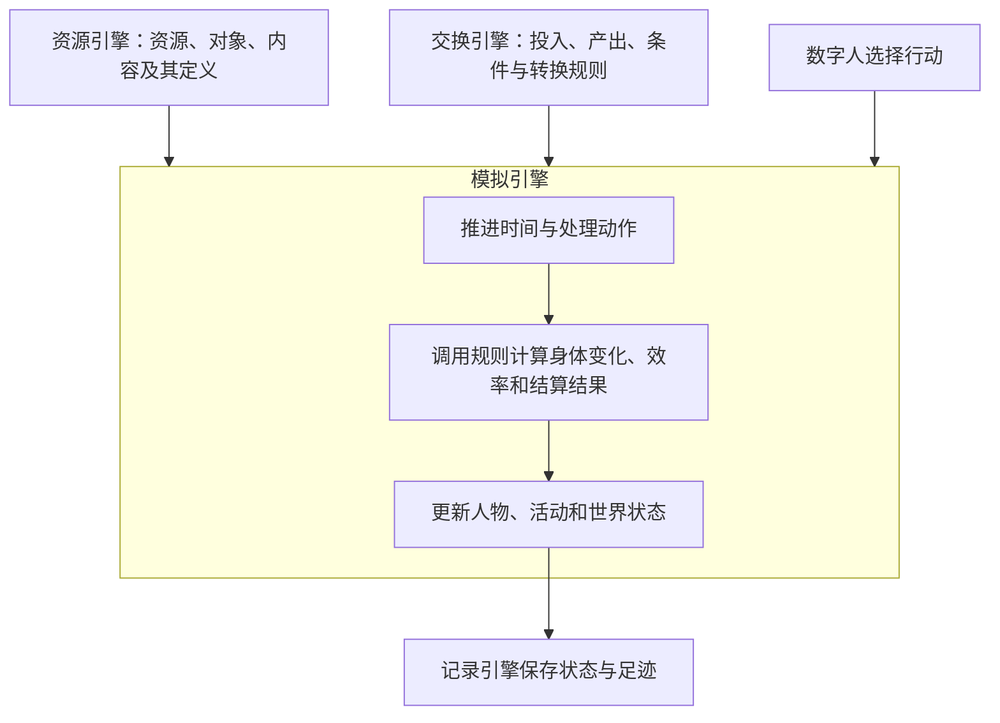

# WorldMock 产品设计说明书 — 概述

## 文档定位

本设计说明书按模块描述当前系统。模块正文是接口、状态、规则和约束的唯一维护位置；
`worldmock-design.html` 是同一正文生成的阅读附件。过程提案、开发规格和验收记录保存在 `docs/dev/`，
只解释当时的目标、取舍和结果，不参与当前行为的优先级判断。

## 背景与目标

### 问题定义

大规模语言模型训练与规则引擎测试需要高质量的结构化数据，而人工标注存在以下问题：

- **成本高**：标注一个完整的多轮对话场景需要数小时人工
- **一致性差**：不同标注员对同一场景的理解存在差异
- **覆盖不全**：难以覆盖长时间跨度的复杂生活场景
- **溯源困难**：标注结果与原始数据的关联关系难以追踪

### 解决方案

WorldMock 通过**数字人生活模拟**生产完整、连续、可追溯的数字足迹：

产出是动作与 app 使用的数字足迹，身体、资金、地图与工作为这些足迹提供处境。只有真实发生的 app 使用才写 app 事实：持续使用保留区间与逐条内容消费，搜索（`search_world`）那几分钟若锁定或归属了下单应用则保留这项搜索的执行区间；导航、下单和支付时在前台的 app 同样保留有开有关的前台区间，没有 app 的动作不写 app 记录；每一行都能追到一个已提交的模拟事件。

- **WorldMock 自有的并发唤醒与时钟屏障内核**：一名或多名数字人按自身需求与环境交互，全局确定性时钟屏障、人物级沙盒 `AgentLoop`、隔离上下文的 `LLM Search Session`、模型调用与共同检查点由 WorldMock 自己的代码承担
- **确定性规则引擎**：环境侧用确定性代码维护世界状态，经 `Fact Guard` 约束商品报价与地点投影，保证数据可信
- **完整数字足迹**：记录观察、唤醒会话、执行、状态变化、结果、记忆的完整过程
- **完整导出**：认证足迹交给 LabelKit-DataSet，由其完成数据加工和发布

### 地图中的消费行为

数字人写要买的商品名称，一份一项，并在 `prefer` 里写想用来下单的 app，没有想法写 `null`；到店、外卖还是快递仍由环境按商品的绑定和人物真实的停留地点派生。人在供给这件商品的店里就是到店购买，不看 `prefer`，店铺须在营业。不在店里时，店铺商品由环境在供给它、绑定了内容 app 且此刻营业的店铺中选一家送外卖：其中有登记了人物所写 app 的店时只在这些店里选、经这个 app 下单，可以因此换到更远的店；没有时在全部这些店里选，下单 app 由环境抽取。绑定在内容 app 上的商品走快递，人物所写的 app 在商品登记的 app 之内就用它，否则抽取。一次买几件时每件各自判断。实际用了哪个 app、还是到店买的，写在购买结果里。选店的排序、抽取的键和每件各判的细则见[模拟引擎](04-simulation-engine.md)「购买、付款与收货」与[配置](08-configuration.md)「唯一种子与随机键」。同类型地点共享商品集合，同一商品各店同价；外卖时长随店铺到收货地点的图上距离增加，运费按配送组合并。
资源引擎统一登记具体环境的对象、绑定、出行方式与声明的距离，并生成内存地图；交换引擎提供步行与配送的固定数值、天气系数和计时计费公式；模拟引擎执行图上出行或配送；记录引擎保存实际看见的信息、完整路径、距离、付款与到达。四个引擎保持原职责。
地图是合成连通加权图，不表达真实路网、GPS 或交通拥堵：两地的距离可由数据集声明，其余的边由 WorldMock 按运行种子随机生成，生成结果不发布。等长最短路取完整路径元组字典序较小者，场景只选择地点，路径可以经过其他目录节点。
运行和恢复核对清单 `environment_identity`，其中的地图摘要取决于地点集合、声明的距离和运行种子；生成的地图随运行素材冻结，运行中只读。真实名称不证明真实数值，合成输入与实际数字足迹分别留证。
开发范围见[交换引擎](02-exchange-engine.md)，完整运行与平台结论按真实验收记录判定。

付款与实际收货分别留证：购买走到计划结束的那一秒才扣款。到店购买的商品履约记录随付款当秒收货；外卖在配送到期时真实送达并收货，路程再长也不改走快递；绑定在内容 app 上的商品一律走快递，按本地日期边界送到离住处最近的驿站。到站只进入 `ready_for_pickup` 并通知收货人，没有商品效果；本人到站后在本站开始一件事时，才领取并结算本站全部到站包裹。
每条商品履约记录由唯一收货函数恰好结算一次，写 `received_at`、记录终态、商品效果和本人 `goods_received`；不创建库存或持有物。零食和食品按收货当秒的利用率与能量上限补充能量，饮料和商品减少放松需要。地点内容可以声明做完时的一次性效果：在地点做完一件声明了 `completion_effects.food` 的事，在做完的那一秒按同一规则补充一份零食或一餐的能量，不经收货，见[交换引擎](02-exchange-engine.md)「收货与费用」。订单、配送组、付款、通知与到达排程见[模拟引擎](04-simulation-engine.md)「购买、付款与收货」，收货效果见[交换引擎](02-exchange-engine.md)「收货与费用」，字段见[状态与序列化](09-io-formats.md)「世界、人物与活动」。

### 系统目标

| 目标维度 | 具体目标 |
| --- | --- |
| **覆盖范围** | 任意性格数字人的数字足迹模拟与记录 |
| **时间跨度** | 模拟时间跨度可配置，不限制长度 |
| **数据质量** | 可追溯、可验证、结构完整、来源明确 |
| **真实性** | 以已记录事实分析行为模式；统计结果不自动证明与真实个体一致 |
| **可扩展性** | 支持完整环境数据集与反事实分支 |
| **下游对接** | 完整导出交给 LabelKit-DataSet；新消费验收仍待完成 |

### 非目标（明确不做）

- 不做物理仿真或 3D 渲染
- 不训练或托管本地模型
- 不做实时交互式界面
- 不做社会级宏观模拟（经济系统、政治系统）
- 不保证与任何特定真实个体的行为一致

## 术语与缩写

### 核心术语

| 术语 | 定义 |
| --- | --- |
| **数字人（人物，`LifeAgent`）** | 被模拟的人，具有人格、需求、记忆与决策能力；环境支持一名或多名数字人共享同一世界时钟并发运行，`LifeAgent`（`src/worldmock/agents/life_agent.py`）依托通用 `AgentLoop` 在个人内存沙盒 `AgentSandbox` 中完成单次唤醒会话并交由 `BarrierMerger` 确定性提交 |
| **[资源引擎](03-resource-engine.md)** | 登记 app、地点、商品、内容、出行方式及其绑定；严格校验后提供冻结对象、反向索引与只读查询 |
| **[交换引擎](02-exchange-engine.md)** | 维护注册表中的交换规则及其引用关系；运行时查询适用规则、校验交换条件、计算投入产出、校验资源分录并返回规则结果，例如判定购买条件、计算食品数量与付款金额、依合同计算报酬 |
| **[模拟引擎](04-simulation-engine.md)** | 组织数字人与生活引擎（`LifeEngine`）的交互，提供观察与唤醒机会，推进共享时钟和实际活动，运行沙盒工具结算、搜索完成投影与 `BarrierMerger` 确定性提交，计算身体变化与效率，编排恢复与实际反事实运行 |
| **[记录引擎](05-recording-engine.md)** | 保存并关联模拟引擎提交的观察、唤醒会话、执行、状态变化、结果与记忆，核验记录一致性并导出数字足迹；保存共同检查点、构建分支存储并提供恢复材料，保留原分支与来源关系；恢复后的执行由模拟引擎编排 |
| **LabelKit-DataSet 数据加工** | 消费记录引擎的认证导出，通过 LabelKit 加工训练数据与规则夹具；离线经历回顾、反思与假设推演（Dreaming）在此进行，默认不写回运行中的数字人 |
| **app** | 数据集登记的渠道，分内容 app 与功能 app。内容 app 承载内容、供应商品或被供应商品的地点绑定：登记了内容的，人物可以点名打开，只看内容；能接单的（直接登记了商品，或被实际卖商品的地点登记）叫下单 app，人物购买和搜索时可以把它写进 `prefer`，用不上时由环境抽取；没有登记内容的只用于下单和搜索引导，不能单独打开。功能 app 由引擎代为选用，绑定 `purchase` 的是支付 app 候选，绑定某种出行方式的是这种方式的导航 app 候选 |
| **app 推送** | 当前地点会话内的一条 app 内容提醒；状态依次为 pending、opened、released，人物可以不打开 |
| **分配的工作内容** | 场景 `work_content_ids` 指向的工作与学习内容；目标工时来自内容时长 |
| **动作** | 引擎固定的活动启动方式：主槽位使用 `start_main_activity`（`travel`、`interact`、`sleep`），副槽位使用 `start_side_activity`（`purchase`、`interact`）与独立原生工具 `search_world`（发起 `ActivityKind.SEARCH` 搜索会话）；数据集不登记动作，出行方式写在 `travel` 的 `detail` 里 |
| **内容** | 绑定到内容 app 或地点类型，恰有一侧，带标题、摘要与时长；时长决定执行时间，绑定到 app 的内容可以另写开始的前提；绑定到地点类型的内容可以另写做完时的一次性效果 `completion_effects` |
| **商品** | 属于零食、食品、饮料、商品四个固定类别之一的目录对象，带固定单价，绑定到地点类型或内容 app，恰有一侧；按固定收货效果结算，不形成库存 |

### 缩写

| 缩写 | 全称 |
| --- | --- |
| LLM | Large Language Model |
| SQLite | 嵌入式关系数据库 |
| JSONL | JSON Lines，每行一个 JSON 对象的文本格式 |
| SHA-256 | 安全哈希算法 256 位 |

## 设计原则

### 核心原则

| 原则 | 含义 | 来源/背书 |
| --- | --- | --- |
| **人物自主性** | 要不要做、做什么由人物决定，环境只判定可行性与施加资源约束；引导而不拦截；能量不阻断任何活动 | Agent 范式标准实践 |
| **确定性结算** | 世界状态由环境确定性代码维护，人物不能直接设置余额或状态 | 游戏引擎与经济模拟标准实践 |
| **唯一写入者** | 只有环境可写入数据库，避免并发冲突与状态不一致 | 事件溯源（Event Sourcing）模式 |
| **完整足迹** | 记录决策、执行、状态变化、结果的完整过程，不丢弃中间态 | 可审计系统设计原则 |
| **来源可追溯** | 每一条数据必须可追到原始来源：规则产生、模型生成或外部服务 | 数据血缘（Data Lineage）标准实践 |
| **离线语料** | 环境只经目录登记进入引擎，引擎不读语料；真实名称、合成或有出处的摘要与合成数值由数据仓目录提供 | 实验可复现性要求 |
| **检查点恢复** | 支持从任意检查点建立新分支，原运行保持不变 | 版本控制系统范式 |
| **失败即失败** | 故障不自动补造结果，状态异常立即中止 | Fail-fast 原则 |

### 数据质量原则

| 原则 | 含义 |
| --- | --- |
| **结构正确性** | 所有事件符合 Schema 定义，字段类型与约束严格校验 |
| **时序一致性** | 事件序号严格递增，状态版本连续，检查点可恢复 |
| **资源结算可核验** | 金钱转账两端守恒；能量与娱乐需要按流水和边界校验；睡眠按演化规则核对；共享时钟推进与实际结算时长一致 |
| **引用完整性** | 内容引用、记忆来源（由系统登记）、人际关系引用指向有效实体；relationship、preference 记忆的 `subject` 指向这次收尾点名的对象，relationship 须是卡片上的人物；日、月、年回顾每类的 `refs` 非空、全部是这一类输入行的编号，不合的类重试，用完记为 null 并列入 `fallback`；个人事务的完成事件引用事务所有人自己的收货证据事件，缺证据的完成计入质量报告的完整性计数（`errand_metrics.completed_without_evidence_count`）且应恒为 0 |
| **来源明确性** | 每条内容标记来源数据集、版本、区间与许可 |

## 算法与工程背书总表

下表列出采用方案及依据；身体模型参数按冻结规格记录来源与仿真假设，不将参考模型等同于已验证的生理真实性：

| 功能点 | 采用方案 | 背书（论文/工业项目） |
| --- | --- | --- |
| 决策与唤醒循环 | 全局确定性时钟屏障 + 人物级沙盒 `AgentLoop` + 无栈挂起恢复：就绪人物基于只读快照并发推进个人内存沙盒，`BarrierMerger` 按 `agent_id` 升序单事务合入并校验跨人物冲突，每步写一个共同检查点 | 离散事件时钟屏障同步、并发沙盒事务提交与无栈挂起恢复模式 |
| 能量与体感 | 收货热量、地点内容完成效果的热量、基础代谢与活动消耗决定可用能量；结合昼夜节律和餐时生成饥饿体感，低能量时饥饿分级不被昼夜项与餐时项压低，另设「饿得发慌」档；能量不阻断任何活动，最低为 0 | [交换引擎](02-exchange-engine.md)「身体共同结算」；低能量分界是实验假设 |
| 睡眠模型 | 两过程模型计算睡眠压力和困意；独立记录睡眠不足并计算效率 | [交换引擎](02-exchange-engine.md)「身体共同结算」；食品利用效率关系为仿真假设 |
| 分配的工作内容 | 全局内容进度按真实秒数累计，达到内容时长即完成；模型注记不改变位置或轮数；在地点做的事被人物用 `conclude_activity` 结束时，整件事同样记为做完一轮 | [状态与序列化](09-io-formats.md)「世界、人物与活动」、[模拟引擎](04-simulation-engine.md)「出行、内容与搜索」 |
| 内容呈现 | 人物选择动作与明确的可用 app，环境按合格内容（这个 app 的内容里此刻满足内容前提的那些）及本人真实进度选择；打开时可续推送和未完成内容优先，每条内容的时长来自内容余量；一次 app 使用放完一条自动接下一条（系列的下一集，最近放过而没放完的另一部系列，或随机一条没看过的独立内容，后两种只取可推送的合格内容），没有可接的才停下等人物收尾；在地点做的事系列按集号接续，非系列内容做完活动即结束 | [模拟引擎](04-simulation-engine.md)「出行、内容与搜索」 |
| 数字足迹存储 | SQLite 事务 + 文件引用 | 事件溯源（Event Sourcing）模式 |
| 检查点恢复 | 完整状态快照 + 增量事件 | Git 的 snapshot + delta 模型 |
| 资源结算 | 货币双边转账；能量与娱乐需要单边流水；睡眠和时间按各自规则核验 | [交换引擎](02-exchange-engine.md)「资源与账户」与[记录引擎](05-recording-engine.md)「事件与来源」 |
| 足迹交接 | 固定截止 JSONL | 记录引擎的导出与来源认证合同 |
| 行为分析 | 已记录事实的行为与工作统计 | 确定性统计与明确的缺失说明 |

## 设计决策

系统采用以下设计：

| 设计点 | 设计决策 |
| --- | --- |
| 决策与唤醒循环 | 全局确定性时钟屏障与人物级沙盒 `AgentLoop`：`RunHost` 驱动到期搜索子会话、并发唤醒屏障、推进与共同检查点，故障传播与无栈挂起恢复由 WorldMock 自己的代码承担，见[运行装配与决策循环](10-runtime.md)「时钟屏障与并发唤醒循环」 |
| 时间推进 | 单次唤醒内零耗时只读查询、控制动作与拒绝纠偏留在个人沙盒内即时回传；全员提交持续活动、进入挂起或休眠后按最早事件边界推进共享时钟 |
| 世界状态 | 由模拟引擎唯一同步提交，沙盒与模型协程绝不原地修改已提交状态 |
| 内容来源 | 离线整理并固化版本，运行期只读，保证实验可复现 |
| 内容提供 | 内容显式绑定到内容 app 或地点类型；抽取只读冻结随机状态和固定键，保证恢复与重演得到同一序列 |
| 存储方案 | SQLite 保存结构化数据并提供单事务保证，素材以文件引用关联 |
| 人物并发 | 支持多数字人并发：同刻就绪人物经 `asyncio.gather` 并发运行私有沙盒与 `EvidenceBuffer`，`BarrierMerger` 按 `agent_id` 升序确定性提交并校验共享资源冲突，保证事件序号与随机流逐字节可复现 |
| 恢复策略 | 在新分支目录恢复，保留父运行与挂起恢复载荷；反事实干预清空挂起状态 |
| 失败处理 | 故障立即中止，补写未落盘证据并记录错误 |
| 人物数量 | 支持一名或多名数字人并发（`personas/*.toml` 非空） |

## 非功能约束

| 约束类型 | 具体要求 |
| --- | --- |
| **性能** | 单人物 12 周模拟在 8 核 32GB 机器上 ≤ 24 小时完成 |
| **存储** | 单人物 12 周数字足迹 ≤ 10 GB（数据库 + 素材文件） |
| **可靠性** | 检查点恢复成功率 100%，状态版本连续性 100% |
| **可维护性** | 代码覆盖率 ≥ 85%，公共接口覆盖率 100% |
| **依赖** | Python 3.12，SQLite 3.35+ |
| **平台** | Linux x86_64 / macOS；Windows 必须完成跨平台核心与环境重建验收。当前 macOS 收据与尚未执行的 Windows 收据分别登记，不能由单平台结果推定跨平台放行；平台边界以[运行装配与决策循环](10-runtime.md)为准 |

## 设计假设（若不成立需回到设计层）

| 假设 | 如果不成立的处理 |
| --- | --- |
| 全局时钟屏障与人物级沙盒 `AgentLoop` 足以承载多数字人并发运行：`asyncio.gather` 并发执行只读输入上的网络 I/O，写库严格收口在 `LifeEngine.commit_barrier` 同步单事务中按 `agent_id` 升序提交；`search_world` 通过 `AgentState.suspended_loop` 无栈挂起恢复，`LLM Search Session` 与 `Fact Guard` 隔离目录检索并杜绝价格幻觉 | 若未来需扩展跨人物同步强交互（如面谈协商、实时共享房间占座），可继续在 `BarrierMerger` 中扩充共享资源冲突判定并在不打破单事务提交的前提下重唤醒冲突人物 |
| 双维异构模型路由（`[models.*]` 与 `[model_routing]`）与实际模型服务提供声明容量和原生工具调用 | 由 `ModelRegistry` 在启动准入时按实际路由档案逐项核验元数据并复用连接池，记录并传播故障，不静默替换模型 |
| 环境包根目录由 `catalog/`、`personas/*.toml` 与 `config.toml` 组成，支持一个或多个数字人共享世界 | 人物声明与运行参数严格来自对应 TOML 文件，不接受遗留旧结构 |
| 12 周时间跨度足以覆盖日常行为模式 | 需调整实验时长 |
| 内容到内容 app 或地点类型的显式绑定足以支撑人物选择入口、环境抽取内容和完整来源追溯 | 需重新评估内容目录与 app 绑定合同 |
| SQLite 事务性能足以支撑实时记录 | 需评估批量提交或其他数据库 |

## 参考文献

- [交换引擎](02-exchange-engine.md)：身体模型的算法、参数与仿真假设，资金与收货的结算
- Daan、Beersma 与 Borbély (1984)：两过程睡眠模型，采用方式见[交换引擎](02-exchange-engine.md)「身体共同结算」
- Event Sourcing Pattern - Martin Fowler
- Git Internals - Scott Chacon
- [资源引擎](03-resource-engine.md)：目录格式、对象绑定、地图与加载边界
- [模拟引擎](04-simulation-engine.md)：动作、出行、内容、搜索、购买、推送与唤醒的规则
