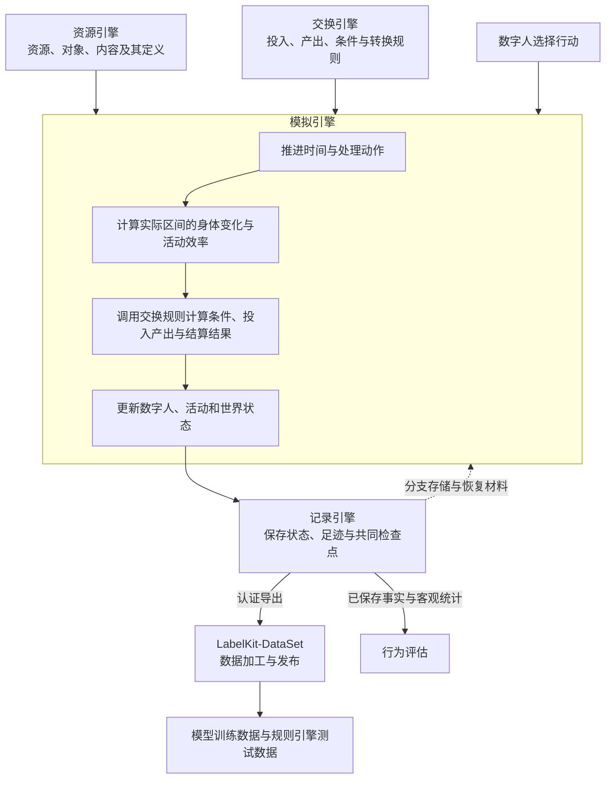
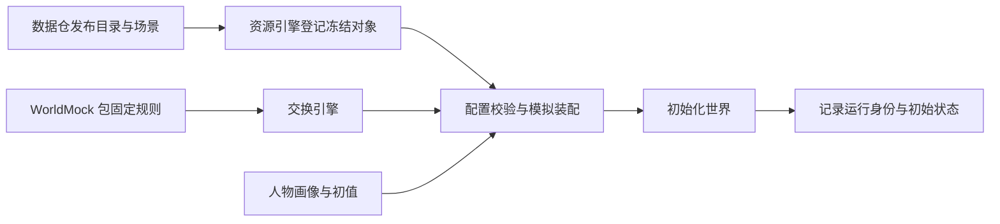
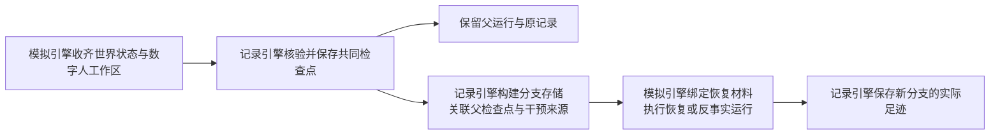
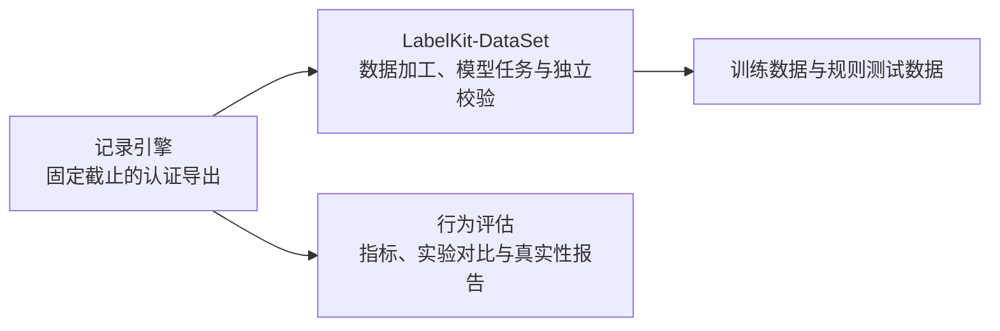
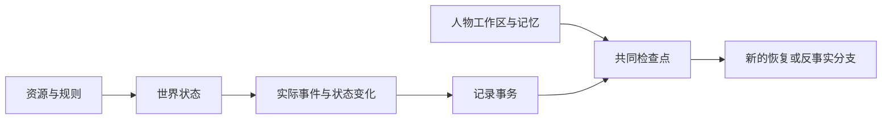

<a name="architecture"></a>
# WorldMock 产品设计说明书 — 总体架构

<a name="architecture-系统定位与总体规格"></a>
## 系统定位与总体规格

<a name="architecture-系统定位"></a>
### 系统定位

WorldMock 是数字人生活模拟与数字足迹系统。数字人作选择，环境按统一规则推进世界，记录引擎保存实际发生的过程；行为评估据此比较实验结果。系统用清楚的状态归属把模型叙述与客观事实分开。

<a name="architecture-系统边界"></a>
### 系统边界

系统包含数字人与环境的交互、资源与内容提供、交换规则、时间与活动推进、
数字足迹记录、恢复与分支，以及向 LabelKit-DataSet 提供完整足迹导出。

系统不包含物理仿真或三维渲染、模型训练或托管、实时交互式界面、
社会级宏观模拟或真实银行、电商等外部业务系统集成，也不保证与任何特定真实个体的行为一致。
资源和规则使用运行前整理并绑定的版本。

<a name="architecture-总体架构与职责分工"></a>
## 总体架构与职责分工

<a name="architecture-总体架构"></a>
### 总体架构

资源引擎提供世界里可使用的定义与内容，交换引擎提供条件和转换规则。
模拟引擎组织数字人的选择与世界变化，记录引擎保存实际过程和结果。



图中的引擎表示职责边界。AgentSociety 2 提供调度、模型调用、人物决策与记忆基础；
LifeAgent 承载数字人，LifeEnv 是模拟引擎接入 AgentSociety 2 的环境入口。
现有代码文件可以承载多个引擎的处理逻辑，不能仅凭目录名称判定职责归属。

<a name="architecture-职责与交接"></a>
### 职责与交接

| 负责方 | 负责什么 | 向协作方交付什么 |
| --- | --- | --- |
| [数字人](06-agent.md) | 画像、七层提示组装、行动选择、收尾记忆与反思 | 向模拟引擎提交动作请求（播报、暂停与收尾请求可携带个人事务的新增、更新与取消），提供决策和记忆证据 |
| [资源引擎](03-resource-engine.md) | 资源与对象定义、动作与内容绑定、版本与来源、查询与提供 | 返回指定版本的定义、属性、匹配条目、内容片段与素材引用 |
| [交换引擎](02-exchange-engine.md) | 维护与查询交换规则，校验条件，计算投入产出，校验资源分录 | 返回条件判定、资源变化明细、履约条件或拒绝原因 |
| [模拟引擎](04-simulation-engine.md) | 初始化、时间调度、动作受理、世界结算与恢复编排 | 人物观察与反馈、实际事件、状态和共同快照 |
| [记录引擎](05-recording-engine.md) | 保存与关联足迹、素材和状态，校验记录一致性，保存检查点，构建分支存储，认证导出与诊断 | 返回保存确认、已核验的恢复材料、认证导出和客观统计 |
| LabelKit-DataSet 数据加工 | 证据窗口、离线经历回顾与假设推演、LabelKit 加工、样本校验与发布 | 交付可追溯的训练数据与规则测试数据 |
| [行为评估](07-evaluation.md) | 依据已记录事实计算指标、对比与真实性评价 | 带证据关联和结论边界的报告 |

LifeEnv 与活动属于模拟引擎的执行职责；数字足迹、检查点和分支存储属于记录引擎。
离线数据加工由 LabelKit-DataSet 消费认证导出，
默认不写回仍在运行的数字人；数字人运行中的记忆与反思由人物模块维护。
反事实分支中的实际执行由模拟引擎编排，分支保存和来源关系由记录引擎维护。

<a name="architecture-状态归属与写入边界"></a>
### 状态归属与写入边界

| 状态 | 唯一写入方 | 协作边界 |
| --- | --- | --- |
| 世界时钟、人物客观状态、活动、订单与计划 | 模拟引擎 | 人物提交意图；模拟引擎校验、结算并产生事件 |
| 登记对象、内容与发布图 | 资源引擎 | 启动时读取发布版本，运行中只读 |
| 交换常数与计算规则 | 交换引擎 | 返回纯计算结果，不直接修改世界或存储 |
| 主观记忆、画像与模型会话 | 人物模块 | 引用真实事件形成主观记录，不能改变客观结果 |
| 持久事件、素材、状态版本与检查点 | 记录引擎 | 在一次提交内保存并校验，向恢复与评估提供已记录事实 |

运行宿主组织调用，不另建世界状态副本。字段面见[状态与序列化](09-io-formats.md)，
变化规则见[模拟引擎](04-simulation-engine.md)，事务边界见[记录引擎](05-recording-engine.md)。

<a name="architecture-端到端数据流"></a>
## 端到端数据流

<a name="architecture-准备与初始化"></a>
### 准备与初始化



数据仓负责素材和发布字节，资源引擎核对对象与引用，交换引擎提供包内规则，模拟引擎完成装配。
缺少必要输入即失败，不补造世界。目录格式见[资源引擎](03-resource-engine.md)，场景准入见[配置](08-configuration.md)。

<a name="architecture-地图与门店供给的交接"></a>
### 地图与门店供给的交接

发布图与供给属于资源输入，路线与履约条件由交换规则计算，出行、付款和收货由模拟引擎执行。
记录引擎保存实际路径、结算与来源；报价与预览不修改世界。人物查商品是一项占槽位、花时间的活动，见[模拟引擎](04-simulation-engine.md)「出行、内容与查询」。
图准入与对象绑定见[资源引擎](03-resource-engine.md)，算法见[交换引擎](02-exchange-engine.md)，
交易时序见[模拟引擎](04-simulation-engine.md)。

<a name="architecture-观察-行动与执行"></a>
### 观察、行动与执行

模拟引擎先冻结人物观察，人物模块据此组织请求并作选择。
宿主绑定调用身份；只读查询（记忆查询与回看任务）返回冻结事实，世界请求在收齐本轮请求后确定性结算。
模型的叙述只作为主观文字保存，不能代替实际进度、支付或收货。

请求和受理规则见[人物工具与管理接口](04-simulation-engine.md)，
提示与模型协议见[人物](06-agent.md)，框架调用边界见[运行与框架集成](10-runtime.md)。

<a name="architecture-事件驱动的时间推进"></a>
### 事件驱动的时间推进

共享时钟不按固定步长走，直接推进到下一个真实边界，例如活动的计划结束、身体体感分级变化、商品送达、提醒、班次起止、整点推送、进度播报和重估间隔。每个边界都结算并提交；只有命中唤醒原因的边界才请人物决策，结算边界和决策机会分别判断。在地点做的系列一集做完自动接下一集，一次 app 使用放完一条自动接下一条，都不增加决策；在地点做的非系列内容或系列最后一集做完、一次 app 使用没有可接的内容时活动结束，接哪一条见[模拟引擎](04-simulation-engine.md)「出行、内容与查询」。查询做完时自己结束，不经人物收尾，做完的那一秒照样请人物决策。长时间活动的固定决策机会是进度播报：这个机会一提出，不论人物用哪个工具、请求被受理还是被拒绝，当时到期的播报锚点都移到当前秒。睡眠只在自己的计划结束时结束，提醒、推送、送达和班次起止都不叫醒睡着的人。唤醒原因有哪些、各属哪一类、能否叫醒睡着的人，只写在[模拟引擎](04-simulation-engine.md#simulation-engine-唤醒-日计划与个人事务)的唤醒表里，本节不重复名称和个数。

<a name="architecture-检查点-恢复与反事实分支"></a>
### 检查点、恢复与反事实分支



检查点包含共同边界上的世界状态、数字人工作区及恢复所需材料。
记录引擎负责核验和提供这些材料，模拟引擎负责恢复外部运行实例、施加已声明的干预并继续执行。
假设文本和实际重新模拟得到的结果分别标明来源，新分支结果不改写原分支经历。
完整规则见[记录引擎](05-recording-engine.md)与[模拟引擎](04-simulation-engine.md)。

<a name="architecture-足迹交接与评估"></a>
### 足迹交接与评估



离线 Dreaming 基于已有足迹归纳经历或提出假设，默认不写回运行中的数字人。
实际反事实运行由明确的运行请求触发，并按新的分支身份保存；不能将生成的假设文本冒充执行结果。
交付和评估的输入范围、校验与发布条件见LabelKit-DataSet 数据加工和[验收门禁](01-architecture.md)。

<a name="architecture-现有代码与职责的对应关系"></a>
## 现有代码与职责的对应关系

下表用于定位现有实现。同一文件可能承载多个引擎的处理逻辑，职责按实际输入与输出判断。

| 职责 | 现有承载位置 | 详细设计 |
| --- | --- | --- |
| 数字人 | [LifeAgent](../../custom/agents/life_agent.py)、[就寝反思工具](../../src/worldmock/agents/life_reflection.py)、[人物画像](../../src/worldmock/profile)、AgentSociety 2 人物与记忆模块 | [人物](06-agent.md) |
| 资源引擎 | [目录登记、加载与图查询](../../src/worldmock/catalog)及只读反向索引；内容选择与进度由模拟引擎负责 | [资源引擎](03-resource-engine.md) |
| 交换引擎 | [固定类型、常数与算子](../../src/worldmock/exchange)、[具体动作声明](../../src/worldmock/life/action_contract.py)、[资源分录计算与校验](../../src/worldmock/resources)及生活模型中的条件、费用和报酬规则 | [交换引擎](02-exchange-engine.md) |
| 模拟引擎 | [运行入口](../../src/worldmock/runtime.py)、[LifeEnv](../../custom/envs/life_env.py)、[只读查询转发](../../src/worldmock/life/read_query_runtime.py)、[生活运行逻辑](../../src/worldmock/life/engine.py)及活动、身体和调度模块 | [模拟引擎](04-simulation-engine.md) | 初始化、时间调度、动作受理、世界结算与恢复编排 | 人物观察与反馈、实际事件、状态和共同快照 |
| 记录引擎 | [足迹存储](../../src/worldmock/footprints)、[素材存储](../../src/worldmock/footprints/assets.py) | [记录引擎](05-recording-engine.md) |
| 完整导出与评估 | [导出模块](../../src/worldmock/footprints/export.py)、[评估模块](../../src/worldmock/evaluation) | [记录引擎](05-recording-engine.md)、[行为评估](07-evaluation.md) |

LifeEngine 是现有内部代码载体，不作为四个引擎之外的另一项顶层职责。
身体相关资源、体感与活动效率在模拟引擎中计算，资源定义来自资源引擎，
具体交换投入产出由交换引擎计算，准确数值和变化原因交给记录引擎保存。

<a name="architecture-配置-接口与数据结构"></a>
## 配置、接口与数据结构

<a name="architecture-配置与运行入口"></a>
### 配置与运行入口

| 输入或入口 | 作用 | 所属设计 |
| --- | --- | --- |
| 场景 | 选择人物、时间、地点、初值与环境版本 | [配置](08-configuration.md) |
| 环境目录 | 提供登记对象、绑定、内容与发布图 | [资源引擎](03-resource-engine.md) |
| 包内规则 | 提供固定类别与结算算法 | [交换引擎](02-exchange-engine.md) |
| 模型凭证 | 在运行环境读取，不进入仓库或数字足迹 | [配置](08-configuration.md) |
| 命令行与依赖 | 发起校验、运行、恢复、导出和评估 | [运行与框架集成](10-runtime.md) |

输入、代码和模型身份在运行开始时冻结，恢复必须匹配；格式与身份只在所属模块维护。
旧格式直接拒绝，不设置兼容读取或迁移路径。

<a name="architecture-状态与记录"></a>
### 状态与记录



世界状态与事件同批提交，人物工作区在共同检查点与世界时钟对齐。
运行身份与内容指纹由实际输入计算，不在文档复制字面哈希。
状态结构见[状态与序列化](09-io-formats.md)，持久化与认证导出见[记录引擎](05-recording-engine.md)。

<a name="architecture-实际生产依赖与状态归属"></a>
## 实际生产依赖与状态归属

生产依赖沿职责单向组织：运行宿主装配人物与模拟引擎，模拟引擎调用资源和交换规则，并通过记录引擎提交事实。
资源与交换模块不反向依赖模拟运行时；查看器、导出与评估读取已保存事实，不参与世界结算。
结构检查直接验证模块依赖，行为测试验证状态只有一个写入入口。

<a name="architecture-核心决策"></a>
## 核心决策

| 设计决定 | 原因 |
| --- | --- |
| 复用 AgentSociety、Pydantic、JSON Schema 与 SQLite | 使用现有调度、校验、结构与事务能力，WorldMock 集中实现生活规则 |
| 模型负责选择，环境负责事实 | 主观计划和叙述不能直接更改余额、身体、活动进度或完成状态 |
| 统一模拟时钟与确定性结算 | 唯一人物使用同一个已提交时间和世界，不依赖程序运行速度 |
| 只提供实际可见内容 | 观察、查询与记忆可追溯到明确的世界版本和事件 |
| 结构化事件与原始素材分离保存 | 支持查询和对账，同时保留模型请求与内容原貌 |
| 从共同检查点建立新分支 | 恢复和反事实运行保存父子关系，保留原运行事实 |
| 现行设计按模块维护 | 规则只有一个归属，历史开发记录不参与当前行为判定 |

<a name="architecture-工程验证"></a>
## 工程验证

测试按当前模块行为组织，不维护开发阶段、历史裁决和条款归属的机器台账。
单元测试检验纯规则和独立模块；集成测试检验模块协作及真实存储；系统测试检验完整运行路径。
依赖方向、单一状态归属和模块独立加载属于当前架构约束，直接由结构检查与实际调用验证。

```sh
python -m pytest tests/unit
python -m pytest tests/integration
python -m pytest tests/system
python -m pytest tests
```

覆盖率通过 coverage.py 分层采集，JUnit 记录测试结果；每层使用独立的 `.coverage` 和 JUnit 路径。
合并覆盖数据后，`scripts/coverage_gate.py --from-json <coverage.json> --junit <单元结果> <集成结果> <系统结果>`
核对实际报告，`--output` 指定报告位置。分支覆盖率至少 85%，未覆盖公共接口为零。
测试失败、跳过、缺失报告和覆盖率不足不能表示全量通过。

测试耗时、覆盖率明细和运行回执写到 `.work/`。CI 自动上传 JUnit、覆盖率报告和设计 HTML，
从 PR 检查进入 workflow 摘要查看结果，并在 Artifacts 下载附件。
测试实际消费的输入、期望行为与必要基线留在 `tests/`，不以历史收据代替本次结果。
两份完整日基线 `tests/fixtures/dayrun-activity-baseline.json` 与 `tests/fixtures/dayrun-callback-baseline.json`
绑定代码身份：摘要包含冻结的运行清单，其中有 `code_sha256`、提示指纹、工具指纹和环境身份，比对时不屏蔽它们。
改了生产源码的变更，哪怕只改注释，都要按双候选规程重冻这两份基线：在两个独立进程里各录一份候选，
交给 `scripts/freeze_rrs_baseline.py`；两份候选逐项相等且身份合法才写入，否则目标文件保留原字节，
先查明不确定性的来源，不重试到相等为止。`tests/` 不计入代码身份，提交基线不会让它再次失效。
`scripts/render_day.py` 不计入代码身份，但导出的一天时间线由它生成并进基线摘要，改它同样要重冻。
查看器录制样例 `tests/fixtures/viewer-context.json` 逐字记着系统层与工具定义，改了这两样要用真实宿主重录。
模型提供商、平台能力和长期人物行为必须由对应真实运行证明，离线测试不能替代。

引擎优化指声明不改变人物经历、只改成本或记录形式的变更。证明它的工具有三项，都在 `scripts/`，不计入代码身份：

| 证明 | 做什么 | 证明不了什么 |
| --- | --- | --- |
| 掩码完整日比较 `scripts/compare_complete_days.py` | 在基与头两个检出里各录活动日与回调日两份完整日，比较行为签名：与绑定代码身份的签名相同，只把运行清单与导出清单的 `code_sha256`、`git_commit`、`git_dirty` 换成占位、检查点里的 `manifest_sha256` 按屏蔽后的清单重算、质量报告里以代码摘要为键的那一项改用占位键。每个 PR 在 CI 里运行 | 引擎被直接驱动，不经 LifeAgent：看不见动态提示渲染，系统文本、层结构和工具定义只经清单里的两个指纹看到；只有一天、人工环境，没有模型证据和重启 |
| 录音应答运行 `scripts/recorded_response_run.py` | 用一次真实运行自己录下的模型应答，在 127.0.0.1 上重跑新代码：每次请求的模型可见字段必须与录音逐值相等，任何偏差以 HTTP 400 拒绝并写偏差报告；在录音的检查点位置重现重启；各段沿用来源的运行身份，因为动作随机流以带运行身份的动作身份为键（[配置](08-configuration.md)「唯一种子与随机键」） | 只覆盖有录音的提示谱系与操作系统；录音没走过的路径（传输失败、停驻、整次截止）不被检验；工具定义的键序只在两次重放之间比较 |
| 运行比对 `scripts/compare_runs.py` | 按[记录引擎](05-recording-engine.md)「运行比对」的字段分类比较两次运行的事件、清单、重启点与日终世界、检查点和每个导出工件 | 比的是存下的值，键序看不见 |

掩码完整日比较在每个 PR 的 CI 里不带规则运行；改了记录形式的变更在本地带声明的重建规则运行，结论为「在规则下相等」，报告附在 PR 里。
录音应答运行与运行比对需要同一提示谱系的录音；一项优化是否必须以录音应答运行零偏差为合入条件，由该次开发记录规定。
两份绑定代码身份的完整日基线照旧按双候选规程重冻，掩码比较与它们并存，不替代、不放宽它们。

修改公开行为时，同一变更更新所属模块设计、实现与行为测试；用户操作改变时更新手册。
执行 `python scripts/build_design_doc.py` 生成 `.work/docs/design/worldmock-design.html`；
源码为 `docs/design/*.md`，生成附件不进入版本控制。CI 同时打包当前 INDEX、模块正文和手册，保留相对链接。
