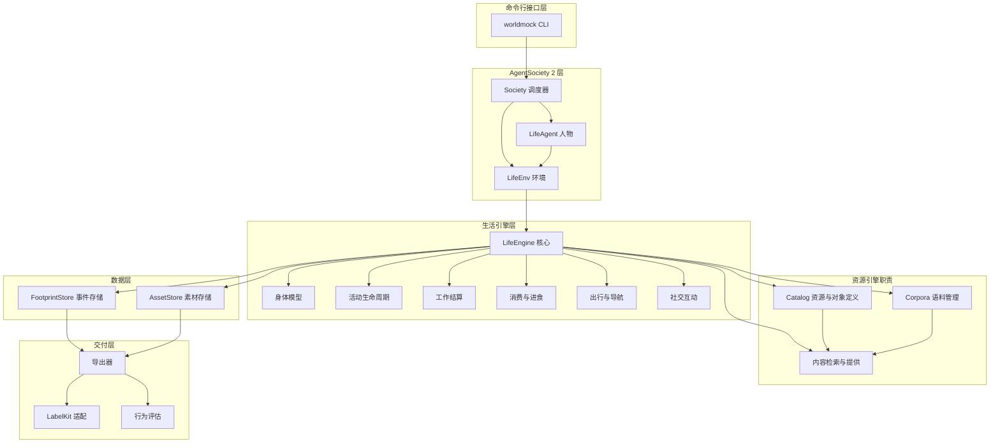
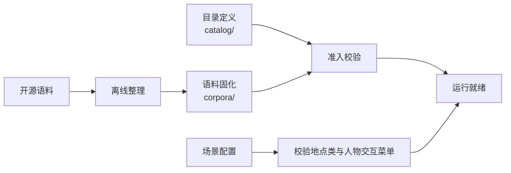
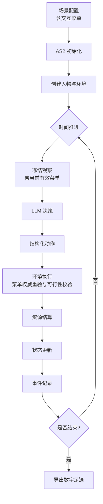
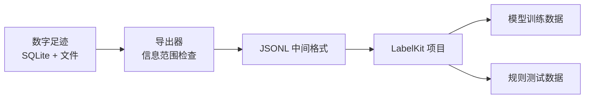
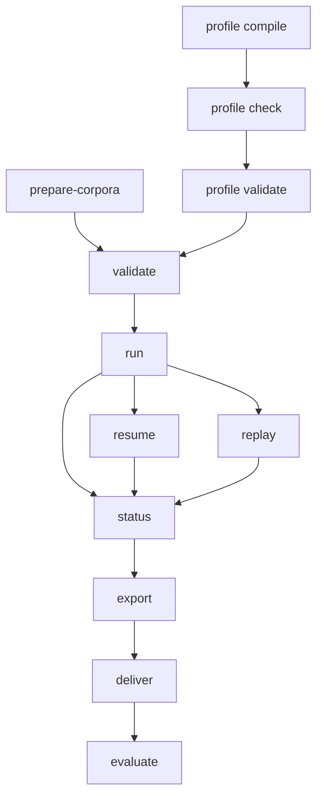
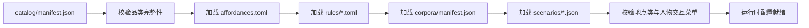
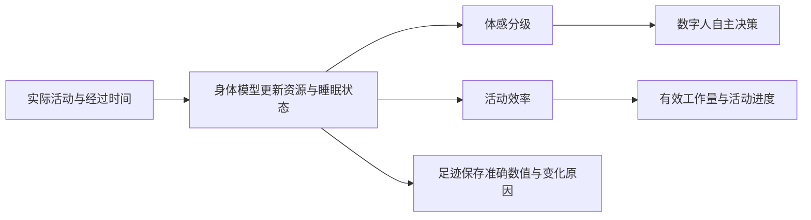

# WorldMock 产品设计说明书 — 总体架构

> **状态**：DRAFT  
> **日期**：2026-09-20  
> **版本**：v1.2\
> **目标读者**：架构师、开发工程师、系统工程师

## 1. 系统定位与总体规格

### 1.1 系统定位

WorldMock 是一个**基于 AgentSociety 2 的数字人生活模拟系统**，用于生成高质量的模型训练数据与规则引擎测试数据。系统特点：

- **批处理模式**：一次运行模拟完整时间段，输出数字足迹
- **确定性引擎**：世界规则确定性执行，保证数据可信与可复现
- **完整足迹**：记录观察、决策、执行、状态变化的完整过程
- **LLM 驱动**：人物决策由 LLM 完成，行为模式接近真实人类
- **离线语料**：内容素材预先整理固化，运行期只读

### 1.2 功能规格总表

| 能力 | 可选性 | 规格 |
| --- | --- | --- |
| 人物决策 | 必选 | AS2 驱动的自主决策，基于观察、需求、记忆选择行动 |
| 交互菜单 | 必选 | 场景按地点类与人物声明允许的工具和活动类型，随观察冻结并由环境重验；[冻结规格](../dev/SPEC-interaction-menu.md) |
| 身体模型 | 必选 | 维护身体相关资源，计算睡眠演化、体感分级和活动效率；执行边界见[模拟引擎](04-simulation-engine.md#实际区间身体变化与效率) |
| 活动执行 | 必选 | 工作、进食、睡眠、娱乐、购物、出行六大类活动 |
| 资源结算 | 必选 | 金钱双边转账；能量与娱乐需要流水结算；睡眠和共享时钟按各自规则核验 |
| 资源引擎 | 必选 | 统一资源定义、内容与语料、目录发布、检索与提供；[详细设计](03-resource-engine.md) |
| 社交互动 | 可选，v1.0 最小可行版 | 看见同地他人，与联系人通讯 |
| 记录引擎 | 必选 | 事件、素材、检查点、分支、导出与诊断统一见[记录引擎设计](05-recording-engine.md) |
| 检查点恢复 | 必选 | 完整世界与工作区快照，支持从已验证的共同检查点建立新分支 |
| LabelKit 交付 | 必选 | JSONL 格式导出，包含动作序列、意图、dreaming |
| 行为评估 | 必选 | 多维度指标评估，生成对比报告 |

### 1.3 系统边界

**包含**：
- 数字人的日常生活模拟（工作、饮食、娱乐、购物、出行、社交）
- 世界状态的确定性维护与结算
- 完整数字足迹的记录与导出
- 向 LabelKit 的数据交付

**不包含**：
- 物理仿真或 3D 渲染
- 模型训练或托管
- 实时交互式界面
- 社会级宏观模拟（经济、政治系统）
- 与真实外部系统的集成（银行、电商等）

## 2. 总体架构与模块清单

### 2.1 分层架构

下图展示运行、资源和数据持久化的职责分工：



### 2.2 模块清单

| 模块 | 职责 | 状态 |
| --- | --- | --- |
| **M1: CLI** | 命令行入口，参数解析，调度运行 | 已实现 |
| **M2: LifeEnv** | AS2 环境适配，调度生活引擎 | 已实现 |
| **M3: LifeAgent** | AS2 人物适配，工具注册，记忆管理 | 已实现 |
| **M4: LifeEngine** | 生活引擎核心，时间推进，活动调度 | 已实现 |
| **M5: 身体模型** | 能量变化、睡眠演化、体感分级与效率计算 | 规则见[运行时规格](../dev/SPEC-life-runtime.md) |
| **M6: 活动生命周期** | 活动开始、进行、完成、中止 | 已实现 |
| **M7: 工作结算** | 任务接收、执行、验收、报酬 | 已实现 |
| **M8: 消费与进食** | 购物、支付、进食、库存管理 | 已实现 |
| **M9: 出行与导航** | 路径规划、时间估算、交通费用 | 已实现 |
| **M10: 社交互动** | 看见他人、通讯、关系维护 | 最小可行版 |
| **M11: 资源引擎** | 资源定义、内容、语料与提供，由现有目录和内容模块承载 | 部分实现；各功能的实现与差距见[资源引擎](03-resource-engine.md) |
| **M12: FootprintStore** | 事件存储，状态快照，事务管理 | 已实现 |
| **M13: AssetStore** | 素材文件管理，SHA-256 去重 | 已实现 |
| **M14: Corpora** | 资源引擎的语料文件加载、身份与版本核验 | 已实现 |
| **M15: Catalog** | 资源引擎的定义与准入，向交换引擎提供活动规则 | 部分实现 |
| **M16: 导出器** | 数字足迹导出，信息范围检查 | 已实现 |
| **M17: LabelKit 适配** | 证据窗口，格式转换，发布协议 | 已实现 |
| **M18: 行为评估** | 指标计算，对比协议，报告生成 | 已实现 |
| **M19: 人物画像编译** | 背景故事解析，大五人格，动态参数 | 已实现 |

运行初始化、冻结观察与交互菜单、共享时钟、活动推进和状态结算统一见[模拟引擎](04-simulation-engine.md)，
菜单的声明、交集和执行边界见[交互菜单规格](../dev/SPEC-interaction-menu.md)。
画像、两阶段决策和记忆算法由[人物决策与画像规格](../dev/SPEC-life-realism.md)维护。
足迹保存与共同检查点由[记录引擎](05-recording-engine.md)承载；模拟引擎负责在完整运行边界调用它。

## 3. 端到端数据流

### 3.1 准备阶段



### 3.2 运行阶段



当前有效菜单由地点类声明与人物声明求交集，随本轮观察冻结，供实际模型工具、本地校验和宿主派发共用。
环境在产生领域副作用前依据权威状态重新计算并校验菜单；原有状态、阶段、能量和可见目标继续收窄行动。
菜单不删除候选、事实或资源目录，也不改变候选排除原因。详细行为见
[交互菜单规格](../dev/SPEC-interaction-menu.md)。

### 3.3 交付阶段



## 4. CLI 规格

### 4.1 命令清单

| 命令 | 功能 | 示例 |
| --- | --- | --- |
| `prepare-corpora` | 准备语料，构建索引 | `worldmock prepare-corpora --output corpora/` |
| `validate` | 验证场景配置 | `worldmock validate --scenario scenarios/white-collar.json` |
| `run` | 运行模拟 | `worldmock run --scenario scenarios/white-collar.json --output runs/001` |
| `resume` | 从检查点恢复 | `worldmock resume --parent runs/001 --checkpoint cp-day-30 --output runs/002` |
| `replay` | 反事实重放 | `worldmock replay --parent runs/001 --checkpoint cp-day-30 --intervention intervention.json --output runs/003` |
| `status` | 查看运行状态 | `worldmock status --run-dir runs/001` |
| `export` | 导出数字足迹 | `worldmock export --run-dir runs/001 --output runs/001/exports/final` |
| `deliver` | 交付给 LabelKit | `worldmock deliver --export runs/001/exports/final --output runs/001/delivery` |
| `evaluate` | 评估行为指标 | `worldmock evaluate --dataset-a runs/001 --dataset-b runs/002 --output eval/` |
| `profile compile` | 编译人物画像 | `worldmock profile compile --story story.md --output persona.json` |
| `profile check` | 检查画像一致性 | `worldmock profile check --story story.md --runs 3` |
| `profile validate` | 验证画像覆盖率 | `worldmock profile validate --scenario scenarios/white-collar.json` |

### 4.2 命令执行顺序



### 4.3 配置层级

配置分为四个层级，优先级从高到低：

1. **命令行参数**：`--output`, `--scenario` 等
2. **场景配置文件**：`scenarios/*.json`
3. **目录配置**：`catalog/*.toml`
4. **代码默认值**：`src/worldmock/life/models.py`

## 5. 配置体系总览

### 5.1 配置文件清单

| 文件 | 职责 | 示例 |
| --- | --- | --- |
| `scenarios/*.json` | 场景定义：人物、时间、地点、交互菜单、规则参数 | `white-collar-12-weeks.json` |
| `catalog/manifest.json` | 目录清单：版本、品类要求、校验规则 | 版本化目录入口 |
| `catalog/affordances.toml` | 可供性注册：活动类型、动机、参数 | 活动定义 |
| `catalog/resources.jsonl` | 资源目录：资源类型、单位、边界 | 自动生成 |
| `catalog/rules/*.toml` | 规则配置：画像映射、动机、禁食等 | 规则参数 |
| `corpora/manifest.json` | 语料清单：来源、版本、哈希、统计 | 语料元数据 |
| `corpora/*/items.json` | 语料内容：节目、游戏、商品等 | 具体素材 |
| `~/.config/worldmock/deepseek.env` | 模型凭证：API Key（不入版本控制） | `DEEPSEEK_API_KEY=...` |

### 5.2 配置加载顺序



## 6. 核心数据结构与内部 API

### 6.1 世界状态（WorldState）

```python
@dataclass
class WorldState:
    """完整世界状态，环境唯一维护"""
    version: int  # 状态版本号，严格递增
    sim_time: datetime  # 模拟时间
    agents: dict[str, AgentState]  # 人物状态字典
    locations: dict[str, Location]  # 地点状态
    calendar: Calendar  # 日历与天气
    traffic: TrafficConditions  # 交通状况
```

### 6.2 人物状态（AgentState）

数字人的状态关联其所在地点、身体相关资源、库存和当前活动。资金通过账户身份关联到世界账户，
以整数分保存；身体相关资源与睡眠模型状态由 `body` 持有，不合并为一份无单位的通用余额字典。
状态字段与修改权限见[接口合同](../CONTRACTS.md)「状态归属」，本节不重复定义内部类型。

### 6.3 身体状态（BodyState）

`BodyState` 汇集身体相关资源、睡眠模型状态与必要人物参数，是内部状态载体。
资源的计量语义见[接口合同](../CONTRACTS.md)「资源与需求字段」，
变化过程见[模拟引擎](04-simulation-engine.md#实际区间身体变化与效率)「实际区间、身体变化与效率」；本节不另定义一套身体字段。



体感描述供数字人理解处境；准确数值进入足迹与评估。困意或情绪不直接强制数字人选择某个活动，
活动是否可执行由能量、位置、库存、时间及占用等约束判定。

### 6.4 活动（Activity）

```python
@dataclass
class Activity:
    """进行中的活动"""
    activity_id: str
    activity_type: str  # 活动类型
    start_time: datetime  # 开始时间
    expected_duration: timedelta  # 预期时长
    progress: float  # 进度 [0, 1]
    consumed: dict[str, Any]  # 已消耗资源
    context: dict[str, Any]  # 活动上下文
```

### 6.5 事件（Event）

事件字段、类型、状态关联与素材引用统一见[记录引擎的事件结构](05-recording-engine.md#数字足迹事件结构)。

### 6.6 核心 API

| 接口 | 功能 | 所属模块 |
| --- | --- | --- |
| `LifeEngine.step()` | 时间推进一步 | M4 |
| `LifeEngine.execute_action()` | 执行人物动作 | M4 |
| `worldmock.life.body.settle_body()`、`felt_levels()` | 结算能量和睡眠状态，计算体感分级 | 身体模型 |
| `ActivityManager.start()` | 开始新活动 | M6 |
| `ActivityManager.advance()` | 推进活动进度 | M6 |
| `ActivityManager.complete()` | 完成活动 | M6 |
| `FootprintStore.commit()` | 提交事件与状态 | M12 |
| `AssetStore.put()` | 保存并核验不可变素材 | M13 |
| `worldmock.life.content.reveal_watch()`、`reveal_mail()` | 按实际活动提供已接触内容 | 资源引擎 |

记录引擎接口见[各功能主题](05-recording-engine.md#主题阅读路径)，其他接口见 `docs/CONTRACTS.md`。

## 7. 非功能约束

### 7.1 性能约束

| 指标 | 目标 | 测量方法 |
| --- | --- | --- |
| 模拟速度 | 单人物 12 周 ≤ 24 小时 | 实际运行计时 |
| 内存占用 | 峰值 ≤ 8 GB | `psutil` 监控 |
| 数据库大小 | 单人物 12 周 ≤ 1 GB | `du -sh footprints.sqlite` |
| 素材文件 | 单人物 12 周 ≤ 9 GB | `du -sh assets/` |
| 事件写入 | ≥ 1000 events/s | `scripts/coverage_gate.py` |

### 7.2 可靠性约束

| 指标 | 目标 | 测量方法 |
| --- | --- | --- |
| 检查点恢复 | 成功率 100% | 恢复测试 |
| 状态连续性 | 版本无跳跃 | `FootprintStore.validate()` |
| 资源结算 | 资金按整数分对账；能量与娱乐需要满足流水和边界；睡眠按模型演化 | [运行时规格](../dev/SPEC-life-runtime.md)与[记录引擎设计](05-recording-engine.md) |
| 事件序号 | 严格递增 | 序号校验 |

### 7.3 可维护性约束

| 指标 | 目标 | 测量方法 |
| --- | --- | --- |
| 代码覆盖率 | 分支覆盖率 ≥ 85% | `scripts/coverage_gate.py` |
| 公共接口覆盖率 | 100% | 覆盖率门禁 |
| 文档覆盖率 | 每个模块有设计文档 | 人工审查 |
| 测试矩阵 | 每个规格条款有测试 | `ANALYSIS-spec-coverage.md` |

### 7.4 依赖约束

| 依赖 | 版本 | 说明 |
| --- | --- | --- |
| Python | 3.12+ | 类型系统依赖 |
| AgentSociety 2 | `worldmock-life` 分支 | 包含必要改动 |
| LabelKit | `v1.21` | 数据交付接口 |
| SQLite | 3.35+ | 事务特性依赖 |
| DeepSeek | API | 模型服务 |

## 8. 演进路线

### 8.1 v1.0（当前版本）

- [x] 单人物生活模拟
- [x] 六大类活动（工作、进食、睡眠、娱乐、购物、出行）
- [x] 确定性规则引擎
- [x] 完整数字足迹记录
- [x] LabelKit 数据交付
- [x] 检查点恢复与反事实分支
- [x] 行为评估框架

### 8.2 v2.0（计划中）

- [ ] 多人物社交互动
- [ ] 复杂情感模型（OCC 模型）
- [ ] 更多内容品类（健身、医疗、教育）
- [ ] 长期记忆压缩
- [ ] 更多地理区域支持

### 8.3 v3.0（远期）

- [ ] 实时观察界面
- [ ] 在线学习与模型微调反馈
- [ ] 大规模多人物社会模拟
- [ ] 经济系统宏观模拟

## 版本历史

| 版本 | 日期 | 修订内容 |
| --- | --- | --- |
| v1.0 | 2026-09-20 | 初版：系统定位、分层架构、模块清单、数据流、CLI 规格、配置体系、核心数据结构 |
| v1.1 | 2026-09-20 | 身体模型与资源结算对齐冻结规格，删除四项百分制身体字段与统一误差阈值 |
| v1.2 | 2026-09-20 | 接入地点类与人物交互菜单，明确初始化准入、冻结观察、环境权威重验与候选不变边界 |
