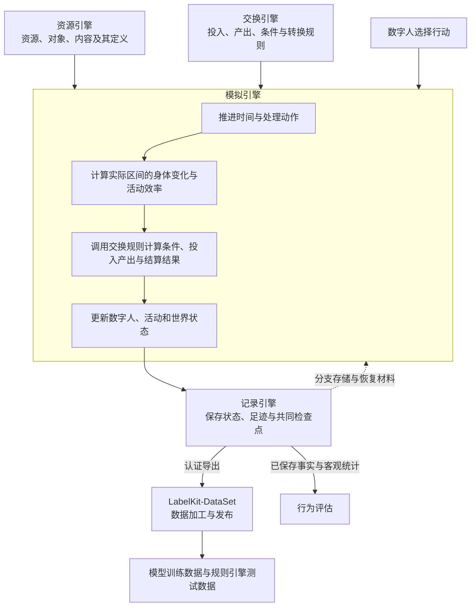
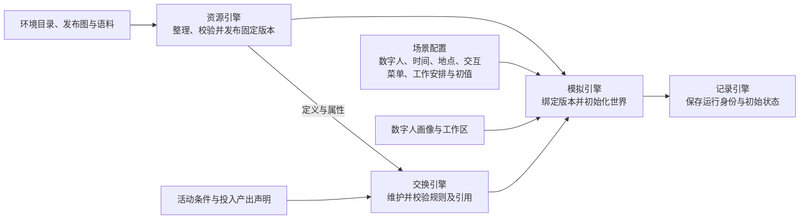
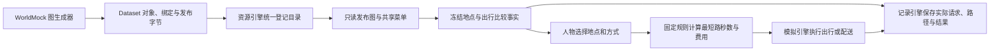
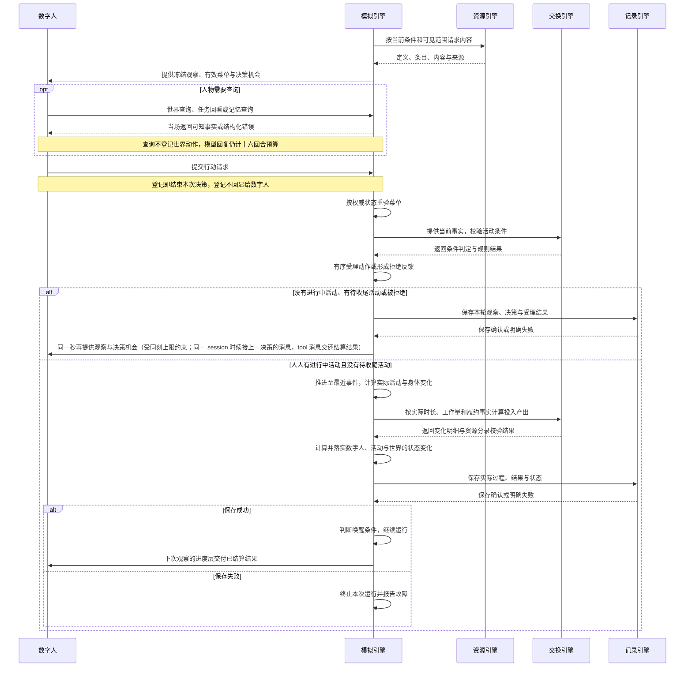
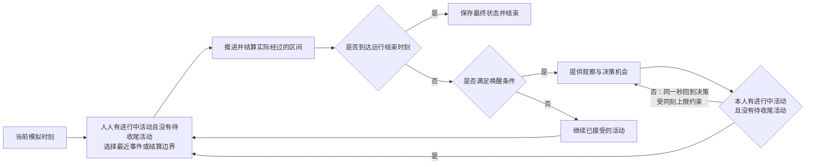
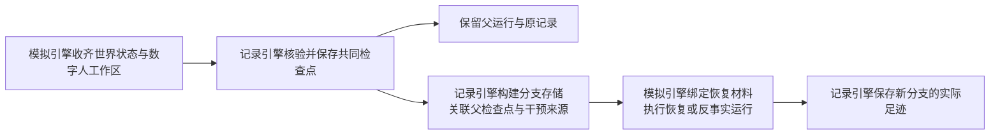
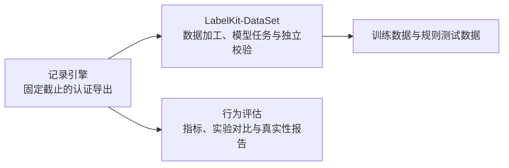
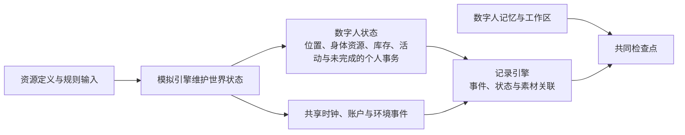
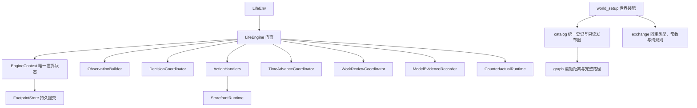

# WorldMock 产品设计说明书 — 总体架构

> 2026-10-07：按资源与规则引擎简化规格同步剩余系统规则、最终提示身份与查看器（阶段 6）。

> 按[资源与规则引擎简化规格](../dev/SPEC-resource-and-rule-simplification.md#spec-rrs-资源与规则引擎简化开发规格)修订「地图与门店供给的交接」、「3.1 准备与初始化」、「6.1 配置与运行入口」、「6.2 状态与记录」、「5. 现有代码与职责的对应关系」、「1.1 系统定位」、「3.2 观察、行动与执行」、「4. 已采用的设计决策」、「实际生产依赖与状态归属」（阶段 2）；「2.3 状态归属与写入边界」（阶段 3）。

> **状态**：DRAFT；职责设计，现行接口与行为以所属合同和规格为准；按人物 Prompt 规格修订，修订部分已实现（证据见[人物 Prompt 验收记录](../archive/persona-prompt/persona-prompt-verification.md)）\
> **工具交互修订**：按[工具交互规格](../dev/SPEC-life-runtime.md#tool-interaction-工具请求)冻结本次设计；本次修订已实现，既有验收不覆盖新行为。
> **个人事务与工作安排修订**：按[个人事务与工作安排规格](../dev/SPEC-as2-integration.md#errands-workday-运行修复入库)分阶段同步（[实施计划](../archive/errands-workday/errands-workday-implementation-plan.md) D1 作业），已实现（离线验收，证据见[个人事务与工作安排验收记录](../archive/errands-workday/errands-workday-verification.md)）。
> **让「等待」成为例外修订**：按[让「等待」成为例外规格](../dev/SPEC-idle-fillers.md#spec-idle-fillers-让等待成为例外开发规格)修订「3.3 事件驱动的时间推进」（阶段 1）与「6.2 状态与记录」（阶段 1、阶段 2、阶段 3）。
> **同时做两件事修订**：按[同时做两件事规格](../dev/SPEC-parallel-activities.md#spec-parallel-activities-同时做两件事开发规格)修订「2.3 状态归属与写入边界」与「6.2 状态与记录」（阶段 1）。
> **日期**：2026-10-07
> **版本**：v1.16
> **目标读者**：架构师、开发工程师、系统工程师

本文承接[概述](00-overview.md#overview-worldmock-产品设计说明书-概述)，说明数字人、资源引擎、交换引擎、模拟引擎和记录引擎如何协作，
以及数字足迹如何进入数据交付与行为评估。各引擎的内部规则由所属设计文档维护；
跨模块字段与调用合同见[接口合同](../CONTRACTS.md#contracts-worldmock-接口合同)，文档权威归属见[文档入口](../INDEX.md#index-worldmock-文档入口)。
职责划分不代表对应实现已经拆成独立服务，也不构成实现完成或真实运行验收。

具体环境及制作工具按[环境数据归属规格](../dev/SPEC-environment-data-ownership.md)归 WorldMock-Dataset，
正式环境为 `environment/zhangjiang-baseline/`；WorldMock 提供引擎及包内固定通用规则。
本章的 `catalog/`、`corpora/`、`scenarios/` 指外部环境目录，命令以 WorldMock 为当前工作目录并显式传路径。
当前场景结构 7，环境钉与目录登记在启动前校验，发布图只读；完整组合放行另核对实际收据。

## 共享规则与可重建环境修订

按[共享规则与可重建环境规格](../dev/SPEC-shared-rules-and-rebuildable-env.md)修订；验收结果独立记录。

共享规则分别归属于记录、资源和生活模块的唯一实现，呈现、受理、结算与评估直接复用。基础模型位于不依赖业务模块的叶子模块；目录模型深冻结由目录登记合同维护。AS2 负责调度、模型服务和恢复，WorldMock 负责人物的记忆业务规则。

## 1. 系统定位与总体规格

### 1.1 系统定位

WorldMock 模拟并记录任意性格数字人的数字足迹。数字人依据自身画像、需求、观察和记忆选择行动，
系统组织环境交互、计算实际结果并保存可追溯记录，完整导出交给 LabelKit-DataSet 数据加工。

| 目标维度 | 架构要求 |
| --- | --- |
| 覆盖范围 | 任意性格数字人的数字足迹模拟与记录；具体人物、活动与内容由场景、资源和规则共同确定 |
| 时间跨度 | 模拟时间跨度可配置，不设置固定长度上限；每次运行按配置的起止时刻执行 |
| 数字人数量 | 场景声明参与者，各数字人共享同一世界时钟；具体人数和社交范围属于运行配置与验收范围 |
| 行动选择 | 复用 AgentSociety 2 的人物决策和记忆机制；数字人选择行动，环境判断可行性并执行 |
| 过程记录 | 观察、决策、执行、状态变化、结果与记忆都有来源和关联，支持检查点恢复及反事实分支 |
| 足迹交接 | 记录引擎提供固定截止的完整认证导出，下游加工与发布归 LabelKit-DataSet |

白领生活、单数字人和连续十二周是已有实验场景的设置，具体身份见[实验定义](../EXPERIMENT.md#experiment-worldmock-实验设置)。
实验时长和内容样本不构成产品覆盖范围或模拟时长上限；可配置时长也不代表任意长度的运行已经完成验证。

| 能力 | 可选性 | 规格 |
| --- | --- | --- |
| 人物决策 | 必选 | AS2 驱动的自主决策，基于观察、需求、记忆选择行动 |
| 交互菜单 | 必选 | 场景按地点类与人物声明允许的对象动作，随观察冻结并由环境重验；`start_activity.items[]` 每项含目标、方式、来源和去向，内部动作由目标与方式唯一解析；任务回看和世界查询归只读，工具面以接口合同为准；[冻结规格](../dev/SPEC-interaction-menu.md#spec-interaction-menu-特性规格交互菜单) |
| 身体模型 | 必选 | 维护身体相关资源，计算睡眠演化、体感分级和活动效率；执行边界见[模拟引擎](04-simulation-engine.md#simulation-engine-实际区间身体变化与效率) |
| 活动执行 | 必选 | 工作、进食、睡眠、娱乐、购物、出行六大类活动；每人两个活动名额 |
| 资源结算 | 必选 | 金钱双边转账；能量与娱乐需要流水结算；睡眠和共享时钟按各自规则核验 |
| 资源引擎 | 必选 | 统一登记环境对象、绑定与发布图，读取内容与语料、检索与提供；[详细设计](03-resource-engine.md#resource-engine-worldmock-产品设计说明书-资源引擎) |
| 社交互动 | 可选，v1.0 最小可行版 | 看见同地他人，与联系人通讯 |
| 记录引擎 | 必选 | 事件、素材、检查点、分支、导出与诊断统一见[记录引擎设计](05-recording-engine.md#recording-engine-worldmock-产品设计说明书-记录引擎) |
| 检查点恢复 | 必选 | 完整世界与工作区快照，支持从已验证的共同检查点建立新分支 |
| 完整足迹导出 | 必选 | JSONL 保留事件、活动、已核验经历、购买与 app 使用 |
| 行为评估 | 必选 | 多维度指标评估，生成对比报告 |

### 1.2 系统边界

系统包含数字人与环境的交互、资源与内容提供、交换规则、时间与活动推进、
数字足迹记录、恢复与分支，以及向 LabelKit-DataSet 提供完整足迹导出。

系统不包含物理仿真或三维渲染、模型训练或托管、实时交互式界面、
社会级宏观模拟或真实银行、电商等外部业务系统集成，也不保证与任何特定真实个体的行为一致。
资源和规则使用运行前整理并绑定的版本。

## 2. 总体架构与职责分工

### 2.1 总体架构

资源引擎提供世界里可使用的定义与内容，交换引擎提供条件和转换规则。
模拟引擎组织数字人的选择与世界变化，记录引擎保存实际过程和结果。

图中的引擎表示职责边界。AgentSociety 2 提供调度、模型调用、人物决策与记忆基础；
LifeAgent 承载数字人，LifeEnv 是模拟引擎接入 AgentSociety 2 的环境入口。
现有代码文件可以承载多个引擎的处理逻辑，不能仅凭目录名称判定职责归属。

### 2.2 职责与交接

| 负责方 | 负责什么 | 向协作方交付什么 |
| --- | --- | --- |
| [数字人](../dev/SPEC-life-realism.md#spec-life-realism-特性规格人物决策与画像) | 画像、七层提示组装、行动选择、收尾记忆与反思 | 向模拟引擎提交动作请求（播报、暂停与收尾请求可携带个人事务的新增、更新与取消），提供决策和记忆证据 |
| [资源引擎](03-resource-engine.md#resource-engine-worldmock-产品设计说明书-资源引擎) | 资源与对象定义、内容与固化语料、版本与来源、查询与提供 | 返回指定版本的定义、属性、匹配条目、内容片段与素材引用 |
| [交换引擎](02-exchange-engine.md#exchange-engine-worldmock-产品设计说明书-交换引擎) | 维护与查询交换规则，校验条件，计算投入产出，校验资源分录 | 返回条件判定、资源变化明细、履约条件或拒绝原因 |
| [模拟引擎](04-simulation-engine.md#simulation-engine-worldmock-产品设计说明书-模拟引擎) | 初始化、观察与决策机会、动作受理、时间推进、实际活动与会话切换、身体变化与效率、零点计划（运行时后台任务 `plan_day`，不经人物）、计划与提醒、个人事务的受理、按结算证据确认办成与事务提醒、按场景工作安排求值今天的上班安排、状态更新、恢复后的执行 | 向数字人提供观察与反馈，向记录引擎提交实际过程、结果与共同快照 |
| [记录引擎](05-recording-engine.md#recording-engine-worldmock-产品设计说明书-记录引擎) | 保存与关联足迹、素材和状态，校验记录一致性，保存检查点，构建分支存储，认证导出与诊断 | 返回保存确认、已核验的恢复材料、认证导出和客观统计 |
| LabelKit-DataSet 数据加工 | 证据窗口、离线经历回顾与假设推演、LabelKit 加工、样本校验与发布 | 交付可追溯的训练数据与规则测试数据 |
| [行为评估](07-evaluation.md#evaluation-worldmock-产品设计说明书-行为评估) | 根据已保存事实计算行为指标、比较实验并形成真实性评价；工作负荷与作息偏离两个只报告项另读一个可选的打包输入（各人物的班次、任务的预约与要求地点、住处、覆盖后的作息窗口与播报间隔），缺输入的人物报告 null | 评估报告与证据关联 |

LifeEnv 与活动属于模拟引擎的执行职责；数字足迹、检查点和分支存储属于记录引擎。
离线数据加工由 LabelKit-DataSet 消费认证导出，
默认不写回仍在运行的数字人；数字人运行中的记忆与反思由人物模块维护。
反事实分支中的实际执行由模拟引擎编排，分支保存和来源关系由记录引擎维护。

### 2.3 状态归属与写入边界

| 对象 | 负责方 | 修改边界 |
| --- | --- | --- |
| 固定资源目录、地图地点、食品与 app 绑定、内容与来源语料 | 资源引擎 | 运行前准备和发布；运行期按绑定版本查询与读取 |
| 包内固定交换常数与算子 | 交换引擎 | 随引擎发布维护；运行时根据输入事实求值并返回结果 |
| 共享时钟、余额、订单、食品持有、身体状态、活动进度、地点会话、当日计划与提醒、未完成的个人事务及其提醒 | 模拟引擎中的生活环境 | 收齐动作后有序受理，按实际经过时间和规则结果更新；个人事务由人物在播报、暂停与收尾请求里新增、更新或取消，与该请求的活动状态转换同一事务提交，办成只由确定性环境代码按结算证据写入；事务是人物记下的打算，随人物状态保存但不是世界事实，文字只用于呈现，不参与结算与完成判定，不改变余额、食品持有、身体、订单与验收 |
| 数字人的记忆与工作区 | 数字人 | 依观察、执行反馈和记忆流程更新；记忆写入点为 `conclude_activity` 与就寝反思两处（就寝反思经唯一的严格工具 `submit_reflection` 提交，引用须取自本次输入的记忆，不合合同的输出不写入任何洞见），阈值巩固不变；由模拟引擎协调共同保存边界。提示中的记忆层是构建提示时由环境从已提交事件与世界状态派生的视图，不新增持久状态（构建结果随观察事件保存，并写进人物工作区的只读问答快照）；关系与偏好在人设层按对象原地呈现；个人事务不是记忆、不属人物工作区，随世界状态里的人物状态保存，宿主不得旁路写入 |
| 事件、素材、状态快照、检查点与分支来源 | 记录引擎 | 保存模拟引擎提交的事实，校验引用、版本和事务一致性 |

世界状态只有生活环境这一写入入口。记录引擎在共享环境的写入路径中执行持久化，
人物 worker 通过环境登记证据，不直接写数据库。
资源查询和交换规则求值不会自行推进世界时钟，也不会自行修改运行中的世界状态。
人物 worker 的只读查询同样不写世界：回看任务经环境代理转发到唯一的环境 actor 并等待结果，
世界查询由宿主在本次冻结观察上本地求值，二者都不写事件、不改世界版本与时钟。

同一人物有两个活动名额，进行中与待收尾的活动各占一个，暂停的不占，恢复暂停的活动要有空名额；能否同时进行按注册表声明的占用与准入事实判定。
活动集合属于模拟引擎，人物共同经过的区间只结算一次身体，
每项活动独立记录进度和结束。记录引擎从已提交事件投影已核验经历；人物模块的自由归纳、感受和反思
始终作为主观记忆保存，来源由系统登记。发给人物的记忆层把系统写的 `settled`（已提交结果与世界事件的确定性句子）
与人物写的 `self_notes`（pause、conclude 写下的 summary 与记忆原文）分字段呈现，按 session 派生、零点分区。
个人事务的完整行在每次请求的六层快照内只在待办层出现，进度层的提醒与办成记录、结果回执只以名称引用
（同秒续接原样带回的调用参数与改动、当日操作备忘与被拒结果明细照原始证据回显所写内容，不在此列）；
事务文字不进 `self_notes`，记忆层也不为它写 `settled` 句。
这条交接沿用现有 AS2 人物循环、记忆存储和检查点，不增加第二套运行或记忆框架。
完整行为与验收见[一日行为规格](../dev/SPEC-dayrun-behavior.md#spec-dayrun-behavior-一日行为可信性特性开发规格)。

目录食品价格与菜单不可变，没有营业、报价、店铺库存或工作日历状态归属；工作安排仍是声明的班次事实。

## 3. 端到端数据流

### 3.1 准备与初始化

场景决定本次运行使用哪些人物、资源、规则、时间范围，以及地点类与人物的交互菜单和每个人物的工作安排（必填，可为 null）。
资源引擎统一登记对象、绑定、文件身份和发布图；交换引擎提供包内固定规则；模拟引擎加载场景结构 7，核对环境钉并建立世界结构 10 的状态。图不在运行中重生成，菜单不在运行中抽样。
缺少必要定义、规则或素材时明确失败，不补造可继续运行的世界。

### 地图与门店供给的交接

场景结构 `7` 钉目录身份，只选择地点。地点恰有身份、名称、分店标签、类型与 app 绑定五个字段；类型派生活动环境。
图覆盖全目录节点，场景选择不裁切路径。随机连通加权图由 WorldMock 生成、Dataset 发布，最短路等长按完整路径元组字典序决胜。
同种食品店铺共享菜单，食品全店同价，`"all"` 不包含住宅；外卖覆盖全图，没有营业、资格、库存或道路状态。
只读查询与耗时发现保持各自的时间和证据边界，图查询不刷新世界。运行清单与检查点核对 `environment_identity`，出行保存 `trip_id`、`path` 和 `distance_meters`。

### 3.2 观察、行动与执行

行动请求的登记不代表活动已受理或已完成。模拟引擎根据接受、拒绝、进度和结果形成反馈，
记录引擎在相应交互边界保存观察、决策、执行与记忆证据。
有效菜单由地点类与人物声明求交集，随本轮观察冻结；阶段与可见目标继续收窄。
宿主的本地校验与直接派发按冻结菜单失败关闭，环境重验阻止绕过模型工具 Schema，候选、事实与资源目录保持完整。详细合同见
[交互菜单规格](../dev/SPEC-interaction-menu.md#spec-interaction-menu-特性规格交互菜单)。
决策不耗时；有进行中活动且无唤醒条件才静默续行。

宿主与环境复用现有 Pydantic、JSON Schema、名称和方式映射，避免各自解释同一请求。
所有接口错误返回英文原因与完整位置数组 `path`、全部合法 `allowed_values`、类型或业务条件 `expected`；
候选只使用可直接提交的新请求 `{tool, arguments, note}`，不读取旧候选格式。
查询与世界请求不能混批；查询批次先完整校验，任一无效则整批不执行。
任务输入必填 `appointment`，普通为 null，预约为 `{starts_at, reason}`；不输入重复的 `available_at` 或种类、原因字段。
场景编译生成内部 `RuntimeWorkTask.available_at`，普通取最早本人关联邮件时刻，预约取真实约定开始；
通知送达使任务可知，普通到要求地点即可开始，预约提前可知但真实约定时刻才开放唤醒。
每封关联邮件引用存在任务且收件人为该任务受派人物，每项任务至少一封通知；预约只约束最早通知不晚于约定开始，
后续提醒不改变开放时刻。通知完整性和素材有效性在加载前验证，任务合同只在工具层目标中公开，邮件正文仍须阅读。
故障按所属合同终止并保存错误，不把失败包装成成功经历。

前往目标由目录地点与发布图确定，模型只选地点名称和方式；环境从最短距离派生秒数和车费，记录保存完整路径和图上米数。图连通，不生成中转提示；需前往时只写 `Go to <place>.`。

### 3.3 事件驱动的时间推进

每个数字人都有进行中活动且没有待收尾活动时，模拟引擎才推进到最近一个需要处理的时刻：
活动结束、内容反馈、通知到达、工作截止、身体变化边界、计划提醒、清醒人物的事务提醒、清醒人物的班次与休息时段起止、场景本地零点、等待结束或本次运行的结束时刻。
班次与休息时段的起止只在当秒给声明了该工作安排、此刻清醒的人物一次决策机会，进行中的活动照常继续。
睡眠中的人物不计入事务提醒与班次、休息时段起止的边界候选、不形成静默边界，睡眠期间到点的事务提醒在人物醒来的那个边界一并交付，
睡过的班次与休息时段起止不补。
跨越的实际时长用于计算身体变化、活动进度与资源变化。

资源结算可以有固定间隔，结算时刻作为事件参与上述选择；结算间隔不等于数字人的决策间隔。
时间与唤醒规则由[模拟引擎](04-simulation-engine.md#simulation-engine-worldmock-产品设计说明书-模拟引擎)、[运行时规格](../dev/SPEC-life-runtime.md#spec-life-runtime-特性规格lifeenv-运行时行为与结算规则)及[时间与能量规格](../dev/SPEC-life-runtime.md#time-and-energy-决策不耗时时间只在做事时流动)维护。

### 3.4 检查点、恢复与反事实分支

检查点包含共同边界上的世界状态、数字人工作区及恢复所需材料。
记录引擎负责核验和提供这些材料，模拟引擎负责恢复外部运行实例、施加已声明的干预并继续执行。
假设文本和实际重新模拟得到的结果分别标明来源，新分支结果不改写原分支经历。
完整规则见[记录引擎](05-recording-engine.md#recording-engine-恢复与反事实分支)与[模拟引擎](04-simulation-engine.md#simulation-engine-worldmock-产品设计说明书-模拟引擎)。

### 3.5 足迹交接与评估

离线 Dreaming 基于已有足迹归纳经历或提出假设，默认不写回运行中的数字人。
实际反事实运行由明确的运行请求触发，并按新的分支身份保存；不能将生成的假设文本冒充执行结果。
交付和评估的输入范围、校验与发布条件见LabelKit-DataSet 数据加工和[验收门禁](../VERIFICATION.md#verification-worldmock-验收标准)。

## 4. 已采用的设计决策

| 设计点 | 设计决策 |
| --- | --- |
| 基础框架 | 复用 AgentSociety 2 的调度、模型调用、数字人决策、记忆与 Ray 多进程机制 |
| 时间推进 | 决策不耗时：没有进行中活动或有待收尾活动的数字人同一秒再决策，受同刻上限约束；人人有进行中活动且没有待收尾活动后，按最近相关事件推进共享模拟时钟，决策机会由唤醒条件决定 |
| 世界状态 | 由模拟引擎中的生活环境集中更新；记录引擎负责保存与一致性核验 |
| 资源与规则 | 对象与绑定由统一目录登记；固定类型、常数和算子归 WorldMock；运行期只读发布版本 |
| 地图与出行 | WorldMock 生成连通加权图、Dataset 发布；完整路径字典序裁决等长最短路，时长和车费由固定规则计算 |
| 内容检索 | 使用确定性属性筛选与倒排索引，按指定可见范围和接触区间提供内容 |
| 持久化 | SQLite 保存结构化事件与状态，内容寻址文件保存素材与证据 |
| 恢复与分支 | 从已核验的共同检查点构建新分支，保留父运行和来源关系 |
| 失败处理 | 按所属合同明确拒绝或中止，保留原因；记录失败不得返回成功确认 |

## 5. 现有代码与职责的对应关系

下表用于定位现有实现。同一文件可能承载多个引擎的处理逻辑，职责按实际输入与输出判断。

| 职责 | 现有承载位置 | 详细设计 |
| --- | --- | --- |
| 数字人 | [LifeAgent](../../custom/agents/life_agent.py)、[就寝反思工具](../../src/worldmock/agents/life_reflection.py)、[人物画像](../../src/worldmock/profile)、AgentSociety 2 人物与记忆模块 | [人物规格](../dev/SPEC-life-realism.md#spec-life-realism-特性规格人物决策与画像) |
| 资源引擎 | [目录登记、加载与图查询](../../src/worldmock/catalog)、[通用语料加载](../../src/worldmock/corpora)、[内容读取](../../src/worldmock/life/content.py)及检索、呈现模块 | [资源引擎](03-resource-engine.md#resource-engine-worldmock-产品设计说明书-资源引擎) |
| 交换引擎 | [固定类型、常数与算子](../../src/worldmock/exchange)、[固定活动声明](../../src/worldmock/data/affordances.toml)、[资源分录计算与校验](../../src/worldmock/resources)及生活模型中的条件、费用和报酬规则 | [交换引擎](02-exchange-engine.md#exchange-engine-worldmock-产品设计说明书-交换引擎) |
| 模拟引擎 | [运行入口](../../src/worldmock/runtime.py)、[LifeEnv](../../custom/envs/life_env.py)、[只读查询转发](../../src/worldmock/life/read_query_runtime.py)、[生活运行逻辑](../../src/worldmock/life/engine.py)及活动、身体和调度模块 | [模拟引擎](04-simulation-engine.md#simulation-engine-worldmock-产品设计说明书-模拟引擎) |
| 记录引擎 | [足迹存储](../../src/worldmock/footprints)、[素材存储](../../src/worldmock/footprints/assets.py) | [记录引擎](05-recording-engine.md#recording-engine-worldmock-产品设计说明书-记录引擎) |
| 完整导出与评估 | [导出模块](../../src/worldmock/footprints/export.py)、[评估模块](../../src/worldmock/evaluation) | [记录引擎](05-recording-engine.md#recording-engine-固定截止导出)、[行为评估](07-evaluation.md#evaluation-worldmock-产品设计说明书-行为评估) |

LifeEngine 是现有内部代码载体，不作为四个引擎之外的另一项顶层职责。
身体相关资源、体感与活动效率在模拟引擎中计算，资源定义来自资源引擎，
具体交换投入产出由交换引擎计算，准确数值和变化原因交给记录引擎保存。

## 6. 配置、接口与数据结构

### 6.1 配置与运行入口

| 配置或入口 | 架构职责 | 具体规格 |
| --- | --- | --- |
| 场景 | 选择数字人、时间范围、地点、交互菜单、作息覆盖与工作安排、初值，以及资源和规则版本 | [配置设计](08-configuration.md#configuration-worldmock-产品设计说明书-配置规格)、[交互菜单规格](../dev/SPEC-interaction-menu.md#spec-interaction-menu-特性规格交互菜单)、[实验定义](../EXPERIMENT.md#experiment-worldmock-实验设置) |
| 资源目录与语料 | 提供七份目录、发布图、环境身份及实际可读取语料，统一登记后只读消费 | [资源引擎](03-resource-engine.md#resource-engine-worldmock-产品设计说明书-资源引擎) |
| 交换规则 | 声明使用条件、资源占用、转换和履约条件 | [交换引擎](02-exchange-engine.md#exchange-engine-worldmock-产品设计说明书-交换引擎) |
| 模型凭证 | 在运行环境中读取，不进入仓库或数字足迹 | [配置设计](08-configuration.md#configuration-worldmock-产品设计说明书-配置规格) |
| 命令行入口 | 发起准备、校验、运行、恢复、查询、导出、交付和评估 | [接口合同](../CONTRACTS.md#contracts-worldmock-接口合同) |

运行参数与场景选定版本后，由模拟引擎组织目录登记、发布图读取与场景 7 加载，资源和交换引擎分别核验自己的输入。
具体命令签名和字段只在所属合同维护，不在总体架构中另列一套示例接口。
Python、AgentSociety 2、SQLite 与模型服务的版本和运行绑定见[实验定义](../EXPERIMENT.md#experiment-worldmock-实验设置)。

### 6.2 状态与记录

工具交互按独立端到端阶段发布：任务输入阶段升场景结构 4；供给价格形状变化时升地图结构 3、品类与规则绑定 3，并发布新目录。
错误接口、查询和派生提示只更新自身代码、工具或提示身份，世界结构保持 8，不要求四种数据同次升版。
每阶段及后续目录内容变化分别冻结实际版本与摘要，禁止重写已经发布的目录版本。
任务可知集合沿用现有字段，操作备忘从已提交事件派生，紧凑工具层只做无损呈现；
旧输入、旧工具请求与旧候选直接拒绝，不创建迁移或兼容读取路径。

个人事务与工作安排规格按阶段发布，各结构只在首次触及形状的阶段升一次：个人事务阶段把未完成事务写进人物状态，
世界结构升 9、质量报告结构升 4，三个控制请求增必填的 `errands`；旧检查点与缺 `errands` 的旧控制请求按版本或缺字段拒绝，
不创建迁移或兼容读取路径。工作安排阶段场景结构升 5（人物配置增必填可空的 `work_schedule` 与可选的下班、到家窗口），卡片结构升 3、抽取提示为 `card-v3`；
旧场景按版本拒绝，旧结构化卡片因缺下班、到家两个必填键被拒；当时三份场景同批显式写出 `work_schedule`，`scenario_sha256` 随之改变。
查询阶段只更新 `tool_schema_sha256` 与 `code_sha256`；旧四键查询请求按缺字段拒绝。
[让「等待」成为例外规格](../dev/SPEC-idle-fillers.md#spec-idle-fillers-让等待成为例外开发规格)的班次与休息时段起止唤醒只更新 `code_sha256`：
`prompt_sha256`、`tool_schema_sha256`、世界结构 9、质量报告结构 4 与场景结构 6 都不变，没有声明工作安排的场景行为不变。
同一规格的系统层第 7、14、15、16 条原位改写（仍为十八条）使 `prompt_sha256` 与 `code_sha256` 随之改变，`tool_schema_sha256`、世界结构 9、质量报告结构 4 与场景结构 6 不变；
改写之前的运行按身份拒绝恢复与重放，不创建兼容读取路径；零点计划模板第三、五、六条的改写只更新 `code_sha256`。
[同时做两件事规格](../dev/SPEC-parallel-activities.md#spec-parallel-activities-同时做两件事开发规格)阶段 1 让暂停的活动不再占名额，只更新 `code_sha256`：
`prompt_sha256`、`tool_schema_sha256`、目录摘要、世界结构 9（受限轮阶段闭集仍为五个值）、质量报告结构 4 与场景结构 6 都不变；落地前后的运行不可合并比较。

资金通过账户身份关联，以最小货币单位整数保存；身体资源和睡眠模型保留各自单位与变化规则。
体感分级、商品每份热量与路线费力供数字人理解处境，准确数值进入足迹与评估；发给模型的请求按七层 JSON 组织，
同一信息只出现一次，不含内部身份。
状态字段与修改权限见[接口合同](../CONTRACTS.md#contracts-worldmock-接口合同)，事件、检查点与导出格式见
[记录引擎](05-recording-engine.md#recording-engine-worldmock-产品设计说明书-记录引擎)；输入输出导航见[格式说明](09-io-formats.md#io-formats-worldmock-产品设计说明书-输入输出格式)。

资源与规则引擎简化规格把场景、世界和运行清单分别升为 `7`、`10`、`3`，目录清单与地图结构均为 `1`，旧结构直接拒绝。运行清单使用五字段 `environment_identity`，代码每个代码阶段都改变。
`tool_schema_sha256` 在固定规则与目录、食品与店铺、app、工作阶段改变；`prompt_sha256` 在食品与店铺、app、工作、Prompt 阶段改变。固定规则与目录及 app 阶段的活动声明字节进入工具身份；食品阶段的请求模型与呈现、工作阶段删除工作提交工具分别进入所属指纹；Prompt 阶段只改系统规则与查看器，不改工具 Schema。
这些指纹均由实际函数计算，测试和文档不钉任何中间或最终字面值；每阶段按实际清单与收据核验。

剩余系统规则已按冻结合同同步：推送时机、并行活动、名称、购买来源与工作主题。
这次改写只更新最终 `prompt_sha256` 与代码身份，`tool_schema_sha256` 沿用工作阶段已验收的工具面；
改写前后的运行不能恢复、重放或合并比较。运行中的系统层与工具定义始终保持各自冻结字节。

## 7. 验收与实现状态

### 7.1 时间跨度与性能基准

系统按配置执行模拟，不设置十二周或其他固定长度上限。
已有单数字人十二周场景用于性能、存储和行为评估；该场景的指标是特定负载下的验收目标，
不代表产品的最长模拟时间，也不代表目标已经通过实测。

| 基准指标 | 目标及适用范围 |
| --- | --- |
| 模拟耗时 | 单数字人十二周基准在八核、32 GB 机器上不超过 24 小时 |
| 峰值内存 | 单数字人十二周基准不超过 8 GB |
| 存储规模 | 单数字人十二周基准的数据库与素材合计不超过 10 GB |
| 数据库与素材预算 | 单数字人十二周基准的数据库不超过 1 GB，素材文件不超过 9 GB |
| 事件写入 | 写入负载测试达到每秒至少 1000 条事件，吞吐由实际写入耗时测量 |
| 其他规模 | 记录实际人物数、模拟时长、事件量、耗时、峰值内存和存储增长，按实际结果评估 |

### 7.2 一致性与交付验收

工具交互修订已实现；新增请求、查询、任务通知和类别供给必须经生产入口行为测试及独立变异测试，
按错误接口、任务、供给价格、料理、查询、操作备忘与紧凑呈现的独立端到端阶段逐项放行与复验，
各自只更新实际改变的身份，退役格式在该阶段删除，门禁见[工具交互特性门禁](../VERIFICATION.md#verification-工具交互特性门禁)。

| 验收对象 | 判定要求 | 权威文档 |
| --- | --- | --- |
| 世界推进与交换 | 实际区间可对账，规则结果与已落实状态一致，故障如实反馈 | [运行时规格](../dev/SPEC-life-runtime.md#spec-life-runtime-特性规格lifeenv-运行时行为与结算规则)、[时间与能量规格](../dev/SPEC-life-runtime.md#time-and-energy-决策不耗时时间只在做事时流动)、[人物 Prompt 规格](../dev/SPEC-life-realism.md#persona-prompt-七层请求)、[个人事务与工作安排规格](../dev/SPEC-as2-integration.md#errands-workday-运行修复入库) |
| 数字足迹与恢复 | 事件和状态连续、引用完整，检查点可核验，分支保留来源关系 | [记录引擎](05-recording-engine.md#recording-engine-worldmock-产品设计说明书-记录引擎) |
| 工程质量与行为真实性 | 执行当前门禁，报告测试与真实运行证据的适用范围 | [验收门禁](../VERIFICATION.md#verification-worldmock-验收标准) |

代码覆盖率的统计范围、分支门槛和公共接口门槛见[覆盖率基线](../dev/coverage-baseline.md#coverage-baseline-覆盖率门禁口径与基线)；
模块设计与规格条款对应的测试证据见[规格覆盖分析](../dev/ANALYSIS-spec-coverage.md#analysis-spec-coverage-规格测试用例覆盖率追溯矩阵)。
各引擎已实现的能力、尚未完成的部分与验收方法在所属设计中逐项说明。
全项目的实测结果与未完成项见[实现状态](../dev/implementation-status.md#implementation-status-worldmock-实现状态)；
本文不以模块存在或文档已整合代替实现完成声明。

## 实际生产依赖与状态归属

门面保留 LifeEnv 使用的公开方法签名，职责对象持有同一个上下文和必要的具名协作者。上下文不保存第二份场景或状态，不保存门面、服务字典或回调注册表。生产导入图覆盖模块级、函数内和显式动态导入，只有静态类型分支不参与运行期图；最终图无环。

资源目录与图是只读输入，`EngineContext` 持有唯一世界状态；出行只消费图查询结果，不再加载独立道路模型或时间资料。

## 版本历史

| 版本 | 日期 | 修订内容 |
| --- | --- | --- |
| v1.0 | 2026-09-20 | 初版：系统定位、分层架构、模块清单、数据流、CLI 规格、配置体系、核心数据结构 |
| v1.1 | 2026-09-20 | 身体模型与资源结算对齐冻结规格，删除四项百分制身体字段与统一误差阈值 |
| v1.2 | 2026-09-20 | 同步总览的数字人与四引擎职责、可配置时间跨度、事件驱动、检查点与分支、离线交付边界；接口和实现状态改为引用所属文档 |
| v1.3 | 2026-09-20 | 在初始化与行动链路接入地点类和人物交互菜单，明确冻结观察、环境重验与候选不变边界 |
| v1.4 | 2026-09-24 | 同步时间与能量规格：八个人物工具与两个活动名额；零点计划、计划与提醒、会话切换归模拟引擎；记忆写入点与系统登记的来源；行动链路与时间推进改为决策不耗时、同刻再决策；商品热量、路线费力与提示不含内部身份；验收权威补该规格 |
| v1.5 | 2026-09-27 | 同步人物 Prompt 七层规格（人物 Prompt 台账 E1-1–E1-7）：文件头注明修订部分待实现；数字人职责改为画像、七层提示组装、行动选择、收尾记忆与反思；记忆写入点不变，记忆层是派生视图，关系与偏好在人设层原地呈现，记忆层分列系统写的 `settled` 与人物写的 `self_notes`；行动链路删登记确认，登记不回显，同秒再决策时续接上一决策的消息；状态与记录补七层 JSON 与唯一出现；验收权威补该规格 |
| v1.6 | 2026-09-28 | 人物 Prompt 七层规格实现后文档：文件头注明修订部分已实现；「状态归属与写入边界」写明记忆层不新增持久状态，构建结果随观察事件与只读问答快照保存（原写「不另存」） |
| v1.7 | 2026-10-01 | 工具交互目标设计冻结并已实现：`items[]`和只读查询分工、共享依赖与英文完整错误、普通任务通知与预约开放、类别完整供给及两份种子地图、新发布身份；操作备忘派生、紧凑呈现无损，新增行为与变异验收 |
| v1.8 | 2026-10-03 | 同步个人事务与工作安排规格阶段 1（实施计划 D1-01–D1-05、D1-22）：就寝反思经严格工具提交并核验引用；只读查询的执行位置（回看任务经环境 actor 转发，世界查询宿主本地求值）；承载位置表补就寝反思工具与只读查询转发；文件头增修订行；版本表改为末行最新 |
| v1.9 | 2026-10-03 | 同步个人事务与工作安排规格阶段 2（实施计划 D1-06–D1-14、D1-24，按 `d09d574` 的代码核对）：数字人与模拟引擎职责、状态归属表与状态图补个人事务及其提醒；个人事务不是记忆、不进 `self_notes`，完整行在六层快照内只在待办层；时间推进边界补清醒人物的事务提醒，睡眠中不入候选、醒来的边界交付；状态与记录写明世界结构 9、质量报告结构 4 与旧形状拒绝；验收权威补该规格；文件头修订行改到阶段 2 |
| v1.10 | 2026-10-03 | 同步个人事务与工作安排规格阶段 4（实施计划 D1-20、D1-21）：`query_world` 六键请求、来源与可执行筛选、结果不附候选；查询阶段只更新工具与代码身份，写在「状态与记录」分阶段段落的段末（阶段 4 与阶段 2 并行开发，在阶段 2 之后并入）；文件头修订行改为已落地阶段 1、2 与阶段 4 |
| v1.11 | 2026-10-03 | 同步个人事务与工作安排规格阶段 3（实施计划 D1-15–D1-19）：模拟引擎职责补上班安排求值；场景配置补工作安排与作息覆盖；状态与记录写明场景结构 5、卡片结构 3 与旧场景、旧卡片的拒绝；行为评估另读工作安排与作息窗口；「状态与记录」分阶段段落里工作安排阶段一句排在个人事务阶段与查询阶段之间；文件头修订行改为已落地阶段 1–4（阶段 3 在自己的分支上开发，在阶段 2、4 之后并入） |
| v1.12 | 2026-10-04 | 个人事务与工作安排规格实现后文档（实施计划 D1-27）：文件头修订行注明已实现并链接个人事务与工作安排验收记录（证据为离线测试，规格阶段 6 的配对全天复跑未执行）；正文不变 |
| 环境数据归属 | 2026-10-05 | 按环境数据归属规格同步双仓职责、包内通用规则与显式环境路径；场景结构 6、必填标题和冻结活动效果按正文说明，最终验收另记实际收据 |
| `2026-10-05-layering-and-test-tiers` | 2026-10-05 | 当前职责对象与依赖方向、五项行为正文归属、固定历史来源和稳定引用；业务与持久合同保持不变 |
| 共享规则与可重建环境 | 2026-10-05 | 同步规则归属、源码重建与验收合同 |
| `2026-10-05-idle-fillers-c` | 2026-10-05 | 按[让「等待」成为例外规格](../dev/SPEC-idle-fillers.md#spec-idle-fillers-让等待成为例外开发规格)阶段 1 同步：「3.3 事件驱动的时间推进」的边界清单补清醒人物的班次与休息时段起止，起止只在当秒给声明了该工作安排、此刻清醒的人物一次决策机会，活动照常继续，睡眠中的人物不计入它们的边界候选、不形成静默边界，睡过的起止不补；「6.2 状态与记录」分阶段身份补班次边界唤醒只更新 `code_sha256`，两个提示指纹、世界结构 9、质量报告结构 4 与场景结构 5 不变；版本表去掉隔开末两行的空行；文件头增该规格修订行，版本改为 v1.14 |
| `2026-10-05-idle-fillers-a` | 2026-10-05 | 按[让「等待」成为例外规格](../dev/SPEC-idle-fillers.md#spec-idle-fillers-让等待成为例外开发规格)阶段 2 同步：「6.2 状态与记录」分阶段身份补系统层第 7、14、15、16 条原位改写（仍为十八条）使 `prompt_sha256` 与 `code_sha256` 随之改变，`tool_schema_sha256`、世界结构 9、质量报告结构 4 与场景结构 5 不变，改写之前的运行按身份拒绝恢复与重放、不创建兼容读取路径；文件头修订行补「6.2 状态与记录」（阶段 2） |
| `2026-10-05-idle-fillers-b` | 2026-10-05 | 按[让「等待」成为例外规格](../dev/SPEC-idle-fillers.md#spec-idle-fillers-让等待成为例外开发规格)阶段 3 同步：「6.2 状态与记录」分阶段身份补零点计划模板第三、五、六条的改写只更新 `code_sha256`，`prompt_sha256`、`tool_schema_sha256`、世界结构 9、质量报告结构 4 与场景结构 5 不变；文件头修订行改为按节注明阶段，「6.2 状态与记录」补阶段 3 |
| 环境归属与等待行为整合 | 2026-10-06 | 保留已实施的班次唤醒、系统层与零点计划文本；现行场景结构 6 与显式数据仓输入，完整日核验实际工件，历史两份证明不改；跨平台方案仍未实施 |
| `2026-10-06-parallel-activities-slots` | 2026-10-06 | 按[同时做两件事规格](../dev/SPEC-parallel-activities.md#spec-parallel-activities-同时做两件事开发规格)阶段 1 同步：「2.3 状态归属与写入边界」的两个活动名额只由进行中与待收尾的活动各占一个，暂停的不占，恢复暂停的活动要有空名额；「6.2 状态与记录」分阶段身份补该阶段只更新 `code_sha256`，`prompt_sha256`、`tool_schema_sha256`、目录摘要、世界结构 9、质量报告结构 4 与场景结构 6 不变；文件头补修订说明，版本升为 v1.15 |
| `2026-10-06-rrs-map` | 2026-10-07 | 随机连通加权图、最短距离出行与环境恢复身份；对应正文按资源与规则引擎简化规格地图阶段修订 |
| `2026-10-06-rrs-store` | 2026-10-07 | 食品、店铺 app 来源、固定价格与单订单结算；类别消费、六个输入警告和目录覆盖率，删除本阶段退役正文 |
| `2026-10-06-rrs-prompt` | 2026-10-07 | 剩余系统规则与提示身份、当前 app 和工作主题查看器；工具身份保持已验收形状 |
| `2026-10-07-repository-ownership` | 2026-10-07 | 按用户裁决收敛目录与职责：WorldMock 保留模拟、记录、完整认证足迹与评估；下游加工、模型任务、训练和规则数据归 LabelKit-DataSet，源码快照已接收，新消费验收另记实际证据 |
