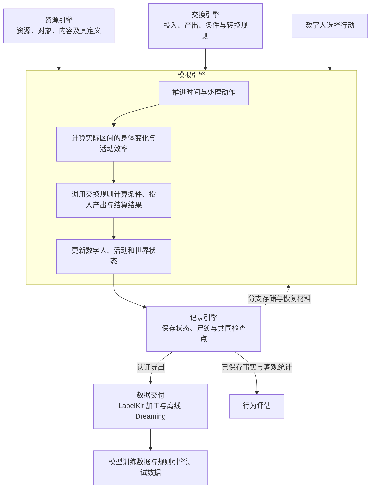
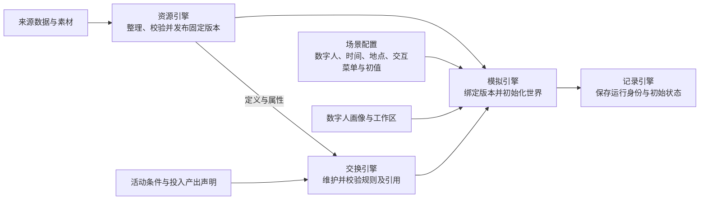
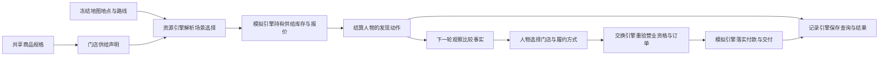
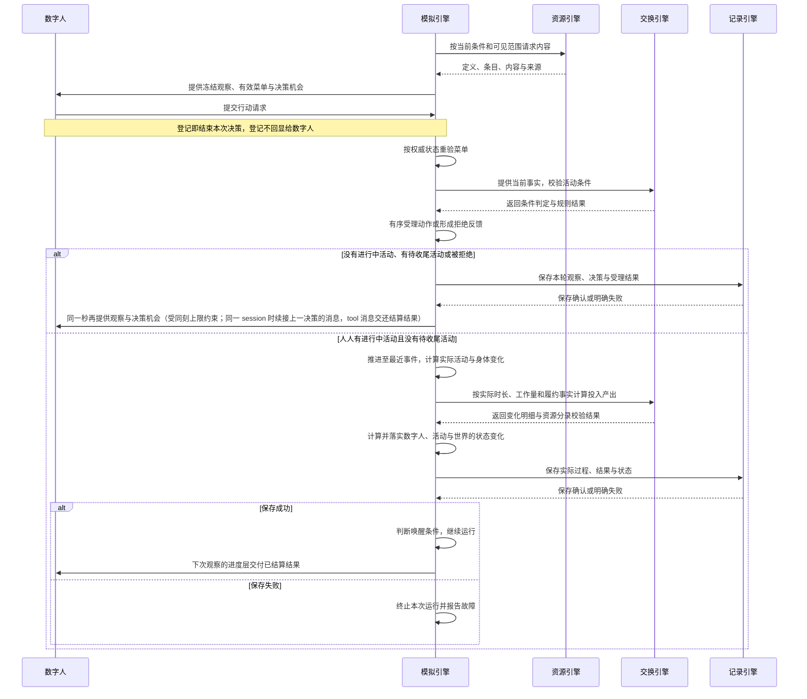
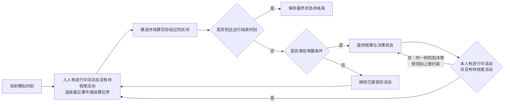
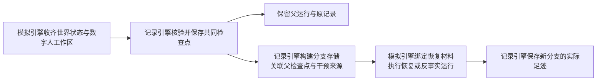
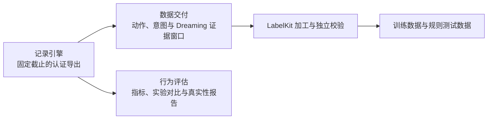
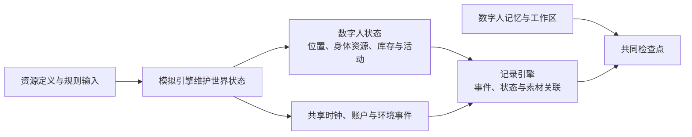

# WorldMock 产品设计说明书 — 总体架构

> **状态**：DRAFT；职责设计，现行接口与行为以所属合同和规格为准；按人物 Prompt 规格修订，修订部分待实现\
> **日期**：2026-09-27\
> **版本**：v1.5\
> **目标读者**：架构师、开发工程师、系统工程师

本文承接[概述](00-overview.md)，说明数字人、资源引擎、交换引擎、模拟引擎和记录引擎如何协作，
以及数字足迹如何进入数据交付与行为评估。各引擎的内部规则由所属设计文档维护；
跨模块字段与调用合同见[接口合同](../CONTRACTS.md)，文档权威归属见[文档入口](../INDEX.md)。
职责划分不代表对应实现已经拆成独立服务，也不构成实现完成或真实运行验收。

## 1. 系统定位与总体规格

### 1.1 系统定位

WorldMock 模拟并记录任意性格数字人的数字足迹。数字人依据自身画像、需求、观察和记忆选择行动，
系统组织环境交互、计算实际结果并保存可追溯记录，供 LabelKit 加工模型训练数据与规则引擎测试数据。

| 目标维度 | 架构要求 |
| --- | --- |
| 覆盖范围 | 任意性格数字人的数字足迹模拟与记录；具体人物、活动与内容由场景、资源和规则共同确定 |
| 时间跨度 | 模拟时间跨度可配置，不设置固定长度上限；每次运行按配置的起止时刻执行 |
| 数字人数量 | 场景声明参与者，各数字人共享同一世界时钟；具体人数和社交范围属于运行配置与验收范围 |
| 行动选择 | 复用 AgentSociety 2 的人物决策和记忆机制；数字人选择行动，环境判断可行性并执行 |
| 过程记录 | 观察、决策、执行、状态变化、结果与记忆都有来源和关联，支持检查点恢复及反事实分支 |
| 数据交付 | 记录引擎提供固定截止的认证导出，数据交付通过 LabelKit 加工并校验成品 |

白领生活、单数字人和连续十二周是已有实验场景的设置，具体身份见[实验定义](../EXPERIMENT.md)。
实验时长和内容样本不构成产品覆盖范围或模拟时长上限；可配置时长也不代表任意长度的运行已经完成验证。

| 能力 | 可选性 | 规格 |
| --- | --- | --- |
| 人物决策 | 必选 | AS2 驱动的自主决策，基于观察、需求、记忆选择行动 |
| 交互菜单 | 必选 | 场景按地点类与人物声明允许的对象动作，随观察冻结并由环境重验；八个人物工具（取消 `finish`，`plan_day` 移出人物工具，`start_activity` 取五个动词并选对象列出的方式）由独立工具层管理，工具数以接口合同为准；[冻结规格](../dev/SPEC-interaction-menu.md) |
| 身体模型 | 必选 | 维护身体相关资源，计算睡眠演化、体感分级和活动效率；执行边界见[模拟引擎](04-simulation-engine.md#实际区间身体变化与效率) |
| 活动执行 | 必选 | 工作、进食、睡眠、娱乐、购物、出行六大类活动；每人两个活动名额 |
| 资源结算 | 必选 | 金钱双边转账；能量与娱乐需要流水结算；睡眠和共享时钟按各自规则核验 |
| 资源引擎 | 必选 | 统一资源定义、内容与语料、目录发布、检索与提供；[详细设计](03-resource-engine.md) |
| 社交互动 | 可选，v1.0 最小可行版 | 看见同地他人，与联系人通讯 |
| 记录引擎 | 必选 | 事件、素材、检查点、分支、导出与诊断统一见[记录引擎设计](05-recording-engine.md) |
| 检查点恢复 | 必选 | 完整世界与工作区快照，支持从已验证的共同检查点建立新分支 |
| LabelKit 交付 | 必选 | JSONL 格式导出，包含动作序列、意图、dreaming |
| 行为评估 | 必选 | 多维度指标评估，生成对比报告 |

### 1.2 系统边界

系统包含数字人与环境的交互、资源与内容提供、交换规则、时间与活动推进、
数字足迹记录、恢复与分支，以及向 LabelKit 的数据交付。

系统不包含物理仿真或三维渲染、模型训练或托管、实时交互式界面、
社会级宏观模拟或真实银行、电商等外部业务系统集成，也不保证与任何特定真实个体的行为一致。
资源和规则使用运行前整理并绑定的版本。

## 2. 总体架构与职责分工

### 2.1 总体架构

资源引擎提供世界里可使用的定义与内容，交换引擎提供条件和转换规则。
模拟引擎组织数字人的选择与世界变化，记录引擎保存实际过程和结果。

图中的引擎表示职责边界。AgentSociety 2 提供调度、模型调用、人物决策与记忆基础；
LifeAgent 承载数字人，LifeEnv 是模拟引擎接入 AgentSociety 2 的环境入口。
现有代码文件可以承载多个引擎的处理逻辑，不能仅凭目录名称判定职责归属。

### 2.2 职责与交接

| 负责方 | 负责什么 | 向协作方交付什么 |
| --- | --- | --- |
| [数字人](../dev/SPEC-life-realism.md) | 画像、七层提示组装、行动选择、收尾记忆与反思 | 向模拟引擎提交动作请求，提供决策和记忆证据 |
| [资源引擎](03-resource-engine.md) | 资源与对象定义、内容与固化语料、版本与来源、查询与提供 | 返回指定版本的定义、属性、匹配条目、内容片段与素材引用 |
| [交换引擎](02-exchange-engine.md) | 维护与查询交换规则，校验条件，计算投入产出，校验资源分录 | 返回条件判定、资源变化明细、履约条件或拒绝原因 |
| [模拟引擎](04-simulation-engine.md) | 初始化、观察与决策机会、动作受理、时间推进、实际活动与会话切换、身体变化与效率、零点计划（运行时后台任务 `plan_day`，不经人物）、计划与提醒、状态更新、恢复后的执行 | 向数字人提供观察与反馈，向记录引擎提交实际过程、结果与共同快照 |
| [记录引擎](05-recording-engine.md) | 保存与关联足迹、素材和状态，校验记录一致性，保存检查点，构建分支存储，认证导出与诊断 | 返回保存确认、已核验的恢复材料、认证导出和客观统计 |
| [数据交付](06-delivery.md) | 证据窗口、离线经历回顾与假设推演、LabelKit 加工、样本校验与发布 | 交付可追溯的训练数据与规则测试数据 |
| [行为评估](07-evaluation.md) | 根据已保存事实计算行为指标、比较实验并形成真实性评价 | 评估报告与证据关联 |

LifeEnv 与活动属于模拟引擎的执行职责；数字足迹、检查点和分支存储属于记录引擎。
Dreaming 按当前[交付规格](../dev/SPEC-labelkit-delivery.md)消费认证导出，
默认不写回仍在运行的数字人；数字人运行中的记忆与反思由人物模块维护。
反事实分支中的实际执行由模拟引擎编排，分支保存和来源关系由记录引擎维护。

### 2.3 状态归属与写入边界

| 对象 | 负责方 | 修改边界 |
| --- | --- | --- |
| 资源定义、地图地点、供给声明、内容与来源语料 | 资源引擎 | 运行前准备和发布；运行期按绑定版本查询与读取 |
| 交换规则及其引用关系 | 交换引擎 | 维护规则声明；运行时根据输入事实求值并返回结果 |
| 共享时钟、余额、按供给报价与库存、营业例外、身体状态、活动进度、地点会话、当日计划与提醒 | 模拟引擎中的生活环境 | 收齐动作后有序受理，按实际经过时间和规则结果更新 |
| 数字人的记忆与工作区 | 数字人 | 依观察、执行反馈和记忆流程更新；记忆写入点为 `conclude_activity` 与就寝反思两处，阈值巩固不变；由模拟引擎协调共同保存边界。提示中的记忆层是构建提示时由环境从已提交事件与世界状态派生的视图，不另存；关系与偏好在人设层按对象原地呈现 |
| 事件、素材、状态快照、检查点与分支来源 | 记录引擎 | 保存模拟引擎提交的事实，校验引用、版本和事务一致性 |

世界状态只有生活环境这一写入入口。记录引擎在共享环境的写入路径中执行持久化，
人物 worker 通过环境登记证据，不直接写数据库。
资源查询和交换规则求值不会自行推进世界时钟，也不会自行修改运行中的世界状态。

同一人物有两个活动名额，进行中、暂停中与待收尾的活动各占一个；能否同时进行按注册表声明的占用与准入事实判定。
活动集合属于模拟引擎，人物共同经过的区间只结算一次身体，
每项活动独立记录进度和结束。记录引擎从已提交事件投影已核验经历；人物模块的自由归纳、感受和反思
始终作为主观记忆保存，来源由系统登记。发给人物的记忆层把系统写的 `settled`（已提交结果与世界事件的确定性句子）
与人物写的 `self_notes`（pause、conclude 写下的 summary 与记忆原文）分字段呈现，按 session 派生、零点分区。
这条交接沿用现有 AS2 人物循环、记忆存储和检查点，不增加第二套运行或记忆框架。
完整行为与验收见[一日行为规格](../dev/SPEC-dayrun-behavior.md)。

## 3. 端到端数据流

### 3.1 准备与初始化

场景决定本次运行使用哪些人物、资源、规则、时间范围，以及地点类与人物的交互菜单。
资源引擎检查定义、文件身份和引用；交换引擎检查关联规则；模拟引擎绑定结果并建立运行状态。
原生品类契约、对象属性增量与库存转换继续有效；商品使用合同可覆盖不在售的持有物，购买另由门店供给确定报价与卖方。
缺少必要定义、规则或素材时明确失败，不补造可继续运行的世界。

### 地图与门店供给的交接

场景只引用地图身份、地点、商品和供给，并提供实例初值。地点名称、坐标、营业和路线只有地图目录一份定义。
`kind`、`business_kind`、`location_kinds` 分别用于菜单、经营业态和活动环境，不自动互推。
发现是正常生活动作，不能成为同一决策中刷新世界的即时接口；地图身份、当前报价和可见供给进入恢复边界。

### 3.2 观察、行动与执行

行动请求的登记不代表活动已受理或已完成。模拟引擎根据接受、拒绝、进度和结果形成反馈，
记录引擎在相应交互边界保存观察、决策、执行与记忆证据。
有效菜单由地点类与人物声明求交集，随本轮观察冻结；阶段与可见目标继续收窄。
宿主的本地校验与直接派发按冻结菜单失败关闭，环境重验阻止绕过模型工具 Schema，候选、事实与资源目录保持完整。详细合同见
[交互菜单规格](../dev/SPEC-interaction-menu.md)。
决策不耗时；有进行中活动且无唤醒条件才静默续行。
故障按所属合同终止并保存错误，不把失败包装成成功经历。

### 3.3 事件驱动的时间推进

每个数字人都有进行中活动且没有待收尾活动时，模拟引擎才推进到最近一个需要处理的时刻：
活动结束、内容反馈、通知到达、工作截止、身体变化边界、计划提醒、场景本地零点、等待结束或本次运行的结束时刻。
跨越的实际时长用于计算身体变化、活动进度与资源变化。

资源结算可以有固定间隔，结算时刻作为事件参与上述选择；结算间隔不等于数字人的决策间隔。
时间与唤醒规则由[模拟引擎](04-simulation-engine.md)、[运行时规格](../dev/SPEC-life-runtime.md)及[时间与能量规格](../dev/SPEC-time-and-energy.md)维护。

### 3.4 检查点、恢复与反事实分支

检查点包含共同边界上的世界状态、数字人工作区及恢复所需材料。
记录引擎负责核验和提供这些材料，模拟引擎负责恢复外部运行实例、施加已声明的干预并继续执行。
假设文本和实际重新模拟得到的结果分别标明来源，新分支结果不改写原分支经历。
完整规则见[记录引擎](05-recording-engine.md#恢复与反事实分支)与[模拟引擎](04-simulation-engine.md)。

### 3.5 数据交付与评估

离线 Dreaming 基于已有足迹归纳经历或提出假设，默认不写回运行中的数字人。
实际反事实运行由明确的运行请求触发，并按新的分支身份保存；不能将生成的假设文本冒充执行结果。
交付和评估的输入范围、校验与发布条件见[交付规格](../dev/SPEC-labelkit-delivery.md)和[验收门禁](../VERIFICATION.md)。

## 4. 已采用的设计决策

| 设计点 | 设计决策 |
| --- | --- |
| 基础框架 | 复用 AgentSociety 2 的调度、模型调用、数字人决策、记忆与 Ray 多进程机制 |
| 时间推进 | 决策不耗时：没有进行中活动或有待收尾活动的数字人同一秒再决策，受同刻上限约束；人人有进行中活动且没有待收尾活动后，按最近相关事件推进共享模拟时钟，决策机会由唤醒条件决定 |
| 世界状态 | 由模拟引擎中的生活环境集中更新；记录引擎负责保存与一致性核验 |
| 资源与规则 | 运行前整理、校验并绑定版本；运行期读取固定定义并按规则求值 |
| 内容检索 | 使用确定性属性筛选与倒排索引，按指定可见范围和接触区间提供内容 |
| 持久化 | SQLite 保存结构化事件与状态，内容寻址文件保存素材与证据 |
| 恢复与分支 | 从已核验的共同检查点构建新分支，保留父运行和来源关系 |
| 失败处理 | 按所属合同明确拒绝或中止，保留原因；记录失败不得返回成功确认 |

## 5. 现有代码与职责的对应关系

下表用于定位现有实现。同一文件可能承载多个引擎的处理逻辑，职责按实际输入与输出判断。

| 职责 | 现有承载位置 | 详细设计 |
| --- | --- | --- |
| 数字人 | [LifeAgent](../../custom/agents/life_agent.py)、[人物画像](../../src/worldmock/profile)、AgentSociety 2 人物与记忆模块 | [人物规格](../dev/SPEC-life-realism.md) |
| 资源引擎 | [目录定义与加载](../../src/worldmock/catalog)、[语料整理](../../src/worldmock/corpora)、[内容读取](../../src/worldmock/life/content.py)及检索、呈现模块 | [资源引擎](03-resource-engine.md) |
| 交换引擎 | [规则声明](../../catalog)、[资源分录计算与校验](../../src/worldmock/resources)及生活模型中的条件、费用和报酬规则 | [交换引擎](02-exchange-engine.md) |
| 模拟引擎 | [运行入口](../../src/worldmock/runtime.py)、[LifeEnv](../../custom/envs/life_env.py)、[生活运行逻辑](../../src/worldmock/life/engine.py)及活动、身体和调度模块 | [模拟引擎](04-simulation-engine.md) |
| 记录引擎 | [足迹存储](../../src/worldmock/footprints)、[素材存储](../../src/worldmock/footprints/assets.py) | [记录引擎](05-recording-engine.md) |
| 数据交付与评估 | [交付模块](../../src/worldmock/delivery)、[评估模块](../../src/worldmock/evaluation) | [数据交付](06-delivery.md)、[行为评估](07-evaluation.md) |

LifeEngine 是现有内部代码载体，不作为四个引擎之外的另一项顶层职责。
身体相关资源、体感与活动效率在模拟引擎中计算，资源定义来自资源引擎，
具体交换投入产出由交换引擎计算，准确数值和变化原因交给记录引擎保存。

## 6. 配置、接口与数据结构

### 6.1 配置与运行入口

| 配置或入口 | 架构职责 | 具体规格 |
| --- | --- | --- |
| 场景 | 选择数字人、时间范围、地点、交互菜单、初值，以及资源和规则版本 | [配置设计](08-configuration.md)、[交互菜单规格](../dev/SPEC-interaction-menu.md)、[实验定义](../EXPERIMENT.md) |
| 资源目录与语料 | 提供定义、来源、版本和实际可读取内容 | [资源引擎](03-resource-engine.md) |
| 交换规则 | 声明使用条件、资源占用、转换和履约条件 | [交换引擎](02-exchange-engine.md) |
| 模型凭证 | 在运行环境中读取，不进入仓库或数字足迹 | [配置设计](08-configuration.md) |
| 命令行入口 | 发起准备、校验、运行、恢复、查询、导出、交付和评估 | [接口合同](../CONTRACTS.md) |

运行参数与场景选定版本后，由模拟引擎组织加载与准入，资源和交换引擎分别核验自己的输入。
具体命令签名和字段只在所属合同维护，不在总体架构中另列一套示例接口。
Python、AgentSociety 2、LabelKit、SQLite 与模型服务的版本和运行绑定见[实验定义](../EXPERIMENT.md)。

### 6.2 状态与记录

资金通过账户身份关联，以最小货币单位整数保存；身体资源和睡眠模型保留各自单位与变化规则。
体感分级、商品每份热量与路线费力供数字人理解处境，准确数值进入足迹与评估；发给模型的请求按七层 JSON 组织，
同一信息只出现一次，不含内部身份。
状态字段与修改权限见[接口合同](../CONTRACTS.md)，事件、检查点与导出格式见
[记录引擎](05-recording-engine.md)；输入输出导航见[格式说明](09-io-formats.md)。

## 7. 验收与实现状态

### 7.1 时间跨度与性能基准

系统按配置执行模拟，不设置十二周或其他固定长度上限。
已有单数字人十二周场景用于性能、存储和行为评估；该场景的指标是特定负载下的验收目标，
不代表产品的最长模拟时间，也不代表目标已经通过实测。

| 基准指标 | 目标及适用范围 |
| --- | --- |
| 模拟耗时 | 单数字人十二周基准在八核、32 GB 机器上不超过 24 小时 |
| 峰值内存 | 单数字人十二周基准不超过 8 GB |
| 存储规模 | 单数字人十二周基准的数据库与素材合计不超过 10 GB |
| 数据库与素材预算 | 单数字人十二周基准的数据库不超过 1 GB，素材文件不超过 9 GB |
| 事件写入 | 写入负载测试达到每秒至少 1000 条事件，吞吐由实际写入耗时测量 |
| 其他规模 | 记录实际人物数、模拟时长、事件量、耗时、峰值内存和存储增长，按实际结果评估 |

### 7.2 一致性与交付验收

| 验收对象 | 判定要求 | 权威文档 |
| --- | --- | --- |
| 世界推进与交换 | 实际区间可对账，规则结果与已落实状态一致，故障如实反馈 | [运行时规格](../dev/SPEC-life-runtime.md)、[时间与能量规格](../dev/SPEC-time-and-energy.md)、[人物 Prompt 规格](../dev/SPEC-persona-prompt.md) |
| 数字足迹与恢复 | 事件和状态连续、引用完整，检查点可核验，分支保留来源关系 | [记录引擎](05-recording-engine.md) |
| 训练数据与规则测试数据 | 输入范围、来源、独立校验、真实加载与执行满足交付要求 | [交付规格](../dev/SPEC-labelkit-delivery.md) |
| 工程质量与行为真实性 | 执行当前门禁，报告测试与真实运行证据的适用范围 | [验收门禁](../VERIFICATION.md) |

代码覆盖率的统计范围、分支门槛和公共接口门槛见[覆盖率基线](../dev/coverage-baseline.md)；
模块设计与规格条款对应的测试证据见[规格覆盖分析](../dev/ANALYSIS-spec-coverage.md)。
各引擎已实现的能力、尚未完成的部分与验收方法在所属设计中逐项说明。
全项目的实测结果与未完成项见[实现状态](../dev/implementation-status.md)；
本文不以模块存在或文档已整合代替实现完成声明。

## 版本历史

| 版本 | 日期 | 修订内容 |
| --- | --- | --- |
| v1.0 | 2026-09-20 | 初版：系统定位、分层架构、模块清单、数据流、CLI 规格、配置体系、核心数据结构 |
| v1.1 | 2026-09-20 | 身体模型与资源结算对齐冻结规格，删除四项百分制身体字段与统一误差阈值 |
| v1.2 | 2026-09-20 | 同步总览的数字人与四引擎职责、可配置时间跨度、事件驱动、检查点与分支、离线交付边界；接口和实现状态改为引用所属文档 |
| v1.3 | 2026-09-20 | 在初始化与行动链路接入地点类和人物交互菜单，明确冻结观察、环境重验与候选不变边界 |
| v1.4 | 2026-09-24 | 同步时间与能量规格：八个人物工具与两个活动名额；零点计划、计划与提醒、会话切换归模拟引擎；记忆写入点与系统登记的来源；行动链路与时间推进改为决策不耗时、同刻再决策；商品热量、路线费力与提示不含内部身份；验收权威补该规格 |
| v1.5 | 2026-09-27 | 同步人物 Prompt 七层规格（人物 Prompt 台账 E1-1–E1-7）：文件头注明修订部分待实现；数字人职责改为画像、七层提示组装、行动选择、收尾记忆与反思；记忆写入点不变，记忆层是派生视图，关系与偏好在人设层原地呈现，记忆层分列系统写的 `settled` 与人物写的 `self_notes`；行动链路删登记确认，登记不回显，同秒再决策时续接上一决策的消息；状态与记录补七层 JSON 与唯一出现；验收权威补该规格 |
