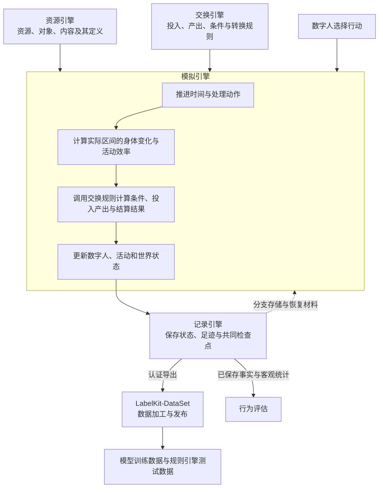
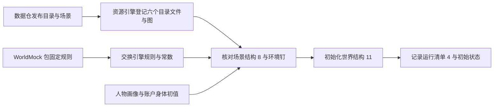
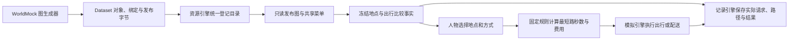
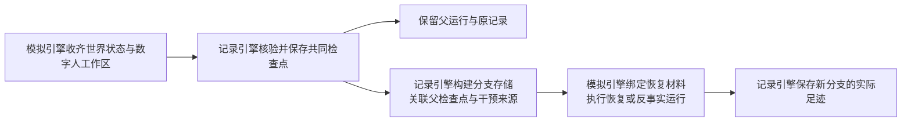
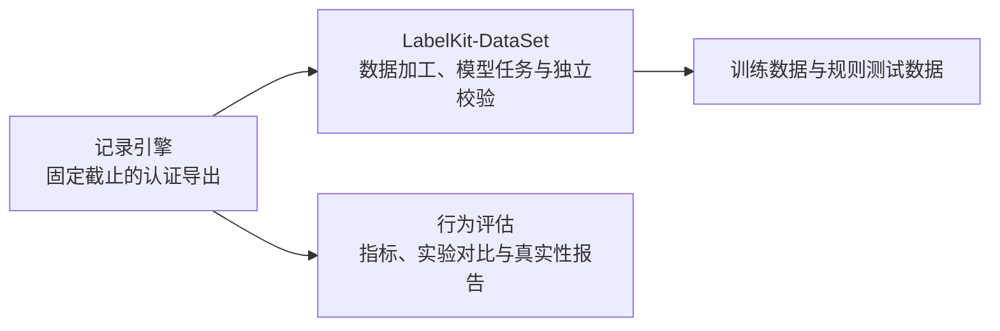
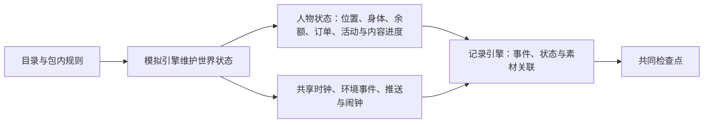
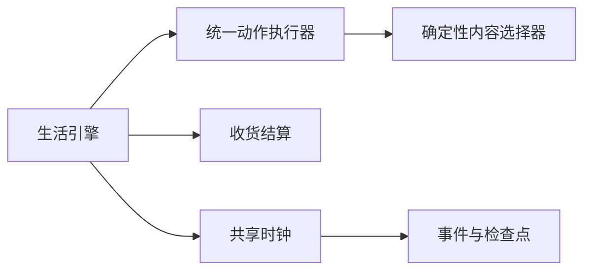

# WorldMock 产品设计说明书 — 总体架构

> **状态**：DRAFT；职责设计，现行接口与行为以所属合同和规格为准；按人物 Prompt 规格修订，修订部分已实现（证据见[人物 Prompt 验收记录](../archive/persona-prompt/persona-prompt-verification.md)）\
> **日期**：2026-10-07
> **版本**：v1.17
> **工具交互修订**：按[工具交互规格](../dev/SPEC-life-runtime.md#tool-interaction-工具请求)冻结本次设计；本次修订已实现，既有验收不覆盖新行为。
> **个人事务与工作安排修订**：按[个人事务与工作安排规格](../dev/SPEC-as2-integration.md#errands-workday-运行修复入库)分阶段同步（[实施计划](../archive/errands-workday/errands-workday-implementation-plan.md) D1 作业），已实现（离线验收，证据见[个人事务与工作安排验收记录](../archive/errands-workday/errands-workday-verification.md)）。
> **让「等待」成为例外修订**：按[让「等待」成为例外规格](../dev/SPEC-idle-fillers.md#spec-idle-fillers-让等待成为例外开发规格)修订「3.3 事件驱动的时间推进」（阶段 1）与「6.2 状态与记录」（阶段 1、阶段 2、阶段 3）。
> **同时做两件事修订**：按[同时做两件事规格](../dev/SPEC-parallel-activities.md#spec-parallel-activities-同时做两件事开发规格)修订「2.3 状态归属与写入边界」与「6.2 状态与记录」（阶段 1）。
> **目标读者**：架构师、开发工程师、系统工程师

> 2026-10-07：按资源与规则引擎简化规格同步剩余系统规则、最终提示身份与查看器（阶段 6）。

> 按[资源与规则引擎简化规格](../dev/SPEC-resource-and-rule-simplification.md#spec-rrs-资源与规则引擎简化开发规格)修订「地图与门店供给的交接」、「3.1 准备与初始化」、「6.1 配置与运行入口」、「6.2 状态与记录」、「5. 现有代码与职责的对应关系」、「1.1 系统定位」、「3.2 观察、行动与执行」、「4. 已采用的设计决策」、「实际生产依赖与状态归属」（阶段 2）；「2.3 状态归属与写入边界」（阶段 3）。

本文承接[概述](00-overview.md#overview-worldmock-产品设计说明书-概述)，说明数字人、资源引擎、交换引擎、模拟引擎和记录引擎如何协作，
以及数字足迹如何进入数据交付与行为评估。各引擎的内部规则由所属设计文档维护；
跨模块字段与调用合同见[接口合同](../CONTRACTS.md#contracts-worldmock-接口合同)，文档权威归属见[文档入口](../INDEX.md#index-worldmock-文档入口)。
职责划分不代表对应实现已经拆成独立服务，也不构成实现完成或真实运行验收。

> 按[动作与内容简化规格](../dev/SPEC-action-and-content-simplification.md#spec-acs-动作与内容简化开发规格)修订「固定规则、目录格式与加载边界、收货结算」（阶段 1、2）。

具体环境及制作工具按[环境数据归属规格](../dev/SPEC-environment-data-ownership.md)归 WorldMock-Dataset，
正式重制环境路径由 WorldMock-Dataset 发布决定；WorldMock 提供引擎及包内固定通用规则。
本章的 `catalog/`、`scenarios/` 指外部环境目录，命令以 WorldMock 为当前工作目录并显式传路径。
当前场景结构 8、世界结构 11；类别、使用方式、效果与供给表由 WorldMock 固定，
环境只登记对象、绑定与价格、内容时长、集数三种数；新组合放行另核对实际收据。

## 共享规则与可重建环境修订

按[共享规则与可重建环境规格](../dev/SPEC-shared-rules-and-rebuildable-env.md)修订；验收结果独立记录。

共享规则分别归属于记录、资源和生活模块的唯一实现，呈现、受理、结算与评估直接复用。基础模型位于不依赖业务模块的叶子模块；目录模型深冻结由目录登记合同维护。AS2 负责调度、模型服务和恢复，WorldMock 负责人物的记忆业务规则。

## 1. 系统定位与总体规格

### 1.1 系统定位

活动只有 `wait`、`sleep`、`travel`、`action`。系统动作负责购买、领取、闹钟、出行、睡眠与等待；全部数据集动作使用同一个执行器。选内容不耗时，按实际经过秒数推进身体和内容。`remaining = min(ceil(duration_seconds - position_seconds), 86400)`；开始、换内容和恢复时，计划时长为已做秒数加余量，计划结束为当前时刻加余量。娱乐在同一活动静默接续；其他四类做完一条即完成。暂停不消费，提前结束只留下真实部分，恢复沿用原内容并读取全局最新位置，不重抽。

### 1.2 系统边界

系统包含数字人与环境的交互、资源与内容提供、交换规则、时间与活动推进、
数字足迹记录、恢复与分支，以及向 LabelKit-DataSet 提供完整足迹导出。

系统不包含物理仿真或三维渲染、模型训练或托管、实时交互式界面、
社会级宏观模拟或真实银行、电商等外部业务系统集成，也不保证与任何特定真实个体的行为一致。
资源和规则使用运行前整理并绑定的版本。

## 2. 总体架构与职责分工

### 2.1 总体架构

资源引擎提供世界里可使用的定义与内容，交换引擎提供条件和转换规则。
模拟引擎组织数字人的选择与世界变化，记录引擎保存实际过程和结果。

图中的引擎表示职责边界。AgentSociety 2 提供调度、模型调用、人物决策与记忆基础；
LifeAgent 承载数字人，LifeEnv 是模拟引擎接入 AgentSociety 2 的环境入口。
现有代码文件可以承载多个引擎的处理逻辑，不能仅凭目录名称判定职责归属。

### 2.2 职责与交接

| 负责方 | 负责什么 | 向协作方交付什么 |
| --- | --- | --- |
| [数字人](../dev/SPEC-life-realism.md#spec-life-realism-特性规格人物决策与画像) | 画像、七层提示组装、行动选择、收尾记忆与反思 | 向模拟引擎提交动作请求（播报、暂停与收尾请求可携带个人事务的新增、更新与取消），提供决策和记忆证据 |
| [资源引擎](03-resource-engine.md#resource-engine-worldmock-产品设计说明书-资源引擎) | 资源与对象定义、动作与内容绑定、版本与来源、查询与提供 | 返回指定版本的定义、属性、匹配条目、内容片段与素材引用 |
| [交换引擎](02-exchange-engine.md#exchange-engine-worldmock-产品设计说明书-交换引擎) | 维护与查询交换规则，校验条件，计算投入产出，校验资源分录 | 返回条件判定、资源变化明细、履约条件或拒绝原因 |
| [模拟引擎](04-simulation-engine.md#simulation-engine-worldmock-产品设计说明书-模拟引擎) | 初始化、观察与决策机会、动作受理、时间推进、实际活动与会话切换、身体变化与效率、零点计划（运行时后台任务 `plan_day`，不经人物）、计划与提醒、个人事务的受理、按结算证据确认办成与事务提醒、按场景工作安排求值今天的上班安排、状态更新、恢复后的执行 | 向数字人提供观察与反馈，向记录引擎提交实际过程、结果与共同快照 |
| [记录引擎](05-recording-engine.md#recording-engine-worldmock-产品设计说明书-记录引擎) | 保存与关联足迹、素材和状态，校验记录一致性，保存检查点，构建分支存储，认证导出与诊断 | 返回保存确认、已核验的恢复材料、认证导出和客观统计 |
| LabelKit-DataSet 数据加工 | 证据窗口、离线经历回顾与假设推演、LabelKit 加工、样本校验与发布 | 交付可追溯的训练数据与规则测试数据 |
| [行为评估](07-evaluation.md#evaluation-worldmock-产品设计说明书-行为评估) | 根据已保存事实计算行为指标、比较实验并形成真实性评价；工作负荷与作息偏离两个只报告项另读一个可选的打包输入（各人物的班次、任务的预约与要求地点、住处、覆盖后的作息窗口与播报间隔），缺输入的人物报告 null | 评估报告与证据关联 |

LifeEnv 与活动属于模拟引擎的执行职责；数字足迹、检查点和分支存储属于记录引擎。
离线数据加工由 LabelKit-DataSet 消费认证导出，
默认不写回仍在运行的数字人；数字人运行中的记忆与反思由人物模块维护。
反事实分支中的实际执行由模拟引擎编排，分支保存和来源关系由记录引擎维护。

### 2.3 状态归属与写入边界

每个人的 `content_progress` 以内容为键，跨 app 共享。记录恰含 `content_id`、`position_seconds`、`completed_rounds`、必填的 `last_consumed_at`；只有正秒消费才创建或更新，推送、展示和零秒暂停不算看过。完成时位置归零、轮数加一，活动 `played` 追加实际消费区间，并释放当前 session 指向该内容的全部推送。

购买受理当秒付款，每单一次，不产生提前的商品效果。到店与直送经唯一收货入口结算；完整运输时长严格大于一天时，一次报价仍保持不变，订单改送实际模拟收货人家庭地址最近且场景选中的驿站。到站只进入 `ready_for_pickup` 并通知实际收货人，本人在站零秒领取后才写 `received_at`、`goods_received` 和商品效果。联系人直送只改变订单，不改变模拟人物身体，也不写 `goods_received`。系统没有库存、持有、食用或给予。

只有环境明确声明拥有汽车的人物能够驾车；初始可用天数由环境声明。现场在加油站为本人购买燃油恰增加七天，没有库存或身体效果。每个本地日期首次正秒驾车扣一天，不驾车不扣，同日多次不重扣；跨午夜按实际驾驶覆盖的日期计算，恰好停在午夜不扣次日。车费仍在受理出发时支付一次。

## 3. 端到端数据流

### 3.1 准备与初始化

目录清单恰列 `apps.json`、`locations.json`、`goods.json`、`actions.json`、`contents.json`、`map.json`。
资源引擎登记与冻结对象及反向索引；模拟引擎负责内容选择、实际进度与历史。
不读取 `corpora/`，规则只从包读取。场景决定人物、地点、工作安排、菜单、时间与初值。
缺少必要定义、规则或素材即明确失败，不补造可继续运行的世界。

### 地图与门店供给的交接

场景结构 `8` 钉目录身份，只选择地点。地点恰有身份、名称、分店标签、类型与 app 绑定五个字段；类型派生活动环境。
图覆盖全目录节点，场景选择不裁切路径。随机连通加权图由 WorldMock 生成、Dataset 发布，最短路等长按完整路径元组字典序决胜。
同种商品店铺共享菜单，商品全店同价，`"all"` 不包含住宅；外卖覆盖全图，没有营业、资格、库存或道路状态。
只读查询与耗时发现保持各自的时间和证据边界，图查询不刷新世界。运行清单与检查点核对 `environment_identity`，出行保存 `trip_id`、`path` 和 `distance_meters`。

店铺类型可供给的商品类别由 `GOODS_CATEGORY_STORE_KINDS` 固定，目录绑定不能覆盖该表。

付款成功不产生商品效果，只有收货结算施加效果；人物资产是余额与订单，没有持有。

### 3.2 观察、行动与执行

人物选动作与可选的 app，系统从该动作绑定的合格内容中选择。顺序是当前 session 同 app、同动作的未释放推送，最近实际消费但未完成的内容，已开始系列的下一集，未看单元，完成轮数最少的单元。每个系列只由最低轮次的最低集代表，预留内容和刚完成内容只在仍有其他候选时排除。候选按内容身份排序，用 `activity_id:draw_index` 或推送 `scheduled_id` 的 SHA-256 随机流决胜，不改变世界随机状态。

实际动作先只读准备一次，准入通过后初始化；后续活动进度、结算与事件在共享时钟上提交。模型只描述意图与主观经历，不改变真实进度。

社交动作由环境数据声明 `communication_mode`。同 app 文字聊天只记录实际动作内容、进度与人物自行撰写的主题性文字，不调用通话域函数；语音模式才建立真实通话。两者都不能用模型叙述伪造发送、回复、时长或内容位置。

### 3.3 事件驱动的时间推进

活动只有 `wait`、`sleep`、`travel`、`action`。系统动作负责购买、领取、闹钟、出行、睡眠与等待；全部数据集动作使用同一个执行器。选内容不耗时，按实际经过秒数推进身体和内容。`remaining = min(ceil(duration_seconds - position_seconds), 86400)`；开始、换内容和恢复时，计划时长为已做秒数加余量，计划结束为当前时刻加余量。娱乐在同一活动静默接续；其他四类做完一条即完成。暂停不消费，提前结束只留下真实部分，恢复沿用原内容并读取全局最新位置，不重抽。

结算边界和决策机会分别判断。娱乐内容完成只结算和提交，不增加决策；其他类别内容完成使活动结束。长时间动作的固定机会是 `progress_report_due`，该机会提出后，不论人物使用哪个工具、受理还是拒绝，都把当时到期的活动播报锚点移到当前秒。既有唤醒原因共 23 个，包含 `alarm_ring`，没有内容完成原因。睡眠只接受工作边界、目标提醒、实验结束和闹钟等既有允许原因；娱乐推送送达不叫醒。

### 3.4 检查点、恢复与反事实分支

检查点包含共同边界上的世界状态、数字人工作区及恢复所需材料。
记录引擎负责核验和提供这些材料，模拟引擎负责恢复外部运行实例、施加已声明的干预并继续执行。
假设文本和实际重新模拟得到的结果分别标明来源，新分支结果不改写原分支经历。
完整规则见[记录引擎](05-recording-engine.md#recording-engine-恢复与反事实分支)与[模拟引擎](04-simulation-engine.md#simulation-engine-worldmock-产品设计说明书-模拟引擎)。

### 3.5 足迹交接与评估

离线 Dreaming 基于已有足迹归纳经历或提出假设，默认不写回运行中的数字人。
实际反事实运行由明确的运行请求触发，并按新的分支身份保存；不能将生成的假设文本冒充执行结果。
交付和评估的输入范围、校验与发布条件见LabelKit-DataSet 数据加工和[验收门禁](../VERIFICATION.md#verification-worldmock-验收标准)。

## 4. 已采用的设计决策

按消费历史确定性选择内容；固定规则、常数和占用归 WorldMock，环境只维护地点、商品、动作、app、内容与图。订单、消息正文、分配内容、推送和内容实际进度分别保存在自己的权威状态。

## 5. 现有代码与职责的对应关系

下表用于定位现有实现。同一文件可能承载多个引擎的处理逻辑，职责按实际输入与输出判断。

| 职责 | 现有承载位置 | 详细设计 |
| --- | --- | --- |
| 数字人 | [LifeAgent](../../custom/agents/life_agent.py)、[就寝反思工具](../../src/worldmock/agents/life_reflection.py)、[人物画像](../../src/worldmock/profile)、AgentSociety 2 人物与记忆模块 | [人物规格](../dev/SPEC-life-realism.md#spec-life-realism-特性规格人物决策与画像) |
| 资源引擎 | [目录登记、加载与图查询](../../src/worldmock/catalog)及只读反向索引；内容选择与进度由模拟引擎负责 | [资源引擎](03-resource-engine.md#resource-engine-worldmock-产品设计说明书-资源引擎) |
| 交换引擎 | [固定类型、常数与算子](../../src/worldmock/exchange)、[固定活动声明](../../src/worldmock/data/affordances.toml)、[资源分录计算与校验](../../src/worldmock/resources)及生活模型中的条件、费用和报酬规则 | [交换引擎](02-exchange-engine.md#exchange-engine-worldmock-产品设计说明书-交换引擎) |
| 模拟引擎 | [运行入口](../../src/worldmock/runtime.py)、[LifeEnv](../../custom/envs/life_env.py)、[只读查询转发](../../src/worldmock/life/read_query_runtime.py)、[生活运行逻辑](../../src/worldmock/life/engine.py)及活动、身体和调度模块 | [模拟引擎](04-simulation-engine.md#simulation-engine-worldmock-产品设计说明书-模拟引擎) |
| 记录引擎 | [足迹存储](../../src/worldmock/footprints)、[素材存储](../../src/worldmock/footprints/assets.py) | [记录引擎](05-recording-engine.md#recording-engine-worldmock-产品设计说明书-记录引擎) |
| 完整导出与评估 | [导出模块](../../src/worldmock/footprints/export.py)、[评估模块](../../src/worldmock/evaluation) | [记录引擎](05-recording-engine.md#recording-engine-固定截止导出)、[行为评估](07-evaluation.md#evaluation-worldmock-产品设计说明书-行为评估) |

LifeEngine 是现有内部代码载体，不作为四个引擎之外的另一项顶层职责。
身体相关资源、体感与活动效率在模拟引擎中计算，资源定义来自资源引擎，
具体交换投入产出由交换引擎计算，准确数值和变化原因交给记录引擎保存。

## 6. 配置、接口与数据结构

### 6.1 配置与运行入口

| 配置或入口 | 架构职责 | 具体规格 |
| --- | --- | --- |
| 场景 | 选择数字人、时间范围、地点、交互菜单、作息覆盖与工作安排、初值，以及资源和规则版本 | [配置设计](08-configuration.md#configuration-worldmock-产品设计说明书-配置规格)、[交互菜单规格](../dev/SPEC-interaction-menu.md#spec-interaction-menu-特性规格交互菜单)、[实验定义](../EXPERIMENT.md#experiment-worldmock-实验设置) |
| 资源目录与登记目录 | 提供六份目录、发布图、环境身份及实际可读取登记目录，统一登记后只读消费 | [资源引擎](03-resource-engine.md#resource-engine-worldmock-产品设计说明书-资源引擎) |
| 交换规则 | 声明使用条件、资源占用、转换和履约条件 | [交换引擎](02-exchange-engine.md#exchange-engine-worldmock-产品设计说明书-交换引擎) |
| 模型凭证 | 在运行环境中读取，不进入仓库或数字足迹 | [配置设计](08-configuration.md#configuration-worldmock-产品设计说明书-配置规格) |
| 命令行入口 | 发起准备、校验、运行、恢复、查询、导出、交付和评估 | [接口合同](../CONTRACTS.md#contracts-worldmock-接口合同) |

运行参数与场景选定版本后，由模拟引擎组织目录登记、发布图读取与场景 8 加载，资源和交换引擎分别核验自己的输入。
具体命令签名和字段只在所属合同维护，不在总体架构中另列一套示例接口。
Python、AgentSociety 2、SQLite 与模型服务的版本和运行绑定见[实验定义](../EXPERIMENT.md#experiment-worldmock-实验设置)。

现行身份是目录格式 2、`RULES_VERSION = 2`、场景结构 8、世界结构 11、运行清单 4。
运行、检查点与恢复使用五字段 `environment_identity`：`environment_id`、`environment_version`、
`rules_version`、`catalog_content_sha256`、`map_sha256`。
规则文件只从引擎包读取，环境不发布副本，也不添加规则哈希；`code_sha256` 额外覆盖 `src/worldmock/data/` 下每个文件。
旧格式与旧结构号直接拒绝，不迁移、不双读。

### 6.2 状态与记录

当前只接受目录格式 2、`RULES_VERSION = 2`、场景结构 8、世界结构 11 与运行清单 4。人物资产只有余额与订单；模拟状态另保存实际活动、内容进度、session 推送、驾驶天数与闹钟，没有食品持有或联系人持有。旧输入与旧检查点直接拒绝，不迁移、不双读。

运行、检查点与恢复使用五字段 `environment_identity`：`environment_id`、`environment_version`、`rules_version`、`catalog_content_sha256`、`map_sha256`。规则文件只从引擎包读取，环境不发布副本，也不添加规则哈希；`code_sha256` 额外覆盖 `src/worldmock/data/` 下每个文件。人物请求使用四字段 `start_activity` 项与按 `from` 筛选的 `query_world`，模型提示和工具层与该接口同源。

## 7. 验收与实现状态

### 7.1 时间跨度与性能基准

系统按配置执行模拟，不设置十二周或其他固定长度上限。
已有单数字人十二周场景用于性能、存储和行为评估；该场景的指标是特定负载下的验收目标，
不代表产品的最长模拟时间，也不代表目标已经通过实测。

| 基准指标 | 目标及适用范围 |
| --- | --- |
| 模拟耗时 | 单数字人十二周基准在八核、32 GB 机器上不超过 24 小时 |
| 峰值内存 | 单数字人十二周基准不超过 8 GB |
| 存储规模 | 单数字人十二周基准的数据库与素材合计不超过 10 GB |
| 数据库与素材预算 | 单数字人十二周基准的数据库不超过 1 GB，素材文件不超过 9 GB |
| 事件写入 | 写入负载测试达到每秒至少 1000 条事件，吞吐由实际写入耗时测量 |
| 其他规模 | 记录实际人物数、模拟时长、事件量、耗时、峰值内存和存储增长，按实际结果评估 |

### 7.2 一致性与交付验收

工具交互修订已实现；新增请求、查询、任务通知和类别供给必须经生产入口行为测试及独立变异测试，
按错误接口、任务、供给价格、料理、查询、操作备忘与紧凑呈现的独立端到端阶段逐项放行与复验，
各自只更新实际改变的身份，退役格式在该阶段删除，门禁见[工具交互特性门禁](../VERIFICATION.md#verification-工具交互特性门禁)。

| 验收对象 | 判定要求 | 权威文档 |
| --- | --- | --- |
| 世界推进与交换 | 实际区间可对账，规则结果与已落实状态一致，故障如实反馈 | [运行时规格](../dev/SPEC-life-runtime.md#spec-life-runtime-特性规格lifeenv-运行时行为与结算规则)、[时间与能量规格](../dev/SPEC-life-runtime.md#time-and-energy-决策不耗时时间只在做事时流动)、[人物 Prompt 规格](../dev/SPEC-life-realism.md#persona-prompt-七层请求)、[个人事务与工作安排规格](../dev/SPEC-as2-integration.md#errands-workday-运行修复入库) |
| 数字足迹与恢复 | 事件和状态连续、引用完整，检查点可核验，分支保留来源关系 | [记录引擎](05-recording-engine.md#recording-engine-worldmock-产品设计说明书-记录引擎) |
| 工程质量与行为真实性 | 执行当前门禁，报告测试与真实运行证据的适用范围 | [验收门禁](../VERIFICATION.md#verification-worldmock-验收标准) |

代码覆盖率的统计范围、分支门槛和公共接口门槛见[覆盖率基线](../dev/coverage-baseline.md#coverage-baseline-覆盖率门禁口径与基线)；
模块设计与规格条款对应的测试证据见[规格覆盖分析](../dev/ANALYSIS-spec-coverage.md#analysis-spec-coverage-规格测试用例覆盖率追溯矩阵)。
各引擎已实现的能力、尚未完成的部分与验收方法在所属设计中逐项说明。
全项目的实测结果与未完成项见[实现状态](../dev/implementation-status.md#implementation-status-worldmock-实现状态)；
本文不以模块存在或文档已整合代替实现完成声明。

## 实际生产依赖与状态归属

## 版本历史

| 版本 | 日期 | 修订内容 |
| --- | --- | --- |
| v1.0 | 2026-09-20 | 初版：系统定位、分层架构、模块清单、数据流、CLI 规格、配置体系、核心数据结构 |
| v1.1 | 2026-09-20 | 身体模型与资源结算对齐冻结规格，删除四项百分制身体字段与统一误差阈值 |
| v1.2 | 2026-09-20 | 同步总览的数字人与四引擎职责、可配置时间跨度、事件驱动、检查点与分支、离线交付边界；接口和实现状态改为引用所属文档 |
| v1.3 | 2026-09-20 | 在初始化与行动链路接入地点类和人物交互菜单，明确冻结观察、环境重验与候选不变边界 |
| v1.4 | 2026-09-24 | 同步时间与能量规格：八个人物工具与两个活动名额；零点计划、计划与提醒、会话切换归模拟引擎；记忆写入点与系统登记的来源；行动链路与时间推进改为决策不耗时、同刻再决策；商品热量、路线费力与提示不含内部身份；验收权威补该规格 |
| v1.5 | 2026-09-27 | 同步人物 Prompt 七层规格（人物 Prompt 台账 E1-1–E1-7）：文件头注明修订部分待实现；数字人职责改为画像、七层提示组装、行动选择、收尾记忆与反思；记忆写入点不变，记忆层是派生视图，关系与偏好在人设层原地呈现，记忆层分列系统写的 `settled` 与人物写的 `self_notes`；行动链路删登记确认，登记不回显，同秒再决策时续接上一决策的消息；状态与记录补七层 JSON 与唯一出现；验收权威补该规格 |
| v1.6 | 2026-09-28 | 人物 Prompt 七层规格实现后文档：文件头注明修订部分已实现；「状态归属与写入边界」写明记忆层不新增持久状态，构建结果随观察事件与只读问答快照保存（原写「不另存」） |
| v1.7 | 2026-10-01 | 工具交互目标设计冻结并已实现：`items[]`和只读查询分工、共享依赖与英文完整错误、普通任务通知与预约开放、类别完整供给及两份种子地图、新发布身份；操作备忘派生、紧凑呈现无损，新增行为与变异验收 |
| v1.8 | 2026-10-03 | 同步个人事务与工作安排规格阶段 1（实施计划 D1-01–D1-05、D1-22）：就寝反思经严格工具提交并核验引用；只读查询的执行位置（回看任务经环境 actor 转发，世界查询宿主本地求值）；承载位置表补就寝反思工具与只读查询转发；文件头增修订行；版本表改为末行最新 |
| v1.9 | 2026-10-03 | 同步个人事务与工作安排规格阶段 2（实施计划 D1-06–D1-14、D1-24，按 `d09d574` 的代码核对）：数字人与模拟引擎职责、状态归属表与状态图补个人事务及其提醒；个人事务不是记忆、不进 `self_notes`，完整行在六层快照内只在待办层；时间推进边界补清醒人物的事务提醒，睡眠中不入候选、醒来的边界交付；状态与记录写明世界结构 9、质量报告结构 4 与旧形状拒绝；验收权威补该规格；文件头修订行改到阶段 2 |
| v1.10 | 2026-10-03 | 同步个人事务与工作安排规格阶段 4（实施计划 D1-20、D1-21）：`query_world` 六键请求、来源与可执行筛选、结果不附候选；查询阶段只更新工具与代码身份，写在「状态与记录」分阶段段落的段末（阶段 4 与阶段 2 并行开发，在阶段 2 之后并入）；文件头修订行改为已落地阶段 1、2 与阶段 4 |
| v1.11 | 2026-10-03 | 同步个人事务与工作安排规格阶段 3（实施计划 D1-15–D1-19）：模拟引擎职责补上班安排求值；场景配置补工作安排与作息覆盖；状态与记录写明场景结构 5、卡片结构 3 与旧场景、旧卡片的拒绝；行为评估另读工作安排与作息窗口；「状态与记录」分阶段段落里工作安排阶段一句排在个人事务阶段与查询阶段之间；文件头修订行改为已落地阶段 1–4（阶段 3 在自己的分支上开发，在阶段 2、4 之后并入） |
| v1.12 | 2026-10-04 | 个人事务与工作安排规格实现后文档（实施计划 D1-27）：文件头修订行注明已实现并链接个人事务与工作安排验收记录（证据为离线测试，规格阶段 6 的配对全天复跑未执行）；正文不变 |
| 环境数据归属 | 2026-10-05 | 按环境数据归属规格同步双仓职责、包内通用规则与显式环境路径；场景结构 6、必填标题和冻结活动效果按正文说明，最终验收另记实际收据 |
| `2026-10-05-layering-and-test-tiers` | 2026-10-05 | 当前职责对象与依赖方向、五项行为正文归属、固定历史来源和稳定引用；业务与持久合同保持不变 |
| 共享规则与可重建环境 | 2026-10-05 | 同步规则归属、源码重建与验收合同 |
| `2026-10-05-idle-fillers-c` | 2026-10-05 | 按[让「等待」成为例外规格](../dev/SPEC-idle-fillers.md#spec-idle-fillers-让等待成为例外开发规格)阶段 1 同步：「3.3 事件驱动的时间推进」的边界清单补清醒人物的班次与休息时段起止，起止只在当秒给声明了该工作安排、此刻清醒的人物一次决策机会，活动照常继续，睡眠中的人物不计入它们的边界候选、不形成静默边界，睡过的起止不补；「6.2 状态与记录」分阶段身份补班次边界唤醒只更新 `code_sha256`，两个提示指纹、世界结构 9、质量报告结构 4 与场景结构 5 不变；版本表去掉隔开末两行的空行；文件头增该规格修订行，版本改为 v1.14 |
| `2026-10-05-idle-fillers-a` | 2026-10-05 | 按[让「等待」成为例外规格](../dev/SPEC-idle-fillers.md#spec-idle-fillers-让等待成为例外开发规格)阶段 2 同步：「6.2 状态与记录」分阶段身份补系统层第 7、14、15、16 条原位改写（仍为十八条）使 `prompt_sha256` 与 `code_sha256` 随之改变，`tool_schema_sha256`、世界结构 9、质量报告结构 4 与场景结构 5 不变，改写之前的运行按身份拒绝恢复与重放、不创建兼容读取路径；文件头修订行补「6.2 状态与记录」（阶段 2） |
| `2026-10-05-idle-fillers-b` | 2026-10-05 | 按[让「等待」成为例外规格](../dev/SPEC-idle-fillers.md#spec-idle-fillers-让等待成为例外开发规格)阶段 3 同步：「6.2 状态与记录」分阶段身份补零点计划模板第三、五、六条的改写只更新 `code_sha256`，`prompt_sha256`、`tool_schema_sha256`、世界结构 9、质量报告结构 4 与场景结构 5 不变；文件头修订行改为按节注明阶段，「6.2 状态与记录」补阶段 3 |
| 环境归属与等待行为整合 | 2026-10-06 | 保留已实施的班次唤醒、系统层与零点计划文本；现行场景结构 6 与显式数据仓输入，完整日核验实际工件，历史两份证明不改；跨平台方案仍未实施 |
| `2026-10-06-parallel-activities-slots` | 2026-10-06 | 按[同时做两件事规格](../dev/SPEC-parallel-activities.md#spec-parallel-activities-同时做两件事开发规格)阶段 1 同步：「2.3 状态归属与写入边界」的两个活动名额只由进行中与待收尾的活动各占一个，暂停的不占，恢复暂停的活动要有空名额；「6.2 状态与记录」分阶段身份补该阶段只更新 `code_sha256`，`prompt_sha256`、`tool_schema_sha256`、目录摘要、世界结构 9、质量报告结构 4 与场景结构 6 不变；文件头补修订说明，版本升为 v1.15 |
| `2026-10-06-rrs-map` | 2026-10-07 | 随机连通加权图、最短距离出行与环境恢复身份；对应正文按资源与规则引擎简化规格地图阶段修订 |
| `2026-10-06-rrs-store` | 2026-10-07 | 食品、店铺 app 来源、固定价格与单订单结算；类别消费、六个输入警告和目录覆盖率，删除本阶段退役正文 |
| `2026-10-06-rrs-prompt` | 2026-10-07 | 剩余系统规则与提示身份、当前 app 和工作主题查看器；工具身份保持已验收形状 |
| `2026-10-07-repository-ownership` | 2026-10-07 | 按用户裁决收敛目录与职责：WorldMock 保留模拟、记录、完整认证足迹与评估；下游加工、模型任务、训练和规则数据归 LabelKit-DataSet，源码快照已接收，新消费验收另记实际证据 |
| `2026-10-07-acs-rules` | 2026-10-07 | 固定规则版本 2；目录格式 2、场景结构 8、世界结构 11、运行清单 4；环境仅发布目录与场景，规则只从包读取。 |
| `2026-10-07-acs-receipt` | 2026-10-07 | 付款与收货分别留证，收货由唯一函数恰好结算一次，效果与证据归收货人；个人事务七键，用餐目标按本人 meal 收货推进。 |
