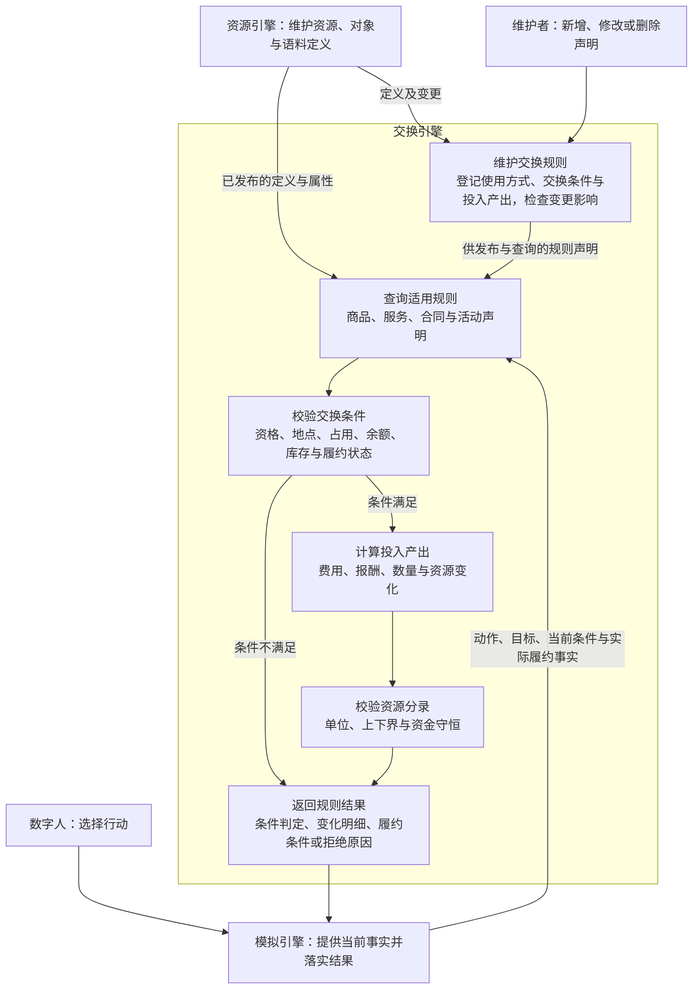
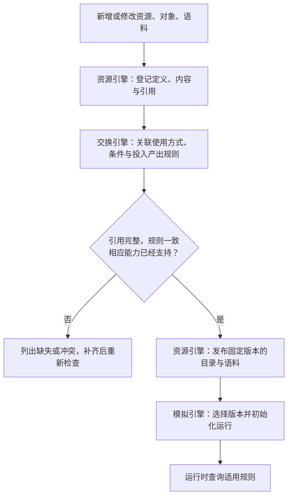
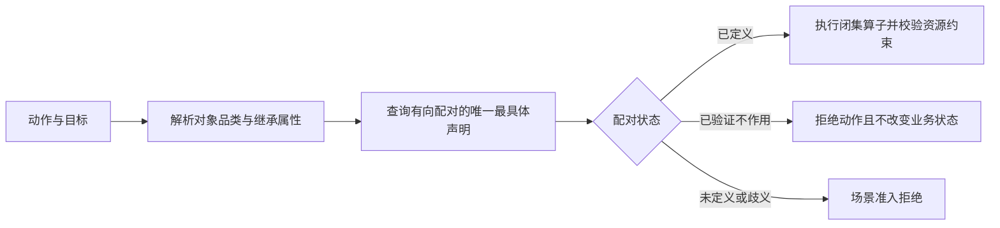
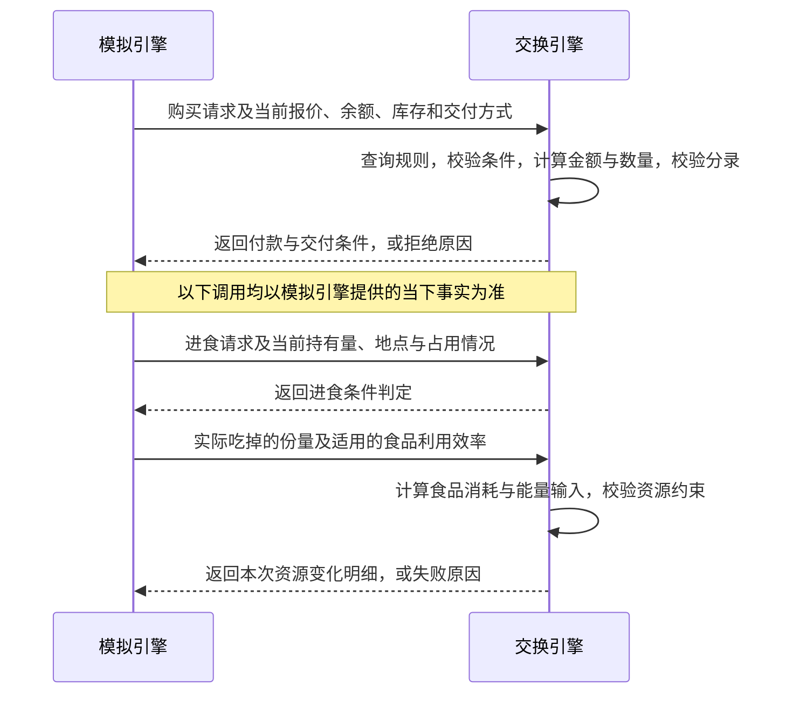

# WorldMock 产品设计说明书 — 交换引擎

> **状态**：DRAFT；接口与行为以冻结合同和规格为准  
> **日期**：2026-09-20  
> **版本**：v1.1  
> **范围**：维护交换规则、查询适用规则、校验交换条件、计算投入产出、校验资源分录与返回规则结果

本文说明交换引擎提供哪些规则能力，以及这些能力的输入和输出。
接口定义见[接口合同](../CONTRACTS.md)，具体计算规则见[生活运行时规格](../dev/SPEC-life-runtime.md)。

## 1. 交换引擎与项目框架

### 用户的心智模型

> “资源引擎和交换引擎应该是相对静态的引擎”
>
> “这里是心智模型文档”
>
> “把引擎的职责边界确定好，不要写一些不属于我们引擎范围的东西”

交换引擎回答：在给定条件下，这件事能不能做，需要付出什么，能够得到什么。
例如，购买食品要满足哪些条件、需要支付多少、能够取得多少食品，以及何种条件下才能交付。
这些规则需要先登记，并随资源、对象和语料的新增、修改、删除一起维护，供运行时查询。
交换引擎把判断和计算结果交给模拟引擎，由模拟引擎决定何时调用并落实变化。

### 项目框架映射

图中同时展开规则维护和运行时调用；规则维护不是每次交换都要执行的步骤。
当前能力由多个模块共同承载，维护流程的缺口见[当前差距](#当前差距)。一次查询或计算不会自行推进时间，
计算结果也不等于世界已经发生变化；模拟引擎负责把结果应用到运行中的世界。

### 与其他引擎的职责边界

| 负责方 | 负责什么 | 与交换引擎如何衔接 |
| --- | --- | --- |
| [资源引擎](03-resource-engine.md) | 定义资源与对象，维护内容、来源、版本、检索与提供 | 提供规则所需的定义和属性 |
| 交换引擎 | 维护交换规则及其引用关系，查询规则、判断条件、计算投入产出、校验本次资源变化并返回结果 | 登记并校验规则；运行时接收事实，返回判断与计算结果 |
| [模拟引擎](04-simulation-engine.md) | 时间与事件调度、活动推进、身体演化、效率求值、验收调用和世界状态更新 | 提供实际时长、工作量、身体计算结果与履约事实，按交换规则执行 |
| [记录引擎](05-recording-engine.md) | 状态与足迹持久化、历史核验、检查点与恢复 | 接收模拟引擎实际提交的状态和证据 |

正文按图中的功能展开。身体模型、活动生命周期、共享时钟和预排事件由模拟引擎设计承载；
存储事务和历史审计由记录引擎设计承载。交换引擎只说明与这些能力之间的输入输出关系。

## 2. 交换引擎的功能设计

先说明规则如何登记和维护，再用“购买一份食品，送达后再进食”说明运行时如何使用规则。
每次运行时调用只处理模拟引擎提供的当下事实。

### 维护交换规则

**目的：让新增、修改或删除的资源、对象与语料，具有一致且可用的交换规则。**
输入是待变更的声明及其引用关系；输出是通过检查、可供发布的规则，或需要处理的缺失与冲突。
品类、属性继承、三态配对和闭集算子的冻结行为见[品类契约规格](../dev/SPEC-category-contract.md)。
下文说明职责，实际实施证据见[品类契约验证台账](../dev/category-contract-verification.md)。

#### 注册表登记什么

注册表把“有什么”和“允许怎样使用、会产生什么变化”关联起来。
它由资源定义、对象、语料引用和规则声明组成，按标识相互引用；不要求把所有内容存进同一种对象结构。

| 登记内容 | 例子 | 维护职责 |
| --- | --- | --- |
| 资源定义 | 能量的单位、范围与归属 | 资源引擎维护定义；交换引擎的规则引用它 |
| 对象与语料条目 | 一种食品的属性、一部影片的素材和元数据 | 资源引擎维护身份、内容、来源与版本 |
| 使用方式与交换规则 | 食品允许购买和进食；观看影片需要哪些条件、按什么依据计算效果 | 交换引擎维护条件、投入产出与履约要求 |

某个人此刻还剩多少能量、持有几份食品、影片看到了哪里，是模拟引擎维护的运行状态。
新增资源定义不会自动给每个人创建状态，删除语料条目也不等于删除人物已经发生的观看记录。

#### 新增状态资源、对象或语料

| 维护场景 | 资源引擎登记什么 | 交换引擎维护什么 | 何时可以使用 |
| --- | --- | --- | --- |
| 新增一种状态资源，例如水分 | 单位、归属、上下界与来源 | 哪些交换输入或消耗水分、使用什么条件与计算依据 | 模拟引擎已支持该状态的初始化、变化与应用，相关规则经调用验证 |
| 新增商品、服务或合同 | 身份、属性、规格与来源 | 支持的动作、资格、占用、投入产出和履约要求 | 定义与规则引用完整，相应交换计算和执行能力已支持 |
| 新增一部影片等已有类型的语料 | 素材、元数据、来源、文件身份与内容引用 | 关联已有的观看规则；只有使用条件或效果依据不同时才需要调整规则 | 素材可读取，场景可引用，相应活动已支持 |

新增同类条目通常复用已有规则，不为每部影片或每种食品重复发明一套规则。
新增内容类型或新的交换方式则需要相应的读取、判断、计算与执行能力；登记本身不能补出这些能力。
身体持续变化的算法仍由模拟引擎设计承载，本节只要求新增状态能够被实际使用。

#### 修改与删除

修改条目时，检查引用它的交换规则是否仍然成立，再由资源引擎发布新的固定版本。
例如食品份量变化后，应重新核对进食数量与能量输入，门店供给另行声明其报价；只改展示信息不能视为规则已经同步。

删除面向待发布的版本：该条目退出可用集合，规则和场景不能继续引用它。
交换引擎处理交换规则中的关联；资源引擎处理定义、素材及内容引用；场景引用由场景维护者处理。
例如删除影片时，要移除针对该影片的关联，但其他影片仍可使用通用观看规则。
删除状态资源时，则需要同时处理使用它的规则与模拟能力；不能只删注册条目而留下仍会读写它的活动。

已经开始的运行继续使用其绑定的固定版本；新版本的发布不直接修改运行中的世界。
历史运行所需的固定材料由资源引擎保留，实际使用证据由记录引擎保存；素材文件清理由资源引擎处理。
当前目录的退役操作保留条目并拒绝新引用，它与彻底删除文件不同，也尚未覆盖语料删除的完整流程。

定义与实例分离参考 [Unity 的共享数据资产](https://docs.unity3d.com/6000.1/Documentation/Manual/class-ScriptableObject.html)；
变更前查询引用关系参考 [Confluent 注册表的引用查询](https://docs.confluent.io/platform/current/schema-registry/develop/api.html#list-schemas-referencing-a-schema)。
本项目继续使用已有目录、语料清单和声明文件承载这些关系。

### 查询适用规则

**目的：确定这次动作按什么规则处理。** 输入是动作、目标对象、场景指定的规则版本和必要的当前条件；
输出是适用的交换条件、计算依据与履约要求。

#### 交换对象与资源变化声明

| 查询什么 | 需要得到什么 | 食品例子 |
| --- | --- | --- |
| 门店供给 | 地点、商品、卖方、当前报价、库存与履约条件 | 从哪家门店购买、向谁付款、怎样交付 |
| 商品、服务或合同 | 商品规格与使用效果、服务或报酬依据 | 食品每份提供什么，工作按什么合同结算 |
| 活动声明 | 支持的动作、占用要求、使用条件与效果依据 | 购买与进食分别适用什么条件 |
| 资源定义 | 各资源的单位、取值边界与守恒要求 | 钱以分计，食品以份量计，能量以 kcal 计 |
| 资源变化声明 | 何种行为产生何种投入与产出，涉及哪些主体 | 购买产生付款义务，实际进食产生食品消耗 |

资源和对象定义由资源引擎提供；交换引擎解释其中与当前动作有关的规则。
交换双方、当前位置、有效报价和已持有数量由模拟引擎提供，不由规则查询自行创造。

#### 可供性与活动声明

活动声明说明一个对象允许怎样使用，以及这种使用需要满足什么条件、可能产生什么效果。
交换引擎读取其中的交换条件与计算依据，例如食品的使用方式、所需份量和热量，
或工作的资格、验收要求与付款方式。

同一活动应使用一致的条件和效果规则。对象如何被检索、怎样向数字人呈现，见资源引擎；
数字人何时行动、活动如何推进，见模拟引擎。

活动声明同时明确占用 `position`、`attention`、`device`、`hands` 或 `vehicle` 中的资源。
交换条件对每一启动项重算地点、资格、目标与占用；模拟引擎对原子组合在同一暂存世界重算
全部条件和共同能量。没有声明的资源不占用，暂停和终态释放占用，不能用隐藏的全局位置锁
或组合白名单替代声明。声明表及允许组合见[一日行为可信性规格](../dev/SPEC-dayrun-behavior.md#唯一状态与资源准入)。

#### 交换规则的加载与准入

规则可用的前提是所引用的资源与对象存在、计量单位一致、交换双方明确，且条件与计算依据不矛盾。
资源引擎负责定义的来源、版本和发布；交换引擎检查这些定义能否共同表达当前交换。

**食品例子：** 购买时查询付款与交付规则；进食时查询使用条件、份量与食品输入规则。
同一食品对应不同动作，适用的投入产出不同。

### 校验交换条件

**目的：判断给定事实是否满足交换要求。** 输入是适用规则、请求与当前条件；
输出是条件满足，或具体的拒绝原因。

| 校验内容 | 要回答的问题 | 食品例子 |
| --- | --- | --- |
| 动作与目标 | 是否允许对这个目标执行这个动作？ | 可购买的商品是否也支持进食 |
| 资格与地点 | 使用者是否有资格，所在位置是否满足要求？ | 食品是否在当前可以使用的地点 |
| 余额与库存 | 金额和数量是否足够？ | 购买看余额与所选供给库存，进食看已持有数量 |
| 时长与占用 | 计划投入是否可承受，所需资源是否可用？ | 进食所需时长与占用是否满足条件 |
| 履约状态 | 是否到期、已交付、已验收或已付款？ | 配送未完成时不能按已持有食品处理 |
| 报价与规则依据 | 请求依赖的报价等条件是否仍有效？ | 改价后不能按失效报价付款 |

成本计算可以用于判断余额与资源是否足够，计算预期成本本身不会发生消耗。
模拟引擎在需要受理或落实变化时提供当下事实，交换引擎据此重新校验；曾经可行不保证现在仍然可行。
实际偏好影响数字人如何选择，不能替代余额、库存和使用资格等事实条件。

**食品例子：** 钱足够时可以通过购买校验；食品尚未送达时，进食校验仍应拒绝。
如果一张订单中有任一商品不满足条件，返回整单拒绝原因，不自动删减商品。

### 门店供给的时态与履约判断

购买以 `supply_id` 查询地点、商品和卖方，当前报价及库存由模拟引擎提供。
商品不携带门店价格或静态购买转账边；同商品的供给彼此独立，已取得商品仍共享规格和消费效果。
品类购买配对与 `RuleEdge` 保留，规则读取模拟引擎提供的有效供给报价，不声明商品价格槽。
每个订单行调用 `evaluate_purchase(quote.price_fen, quantity, coefficient)`，以 Decimal 对整行乘积向上取整分，形成该行的 `total_price_fen`；整单 `total_price_fen` 为各行金额之和。不得先对单价取整再乘数量。
报价声明不因系数求值改变；实际收款账户取供给卖方。
公开供给行保留原始 `price_fen`、`price_version` 与 `quote`，同时提供 `purchase_pairing_state`、`purchase_coefficient` 和 `purchase_price_fen`。
配对为 `defined` 时，系数来自冻结声明，`purchase_price_fen` 通过同一 `purchase_amount` 入口计算购买一份的实际金额；报价未知时金额为 `null`。
配对不是 `defined` 时保留原始报价和配对状态，系数及实际金额均为 `null`，`purchase_allowed=false`；动机跳过该供给，但不隐藏已持有物品。
人物的余额判断和价格排序也使用该入口计算的一份金额。多份请求必须用原始报价、数量和系数重新求整行金额，不能把已取整的一份金额乘以数量。
原始报价保持正整数分；明确的 `defined` 配对可以有零系数并产生零额付款，仍正常扣供给库存和履约，不能把 `no_effect` 当作零价购买。

| 判断 | 规则 |
| --- | --- |
| 营业与访问 | 分钟级周区间、跨午夜、日期例外与世界覆盖使用统一解释；结果是开放、关闭或未知，缺资料不开放；到达重新验证访问资格 |
| 报价 | 半开生效区间，不重叠；未生效和间隙无报价；购买必须提交当前报价版本，不能自动换价 |
| 整单 | 一至五个不同供给，同地点同卖方；任一条件失败，账户、供给库存、订单与持有物均不变化 |
| 自提 | 人物和目的地都为所选门店；不额外要求配送路线 |
| 配送 | 供给支持方式和目的地范围、冻结运输路线可达；按最迟备货时刻加分时运输时长一次配送 |
| 交付与使用 | 付款不产生已持有物品；交付到目的地后方可使用；取得后仍按商品身份合并数量 |

环境不能依据品牌、价格或距离替人物选择。条件失效只拒绝本次购买，已经发生的旅行与费用仍是事实。
时态字段和错误区分见 [地图与门店供给合同](../CONTRACTS.md#地图与门店供给合同)。

### 计算投入产出

**目的：计算给定条件下的资源变化。** 输入是适用规则、数量和模拟引擎提供的实际履约事实；
输出是投入、产出及相应的付款、使用或交付条件。

#### 资源变化的计算

| 变化类型 | 含义 | 例子 |
| --- | --- | --- |
| 转移 | 一方减少，另一方增加同种资源 | 买方付款，商家收款 |
| 产生 | 按有来源的输入增加资源 | 食品输入对应的能量增加 |
| 消耗 | 按实际用量减少资源 | 吃掉的食品份量 |
| 转换 | 按规则原子改变输入与输出库存 | 使用完成后将封装物转为明确绑定的输出物 |

各资源分别计量和校验，金钱、时间与能量不能相加求守恒。
身体计算结果、实际活动区间和有效工作量都是模拟引擎提供的输入；交换引擎使用这些事实求值规则。
用于受理的预计投入与用于结算的实际投入必须区分，计划尚未执行的部分不能计入实际产出。

#### 不同交换的计算依据

| 交换 | 接收的事实 | 返回的计算结果与条件 |
| --- | --- | --- |
| 购买 | 当前有效报价、数量、交换双方与交付方式 | 整单金额、取得数量、交付条件 |
| 进食 | 实际消耗份量、食品属性与适用的食品利用效率 | 食品消耗与对应能量输入；不把购买本身算作进食 |
| 工作 | 合同、实际投入、有效工作量、验收结果与付款记录 | 满足合同条件时的报酬；已付款任务不重复计款 |
| 出行 | 路线、方式、适用时段与报价依据 | 应付费用与取消条件；现行规则为启程预付一次，取消不退 |
| 内容使用 | 实际接触的内容、偏好、接触次数与时长 | 本次内容体验对应的需要缓解量 |

工作报酬按计时、计件或包干合同计算；实际投入充分仍须满足交付验收条件。
交换引擎使用验收结果，不组织验收过程；合同不额外乘质量分数，也不重复扣减身体效率已经影响的产出。
涉及身体资源时，只返回本次交换对应的输入或消耗；持续身体演化与体感更新由模拟引擎负责。
具体计算约束见[消费、生产与需求模型](../dev/SPEC-life-runtime.md#消费生产与需求模型)和[资金与合同](../dev/SPEC-life-runtime.md#资金与合同)。

**食品例子：** 购买时计算付款与取得数量，返回交付要求；进食时按实际吃掉的份量计算食品输入。
没有实际进食，就没有这部分食品消耗或能量输入。

### 校验资源分录

**目的：检查本次计算出的变化能否应用。** 输入是变化前的余额或数量，以及本次变化明细；
输出是符合约束的结果，或具体的失败原因。分录是一次资源增减的明细，校验通过不表示状态已经保存。

| 校验什么 | 必须满足什么 |
| --- | --- |
| 资源与单位 | 按已定义的资源和单位计算，不混用金额、份量和热量 |
| 归属与数量 | 资源归属明确，数量合法，同一项变化不重复计算 |
| 余额与边界 | 普通账户不能透支，库存不能为负，变化后的资源符合上下界 |
| 资金守恒 | 同种封闭资源的转出与转入对应，初始注资也须有来源 |
| 开放资源 | 增加和消耗各有原因，变化前后能够对应 |
| 转换 | 投入与产出明确，涉及的每种资源分别满足约束 |

初始资金的外部注资账户按规则允许为负，普通账户不适用这个例外。
校验针对本次交换；跨历史记录的重建、对账和完整性审计由记录引擎负责。

**食品例子：** 买方扣款应等于商家收款，吃掉的份量不能超过持有量。
一笔合法转账只能说明付款规则成立，不能证明食品已送达或已吃掉。

### 返回规则结果

**目的：把本次判断、计算与校验的结果交给模拟引擎。**
结果要清楚区分“允许执行”和“根据已发生事实算出的变化”，不能把预计产出描述为完成结果。

| 结果内容 | 应表达什么 |
| --- | --- |
| 条件判定 | 当前动作或交换是否满足要求 |
| 变化明细 | 哪一方的什么资源应增加或减少多少，以及计算所依据的事实 |
| 履约条件 | 取得、使用、付款或交付还需满足什么条件 |
| 拒绝原因 | 哪个条件或资源约束不满足，不能用替代行动冒充成功 |

模拟引擎消费这些结果，负责执行、安排履约和更新状态。交换引擎没有独立的世界状态，
也不负责事件排队、时间推进或记录保存。

#### 食品交换的规则调用

## 3. 当前实现与验收

### 实现职责与证据入口

当前规则能力分散在目录解释、活动规则和各类交换处理中，由模拟引擎组织调用。
下面仅标明交换规则的现有入口，不把这些模块承担的其他运行职责归入交换引擎。

| 功能 | 当前规则能力的入口 |
| --- | --- |
| 维护交换规则 | [品类维护工具](../../src/worldmock/categories/maintenance.py)与 `worldmock category check/refine/publish` 完成只读影响分析、显式归属确认和新目录发布；[目录构建原语](../../src/worldmock/catalog/builder.py)保留逐条追加与退役 |
| 查询适用规则 | [品类模块](../../src/worldmock/categories/)解析共享契约与双端继承；[目录编译](../../src/worldmock/catalog/compiler.py)生成只读有效对象；[场景准入](../../src/worldmock/life/category_contract.py)检查所有可能触达的配对 |
| 校验交换条件 | [活动规则](../../src/worldmock/life/rules.py)及各交换业务的资格、余额和库存校验 |
| 计算投入产出 | [闭集算子](../../src/worldmock/categories/operators.py)统一数量与金额计算，经 [购买与进食](../../src/worldmock/life/basket.py)、[工作](../../src/worldmock/life/work.py)、[出行](../../src/worldmock/life/travel.py)和 [库存转换](../../src/worldmock/life/inventory_recipe.py)进入真实状态提交 |
| 校验资源分录 | [资源账本](../../src/worldmock/resources/ledger.py)、[资金规则](../../src/worldmock/life/settlement.py)及业务数量约束 |
| 返回规则结果 | 各领域处理结果，由[生活引擎](../../src/worldmock/life/engine.py)接收和汇总 |

### 当前差距

| 差距名称 | 对交换规则的影响 | 所属功能 |
| --- | --- | --- |
| 状态与语料不能仅靠登记扩展 | 人物状态仍由明确的状态模型承载；语料准备只支持既定来源和类型，尚无通用的新增、修改、删除流程 | 维护交换规则的跨引擎接入 |
| 场景活动声明未贯穿使用 | 部分规则仍读取仓库默认声明，不能保证场景指定的声明在所有交换中一致生效 | 查询适用规则 |

品类对象发布、清单字段保留、合同单一付款路径与旧效果字段清理已进入本次实现范围，
不得再作为延期差距；准确测试结果统一登记在品类契约验证台账。
通用语料编辑器和新增身体状态不属于品类契约特性。

规则需要确定的资源身份与版本，相关定义差距归[资源引擎](03-resource-engine.md#资源定义的实现与验收)与[目录发布](03-resource-engine.md#目录发布的实现与验收)。
身体规则的执行、状态更新和完整生活运行验收归模拟引擎；保存与审计验收归记录引擎。
新增交换行为仍须有相应的计算和校验能力，不能仅凭登记了一个新条目就宣称支持。
状态接入的当前边界见[人物状态模型](../../src/worldmock/life/models.py)，语料维护的当前边界见
[语料准备](../../src/worldmock/corpora/fetch.py)与[语料清单校验](../../src/worldmock/corpora/manifest.py)。

### 分阶段验证与完成条件

| 验证功能 | 必须确认的结果 |
| --- | --- |
| 维护交换规则 | 新条目关联到可执行的规则；修改能定位受影响的引用；删除后无失效引用且同类其他条目的规则仍可用；新发布不修改已绑定的版本 |
| 查询适用规则 | 同一动作与目标使用指定规则；缺失资源、错误单位或交换双方不明确时不能继续求值 |
| 校验交换条件 | 余额不足、库存不足、未交付、无资格或报价失效时拒绝，并说明原因 |
| 计算投入产出 | 购买不计进食效果，进食按实际份量计算，报酬符合合同和验收条件，重复付款被拒绝 |
| 校验资源分录 | 转入转出对应，数量与余额满足边界，开放资源的增加和消耗有依据 |
| 返回规则结果 | 明确区分条件判定、预计投入和实际变化；返回履约要求或拒绝原因，不自行改变世界 |

品类特性按冻结规格完成确定性与真实离线运行路径验证，证据以专项台账为准。
正式模型的长期运行验收仍见[验证规则](../VERIFICATION.md)。
