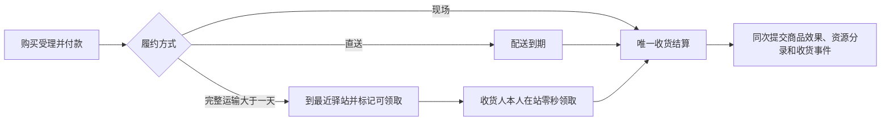

# WorldMock 产品设计说明书 — 交换引擎

> **状态**：DRAFT；接口与行为以冻结合同和规格为准；按人物 Prompt 规格修订，修订部分已实现（证据见[人物 Prompt 验收记录](../archive/persona-prompt/persona-prompt-verification.md)）；按一日运行保真规格同步（一日运行保真 EX1），已实现 
> **日期**：2026-10-07
> **版本**：v1.13\
> **工具交互修订**：价格构建范围、方式解析、英文错误明细与真实做饭链已冻结，已实现；本次生产验收单独记录；以[工具交互规格](../dev/SPEC-life-runtime.md#tool-interaction-工具请求)为本次合同。
> **个人事务与工作安排修订**：按[个人事务与工作安排规格](../dev/SPEC-as2-integration.md#errands-workday-运行修复入库)阶段 4 同步（查询筛选与返回精简，[实施计划](../archive/errands-workday/errands-workday-implementation-plan.md) D2 作业），已实现（离线验收，证据见[个人事务与工作安排验收记录](../archive/errands-workday/errands-workday-verification.md)）；该规格其余阶段不改本文。
> **同时做两件事修订**：按[同时做两件事规格](../dev/SPEC-parallel-activities.md#spec-parallel-activities-同时做两件事开发规格)修订「可供性与活动声明」（阶段 1）；「可供性与活动声明」的占用名（阶段 2）。
> **范围**：固定类型与常数、纯条件和投入产出求值、资源分录校验

> 按[资源与规则引擎简化规格](../dev/SPEC-resource-and-rule-simplification.md#spec-rrs-资源与规则引擎简化开发规格)修订「维护交换规则、注册表登记什么、新增状态资源、对象或语料、修改与删除、查询适用规则、交换规则的加载与准入、系统固定类型与常数、交换对象与资源变化声明、可供性与活动声明、校验交换条件、门店供给的时态与履约判断、资源变化的计算、不同交换的计算依据、校验资源分录、食品交换的规则调用、实现职责与证据入口、当前差距、分阶段验证与完成条件、纯规则与执行职责、项目框架映射、与其他引擎的职责边界」（阶段 1）；「返回规则结果」（阶段 3）。

本文说明交换引擎提供哪些规则能力，以及这些能力的输入和输出。
接口定义见[接口合同](../CONTRACTS.md#contracts-worldmock-接口合同)，具体计算规则见[生活运行时规格](../dev/SPEC-life-runtime.md#spec-life-runtime-特性规格lifeenv-运行时行为与结算规则)。

> 按[动作与内容简化规格](../dev/SPEC-action-and-content-simplification.md#spec-acs-动作与内容简化开发规格)修订「固定规则、目录格式与加载边界、收货结算」（阶段 1、2）。

具体环境及制作工具按[环境数据归属规格](../dev/SPEC-environment-data-ownership.md)归 WorldMock-Dataset，
正式重制环境路径由 WorldMock-Dataset 发布决定；WorldMock 提供引擎及包内固定通用规则。
本章的 `catalog/`、`scenarios/` 指外部环境目录，命令以 WorldMock 为当前工作目录并显式传路径。
当前场景结构 8、世界结构 11；类别、使用方式、效果与供给表由 WorldMock 固定，
环境只登记对象、绑定与价格、内容时长、集数三种数；新组合放行另核对实际收据。

## 共享规则与可重建环境修订

按[共享规则与可重建环境规格](../dev/SPEC-shared-rules-and-rebuildable-env.md)修订；验收结果独立记录。

活动缓解速率和 MET 键由结算与预估共用；社交资源分录只保留一个应用入口。资源账本错误保留自身异常类型和英文错误形状，并记录错误日志；品类和目录错误使用同一稳定错误码实现。

## 1. 交换引擎与项目框架

### 用户的心智模型

> “资源引擎和交换引擎应该是相对静态的引擎”
>
> “这里是心智模型文档”
>
> “把引擎的职责边界确定好，不要写一些不属于我们引擎范围的东西”

交换引擎回答：在给定条件下，这件事能不能做，需要付出什么，能够得到什么。
例如，购买食品要满足哪些条件、需要支付多少、能够取得多少食品，以及何种条件下才能交付。
这些规则需要先登记，并随资源、对象和语料的新增、修改、删除一起维护，供运行时查询。
交换引擎把判断和计算结果交给模拟引擎，由模拟引擎决定何时调用并落实变化。

### 项目框架映射

规则维护通过 WorldMock 的源码、测试和 `RULES_VERSION` 发布完成。环境发布不能新增公式或覆盖常数；纯计算和目录查询不自行推进时间或制造事实。

### 与其他引擎的职责边界

| 负责方 | 职责 | 衔接 |
| --- | --- | --- |
| 资源引擎 | 登记、校验对象与绑定，派生只读索引 | 提供已校验的目录事实 |
| 交换引擎 | 固定类型、常数、纯条件与投入产出求值 | 返回可应用变化或拒绝原因 |
| 模拟引擎 | 共享时钟、活动推进、身体演化与原子世界变化 | 按真实活动应用规则结果 |
| 记录引擎 | 状态、事件、检查点与实际足迹 | 保存已提交事实与身份 |

资源定义归交换引擎，具体世界来源和发布归 Dataset。

## 2. 交换引擎的功能设计

规则只读取模拟引擎提供的当下事实，用「付款、收货、一次结算」说明调用链。每单付款一次，商品效果在收货时按收货人结算，预计产出不冒充完成事实。

### 维护交换规则

## 系统固定类型与常数

`worldmock.exchange` 唯一拥有闭集、类别表、常数与 Decimal 交换算子，统一由 `RULES_VERSION = 2` 绑定。
`types.py` 定义地点、商品、动作类别、app 使用方式、设备映射与 app 用途；内容没有分类字段。
`constants.py` 定义固定数值，`operators.py` 求值，`body.py` 定义身体动力学与资源元信息。

| 固定内容 | 规则 |
| --- | --- |
| 商品类别 | `meal`、`snack`、`drink`、`leisure`、`daily`、`fuel` |
| 食品热量 | 正餐 600、零食 200、饮品 100 千卡每份；没有食用秒数 |
| 非食品收货效果 | 休闲用品每订单行缓解娱乐需要 0.10，日常用品每订单行情绪 +0.05；燃油恰增加七个驾驶可用天数，无库存或身体效果 |
| app 用途 | `navigation`、`shopping`、`payment`；可以同时具有多个用途或为空 |
| 店铺供给 | 餐馆：正餐、饮品、零食；咖啡馆：饮品、零食；便利店与超市：除燃油外五类商品；加油站只卖燃油，驿站不卖商品 |
| 内容时长 | `CONTENT_MIN_SECONDS = 60`，不设登记上限 |
| 内容娱乐速率 | 娱乐类别每小时缓解娱乐需要 0.3；不按内容形式或名称分速率 |
| 身体活动键 | 等待 1.3、睡眠 0.95、步行 3.5、驾车 1.5；类别 MET 来自 `CATEGORY_MET` |
| 出行与配送 | 步行 1.2 米/秒、驾车 7 米/秒；驾车费用为 `max(500, ceil(0.2 × 米))` 分；配送 5 米/秒、备餐 600 秒、每单 500 分 |
| 图生成 | 最少两节点、边长 200–2000 米、树外边数 ⌊(n−1)/2⌋、生成规则版本 1 |
| 身体资源 | 2400 千卡上限、基础代谢 65 千卡/小时、饥饿阈值 800/400 千卡；睡眠债恢复与食品利用曲线不变 |

| 动作类别 | 内容完成后的接续 | MET | 按实际秒数的状态效果 | 场所 |
| --- | --- | --- | --- | --- |
| `entertainment` | 同一活动内接下一条 | 1.0 | 按固定 `ENTERTAINMENT_RELIEF_PER_HOUR = 0.3` 缓解娱乐需要 | 任意 |
| `work_study` | 一条结束 | 1.5 | 无按秒效果；分配工作内容完成有一次 +0.05 情绪脉冲 | 分配内容只能在本人工作地点，其余任意 |
| `social` | 一条结束 | 无 app 1.5，有 app 1.3 | 共同有效社交分别每小时缓解 0.5、0.4，对方不在的秒数每小时 0.2 | 任意；请求必须有对象 |
| `exercise` | 一条结束 | 5.0 | 每小时情绪 +0.1 | `home`、`outdoor`、`fitness` |
| `daily_care` | 一条结束 | 2.0 | 能量消耗之外无效果 | 任意 |

| 使用方式 | 设备 | 额外占用 |
| --- | --- | --- |
| `phone_continuous` | `phone` | `use_app` |
| `other_device` | `other` | 无 |
| `offline_assisted` | `phone` | 无 |

类别、使用方式与效果不接受环境覆盖，也没有类别与使用方式的合法组合表。
社交、情绪与运动速率只在 `exchange.constants` 定义，完整逐值表见[固定规则与常数](../dev/SPEC-action-and-content-simplification.md#spec-acs-固定规则与常数)。
规则只从引擎包读取，环境没有规则副本；常数已通过纯测试不代表完整运行已取得验收证据。

#### 注册表登记什么

#### 新增状态资源、对象或语料

#### 修改与删除

### 查询适用规则

#### 交换对象与资源变化声明

数据仓只为对象选择固定类别与使用方式，填写名称、说明、摘要、价格、内容时长与集数及绑定；不声明公式或状态效果。

内容必须绑定恰好一个动作；动作可以不绑定 app。动作的 `app_ids` 非空时，`manner` 必须是一种固定使用方式，
每条内容的 `app_ids` 是该动作 app 集合的非空子集；动作没有 app 时，`manner` 为 null、内容 app 集合为空。
每个动作及每个动作与 app 的组合至少有一条内容。空集合从不表示全部 app。
内容 `duration_seconds` 是正整数且不小于 60 秒；动作不登记时长、时间窗、场所或效果。
内容不登记分类；环境维护动作名称、说明及其内容。
系列以 `(action_id, series.title)` 识别，各集具有相同动作与 app 集合，集数为唯一的正整数。

商品绑定店铺，店铺绑定购物 app。`GOODS_CATEGORY_STORE_KINDS` 固定类型可供给的类别，
`"all"` 展开到全部可供给该类别的店铺；显式绑定列表去重排序，同类型店铺同菜单。
购物用途存在当且仅当至少一家店铺绑定该 app；支付绑定非空当且仅当有购物用途，
绑定目标具有支付用途，允许绑定自己。导航与支付 app 可以没有内容；app 必须有用途或动作绑定。

#### 可供性与活动声明

占用闭集是 `wait`、`travel`、`talk`、`use_app`、`entertainment`、`work_study`、`exercise`、`daily_care`。每个动作占自己的类别，社交占 `talk`；`phone_continuous` 另占 `use_app`，`other_device` 与 `offline_assisted` 不另占。睡眠占全部八个；驾车占除 `talk` 外七个。每人两个活动名额，暂停让出名额，待收尾仍占名额。

| 类别 | 代谢当量 | 按实际秒数的效果 |
| --- | --- | --- |
| entertainment | 1.0 | 每小时缓解娱乐需要 0.3 |
| work_study | 1.5 | 分配内容首次完成才施加 `goal_progressed` +0.05 |
| social | 无 app 1.5，有 app 1.3 | 共处、未接受、远程分别每小时 0.5、0.2、0.4 |
| exercise | 5.0 | 每小时情绪 +0.1；只限 home、outdoor、fitness 环境 |
| daily_care | 2.0 | 无额外按秒效果 |

#### 交换规则的加载与准入

### 校验交换条件

购买按当前供给、余额与 app 绑定校验，不读取持有。店铺全天服务，没有营业时态、报价、资格或库存条件。整组先完成准入再提交变化，拒绝不制造扣款或收货事实。

### 门店供给的时态与履约判断

店铺全天服务，唯一商品价格位于 `goods.json.price_fen`。
菜单由 `store_ids` 或 `"all"` 与固定 `GOODS_CATEGORY_STORE_KINDS` 得出，同类型店铺同菜单。
没有供给时态、营业例外、报价、有效期或门店库存。
现场购买读取真实所在门店；远程购买读取明确的购物与支付 app 绑定及收货地址。店铺 `shipping_seconds` 非空时表示完整运输时长，为 null 时按发布图与固定配送算子计算，不额外叠加备货时间。长途订单按收货人家庭地址选择驿站，完整运输报价不因末端改址而重算。
费用与时长规则归 `worldmock.exchange`；实际订单、付款、到站与收货证据由模拟与记录引擎负责，详细边界见[请求字段与结算检查](../CONTRACTS.md#contracts-request-settlement)。

### 计算投入产出

**目的：计算给定条件下的资源变化。** 输入是适用规则、数量和模拟引擎提供的实际履约事实；
输出是投入、产出及相应的付款、使用或交付条件。

#### 资源变化的计算

货款与配送费按商品固定价格、件数和规则求值，每单一次转给 merchant 账户；驾车按图距离与固定费率求值。收货规则量由 `evaluate_goods_receipt(category, quantity)` 给出 provided；食品经 apply_food 得到 applied，使用当秒睡眠不足利用率并受能量上限约束，超出部分丢失。规则不自行写余额、世界状态或足迹。

#### 不同交换的计算依据

购买受理当秒付款，每单一次，不产生提前的商品效果。现场购买同次提交收货，直送在配送到期时收货；长途到站只进入 `ready_for_pickup`，本人在站零秒领取才收货。每单由唯一函数写 `received_at`、订单终态与本人 `goods_received`，按收货人的实际状态施加效果，不产生库存、持有或独立进食活动。联系人收货不改变模拟人物身体，也不写 `goods_received`。完整边界统一见[请求字段与结算检查](../CONTRACTS.md#contracts-request-settlement)。

动作内容消费的效果是固定类别速率乘实际秒数，不由动作名称、内容形式或模型文字推断。

| 类别 | 代谢当量 | 按实际秒数的效果 |
| --- | --- | --- |
| entertainment | 1.0 | 每小时缓解娱乐需要 0.3 |
| work_study | 1.5 | 分配内容首次完成才施加 `goal_progressed` +0.05 |
| social | 无 app 1.5，有 app 1.3 | 共处、未接受、远程分别每小时 0.5、0.2、0.4 |
| exercise | 5.0 | 每小时情绪 +0.1；只限 home、outdoor、fitness 环境 |
| daily_care | 2.0 | 无额外按秒效果 |

### 校验资源分录

资源分录继续校验单位、有限数值、上下界和封闭资金守恒。资源定义从 `worldmock.exchange` 取得，不能从环境 `resources.jsonl` 加载；计算错误保留稳定英文错误和异常日志。
通过求值的分录只是候选变化，只有模拟引擎实际提交后才成为可追溯的数字足迹。

### 返回规则结果

**目的：把本次判断、计算与校验的结果交给模拟引擎。**
结果要清楚区分“允许执行”和“根据已发生事实算出的变化”，不能把预计产出描述为完成结果。
全部接口拒绝给出英文说明，`items[]` 每项包含
`path/written/error_code/allowed_values/expected/why/candidates`；`path` 从模型工具调用根开始，保留全部数组下标，
`why` 写参数、名称或世界前置条件的英文原因。不以笼统失败代替参数诊断，不采用旧 `index/field` 形状。
可照填候选只用完整 `{tool, arguments, note}` 调用。
`query_world(name, way, category, from, available_only, offset)` 读取同一冻结权限下的固定食品菜单与价格；category 来自公开可调用索引，
`from` 与购买请求用同一个来源解析函数（登记店铺显示名或 app 名，只匹配食品条目），`available_only` 只读取冻结观察里已求得的动作与工具
`available`，不重新求值交换条件，成功仍以受理时的重验为准；以 matches/total_count/next_offset 返回可遍历的每页结果，逐项不再附候选，
不触发交换求值副作用或呈现留痕。

| 结果内容 | 应表达什么 |
| --- | --- |
| 条件判定 | 当前动作或交换是否满足要求 |
| 变化明细 | 哪一方的什么资源应增加或减少多少，以及计算所依据的事实 |
| 履约条件 | 取得、使用、付款或交付还需满足什么条件 |
| 拒绝原因 | 哪个条件或资源约束不满足，不能用替代行动冒充成功 |

模拟引擎消费这些结果，负责执行、安排履约和更新状态。交换引擎没有独立的世界状态，
也不负责事件排队、时间推进或记录保存。

付款与收货结算由模拟引擎分别提交；每次收货的 provided、applied 与资源分录可以独立核验，没有库存、给予或进食结果。

#### 收货结算的规则调用

连续身体变化先结算至实际收货秒；唯一收货函数按商品类别与件数求 `provided`，再按收货人当秒状态求 `applied`，取走本次分录并同次提交订单与收货事件。食品使用当秒效率和能量上限，休闲与日常用品施加固定效果，燃油只增加驾驶可用天数。
直送和现场购买无需等待独立消费动作；长途到站不能提前施加效果。重复到期、重复领取或他人订单不能多结算。完整时长严格大于 86400 秒才进入驿站链，恰为 86400 秒仍直送；驿站由实际模拟收货人家庭地址在完整发布图上的最近站确定，且必须由场景选中。
字段、分录、归属和幂等细节只在[供给结算与事件载荷](../CONTRACTS.md#contracts-供给结算与事件载荷)及[请求字段与结算检查](../CONTRACTS.md#contracts-request-settlement)定义。

## 3. 当前实现与验收

### 实现职责与证据入口

固定规则位于 `src/worldmock/exchange/`，目录登记位于 `src/worldmock/catalog/`。
纯行为证据在 `tests/exchange/` 与 `tests/catalog/`；发布命令为 `worldmock environment generate-map`、`check` 与 `worldmock validate --environment`。
验收台账登记实际生产符号、具名行为节点与源码变异。目录有效、完整引擎执行、正式环境与真实平台回执分别判断。

### 当前差距

固定规则、六文件目录与纯加载边界已有对应实现和纯测试。
动作执行、收货结算、人物请求与足迹的集成完成状态以[动作与内容简化验收台账](../dev/SPEC-action-and-content-simplification.md#spec-acs-验收台账)和真实运行回执为准。
目录有效不证明这些消费链已闭合；目录中没有占位规则接口、旧格式读取或兼容入口。

### 分阶段验证与完成条件

验证依次覆盖固定规则、严格目录登记、实际地图命令与加载边界，以及真实引擎、恢复、导出和完整自然日。
常数测试不能替代真实调用；每项证据对应实际生产符号、具名行为节点与有效源码变异。
正式环境和平台运行须有匹配身份的回执，文档冻结或目录有效都不能单独证明完成。

## 纯规则与执行职责

交换引擎拥有固定闭集、类别与使用方式表、身体与社交情绪常数、Decimal 算子及资源分录规则。
收货算子 `evaluate_goods_receipt(category, quantity)` 给出食品提供热量或固定非食品效果，包括燃油的驾驶可用天数；实际状态应用归模拟引擎。
规则由 `RULES_VERSION` 统一绑定，恢复核对五字段 `environment_identity`。环境只登记对象与绑定，不提供规则副本。

## 版本历史

| 版本 | 日期 | 修订内容 |
| --- | --- | --- |
| v1.2 | 2026-09-24 | 同步时间与能量规格：占用按新槽位重列，交换条件按启动项重算地点（出行中为「途中」）与占用，能量不参与，每人两个活动名额；「时长与占用」改为「时长与并行」并引派生时长上限；接触次数只在首次与从头重看时加一；不足 60 秒不开工；新增本表，此前版本未入表 |
| v1.3 | 2026-09-27 | 同步人物 Prompt 七层规格（人物 Prompt 台账 E2-1–E2-7）：文件头注明修订部分待实现；资源变化声明补给予只转移持有物；校验交换条件增「来源与去向」行（`from` 须真实持有或可取得，`to` 为自己、同处人物或有收货地点的联系人），给予要求同处，不足一份也可消费、时长按份量折算；持有人取 `to`，订单只有一个收货人，直接送给他人与收货后再给予不重复转移；转移补给予，进食补暂停保留与结束丢弃，增给予一行；分录校验与食品规则调用补 `from`、`to` 与丢弃份量；完成条件补小数份、剩余处理与给予不计摄入 |
| v1.4 | 2026-09-28 | 人物 Prompt 七层规格实现后文档：文件头注明修订部分已实现，链接人物 Prompt 验收记录；正文不变 |
| v1.5 | 2026-09-29 | 按[一日运行保真规格](../dev/SPEC-life-runtime.md#dayrun-fidelity-身体与需要)同步（一日运行保真 EX1，随阶段 2、3 的代码落地，按 `e377669` 核对）：「校验交换条件」来源与去向行写明 `from` 是可选的来源约束（null 为全部门店，门店名为该门店，渠道称呼即 App 名为该渠道的成员门店），指名购买分段解析出的问题（商品找不到、`from` 不是门店或渠道、标签的门店不在 `from` 的范围里、那家店不卖、不支持所写方式、此刻服务不了）逐项写进拒绝的 `items[]`（序号、参数、原文、该项错误码与至多 3 个可照填的候选），顶层码取第一个名称类问题的码，其余条件报第一条，整组仍原子受理，多家都能服务不是问题；「门店供给的时态与履约判断」自提行补送给别人时收货人也须在店里，配送行写明「送达地不在配送范围」与「配送路线缺失」是两个原因（`unmet` 取 `delivery_destination` 或 `delivery_route`，各一句），送给自己说「这里」、送给别人说「<名>那里」并以先送到自己这里再当面给为下一步，下一步只指向能送达且此地可达的地点，配送来源可以是渠道成员门店；人物可以把挑店交给系统（只写商品名、`from` 为 null 或渠道称呼，方式「购买」时连到店还是远程下单也由系统定），多家都能服务时按请求级 `prefer` 选定一家（并列先比到手价、再比门店标识，只看能否服务），写进 `details.notes`，不报 `SUPPLY_NAME_AMBIGUOUS`；「不同交换的计算依据」内容使用按有效偏好 `f + (1 − f)·w` 缓解、有缓解时不累积，游戏同一算法；文件头补修订说明，日期改写 |
| v1.6 | 2026-10-01 | 工具交互设计冻结并已实现：区分对象构建范围与真实门店报价；单食材包制作及产物反馈；拒绝使用具体路径、合法值和完整调用候选 |
| v1.7 | 2026-10-03 | 同步个人事务与工作安排规格阶段 4（实施计划 D2-01–D2-03、D2-06）：`query_world` 改六键，来源筛选与购买 `from` 同一解析，只看此刻能做的筛选读取冻结观察的可用性、不重新求值交换条件，结果不附候选；购买来源的写法更正为地点显示名（含「家」「住处」）或渠道称呼；版本表改为末行最新 |
| v1.8 | 2026-10-04 | 个人事务与工作安排规格实现后文档（实施计划 D2-05）：文件头修订行注明已实现并链接个人事务与工作安排验收记录（证据为离线测试，规格阶段 6 的配对全天复跑未执行）；正文不变 |
| 环境数据归属 | 2026-10-05 | 按环境数据归属规格同步双仓职责、包内通用规则与显式环境路径；场景结构 6、必填标题和冻结活动效果按正文说明，最终验收另记实际收据 |
| `2026-10-05-layering-and-test-tiers` | 2026-10-05 | 当前职责对象与依赖方向、五项行为正文归属、固定历史来源和稳定引用；业务与持久合同保持不变 |
| 共享规则与可重建环境 | 2026-10-05 | 同步规则归属、源码重建与验收合同 |
| `2026-10-06-parallel-activities-slots` | 2026-10-06 | 按[同时做两件事规格](../dev/SPEC-parallel-activities.md#spec-parallel-activities-同时做两件事开发规格)阶段 1 同步：「可供性与活动声明」的两个活动名额只由进行中与待收尾的活动各占一个，暂停的不占，恢复暂停的活动要有空名额；文件头补修订说明，版本升为 v1.11；版本表并回表外的末两行 |
| `2026-10-06-parallel-activities-claims` | 2026-10-06 | 按[同时做两件事规格](../dev/SPEC-parallel-activities.md#spec-parallel-activities-同时做两件事开发规格)阶段 2 同步：「可供性与活动声明」的占用名改为 `wait`、`work`、`watch`、`screen`、`play_game`、`read_mail`、`browse`、`consume`、`lifestyle`、`talk`、`travel`，每种动作占自己的名字，只有同一种动作互斥；睡眠占全部名字，驾车另占除 `watch`、`talk` 以外的八个 |
| `2026-10-06-rrs-rules` | 2026-10-07 | 阶段 1：固定规则与 RULES_VERSION、七份环境目录、真实环境命令和五字段运行身份；旧品类合同归档，后续消费者按阶段闭合 |
| `2026-10-06-rrs-store` | 2026-10-07 | 食品、店铺 app 来源、固定价格与单订单结算；类别消费、六个输入警告和目录覆盖率，删除本阶段退役正文 |
| `2026-10-07-acs-rules` | 2026-10-07 | 固定规则版本 2；目录格式 2、场景结构 8、世界结构 11、运行清单 4；环境仅发布目录与场景，规则只从包读取。 |
| `2026-10-07-acs-receipt` | 2026-10-07 | 付款与收货分别留证，收货由唯一函数恰好结算一次，效果与证据归收货人；个人事务七键，用餐目标按本人 meal 收货推进。 |
