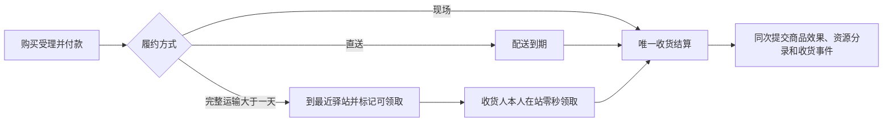

<a name="exchange-engine"></a>
# WorldMock 产品设计说明书 — 交换引擎

<a name="exchange-engine-交换引擎与项目框架"></a>
## 交换引擎与项目框架

<a name="exchange-engine-用户的心智模型"></a>
### 用户的心智模型

> “资源引擎和交换引擎应该是相对静态的引擎”
>
> “这里是心智模型文档”
>

交换引擎回答：在给定条件下，这件事能不能做，需要付出什么，能够得到什么。
例如，购买食品要满足哪些条件、需要支付多少、能够取得多少食品，以及何种条件下才能交付。
固定规则随引擎源码和规则版本维护；目录新增、修改或删除对象与内容时，只校验其类别与绑定，不另登记规则或语料。
交换引擎把判断和计算结果交给模拟引擎，由模拟引擎决定何时调用并落实变化。

<a name="exchange-engine-项目框架映射"></a>
### 项目框架映射


规则维护通过 WorldMock 的源码、测试和 `RULES_VERSION` 发布完成。环境发布不能新增公式或覆盖常数；纯计算和目录查询不自行推进时间或制造事实。

<a name="exchange-engine-与其他引擎的职责边界"></a>
### 与其他引擎的职责边界

| 负责方 | 职责 | 衔接 |
| --- | --- | --- |
| 资源引擎 | 登记、校验对象与绑定，派生只读索引 | 提供已校验的目录事实 |
| 交换引擎 | 固定类型、常数、纯条件与投入产出求值 | 返回可应用变化或拒绝原因 |
| 模拟引擎 | 共享时钟、活动推进、身体演化与原子世界变化 | 按真实活动应用规则结果 |
| 记录引擎 | 状态、事件、检查点与实际足迹 | 保存已提交事实与身份 |

资源定义归交换引擎，具体世界来源和发布归 Dataset。

<a name="exchange-engine-交换引擎的功能设计"></a>
## 交换引擎的功能设计

规则只读取模拟引擎提供的当下事实，用「付款、收货、一次结算」说明调用链。每单付款一次，商品效果在收货时按收货人结算，预计产出不冒充完成事实。

<a name="exchange-engine-维护交换规则"></a>
### 维护交换规则

<a name="exchange-engine-系统固定类型与常数"></a>
## 系统固定类型与常数

`worldmock.exchange` 唯一拥有闭集、类别表、常数与 Decimal 交换算子，统一由 `RULES_VERSION = 2` 绑定。
`types.py` 定义地点、商品、动作类别、app 使用方式、设备映射与 app 用途；内容没有分类字段。
`constants.py` 定义固定数值，`operators.py` 求值，`body.py` 定义身体动力学与资源元信息。

| 固定内容 | 规则 |
| --- | --- |
| 商品类别 | `meal`、`snack`、`drink`、`leisure`、`daily`、`fuel` |
| 食品热量 | 正餐 600、零食 200、饮品 100 千卡每份；没有食用秒数 |
| 非食品收货效果 | 休闲用品每订单行缓解娱乐需要 0.10，日常用品每订单行情绪 +0.05；燃油恰增加七个驾驶可用天数，无库存或身体效果 |
| app 用途 | `navigation`、`shopping`、`payment`；可以同时具有多个用途或为空 |
| 店铺供给 | 餐馆：正餐、饮品、零食；咖啡馆：饮品、零食；便利店与超市：除燃油外五类商品；加油站只卖燃油，驿站不卖商品 |
| 内容时长 | `CONTENT_MIN_SECONDS = 60`，不设登记上限 |
| 内容娱乐速率 | 娱乐类别每小时缓解娱乐需要 0.3；不按内容形式或名称分速率 |
| 身体活动键 | 等待 1.3、睡眠 0.95、步行 3.5、驾车 1.5；类别 MET 来自 `CATEGORY_MET` |
| 出行与配送 | 步行 1.2 米/秒、驾车 7 米/秒；驾车费用为 `max(500, ceil(0.2 × 米))` 分；配送 5 米/秒、备餐 600 秒、每单 500 分 |
| 图生成 | 最少两节点、边长 200–2000 米、树外边数 ⌊(n−1)/2⌋、生成规则版本 1 |
| 身体资源 | 2400 千卡上限、基础代谢 65 千卡/小时、饥饿阈值 800/400 千卡；睡眠债恢复与食品利用曲线不变 |

| 动作类别 | 内容完成后的接续 | MET | 按实际秒数的状态效果 | 场所 |
| --- | --- | --- | --- | --- |
| `entertainment` | 同一活动内接下一条 | 1.0 | 按固定 `ENTERTAINMENT_RELIEF_PER_HOUR = 0.3` 缓解娱乐需要 | 任意 |
| `work_study` | 一条结束 | 1.5 | 无按秒效果；分配工作内容完成有一次 +0.05 情绪脉冲 | 分配内容只能在本人工作地点，其余任意 |
| `social` | 一条结束 | 无 app 1.5，有 app 1.3 | 共同有效社交分别每小时缓解 0.5、0.4，对方不在的秒数每小时 0.2 | 任意；请求必须有对象 |
| `exercise` | 一条结束 | 5.0 | 每小时情绪 +0.1 | `home`、`outdoor`、`fitness` |
| `daily_care` | 一条结束 | 2.0 | 能量消耗之外无效果 | 任意 |

| 使用方式 | 设备 | 额外占用 |
| --- | --- | --- |
| `phone_continuous` | `phone` | `use_app` |
| `other_device` | `other` | 无 |
| `offline_assisted` | `phone` | 无 |

类别、使用方式与效果不接受环境覆盖，也没有类别与使用方式的合法组合表。
社交、情绪与运动速率只在 `exchange.constants` 定义，完整逐值表见[固定规则与常数](04-simulation-engine.md)。
规则只从引擎包读取，环境没有规则副本；常数已通过纯测试不代表完整运行已取得验收证据。

<a name="exchange-engine-注册表登记什么"></a>
#### 注册表登记什么

<a name="exchange-engine-新增状态资源-对象或语料"></a>
#### 新增状态资源、对象或语料

<a name="exchange-engine-修改与删除"></a>
#### 修改与删除

<a name="exchange-engine-查询适用规则"></a>
### 查询适用规则

<a name="exchange-engine-交换对象与资源变化声明"></a>
#### 交换对象与资源变化声明

数据仓只为对象选择固定类别与使用方式，填写名称、说明、摘要、价格、内容时长与集数及绑定；不声明公式或状态效果。

内容必须绑定恰好一个动作；动作可以不绑定 app。动作的 `app_ids` 非空时，`manner` 必须是一种固定使用方式，
每条内容的 `app_ids` 是该动作 app 集合的非空子集；动作没有 app 时，`manner` 为 null、内容 app 集合为空。
每个动作及每个动作与 app 的组合至少有一条内容。空集合从不表示全部 app。
内容 `duration_seconds` 是正整数且不小于 60 秒；动作不登记时长、时间窗、场所或效果。
内容不登记分类；环境维护动作名称、说明及其内容。
系列以 `(action_id, series.title)` 识别，各集具有相同动作与 app 集合，集数为唯一的正整数。

商品绑定店铺，店铺绑定购物 app。`GOODS_CATEGORY_STORE_KINDS` 固定类型可供给的类别，
`"all"` 展开到全部可供给该类别的店铺；显式绑定列表去重排序，同类型店铺同菜单。
购物用途存在当且仅当至少一家店铺绑定该 app；支付绑定非空当且仅当有购物用途，
绑定目标具有支付用途，允许绑定自己。导航与支付 app 可以没有内容；app 必须有用途或动作绑定。

<a name="exchange-engine-可供性与活动声明"></a>
#### 可供性与活动声明

占用闭集是 `wait`、`travel`、`talk`、`use_app`、`entertainment`、`work_study`、`exercise`、`daily_care`。每个动作占自己的类别，社交占 `talk`；`phone_continuous` 另占 `use_app`，`other_device` 与 `offline_assisted` 不另占。睡眠占全部八个；驾车占除 `talk` 外七个。每人两个活动名额，暂停让出名额，待收尾仍占名额。

| 类别 | 代谢当量 | 按实际秒数的效果 |
| --- | --- | --- |
| entertainment | 1.0 | 每小时缓解娱乐需要 0.3 |
| work_study | 1.5 | 分配内容首次完成才施加 `goal_progressed` +0.05 |
| social | 无 app 1.5，有 app 1.3 | 共处、未接受、远程分别每小时 0.5、0.2、0.4 |
| exercise | 5.0 | 每小时情绪 +0.1；只限 home、outdoor、fitness 环境 |
| daily_care | 2.0 | 无额外按秒效果 |

<a name="exchange-engine-交换规则的加载与准入"></a>
#### 交换规则的加载与准入

<a name="exchange-engine-校验交换条件"></a>
### 校验交换条件

购买按当前供给、余额与 app 绑定校验，不读取持有。店铺全天服务，没有营业时态、报价、资格或库存条件。整组先完成准入再提交变化，拒绝不制造扣款或收货事实。

<a name="exchange-engine-门店供给的时态与履约判断"></a>
### 门店供给的时态与履约判断

店铺全天服务，唯一商品价格位于 `goods.json.price_fen`。
菜单由 `store_ids` 或 `"all"` 与固定 `GOODS_CATEGORY_STORE_KINDS` 得出，同类型店铺同菜单。
没有供给时态、营业例外、报价、有效期或门店库存。
现场购买读取真实所在门店；远程购买读取明确的购物与支付 app 绑定及收货地址。店铺 `shipping_seconds` 非空时表示完整运输时长，为 null 时按发布图与固定配送算子计算，不额外叠加备货时间。长途订单按收货人家庭地址选择驿站，完整运输报价不因末端改址而重算。
费用与时长规则归 `worldmock.exchange`；实际订单、付款、到站与收货证据由模拟与记录引擎负责，详细边界见[请求字段与结算检查](04-simulation-engine.md#simulation-engine-请求字段与结算检查)。

<a name="exchange-engine-计算投入产出"></a>
### 计算投入产出

**目的：计算给定条件下的资源变化。** 输入是适用规则、数量和模拟引擎提供的实际履约事实；
输出是投入、产出及相应的付款、使用或交付条件。

<a name="exchange-engine-资源变化的计算"></a>
#### 资源变化的计算

货款与配送费按商品固定价格、件数和规则求值，每单一次转给 merchant 账户；驾车按图距离与固定费率求值。收货规则量由 `evaluate_goods_receipt(category, quantity)` 给出 provided；食品经 apply_food 得到 applied，使用当秒睡眠不足利用率并受能量上限约束，超出部分丢失。规则不自行写余额、世界状态或足迹。

<a name="exchange-engine-不同交换的计算依据"></a>
#### 不同交换的计算依据

购买受理当秒付款，每单一次，不产生提前的商品效果。现场购买同次提交收货，直送在配送到期时收货；长途到站只进入 `ready_for_pickup`，本人在站零秒领取才收货。每单由唯一函数写 `received_at`、订单终态与本人 `goods_received`，按收货人的实际状态施加效果，不产生库存、持有或独立进食活动。联系人收货不改变模拟人物身体，也不写 `goods_received`。完整边界统一见[请求字段与结算检查](04-simulation-engine.md#simulation-engine-请求字段与结算检查)。

动作内容消费的效果是固定类别速率乘实际秒数，不由动作名称、内容形式或模型文字推断。

| 类别 | 代谢当量 | 按实际秒数的效果 |
| --- | --- | --- |
| entertainment | 1.0 | 每小时缓解娱乐需要 0.3 |
| work_study | 1.5 | 分配内容首次完成才施加 `goal_progressed` +0.05 |
| social | 无 app 1.5，有 app 1.3 | 共处、未接受、远程分别每小时 0.5、0.2、0.4 |
| exercise | 5.0 | 每小时情绪 +0.1；只限 home、outdoor、fitness 环境 |
| daily_care | 2.0 | 无额外按秒效果 |

<a name="exchange-engine-校验资源分录"></a>
### 校验资源分录

资源分录继续校验单位、有限数值、上下界和封闭资金守恒。资源定义从 `worldmock.exchange` 取得，不能从环境 `resources.jsonl` 加载；计算错误保留稳定英文错误和异常日志。
通过求值的分录只是候选变化，只有模拟引擎实际提交后才成为可追溯的数字足迹。

<a name="exchange-engine-返回规则结果"></a>
### 返回规则结果

**目的：把本次判断、计算与校验的结果交给模拟引擎。**
结果要清楚区分“允许执行”和“根据已发生事实算出的变化”，不能把预计产出描述为完成结果。
全部接口拒绝给出英文说明，`items[]` 每项包含
`path/written/error_code/allowed_values/expected/why/candidates`；`path` 从模型工具调用根开始，保留全部数组下标，
`why` 写参数、名称或世界前置条件的英文原因。不以笼统失败代替参数诊断，不采用旧 `index/field` 形状。
可照填候选只用完整 `{tool, arguments, note}` 调用。
`query_world(name, way, category, app, available_only, offset)` 读取完整冻结公开目标，按名称、方式、类别与实际 app 取交集。available_only 读取该命中组合的同源资格，查询不重新结算交换、不推进时钟、不改变状态或呈现记录。
返回 matches、total_count、next_offset；先筛选后排序与分页，错误候选只在完整参数错误明细中出现，不代选应用或执行。

| 结果内容 | 应表达什么 |
| --- | --- |
| 条件判定 | 当前动作或交换是否满足要求 |
| 变化明细 | 哪一方的什么资源应增加或减少多少，以及计算所依据的事实 |
| 履约条件 | 取得、使用、付款或交付还需满足什么条件 |
| 拒绝原因 | 哪个条件或资源约束不满足，不能用替代行动冒充成功 |

模拟引擎消费这些结果，负责执行、安排履约和更新状态。交换引擎没有独立的世界状态，
也不负责事件排队、时间推进或记录保存。

付款与收货结算由模拟引擎分别提交；每次收货的 provided、applied 与资源分录可以独立核验，没有库存、给予或进食结果。

<a name="exchange-engine-收货结算的规则调用"></a>
#### 收货结算的规则调用



连续身体变化先结算至实际收货秒；唯一收货函数按商品类别与件数求 `provided`，再按收货人当秒状态求 `applied`，取走本次分录并同次提交订单与收货事件。食品使用当秒效率和能量上限，休闲与日常用品施加固定效果，燃油只增加驾驶可用天数。
直送和现场购买无需等待独立消费动作；长途到站不能提前施加效果。重复到期、重复领取或他人订单不能多结算。完整时长严格大于 86400 秒才进入驿站链，恰为 86400 秒仍直送；驿站由实际模拟收货人家庭地址在完整发布图上的最近站确定，且必须由场景选中。
字段、分录、归属和幂等细节只在[供给结算与事件载荷](09-io-formats.md)及[请求字段与结算检查](04-simulation-engine.md#simulation-engine-请求字段与结算检查)定义。

<a name="exchange-engine-纯规则与执行职责"></a>
## 纯规则与执行职责

交换引擎拥有固定闭集、类别与使用方式表、身体与社交情绪常数、Decimal 算子及资源分录规则。
收货算子 `evaluate_goods_receipt(category, quantity)` 给出食品提供热量或固定非食品效果，包括燃油的驾驶可用天数；实际状态应用归模拟引擎。
规则由 `RULES_VERSION` 统一绑定，恢复核对五字段 `environment_identity`。环境只登记对象与绑定，不提供规则副本。

<a name="exchange-engine-身体语义-两过程睡眠-睡眠不足账-体感分级"></a>
## 身体语义：两过程睡眠、睡眠不足账、体感分级

引用 `docs/design/09-io-formats.md`「LifeEnv 状态字段」章的「资源与需求字段」节。

<a name="exchange-engine-两过程睡眠模型"></a>
### 两过程睡眠模型

**状态字段**：`sleep_pressure`（睡眠压力）、`sleep_deficit_hours`（睡眠不足账）

**算法**（Daan、Beersma 与 Borbély 1984；参数取 npj Biological Timing and Sleep 2025 综述标准值）：

```
清醒：S(t+dt) = 1 − (1 − S(t)) · exp(−dt / 18.2h)
睡眠：S(t+dt) = S(t) · exp(−dt / 4.2h)

入睡阈值 H(t) = 0.67 − 0.12 · cos(2π (t − t_min) / 24h)
醒来阈值 L(t) = 0.17 − 0.12 · cos(2π (t − t_min) / 24h)

困意 = (S − L(t)) / (H(t) − L(t))，截断到 [0, 1.2]
```

**参数**：
- `t_min` 为两条阈值的最低点时刻，取人物卡片的 `chronotype_midsleep`（自由日睡眠中点），默认 04:00
- 晚型人物中点每晚一小时，阈值曲线整体后移一小时
- 初始 `sleep_pressure` 假定人物自起点之前最近一次惯常起床时刻（`chronotype_midsleep + sleep_need_hours/2`，按 24 小时取模）
  起一直清醒反推：起床时取睡满后的压力，再按清醒过程推进到起点；不预置活动

**困意分级**（档界按 KSS 等价刻度 `K = 7 + 7.6 · (困意 − 1)` 在 K = 5.5、6.5、7.5、8.4 处切分，属实验假设，登记在 `docs/design/02-exchange-engine.md`「实验假设声明」；档的名称与个数不变）：
- `< 0.80` 清醒
- `0.80–0.93` 有点乏
- `0.93–1.07` 困
- `1.07–1.18` 很困
- `≥ 1.18` 撑不住（留 0.02 余量，不与截断上界 1.2 重合）

**预期行为示例**：
假设按默认参数（睡眠中点 04:00），人物 07:00 起床、起床时压力等于当时的醒来阈值 L(07:00)，此后一直清醒，按上面的公式计算：
约 21:30 起为“有点乏”、22:40 起为“困”、00:05 起为“很困”、01:25 起为“撑不住”；睡眠中点 05:00、08:00 起床的晚型人物整体后移一小时。

场景起点为 00:00 时，按默认参数反推的惯常起床时刻为 07:45，人物在起点已清醒 16.25 小时，困意约 1.04，为“困”；
睡眠中点 05:00 的晚型人物困意约 0.94，同为“困”。去不去睡由人物决定。

<a name="exchange-engine-睡眠不足账与效率曲线"></a>
### 睡眠不足账与效率曲线

**累积算法**：
```
清醒每小时累积：sleep_need_hours / (24 − sleep_need_hours)
睡眠每小时恢复：1 小时
下限：0
上限：24
```

**默认参数**：`sleep_need_hours=7.5`（来自人物卡片，允许 7–9 小时），清醒每小时累积约 0.45 小时睡眠不足。

**效率曲线**（输入为 `sleep_deficit_hours`）：

工作效率节点：`(0, 1.0)、(8, 1.0)、(16, 0.85)、(24, 0.65)`
食品利用效率节点：`(0, 0.90)、(8, 0.90)、(16, 0.85)、(24, 0.80)`

节点之间线性插值，两端取边界值。

**分工明确**：
- `sleep_pressure` 决定人物此刻困不困
- `sleep_deficit_hours` 决定连续缺觉对效率的累积影响

<a name="exchange-engine-其他体感分级"></a>
### 其他体感分级

**饥饿体感**：
```
appetite = clamp((appetite_anchor_kcal − energy_kcal) / (appetite_anchor_kcal − 400), 0, 1)
          · (1 + 0.17 · cos(2π (t − 20h) / 24h)) + 餐时项
```

- `appetite_anchor_kcal` 默认 1200
- 由此 800 kcal 对应“饿”；能量低于身体配置的紧急阈值（`emergency_threshold_kcal`，400 kcal）时无条件至少“饿得难受”，不受昼夜项与餐时项影响
- 昼夜项依据 Scheer、Morris 与 Shea 2013 的内源饥饿节律（08:00 低谷、20:00 峰值、峰谷差 17%）
- 餐时项在午餐、晚餐窗口内加 0.15，窗口外为零

**分级**：
- `< 0.15` 不饿
- `0.15–0.35` 有点想吃
- `0.35–0.6` 饿
- `0.6–0.85` 很饿
- `≥ 0.85` 饿得难受
- 能量低于 100 kcal 为第六档“饿得发慌”，只由能量决定；100 kcal 登记在 `docs/design/02-exchange-engine.md`「场景参数」章的「需求状态」节

**娱乐需要分级**：
- `< 0.3` 不闷
- `0.3–0.6` 有点想放松
- `≥ 0.6` 很想放松

**社交需要**（`social_need`，取零到一）：
- 清醒每小时增长 0.04；是否清醒按本区间共同身体结算（`body_settlement.activity_ids`）所用的活动集合判定，不在推进后重新推断，
  所以在边界结束的睡眠整段按睡眠计；没有该结算草稿时（直接调用）按「ACTIVE，或 COMPLETED 且 `ended_at` 等于此刻」判定
- 与在场人物交谈每小时减少 0.5
- 与联系人通话每小时减少 0.4
- 收到并阅读一条来自人物或联系人的消息减少 0.05；睡眠中不读消息，睡眠中送达的消息在醒来后的第一个边界才阅读并计效果
- 社交覆盖按同一个实际活动区间集合判定，不从边界之后的状态反推。

**分级**：
- `< 0.3` 不想找人
- `0.3–0.6` 想和人说说话
- `≥ 0.6` 有点孤单

**情绪**（`mood_valence`，取 −1 到 1）：

按事件加脉冲并以半衰期衰减。

脉冲表：

- 收到人物或联系人的消息 +0.1（睡眠中送达的，醒来后的第一个边界阅读时才计）
- 连续两小时以上饿（饥饿分级“饿”及以上，含“饿得发慌”）或困 −0.1/小时；两小时门槛只判一次：连续不适时长减去两小时为可计费小时，
  每个边界按新增的可计费小时施加，未施加时不消耗计费小时
- 当日目标首次由实际活动推进 +0.05；每条目标只发一次，按当日目标规格核验活动证据
- 业务拒绝 −0.05，同一人物同一模拟秒至多一次；名称类拒绝（码的闭集见[模拟引擎](04-simulation-engine.md)）不施加，每人每秒至多 2 次，第 3 次起照常施加

半衰期：45 分钟 × `(1 + 0.3 · N_norm)`
脉冲幅度：× `(1 + 0.5 · N_norm)`
`N_norm` 为神经质归一到 [−1, 1] 的值

**分级**：
- `< −0.4` 很烦
- `−0.4 – −0.15` 有点烦
- `−0.15 – 0.15` 平静
- `0.15 – 0.4` 挺好
- `≥ 0.4` 很开心

**情绪只影响体感呈现与记忆重要度加权，不直接改变任何动作可行性。**

<a name="exchange-engine-滞回规则"></a>
### 滞回规则

分级在每个结算边界重算，但只有与“上一次实际提供决策时的分级”不同才构成唤醒条件。

这以决策而非结算为参照，天然抑制在分级边界附近的抖动，不另设阈值参数。

<a name="exchange-engine-数值与分级的分离"></a>
### 数值与分级的分离

所有数值继续写入 `activity_progress` 与 `observation` 事件的 `body` 字段供评估与导出；**给模型的提示只含分级文本**。
商品每份热量与路线费力是商品和路线的事实，可进工具层的目标与动作，不算身体数值。

身体状态与账户余额的准确数值只属于世界事实，但人物拿到的是体感分级，不是精确数值。

**验证**：见 `tests/life/test_sleep_two_process.py`、`test_felt_states.py`、`test_body.py`。

<a name="exchange-engine-身体参数与单位"></a>
## 身体参数与单位

场景校验强制每项身体与活动参数带单位、来源类型与取值区间；初始取值按实验假设处理，此后只随时间与动作规则变化。不能把「为了更像人」的运行后指标反馈成秘密行动脚本。

**WorldMock 固定身体参数**（`worldmock.exchange.body.BODY_CONSTANTS`，`source_kind = worldmock:<RULES_VERSION>`）：
- 体重 65 kg
- 初始能量 1600 kcal、上限 2400 kcal
- 初始睡眠不足零小时
- 基础消耗每小时 65 kcal
- 额外活动消耗按已声明的代谢当量扣除基础部分后计算

**能量精度**：
- 结算与预测共用完整能量成本函数
- 分段结算使用浮点数
- 所有活动集合的能量都以 0 截断，不报错
- 能量不参与受理、路线与恢复

**效率曲线**：
- 工作效率曲线节点为 `(0, 1.0)、(8, 1.0)、(16, 0.85)、(24, 0.65)`
- 食品利用效率节点为 `(0, 0.90)、(8, 0.90)、(16, 0.85)、(24, 0.80)`
- 以上两条输入均为 `sleep_deficit_hours`
- 能量效率节点为 `(0, 0.5)、(399.9, 0.5)、(400, 0.8)、(800, 1.0)`，输入为 `energy_kcal`，与工作效率相乘
- 节点之间线性插值，两端取边界值

**睡眠参数**：
- 两过程模型按前述算法
- `sleep_need_hours` 默认 7.5，允许 7–9 小时
- 睡眠不足账清醒每小时累积约 0.45、睡眠每小时恢复 1

**娱乐与社交**：
- 娱乐需要取零到一，清醒每小时增长 0.08，有 app 内容实际推进时不再增长；按固定娱乐缓解率 0.3/小时与实际经过时间减少（见「转换效率算法」），不读画像权重或接触次数
- 社交需要取零到一，清醒每小时增长 0.04（清醒按本区间共同身体结算所用的活动集合判定），交谈、通话、收到并阅读消息与共同用餐按前述规则减少；
  睡眠中不读消息
- app 内容位置、完成轮次与每个区间的固定速率效果都落在数字足迹里

**所有系数作为实验假设记录；真实人类生理有效性不是既得结论。**

身体演化常数的唯一来源是 WorldMock 包，环境不能用资源目录覆盖。场景只给体重、初始能量、睡眠债与娱乐需要。食品每份热量由 `GOODS_ENERGY_KCAL` 按 `GoodsCategory` 求值，800/400 千卡阈值是 WorldMock 常数。

目录不提供代谢当量；动作取 `CATEGORY_MET`，其余仅保留等待、睡眠、步行、驾车四项身体代谢当量。

<a name="exchange-engine-饥饿在低能量时不失灵"></a>
## 饥饿在低能量时不失灵

食欲公式与原五档阈值不变；新增第六档「饿得发慌」，只由能量决定。两条低能量规则：

| 条件 | 显示 |
| --- | --- |
| `energy_kcal` < 400（身体配置 `emergency_threshold_kcal`） | 至少「饿得难受」，不受昼夜项与餐时项影响 |
| `energy_kcal` < 100（新常量 `APPETITE_STARVING_KCAL`，约 1.5 小时基础消耗） | 新档「饿得发慌」 |

- 400 取身体配置的 `emergency_threshold_kcal`（目录 `alert_rules` 中的 `EMERGENCY_ENERGY`），不复用 `felt.py` 的公式
  下限 `APPETITE_KCAL_FLOOR`（`src/worldmock/life/felt.py::APPETITE_KCAL_FLOOR`）。100 是 `felt.py` 的新常量 `APPETITE_STARVING_KCAL`，不进目录，所以目录与
  数据集副本都不变。`BodyConfig.validate_body`改为校验
  `APPETITE_STARVING_KCAL < emergency_threshold_kcal < hunger_threshold_kcal <= maximum_energy_kcal`。
- 分级函数改为 `felt.appetite_level(appetite, energy_kcal, emergency_kcal)`；`summarize_felt_levels` 相应增加这两个参数，
  三处调用都要传入：`projection.body_projection`（`src/worldmock/life/projection.py`）与 `src/worldmock/life/rhythm.py`；`projection.felt_values`
  仍只返回五个数值，`body.values` 的字段不变。`body.values.appetite` 的数值仍按原公式计算。
  「饿得发慌」不进 `APPETITE_BANDS`。
- 「饿得发慌」加入分级序表与饥饿不适档（`rhythm.py` 的 `_BAND_ORDER`、`HUNGRY_BANDS`）。
- 边界预测的能量阈值为 800、400、100（800、400 取身体配置，100 取 `APPETITE_STARVING_KCAL`；`src/worldmock/life/body.py` 现只有
  前两个），跨档照常以 `felt_band_change` 唤醒，睡眠中过滤。
- 能量同时压低工作效率；这一事实只写进系统层规则（[人物系统提示](06-agent.md#agent-请求组成)），不给数值。
- `body_observation`（`src/worldmock/life/body.py`）与只为它存在的 `body.felt_levels`、`body.felt_values`都没有生产调用方，一并删除；同时删除 `ScenarioSemantics.alert_codes`。目录 `alert_rules`
  仍是 800、400 的来源。`scripts/inspect_run.py` 改读 `body.values` 与 `body.levels`。

本节 800/400 千卡阈值由 `worldmock.exchange.body.BODY_CONSTANTS` 唯一定义，来源为 `worldmock:<RULES_VERSION>`；场景与环境目录不能另设阈值。

<a name="exchange-engine-规则数值与实验假设"></a>
## 规则数值与实验假设

固定速度、费用、需要缓解率、代谢当量和阈值属于模拟假设，不是对现实人群的拟合结论。
固定规则的变更需要修改引擎并更新规则身份；环境数据只选择对象、价格、时长和绑定。

| 常数 | 当前值与含义 |
| --- | --- |
| `SOCIAL_NEED_AWAKE_RATE` | 清醒每小时社交需要增加 0.04 |
| `SOCIAL_NEED_MESSAGE_RELIEF` | 每条实际已读消息缓解 0.05 |
| `SOCIAL_NEED_CONVERSATION_RATE`、`SOCIAL_NEED_REMOTE_RATE` | 无 app 与有 app 的有效社交每小时缓解 0.5、0.4 |
| `CHAT_RELIEF_DECLINED_PER_HOUR` | 对方不在的社交区间每小时缓解 0.2 |
| `MOOD_PULSES` | 已读消息 +0.1、不适计费小时 −0.1、目标首次推进 +0.05、业务拒绝 −0.05 |
| `MOOD_HALFLIFE_MINUTES` | 情绪半衰期基值 45 分钟 |
| `MOOD_HALFLIFE_NEUROTICISM_FACTOR` | 神经质对半衰期的系数 0.3 |
| `MOOD_PULSE_NEUROTICISM_FACTOR` | 神经质对脉冲幅度的系数 0.5 |
| `MOOD_DISCOMFORT_TRIGGER_HOURS` | 连续不适超过 2 小时后按新增区间计费 |
| `PUSH_HOURS_LOCAL` | 当地 08:00 至 21:00 的整点 |
| `PUSH_SUMMARY_MAX_CHARS` | 摘要至多 200 个 Unicode 码点 |
| `DERIVED_DURATION_CAP_SECONDS` | 一次活动计划时长至多 86400 秒；不是内容登记时长上限 |

食品按收货量和食品利用效率立即结算，能量截断到上限；非食品按订单行结算，不随数量重复脉冲。
收货没有进食活动，也没有共同用餐缓解规则。身体结算只采用实际活动覆盖的共同区间。
