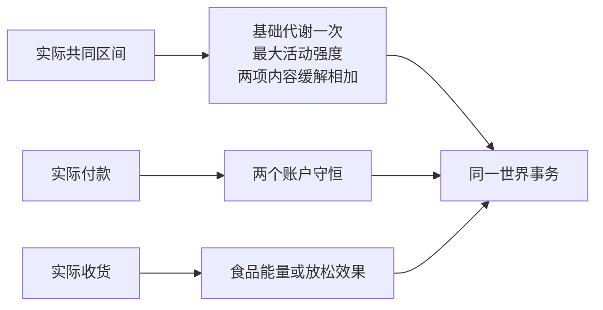

# WorldMock 产品设计说明书 — 交换引擎

## 资源与账户

交换只结算已经发生的活动区间、付款或收货。资金使用整数分，身体资源使用有限数值；
每次提交保留实际限幅差额。人物账户 `agent:{agent_id}` 不得为负，`external:scenario` 为允许有符号余额的外部对手方。
购买、交通费和回调支出从人物账户转到外部账户，回调收入反向转账。
资金事实只在事件信封的 `resource_changes` 中记录，两个账户的资金变化严格守恒。

## 身体共同结算

身体保存能量、双过程睡眠状态、`relaxation_need` 和 `social_need`，删除娱乐需要、情绪与健康行为脉冲。
能量池上限为 2400 千卡，低于 800 千卡饥饿，低于 400 千卡进入更强饥饿档；能量上限和饥饿阈值不随体重变。
代谢当量是活动强度相对静坐的倍数，1 个代谢当量等于每公斤体重每小时 1 千卡。
每小时基础代谢等于 `mass_kg` 千卡，每小时额外消耗为 `max(MET - 1, 0) × mass_kg` 千卡；
`mass_kg` 是 `persona.toml` 的 `body.mass_kg`。一个共同区间取 `hours = seconds / 3600`，两项各乘一次 `hours`，
能量减少两项之和与区间开始时能量的较小值，不低于 0；结算证据里的基础代谢和额外消耗不因能量见底而缩小。
实际区间只扣一次基础代谢；并行活动使用最高代谢当量，暂停活动不进入区间集合，没有活动时代谢当量取 1.0。
睡眠的代谢当量 0.95 小于 1，额外消耗为 0，不折减基础代谢：睡一小时和空闲一小时消耗相同。
身体边界预测用同一组每小时速率，人物因为饿而得到决策机会的时刻随体重变化。

| 活动或内容体力档位 | 代谢当量 |
| --- | --- |
| 睡眠 | 0.95 |
| 自带的步行 | 3.5 |
| 购买、纯目录浏览、空闲 | 1.0 |
| idle、light、moderate、heavy | 1.0、1.5、2.0、5.0 |

出行的体力消耗沿用内容的四个档位：数据集定义的出行方式取它声明的 `exertion` 档位，自带的步行固定为 3.5。
出行活动受理时把代谢当量键（`walking` 或所声明的档位）写进活动私有数据的 `exertion`，身体结算对出行和 interact 一样读这个键。

双过程睡眠模型按实际清醒与睡眠区间更新睡眠压力和睡眠不足，不把活动名推测成睡眠效果。
睡眠不足就是欠的觉：清醒每小时增加 `sleep_need_hours ÷ (24 − sleep_need_hours)` 小时，睡每小时补 1 小时，限在 0 到 24 小时。
两条都按实际经过的时长结算，睡过头多睡的那段同样补觉；`sleep_need_hours` 不决定一觉睡多久。
身体的睡眠需要与睡眠中点读 `persona.toml` 的 `sleep_need_hours` 与 `chronotype_midsleep`，两项必填，没有缺省值。
饥饿体感在饭点多 0.15：钟面时刻落在 `persona.toml` 的 `lunch_window` 或 `dinner_window` 里时加一次，两个时段重叠时也只加一次。
时段按钟面读：起点与终点各对 24 取模后比较，取模后起点不小于终点的时段跨过午夜，跨度达到 24 小时的时段全天命中。
这个判断对任何「两个有限数、起点小于终点」的时段都有定义，所以饭点时段没有 0 到 24 的范围检查，也不要求午饭与晚饭互不重叠。
食品利用率按睡眠不足的既有曲线插值，输入 0、8、16、24 小时分别为
0.90、0.90、0.85、0.80；真实食品收货才增加能量，上限仍为 2400 千卡。

## 放松与社交需要

两项需要均限幅至 `[0, 1]`。清醒时放松需要每小时自然增加 0.08，社交需要每小时自然增长取 `persona.toml` 的 `social_need_growth_per_hour`；
共同区间只增加一次自然增长。睡眠冻结两项需要，暂停、购买与纯目录浏览没有内容缓解效果。

内容的 `relaxation_relief` 和 `social_relief` 独立使用 none、low、medium、high 档，
对应每实际小时减少 0、0.10、0.30、0.50。并行内容效果相加，进度报告与重放不重复结算。

清醒的饥饿或强困倦持续超过两小时后，超出的时间每小时增加 0.10 放松需要。
同一人物同一秒的服务拒绝只增加一次 0.05 放松需要；没有目标进展奖励或其他情绪脉冲。

| 需要 | 小于 0.30 | 从 0.30 到小于 0.60 | 从 0.60 起 |
| --- | --- | --- | --- |
| 放松需要 | 不闷 | 有点想放松 | 很想放松 |
| 社交需要 | 不想找人 | 想和人说说话 | 有点孤单 |

## 收货与费用

零食每件提供 200 千卡，食品每件提供 600 千卡；饮料或商品的真实收货减少 0.10 放松需要。
付款、到站通知和未收货订单不产生这些效果；同一订单重复收货没有新效果。

商品定价与履约来源归[资源引擎](03-resource-engine.md)，实际购买与收货生命周期归
[模拟引擎](04-simulation-engine.md)。

一次出行的距离取地图完整最短路径的整数米数，速度和两项价格来自所选的出行方式（见[资源引擎](03-resource-engine.md)的「出行方式」），用时与车费只有下面两条公式。

| 量 | 公式 |
| --- | --- |
| 用时（秒） | `ceil(distance_meters ÷ (speed_meters_per_second × 天气系数))` |
| 车费（分） | `max(start_price_fen, ceil(price_per_km_fen × distance_meters ÷ 1000))` |

天气系数取受理当刻的世界天气：晴、多云 1.0，小雨 0.85，大雨 0.7，雪 0.6；它对自带的步行和数据集定义的全部方式生效，数据集不能改。
用时沿用十进制精确算法：速度为整数时原样取，为小数时取它的最短十进制写法，先精确相乘，再整数化上取整。
车费全程整数运算，即 `max(start_price_fen, (price_per_km_fen * distance_meters + 999) // 1000)`，与天气无关；两个价格都是 0 的方式免费。
车费在出发受理时支付给 `external:scenario`，为 0 时不动余额。天气与功能 app 选择不改变资金守恒规则。
