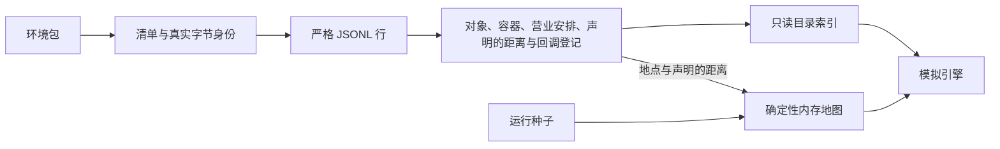
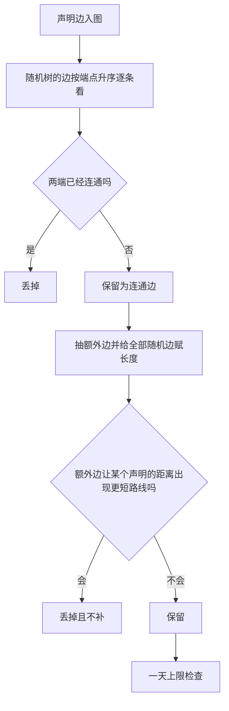

<a name="resource-engine"></a>
# WorldMock 产品设计说明书 — 资源引擎

<a name="resource-engine-职责与边界"></a>
## 职责与边界

资源引擎读取环境包中的发布目录，校验身份、字段、容器绑定、声明的距离和回调声明，建立只读索引与内存地图。
人物和运行配置由环境加载器读取；资源引擎不读取语料、保存活动进度、执行回调或修改资金。
地图的输入有三样：全部登记地点、数据集在 `map.jsonl` 里声明的距离、运行种子。



<a name="resource-engine-环境目录文件"></a>
## 环境目录文件

环境根目录只允许 `catalog/`、`persona.toml`、`config.toml`。`catalog/` 只允许以下文件。
包外条目直接拒绝，不遍历包外目录或符号链接；实际读取也拒绝链接和越界路径。

| 文件 | 是否必需 | 登记内容 | 不存在时 |
| --- | --- | --- | --- |
| `manifest.json` | 必需 | `format_version: 5`、环境身份和版本、`rules_version: 5`、每个存在的目录 JSONL 的路径、摘要和字节数，以及 `catalog_content_sha256` | 加载失败 |
| `app-catalog.jsonl` | 必需 | app 身份、名称、角色，以及功能 app 的购买绑定与出行方式绑定 | 加载失败 |
| `location.jsonl` | 必需 | 全部实际地点、显示名、自由类型、内容 app、住宿和驿站资格、营业安排 | 加载失败 |
| `merchant-catalog.jsonl` | 必需 | 商品身份、名称、四类商品、固定价格、地点类型或内容 app 绑定 | 加载失败 |
| `content-catalog.jsonl` | 必需 | 内容身份、标题、时长、体力消耗、推送资格、心理缓解档位、摘要与容器；绑定到 app 的内容可以另写前提 `prerequisite`；绑定到地点类型的内容可以另写凭状态 `consumes_state` 与完成效果 `completion_effects` | 加载失败 |
| `callbacks.jsonl` | 可选 | 状态声明和触发规则 | 没有状态，没有规则 |
| `map.jsonl` | 可选 | 声明的两地距离 | 没有声明，地图全部随机生成 |
| `travel-method.jsonl` | 可选 | 数据集定义的出行方式 | 只有引擎自带的步行 |

规则版本 `RULES_VERSION` 是 5，目录格式 `format_version` 是 5；这两个号只在本节维护。
四个必需文件名是 `catalog.identity` 的 `REQUIRED_CATALOG_FILES`，三个可选文件名是 `OPTIONAL_CATALOG_FILES`，其余模块只引用这两个常量。
可选文件「存在」指 `catalog/` 下有这个名字的目录条目，不论类型；存在的条目必须是普通文件，链接和目录由安全文件边界拒绝。
可选文件允许零字节。零字节表示零行，加载出的目录、地图和运行行为与文件不存在完全相同；两者只在清单文件表和目录摘要上不同。
文件名一律用连字符，`travel_method.jsonl`、`map.json`、`callback.jsonl` 等其他名字都是包外条目。

不发布生成的地图；`map.jsonl` 只声明距离。没有目录动作、地点实例数量、环境规则副本、脚本或运输时长。
未知字段不忽略、不翻译；旧格式直接拒绝。

<a name="resource-engine-jsonl-行读取"></a>
## JSONL 行读取与环境包边界

JSONL 按真实 UTF-8 字节和 LF 逐行解析。零字节表示零行；末尾 LF 后的空串不算一行，最后一行可以没有 LF。
每行恰好包含一个 JSON 对象。空行、全空白、BOM、非法 UTF-8、多值、跨行对象、数组、标量和非 JSON 数值拒绝。
任意 CR 使用 `ENVIRONMENT_KIND_INVALID`，详情保留 `Catalog JSON must use LF line endings.`；
其他行解析失败使用 `ENVIRONMENT_LINE_INVALID`。行失败详情均以 `<目录相对路径>:<行号>` 开头。
模型未知字段优先使用种类错误，再按实际字段判断数值错误。行内空白和键序不规范化，身份按实际字节计算。

清单原始对象中的 `rules_version` 若为严格整数，先比较当前规则版本，再解析严格清单模型。
不匹配直接报 `RULES_VERSION_MISMATCH`；字符串、布尔、缺失版本、`format_version` 不是当前目录格式号和非法清单形状报 `ENVIRONMENT_KIND_INVALID`。
加载与纯校验读四个必需文件和清单文件表登记的可选文件；不存在因而没有登记的可选文件按零行处理，
此后的对象登记、索引和运行不区分「不存在」与「零行」。

<a name="resource-engine-注册校验与错误"></a>
## 注册校验与错误

`catalog.admission` 是唯一对象登记校验器。`load_catalog(catalog_dir, seed)` 和
`validate_catalog_files(catalog_dir)` 共用文件读取与登记阶段；纯校验不需要种子、不生成地图。
失败抛带稳定 `code` 的 `RegistrationError`，英文原因只维护在 `catalog.errors`，异常均记录英文日志。
`validate_environment_entries` 独立检查两层包闭集，使人物、配置和目录能够各自报告输入错误。

身份行和引用列表按身份字符串升序且无重复；名称比较经 `channel_key` 去全部空白并忽略大小写。
app、地点显示名、商品名分别在所属文件唯一。app 名不得与任何地点显示名相同；
出行方式的名称在全部出行方式（含自带的「步行」）之间唯一，不与其他对象的名称比较；
人物实际可见的地点、商品、内容 app 名称唯一性由环境加载器检查。
地点内容的单元名是人物要写的名称：同一个地点类型下，独立内容的 `title` 与系列的 `series.title` 合在一起比较，不得重复。
同一系列的各集属于同一单元；不同地点类型之间可以重名，也不要求与商品、app、地点的名称不同。
这项检查按文件行序逐行进行，排在该行的容器、引用、摘要、来源和系列检查之后。
绑定到 app 的内容标题不参与名称解析，也不检查唯一。

内容前提分两步校验，加载与纯校验都执行。行解析时由严格行模型检查 `prerequisite` 及其成员的形状，失败详情以 `content-catalog.jsonl:<行号>` 开头。
登记核对在内容逐行校验里进行，排在该行的容器、引用、摘要和来源检查之后、系列检查之前，按下面的次序先遇到的先报：
写在地点内容上、两个成员都没写、`location_kinds` 的重复与排序、`location_kinds` 悬空、`opens` 的时段写法。
同一系列各集的前提是否相同属于系列检查。

地点内容的凭状态 `consumes_state` 与完成效果 `completion_effects` 同样分两步。行解析时由严格行模型检查形状：
两个字段或完成效果的成员写成 `null`、类型不对、`consumes_state` 空白、`completion_effects` 不是对象或含未知成员、成员不是所属档位表里的档位名，
都在行解析时拒绝，早于全部登记核对，失败详情以 `content-catalog.jsonl:<行号>` 开头。登记核对用 `callbacks.jsonl` 登记的全部状态名，没有这个文件时为空集；
它排在内容前提的核对之后、系列检查之前，按下面的次序先遇到的先报：

| 次序 | 检查 | 登记码 | 详情 |
| --- | --- | --- | --- |
| 1 | 写了 `consumes_state` 或 `completion_effects`，而这是 app 内容（`app_ids` 非空） | `ENVIRONMENT_KIND_INVALID` | `<content_id> is an app content; consumes_state and completion_effects belong to location contents.` |
| 2 | `completion_effects` 三个成员都省略 | `ENVIRONMENT_KIND_INVALID` | `<content_id> declares an empty completion_effects.` |
| 3 | `consumes_state` 不是登记的状态名 | `ENVIRONMENT_REF_UNKNOWN` | `<content_id> consumes_state names <状态名>.` |

同一系列各集的 `consumes_state` 是否相同属于系列检查，排在各集前提是否相同的核对之后。

清单检查按下面的次序进行，先遇到的先报：

| 次序 | 检查 | 登记码 |
| --- | --- | --- |
| 1 | 清单原始对象的 `rules_version` 是严格整数且不等于当前规则版本 | `RULES_VERSION_MISMATCH` |
| 2 | 严格清单模型不通过；只有 `files[].size_bytes` 的缺失、类型或取值错误报数值码 | `ENVIRONMENT_KIND_INVALID`、`ENVIRONMENT_NUMBER_INVALID` |
| 3 | 文件表路径重复；未按路径升序 | `ENVIRONMENT_ID_DUPLICATE`；`ENVIRONMENT_KIND_INVALID` |
| 4 | 文件表里有必需与可选文件名以外的路径 | `ENVIRONMENT_STALE_FILE` |
| 5 | 文件表缺少某个必需文件 | `ENVIRONMENT_FILE_UNLISTED` |
| 6 | `catalog/` 里有清单、必需与可选文件名以外的条目 | `ENVIRONMENT_STALE_FILE` |
| 7 | 某个可选文件存在而文件表没有登记 | `ENVIRONMENT_FILE_UNLISTED` |
| 8 | 从实际文件重算文件表和目录摘要，与清单逐项比较有任何不同；登记了并不存在的可选文件属于这一项 | `ENVIRONMENT_IDENTITY_MISMATCH` |

登记失败没有 `fix` 字段：固定英文原因之外只有一段可选的英文详情，作者的改法写在手册里。

| 拒绝码 | 登记边界 |
| --- | --- |
| `RULES_VERSION_MISMATCH` | 清单的规则版本不是当前规则版本 |
| `ENVIRONMENT_STALE_FILE` | 环境根、目录或清单存在闭集外条目，详情指出实际路径 |
| `ENVIRONMENT_FILE_UNLISTED` | 清单缺少必需 JSONL，或存在的可选文件未登记；详情是没有登记的文件名 |
| `ENVIRONMENT_IDENTITY_MISMATCH` | 安全文件边界失败，或实际文件表、字节摘要和清单不一致 |
| `ENVIRONMENT_LINE_INVALID` | 某行不是恰好一个 JSON 对象，含 `map.jsonl` 与 `travel-method.jsonl` 的行 |
| `ENVIRONMENT_ID_DUPLICATE` | 身份、名称或引用列表重复，含内容前提的 `location_kinds`；`map.jsonl` 同一对地点出现两行；出行方式的身份或名称重复、使用保留身份 `walking` 或自带名称「步行」；同一地点类型下单元名重复时详情为 `content-catalog.jsonl:<先登记一行的行号> and content-catalog.jsonl:<当前行的行号> give location kind <类型> the same activity name <先登记的单元名>.` |
| `ENVIRONMENT_REF_UNKNOWN` | app、商品等对象引用未登记；`map.jsonl` 的端点不是登记地点；功能 app 或回调规则引用的出行方式既没有登记、也不是 `walking`；地点内容的 `consumes_state` 不是登记的状态 |
| `ENVIRONMENT_KIND_INVALID` | 未知字段、非法闭集值、坏字符串或布尔、未排序列表、非法营业时段；`map.jsonl` 的端点不满足 `a < b` 或行未排序；`travel-method.jsonl` 的行未按身份升序；功能 app 的 `actions` 出现 `purchase` 以外的值；回调的出行触发缺少 `travel_method_id`，或其他动作触发带了它。内容前提写成 `null`、不是对象或含未知键，`location_kinds` 不是字符串数组、有空白项或未按升序，前提的 `opens` 写成 `null`、形状不符或时段写法不合法，都属于这一项；两种 `null` 的详情分别是 `A declared content prerequisite must be an object.` 与 `A declared opening schedule must be an object.`，后一句地点行与内容前提共用。app 行写了已删除的 `browse_duration_seconds` 按未知字段处理，详情以 `app-catalog.jsonl:<行号>` 开头、含字段名和 `Extra inputs are not permitted`。app 内容写了 `consumes_state` 或 `completion_effects`；`consumes_state` 类型不对、空白或写成 `null`；`completion_effects` 不是对象、写成 `null`、为空、有未知成员，或成员的档位不在表内（含 `none`、数字和 `null`），都属于这一项；三种 `null` 的详情分别带 `A declared consumed state must be a state name.`、`A declared completion effect must be an object.` 与 `A declared completion effect tier must be a tier name.`，登记核对的两句详情见上文的次序表 |
| `ENVIRONMENT_NUMBER_INVALID` | 严格整数类型或范围不符；`map.jsonl` 的 `length_m` 缺失、不是严格整数或小于 1；出行方式的速度不是大于 0 的有限数值，或两个价格不是不小于 0 的严格整数 |
| `HOME_LOCATION_REQUIRED` | 没有显式住宿地点，或人物住处未解析到住宿地点 |
| `HOME_NOT_SLEEPABLE` | 人物住处没有标 `sleepable`；原因 `The persona home must be marked sleepable.`，详情 `persona.home_location` |
| `PARCEL_STATION_REQUIRED` | app 侧商品需要驿站但未登记，或驿站类型没有地点内容 |
| `APP_ROLE_BINDING_INVALID` | 内容 app 带有 `actions` 或 `travel_method_ids` 字段（空数组也算），或地点、商品、内容、提醒引用功能 app；原因 `Only function apps may bind actions or travel methods, and only content apps may be referenced by locations, goods or contents.` |
| `APP_UNBOUND` | 内容 app 没有有效内容来源，或功能 app 的 `actions` 与 `travel_method_ids` 都为空；原因 `An app must have content, or an action or travel method binding, for its role.` |
| `APP_NAME_COLLIDES_LOCATION` | app 名与地点显示名碰撞 |
| `GOODS_BINDING_MISSING`、`GOODS_BINDING_SIDE_EXCLUSIVE`、`GOODS_BINDING_DANGLING` | 商品容器缺失、两侧同时绑定、类型没有实际地点 |
| `CONTENT_CONTAINER_MISSING`、`CONTENT_CONTAINER_SIDE_EXCLUSIVE` | 内容容器缺失、两侧同时绑定 |
| `CONTENT_BINDING_DANGLING` | 内容写的地点类型没有任何登记地点声明，顶层绑定与内容前提的 `location_kinds` 都算；原因 `A content names a location kind that no registered location declares.`，前提悬空时详情为 `<content_id> prerequisite names <kind>.` |
| `CONTENT_PREREQUISITE_INVALID` | 内容前提写在绑定到地点类型的内容上，或 `location_kinds` 为空且没写 `opens`；原因 `A content prerequisite must belong to an app content and declare location kinds, opening hours, or both.`，详情分别是 `<content_id> is a location content.` 与 `<content_id> declares neither location kinds nor opening hours.` |
| `CONTENT_SERIES_INVALID` | 同系列容器不同、集号重复，各集的内容前提不完全相同，或各集的 `consumes_state` 不同；原因 `Episodes of a series must share one container binding and one prerequisite and have unique episode numbers.`，前提不同时详情为 `<series.title> episodes declare different prerequisites.`，`consumes_state` 不同时详情为 `<series.title> episodes declare different consumed states.` |
| `CONTENT_SUMMARY_TOO_LONG`、`CONTENT_SOURCE_URL_MISSING` | 摘要超过 200 字符或真实来源缺少 URL |
| `CALLBACK_STATE_UNREGISTERED`、`CALLBACK_FOOTPRINT_EMPTY`、`CALLBACK_NOTIFY_MISMATCH` | 回调状态未知、足迹为空、提醒与效果不配对 |
| `MAP_DISTANCE_CONTRADICTED` | 某条声明边的两端经其他声明边有一条严格更短的路线，详情指出行号、声明值、更短的路线和它的总长 |
| `MAP_ROUTE_TOO_LONG` | 生成后的地图上，最远的一对地点用最慢的出行方式在最差天气下走不到一天之内；需要种子，纯校验不做 |
| `MAP_TOO_SMALL`、`MAP_EDGE_INVALID`、`MAP_DISCONNECTED` | 内存地图节点不足、边非法或不连通 |

<a name="resource-engine-图与地点关系准入"></a>
## 地点与营业安排

每行声明一个实际地点，必填 `location_id`、`name`、`kind`、`app_ids`。`kind` 是非空白严格字符串，
与商品 `store_kinds`、内容 `location_kinds` 逐字符相等匹配，不按名称归一或旧类型推断资格。
可选 `branch_label` 缺省为 null；显示名为名称，或「名称（分店标签）」。同名分店必须提供不同标签。
可选严格布尔 `is_home`、`accepts_parcels`、`sleepable` 缺省 false，资格只按标记判断；
写 null、数字或字符串按字段类型错误拒绝。
`sleepable` 表示人物停留在这个地点时能否开始睡眠，与 `is_home` 互不推导；`is_home` 仍只表示住处。
人物自己的家必须标 `sleepable`：环境加载器在人物住处解析到住宿地点之后检查这一个地点，引擎不替数据集补标，
目录里其他住宿地点不查，只做目录登记校验、不读人设时也不查。
目录至少有一个住宿地点；驿站类型必须有地点内容。全部地点参与供给、名称检查、出行和寻路。

`opens` 缺省表示全天营业；显式声明必须是对象，不能是 null。
完整形状为 `{weekly: {mon..sun: [[HH:MM, HH:MM], ...]}, exceptions: {YYYY-MM-DD: [...]}}`。
`weekly` 必填，`exceptions` 可省略；缺失星期关闭，特殊日期完全替换该日每周时段，空数组表示关闭。
时段按开始时间升序、不重叠、使用半开区间；`24:00` 只作为结束，跨午夜拆到两日。

营业时段对象 `OpeningHours`（`{weekly, exceptions}`）的求值、校验和文字写法各只有一份，地点行的 `opens` 与内容前提的 `opens` 共用。

| 归属 | 规则 |
| --- | --- |
| `OpeningHours.opening_intervals(本地日期)` | 日期的 ISO 写法出现在 `exceptions` 里时返回该日声明的时段，整日替换，可以为空；否则返回 `weekly` 中该星期的时段，没写的星期为空 |
| `OpeningHours.is_open(本地时刻)` | 把已换算到运行时区的本地时刻的小时和分钟折成当日分钟数，秒不参与；存在某个时段使「起点 ≤ 分钟数 < 终点」即为真，`24:00` 按 1440 计。09:59:59 算在 `08:00–10:00` 内，10:00:00 不算 |
| `Location.opening_intervals`、`Location.is_open` | 只处理「没写 `opens` 即全天」，其余委托给 `OpeningHours`；购买报价、受理、工具层和评估仍调用地点的这两个接口 |
| `require_declared_schedule` | 显式 `null` 的拒绝，挂在地点行与内容前提两个 `opens` 字段上，详情统一为 `A declared opening schedule must be an object.` |
| `catalog.admission` 的时段校验 | 星期名、规范日期与时刻、有序不重叠，对地点行与内容前提的 `opens` 各调用一次 |
| `life.readable.interval_phrases` | 每个时段写成 `HH:MM–HH:MM`（中间是 U+2013）；工具层地点行用「、」连接，内容前提的拒绝原因用 `, ` 连接 |

<a name="resource-engine-加权连通图与路线"></a>
## 加权连通图与路线

地图节点恰为全部登记地点，至少两个。无向端点规范为 `a < b`，不允许自环或重复，图必须连通。
数据集可以在可选文件 `map.jsonl` 里声明两地的距离：声明的两地直接相连，距离就是声明值；
其余的边随机生成并保证全图连通，但不得让任何声明的距离被更短的路线绕过。

`map.jsonl` 每行是一条声明边，行模型是 `MapEdge`，只有三个字段，多余的键拒绝，文件可以零行。

| 字段 | 约束 | 含义 |
| --- | --- | --- |
| `a` | 非空白字符串；登记的 `location_id`；按字符串比较严格小于 `b` | 一个端点 |
| `b` | 非空白字符串；登记的 `location_id` | 另一个端点 |
| `length_m` | 不小于 1 的严格整数，不设固定上限，只受一天上限约束 | 两地的距离，单位米，往返共用 |

行按 `(a, b)` 升序，同一对地点只能出现一次；端点写 `location_id`，不写显示名。
声明的地点对之间不需要彼此连通，也不需要覆盖全部地点。
行解析之后依次检查：每行 `a < b`；两个端点都已登记；同一对不重复；行已排序；声明之间不互相矛盾。
这些检查不需要种子，加载与纯校验都执行，失败详情以 `map.jsonl:<行号>` 开头。

互相矛盾的声明这样判定：用全部地点作节点、全部声明边作边建一张只含声明边的图，按文件行序逐行取 `a` 到 `b` 的最短距离；
距离严格小于该行的 `length_m` 就报 `MAP_DISTANCE_CONTRADICTED`，报第一条不成立的行，详情里的路线取 `Graph.path` 的结果。
绕行总长等于声明值不算矛盾。作者的改法只有一种：让直达的距离不超过绕行的总长。

地图只在加载时在内存里生成。使用运行种子先派生 `sha256("random:{seed}")`，再从独立 `map` 随机流取 64 位地图种子；
随机树指 `nx.random_labeled_tree(地点数, seed=地图种子)` 的边映射回地点身份后的地点对。



| 步骤 | 做什么 |
| --- | --- |
| 1 | 地点身份升序排成节点序列，不足两个报 `MAP_TOO_SMALL` |
| 2 | 声明边全部入图，长度取声明值 |
| 3 | 随机树的地点对按 `(a, b)` 升序逐条看：两端此刻还不连通就保留为连通边并合并两部分，已经连通就丢掉 |
| 4 | 候选集合是全部无序地点对减去随机树的全部地点对（保留的和丢掉的都减去）再减去声明的地点对，按 `(a, b)` 升序 |
| 5 | 以 `random.Random(地图种子)` 从候选中 `sample` 抽取额外边，条数为 `floor((n-1)/2)` 与候选个数中较小的一个 |
| 6 | 连通边和抽到的额外边合在一起按 `(a, b)` 升序，用同一个随机流依次各抽一个 200 到 2000 米的整数长度 |
| 7 | 当前图为声明边加连通边；额外边按 `(a, b)` 升序逐条加入，加入后只要有任何一条声明边两端的最短距离严格小于声明值就丢掉，丢掉的不补抽 |
| 8 | 输出节点序列和按 `(a, b)` 升序的全部边，经 `validate_map` 自检后做一天上限检查 |

由此得到三条性质：全图连通；每条声明边两端的最短距离恰等于声明值；
相同的地点集合、相同的声明边（解析后的值，不看行内空白和键序）和相同的种子得到相同的地图。
额外边在总长恰好相等时保留，这时 `Graph.path` 可能返回经过中间地点的那条等长路线，用时和车费不受影响。

连通边和额外边的长度是 200 到 2000 米的整数（`MAP_EDGE_LENGTH_M`）；声明边是不小于 1 米的整数，不设 2000 米上限。
一天上限是对生成后的整张图做的唯一一处检查，保证运行中任何一次出行的用时都不超过 `TRAVEL_MAX_SECONDS`（86,400 秒）：
取最慢速度（自带步行的 1.2 米/秒与 `travel-method.jsonl` 各行速度中最小的一个）和天气系数表里最小的系数，
再取图上最短距离最大的一对地点（距离相同时取 `(a, b)` 最小的一对），用出行用时算子算用时，大于上限就报 `MAP_ROUTE_TOO_LONG`。
只有步行，或数据集定义的方式都不比步行慢时，这等于任意两地的最短距离不超过 62,208 米；
数据集定义了更慢的方式时上限按它算，例如 0.5 米/秒对应 25,920 米。
检查需要生成后的地图，所以只在带种子的加载里做，纯校验不做。

`map_sha256` 是整张生成结果的摘要：对 `{"edges": [{"a", "b", "length_m"}, …], "nodes": […]}` 的规范 JSON 加一个 LF 求 SHA-256，
声明边与随机边一视同仁。它取决于地点身份集合、声明边的值和运行种子，不取决于 `travel-method.jsonl`，也不取决于 `map.jsonl` 的行内空白和键序。
没有 `map.jsonl` 或文件零行时声明边为空：随机树的边全部保留，额外边一条也不丢，生成的边和 `map_sha256` 只由地点集合和种子决定。
地图只在内存维护，生成结果不写进环境包。
`Graph` 保留确定性最短路。住处最近驿站先比较最短距离，同距取较小地点身份。
出行方式的登记见下一节，天气、用时和车费的公式见[交换引擎](02-exchange-engine.md)。

<a name="resource-engine-出行方式"></a>
## 出行方式

引擎只自带步行；步行以外的出行方式由数据集在可选文件 `travel-method.jsonl` 里定义，每行一种。
没有这个文件（或文件零行）的环境包里人物只能步行。

| 字段 | 约束 | 含义 |
| --- | --- | --- |
| `travel_method_id` | 非空白字符串；文件内唯一；行按它升序；不得为保留身份 `walking` | 出行方式的身份，app 行和回调规则用它引用 |
| `name` | 非空白字符串；在全部出行方式（含自带的「步行」）之间经 `channel_key` 比较后唯一 | 人物看到并写进 `detail` 的名称 |
| `speed_meters_per_second` | 有限且大于 0 的 JSON 数值，整数或小数都可以；布尔和字符串不接受 | 基础速度，米/秒 |
| `start_price_fen` | 不小于 0 的严格整数 | 起步价，分 |
| `price_per_km_fen` | 不小于 0 的严格整数 | 每公里价格，分 |
| `exertion` | `idle`、`light`、`moderate`、`heavy` 之一 | 体力档位，与内容行的 `exertion` 同一闭集 |

六个字段都没有缺省值，其他键拒绝，文件可以零行。两个价格都写 0 就是免费的方式。
名称不要求与地点、商品、app 的名称不同，因为它只在 `detail` 里解析。

自带的步行由引擎维护，不写在文件里，任何环境包都有。

| 事实 | 固定值 |
| --- | --- |
| 身份 | `walking`（保留，数据集的行不得使用） |
| 名称 | 「步行」（数据集的行不得重名） |
| 速度 | 1.2 米/秒 |
| 车费 | 0 |
| 代谢当量 | 3.5 |

app 行和回调规则可以像引用数据集的方式一样引用 `walking`。
行解析之后依次检查：保留身份、身份重复、行按身份升序、保留名称、名称重复；先遇到的先报，详情以
`travel-method.jsonl:<行号>` 开头。

| 登记码 | 何时报 | 英文详情 |
| --- | --- | --- |
| `ENVIRONMENT_LINE_INVALID` | 某行不是恰好一个 JSON 对象；行里写 `Infinity`、`NaN` | `travel-method.jsonl:<行号>` 开头 |
| `ENVIRONMENT_KIND_INVALID` | 未知键；`travel_method_id`、`name` 缺失或不是非空白字符串；`exertion` 缺失或不在四个档位内；行未按 `travel_method_id` 升序 | 模型错误原文，或 `Travel method rows must be sorted by travel_method_id.` |
| `ENVIRONMENT_NUMBER_INVALID` | 速度缺失、不是数值、不是有限数（含溢出成无穷大的写法，如 `1e999`）或不大于 0；两个价格缺失、不是严格整数或小于 0 | 模型错误原文 |
| `ENVIRONMENT_ID_DUPLICATE` | `travel_method_id` 重复或写成 `walking`；两行名称相同；名称与「步行」相同 | `travel-method.jsonl:<行号> and travel-method.jsonl:<行号> share the identity <值>.`；`travel-method.jsonl:<行号> uses the reserved identity walking.`；`travel-method.jsonl:<行号> and travel-method.jsonl:<行号> share the name <名称>.`；`travel-method.jsonl:<行号> uses the built-in name 步行.` |
| `ENVIRONMENT_REF_UNKNOWN` | app 行的 `travel_method_ids` 或回调规则的 `travel_method_id` 指向既不在文件里、也不是 `walking` 的身份 | `<文件名>:<行号> Unknown travel_method_id: <值>.` |

速度极慢的方式不在这里拒绝，由「加权连通图与路线」的一天上限统一把关。
用时与车费的公式、天气系数和体力档位对应的代谢当量归[交换引擎](02-exchange-engine.md)；
目录另建索引 `apps_by_travel_method`，键为 `walking` 和每个数据集身份，值为绑定它的功能 app 身份升序元组。

<a name="resource-engine-环境发布身份"></a>
## 环境发布身份

清单文件表恰为在场文件的真实路径、字节数和 SHA-256，按路径排序：四个必需文件必须登记，
可选文件存在就必须登记、不存在就不得登记，清单自己不进文件表。
目录摘要按路径升序为每个在场文件写入一帧：相对路径、NUL、八字节大端内容长度和实际内容；
最后加入移除 `catalog_content_sha256` 且使用真实文件表的规范清单。
不存在的可选文件没有帧，也不在文件表里；零字节的可选文件有一帧和一项 `size_bytes` 为 0 的文件表记录。
所以「不放」与「放一个空文件」行为相同、目录摘要不同。
行内空白、是否有末尾 LF 和键序都影响实际文件身份。目录摘要不包含人物、运行配置、生成的地图或引擎规则副本。
运行身份包含环境标识、版本、规则版本、目录摘要和地图摘要；地图摘要取决于地点集合、`map.jsonl` 声明的距离和运行种子。
增删任何可选文件都会改变目录摘要，所以不为可选文件新增身份项。

<a name="resource-engine-目录发布"></a>
## 目录发布

`refresh_manifest_identity` 安全读取在场的 JSONL，重算文件表和框架化摘要，经原子写入发布 LF 清单。
新放入的可选文件被登记，已删除的可选文件被移出，不为缺席的可选文件写零字节占位；
`format_version`、`rules_version`、`environment_id`、`environment_version` 原样保留。
缺少必需文件或原子写入失败使用稳定身份错误；失败不替换旧清单。环境校验读取真实输入，不用声明摘要代替实际文件。

<a name="resource-engine-地点发现与候选呈现"></a>
## app、内容与候选呈现

app 必填 `app_id`、`name`、`role`。功能 app 是 `role` 为 `function`、由引擎代为选用的 app，它的绑定分成两个字段。

| 字段 | 约束 | 含义 |
| --- | --- | --- |
| `actions` | 功能 app 可选，缺省为空；元素只能是 `purchase`；升序、无重复 | 绑定购买，作为支付 app 候选 |
| `travel_method_ids` | 功能 app 可选，缺省为空；每项是 `travel-method.jsonl` 里的 `travel_method_id` 或 `walking`；按身份升序、无重复 | 绑定这些出行方式，作为导航 app 候选 |

```json
{"app_id": "amap", "name": "高德地图", "role": "function", "travel_method_ids": ["bus", "driving", "taxi", "walking"]}
```

功能 app 的两个数组至少有一个非空，都为空报 `APP_UNBOUND`；`actions` 里出现 `purchase` 以外的值（包括 `travel` 和已删除的出行动作名）报 `ENVIRONMENT_KIND_INVALID`。
内容 app 不得携带这两个字段，即使空数组也以 `APP_ROLE_BINDING_INVALID` 拒绝。
目录索引 `apps_by_action` 只保留 `purchase` 一个键，`apps_by_travel_method` 见「出行方式」。
只有内容 app 可以被地点、商品、内容、阈值提醒引用。功能 app 的自动选择和足迹由模拟引擎处理。

内容 app 至少承载一条显式内容，或供应 app 侧商品，或由实际供应商品的地点绑定。
满足后两条之一的内容 app 能接单，叫下单 app：人物购买和查询时可以把它的名称写进 `prefer`。
app 行只有 `app_id`、`name`、`role` 和功能 app 的两个绑定字段，没有任何时长字段。
没有登记内容的内容 app 仍是合法登记，它一定是下单 app，只用于下单和查询，不能被单独打开，见[模拟引擎](04-simulation-engine.md)「动作、名称与并行」。

内容必填身份、标题、`exertion`、`pushable`、`relaxation_relief`、`social_relief`、摘要、来源和时长。
体力消耗档为 `idle`、`light`、`moderate`、`heavy`；两个心理缓解档独立取 `none`、`low`、`medium`、`high`，
固定每小时缓解量为 0、0.1、0.3、0.5，由身体结算按实际消费时间应用。
`pushable` 是严格布尔，时长是至少 60 秒的严格整数，摘要至多 200 字符。
来源完整形状为 `{kind, url, notice}`，真实来源必须有非空 URL。

绑定到地点类型的内容可以另写两个可选字段，绑定到 app 的内容不得写；两个字段互不要求。

| 字段 | 类型 | 约束 | 含义 |
| --- | --- | --- | --- |
| `consumes_state` | 字符串 | 非空白；须是 `callbacks.jsonl` 登记的一个状态名；省略表示不凭状态，显式 `null` 拒绝 | 这件事只在人物的这个状态不小于 1 时列出和开始，开始时这个状态减 1 |
| `completion_effects` | 对象 | 至少声明一个成员；省略表示做完没有效果，显式 `null` 拒绝 | 这条内容做完时结算一次的效果 |

只写 `consumes_state` 是「开放一次、做完没有效果」的事，只写 `completion_effects` 是「随时能做、做完有效果」的事。
一个状态可以被多条内容写进 `consumes_state`，开放后人物做其中任何一件都用掉它。
登记不拦三种写法：被凭的状态 `cap` 为 0 时这件事永远不会开放；`reset_on_goods` 为空的状态也可以被凭，这样的事只靠 `initial` 或回调的状态增量开放；
不检查 `reset_on_goods` 里商品的类别。

`completion_effects` 只有下面三个成员，其他键拒绝。成员的值只写档位名，不写数值；每个成员都可以省略，省略就是没有这项效果；
成员写成 `null` 拒绝，档位 `none` 不收，「没有」只有省略一种写法。

| 成员 | 档位 | 做完时的效果 |
| --- | --- | --- |
| `food` | `snack`、`meal` | 补的能量与收到一件同名类别的商品相同，数额、利用率与上限见[交换引擎](02-exchange-engine.md)「收货与费用」 |
| `relaxation_relief` | `low`、`medium`、`high` | 放松需要一次减少这一档缓解一小时的量，见[交换引擎](02-exchange-engine.md)「放松与社交需要」 |
| `social_relief` | `low`、`medium`、`high` | 社交需要一次减少这一档缓解一小时的量，同上 |

档位名在整个系统里只有一种含义：`food` 的档位与商品类别同名同热量；两项缓解的档位与内容行顶层的同名字段同一套。
内容行顶层的 `exertion`、`relaxation_relief`、`social_relief` 不变，仍按实际做了多久结算；完成效果另外结算，与它们相加。
引擎不看标题：没有声明 `food` 的事做完不补能量，名称像吃饭也一样。
目录不为两个字段新建索引；单元的列出、受理、开始时减 1 和完成效果的结算归模拟引擎，见[模拟引擎](04-simulation-engine.md)「出行、内容与查询」。

内容恰有 `app_ids` 或 `location_kinds` 一侧非空，可以绑定多个同侧容器。
可选 `series` 为 null 或 `{title, episode}`；系列按标题识别，各集容器必须完全相同，正整数集号不得重复。
同一系列各集的 `consumes_state` 必须相同（都不写，或写同一个状态名）；`completion_effects` 每集各写各的，不要求相同，一个系列可以有几集声明 `food`。
绑定到地点类型的内容，不属于系列时的 `title` 和系列的 `series.title` 是人物要写的名称，系列各集的 `title` 不是；
绑定到 app 的内容标题不是可写的名称，人物只写 app 名。
目录提供按集号排序的系列索引；推荐、进度、连续消费和恢复由模拟引擎处理，不由推送资格决定。

绑定到 app 的内容可以另写前提 `prerequisite`，声明这条内容只有人在某类地点、或当地时间落在某些时段内才能开始。
省略表示没有前提，随时随地能开始；「没有前提」只有省略一种写法，显式 `null` 拒绝。前提对象只有两个成员，其他键拒绝。

| 成员 | 类型 | 约束 | 含义 |
| --- | --- | --- | --- |
| `location_kinds` | 字符串数组 | 省略与 `[]` 等价；每项非空白，无重复并按字符串升序；每项须与至少一个登记地点的 `kind` 逐字相等，不做归一 | 人的停留地点属于其中一类时才能开始；为空表示不限地点 |
| `opens` | 营业时段对象 | 形状与地点行的 `opens` 完全相同，用同一套校验；省略表示不限时间，显式 `null` 拒绝 | 当地时间落在这些时段内才能开始 |

两个成员至少写一项，两项都写时都要满足。`opens` 里一个时段都没有是合法写法，表示这条内容永远不能开始。
内容行顶层的 `location_kinds` 把内容绑定到地点，是地点内容，没有 app 记录；前提里的同名成员只是 app 内容的开始条件，内容仍由 `app_ids` 绑定。写了顶层 `location_kinds` 的行不能写前提，地点内容也没有可用时段字段。
同一系列各集的前提必须完全相同：都不写，或解析后的 `location_kinds` 与 `opens` 逐项相等，键的先后、`exceptions` 省略与写成空对象不算差异。目录不为前提建索引；前提的判定、筛选和拒绝归模拟引擎。
同时卖商品的 app 每条内容都带前提时，前提都不满足它就打不开，登记不拦。它卖的商品照常可以查询和购买。
候选投影见[人物的候选与呈现](06-agent.md)。

<a name="resource-engine-地点供给和价格"></a>
## 地点供给和价格

商品必填 `goods_id`、`name`、`category`、严格正整数 `price_fen`。
类别只有 `snack`、`meal`、`drink`、`goods`；价格全店同价，无库存、供给上限或动态报价。
`store_kinds` 与 `app_ids` 缺省空数组，恰有一侧非空。地点侧展开到全部逐字匹配地点；
app 侧只出现在 app 商品索引，不虚构店铺。任何类别都可绑定任何实际地点类型。
商品实际收货效果和履约见[模拟引擎](04-simulation-engine.md)。

<a name="resource-engine-按类型共享菜单"></a>
### 按类型共享供给

相同类型的地点自然共享商品集合，使用 `goods_by_store`；app 侧使用 `goods_by_app`。
`stores_by_app`、`apps_by_store` 记录实际容器绑定，不维护另一份类型菜单或场景地点子集。

<a name="resource-engine-固定价格与配送费"></a>
### 固定价格与配送费

目录只登记商品固定单价；外卖和快递费用、组合订单、报价选择、付款与收货归模拟引擎。
付款按下单的内容 app 分订单，配送和运费仍按店铺算：一家店在一次购买里只有一个下单 app、一个配送组、一份运费，
同一个内容 app 上点了两家店就是两趟配送、两份运费。数据集作者不需要为此改任何目录文件。
地点行的 `app_ids` 决定哪些店能兑现人物在 `prefer` 里写的下单 app，规则见[模拟引擎](04-simulation-engine.md)「购买、付款与收货」。
购买收款方为 `external:scenario`，目录不声明商家账户或资金账户标签。

## 声明式回调

状态行恰为 `{state, initial, cap, reset_on_goods}`，初值和上限为严格整数，`0 <= initial <= cap`。
商品重置列表可为空，引用实际商品。状态行在前按状态名升序，规则行在后按规则身份升序。
状态除了被回调效果和收货重置改变，还被凭它的地点内容在开始时减 1：字段 `consumes_state` 见「app、内容与候选呈现」，
减 1 的时刻与证据见[模拟引擎](04-simulation-engine.md)「出行、内容与查询」。
规则恰为 `{rule_id, trigger, effect}`，仅可额外声明 `notify`。状态和规则分别唯一。

| 对象 | 完整形状 |
| --- | --- |
| 动作触发 | `{class: action, key: purchase / interact / sleep}`；出行为 `{class: action, key: travel, travel_method_id}` |
| 时间触发 | `{class: time, key: hourly / daily / run_start / run_stop}`；月度为 `{class: time, key: monthly, day, time}` |
| 状态触发 | `{class: state, key: 登记状态名, below: 阈值}` |
| 事件触发 | `{class: event, key}`，仅合格预排事件或静态唤醒类别 |
| 状态增量 | `{type: state_delta, state, delta}`，可选 `once_per: local_day`；增量为非零严格整数 |
| 足迹链 | `{type: footprint_chain, steps}`，非空步骤恰为 `{kind: browse / payment, app_pool, pick: random}` |
| 转账 | `{type: transfer, direction: income / expense, amount_fen: 严格正整数}` |
| 可见提示 | `{visible: 严格布尔}`，只配足迹链 |
| 状态提醒 | `{when: {state, below}, channel: app_push, app_id, text}`，只配状态增量；必须引用内容 app |

动作触发按受理的开始调用求值，每条调用一次，键是调用的 `action`；一次购买无论几件只触发一次。
`key` 为 `travel` 时必须带 `travel_method_id`（文件里的身份或 `walking`），其他 `key` 不得出现这个字段，两种写错都报 `ENVIRONMENT_KIND_INVALID`，指向未登记的身份报 `ENVIRONMENT_REF_UNKNOWN`；已删除的出行动作名不再是合法的 `key`。
动作触发的 `key` 只有 `purchase`、`interact`、`sleep` 三个值，出行另用带 `travel_method_id` 的写法。查询（`query`）不是合法的 `key`，写了报 `ENVIRONMENT_KIND_INVALID`；受理查询不触发任何动作回调。
一条规则只订阅一种出行方式，不提供「任意方式」的写法：出行受理成功时触发原因带上这次出行的 `travel_method_id`，规则的 `key` 与方式都相同才匹配；带 `once_per: local_day` 的增量仍按出行活动实际结算的本地日期执行，匹配条件相同。

```json
{"rule_id": "fuel-daily", "trigger": {"class": "action", "key": "travel", "travel_method_id": "driving"},
 "effect": {"type": "state_delta", "state": "fuel", "delta": -1, "once_per": "local_day"}}
```

状态和提醒阈值是 `1..cap` 的严格整数。月度日号是 `1..31`，时刻为规范有效的 `HH:MM`。
足迹 app 池非空且按身份升序无重复，允许功能 app；不存在空值候选。
事件键为 `delivery_arrival`、`app_push`、`calendar_flag`、`weather`，或
`time_boundary`、`duty_boundary`、`reminder_due`、`event_arrival`、`state_change`、`outcome_feedback`。
退役事件、可执行字段、账户字段、未知效果和非法提醒形状直接拒绝。
转账只在人物账户与 `external:scenario` 之间按方向执行，求值、余额不足、系统证据和提醒投递归模拟引擎。

<a name="resource-engine-验证边界"></a>
## 验证边界

目录单元测试消费清单和它登记的 JSONL，核对字节身份、严格行定位、对象引用、清单检查的次序与错误优先级，
并验证全量供给索引、内容系列、营业安排、内容前提的登记、凭状态与完成效果的登记、app 行已删字段的拒绝、回调登记、声明的距离、出行方式和运行种子地图；
测试夹具只放出行方式一个可选文件，其余带可选文件或只有步行的情形由测试在夹具副本上构造并刷新清单。
环境加载再检查人物名称与冻结身份；动作、交易、实际消费、回调效果和恢复由对应集成及系统测试证明。
