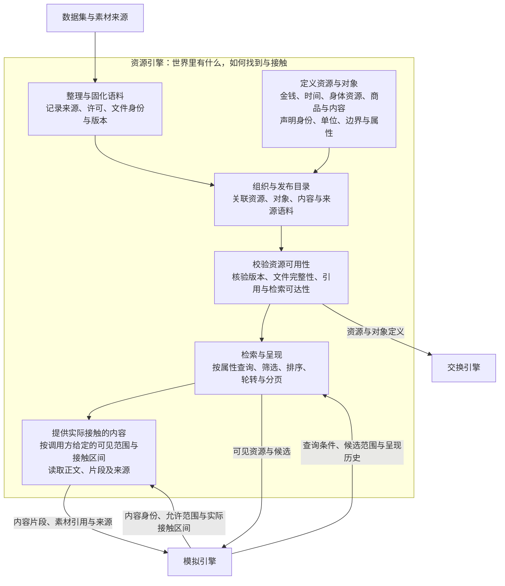
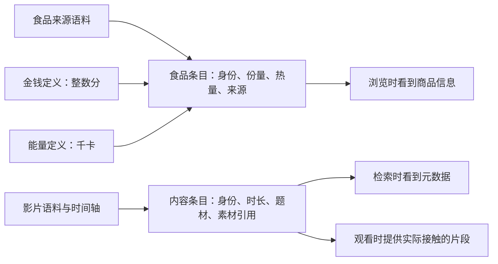
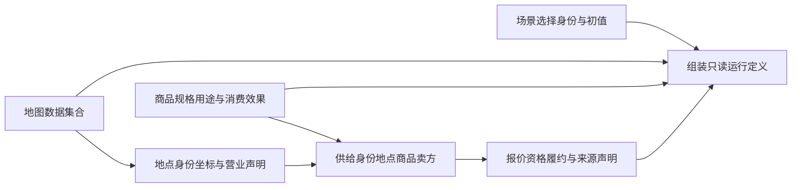
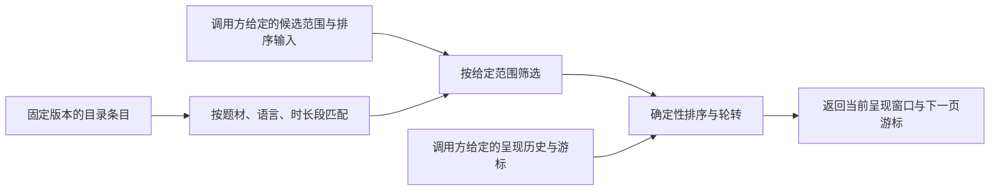
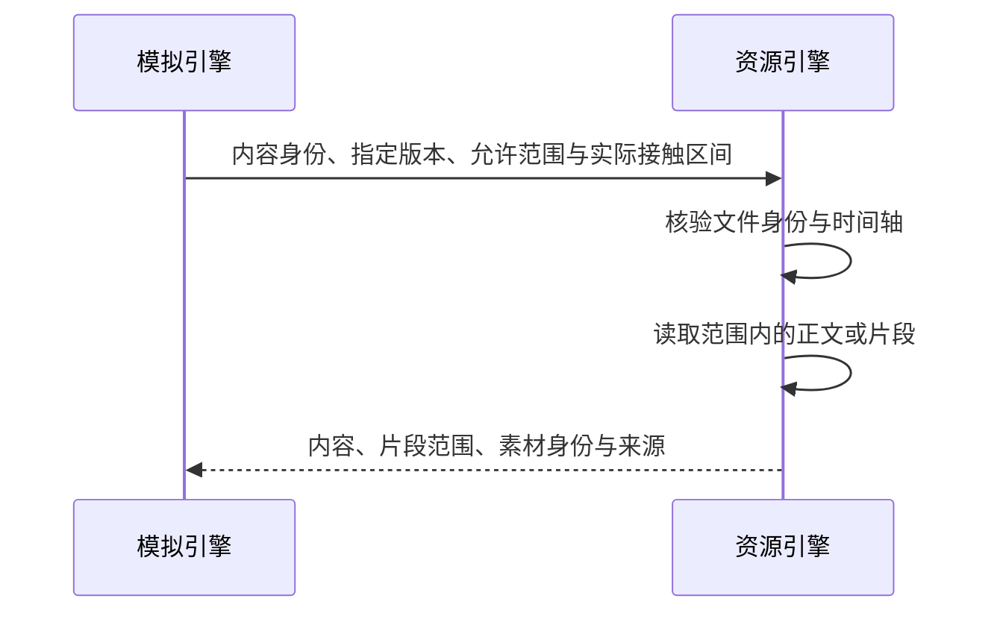

# WorldMock 产品设计说明书 — 资源引擎

> **状态**：DRAFT，整合设计；接口与行为仍以冻结合同和规格为准；按人物 Prompt 规格修订，修订部分已实现（证据见[人物 Prompt 验收记录](../dev/persona-prompt-verification.md)）\
> **日期**：2026-09-28\
> **版本**：v1.6\
> **范围**：资源定义、内容与语料、目录发布、来源校验、检索和提供

资源引擎管理资源定义、对象属性、内容与固化语料，回答“有哪些资源、来自哪里、如何查询和读取”。
它接收明确的版本、查询条件和内容范围，返回定义、条目、内容片段及来源。

接口字段引用[接口合同](../CONTRACTS.md)，行为引用
[运行时规格](../dev/SPEC-life-runtime.md)、[生活真实性规格](../dev/SPEC-life-realism.md)与
[品类契约规格](../dev/SPEC-category-contract.md)。餐馆与音频的本次行为以
[一日行为规格](../dev/SPEC-dayrun-behavior.md)为准。
本文只定义资源数据的准备、发布、校验、查询和读取职责。

## 1. 职责与边界

### 项目框架映射

承接 [overview 的解决方案](00-overview.md#12-解决方案)，只展开资源引擎内部功能，其他引擎作为协作节点：



### 职责约定

资源引擎维护的是固定版本的资源定义、目录与来源语料。查询和读取使用调用方提供的只读输入，
返回结果及来源，不拥有运行中的余额、库存、身体状态、活动进度或人物记忆。
后续正文按图中的六项功能展开，实现差距与验收要求只覆盖这六项功能。

| 协作方 | 资源引擎接收什么 | 资源引擎交付什么 | 对方负责的边界 |
| --- | --- | --- | --- |
| [模拟引擎](04-simulation-engine.md) | 指定版本、查询条件、允许的候选或内容范围、排序输入、呈现历史和实际接触区间 | 匹配条目、呈现窗口、内容片段、来源及素材引用 | 决策编排、活动与身体过程、世界状态更新，以及将实际结果提交给记录引擎 |
| [交换引擎](02-exchange-engine.md) | 资源或对象标识、指定版本与属性查询 | 资源类型、单位、边界、对象属性与关联定义 | 活动条件、投入产出、资源变化和分录规则的判断与计算 |
| [场景配置](08-configuration.md) | 资源和语料版本要求、所需内容品类及引用 | 可加载的资源数据与静态校验结果 | 实例初值、运行参数、资源版本选择与世界初始化 |

资源引擎返回的素材引用供调用方使用；证据落盘、事务、检查点与导出由
[记录引擎](05-recording-engine.md)承载，本文不展开其实现。

职责按处理内容划分，不按代码文件或目录划分。现有 `catalog` 与 `life` 模块包含多个引擎的处理逻辑，
本文只引用其中的资源部分；尚未分开的实现会在对应功能下说明。

## 2. 整理与固化语料

### 整理与固化流程


运行消费已固化的本地语料。外部抓取、清洗和转换在准备阶段完成；
运行中不在线补齐缺失素材，也不让模型编造来源事实。
现有 [prepare_corpora](../../src/worldmock/corpora/fetch.py) 在临时目录整理、生成并校验清单后发布，
拒绝覆盖已存在的目标；它只准备代码中声明的固定素材子集，不能据此重建仓库全部语料。
不同数据集提供不同字段时，先用稳定身份建立关联，再按明确映射组合。
缺少关联依据不能靠名称相似度推断为同一物品；缺失必需字段应在准入阶段暴露。

### 来源分类

目录的来源分类与语料的文件来源是两种记录，分别回答“数值怎么来”和“文件从哪里来”。

| 目录 `provenance.type` | 含义 | 应留下的依据 |
| --- | --- | --- |
| `fact` | 可追溯的来源事实 | 来源文件、字段或公开资料定位 |
| `anchored` | 在来源事实基础上换算或锚定 | 原始锚点、单位换算或变换方法 |
| `assumption` | 仿真使用的假设 | 假设理由与适用边界，不包装成实测事实 |
| `scenario` | 场景明确给定的设定 | 场景来源与相应字段 |

来源记录用 `part` 区分组成部分，并可用 `paths` 定位字段、`artifact` 定位材料、
`method` 记录变换。类型与必填项见[目录模型](../../src/worldmock/catalog/models.py)。
条目属性可以来自不同依据，必须按字段说明；有引用字符串不等于来源文件已归档。

语料的 `source.kind` 是来源种类说明，当前模型不把它限制为上述四种目录分类。
文件来源还包含 `license`、`selector` 及按来源适用的 `url`、`retrieved_at`、`fact_cutoff`。
准入政策要求明确许可和来源，不能把“网上可见”当作许可依据。

### 语料清单与文件身份

[corpora/manifest.json](../../corpora/manifest.json) 的实际结构由
[CorpusManifest](../../src/worldmock/corpora/manifest.py) 定义：

| 层级 | 字段 | 含义 |
| --- | --- | --- |
| 清单 | `schema_version`、`corpus_id`、`created_at`、`transformer_version` | 清单结构、语料身份、带时区的创建时刻、转换版本 |
| 文件集合 | `entries` | 已固化文件的清单 |
| 单个文件 | `entry_id`、`path`、`sha256`、`size_bytes` | 唯一身份、相对路径、完整内容摘要和字节数 |
| 单个文件 | `media_type`、`purpose`、`source` | 文件类型、用途和来源 |

场景通过 `corpus_manifest_sha256` 绑定整份清单，清单再绑定各文件。
加载时的完整性检查见[文件身份校验](#文件身份校验)。

### 语料整理的实现与验收

| 事项 | 当前承载与要求 |
| --- | --- |
| 准备与发布 | [corpora/fetch.py](../../src/worldmock/corpora/fetch.py)负责固定素材子集的准备、校验和发布，不代表能重建仓库全部语料 |
| 清单与来源 | [corpora/manifest.py](../../src/worldmock/corpora/manifest.py)承载文件身份与来源模型 |
| 来源归档差距 | 部分目录来源记录仍标有 `evidence snapshot pending`，不能把来源标签当作证据文件已经归档 |
| 验收 | 核对固定文件、来源、许可与转换依据；用重复身份、路径越界、大小和哈希漂移反例验证清单校验。相关用例见 [tests/corpora](../../tests/corpora) |

清单组织借鉴 [Frictionless Data Package](https://specs.frictionlessdata.io/guides/data-package/)
集中描述文件、来源、许可和结构的方式，继续使用现有模型与清单。

### 地图资料的冻结与许可

地图数据集合固定区域、WGS84、时区、稳定身份、版本、文件哈希以及逐来源时间、许可和通知。
真实地点坐标、路线响应与场景营业/供给假设分别保留来源，不能用一个文件级假设标签覆盖外部事实来源。
运行只读固定资料，不访问在线地点、库存、报价或路由接口。

已核查基线有二百二十份按方式命名的路线响应，其中一百零四份步行响应复用了同端点驾车响应。
文件数量只证明材料存在，不能证明方式正确；发布前须修复或显式标记未知，并核验方式来源。
冻结结果可被重复消费，不意味着公共路由服务日后能重建同一历史路网结果。

许可按具体来源、数据库组合及公开使用方式判定；保留来源与通知是本项目的追溯要求。
产出作品署名不能替代其派生数据库可能承担的义务，也不能用共享条款布尔值判断许可兼容。
准确行业依据见 [可行性核验](../dev/research/map-and-storefront-feasibility.md)。

## 3. 定义资源与对象

### 资源、内容和语料的关系

三者属于同一设计范围，但保存的信息不同。可计量资源保存单位和变化约束；
内容是数字人能够接触的信息；语料是经过整理并固定版本的来源文件集合。
同一个商品可以同时引用资源规则、内容描述与来源语料，不需要复制成三份对象。



### 可计量资源定义

[资源定义模型](../../src/worldmock/catalog/models.py)与
[资源注册表](../../catalog/resources.jsonl)是字段来源。

| 字段 | 含义 |
| --- | --- |
| `resource_id` | 稳定的资源类型标识，区别于某个数字人的状态或账户实例 |
| `kind` | `account` 为账户型，`level` 为存量型 |
| `unit`、`owner` | 计量单位与资源归属声明 |
| `bounds` | 存量型必须声明的取值边界；无上界可显式使用空值 |
| `conservation` | `closed` 要求域内守恒；`open` 允许产生和消耗 |
| `provenance` | 定义与数值字段的来源记录 |
| `version` | 同一资源标识下的条目版本 |

| 资源 | 目录中的定义与属性 |
| --- | --- |
| 金钱 | `money_fen`，账户型，单位为分，封闭域 |
| 可用能量 | `energy_kcal`，存量型，单位为 kcal，声明有效取值范围 |
| 娱乐需要 | `entertainment_need`，存量型，范围为零到一，表示需要程度 |
| 睡眠不足 | 当前目录标识为 `sleep_debt_hours`，单位为小时 |
| 时间 | 当前没有独立资源注册条目，相关对象以明确单位声明时长 |

上述内容定义资源身份与属性。实际资源值由调用方维护。
现有资源条目还携带 `alert_rules`、`drain_rules` 等规则字段，资源引擎负责其结构加载、版本和来源关联；
规则的含义与执行由规则使用方负责，本文不展开阈值触发、身体演化或结算算法。

### 交换对象与内容条目

商品、服务和合同由 [ObjectDeclaration](../../src/worldmock/catalog/models.py) 声明身份、品类、
属性、版本和来源；`ExchangeObject` 是合并品类属性与交换规则后的编译运行视图。
交换条件与投入产出见[交换引擎](02-exchange-engine.md)。
资源引擎负责这些条目的加载、属性查询与来源追踪。交换条件和资源变化声明作为关联规则提供，
其计算语义由交换引擎维护。

内容保留各自需要的结构，不强制所有 `items.json` 使用同一个 Schema：

| 内容 | 资源引擎维护与提供的材料 |
| --- | --- |
| 影片、剧集、网文、新闻与字幕体验 | 条目标识、类别、标题、时长、时间轴与文件身份，以及指定范围内的片段 |
| 游戏 | 固定游戏文件、种子、文件哈希与展示元信息；运行中产生的游戏反馈由模拟侧提供 |
| 工作文档与邮件 | 正文、附件、来源和文件身份，以及调用方允许读取的内容 |
| 食品与其他商品 | 对象标识、规格、份量、热量依据及目录属性；当前报价和持有数量由调用方提供 |
| 生活活动 | 活动素材的标识、名称、品类、典型时长、地点类声明及来源 |
| 地点与路线 | 地点标识、地点类、路线与营业时间声明等素材事实 |
| 官方播客选段 | 节目与音频身份、原始转写锚点、派生段落时间轴、时长和使用条件；播放状态由模拟引擎持有 |

纯商品的运行视图与独立库存物共用 `InventoryItemConfig` 的品类、库存单位和使用语义；门店供给额外提供卖方、报价与可购买性，不能反向修改纯商品。

当前内容引用由 [ContentItemConfig、GameConfig 等场景模型](../../src/worldmock/life/scenario.py)承载，
展示元数据由语料提供。资源引擎检查引用能否解析，不因条目存在而判定活动可以执行。

### 地点、商品与门店供给



地点单值 `kind` 用于交互菜单，`business_kind` 用于经营业态，非空 `location_kinds` 用于活动环境。
品牌是可选属性，缺品牌不影响地点或供给有效。活动环境必须显式声明，不能从名称或业态自动推断。
商品不包含门店、卖方、库存、购买报价或配送处理时长；供给使用独立身份及唯一地点/商品/卖方组合。
供给声明提供初值和有效期，运行库存、当前报价和营业例外仍由模拟引擎持有，资源查询不改状态。
三个正式场景选择的三家餐馆各自声明已有 `prepared-meal` 商品的本店供给，
自提、正库存和报价均在供给中显式给出。门店、商品与数量的联系是场景假设，
不从真实地点名称推断菜单；通用地图可有空菜单，运行时缺货或闭店也不生成替代餐食。

### 冻结地图的准备与发布

本次地图准备读取已有张江地图声明及相邻商品目录，复制已审阅地点、供给及其来源材料，逐条取得声明范围内的道路响应。
地图加载与场景引用按数据集合身份校验；准备命令的现有输入布局见其参数，不把本次地域准备流程扩写为通用地图服务。
成功响应必须同时有完整几何、正距离与时长以及与声明方式相符的实际路段；`NoRoute` 才能证明不可达，
资料未知则保留显式原因。所选有向地点与方式的任何漏项都拒绝发布。


[地图准备入口](../../scripts/prepare_map.py)只在准备阶段联网；验证全部文件和引用后才发布暂存结果，
失败不能覆盖已有发布物。运行模拟仅消费冻结文件。来源结构、许可通知、可信截止日和适用范围须原样保留，
新道路事实保存自身取得时间；供给假设不能随路线重新取得而变成真实零售资料。
地图准备按出行方式解析冻结品类配对，以 `TravelFareRule` 和 `evaluate_travel_fare` 计算费用，
与运行时共享闭集语义，不重新引入文本费率公式。准备器仍负责冻结道路资料，不拥有交换规则。

### 资源定义的实现与验收

| 事项 | 当前承载与要求 |
| --- | --- |
| 类型与字段 | [catalog/models.py](../../src/worldmock/catalog/models.py)定义资源、交换对象、来源和单位约束；场景模型承载实际内容引用 |
| 现有规则字段 | 资源文件同时保存部分规则参数，加载同一文件不意味着资源引擎拥有这些参数的计算语义 |
| 内容结构边界 | 各类内容保留各自的字段与读取路径，不宣称已经存在统一资源类或全部内容共用的数据表 |
| 验收 | 加载真实定义，验证身份、类型、单位、边界与来源；按指定标识和版本查询时返回对应属性。相关用例见 [tests/catalog](../../tests/catalog) |

## 4. 组织与发布目录

新增状态资源、对象或语料时，资源引擎维护定义与素材，交换引擎维护关联的使用条件和投入产出规则。
新增、修改、删除及引用检查的整体流程见[注册表维护设计](02-exchange-engine.md#维护交换规则)。

### 文件职责

本节只列资源定义、来源语料与发布清单。同一存储目录中的其他规则文件由其所属引擎维护。

| 文件或目录 | 保存内容 | 维护入口 |
| --- | --- | --- |
| [catalog/manifest.json](../../catalog/manifest.json) | 主次版本、`category_requirements`、契约版本及契约、规则、目录内容摘要 | 目录生成器与受验证的发布入口 |
| [catalog/resources.jsonl](../../catalog/resources.jsonl) | 可计量资源定义 | 目录生成器 |
| [catalog/objects.jsonl](../../catalog/objects.jsonl) | 身份、品类、属性增量、来源与对象版本；不含内联交换规则 | 目录生成器与构建原语 |
| [catalog/category-contract.json](../../catalog/category-contract.json) | 品类树、槽位、共享值与配对状态 | 品类维护与审核发布 |
| [catalog/exchange-rules.json](../../catalog/exchange-rules.json) | 引用品类的闭集交换规则 | 交换引擎维护与审核发布 |
| [catalog/rules/off-foods.mapping.toml](../../catalog/rules/off-foods.mapping.toml) | 食品来源字段映射 | 人工维护 |
| [corpora/manifest.json](../../corpora/manifest.json) 与 [corpora](../../corpora) | 文件身份、元数据、正文、时间轴及来源证据 | 离线整理与固化 |
| [catalog/overrides/tombstones.jsonl](../../catalog/overrides/tombstones.jsonl) | 目录条目的退役记录 | 当前生成器输出空文件；构建原语支持追加 |

`catalog/manifest.json` 不保存语料文件清单，也没有通用 `defaults` 对象。
`corpora/manifest.json` 不负责定义资源单位、活动规则或闭集交换规则。
资源引擎按调用方指定的两份清单加载数据，不混用版本字段。
内容加载所需的来源映射目前也存放在 [affordances.toml](../../catalog/affordances.toml) 中；
资源引擎只消费相关映射，活动和工具声明的设计仍由交换引擎承载。

### 构建与版本

[目录生成器](../../scripts/build_catalog.py)读取已有固定快照、语料与规则，生成资源、对象、
目录清单和空墓碑文件；不会从当前场景反推定义，也不会覆写人工维护的规则表。

```sh
.venv/bin/python scripts/build_catalog.py --check
```

该检查验证资源和对象数目、静态数值来源覆盖，以及生成结果与在库目录逐字节相同；
不证明场景行为、素材质量或全部运行结果正确。
生成器负责正式数据再现，[目录构建原语](../../src/worldmock/catalog/builder.py)负责对象追加与退役；
`worldmock category check/refine/publish` 提供品类检查、细化影响分析和新目录原子发布。
命令输入和输出见[接口合同](../CONTRACTS.md#cli-命令接口)。

调用方以 `catalog_version.major/minor` 指定目录；条目使用自己的整数 `version`。
当前目录为 `4.1`（与 `catalog/manifest.json` 的 `version_major`、`version_minor` 一致；时间与能量规格阶段 4 改可供性注册表后
升次版本），品类契约和交换规则绑定版本为 `2`；商品已删除门店购买价格与供给库存语义，购买仍编译品类 `RuleEdge`。生活场景结构为 3、地图结构为 2（地点可带分店标签 `branch_label`）、世界状态结构为 8。
这些格式直接拒绝旧输入，不保留旧场景转换脚本，也不能以重建目录代替创建新格式运行。
加载器拒绝同一标识的非递增条目版本，也拒绝新引用使用已退役条目。
已加载的目录视图保持固定。发布物同时绑定版本与内容摘要，加载和运行恢复会核对文件内容；
同版本异内容明确拒绝。
条目退役保留历史定义可查询性。

### 目录发布的实现与验收

| 事项 | 当前承载与要求 |
| --- | --- |
| 生成与检视 | 生成器、构建原语、检视函数与 `worldmock category` 命令分别承载确定性生成、对象维护和品类发布 |
| 增量发布 | 构建原语保留世界素材品类要求与所有清单字段，失败恢复原文件；品类发布在独立暂存目录校验并原子公开新路径 |
| 内容身份 | 绑定资源、对象、契约、交换规则、活动声明与规则文件，身份贯通运行清单、检查点和导出 |
| 验收 | [专项台账](../dev/category-contract-verification.md)记录再生成、版本保留、身份篡改、发布失败与真实场景准入测试 |

目录身份与实际素材位置分离的组织方式参考
[Unity 运行时资源管理](https://docs.unity.com/en-us/engine/6000.7/manual/assets-and-media/assets-managing-runtime/introduction)。
本项目复用已有目录与素材引用，不新增资源管理服务。

## 5. 校验资源可用性

### 文件身份校验

加载时检查清单身份、重复标识与路径，以及每个文件的路径边界、符号链接、大小和哈希。
素材被覆盖、缺失或替换时拒绝加载，不能静默跳过条目。
具体校验入口是 [load_manifest](../../src/worldmock/corpora/manifest.py)。
当前加载器检查清单内文件，不额外遍历根目录拒绝所有清单外文件。

### 准入边界

| 校验对象 | 必须满足的条件 | 证据入口 |
| --- | --- | --- |
| 目录结构 | 字段合法，标识与版本合法，资源单位和边界有定义 | [目录模型与加载器](../../src/worldmock/catalog/loader.py) |
| 消费者引用 | 请求的版本、对象和资源存在，单位声明匹配，关联定义可解析 | [目录准入中的引用检查](../../src/worldmock/catalog/admission.py) |
| 语料身份 | 清单与每个文件的路径、大小和哈希匹配 | [语料加载器](../../src/worldmock/corpora/manifest.py) |
| 世界素材 | 正餐、地点、内容元数据、工作材料、联系人等符合版本化品类要求 | [世界素材准入](../../src/worldmock/catalog/admission.py) |
| 内容可达性 | 检索维度完整，条目至少存在一条可行检索路径 | [检索与可达性](../../src/worldmock/life/retrieval.py) |

具体品类阈值以目录清单和[世界素材规格](../dev/SPEC-life-realism.md)为准。
这里的可用性指资源数据完整、引用有效、存在检索路径；活动此刻能否执行由调用方按交换规则判断。
静态可达性检查可使用调用方提供的地点类等配置，但不据此替代运行时资格判断。

### 地图关系与道路范围准入

选择的地点、商品、供给及账户引用必须完整；同一供给组合不能重复。场景不得复制地点定义或路线。
每个所选有向地点对与 walking/driving 方式都有显式 `reachable/unreachable/unknown` 记录。
成功及已证不可达记录绑定原始响应和哈希；未知记录带来源说明且不可执行出行。漏记录拒绝发布。
报价及营业有效区间不得重叠，核对日期和可信截止日合法且未过期；缺活动环境、错误时区或坐标拒绝发布。

### 准入失败的处理

| 问题 | 处理方式 |
| --- | --- |
| 清单不匹配、文件损坏、路径越界或必需素材缺失 | 完整性错误，拒绝加载并保留错误原因 |
| 非法资源定义、单位或来源引用 | 准入失败，修正输入再运行 |
| 身份存在但必要检索元数据不完整 | 在品类与可达性准入中报告，不能用展示标题代替真实元数据 |

### 资源校验的实现与验收

| 事项 | 当前承载与要求 |
| --- | --- |
| 结构与引用 | 使用 [catalog/loader.py](../../src/worldmock/catalog/loader.py)和 [catalog/admission.py](../../src/worldmock/catalog/admission.py)中的目录结构、资源引用及品类检查；同模块的结算约束和运行初值检查不属于本节 |
| 文件完整性 | [corpora/manifest.py](../../src/worldmock/corpora/manifest.py)核验清单内文件；当前不会额外遍历根目录拒绝所有清单外文件 |
| 静态可达性 | [life/retrieval.py](../../src/worldmock/life/retrieval.py)检查条目是否具有有效检索维度及至少一条可行路径 |
| 验收 | 用版本错配、非法单位、失效引用和损坏素材验证拒绝路径；对合格条目检查至少一条检索路径，不以曝光率作为静态准入判据 |

相关用例见 [tests/catalog](../../tests/catalog)与 [tests/corpora](../../tests/corpora)。

## 6. 检索与呈现

### 从目录到候选

下图表达完整设计流程。当前运行已共用候选、排序与呈现模块，倒排检索与 facet
已有独立实现，但尚未接入运行中的浏览链路，差距见下文“检索呈现的实现与验收”。



检索维度为 `genre`、`language`、`duration_bucket`。题材允许多值，时长使用固定整数秒边界，
桶标签由 [duration_bucket](../../src/worldmock/life/retrieval.py) 生成；地点不作为检索分区键。
调用方区分目录浏览与当前可执行选项，并给出相应候选范围和可见性限制。
资源引擎按这些输入筛选条目，匹配查询与生成呈现窗口；活动受理判断由调用方完成。
排序使用给定的偏好和注意力输入，零偏好不作为删除条目的依据。

同一冻结目录、候选范围、排序输入、查询、游标和呈现历史应得到相同有序结果。
按传入的 `retrieval_index_threshold` 选择线性扫描或确定性倒排索引，两条路径使用相同查询语义。
当前合同采用可枚举的词项与 facet，不使用向量检索或近似最近邻，保证查询结果可复现。

### 轮转与可达性

候选数量受 `candidate_pool_limit` 与 `candidate_presentation_limit` 约束。
资格先于排序：生活活动窗口按人物当前地点施加地点类资格，地点类不符的条目不进窗口，以
`ELIGIBILITY_LOCATION_KIND_MISMATCH` 记为排除项（一日运行保真规格 5.1，裁决 S8）。
排序键为（非零口味，−口味×注意力，−相关度，哈希决胜键）：相关度只取目录时间窗、当日未推进目标的活动家族与人设层习惯签名
（目标取该秒开始时的今日计划，同一秒各轮的呈现窗口不变），
决胜键是场景、人物、本地日期与对象标识的 `sha256`，零偏好时的顺序不是对象标识的字母序，并随日期变化；排序键版本为 2（裁决 S4）。
轮转按检索分区内每个对象的 `last_presented_at`、`rotation_quota_ratio` 与 `rotation_stale_seconds` 工作：
换新名额按上次呈现时刻从早到晚留给该分区内长期未呈现的对象（从未呈现的最先），其余名额按排序键；
不用人物级共享偏移量，也不设分区游标，`⌈N ÷ k⌉` 的上界按分区成立。
本次没有进入窗口的条目仍在目录内，排除原因包含 `ROTATION_DEFERRED`。

轮转只改变呈现窗口，不按点击次数、偏好分或互动次数永久移除对象；它也不限制指名购买，
本轮未呈现但存在的商品仍可由人物按名称购买，解析与结算由模拟引擎组织。
静态可达性只保证“存在一条能找到该条目的路径”；实际曝光还依赖人物到达地点、查询分区
及决策次数，不能宣称每次有限时长运行都会呈现全部素材。
呈现历史由调用方提供；本次窗口、呈现标识和游标作为结果返回，运行状态的更新与保存由调用方负责。
规则依据见[候选与呈现合同](../CONTRACTS.md#候选与呈现合同)。

### 地点发现与供给比较

地点发现返回匹配地点，公园等没有供给的地点仍可发现；购买比较按 `supply_id` 区分，保留 `product_id` 引用。
道路范围按冻结路线和分时系数判断，直线距离只可用于粗筛；已知超范围、不可达和未知分别解释。
关闭、售罄或缺品牌不删除地点身份。无结果与未知条件不能混为不存在。
购买排序、分页、轮转、排除统计与可见凭据按供给身份，持有和使用按商品身份。
展示与比较以实际呈现为界，不能借浏览一次展示整份商品目录；可见凭据只管展示与比较，按名称购买本轮未呈现的商品不需要它。
按名调用推广到全部目录类对象（[一日运行保真规格](../dev/SPEC-dayrun-fidelity.md#31-统一名称解析) 3.1）：名称先精确匹配，再按统一
名称解析无损归一后唯一即受理，本轮未呈现的生活活动、内容与游戏同样可以写名称，受理时照常做资格与准入判定。指名购买按
「<门店>出售的<商品>」或商品名（同一归一口径）找满足所选方式的唯一供给；找不到时给出的至多 3 个候选跨类别使用确定性词项相似度
（单字加二字的 Dice 系数）排名，此刻可行的在前（商品为能按所选方式送到），写成可以照填的请求 `{target, action, way, from, to}`，
从不替换人物写的名称；同样遵守上文不使用向量检索或近似最近邻的约定；相同输入必须有相同结果及顺序。
发现查询的登记及后轮反馈由模拟引擎组织，实际返回结果由记录引擎保存。

### 无结果与范围限制

| 情况 | 处理方式 |
| --- | --- |
| 当前查询无匹配项 | 返回真实空结果和可用查询信息，不编造条目补齐 |
| 条目不在调用方给定的候选或可见范围内 | 不纳入本次结果，保留相应筛选依据；不自行作出活动拒绝，也不删除目录条目 |

交互菜单是模拟引擎的入口准入约束，不是资源候选的世界事实排除条件。资源引擎仍返回完整候选、排除
证据与目录事实；菜单可以让模拟引擎撤下某个下钻入口或启动资格，但不能让资源引擎删除条目、改写排除
原因计数或缩小 `affordance_contract`。活动类型名称引用现有可供性注册表的 `kinds`；注册表 `surface`
不构成全部生活工具名清单。边界见[交互菜单规格](../dev/SPEC-interaction-menu.md)。

### 检索呈现的实现与验收

| 事项 | 当前承载与要求 |
| --- | --- |
| 检索与可达性 | [life/retrieval.py](../../src/worldmock/life/retrieval.py)已有倒排索引、查询和 facet 纯函数 |
| 候选与呈现 | [presentation.py](../../src/worldmock/life/presentation.py)与 [rotation.py](../../src/worldmock/life/rotation.py)承载排序、窗口和轮转 |
| 职责分离差距 | 当前 `presentation.present` 调用 `candidates.recall`，候选链仍包含运行资格判断；设计上资源引擎只消费调用方确定的范围，现有代码尚未完全分开 |
| 运行接入差距 | `presentation.present` 与生活浏览动作尚未调用倒排检索链路，当前浏览结果不能宣称已提供 facet 返回体 |
| 验收 | 相同目录与只读查询输入应产生相同结果；索引与扫描结果一致，轮转不改目录、长期未呈现对象不被永久排除。相关用例见 [tests/life](../../tests/life) |

## 7. 提供实际接触的内容

### 按指定范围提供内容

调用方给定内容身份、版本或哈希、允许读取的范围，以及已经确认的实际接触区间。
资源引擎核验文件身份，读取相应正文或时间轴片段，返回内容与来源。
权限和接触区间由调用方确定，资源引擎在读取时执行给定的范围限制。



一般字幕取给定区间与时间轴相交的片段；NASA 播客选段按官方段落锚点读取，
只有真实媒体位置完整跨过该段的下一锚点才揭示段落文字。暂停、倍速和恢复使用同一媒体位置，
不按字数推算逐词时刻。文档或邮件正文按给定的读取范围返回。
当前查询只需要元数据时，不返回完整正文。游戏素材与既有文本可以读取，运行中产生的游戏反馈由调用方提供。

### 返回内容与来源

| 返回信息 | 资源引擎保证 |
| --- | --- |
| 条目身份与内容版本 | 与请求的固定资源相对应 |
| 正文或内容片段 | 来自已核验的来源文件，符合给定的可见范围与接触区间 |
| 素材身份与来源 | 提供可定位来源的版本、哈希或已有素材引用，保留相应来源信息 |
| 片段范围与媒体类型 | 如实说明提供的内容范围和模态，字幕不标成视频帧或音轨 |

返回内容表示本次提供了哪些材料。它不自行推进活动、更新续看位置或写入人物知识；
实际交付与状态提交由调用方完成。

### 内容读取失败

实际读取时再次发现文件缺失、路径非法、大小或哈希漂移，应拒绝该次读取并保留错误原因。
不能用占位正文、跳过片段或编造结果替代缺失内容；未提供的内容也不能计为已接触。

### 内容提供的实现与验收

| 事项 | 当前承载与要求 |
| --- | --- |
| 内容与时间轴 | [life/content.py](../../src/worldmock/life/content.py)承载固定语料、字幕时间轴和邮件正文的读取 |
| 职责分离差距 | 当前 `reveal_watch` 与 `reveal_mail` 同时处理内容和人物阅读状态，`reveal_watch` 还改写活动中的揭示位置；资源读取与运行状态更新尚未完全分开 |
| 验收 | 指定身份、版本和范围时返回对应片段与来源；范围外内容不泄露，缺失或损坏素材明确失败；资源接口自身不推进活动或提交运行状态。相关用例见 [tests/life](../../tests/life) |

## 版本历史

| 版本 | 日期 | 修订内容 |
| --- | --- | --- |
| v1.3 | 2026-09-25 | 同步版本事实：世界状态结构改为 7（时间与能量规格第九章）；生活场景结构保持 3 |
| v1.4 | 2026-09-25 | 同步版本事实：时间与能量规格阶段 4 改可供性注册表（删 `energy_projection`、按第五章重列占用），当前目录升为 `4.1` |
| v1.5 | 2026-09-27 | 同步人物 Prompt 七层规格（人物 Prompt 台账 E3-1–E3-3）：文件头注明修订部分待实现；轮转不限制指名购买；地点发现与供给比较按指名购买改写，可见凭据只管展示与比较，近似候选用确定性词项相似度，遵守不使用向量检索与近似最近邻的约定；版本事实同步世界状态结构 8（`catalog_version` 不变） |
| v1.6 | 2026-09-28 | 人物 Prompt 七层规格实现后文档：文件头注明修订部分已实现，链接人物 Prompt 验收记录；正文不变 |
