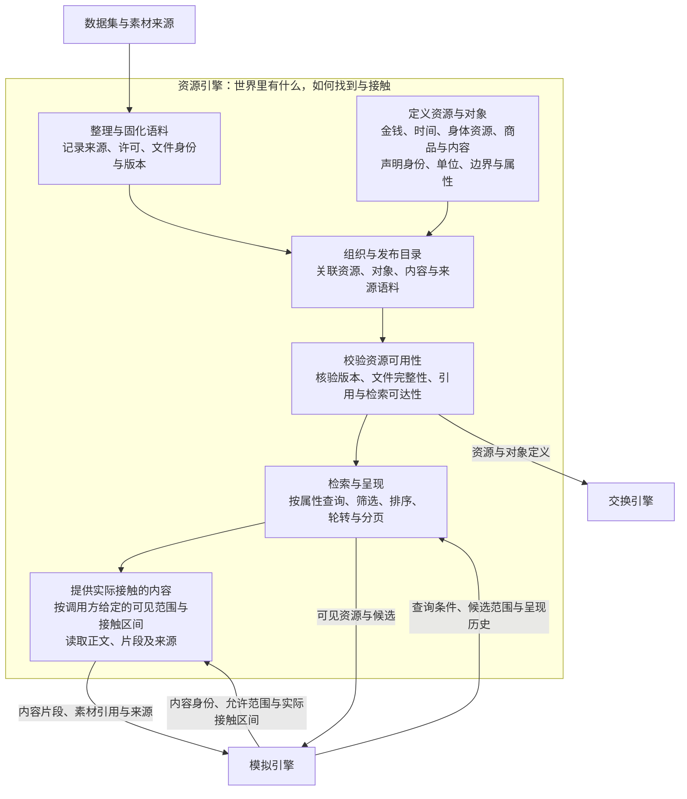
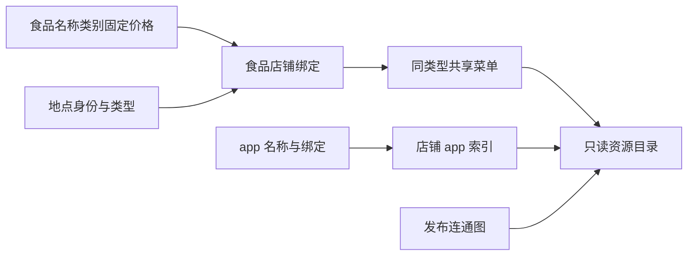
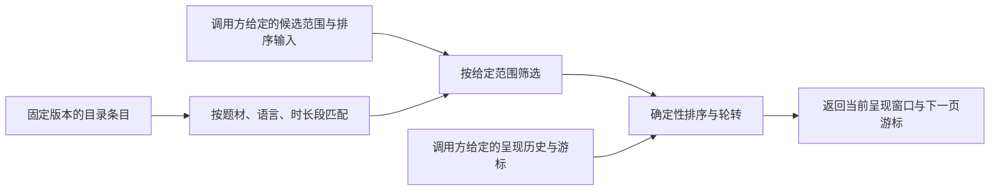
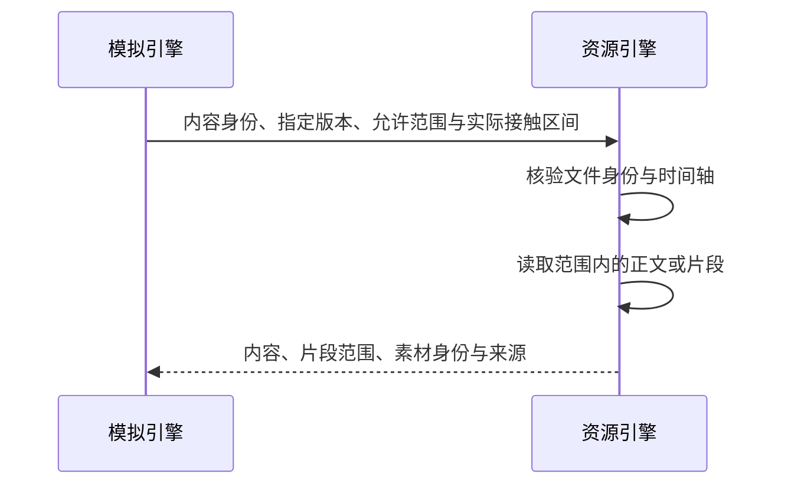

# WorldMock 产品设计说明书 — 资源引擎

> 按[资源与规则引擎简化规格](../dev/SPEC-resource-and-rule-simplification.md#spec-rrs-资源与规则引擎简化开发规格)修订「可计量资源定义、交换对象与内容条目、资源、内容和语料的关系、文件职责、构建与版本、文件身份校验、准入边界、语料清单与文件身份、组织与发布目录、目录发布的实现与验收、职责约定、准入失败的处理、资源校验的实现与验收、基础类型与资源装配」（阶段 1）；「随机地图的冻结」、「随机地图的生成与发布」、「图与地点关系准入」（阶段 2）；「地点、商品与门店供给、地点发现与供给比较、检索呈现的实现与验收、无结果与范围限制」（阶段 3）。

> **状态**：DRAFT，整合设计；接口与行为仍以冻结合同和规格为准；按人物 Prompt 规格修订，修订部分已实现（证据见[人物 Prompt 验收记录](../archive/persona-prompt/persona-prompt-verification.md)）；按一日运行保真规格同步（一日运行保真 RS1），已实现\
> **日期**：2026-10-07
> **版本**：v1.16\
> **工具交互修订**：类别完整供给、冻结价格范围及真实食材配方设计已冻结，已实现；本次生产验收单独记录；以[工具交互规格](../dev/SPEC-life-runtime.md#tool-interaction-工具请求)为本次合同。
> **个人事务与工作安排修订**：按[个人事务与工作安排规格](../dev/SPEC-as2-integration.md#errands-workday-运行修复入库)分阶段同步（[实施计划](../archive/errands-workday/errands-workday-implementation-plan.md) D3 作业），已实现（离线验收，证据见[个人事务与工作安排验收记录](../archive/errands-workday/errands-workday-verification.md)）；该规格阶段 1 不改本文。
> **同时做两件事修订**：按[同时做两件事规格](../dev/SPEC-parallel-activities.md#spec-parallel-activities-同时做两件事开发规格)修订「构建与版本」的可供性占用声明（阶段 2）。
> **范围**：目录登记、严格校验、只读对象与派生索引查询

资源引擎登记并校验环境对象、绑定与图，回答“这个世界有什么，如何按实际绑定查询”。
它提供冻结对象与派生索引；资源定义和规则常数归交换引擎。

接口字段引用[接口合同](../CONTRACTS.md#contracts-worldmock-接口合同)，行为引用
[运行时规格](../dev/SPEC-life-runtime.md#spec-life-runtime-特性规格lifeenv-运行时行为与结算规则)、[生活真实性规格](../dev/SPEC-life-realism.md#spec-life-realism-特性规格人物决策与画像)与
[资源与规则引擎简化规格](../dev/SPEC-resource-and-rule-simplification.md#spec-rrs-资源与规则引擎简化开发规格)。具体活动行为以
[一日行为规格](../dev/SPEC-dayrun-behavior.md#spec-dayrun-behavior-一日行为可信性特性开发规格)为准。
本文定义环境目录登记、校验和只读查询职责；具体世界的数据准备归 Dataset。

具体环境及制作工具按[环境数据归属规格](../dev/SPEC-environment-data-ownership.md)归 WorldMock-Dataset，
正式重制环境路径由 WorldMock-Dataset 发布决定；WorldMock 提供引擎及包内固定通用规则。
本章的 `catalog/`、`corpora/`、`scenarios/` 指外部环境目录，命令以 WorldMock 为当前工作目录并显式传路径。
当前场景结构 7，内容标题来自 `contents.json`，活动效果随环境加载并在启动时冻结；新组合放行另核对实际收据。

## 共享规则与可重建环境修订

按[共享规则与可重建环境规格](../dev/SPEC-shared-rules-and-rebuildable-env.md)修订；验收结果独立记录。

语料文件只接受根内安全相对路径：拒绝绝对路径（含 Windows 上无盘符的根路径）、任何 .. 组件、反斜杠、任一平台不能原样保存的名字（以点或空格结尾、Windows 设备名、禁用字符与数据流冒号、控制字符、孤立代理码点、一级超过 255 字节），以及符号链接、目录联接与非普通文件。曲线输入和输出必须是有限非负数且拒绝布尔值，效率资源名必须含非空白字符；生活与目录读取同一模型。目录发布与品类身份统一以字节原子写入。

## 1. 职责与边界

### 项目框架映射

承接 [overview 的解决方案](00-overview.md#overview-解决方案)，只展开资源引擎内部功能，其他引擎作为协作节点：

### 职责约定

目录的登记、校验与只读查询归 `worldmock.catalog`，资源定义和公式归 `worldmock.exchange`。`Catalog` 提供对象映射与非图索引 `menus_by_kind/foods_by_store/stores_by_app/contents_by_app/apps_by_store`；活动环境从固定地点类型派生。图查询在阶段 2 加入，不声明占位方法。

## 2. 整理与固化语料

### 整理与固化流程

运行消费已固化的本地语料。外部抓取、清洗和转换在准备阶段完成；
运行中不在线补齐缺失素材，也不让模型编造来源事实。
采集、清洗、转换和正式语料发布由 Dataset 制作工具负责；WorldMock 不提供来源准备器。
引擎用实际清单核验文件和引用，不能用摘要正确代替来源与重建验收。
不同数据集提供不同字段时，先用稳定身份建立关联，再按明确映射组合。
缺少关联依据不能靠名称相似度推断为同一物品；缺失必需字段应在准入阶段暴露。

### 来源分类

目录的来源分类与语料的文件来源是两种记录，分别回答“数值怎么来”和“文件从哪里来”。

| 目录 `provenance.type` | 含义 | 应留下的依据 |
| --- | --- | --- |
| `fact` | 可追溯的来源事实 | 来源文件、字段或公开资料定位 |
| `anchored` | 在来源事实基础上换算或锚定 | 原始锚点、单位换算或变换方法 |
| `assumption` | 仿真使用的假设 | 假设理由与适用边界，不包装成实测事实 |
| `scenario` | 场景明确给定的设定 | 场景来源与相应字段 |

来源记录用 `part` 区分组成部分，并可用 `paths` 定位字段、`artifact` 定位材料、
`method` 记录变换。类型与必填项见[目录模型](../../src/worldmock/catalog/models.py)。
条目属性可以来自不同依据，必须按字段说明；有引用字符串不等于来源文件已归档。

语料的 `source.kind` 是来源种类说明，当前模型不把它限制为上述四种目录分类。
文件来源还包含 `license`、`selector` 及按来源适用的 `url`、`retrieved_at`、`fact_cutoff`。
准入政策要求明确许可和来源，不能把“网上可见”当作许可依据。

### 语料清单与文件身份

`corpora/manifest.json` 保持既有格式，绑定生活活动以及 Dataset 的联系人、邮件语料原始字节。`contents.json` 已由目录身份绑定，不再将字幕、音轨或游戏纳入内容呈现。
`worldmock validate --environment ROOT` 同时校验语料清单与目录清单，真实加载所有场景并核对三份包 TOML。

### 语料整理的实现与验收

| 事项 | 当前承载与要求 |
| --- | --- |
| 准备与发布 | Dataset 制作工具负责来源整理、构建和发布；正式来源、数量与可复现重建在数据仓验收 |
| 清单与来源 | [corpora/manifest.py](../../src/worldmock/corpora/manifest.py)承载文件身份与来源模型 |
| 来源归档差距 | 部分目录来源记录仍标有 `evidence snapshot pending`，不能把来源标签当作证据文件已经归档 |
| 验收 | 核对固定文件、来源、许可与转换依据；用重复身份、路径越界、大小和哈希漂移反例验证清单校验。相关用例见 [tests/corpora](../../tests/corpora) |

清单组织借鉴 [Frictionless Data Package](https://specs.frictionlessdata.io/guides/data-package/)
集中描述文件、来源、许可和结构的方式，继续使用现有模型与清单。

### 随机地图的冻结

地图是合成的连通加权无向图，使用全目录地点身份，不包含真实道路、坐标、路线响应、许可或道路范围。
地点名称与分店标签保持具体环境的真实名称语义，数值明确属于模拟假设；正式对象与发布材料由 Dataset 维护。
图字节纳入目录身份，运行只读固定图，不访问在线路由、库存或报价接口。

## 3. 定义资源与对象

### 资源、内容和语料的关系

`catalog/` 登记对象、绑定、图与清单。`corpora/` 保留生活活动、联系人和邮件语料及既有 manifest；内容摘要直接位于 `contents.json`，真实摘要必须有 URL，合成摘要必须有 notice。
真实 app、作品与主题名称，真实或合成摘要，以及合成数值分别保留来源语义，不把合成摘要当作真实内容接触。

### 可计量资源定义

能量、资金、时间和库存的单位、范围及身体常数由 `worldmock.exchange` 定义。资源引擎不从环境加载资源定义，不维护 `resources.jsonl`。环境只提供食品价格、内容时长、主题目标小时与实际对象绑定；运行状态由模拟引擎和记录引擎维护。

### 交换对象与内容条目

目录对象是 app、地点、食品、内容和工作主题。食品只有身份、名称、类别、统一价格与店铺绑定；内容有标题、类型、摘要、来源说明、时长与 app 绑定；工作主题有身份、主题与目标小时。
没有通用对象增量、品类继承、墓碑、配方、字幕、音轨、游戏轨迹或工作材料。生活活动条目仍使用独立语料合同。

### 地点、商品与门店供给

食品在 `foods.json` 定义 `food_id`、名称、`category`、固定 `price_fen` 与店铺绑定。类别只有 `snack`、`drink`、`meal`，同一食品全店同价，同类型食品店铺菜单完全相同。
`store_ids="all"` 只展开到食品店铺类型，住宅不出售食品；目录一次派生 `foods_by_store` 与店铺 app 索引。没有报价、价位、抖动、库存、营业或资格。

地点只声明 `kind`，活动环境由固定类型环境表派生。食品目录和 app 绑定只读；模拟引擎只保存实际订单与食品持有，不保存店铺库存、报价、营业或配方。真实名称、合成价格与边长在输入来源中分别说明。

### 随机地图的生成与发布

Dataset 编写地点后调用 WorldMock 地图生成器。同一地点集合与种子在不同机器上产生相同规范 JSON 与 LF 字节，发布图包括全目录地点，场景选择不裁切图。

`worldmock environment generate-map --locations PATH --seed INT --output PATH` 生成规范图；`--check` 不写文件，逐字节比对，失配报 `MAP_NOT_REGENERATED`。`worldmock validate --environment ROOT` 同时校验登记、图、语料清单、三份 TOML 字节和全部场景。
发布失败不能覆盖已发布身份；内容变化须发布新的环境版本。生成器不持有运行状态，出行费用和配送常数由 WorldMock 固定规则拥有。

### 资源定义的实现与验收

| 事项 | 当前承载与要求 |
| --- | --- |
| 类型与字段 | [catalog/models.py](../../src/worldmock/catalog/models.py)定义资源、交换对象、来源和单位约束；场景模型承载实际内容引用 |
| 现有规则字段 | 资源文件同时保存部分规则参数，加载同一文件不意味着资源引擎拥有这些参数的计算语义 |
| 内容结构边界 | 各类内容保留各自的字段与读取路径，不宣称已经存在统一资源类或全部内容共用的数据表 |
| 验收 | 加载真实定义，验证身份、类型、单位、边界与来源；按指定标识和版本查询时返回对应属性。相关用例见 [tests/catalog](../../tests/catalog) |

## 4. 组织与发布目录

发布环境的 `catalog/`、`corpora/`、`scenarios/` 并列。目录清单精确绑定必需文件，身份刷新通过既有 `footprints.assets.atomic_write` 原子写入，不新增构建器、发布配置或兼容读层。发布后的环境作为不可变输入使用。

### 文件职责

七份目录 JSON 为 `manifest.json`、`apps.json`、`locations.json`、`foods.json`、`contents.json`、`work_topics.json`、`map.json`。清单精确绑定其余六份 JSON 和三份包 TOML；完整字段与全部登记码见[环境目录文件](../CONTRACTS.md#contracts-环境目录文件)。
`loader.load_catalog` 只负责安全读取、严格解析和调用 `catalog.admission` 唯一登记器；`Catalog` 冻结对象与派生索引，调用方不能修改。

### 构建与版本

Dataset 编写具体世界对象与绑定，调用 WorldMock 地图生成器发布图，最后刷新目录清单。`format_version = 1`、地图结构 1、`RULES_VERSION = 1` 分别明确校验，环境身份和版本为非空字符串。
目录内容更新发布新的环境版本，并更新场景 `environment` 钉；旧运行与历史输入不重写。规则变化在 WorldMock 唯一定义处实现并升 `RULES_VERSION`。

### 目录发布的实现与验收

`catalog.identity.refresh_manifest_identity` 安全读取实际文件，重算文件表与框架化目录摘要，经 `atomic_write` 写出规范 LF 清单。地图由 `worldmock environment generate-map` 发布；`--check` 只比较字节。
验收核对清单身份、原子发布失败保持旧目标，以及 `worldmock validate --environment` 的真实成功和逐类失败，不用声明摘要替代实际文件。

## 5. 校验资源可用性

### 文件身份校验

清单 `files` 精确列出六份目录 JSON 与三份包 TOML 的相对路径、SHA-256 与字节数，`catalog_content_sha256` 对该文件表作框架化摘要。根内读取拒绝绝对路径、父引用、链接和非普通文件。
多余文件报 `ENVIRONMENT_STALE_FILE`，缺必需项报 `ENVIRONMENT_FILE_UNLISTED`，字节或摘要不符报 `ENVIRONMENT_IDENTITY_MISMATCH`。规则版本与场景环境钉另行核对，不能只靠版本名放行不同字节。

### 准入边界

`catalog.admission` 是唯一登记校验器。目录加载、环境 CLI 与数据仓检查都复用它；严格模型拒绝未知字段，跨对象绑定、同类菜单、内容 app、图连通性与场景引用在准入时检查。
`RegistrationError` 继承 `IntegrityError`，带稳定码与英文原因。目录通过不代表完整引擎已消费；实际图查询在阶段 2 接入。

### 图与地点关系准入

| 校验 | 失败行为 |
| --- | --- |
| 节点至少两个 | `MAP_TOO_SMALL` |
| 节点与地点集合相等且排序；边无自环、重复或未知端点，`a < b`，边长正整数、边排序 | `MAP_EDGE_INVALID` |
| 图连通 | `MAP_DISCONNECTED` |
| 生成检查和环境校验重生成字节一致 | `MAP_NOT_REGENERATED` |

登记加载只验证发布图结构，不重生成。场景地点必须存在于目录，最短路可经过未选择地点；不存在道路范围、许可或未知路线准入。
对象与绑定继续由统一目录登记验证，同类型食品店铺菜单一致，`"all"` 不展开到住宅，店铺 app 绑定只允许食品店铺。错误输出稳定码、英文原因和所属路径。
项目 `validate` 的覆盖率 0.8 门禁保留，输入覆盖不足不转成运行期默认内容。

### 准入失败的处理

登记失败返回 `RegistrationError.code` 和稳定英文原因，日志记录同一实际错误；调用方不能补齐未知绑定、忽略额外文件、沿用旧身份或退回另一世界。完整错误表见[环境目录文件](../CONTRACTS.md#contracts-环境目录文件)。

### 资源校验的实现与验收

真实环境加载与 `validate --environment` 共用唯一登记器。行为反例覆盖未知引用、非法闭集与数值、食品绑定、内容来源、app 名冲突、图格式连通性、场景环境钉、卖方账户和工作安排；每条失败都给出规范稳定码。
地点活动环境由 `PLACE_KIND_ENVIRONMENTS` 派生，条目保留自己的 `location_kinds`。完整运行行为随所属阶段闭合。

## 6. 检索与呈现

### 从目录到候选

下图表达完整设计流程。当前运行已共用候选、排序与呈现模块，倒排检索与 facet
已有独立实现，但尚未接入运行中的浏览链路，差距见下文“检索呈现的实现与验收”。

检索维度为 `genre`、`language`、`duration_bucket`。题材允许多值，时长使用固定整数秒边界，
桶标签由 [duration_bucket](../../src/worldmock/life/retrieval.py) 生成；地点不作为检索分区键。
调用方区分目录浏览与当前可执行选项，并给出相应候选范围和可见性限制。
资源引擎按这些输入筛选条目，匹配查询与生成呈现窗口；活动受理判断由调用方完成。
排序使用给定的偏好和注意力输入，零偏好不作为删除条目的依据。

同一冻结目录、候选范围、排序输入、查询、游标和呈现历史应得到相同有序结果。
按传入的 `retrieval_index_threshold` 选择线性扫描或确定性倒排索引，两条路径使用相同查询语义。
当前合同采用可枚举的词项与 facet，不使用向量检索或近似最近邻，保证查询结果可复现。

### 轮转与可达性

候选数量受 `candidate_pool_limit` 与 `candidate_presentation_limit` 约束。
资格先于排序：生活活动窗口按人物当前地点施加地点类资格，地点类不符的条目不进窗口，以
`ELIGIBILITY_LOCATION_KIND_MISMATCH` 记为排除项（一日运行保真规格 5.1，裁决 S8）。
排序键为（非零口味，−口味×注意力，−相关度，哈希决胜键）：相关度只取目录时间窗、当日未推进目标的活动家族与人设层习惯签名
（目标取该秒开始时的今日计划，同一秒各轮的呈现窗口不变），
决胜键是场景、人物、本地日期与对象标识的 `sha256`，零偏好时的顺序不是对象标识的字母序，并随日期变化；排序键版本为 2（裁决 S4）。
轮转按检索分区内每个对象的 `last_presented_at`、`rotation_quota_ratio` 与 `rotation_stale_seconds` 工作：
换新名额按上次呈现时刻从早到晚留给该分区内长期未呈现的对象（从未呈现的最先），其余名额按排序键；
不用人物级共享偏移量，也不设分区游标，`⌈N ÷ k⌉` 的上界按分区成立。
本次没有进入窗口的条目仍在目录内，排除原因包含 `ROTATION_DEFERRED`。

呈现窗口之外，工具层另附只列名称的可调用索引 `callable_index`（[一日运行保真规格](../dev/SPEC-interaction-menu.md#dayrun-fidelity-呈现与浏览-只列名称的可调用索引) 5.2，
裁决 S5），工具层因此是 `{layer, targets, callable_index}`。索引恰好四键：`lifestyle` 列出生活活动窗口资格段保留的全部名称（呈现项与
`ROTATION_DEFERRED` 项，不带「活动：」前缀），即此地此刻可做的条目，地点类不符等被资格段排除的不在其中；`contents` 与 `goods` 按品类给
`{category, count, examples}`：内容取内容与游戏两个窗口资格段保留、有标题的条目（游戏会话与可玩游戏同为「游戏」），商品取此刻从这里
能得到的（门店开着、报价已知、有货、人物有资格且购买规则已定义，并且到店时门店就在这里、或远程下单能送到这里）。
`query_categories` 列出 `query_world` 的 `category` 可写的公开品类标签与各自的条目数 `{category, count}`，取本轮查询权限内的完整条目，
不按呈现窗口截断；`query_world` 的 `from`、`available_only` 筛选不改变这一计数口径。`contents`、`goods` 的计数是可以写的名称
个数（同名只计一次），写成「N 个」；示例至多 3 个（商品写商品名，不带门店），先取本轮没有列为目标的，与另一件内容或游戏同名的不作示例，
示例与 `lifestyle` 的顺序都用同一哈希决胜键。有效菜单不许做生活活动、观看（可玩游戏为游玩）或买东西时，对应部分为空。
索引不是候选条目：不计入 `candidate_presentation_limit`，不写 `last_presented_at`，也不影响轮转；它在 user 消息里，计入整次请求的
容量计数。它让人物知道本轮没有呈现、但可以按名调用的名称，写在索引里的名称按下文的按名调用解析，受理时照常做资格与准入判定。

轮转只改变呈现窗口，不按点击次数、偏好分或互动次数永久移除对象；它也不限制指名购买，
本轮未呈现但存在的商品仍可由人物按名称购买，解析与结算由模拟引擎组织。
静态可达性只保证“存在一条能找到该条目的路径”；实际曝光还依赖人物到达地点、查询分区
及决策次数，不能宣称每次有限时长运行都会呈现全部素材。
呈现历史由调用方提供；本次窗口、呈现标识和游标作为结果返回，运行状态的更新与保存由调用方负责。
规则依据见[候选与呈现合同](../CONTRACTS.md#contracts-候选与呈现合同)。

### 地点发现与供给比较

`from` 只接受 `null`、登记店铺显示名或 `apps.json` 的 app 名，来源与购买共用同一名称解析；`null` 不额外限制，食品完整标签仍约束标签店铺。
到店必须人在店内，`app_id=null`；app 配到店以 `SUPPLY_SOURCE_MISMATCH` 拒绝。远程下单要求店铺绑定 app；没有任何 app 是 `FULFILLMENT_NOT_SUPPORTED`，所点 app 未绑定该店是 `APP_NOT_BOUND`，app 的店不卖该食品是 `SUPPLY_NOT_AT_STORE`。
`from=null` 且店铺绑定多个 app 时取最小 `app_id`，写进 `details.notes`。app 来源从目录绑定派生，不读取手机配置。

`query_world(name, way, category, from, available_only, offset)` 六键必填，来源解析为目录店铺或 app，返回固定菜单的紧凑 `{matches, total_count, next_offset}`。
商品价格固定，类别标签来自食品类别；`available_only` 只按人在店内或店铺绑定 app 判断，不检查报价、营业、库存、配送区域或可见凭据。查询不揭示新世界事实、不推进时间、不占名额，只保存实际模型与 tool 交换证据。
查询与世界请求不得混批，先整批校验，再按原执行位置返回；有效交互菜单、同秒预算、名称纠错与只读权限保持原合同。

发现按图最短距离，食品比较按固定单价、每单配送费与图上预计取得时间；购买条目身份 `<store_id>:<food_id>`，消费与多样性按食品身份。没有浏览揭示或可见凭据，提示未列出仍可按名购买；错误候选给完整可填写工具调用，不自动替换食品。

### 无结果与范围限制

| 情况 | 处理方式 |
| --- | --- |
| 当前查询无匹配项 | 返回真实空结果和可用查询信息，不编造条目补齐 |
| 条目不在调用方给定的候选或读取范围内 | 不纳入本次结果，保留相应筛选依据；不自行作出活动拒绝，也不删除目录食品 |

交互菜单是模拟引擎的入口准入约束，不是资源候选的世界事实排除条件。资源引擎仍返回完整候选、排除
证据与目录事实；菜单可以让模拟引擎撤下某个下钻入口或启动资格，但不能让资源引擎删除条目、改写排除
原因计数或缩小 `affordance_contract`。活动类型名称引用现有可供性注册表的 `kinds`；注册表 `surface`
不构成全部生活工具名清单。边界见[交互菜单规格](../dev/SPEC-interaction-menu.md#spec-interaction-menu-特性规格交互菜单)。

合法店铺或 app 来源没有匹配食品时返回真实空页，不切换来源；地点比较只用图距离与到手价，不从无结果推断缺货或闭店。

### 检索呈现的实现与验收

商品、生活活动与任务保留生成、资格、排序、轮转管线；商品候选 `kind="product"` 的 `object_id="<store_id>:<food_id>"`，持有按食品身份。不同店铺条目不合并。
商品目标来自当前店铺菜单和可外卖食品；app 名称始终列出。世界事实判断地点、在场、资源占用和时长，没有库存、下架、口味、报价或营业筛选。
画像和 `tastes` 只以散文进入人设层，不生成权重，不改变候选数值排序；内容娱乐消费者的迁移由所属 app 阶段完成。

| 事项 | 承载与要求 |
| --- | --- |
| 固定菜单 | 目录食品绑定一次派生同类型菜单与店铺 app 索引，读取不改世界状态 |
| 查询与呈现 | 冻结观察的名称、来源与类别筛选；稳定顺序、完整分页与实际曝光轮转分别留证 |
| 比较 | 图最短距离、完整路径与到手价，数据来源不可伪装成真实价格和路网 |
| 验收 | 同输入同结果，分页无重无漏，固定菜单食品按名可调用，app 名称全部列出；娱乐管线的退役由其所属阶段验证 |

## 7. 提供实际接触的内容

### 按指定范围提供内容

调用方给定内容身份、版本或哈希、允许读取的范围，以及已经确认的实际接触区间。
资源引擎核验文件身份，读取相应正文或时间轴片段，返回内容与来源。
权限和接触区间由调用方确定，资源引擎在读取时执行给定的范围限制。

一般字幕取给定区间与时间轴相交的片段；NASA 播客选段按官方段落锚点读取，
只有真实媒体位置完整跨过该段的下一锚点才揭示段落文字。暂停、倍速和恢复使用同一媒体位置，
不按字数推算逐词时刻。文档或邮件正文按给定的读取范围返回。
当前查询只需要元数据时，不返回完整正文。游戏素材与既有文本可以读取，运行中产生的游戏反馈由调用方提供。

### 返回内容与来源

| 返回信息 | 资源引擎保证 |
| --- | --- |
| 条目身份与内容版本 | 与请求的固定资源相对应 |
| 正文或内容片段 | 来自已核验的来源文件，符合给定的可见范围与接触区间 |
| 素材身份与来源 | 提供可定位来源的版本、哈希或已有素材引用，保留相应来源信息 |
| 片段范围与媒体类型 | 如实说明提供的内容范围和模态，字幕不标成视频帧或音轨 |

返回内容表示本次提供了哪些材料。它不自行推进活动、更新续看位置或写入人物知识；
实际交付与状态提交由调用方完成。

### 内容读取失败

实际读取时再次发现文件缺失、路径非法、大小或哈希漂移，应拒绝该次读取并保留错误原因。
不能用占位正文、跳过片段或编造结果替代缺失内容；未提供的内容也不能计为已接触。

### 内容提供的实现与验收

| 事项 | 当前承载与要求 |
| --- | --- |
| 内容与时间轴 | [life/content.py](../../src/worldmock/life/content.py)承载固定语料、字幕时间轴和邮件正文的读取 |
| 职责分离差距 | 当前 `reveal_watch` 与 `reveal_mail` 同时处理内容和人物阅读状态，`reveal_watch` 还改写活动中的揭示位置；资源读取与运行状态更新尚未完全分开 |
| 验收 | 指定身份、版本和范围时返回对应片段与来源；范围外内容不泄露，缺失或损坏素材明确失败；资源接口自身不推进活动或提交运行状态。相关用例见 [tests/life](../../tests/life) |

## 基础类型与资源装配

资源引擎登记并校验七份环境目录，提供冻结的对象与派生索引，不拥有资源定义、交换公式或规则维护流程。正式世界来源和制作归 Dataset，WorldMock 维护固定类型、登记合同和通用运行行为。历史原文与运行证据按原始字节保留。

## 版本历史

| 版本 | 日期 | 修订内容 |
| --- | --- | --- |
| v1.3 | 2026-09-25 | 同步版本事实：世界状态结构改为 7（时间与能量规格第九章）；生活场景结构保持 3 |
| v1.4 | 2026-09-25 | 同步版本事实：时间与能量规格阶段 4 改可供性注册表（删 `energy_projection`、按第五章重列占用），当前目录升为 `4.1` |
| v1.5 | 2026-09-27 | 同步人物 Prompt 七层规格（人物 Prompt 台账 E3-1–E3-3）：文件头注明修订部分待实现；轮转不限制指名购买；地点发现与供给比较按指名购买改写，可见凭据只管展示与比较，近似候选用确定性词项相似度，遵守不使用向量检索与近似最近邻的约定；版本事实同步世界状态结构 8（`catalog_version` 不变） |
| v1.6 | 2026-09-28 | 人物 Prompt 七层规格实现后文档：文件头注明修订部分已实现，链接人物 Prompt 验收记录；正文不变 |
| v1.7 | 2026-09-29 | 按[一日运行保真规格](../dev/SPEC-life-runtime.md#dayrun-fidelity-身体与需要)同步（一日运行保真 RS1，随阶段 1、3、4 的代码落地，按 `e377669` 核对）：版本事实改为地图结构 2（地点可带 `branch_label`）；「轮转与可达性」生活活动窗口先施加地点类资格（不符的记 `ELIGIBILITY_LOCATION_KIND_MISMATCH`），排序键加相关度（目录时间窗、当日未推进目标的活动家族、习惯签名）与场景、人物、日期、对象的 `sha256` 决胜，排序键版本 2，轮转按分区内每个对象的 `last_presented_at` 留换新名额、不用人物级共享偏移量与分区游标、`⌈N ÷ k⌉` 按分区；工具层另附只列名称的可调用索引 `callable_index`（`lifestyle` 为资格段保留的生活活动名称，`contents`、`goods` 按品类给「N 个」与至多 3 个示例，不是候选、不计入呈现上限、不写 `last_presented_at`，计入整次请求的容量计数，其中的名称可以按名调用），实现与验收表补 `callable_index.py` 与 5.2 的验收点；「地点发现与供给比较」按名调用推广到全部目录类对象与没有列出路线的地点，无损归一后唯一即受理，候选（商品取全部供给，其余名称跨类别）用确定性词项相似度、从不替换，指名购买按分段匹配 M0–M3 各报其码（`from` 为 null 跳过 M1，渠道称呼去掉空白、不分大小写比较，方式「购买」跳过 M2 并在 M3 定到店或远程下单），多家都能服务时按 `prefer` 选定并写进 `details.notes`；文件头补修订说明，日期改写 |
| v1.8 | 2026-10-01 | 工具交互设计冻结并已实现：按已有地点类别完整分配品类对象、种子确定性范围内门店报价、有来源的单食材包做饭链与正式数据集行为门禁；独立供给和运行警告边界保留 |
| v1.9 | 2026-10-03 | 同步个人事务与工作安排规格阶段 2（实施计划 D3-01、D3-02、D3-06，按 `d09d574` 的代码核对）：版本事实改为世界状态结构 9（人物状态增未完成的个人事务），目录 `5.3`、绑定版本 `3`、场景结构 `4`、地图结构 `3` 与对象、商品、供给数目不变；文件头增修订行，日期改写；版本表改为末行最新（原插在表首的 v1.8 行移到 v1.7 之后，行内容不改） |
| v1.10 | 2026-10-03 | 同步个人事务与工作安排规格阶段 4（实施计划 D3-04、D3-05、D3-06、D3-11）：`query_world` 改六键，来源筛选与购买同一解析，可执行筛选归模拟引擎，筛选先于切页、`total_count` 为筛选后总数，结果不附候选，除两种参数错误外无匹配为空页；可调用索引更正为四键并写明 `query_categories`（筛选不改变其计数口径）；指名购买来源的写法更正为地点显示名；每页大小改写为取场景参数；文件头修订行改为已落地阶段 2 与阶段 4（阶段 4 与阶段 2 并行开发，在阶段 2 之后并入） |
| v1.11 | 2026-10-03 | 同步个人事务与工作安排规格阶段 3（实施计划 D3-03）：版本事实改为生活场景结构 5（人物配置增必填可空的 `work_schedule`；目录保持 5.3），世界状态结构照阶段 2 为 9；文件头修订行改为已落地阶段 2–4（阶段 3 在自己的分支上开发，在阶段 2、4 之后并入） |
| v1.12 | 2026-10-04 | 个人事务与工作安排规格实现后文档（实施计划 D3-10）：文件头修订行注明已实现并链接个人事务与工作安排验收记录（证据为离线测试，规格阶段 6 的配对全天复跑未执行）；正文不变 |
| 环境数据归属 | 2026-10-05 | 按环境数据归属规格同步双仓职责、包内通用规则与显式环境路径；场景结构 6、必填标题和冻结活动效果按正文说明，最终验收另记实际收据 |
| `2026-10-05-layering-and-test-tiers` | 2026-10-05 | 当前职责对象与依赖方向、五项行为正文归属、固定历史来源和稳定引用；业务与持久合同保持不变 |
| 共享规则与可重建环境 | 2026-10-05 | 同步规则归属、源码重建与验收合同；目录按可供性声明注释的字节身份发布 5.4，业务数值与品类契约、规则绑定版本不变，历史发布记录保留原版本 |
| `2026-10-06-windows-path-safety` | 2026-10-06 | 语料路径一句补 Windows 下的声明规则：无盘符的根路径算绝对路径，反斜杠与任一平台不能原样保存的名字一并拒绝，目录联接与符号链接同样拒绝；版本表去掉隔开末两行的空行 |
| `2026-10-06-parallel-activities-claims` | 2026-10-06 | 按[同时做两件事规格](../dev/SPEC-parallel-activities.md#spec-parallel-activities-同时做两件事开发规格)阶段 2 同步：「构建与版本」补可供性占用声明在包资源 `src/worldmock/data/affordances.toml` 中重列，字节由 `tool_schema_sha256` 绑定，测试环境副本逐字节同步并刷新目录内容摘要，仍带旧占用名副本的外部发布环境在装配时被拒绝、要由 WorldMock-Dataset 按新占用名重新发布；品类契约与规则绑定 3、场景结构 6、地图结构 3、世界结构 9 不变；文件头增该规格修订行，版本升为 v1.15；版本表去掉隔开末三行的空行 |
| `2026-10-06-rrs-rules` | 2026-10-07 | 阶段 1：固定规则与 RULES_VERSION、七份环境目录、真实环境命令和五字段运行身份；旧品类合同归档，后续消费者按阶段闭合 |
| `2026-10-06-rrs-map` | 2026-10-07 | 随机连通加权图、最短距离出行与环境恢复身份；对应正文按资源与规则引擎简化规格地图阶段修订 |
| `2026-10-06-rrs-store` | 2026-10-07 | 食品、店铺 app 来源、固定价格与单订单结算；类别消费、六个输入警告和目录覆盖率，删除本阶段退役正文 |
