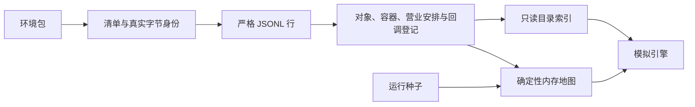

# WorldMock 产品设计说明书 — 资源引擎

## 职责与边界

资源引擎读取环境包中的发布目录，校验身份、字段、容器绑定和回调声明，建立只读索引与内存地图。
人物和运行配置由环境加载器读取；资源引擎不读取语料、保存活动进度、执行回调或修改资金。

## 环境目录文件

环境根目录只允许 `catalog/`、`persona.toml`、`config.toml`。`catalog/` 只允许以下文件。
包外条目直接拒绝，不遍历包外目录或符号链接；实际读取也拒绝链接和越界路径。

| 文件 | 登记内容 |
| --- | --- |
| `manifest.json` | `format_version: 3`、环境身份和版本、`rules_version: 3`、五个 JSONL 的路径、摘要和字节数，以及 `catalog_content_sha256` |
| `app-catalog.jsonl` | app 身份、名称、角色，以及功能动作或纯目录浏览时长 |
| `location.jsonl` | 全部实际地点、显示名、自由类型、内容 app、住宿和驿站资格、营业安排 |
| `merchant-catalog.jsonl` | 商品身份、名称、四类商品、固定价格、地点类型或内容 app 绑定 |
| `content-catalog.jsonl` | 内容身份、标题、时长、体力消耗、推送资格、心理缓解档位、摘要与容器 |
| `callbacks.jsonl` | 状态声明和触发规则，允许零字节 |

没有 `map.json`、目录动作、地点实例数量、环境规则副本、脚本或运输时长。
未知字段不忽略、不翻译；旧格式直接拒绝。

## JSONL 行读取与环境包边界

JSONL 按真实 UTF-8 字节和 LF 逐行解析。零字节表示零行；末尾 LF 后的空串不算一行，最后一行可以没有 LF。
每行恰好包含一个 JSON 对象。空行、全空白、BOM、非法 UTF-8、多值、跨行对象、数组、标量和非 JSON 数值拒绝。
任意 CR 使用 `ENVIRONMENT_KIND_INVALID`，详情保留 `Catalog JSON must use LF line endings.`；
其他行解析失败使用 `ENVIRONMENT_LINE_INVALID`。行失败详情均以 `<目录相对路径>:<行号>` 开头。
模型未知字段优先使用种类错误，再按实际字段判断数值错误。行内空白和键序不规范化，身份按实际字节计算。

清单原始对象中的 `rules_version` 若为严格整数，先比较当前规则版本，再解析严格清单模型。
不匹配直接报 `RULES_VERSION_MISMATCH`；字符串、布尔、缺失版本和非法清单形状报 `ENVIRONMENT_KIND_INVALID`。

## 注册校验与错误

`catalog.admission` 是唯一对象登记校验器。`load_catalog(catalog_dir, seed)` 和
`validate_catalog_files(catalog_dir)` 共用文件读取与登记阶段；纯校验不需要种子、不生成地图。
失败抛带稳定 `code` 的 `RegistrationError`，英文原因只维护在 `catalog.errors`，异常均记录英文日志。
`validate_environment_entries` 独立检查两层包闭集，使人物、配置和目录能够各自报告输入错误。

身份行和引用列表按身份字符串升序且无重复；名称比较经 `channel_key` 去全部空白并忽略大小写。
app、地点显示名、商品名分别在所属文件唯一。app 名不得与任何地点显示名相同；
人物实际可见的地点、商品、内容 app 名称唯一性由环境加载器检查，内容标题不参与名称解析。

| 拒绝码 | 登记边界 |
| --- | --- |
| `ENVIRONMENT_STALE_FILE` | 环境根、目录或清单存在闭集外条目，详情指出实际路径 |
| `ENVIRONMENT_FILE_UNLISTED` | 清单缺少必需 JSONL |
| `ENVIRONMENT_IDENTITY_MISMATCH` | 安全文件边界失败，或实际文件表、字节摘要和清单不一致 |
| `ENVIRONMENT_ID_DUPLICATE` | 身份、名称或引用列表重复 |
| `ENVIRONMENT_REF_UNKNOWN` | app、商品等对象引用未登记 |
| `ENVIRONMENT_KIND_INVALID` | 未知字段、非法闭集值、坏字符串或布尔、未排序列表、非法营业安排 |
| `ENVIRONMENT_NUMBER_INVALID` | 严格整数类型或范围不符 |
| `HOME_LOCATION_REQUIRED` | 没有显式住宿地点，或人物住处未解析到住宿地点 |
| `PARCEL_STATION_REQUIRED` | app 侧商品需要驿站但未登记，或驿站类型没有地点内容 |
| `APP_ROLE_BINDING_INVALID` | 内容 app 声明动作，或地点、商品、内容、提醒引用功能 app |
| `APP_UNBOUND` | 内容 app 没有有效内容来源，或功能 app 没有具体动作 |
| `APP_NAME_COLLIDES_LOCATION` | app 名与地点显示名碰撞 |
| `GOODS_BINDING_MISSING`、`GOODS_BINDING_SIDE_EXCLUSIVE`、`GOODS_BINDING_DANGLING` | 商品容器缺失、两侧同时绑定、类型没有实际地点 |
| `CONTENT_CONTAINER_MISSING`、`CONTENT_CONTAINER_SIDE_EXCLUSIVE`、`CONTENT_BINDING_DANGLING` | 内容容器缺失、两侧同时绑定、类型没有实际地点 |
| `CONTENT_SERIES_INVALID` | 同系列容器不同或集号重复 |
| `CONTENT_SUMMARY_TOO_LONG`、`CONTENT_SOURCE_URL_MISSING` | 摘要超过 200 字符或真实来源缺少 URL |
| `CALLBACK_STATE_UNREGISTERED`、`CALLBACK_FOOTPRINT_EMPTY`、`CALLBACK_NOTIFY_MISMATCH` | 回调状态未知、足迹为空、提醒与效果不配对 |
| `MAP_TOO_SMALL`、`MAP_EDGE_INVALID`、`MAP_DISCONNECTED` | 内存地图节点不足、边非法或不连通 |

## 地点与营业安排

每行声明一个实际地点，必填 `location_id`、`name`、`kind`、`app_ids`。`kind` 是非空白严格字符串，
与商品 `store_kinds`、内容 `location_kinds` 逐字符相等匹配，不按名称归一或旧类型推断资格。
可选 `branch_label` 缺省为 null；显示名为名称，或「名称（分店标签）」。同名分店必须提供不同标签。
可选严格布尔 `is_home`、`accepts_parcels` 缺省 false，资格只按标记判断。
目录至少有一个住宿地点；驿站类型必须有地点内容。全部地点参与供给、名称检查、出行和寻路。

`opens` 缺省表示全天营业；显式声明必须是对象，不能是 null。
完整形状为 `{weekly: {mon..sun: [[HH:MM, HH:MM], ...]}, exceptions: {YYYY-MM-DD: [...]}}`。
`weekly` 必填，`exceptions` 可省略；缺失星期关闭，特殊日期完全替换该日每周时段，空数组表示关闭。
时段按开始时间升序、不重叠、使用半开区间；`24:00` 只作为结束，跨午夜拆到两日。
地点的 `is_open` 接收已换算到运行时区的本地时刻，购买和互动资格由模拟引擎调用。

## 加权连通图与路线

地图节点恰为全部登记地点，至少两个。既有 NetworkX 生成随机标号树，再加入 `floor((n-1)/2)` 条树外边，
边长按排序后的边在 200–2000 米内抽取。无向端点规范为 `a < b`，不允许自环或重复，图必须连通。
使用运行种子先派生 `sha256("random:{seed}")`，再从独立 `map` 随机流取 64 位地图种子。
相同地点集合和运行种子得到相同规范图和 `map_sha256`；地图只在内存维护，不发布文件。
`Graph` 保留确定性最短路。住处最近驿站先比较最短距离，同距取较小地点身份。
出行方式、天气、时长和车费见[模拟引擎](04-simulation-engine.md)。

## 环境发布身份

清单文件表恰为五个 JSONL 的真实路径、字节数和 SHA-256，按路径排序。
目录摘要按每个相对路径、NUL、八字节大端内容长度和实际内容分帧；
最后加入移除 `catalog_content_sha256` 且使用真实文件表的规范清单。
行内空白、是否有末尾 LF 和键序都影响实际文件身份。目录摘要不包含地图或引擎规则副本。
运行身份包含环境标识、版本、规则版本、目录摘要和运行种子生成的地图摘要。

## 目录发布

`refresh_manifest_identity` 安全读取实际 JSONL，重算文件表和框架化摘要，经原子写入发布 LF 清单。
文件或原子写入失败使用稳定身份错误；失败不替换旧清单。环境校验读取真实输入，不用声明摘要代替实际文件。

## app、内容与候选呈现

app 必填 `app_id`、`name`、`role`。功能 app 必须声明非空 `actions`，只可绑定
`walk`、`drive`、`take_taxi`、`take_bus`、`purchase`；内容 app 不得携带 `actions`，即使空数组也拒绝。
只有内容 app 可以被地点、商品、内容、阈值提醒引用。功能 app 的自动选择和足迹由模拟引擎处理。

内容 app 至少承载一条显式内容，或供应 app 侧商品，或由实际供应商品的地点绑定。
没有显式内容的纯目录 app 必须提供严格整数 `browse_duration_seconds >= 60`；
有显式内容的 app 和功能 app 不得声明浏览时长。纯目录浏览不伪造内容身份或标题。

内容必填身份、标题、`exertion`、`pushable`、`relaxation_relief`、`social_relief`、摘要、来源和时长。
体力消耗档为 `idle`、`light`、`moderate`、`heavy`；两个心理缓解档独立取 `none`、`low`、`medium`、`high`，
固定每小时缓解量为 0、0.1、0.3、0.5，由身体结算按实际消费时间应用。
`pushable` 是严格布尔，时长是至少 60 秒的严格整数，摘要至多 200 字符。
来源完整形状为 `{kind, url, notice}`，真实来源必须有非空 URL。

内容恰有 `app_ids` 或 `location_kinds` 一侧非空，可以绑定多个同侧容器。
可选 `series` 为 null 或 `{title, episode}`；系列按标题识别，各集容器必须完全相同，正整数集号不得重复。
目录提供按集号排序的系列索引；推荐、进度、连续消费和恢复由模拟引擎处理，不由推送资格决定。
候选投影见[人物的候选与呈现](06-agent.md)。

## 地点供给和价格

商品必填 `goods_id`、`name`、`category`、严格正整数 `price_fen`。
类别只有 `snack`、`meal`、`drink`、`goods`；价格全店同价，无库存、供给上限或动态报价。
`store_kinds` 与 `app_ids` 缺省空数组，恰有一侧非空。地点侧展开到全部逐字匹配地点；
app 侧只出现在 app 商品索引，不虚构店铺。任何类别都可绑定任何实际地点类型。
商品实际收货效果和履约见[模拟引擎](04-simulation-engine.md)。

### 按类型共享供给

相同类型的地点自然共享商品集合，使用 `goods_by_store`；app 侧使用 `goods_by_app`。
`stores_by_app`、`apps_by_store` 记录实际容器绑定，不维护另一份类型菜单或场景地点子集。

### 固定价格与配送费

目录只登记商品固定单价；外卖和快递费用、组合订单、报价选择、付款与收货归模拟引擎。
购买收款方为 `external:scenario`，目录不声明商家账户或资金账户标签。

## 声明式回调

状态行恰为 `{state, initial, cap, reset_on_goods}`，初值和上限为严格整数，`0 <= initial <= cap`。
商品重置列表可为空，引用实际商品。状态行在前按状态名升序，规则行在后按规则身份升序。
规则恰为 `{rule_id, trigger, effect}`，仅可额外声明 `notify`。状态和规则分别唯一。

| 对象 | 完整形状 |
| --- | --- |
| 动作触发 | `{class: action, key: 七个具体动作之一}` |
| 时间触发 | `{class: time, key: hourly / daily / run_start / run_stop}`；月度为 `{class: time, key: monthly, day, time}` |
| 状态触发 | `{class: state, key: 登记状态名, below: 阈值}` |
| 事件触发 | `{class: event, key}`，仅合格预排事件或静态唤醒类别 |
| 状态增量 | `{type: state_delta, state, delta}`，可选 `once_per: local_day`；增量为非零严格整数 |
| 足迹链 | `{type: footprint_chain, steps}`，非空步骤恰为 `{kind: browse / payment, app_pool, pick: random}` |
| 转账 | `{type: transfer, direction: income / expense, amount_fen: 严格正整数}` |
| 可见提示 | `{visible: 严格布尔}`，只配足迹链 |
| 状态提醒 | `{when: {state, below}, channel: app_push, app_id, text}`，只配状态增量；必须引用内容 app |

状态和提醒阈值是 `1..cap` 的严格整数。月度日号是 `1..31`，时刻为规范有效的 `HH:MM`。
足迹 app 池非空且按身份升序无重复，允许功能 app；不存在空值候选。
事件键为 `delivery_arrival`、`app_push`、`calendar_flag`、`weather`，或
`time_boundary`、`duty_boundary`、`reminder_due`、`event_arrival`、`state_change`、`outcome_feedback`。
退役事件、可执行字段、账户字段、未知效果和非法提醒形状直接拒绝。
转账只在人物账户与 `external:scenario` 之间按方向执行，求值、余额不足、系统证据和提醒投递归模拟引擎。

## 验证边界

目录单元测试消费真实五个 JSONL 和清单，核对字节身份、严格行定位、对象引用与错误优先级，
并验证全量供给索引、内容系列、营业安排、回调登记和运行种子地图。
环境加载再检查人物名称与冻结身份；动作、交易、实际消费、回调效果和恢复由对应集成及系统测试证明。
