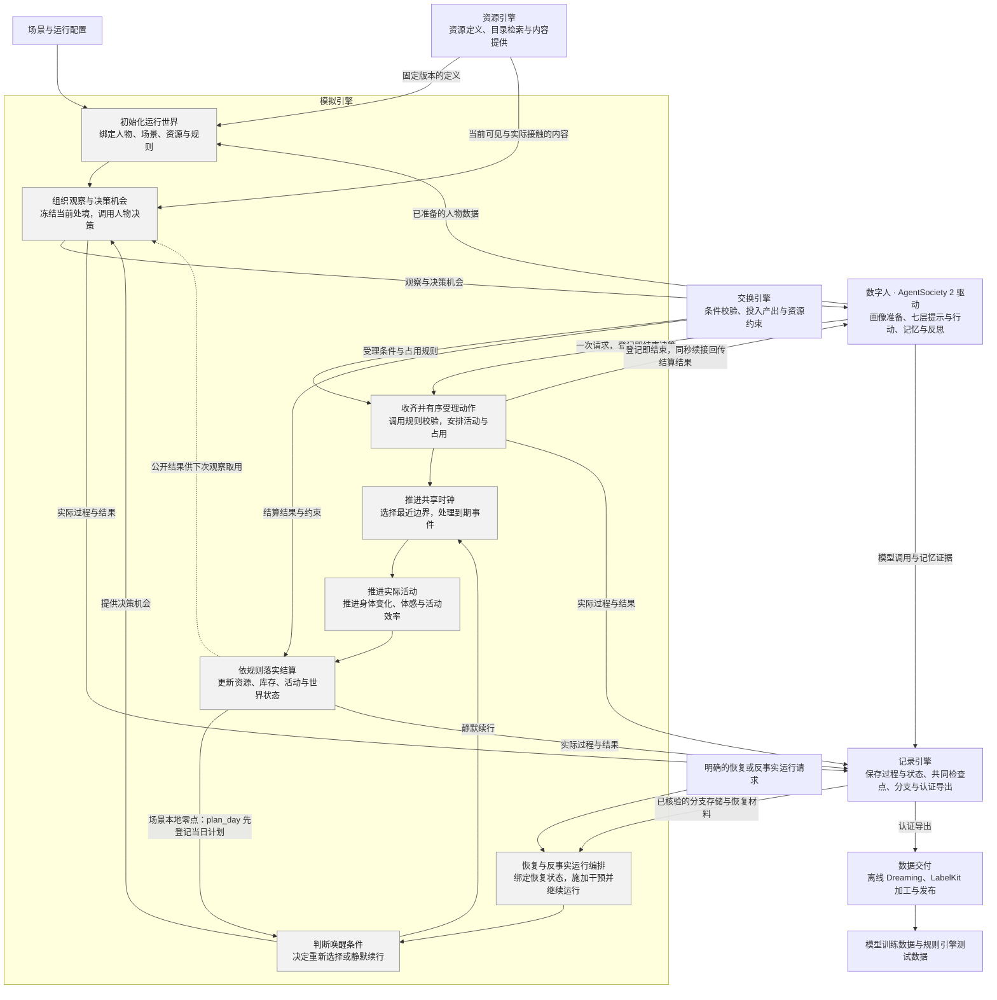
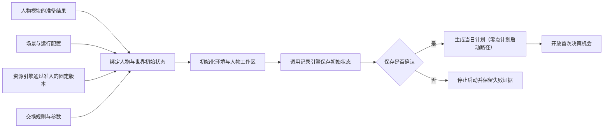
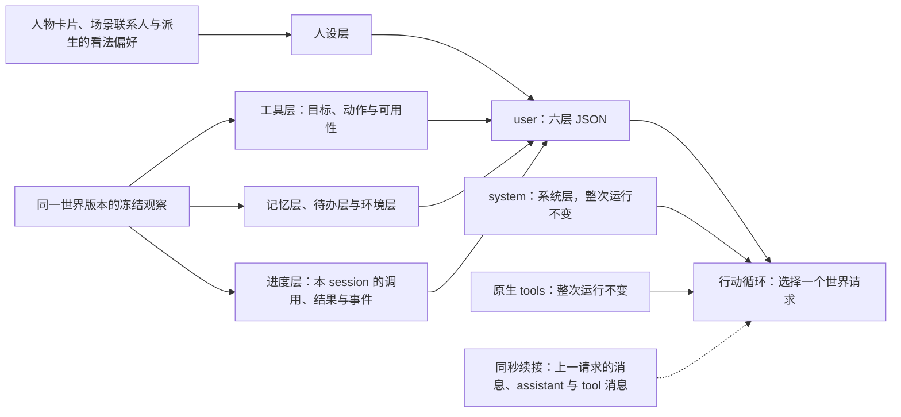
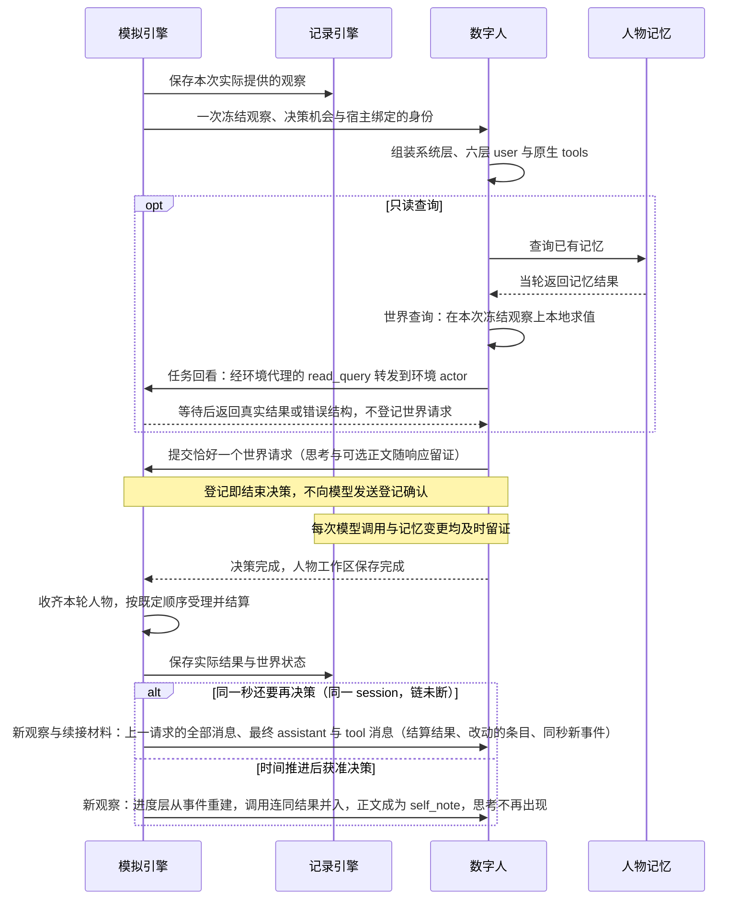
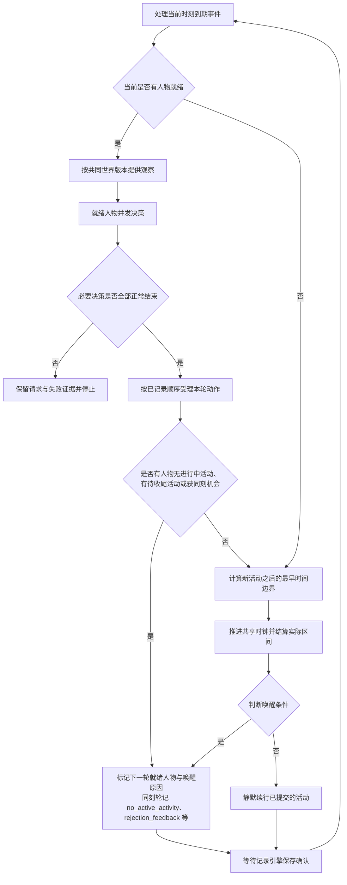
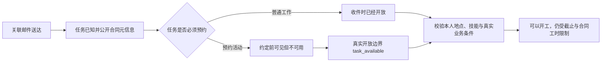
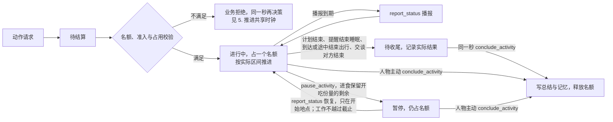
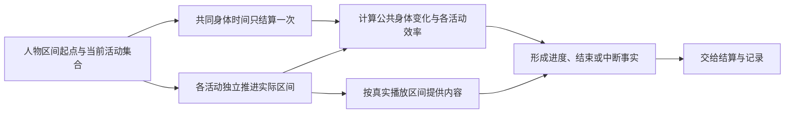
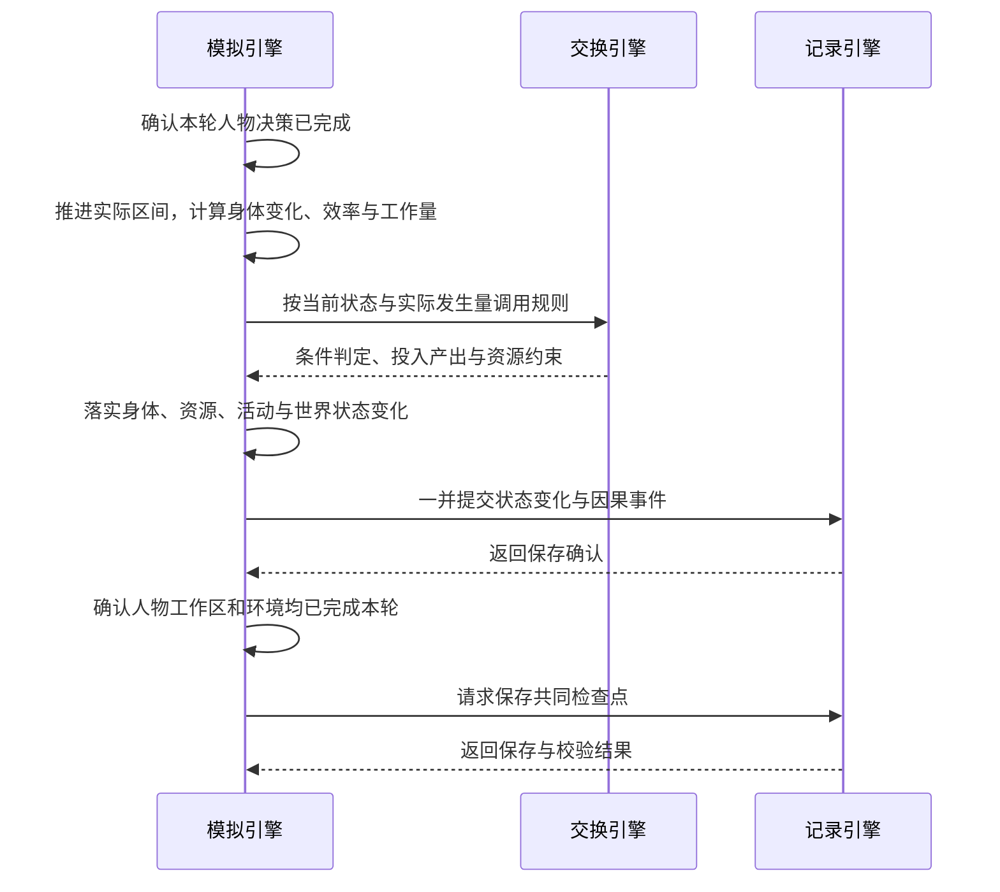
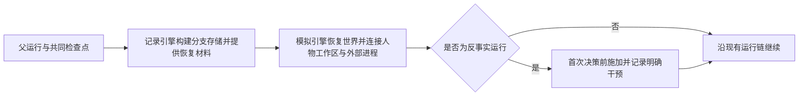

# WorldMock 产品设计说明书 — 模拟引擎

> **状态**：DRAFT；职责设计，现行接口与行为仍以冻结合同和规格为准；按人物 Prompt 规格修订，修订部分已实现（证据见[人物 Prompt 验收记录](../dev/persona-prompt-verification.md)）；按一日运行保真规格同步（一日运行保真 SE1–SE8），已实现  
> **工具交互修订**：按[工具交互规格](../dev/SPEC-tool-interaction.md)冻结本次设计；本次修订已实现，既有验收不覆盖新行为。
> **个人事务与工作安排修订**：按[个人事务与工作安排规格](../dev/SPEC-errands-workday.md)分阶段同步（[实施计划](../dev/research/errands-workday-implementation-plan.md) D4 作业），已实现（离线验收，证据见[个人事务与工作安排验收记录](../dev/errands-workday-verification.md)）。
> **日期**：2026-10-05
> **版本**：v1.18
> **范围**：运行初始化、观察与决策机会、七层人物提示、同刻决策、同秒续接、动作受理、活动名额与生命周期、共享时钟、活动推进、结算、零点计划、个人事务与事务提醒、上班安排、唤醒与恢复编排

模拟引擎负责让数字人在同一个世界中实际生活：在合适的时刻提供观察与决策机会，
推进已接受的活动，调用规则并落实状态变化。本文按引擎内部功能展开；
其他模块只说明交互关系，详细设计由所属模块维护。

## 共享规则与可重建环境修订

按[共享规则与可重建环境规格](../dev/SPEC-shared-rules-and-rebuildable-env.md)修订；验收结果独立记录。

活动清单、按名动作与实际受理读取同一时长推导；逐项改变世界状态后仍重新核验。一般活动封顶一天，消费时长越界拒绝；出行在引擎重算以检查路线不匹配。人物记忆的空列表、阈值巩固、人物卡片和相似合并由 WorldMock 扩展实现，AS2 保留存储与恢复的框架合同。

## 1. 职责与边界

### 模拟引擎负责什么

**数字人决定做什么，模拟引擎负责事情何时发生、实际发生多少，以及世界如何随之改变。**
资源引擎提供定义与内容，交换引擎给出规则判定和计算结果，记录引擎保存事实与状态。
模拟引擎组织这些调用，并在保存确认后继续运行。

对人物而言，一次决策就是选择一个世界请求（一次工具调用），回复正文可有可无。
查询记忆、回看任务与查询世界当场得到答案；世界请求登记即结束本次决策，登记不回给人物；真实结果由环境结算后写进进度层，
同一秒接着决策时随工具结果交还人物。
模拟引擎负责维持这个闭环，人物模块负责其中的选择与记忆。

### 项目框架映射

按[概述的解决方案](00-overview.md#12-解决方案)，模拟引擎展开为下列内部功能。
灰色框对应正文主题；框外模块各自维护其能力与实现。

正文标题与灰色功能框保持同名。人物画像与记忆、资源检索、记录存储、离线 Dreaming
不设为模拟引擎内部主题。反事实运行属于实际执行；基于足迹生成假设文本属于数据交付。
零点计划由运行时在场景本地零点与启动路径执行（同联系人回复），不经人物模块。
虚线表示已结算结果供下次观察使用，不代表每次结算都会触发新的决策。

### 与其他模块的分工

| 所属模块 | 独立负责的内容 | 模拟引擎如何协作 |
| --- | --- | --- |
| [人物模块](../dev/SPEC-life-realism.md) | 画像提取与参数编译、七层提示与行动、记忆检索、合并与反思 | 绑定准备结果，提供观察与机会，等待决策完成及人物工作区保存 |
| [资源引擎](03-resource-engine.md) | 资源与内容定义、语料准入、目录发布、检索排序与内容提供 | 传入当前世界条件、可见范围和实际接触区间，使用返回结果 |
| [交换引擎](02-exchange-engine.md) | 交换条件、占用与转换规则求值，投入产出和资源约束校验 | 提供当前状态、实际时长、工作量与食品利用效率等输入，使用返回结果落实状态变化 |
| [记录引擎](05-recording-engine.md) | 事件与状态存储、事务、证据关联、检查点校验、分支材料、认证导出与查询 | 提供真实过程，在完整运行边界请求保存；取得确认或恢复结果后继续 |
| [数据交付](06-delivery.md) | 证据窗口、离线 Dreaming、LabelKit 调用、编码和发布 | 实际反事实运行结束后，由记录引擎向交付提供认证导出 |
| [行为评估](07-evaluation.md) | 行为指标、评分与真实性评价；原始足迹的客观统计由记录引擎提供 | 提供可分析的运行事实，正式运行不因报告而自行改变规则或选择 |

世界状态由模拟引擎中的生活环境统一修改；人物模块维护自己的记忆与工作区，
记录引擎负责持久化与共同检查点的一致性。规则求值不自行推进时间或写入世界状态。
模拟引擎复用现有 AgentSociety 2 调度与人物调用链，不增加另一套人物决策循环或世界时钟。
零点计划 `plan_day` 是运行时后台任务（同联系人回复），不经人物调用链，计划由其后的共同检查点封存。

### 设计依据

运行接口遵循[接口合同](../CONTRACTS.md)，调度与故障传播遵循
[AgentSociety 2 接入规格](../dev/SPEC-as2-integration.md)，时间、活动与观察行为遵循
[生活运行时规格](../dev/SPEC-life-runtime.md)。人物与环境之间的登记和结果通道遵循
[决策上下文规格](../dev/SPEC-decision-context.md)，人物请求的七层组成、单一行动阶段、同秒续接与交互修复遵循
[人物 Prompt 规格](../dev/SPEC-persona-prompt.md)，地点类与人物的工具准入遵循
[交互菜单规格](../dev/SPEC-interaction-menu.md)，人物工具面、会话与引擎派生参数遵循
[数字人交互规格](../dev/SPEC-agent-interaction.md)，决策不耗时、能量感知与不拦人、零点计划与提醒、
生活动作与并行准入、活动名额与生命周期遵循[时间与能量规格](../dev/SPEC-time-and-energy.md)；
其业界依据分别见所属研究记录。跨模块细节沿上表进入所属设计。

按时间排序、在同一时刻确定性处理事件，沿用成熟离散事件模拟的设计原则，参见
[SimPy 的时间与调度说明](https://simpy.readthedocs.io/en/latest/topical_guides/time_and_scheduling.html)。
本项目由现有运行框架与生活环境执行这些职责。

## 2. 初始化运行世界

### 输入与启动流程

| 输入 | 模拟引擎需要确定的内容 |
| --- | --- |
| 场景 | 起止时间、时区、人物与地点、地点类和人物交互菜单、日历、每个人物的工作安排（`work_schedule`，必填，可为 null；每周班次、日期例外与休息时段）与作息覆盖窗口（含下班、到家）、账户和身体初值（不预置活动，按作息反推，算法见[生活运行时规格](../dev/SPEC-life-runtime.md#两过程睡眠模型)） |
| 人物准备结果 | 人物身份、卡片与运行参数已就绪，并能绑定对应工作区 |
| 资源与规则 | 本次运行使用的固定版本及准入结果，不在运行中补抓或改写目录 |
| 运行配置 | 模型调用配置、独立运行目录及记录引擎返回的运行身份 |

当前新建入口仍会调用人物模块完成画像编译与卡片渲染，再绑定到运行；
这属于启动时准备依赖，画像提取、共识、参数映射和覆盖率算法由
[人物画像规格](../dev/SPEC-life-realism.md#画像编译)维护。
启动完成后使用已绑定结果，恢复运行使用检查点封存的人物工作区，不重新编译画像。
恢复按 `plan_submitted_dates` 不重复生成当日计划与提醒。
未完成的个人事务及其提醒随世界状态恢复，不重复记下、不重复完成、不重复提醒。
恢复还必须加载持久化供给报价、库存、营业例外、人物可见供给与轮转，不用地图初值覆盖已经发生的调价或补货。

### 地图与供给初始化

场景引用唯一冻结地图，选择地点、商品和供给，并给供给库存及人物资格实例初值。
解析后的地点提供菜单分类、经营业态和活动环境；缺活动环境不得按 `anywhere` 放行。
初始化 `supply_stock`、`supply_quotes` 和 `opening_exceptions`，地图身份与来源随运行清单冻结。
路线完整性按每个所选有向端点和方式验证；显式未知可保留资料，但不能据此安排出行。

### 启动完成的条件

人物与世界使用同一场景时间，资源和规则依赖已就绪，初始状态保存确认后才能进入决策。
工作安排在启动前完整校验：班次形状（每周七天全写、例外日期为规范的 ISO 日期、班次同日且起止先后、休息时段落在班次内且升序不重叠）
由场景模型的校验器拒绝；跨引用在加载检查里核对——工作地点是所选地点，并与场景日历交叉核对（补班日必须有班次，春节、病假、
事假日必须不当班，加班机会日不要求班次），交叉核对只对落在场景时间窗内的日历日期执行，时间窗外的例外日期不拒绝；失败为顶层英文明细，
写明人物、日期与字段。
交互菜单的地点类覆盖、人物字段、名称闭集、重复、空集合与保护项在启动前完整校验。
任何必需输入失败都停止启动，不能用空人物、空目录、全量菜单或默认动作继续。
创建新运行与打开已有运行是不同操作；已有目录不得覆盖，恢复失败不得隐式创建空运行。
运行参数见[配置设计](08-configuration.md)，目录身份与保存规则见[记录引擎](05-recording-engine.md)。

## 3. 组织观察与决策机会

输入是已确认的世界状态、当前就绪人物和唤醒原因；输出是实际提供的观察与已完成的决策结果。
是否提供机会由[判断唤醒条件](#8-判断唤醒条件)决定，本主题只组织已获准的一次决策。

### 提供当前可见的处境

模拟引擎将当前地点、体感、今天的上班安排、在场人物、通知、活动结果、未完成的个人事务和计划投影成观察，输出工具层、记忆层、待办层、环境层与进度层的层数据，
与人设层一起组成发给人物的六层 user JSON；调用资源引擎提供当前可见对象与实际接触内容。准确身体数值留给结算和审计，人物接收对应体感。
饥饿分级在低能量时不被昼夜项与餐时项钳住，能量极低时为新增的最重一档「饿得发慌」；食品标每份热量，路线标轻松、一般或费力，
二者是商品与路线事实，不是身体数值。吃饭途径由工具层的目标（手边的、在路上的、这里能买的、能送到这里的）与系统层规则表达，
不另写吃饭途径句。分级数值与阈值见[生活运行时规格](../dev/SPEC-life-runtime.md#其他体感分级)。
人设层由人物模块按人物卡片与场景联系人渲染，其中的关系看法与偏好由环境从事件派生；目录检索、排序、轮转与内容切片由资源引擎维护。
人设层作息里的下班、到家是人物的习惯（卡片可为 null）；今天的上班安排是场景声明、环境按世界时钟求值的事实，只写在环境层 `location`
之后的 `duty`：没有工作安排为 null，当日不当班写「休息日」（钟点、地点与状态为 null，休息时段为空），当班日写「工作日」与班次钟点、
工作地点名、休息时段与状态（「未到上班时间」「当班中」「休息时段」「已下班」之一，只由时钟与班次决定，不看人物在不在场），
不含内部身份（[个人事务与工作安排规格](../dev/SPEC-errands-workday.md#44-环境层-duty) 4.4）。人设层、待办层、工具层与零点计划目标都不重述它，
宿主不渲染人物档案里的工作安排。
模拟引擎同时按权威位置取得地点类菜单，与人物声明求交集并把有效菜单写入事件级工具支持数据。
菜单排除的动作不在工具层列出，其可读说法写进环境层 `fixed_rules`；菜单不裁剪可供性合同或候选，只约束人物本轮可提交的动作。

同轮人物观察基于共同世界版本，每个人物的一次决策只向环境读取一次观察；模型重试、记忆查询和动作登记都不重新读取世界。
同一秒的后续决策仍各读一次观察，但模型只经续接的 tool 消息收到上一请求的结算结果与改动的条目，链首快照不变。
未播放、未阅读、未发生的内容不能当作已接触事实。
观察字段与预算遵循[观察投影合同](../dev/SPEC-life-runtime.md#观察投影与提示合同)。

### 人物所见与可做之事

人物请求由七层组成，每项信息在整个请求中只出现一次：系统层写世界交互规则；工具层列出此刻可操作的目标及其方式、条件与代价，
名称唯一可读，含在场的人、持有物（他处持有物的名称带地点）、进行中与刚结束的活动，以及 task 目标的工作合同，另附只列名称的可调用索引
`callable_index`（此地此刻可做的生活活动名称，内容与商品按品类的计数与至多 3 个示例名；不是目标，不带动作与条件，不计入单次呈现上限，
其中的名称可以按名调用，[一日运行保真规格](../dev/SPEC-dayrun-fidelity.md#52-只列名称的可调用索引) 5.2）；
人设层写人物是谁；记忆层写此前各段停留、路程与更早日期中已经发生的事；待办层写暂停的活动、还没办完的个人事务与今日计划；
环境层写体感分级、所在地点与今天的上班安排；进度层写本段停留或路程中已经发生的事。
人物写下的内容（`self_note`、`self_notes`、人设层的看法与偏好）未经核验，待办层个人事务的文字同样是人物自己记下的，
办没办成由环境按实际结算确认，自己说办完了不算，办成或取消的事务不再列在待办层；这些都由系统层规则统一说明；
内部身份、内部索引和状态维护不进入模型请求，原生工具定义与工具返回同样不含内部身份。
原生工具定义整次运行不变，不按轮绑定名称枚举。冻结菜单排除的动作不列出；此刻不满足的条件只体现在工具层各动作与工具的
`available`、`reason` 上，Schema 不随之收窄：列出的动作都可以提交，不可用的由环境以同一原因业务拒绝。
动作不按人物当前活动、能量、日首计划或上班安排剪裁：班内出行照常列出、照常受理，环境不因工作安排新增任何拒绝；
受限轮与待收尾期间，其余动作标不可用并写明原因。

| 人物阶段 | 使用的上下文 | 当前可做之事 |
| --- | --- | --- |
| 行动 | system 为系统层 JSON，user 为六层 JSON，工具定义走原生 `tools`；同一秒接着决策时追加续接消息 | 按预算查询记忆、回看任务或查询世界后提交恰好一个世界请求，登记即结束；回复正文可以留空 |

请求中，system 为系统层 JSON，整次运行逐字节不变；user 为工具层、人设层、记忆层、待办层、环境层、进度层六个对象组成的 JSON 数组，
每个时间点构造一次；工具定义只经原生 `tools`，整次运行不变，例外只有本次决策只剩最后一个回合与截断重试时去掉全部只读查询工具。
同一行动循环的 user 逐字节保持不变；只读查询与协议纠错的模型与工具消息单独追加，回合预算不追加到 system。
同一秒的后续决策原样续接上一决策末次请求的全部消息，再追加上一决策的最终 assistant 消息（含 `reasoning_content`）
与一条 tool 消息（结算结果、改动的条目与同秒新事件；个人事务的改动写在 `changes.errands` 的 `added`（新增或内容有变的完整行）
与 `removed`（名称），同一秒办成或提醒的事务记录有来源事件，属于 `events`，每条只出现一次）；时间推进、session 切换、反事实干预
或缺少思考时断链，下一次请求从新快照构造。
环境层的 `duty` 在同一秒的链内不变（时钟不动，与所在地点一样），不进 `changes`；时钟推进后的请求从新快照整体给出它。
即时查询结果因此可以服务当前选择，而冻结处境与菜单不会在循环中悄悄变化。

新到的直接消息与交谈邀请以全文进入进度层；邮件只有主题，正文须阅读后才可知。
睡眠中送达的消息在睡眠中不「已读」，醒来后的第一个边界才记已读并施加阅读效果，醒后的决策照常在观察中看到它们。
工具层的地点名称和营业状态解释处境；路线与供给报价由系统单向告知模型，
模型只选可读对象与动作。引擎使用本轮冻结观察中的报价和权威规则计算精确时长、数量与付款，
不要求模型回填价格、报价版本或精确秒数。暂停活动的地点、进度与控制工具只在待办层；
个人事务的完整行只在待办层的 `errands`（必填，没有时为 `[]`，按记下的时刻与身份排序，键序在 `paused_activities` 之后、
`day_plan` 之前），每行写名称 `name`、要办成什么 `done_when`、已办到哪 `progress`、备注 `memo`（可为 null）、尚未提醒的钟点
`remind_time`（没有或已提醒为 null）与记下的本地日期 `noted_on`，不含内部身份、状态枚举与可用性；别处只以名称引用（进度层的
两种事务记录与结果回执的 `errand` 键）；工作任务、订单与未回复消息的位置不变，待办层不复述；
工作合同的开放、地点、截止、有效工时达标情况与前景只在 task 目标的 `contract`。
模型为每个对象选择方式；`start_activity.items[]` 只提交一至两项 `{target, way, from, to}`，
删除旧平行数组与 `actions[]`。宿主与环境以同一冻结观察中的（目标，方式）唯一解析内部动作，解析不唯一即拒绝。
取得与给予用 `from` 写来源、`to` 写去向（null 表示本人，其他收件人写已知人物名）；本人进食或使用的 `consume` 两端必须为 null，
其他内部动作两端同样为 null。取得的 `from` 是可选约束，写 null、地点显示名（含「家」「住处」）或渠道称呼（App 名，由场景钉定的手机配置派生，解析为该渠道的成员
门店，[一日运行保真规格](../dev/SPEC-dayrun-fidelity.md#33-购买渠道app-名解析为成员门店) 3.3）。请求级 `answering` 写所回应的
直接消息，请求级 `prefer` 必填，含购买时只能取「最快拿到」或「到手价最低」，不含购买时必须为 null；多家都能买时按它挑一家，不论 `from`
是 null、地点显示名还是渠道称呼，所选写进 `details.notes`；取得商品的方式另可写「购买」，由系统按人在不在出售它的店里（送给别人时收货人
也要在那家店里，东西才交得到他手上）、能不能送到收货地定到店或远程下单（3.5），列出的与按名写的商品目标都受理它，工具层的商品目标不列出它。
宿主私有 `interaction_bindings` 把（对象，方式）绑定到内部身份、标准动作、出行方式、履约方式、`use_mode`
和冻结报价，模型仅见对象名称与方式短语。提交工作成果与发送消息使用独立工具，任务与收件人同样以可读名称定位。

紧凑工具层只负责模型呈现，公开为 `groups` 与 `callable_index`；每组含 `kind`、`action`、`way`、`shared`、`targets`。
同类别、同动作和同方式的目标分组，`shared` 只含整组逐值相同的字段，`targets` 保存名称与不同字段；
控制对象的 `action`、`way` 为 null，控制工具与状态仍保留。只省略 null 和空集合，不丢失 false、零值或明确未知原因；
状态、价格、时长、开放时刻与地点都逐值保留，冲突字段视为渲染错误。环境与宿主的完整冻结观察不因此改变，
紧凑呈现与同秒 `changes` 使用同一表达，展开后必须得到相同的目标、方式、可用性、原因与代价。
容量统计读取实际发送的紧凑内容，不把内部观察重复发给模型；`callable_index` 的可知范围与资格不变。
每次实际模型请求都计算整次请求的 token 占用（原生 `tools`、系统层、六层 JSON（含工具层的可调用索引）、续接消息与预留输出）；达到所用模型上下文窗口的百分之八十五时，
先提前结束本秒续接，改从新快照构造请求；仍达阈值时从旧到新去掉未受保护记录的 `self_note`，再把最旧一段未受保护、已有结果的记录
折成一条 `condensed` 记录，每步之后重新计数。工具层的进行中与刚结束活动、待办层的暂停活动、未了结订单相关的记录与上次请求之后的新记录
始终完整保留；工具层、人设层、待办层与环境层不浓缩，记忆层只受自身 8000 字符窗口约束。权威状态与事件不变；
仍超限则按系统层、工具定义、各 user 层（可调用索引另单列）、续接消息与预留输出分层记录 token 用量，按容量故障停止。
待办层不浓缩，其中的个人事务因此有上限：每人未完成事务至多 8 条，一次请求至多 4 条变更，名称至多 30 字符，备注与取消原因各至多
120 字符，数量 1 至 9；上限由请求校验执行，不静默截取、不自动合并（上限是实验假设，见[实验设置](../EXPERIMENT.md#实验假设声明)）。

### 发现与比较门店供给

地点发现由 `start_activity` 的可读对象与对应动作发起，使用相同观察、菜单和回合预算。
浏览是占名额的活动，筛选与分页结果随浏览结束（`browse_result`）或在下一次观察时回灌，
下一次观察才看到新的地点与供给事实；`discovery_result` 保留在唤醒闭集中，当前没有触发来源，不另排下一秒。
游标绑定地图、筛选与起点，世界时间推进后仍可继续同一查询。
公开事实包括返回供给的报价、版本、库存、营业、资格、履约、道路状态与来源；未返回供给不取得可见资格。
人物状态用 `visible_supply_ids`、`supply_browsed_at`、`supply_browsed_location` 保存对应身份与时效。
同一商品多家门店的候选、浏览和轮转互不覆盖，消费仍按人物当前位置的商品库存。

可见时刻与呈现地点逐供给保存；超过 1800 秒或当前位置改变后，旧凭据失效。新呈现其他供给不能延长旧凭据。
由 `start_activity` 发起的下钻和有时长的商品浏览都只授权实际窗口；有时长浏览在完成结果中保存 `browse_result`，
记录完成时刻，不能使用活动开始或推进前的世界时刻。发现与浏览回灌优先占用同一个呈现窗口，
当前事实仅补剩余名额；相同事实去重，发生变化的当前事实和历史结果分别保留。
窗口外已知供给、全量商品定义和未返回供给不能借观察刷新可见凭据。
浏览结果在进度层列完整标签「<门店>出售的<商品>」（`details.browse_items`，与工具层商品目标名同一写法），仍只列名称、不标可得性；
session 结束后完成的浏览在记忆层 `settled` 的活动句末写「，浏览到<完整标签>、……」。可见性不放宽（一日运行保真规格 5.3，裁决 D17）：
离开呈现地点或超过 1800 秒后商品目标照常消失，人物凭进度层、记忆层里的完整标签经指名购买路径按名下单。

生活活动在目录中声明支持反馈边界，因此与其他普通清醒活动共用暂停、继续和恢复控制。
暂停的活动只在开始地点恢复；在别处恢复以 `ACTIVITY_PRECONDITION_UNMET` 拒绝并点名地点，保留暂停进度；
在别处可以直接结束。
旅行完成后访问资格不足也保留到达位置、路线进度和交通费，以失败原因和公开 `arrival` 回灌，
到达当秒提供合法下一决策。到达的同一秒，出行与路上开始的活动结束，会话随之切换，人物当即收尾。
旅途中的身体结算与阈值预测复用当前活动实际方式的 MET，
不能用不存在的通用 `travel` 或 `lifestyle` 费率替代驾车、步行或具体生活活动。

### 调用并等待人物决策

模拟引擎沿既有 AgentSociety 2 人物调用链调度，不另写行动或记忆生成算法。
宿主绑定人物、决策和动作身份；人物提交请求不等于环境已接受或执行。
必要决策失败时，停止本轮未执行提案，不能补造动作或结束结果继续推进。
人物请求与决策协议见[人物 Prompt 规格](../dev/SPEC-persona-prompt.md#二决策回复正文与思考)，记忆见
[记忆合同](../dev/SPEC-life-realism.md#记忆合同)。
人物在生活决策中只经 `conclude_activity` 各项的 `items[].memories`（普通记忆，只记以后做决定用得上的新情况，人设层已有的作息和
待办层已有的事务不再记；这是系统层第 6 条的要求，宿主不做语义拒绝）与 `items[].views`（看法与偏好）写记忆，此外只有
就寝反思与阈值巩固：就寝反思的模型调用只带一个严格工具 `submit_reflection`（`tool_choice=required`，思考关闭，不带 `purpose`），
恰好一次调用给出一至五条洞见，每条的 `refs` 非空、条内不重复且全部取自本次输入的记忆，正文与收尾记忆同一校验，
没有可反思的主观记忆时不调用模型；来源由系统登记，零点计划 `plan_day` 不写记忆。看法与偏好用 `about` 写对象，
宿主经 `control_items` 读出后存为带 `subject` 的 relationship、preference 记忆，只在人设层按对象原地呈现最新一条。
个人事务的新增、更新与取消写在 `report_status`、`pause_activity`、`conclude_activity` 的请求级必填字段 `errands`（与 `items` 平级，
可为 `[]`），由环境受理并随人物状态保存；只有本次决策能点名一项活动时才有入口（进行中的可播报、暂停或结束，暂停的在开始地点用
`report_status`、在任何地点用 `conclude_activity`，待收尾的用 `conclude_activity`），空闲与只做瞬时动作期间没有入口。
每条变更是八键全部必填的封闭对象，`change` 取「新增」「更新」「取消」（没有「完成」，取消必带原因）；同一请求内按取消、更新、新增的
次序求值，同一条未完成事务至多被一条更新或取消点名，两条新增不得同名，取消后可在同一请求里沿用原名新增
（[个人事务与工作安排规格](../dev/SPEC-errands-workday.md#22-记下更新取消) 2.2）。它不是记忆写入点，不产生 `memory_updated`；
就寝反思也不记下、不办结、不取消事务，反思里想到的事由人物在其后下一次播报、暂停或收尾时记下。
记忆层在构建提示时由环境从已提交事件与世界状态派生，不新增持久状态：每个 session（一段地点停留或一段路程）结束时派生一条记忆
（系统写的 `settled` 与人物写的 `self_notes`），今天的条目按 session 列出；零点之后按本地日期并入更早日期，
只保留起源于该日且仍未了结的事项与归属该日的就寝反思。

一次决策只有一个行动阶段，可以先做只读查询，也可能有协议纠错回合；正常无查询、无纠错时恰好一次行动请求。
查询与协议重试消耗同一回合预算（每次决策至多 16 个回合）。世界请求登记后不追加任何 tool 消息；
完整内部回执留给宿主审计与幂等，不能把它复制进人物提示。
`recall_task_summary` 与固定工具 `query_world(name, way, category, from, available_only, offset)` 属于只读查询：可与记忆查询同批，
六个键全部必填、无缺省；`name`、`way`、`category`、`from` 可空但至少一个非空（`available_only` 不单独构成查询条件），`from` 写购买来源
（地点显示名，含「家」「住处」，或渠道称呼；与购买请求的 `from` 同一个来源解析函数，只匹配供给条目），`available_only` 为布尔，true 只留
本轮冻结观察里已确认此刻可执行的条目（报价未知、营业未知的也被滤掉），`offset` 为非负整数；`way` 写「购买」等同于同时写「到店」与
「远程下单」。筛选在排序与切页之前施加，按本轮冻结观察的稳定序列分页，不刷新世界或浏览凭据。
不登记世界请求、不结束决策、不推进模拟时间、不计同刻轮数；含查询的模型回复本身仍消耗上述回合预算。
`query_world` 只读取同一冻结观察与人物有权知道的目录，逐项返回冻结目标的无损紧凑投影（紧凑规则复用工具层分组的实现：只省略 null 与
空集合，保留 false、零值与明确的未知原因）及其动作的可用性、具体不可用原因和真实开放时刻，不再逐项附候选；结果恒为
`{matches, total_count, next_offset}`，`total_count` 是筛选后的完整匹配数，末页下一偏移为 null；除两种参数错误（`from` 既不是地点显示名
也不是渠道称呼；`from` 为 null、`name` 无任何匹配且恰是一个渠道称呼）外，任何筛选组合无匹配都返回空页，不报错、不自动放宽、不换来源；
只进入模型与 tool 交换证据，不写进度层 `events` 或人物记忆。
不能泄露未阅读的邮件正文、未知任务或内部身份；剩最后一个回合与截断重试时只开放世界请求。

执行位置分两处：`recall_task_summary` 经 `LifeEnvProxy.read_query` 送到唯一的环境 actor（`LifeEnvActor`，并发度固定为 1）
并等待结果对象；`query_world` 由宿主在本次冻结观察上本地求值，环境侧 `read_query` 的同名分支是同一组纯函数的第二入口：
受理时两入口结果逐值相等，拒绝时两入口给出同一份校验报告。`read_query` 的 `tool` 取 `query_world`、`recall_task_summary` 之一，
`request` 是对应请求模型的实例，按决策身份取本决策唯一一条已提交观察，不写事件、不改世界版本与时钟、不计同刻轮数；
工具与请求类型不符或找不到唯一观察是协议违约，回看的业务拒绝以错误结构作为返回值。

名称写得不准时，宿主在本轮按统一名称解析纠正（`NAME_NOT_FOUND`、`NAME_AMBIGUOUS`、`WAY_NOT_OFFERED` 等名称类纠错：`start_activity`
的对象带可照填的候选，活动、任务与收件人等名称在原因里列出可以改写成的名称；一次请求里各项的名称类失败合并成一次纠错逐项报全部，控制工具
各项的活动名与关系看法写的对象 `SUBJECT_NOT_KNOWN` 也在同一次纠错里；`errands` 的缺键、类型、枚举、交叉约束、长度、单次条数，以及
两条新增同名、同一事务被两条更新或取消点名、新增名称与已有未完成事务归一后相同、同结果同商品与超过上限报 `ARGUMENTS_INVALID`，`path`
完整到 `errands[j].<键>`，枚举给全部合法值，`expected` 写类型与格式，上限与冲突的事务名写在 `why`；更新、取消的事务名找不到或不止
一个报 `NAME_NOT_FOUND`、`NAME_AMBIGUOUS`，`allowed_values` 列本人全部未完成事务名；新增的商品名解析不到唯一商品报同样两码，最接近
的至多三个商品名写在 `why`，不列进 `allowed_values`；这些错误都不带候选、不替换，依赖未完成事务与商品名的几类由宿主与环境在同一
冻结观察上调用同一纯函数 `errands.change_issues` 判定）：这类纠错只耗本次决策的回合，不进引擎，不计同刻轮数；
环境的名称类拒绝每人每秒前两次同样不计轮（见[一轮运行](#一轮运行)）。
思考用尽输出上限（`finish_reason=length`、正文为空、没有工具调用）的截断回合丢弃，不进入后续请求，改给结构化纠错
`OUTPUT_TRUNCATED`，相同的纠错替换、不叠加；紧接着以关闭思考、`tool_choice=required` 的请求重试一次（`max_tokens` 不变，
只开放世界请求）。重试的回合没有思考：它给出的世界请求结束本次决策，被纠错时该回合同样丢弃；重试仍没有工具调用时照常按回合预算处理
（[一日运行保真规格 7.2](../dev/SPEC-dayrun-fidelity.md#72-输出截断与思考螺旋)，参数见[接口合同「生成参数」](../CONTRACTS.md#生成参数)）。

只读提问的 system 为只读系统层，user 为人设层与记忆层（取最近一次生活决策保存在人物工作区的快照），外部问题作为其后一条 user 消息，
不触发生活决策的观察。只读路径只开放预算允许的记忆查询与结束工具（截断重试只开放结束工具），不写世界或人物记忆。

### 接收当日目标并记录实际推进

场景本地零点先结算旧日区间、使旧计划失效，再由运行时后台任务 `plan_day`（同联系人回复）为每个人物生成有序目标，
经引擎的系统登记入口写入世界状态，并写 `environment_event`（`data.kind="day_plan_generated"`）；
计划只写今天与平常不同的事和要办的事，作息在人设层，不在计划里重述。

零点计划的输入另有只读的「个人事务」（名称、要办成什么、已办到哪、备注、提醒时刻，与待办层同一行构造），模板开头的输入说明末行与
新增的第七条随之写明：事务已经记在待办里，不必照抄成目标，今天打算去办的可以写一条目标说明什么时候办（模板原文见
[接口合同「请求组成」](../CONTRACTS.md#请求组成)）。零点置空当日计划、`revise_day_plan` 与目标推进都不改动事务，零点计划只读它，
不创建、不更改、不终结；事务不放进 `DayPlan`，旧计划失效与整表修订都不波及它。

零点计划的输入另有「上班安排」（按输入「计划日期」所指的本地日求值，零点边界算新开始的一日；与环境层 `duty` 同源，不含状态；
没有工作安排为 null）与场景声明的「下班时段」「到家时段」（未声明省略；只来自卡片的下班与到家时刻同起床、出门一样不进入结构化输入）；
模板开头的输入说明首行补「当天的上班安排」，并在第七条之后新增第八条：输入里有上班安排的日子，目标不要安排在上班时间离开上班地点，
写明的休息时段和工作要求去别处的外出除外（模板原文见[接口合同「请求组成」](../CONTRACTS.md#请求组成)，
[个人事务与工作安排规格](../dev/SPEC-errands-workday.md) 4.6）。今日计划可以改写作息习惯，改不了场景声明的上班安排。

目标文字不转换成时间边界或自动活动。目标的 `remind_time` 登记为一次性提醒边界：到期以 `plan_reminder_due`
提供决策，睡眠中则结束睡眠，结束原因为 `plan_reminder`；每条目标的大致时刻 `around_time` 登记为当日绝对时刻
`around_at`，不触发决策，只用于推进判定。人物修订计划时，原样重发的目标保留提醒，只改提醒时刻的换成新提醒，
只改大致时刻的保留登记时刻与提醒状态，被替换或删除的目标取消提醒。

个人事务自带提醒（[个人事务与工作安排规格](../dev/SPEC-errands-workday.md#25-提醒时刻) 2.5）：`remind_time` 换算为绝对时刻，该钟点的
今日时刻严格晚于受理时刻取今天，否则取下一本地日（按本地日历换算），所以总在二十四小时之内。清醒人物的未提醒时刻进入下一边界与
下一次决策机会的候选，精确在该时刻到点，以 `errand_reminder_due` 提供决策机会；每个为清醒人物提供决策机会的边界（含人物刚醒来的
那个边界）都把该人物全部已到点未提醒的事务一并交付：同一边界到期的多条事务合并为一次机会、该原因只计一次，与 `plan_reminder_due`
同刻到期时按枚举顺序并列，每条事务各写一条人物可见的 `errand_reminded` 事件（不带决策与动作身份），平常边界与零点边界同理。
提醒只记下已提醒的时刻，不改变事务的其余状态，也不结束睡眠：睡眠中的人物不计入候选、不形成静默边界、不交付也不消耗，错过的提醒在
醒来的那个边界交付，不另起边界；只在实际交付决策机会时记账并写事件。更新时写新的 `remind_time` 重新计一次，事务办成或取消后
不再提醒，没有提醒时刻的事务只在平常的决策机会里可见。想在某个时刻起床仍只用当日目标的提醒。

实际正时长结算按家族匹配一条尚未推进目标；目标带大致时刻时，活动在当日内的进行区间（从活动实际开始到结算止点）
还须与大致时刻前后 90 分钟有交集。匹配到的目标原子保存推进证据并发放一次情绪脉冲；
例行意图（睡眠、晨间例程、通勤、用餐）的目标同样判定与推进，度量的推进比例只计非例行意图，例行意图另计一行；
记录引擎负责保存事实，不负责判断目标推进。
目标与修订合同见 [当日目标规格](../dev/SPEC-day-plan-goals.md)，零点计划与提醒见
[时间与能量规格](../dev/SPEC-time-and-energy.md#四零点计划与计划提醒)。

## 4. 收齐并有序受理动作

### 收齐请求与确定顺序

输入是同一轮人物基于共同世界版本提交的动作，以及决策前已经记录的竞争顺序。
请求到达时先登记为待结算，全部必要决策正常结束后才有序受理。
输出是活动受理结果、占用安排或带原因的业务拒绝，接受活动不代表活动已经完成。

同轮人物可以并发调用模型，但共享物品、任务和余额由环境串行结算。
决策前按固定随机种子产生并记录竞争顺序，同轮观察基于共同世界版本；
请求到达先后不能改变结算顺序，环境也不能为等待某个早序请求而阻塞接收。
必要决策发生异常时，该轮尚未执行的提案不再结算，保留请求与失败证据并终止。
不可逆付款和任务提交使用稳定动作身份防止重试重复结算。

### 校验与占用安排

模拟引擎先依据权威场景、人物位置与当前状态重算交互菜单，拒绝不允许的标准动作；
恢复操作另按当前资源、地点、归属和身份检查，只在开始地点恢复。随后才把当前状态、动作、目标与已占用资源
交给交换规则核验，并根据规则结果安排活动。
菜单拒绝使用 `INTERACTION_MENU_DENIED`，在付款、消费、活动、游戏、消息与工作验收等领域副作用前
结束。该预检与交换条件是连续的两道校验，菜单不能放宽交换规则，交换规则也不能绕过菜单。
同轮较早动作可能已经改变库存或任务状态，因此必须在实际受理时检查，不能只依赖观察时的可行性。
具体条件见[交换引擎](02-exchange-engine.md)，人物与动作身份仍由宿主绑定。

同一人物一轮决策只提交一个世界请求；`start_activity` 每项选对象列出的方式，由（目标，方式）唯一解析内部动作，
一个请求至多原子开始两项持续活动。每人两个活动名额，进行中、暂停中与待收尾的活动都占名额，
`conclude_activity` 之后释放。每项分别通过可见菜单与领域条件，同一暂存状态按注册表声明的占用交集
与准入事实（实际地点、目标在场、出行方式、物品状态）整组接受或拒绝；能量不参与准入。
出发前须先结束或暂停进行中的活动，否则以 `ACTIVITY_PRECONDITION_UNMET` 拒绝；有刚结束的活动时须先
`conclude_activity`，否则以 `ACTIVITY_CONCLUSION_REQUIRED` 拒绝。观看、游戏内容与生活活动的派生时长
超过 86400 秒时按 86400 秒受理并公开计划时长，出行超限仍拒绝。
活动各自推进、控制与完成，人物共同时间只结算一次；详细规则见
[一日行为可信性规格](../dev/SPEC-dayrun-behavior.md#同一人物的活动集合)与
[时间与能量规格](../dev/SPEC-time-and-energy.md#五五类生活动作与并行准入)。

取得与给予的归属按 `from`、`to` 结算。订单只有一个收货人，送达只入收货人的持有，付款人仍是执行人物。
本人进食或使用的 `consume` 两端必须为 null。给予通过「给予」方式独立解析：瞬时、不占名额、要求同处，只把本人手边的物品转入对方持有，
不增加任何人的摄入。全部目录类对象都可以直接写名称（[一日运行保真规格](../dev/SPEC-dayrun-fidelity.md#31-统一名称解析) 3.1）：
宿主与环境在同一冻结观察上调用同一个统一名称解析，精确匹配或无损归一（全半角与括号、空白、「（模拟）」、活动的开始时刻与邮件的
到达时刻、按目标与方式增补或去掉类别前缀、「家」「住处」）后唯一即受理，归一写进结果 `details.resolved`；方式按同义闭集表在目标
列出的方式里恰好命中一个时受理；本人进食或使用的非空 `from`、`to` 报参数错误，不接受冗余写法；其他内部动作按新合同校验来源去向。
方式不受目标支持时报 `WAY_NOT_OFFERED`。本轮没有列出的生活活动、内容与游戏按观察私有的目录绑定、地点按冻结地点表解析，受理时照常做
资格与准入判定（地点类不符的生活活动以 `ELIGIBILITY_LOCATION_KIND_MISMATCH` 拒绝，没有路线的地点以路线拒绝说明）。
`obtain` 以到店、远程下单或「购买」写的商品名，以及写了门店以外 `from` 的列出商品目标，按指名购买解析：环境按名称解析场景中的供给，
按当前报价在同一秒批量结算，价格、余额、营业与库存照常检查，指名路径不查可见凭据；分段匹配依次报 M0「没有这件商品」`SUPPLY_NOT_FOUND`
（候选是至多 3 个确定性近似标签）、M1 `from` 不是门店或渠道 `SOURCE_NOT_FOUND`、标签的门店不在 `from` 里 `SUPPLY_SOURCE_MISMATCH`、
那家店不卖 `SUPPLY_NOT_AT_STORE`（`from` 为 null 时跳过本段）、M2 不支持所写方式 `FULFILLMENT_NOT_SUPPORTED`（方式为「购买」时跳过）
与 M3 此刻服务不了 `ACTIVITY_PRECONDITION_UNMET`（写明去哪里——只指向能到店买的出售门店——或哪家送不到哪里，送给别人时下一步是先送到
自己这里再当面给；候选为此刻能服务的同名商品）；多家都能服务时按请求级
`prefer` 选定一家，所选的完整标签与「购买」定下的方式写进 `details.notes`，不以 `SUPPLY_NAME_AMBIGUOUS` 拒绝；`from` 解析为渠道时
订单另记 `channel_id`（[一日运行保真规格](../dev/SPEC-dayrun-fidelity.md#32-指名购买from-是约束不是语法) 3.2、3.3、3.5）。
相似度永不自动替换：找不到的名称只给相同意图下确实相近的候选，此刻可行的在前，至多 3 个，写成可以照填的请求；一个请求中几项都有问题时逐项写进
同一次拒绝（码取第一个名称类拒绝的码，都不是名称类时为 `ACTIVITY_PRECONDITION_UNMET`），整组仍原子。
规则见[人物 Prompt 规格](../dev/SPEC-persona-prompt.md#五交互语义)第五章。

业务拒绝与宿主协议纠错共用一个错误结构（[工具交互规格](../dev/SPEC-tool-interaction.md)的错误合同）：错误码、一句英文原因
（拒绝结果的 `message` 就是它）、一句怎样改这次请求的改法（没有可照做的改法时为 null）、逐项明细 `items[]` 与未满足条件；业务拒绝另带世界里
的英文下一步。每次接口报错都必须有逐项明细，包括请求级和嵌套字段错误；每项带完整 `path`、原文和 `allowed_values`。
`path` 是从模型工具调用根开始的完整位置数组，保留所有数组下标，取代旧的 `index` 与 `field`，例如
`["tool_calls", 0, "function", "arguments", "items", 0, "activity_name"]`；有枚举约束时
`allowed_values` 返回该位置的全部合法选项，不存在有限闭集时为 `[]`，`expected` 写合法类型或业务条件。
不能借错误遍历人物无权知道的对象。候选至多 3 个，只含 `{tool, arguments, note}`，`arguments` 是完整合法请求。
`prefer` 越界时返回 `path=["tool_calls", 0, "function", "arguments", "prefer"]` 与
购买请求的 `allowed_values=["最快拿到", "到手价最低"]`；不含购买的请求与本人消费两端非空时合法值为 `[null]`。
名称类的问题逐项报全部，其余条件报第一条。宿主已在本轮纠正名称，环境只防绕过宿主的请求：`start_activity` 的名称解析不出，或
`report_status`、`pause_activity`、`conclude_activity` 各项的 `activity_name` 按统一名称解析不出时，各项合并成一次 `ACTION_REQUEST_INVALID`，
逐项写进 `items[]`（控制工具的明细参数名为 `activity_name`、码为 `NAME_NOT_FOUND` 或 `NAME_AMBIGUOUS`，原因列出最接近或对应的活动名，
不带候选，`activity_control.activity_name_refusal`）；活动名都解析出来之后，三个控制工具的 `errands` 由环境用与宿主相同的纯函数
在同一冻结观察上复核，全部问题合并成一次 `ACTION_REQUEST_INVALID`（明细路径到 `errands[j].<键>`，不带候选），不新增业务拒绝码；
名称都解析出来（控制工具的事务也复核通过）之后，状态、地点与决策边界等其余条件仍报第一条。这种防御拒绝的
顶层码不在名称类拒绝码闭集中，照常计入同刻轮数、照常施加情绪脉冲。拒绝码的具体默认原因由受理代码确定性给出，从不取校验库的转储。

名称类与参数类拒绝还形成进度层的 `rejected_today` 操作备忘：从当天已提交的协议证据与拒绝事件派生，
跨模拟时刻与地点会话保留，下一本地日清空。它只保留所写内容、英文原因、次数、最后时刻及后来受理的写法，
字段为 `written`、`why`、`times`、`last`、`accepted_as`，至多八条，按最新使用保留；每条英文 `why` 至多六十字符。
归一后直接受理的写法不登记，不能把备忘写成人物自述或活动完成事实。

受理成功后的新活动必须参与下一时间边界计算。业务拒绝后的同刻再决策与同刻上限，
由[推进共享时钟](#5-推进共享时钟)处理；不能在同一时刻无限重新请求。

## 5. 推进共享时钟

### 一轮运行

决策不消耗模拟时间：先处理当前到期事件，再提供观察并收齐动作；环境受理后才计算下一时间边界。
决策轮尚未结束或仍有人物待决策时，不能推进共享时钟。
受理后仍有人物就绪，则先完成保存与检查点，再进入下一轮决策；无人待决策才推进时间。
边界取活动完成、内容反馈、身体变化、通知配送、工作截止、计划提醒、清醒人物的事务提醒、活动播报、场景本地零点、等待结束和实验结束等相关时刻中的最早值。
某人睡眠八小时不能让其他人物的活动、通知或配送被跳过。

每次时间推进严格大于零，即时事件在当前时刻按稳定顺序处理。
没有进行中活动或有待收尾活动的人物在同一秒再获得决策，直到有一项进行中活动（等待、睡眠都算）且没有待收尾活动；
人人满足后时钟才推进。有进行中活动时，瞬时动作成功后按决策节律，业务拒绝后同一秒再给一次机会。
同一人物同一秒的相邻决策按同秒续接组织请求，时钟推进即断链。
同一人物同一秒的轮数受场景参数 `max_same_moment_decisions` 约束，时钟推进即归零；轮数计成功、拒绝与重放，不是连续失败次数。
名称类拒绝（名称类拒绝码闭集，[一日运行保真规格](../dev/SPEC-dayrun-fidelity.md#34-名称类拒绝不计同刻轮数) 3.4）每人每秒前两次
不计轮、不施加 `service_refused` 情绪脉冲，第 3 次起照常计轮、照常施加；免计次数是实验假设。
达到上限仍不满足时给至多三轮受限轮，每轮只开放一类动作，其余动作在工具层标不可用并写明原因；开始或恢复被拒后留在原阶段。
受限轮用完仍没有进行中活动，或仍有待收尾活动（例如待收尾活动旁另有进行中活动，收尾前时钟不能推进）时，环境不替人物造活动：写一条 `environment_event`（`data.kind=decision_budget_exhausted`，
`visibility=system`，带最近一次计入轮数的拒绝码），把下次决策设在 `activity_feedback_seconds` 之后，时钟可以推进（技术停顿，身体按静息结算），
不记成人物主动等待。同一秒的轮数因此有上界。业务拒绝不构成运行失败。受限轮的阶梯见
[时间与能量规格](../dev/SPEC-time-and-energy.md#一决策不耗时时间只在做事时流动)。

模拟时间统一使用 UTC epoch 秒；输出给其他模块的时间保持同一发生时刻和排序。
本次推进秒数必须恰好对应上次确认时刻到结束时刻的间隔。

### 预排事件

预排事件在共享时钟上触发，覆盖通知、工作、日历、账单、工资、改价、商品发布和配送等。
场景中明确给定的邮件、任务、日历与账单在加载时编译为初始事件，购买还会动态产生配送事件；
这些事件都要保存身份、顺序和处理游标。
同秒事件稳定排序，已经处理过的事件不能在再次观察或恢复时重复执行。报价声明边界使用 `supply_quote_change`，
先完整切换声明再执行该秒显式调价；调价从到期时刻生效，并保留有效声明的失效边界。显式调价与补货各自保存场景假设来源，
不能沿用真实旧报价的来源标签。整单只排一个携带 `order_ids` 的配送事件，实际交付数量记录为 `inventory_changes`，重放为空。
目录保持只读，运行中的价格变化属于世界状态覆盖值。

### 工作通知与开放时刻

输入 `WorkTaskConfig` 必须声明 `appointment`：普通任务为 null，真实预约为 `{starts_at, reason}`，
两个预约键都必填，时刻带时区、原因非空；删除输入 `available_at`、`availability_kind`、`appointment_reason`。
每封非空 `related_task_id` 邮件必须引用存在的任务，收件人为该任务受派人物；每项工作另须至少一封关联通知，逐封验证不能跨人物告知。
场景编译生成具体 `RuntimeWorkTask`：普通任务的内部 `available_at` 取最早发给受派人的关联邮件 `sent_at`。
运行期受理、调度和合同呈现共用该派生事实，不分别扫描邮箱，不把它写回输入或增加检查点字段。
邮件到达的同一事件批次把任务加入 `visible_task_ids`，其含义是人物已知任务，不是该人物此刻已满足全部开工条件。
通知只公开合同元信息，名称、开放、地点、截止分别按工具层目标与 `contract{opens, place, deadline, remaining, outlook}` 呈现；
合同五项事实只在任务目标出现，邮件结果中的任务引用只用关联任务完整名称，不复制合同元信息。
邮件到达不公开正文，阅读结果保留实际正文，不公开验收答案；读完不构成普通工作的额外开放条件。
`available_at` 可以早于运行起点；`due_at` 必须晚于运行起点与开放时刻，不能关闭已通知的普通工作来等上班钟点。

非空预约对象只用于多人参与或其他必须提前约定的现实活动，内部 `available_at` 取 `appointment.starts_at`，
`appointment.reason` 解释预约依据，最早关联通知不得晚于预约开始；后续提醒可以在开始之后送达，不改变已派生的开放时刻。
提前收到预约通知时任务已知但不可开工，原因写英文说明、真实开放时刻与约定依据；仅生成 `message_arrival`，
不能因为任务新可见而误生成 `task_available`。`WORK_AVAILABLE` 只在真实开放边界触发 `task_available`，
不再负责把未知任务变成已知任务。普通工作邮件与开放同秒时，整批事件处理完才提供一次观察与决策机会。

启动、恢复、正常推进和同秒续接遵守相同语义：运行开始时已经送达的通知与已经开放的事实在首次观察前原子初始化；
未到达的通知不能因合同的开放时刻泄露任务。所有同秒到期事件先结算再观察，恢复不重复告知或重复开放唤醒。
未知任务没有按 `available_at` 自动揭示的路径，缺失通知在加载时拒绝。
办公室上班钟点、习惯作息或单纯缩窄交互窗口不能作为预约依据；会议分析与纪要整理有现成材料时是普通工作。
场景的工作安排同样不参与任务开放时刻的编译，不改变开工、恢复、提交与迟交判定，不延长或缩短任何截止：班前到岗可以开工，
班后可以继续做未到截止的任务（[个人事务与工作安排规格](../dev/SPEC-errands-workday.md#47-与工作任务合同的边界) 4.7）。
正式任务的输入材料必须在通知前已经有效，缺失材料在加载时拒绝；不能把未具备的前序结果伪装成预约时间。
生产改动落在已有链路：场景组装编译任务；加载阶段复用工作输入与验收素材的哈希、编码和结构校验；
预排邮件带关联任务，邮件效果加入已知集合；初始人物依据本人已送达通知初始化；节律去掉新可见即开放的推断。
素材与全部通知引用校验完成后才创建初始世界、保存与构造首个观察；未知未来任务和未读正文不公开。
当前合同没有任务依赖模型，本特性不引入新的任务依赖接口。
到达要求的地点后即可开始普通工作；截止当秒仍沿既有提交语义，逾期任务保留到截止当日本地日结束。

### 程序加速与媒体倍速

程序加速只减少现实等待，不减少生活耗时；观看二十分钟仍消耗二十分钟模拟时间。
人物选择的媒体倍速单独记录，跳过的内容不会进入观察或记忆。
运行速度取决于真实模型调用、内容处理和持久化耗时，不能用示意性能值代替实测。

## 6. 推进实际活动

输入是当前活动、共享时钟确定的实际区间和冻结规则。模拟引擎推进已经被接受的活动，
计算实际进度、身体变化、体感与效率，并把变化交给[依规则落实结算](#7-依规则落实结算)。
人物提交的计划时长不能当作已经完成的时间。

### 活动生命周期

### 实际区间、身体变化与效率

| 活动 | 按实际过程推进的内容 |
| --- | --- |
| 工作 | 实际投入时间与效率决定有效工作量，交付物仍须单独验收，不能以累计时间替代生产结果；投入与有效秒数随每次结算累加到活动；距截止与剩余合同都不少于 60 秒才开工；恢复同受截止约束，时长上限取距截止与合同上限减已累计两者的较小值，不足 60 秒以 `ACTIVITY_DURATION_INVALID` 业务拒绝 |
| 进食 | 开始时每件取 min(1, 手边持有) 从库存移入活动数据的 `opened`，摄入只按 `opened` 与实际进度计算；不足一份也可以吃，时长为 max(60, round(整份时长 × 份量)) 秒；暂停保留 `opened` 的剩余，别处不能用；结束（进行中或暂停的进食）丢弃未吃的部分，不补算摄入，其他份数不动，实验截止截断时不丢弃；购买或取得食品不等于已经进食 |
| 睡眠 | 按实际睡眠区间演化睡眠状态，持续计入基础能耗；中断后不直接恢复到满值；计划提醒到期时结束睡眠（结束原因 `plan_reminder`），按实际时长结算 |
| 节目与游戏 | 节目只提供已播放片段；游戏以实际回合结果推进，简介不能充当执行结果 |
| 出行 | 按实际路线与方式推进，位置变化决定后续能够接触的对象与内容；出发与到达时系统切换地点会话，到达同一秒出行与路上开始的活动结束并待收尾 |
| 等待 | 身体变化和其他人物、通知、配送照常推进，等待不冻结世界 |

身体演化、体感分级和效率求值由模拟引擎负责；交换引擎使用已经计算出的实际时长、工作量和利用效率等输入。
身体数值与体感分开：准确数值用于结算和审计，人物观察接收对应体感。
身体变化与工作效率的算法统一遵循[生活运行时规格](../dev/SPEC-life-runtime.md#身体语义两过程睡眠睡眠不足账体感分级)，
食品和工作等转换规则见[消费、生产与需求模型](../dev/SPEC-life-runtime.md#消费生产与需求模型)。

模拟引擎按人物和正时长区间形成唯一的 `body_settlement` 环境事件，再独立推进活动并应用
进食等专有效果。并行运动负荷取最大 MET，公共身体增长只记一次，同一效果通道先汇总后限幅。
能量对所有活动集合以 0 截断，不报错，也不阻止或停止任何活动；边界预测覆盖全部饥饿阈值，跨档时刻进入边界候选，
阈值数值见[生活运行时的决策节律](../dev/SPEC-life-runtime.md#决策节律结算边界与唤醒条件分离)。
各 `activity_progress` 引用共同事件，并只保存本活动进度与效果。
其中的 `after` 不是包含全部食品效果的最终身体状态；食品能量流入须结合
`resource_flows` 与最终世界状态核验。睡眠演化由对应规则验证；
模拟引擎核对共享时钟与实际结算区间，并行活动时长不能直接相加。
同一边界的节律结算按这条 `body_settlement` 的 `activity_ids` 记社交账：集合里有睡眠即整段按睡眠计、社交需要不增长
（在边界结束的睡眠也一样，不在推进后重新推断），有交谈或通话时由其活动结算记账，有进食且此刻同地点有他人即算
共同用餐（在边界吃完的一餐也算）；计费小时取本边界的区间。代谢照常扣除，娱乐需要在睡眠中不增长。

娱乐需要在共同身体结算里先汇总各活动的缓解：有缓解的活动（观看、游戏、带娱乐效果的生活活动）进行时只按缓解下降、
不再累积清醒增长，没有缓解时按清醒速率累积，睡眠中不变；单活动结算路径用同一口径，两条路径对同一活动的净效果相同。
观看与游戏的缓解按有效偏好 `f + (1 − f)·w` 调幅度（`w` 为口味权重，`f` 为场景 `body.entertainment_relief_preference_floor`，
缺省 0.5），不喜欢的内容与没有题材声明的游戏也按 `f` 缓解；排序仍用原始口味权重，规则见
[一日运行保真规格 1.2](../dev/SPEC-dayrun-fidelity.md#12-下限缓解与累积口径)。

模拟引擎将实际食品利用效率写入进食活动的 `activity_progress.data.consumption.food_efficiency`，
对应同一区间的真实食用增量。记录引擎读取已提交测量；字段缺失时只能标为未知，不能自行补算。

### 反馈、续行与结束

普通活动只有到达对应反馈边界并满足资格才接受继续请求，游戏回合使用自己的反馈与动作入口。
播报只针对进行中的活动，锚点为活动的 `report_anchor_at`。
活动推进遵循[生活运行时规格](../dev/SPEC-life-runtime.md)，其中使用的交换条件与转换规则见
[交换引擎](02-exchange-engine.md)。

暂停不继续产生该活动的进度与内容；完成、取消或中断只按实际发生部分形成结果。
活动因计划结束或提醒结束睡眠而结束时，人物在同一秒以 `conclude_activity` 收尾。
进食与未完成的浏览的收尾结果在 `details.outcome` 逐项写终局（完成、提前结束、失败），进食另写已吃、丢弃与剩余份量，未完成的浏览写「未取得浏览结果」，其他活动的收尾没有这一项；人物写「吃完了」不能覆盖结算结果。
结束、暂停与恢复逐活动写 `environment_event`；原始动作的全部子活动终结时写一次终态；暂停不是终态。
反馈边界不自动终止活动，也不允许继续请求重复结算同一区间。
是否在该边界打断人物并重新选择，由[判断唤醒条件](#8-判断唤醒条件)独立决定。

## 7. 依规则落实结算

### 从实际进度到世界变化

输入是当前状态、已经发生的活动区间、实际工作量与履约事实。模拟引擎调用交换规则，
取得投入、产出与约束后落实变化；资源定义提供单位和边界，记录引擎负责把状态与事件一起保存。
交换规则求值不自行推进时间，也不独立写入另一份世界状态。

| 结算对象 | 模拟引擎落实的变化 |
| --- | --- |
| 资源与身体 | 应用实际区间的输入、消耗和恢复，保留变化原因与使用的规则 |
| 库存与配送 | 区分付款、取得与使用，更新持有数量和实际履约状态；送达只入订单收货人（`to`）的持有，同世界人物入其库存，场景联系人入 `contact_holdings`；给予把本人手边的物品转入对方持有 |
| 工作与报酬 | 将实际交付送验，在验收与付款条件满足后按合同结算，重复提交不能重复付款；未付款的逾期任务保留到截止当日的本地日结束，逾期提交以 `WORK_SUBMISSION_LATE` 业务拒绝 |
| 活动与世界 | 更新实际进度、完成或中断状态，以及已发生的位置和环境变化 |
| 个人事务 | 每次提交在全部结算之后按事件先后核对一次（决策轮提交在全部动作结算之后，时钟推进在后台事件并入之后、构造节律边界之前；纯函数 `errands.settle`）：记下之后本人作为收货人的订单变为已送达（动作结果顶层 `orders` 里已送达的订单，含到店成交与当场送达的远程订单，以及配送送达事件里本次新送达的入库行）、制作产出入库、收到的当面给予算「取得」，本人进食的实际食用量算「吃掉」；「取得」不含地点条件，到店成交的物品留在门店，事务照样办成；累计到记下的数量（减 1e-9）即办成并移出未完成集合，不足时保留已累计量，此后吃掉或给出不回退；下单受理、未送达、活动开始、制作未完成、目标 `progressed`、重放的动作结果与自述都不算，记下前已持有的、本人买给别人的不算，活动进度类证据的结算区间起点不得早于记下的时刻；先后按事件顺序不按时刻：以往提交记下的事务对本次全部证据有效，本次新增的只认排在其新增事件之后的证据，本次被取消的不再接受该提交的证据，同一秒先记下再到店买下可以当场办成 |

一次动作的请求、接受和完成分别留证。不得把模型的成功叙述当作世界变化，
不得在计划尚未执行时提前记入产出或完成结果。

### 将真实结果交还人物

世界请求登记即结束本次决策，登记不回显给人物；即时记忆查询返回人物已经拥有的信息；世界结果在统一结算后交还人物：
同一秒接着决策时随续接的 tool 消息返回，此后在进度层中出现。这三种语义分别承担登记、查询和反馈，不能相互替代。
工作验收可以在提交期间准备，但其通过或返工结论仍不能在本轮结算前回流给人物。

进度层按事件顺序列出本 session 的世界请求连同公开结果与世界事件；结果在整个 session 内保留，session 结束后由系统写成记忆层的 `settled` 句子。
进度层另有两种由事件派生、只写名称的记录：`errand_reminder{errand}`（事务提醒到点）与 `errand_completed{errand}`（环境确认办成），
来源事件人物可见并计入观察的进度来源；办成的事务由此对人物可见，随后从待办层消失，取消的事务只从待办层消失。个人事务不进记忆层，
记忆层不为它们写 `settled` 句；容量浓缩时 `errand_completed` 折成一句只含时刻与事务名的句子，`errand_reminder` 与当日目标提醒
同等对待、不留句。控制请求在进度层的调用参数略去 `errands`（先例：`views`），本 session 内由结果的 `details.errands` 回执
`[{errand, change}]`（`errand` 为名称，没有变更时为 `[]`，被拒结果没有该键）可见。每次请求的六层快照内，事务的完整行只在待办层，
别处只以名称引用；照原始证据回显所写内容的三处不在此列：同秒续接中上一决策原样带回的调用参数与 tool 消息里的改动、当日操作备忘的
所写与受理写法、被拒结果明细里的所写内容（与 `views` 的现行处理相同，[个人事务与工作安排规格](../dev/SPEC-errands-workday.md#26-待办层与进度层呈现) 2.6）。
只读查询不进入进度层 `events` 或 `settled`，原生模型与 tool 交换留在实际请求证据中。
公开结果保留具体失败原因、下一步与公开工作反馈；不能静默裁剪，超出预算按预算规则处理，仍超限则明确失败。
动作身份由宿主私下关联，不进入模型可见结果；调用与结果合为一条记录，不给模型任何调用编号。
记忆查询的返回与原生工具定义同样不含内部身份。
内部参考身份、答案对象、哈希、资源账户、数值身体状态和完整活动快照留在宿主证据中，
评审理由也不能夹带内部参考身份或哈希。进度层与结果字段见[人物 Prompt 规格](../dev/SPEC-persona-prompt.md#进度层)，
回执隔离与递归泄漏校验见[登记确认与结算结果](../dev/SPEC-decision-context.md#登记确认与结算结果)。

### 每轮保存与确认

模拟引擎将自己产生的观察、动作受理、活动进度和状态变化交给记录引擎，
并等待人物调用及记忆保存完成；人物内部证据由人物模块通过记录接口保存。
零点计划的模型请求与响应在零点边界的共同检查点之前，与计划、提醒同一次提交并留证。
`conclude_activity` 的记忆在登记的同一轮由宿主经 `after_step` 写入，环境只校验形状并随 `action_requested` 留证。
个人事务的变更不走宿主写入：它与同一请求的活动状态转换同批校验、同一事务提交，请求被业务拒绝时一并不生效，而同一请求的 `memories`
此时已按上述规则由宿主写入；每条被受理的变更恰好写一条事务事件，只在成功分支生成。
人物提交请求、环境接受请求、活动实际完成是不同事实，不能用前一阶段的反馈代替后一阶段的结果。
回复正文属于人物自述（写入 `action_requested.data.self_note`，未经核验），思考不进入任何一层；准确世界变化由环境产生；
所有证据绑定当前人物、决策、动作和时间。

环境仍是世界状态的唯一写入方。并发人物 worker 不能各自修改世界数据库，
模拟引擎也不能在保存失败时继续采用未提交的内存结果。
事件字段、素材发布、事务、资金对账和版本连续性只在
[记录引擎](05-recording-engine.md)维护，本文不再定义另一套存储结构或事件枚举。

### 共同检查点的调用时机

本轮人物响应、记忆写盘、环境推进和事件提交全部完成后，模拟引擎才请求共同检查点。
模拟引擎提供当前世界与人物运行状态，记录引擎负责检查点的完整性校验和保存。
模拟引擎只接受记录引擎确认的完整结果，不自行根据某个文件存在判定恢复材料有效。

检查点失败就是运行故障；已确认状态保留，不能将半成品作为恢复入口。
保存和校验细节见[保存共同检查点](05-recording-engine.md#保存共同检查点)与[恢复与反事实分支](05-recording-engine.md#恢复与反事实分支)。

## 8. 判断唤醒条件

### 结算边界与决策机会

| 边界 | 环境行为 | 人物行为与足迹 |
| --- | --- | --- |
| 静默结算 | 按实际区间更新身体、内容和活动进度 | 不调用人物决策模型（零点计划的后台调用不是人物调用）；只记录进度，决策标记为否、唤醒原因为空 |
| 命中唤醒条件 | 保存变化与全部命中的原因 | 提供观察与决策机会，记录实际请求、响应和记忆 |
| 同刻再决策 | 不推进时钟，不写 `body_settlement` | 没有进行中活动、有待收尾活动或业务拒绝后，同一秒再提供决策，唤醒原因替换为本轮原因；轮数受同刻上限约束；同一 session 且链未断时续接上一决策的原生消息 |
| 场景本地零点 | 结算旧日区间、使旧计划失效；运行时后台任务 `plan_day` 为每个人物生成当日计划并登记提醒 | 零点本身不提供决策、不打断睡眠；该秒的唤醒原因与下一决策候选在计划提交之后判定 |
| 游戏回合反馈 | 保持游戏的回合边界 | 使用对应游戏动作入口，不能视为普通活动续行 |
| 睡眠 | 持续结算实际经过时间；睡眠中送达的消息不标已读、不施加消息的社交与情绪效果，醒来后的第一个边界才标已读并施加 | 只因计划结束、计划提醒或合同允许的唤醒事件提供机会，计划提醒到期时结束睡眠；事务提醒不在睡眠允许的原因里，睡眠中的人物不计入它的边界候选、不形成静默边界，到点不交付也不消耗，在醒来的那个边界交付；不受普通重估间隔打断 |

反馈粒度决定结算边界，普通重估间隔只是唤醒条件之一；二者分别使用场景参数，
不能把每次结算都变为一次模型调用。
静默边界不产生 `observation`、`decision_started`、`model_request` 或 `memory_updated`；
零点计划例外：它产生带 `purpose="plan_day"` 的 `model_request`，但同样不产生 `observation`、`decision_started` 与 `memory_updated`。

唤醒条件取生活运行时规格的唤醒闭集，本文只点名四项：`no_active_activity` 用于边界兜底，
边界结算后没有进行中活动的人物必获决策；`plan_reminder_due` 在计划提醒到期时提供决策；
`errand_reminder_due` 在清醒人物的个人事务提醒到点时提供决策（睡眠中错过的在醒来的那个边界交付），同一边界到期的多条事务合并为
一次机会、只计一次，排在 `plan_reminder_due` 之后，不进入睡眠允许集合；
播报到期（`progress_report_due`）只针对进行中活动。`activity_infeasible` 保留名称，当前无来源。
闭店威胁只从绑定当前地点的未完成工作任务和确实受营业限制的活动生成；自由文字目标不能证明地点绑定，未完成的个人事务也不计入
在手承诺，不改变常规与空闲重估间隔及闭店预警。
班次起止不新增唤醒原因，也不是时间边界：清醒且有进行中活动时，班次边界后的首个决策机会不晚于一个播报间隔，睡眠中不适用；
手上的工作交了，`duty` 仍是「当班中」。班内离岗不被拒绝，也不另写事件，由行为评估的工作负荷与作息偏离从事件与场景重算；
声明的例外只有两种场景事实：班次内声明的休息时段，与前往本人已开放且未结清的工作任务的要求地点（含预约任务，要求地点不是工作地点时）；
当日不当班不产生班次，模型写的理由不构成例外；例外只影响指标口径，不影响受理
（[个人事务与工作安排规格](../dev/SPEC-errands-workday.md#45-效力呈现事实不新增拒绝) 4.5）。
指标对预约任务的外出从约定开始那一天的当地零点起算（赴约路上与提前到达的等候也算，不等约定开始），普通任务从开放时刻起算，
都到首次付款结清为止，口径见[行为评估设计「报告项」](07-evaluation.md#22-报告项reports)。
完整闭集、睡眠允许的原因与触发阈值见[生活运行时的决策节律](../dev/SPEC-life-runtime.md#决策节律结算边界与唤醒条件分离)，
留证字段见[记录引擎的共同身体结算与决策证据](05-recording-engine.md#共同身体结算与决策证据)。
体感变化与上一次实际提供决策时的分级比较，不与紧邻的静默结算边界比较；滞回沿用身体规则。

### 门店营业与报价事件

营业解释覆盖分钟级分段、跨午夜、全天开放与日期例外；明确闭店日期覆盖前日跨夜区间。
观察、候选、动机、购买和唤醒使用同一 `open/closed/unknown` 结果，不保留整点开闭店判断。
营业变化、报价生效/失效、调价和补货进入既有事件时钟，不增加周期轮询。
当前报价和库存写入世界状态；到达重验访问资格，购买重验营业、资格、报价和履约。
购买失败不撤销实际旅行；整单成功才一次付款和扣供给库存，配送实际交付才增加目的地商品数量。

## 9. 恢复与反事实运行编排

`resume` 从完整检查点继续生活，`replay` 在新分支施加明确干预后重新执行环境。
恢复必须使用检查点封存的世界、人物、游戏与随机状态，不能混入父目录之后的修改或残留进程状态。
记录引擎负责新分支身份、来源关系和历史完整性；模拟引擎确认人物工作区与各参与者恢复成功后才开始决策。
运行宿主核验当前代码（含实际导入的 AS2）、依赖、模型配置与场景是否匹配冻结身份，任一不符即拒绝恢复执行；
运行清单另记 `git_commit` 与 `git_dirty`，只记录，不参与恢复比对。
菜单声明随场景原始字节进入场景身份；静态工具描述变化进入工具模板身份。恢复不得把不同菜单、
不同工具模板或不同代码的状态解释为同一运行。
新建、打开既有运行（含从工作区加载）、恢复、重放与校验经同一校验函数核对决策阶段身份（清单键 `stage_model_identity`，取代
`two_stage_model_identity`）：阶段键只剩 `action`、`work_review`，含 `decision_statement` 的模型清单一律拒绝；同秒续接开关
`same_second_continuation`（新建运行由 `worldmock run --same-second-continuation on|off` 给出，缺省开）冻结进清单的 `stages.action`
与人物配置，恢复与重放继承父清单的值，不能覆盖，恢复时人物配置与父清单不符即拒绝。
普通恢复继续同秒续接，续接材料由环境从已提交的模型证据重建；反事实分支在分支起点一律断链，分支内此后同一秒的相邻决策照常成链。
世界结构版本为 9（人物状态增未完成的个人事务），版本不符的检查点一律拒绝，不迁移；
共同检查点保存未完成事务，恢复后待办层逐字节相同。恢复与反事实分支按 `plan_submitted_dates` 判定当日零点计划：
已生成的不重复生成计划与提醒；未生成的在首次决策之前执行，反事实分支在干预检查点之后，普通恢复在 `init` 中。
运行宿主负责将中断状态登记为 `interrupted`；创建分支不改写父运行，已提交尾部与失败证据保留。
游戏引擎执行后、数据库提交前崩溃时，必须从共同检查点重建游戏状态，不能继续使用残留进程。
恢复失败不得变为新建空运行。

现有余额条件干预 `set_balance_fen` 在子分支首次决策前应用并留证，人物随后自主选择。
干预不替人物编写下一步行为。重放已记录结果与重新调用模型分开：前者复原既有历史，
后者不保证作出相同选择。分支保存和历史认证统一见
[记录引擎](05-recording-engine.md#反事实分支与来源关系)。

模拟引擎只负责在恢复状态上实际执行。离线经历归纳、反思、假设文本生成和 LabelKit 调用
由[数据交付](06-delivery.md#34-dreaming-窗口提取规则)负责，默认不写回运行中的人物。
只有实际完成并由记录引擎认证的运行结果，才能作为真实反事实分支交付。

## 附录：运行约束与验证

### 失败处理

| 情况 | 模拟引擎的处理 |
| --- | --- |
| 余额不足、库存不足或活动冲突 | 接收规则给出的拒绝原因，同一秒再提供决策，受同刻上限约束 |
| 请求违反当前交互菜单 | 在任何领域副作用前返回 `INTERACTION_MENU_DENIED`，按业务拒绝回灌并同一秒再决策，受同刻上限约束 |
| 指名购买解析不出或此刻服务不了 | 分段匹配依次以 `SUPPLY_NOT_FOUND`（没有这件商品）、`SOURCE_NOT_FOUND`（`from` 不是门店或渠道）、`SUPPLY_SOURCE_MISMATCH`（标签的门店不在 `from` 的范围里）、`SUPPLY_NOT_AT_STORE`（那家店不卖）、`FULFILLMENT_NOT_SUPPORTED`（不支持所写方式）或 M3 的 `ACTIVITY_PRECONDITION_UNMET`（写明去哪里或哪家送不到哪里）业务拒绝，拒绝的逐项明细 `items[]` 写出错的项与至多 3 个可照填的候选请求，几项都出错时逐项报全部、整组不受理；同一秒再提供决策，名称类拒绝每人每秒前两次不计同刻轮数；多家都能服务时按 `prefer` 选定一家，不以 `SUPPLY_NAME_AMBIGUOUS` 拒绝；不自动替换商品 |
| 进度层浓缩后仍超限 | 按系统层、工具定义、各 user 层（可调用索引另单列）、续接消息与预留输出分层记录 token 用量与英文错误日志，按容量故障停止 |
| 受限轮用完仍没有进行中活动或仍有待收尾活动 | 写 `decision_budget_exhausted` 并技术停顿，不替人物造活动，不写 `run_failed` |
| 能量为 0 | 照常受理与结算，以 0 截断 |
| 交互对象为空 | 合法状态，决策照常 |
| 必要人物决策失败 | `LifeAgent.step` 先写一条带完整异常链的英文 error 日志再原样上抛（异常对象与类型不变）；工具分发失败先写日志，再按现行实现的失败阶段码 `TOOL_SERVICE_FAILED` 抛出（模型服务、证据写入、记忆查询、工具服务四个失败阶段码登记在[接口合同](../CONTRACTS.md#工具返回通道)的宿主错误码表，只标出失败阶段与调用位置，不是对请求参数的协议纠错）；停止该轮未执行提案，不合成默认动作，不推进时间。日志走标准 logging，不是持久证据，不新增事件，不改变失败分类 |
| 资源、规则或必需观察不可用 | 保留已确认状态并停止，不用空内容或默认结果替代；空交互对象层不属于必需观察不可用 |
| 零点计划输出不合法 | 校验与 `revise_day_plan` 共用同一函数：重复意图同时定位首次与其后每次出现的 `goals[i].intent_kind`，条数超过八条与重复意图同批报告；附回错误重试（有限次数，按[时间与能量规格](../dev/SPEC-time-and-energy.md#四零点计划与计划提醒)第四章）；耗尽或传输失败为运行故障，保留请求、响应与错误证据 |
| 就寝反思输出不合合同（自由文本、其他工具、多次调用、条数越界、引用为空、未知或条内重复、正文超长或含身份串） | 协议违约，不是业务拒绝：与零点计划同形的有界校验重试，在原始消息之后附回上一次不合法的工具调用、英文校验错误与重新提交的指令再请求（总是基于原始消息，不逐次累积），首次之外至多三次（独立常量，与零点计划的次数同值），与传输重试分开计数；每次尝试是 AS2 记忆调度下的一次独立模型调用，请求与响应照常留证并各自计入模型用量，校验错误随下一次请求的附回消息留证；耗尽即运行故障，最后一次错误写进故障原因，本轮中止，不写入任何洞见、不登记 `memory_updated`、不降级为空反思 |
| 状态、人物工作区或检查点保存失败 | 传播故障，不能以未确认的内存状态继续运行 |
| 恢复或干预失败 | 不开放首次决策机会，不改为新建空运行 |

致命异常保持故障身份，记录英文错误与关联身份后终止。
跨模块接口失败不能被改写成普通业务拒绝，也不能依据离线报告自动修改正在运行的规则。

### 当前实现入口

| 模拟职责 | 当前入口 |
| --- | --- |
| 初始化、恢复与实际反事实运行编排 | [运行入口](../../src/worldmock/runtime.py) |
| 连接人物决策与生活环境 | [环境适配](../../custom/envs/life_env.py)、[只读查询转发](../../src/worldmock/life/read_query_runtime.py)（`LifeEnvActor`、`LifeEnvProxy`，actor 并发度固定为 1）与既有 AgentSociety 2 调度链 |
| 观察、受理、时间、活动、结算和唤醒 | [生活运行模块](../../src/worldmock/life/) |
| 预排事件与处理游标 | [预排事件模块](../../src/worldmock/scheduling/) |

上述是职责入口，不代表整个代码目录归模拟引擎独占。当前生活运行模块内也存在资源检索等实现，
它们按资源引擎的职责维护；运行入口调用画像编译，也不改变人物算法的归属。
本文收紧设计边界，不据此宣称代码已经完成物理拆分。

### 当前实现边界

工具交互沿已有生产主链分阶段完成端到端能力，每阶段都有独立固定身份的行为与变异验收，
具体放行结果见[工具交互特性门禁](../VERIFICATION.md#工具交互特性门禁)。版本在自身形状首次改变时发布，
任务阶段场景升 4；供给价格阶段相应地图、品类与规则升 3并发布新目录；后续目录内容另发版本，世界结构保持 8。

每个节点先从真实输入跑到受理、结算及持久证据再放行下一节点，不保留退役形状或双格式读取。

工具交互规格的 `items[]` 请求、只读世界查询、任务通知与开放分离、操作备忘及紧凑工具层已实现。
本次行为、源码变异与实际运行结果见[工具交互验收记录](../dev/tool-interaction-verification.md)。

[个人事务与工作安排规格](../dev/SPEC-errands-workday.md)按阶段落地，各结构只在首次触及形状的阶段升一次：阶段 1 运行修复（就寝反思
严格工具、只读查询转发、计划重复意图定位、异常日志）只变代码身份；阶段 2 个人事务与提示信息分工升世界结构 9、质量报告结构 4，
`prompt_sha256` 与 `tool_schema_sha256` 随之变化，旧检查点与缺 `errands` 的旧控制请求直接拒绝，不留读取分支。
阶段 3 作息与工作安排升场景结构 5、卡片结构 3 与抽取提示 `card-v3`，`prompt_sha256` 与仓库三份场景的 `scenario_sha256` 随之变化；
旧场景按版本拒绝，旧结构化卡片因缺下班、到家两个必填键被拒。
阶段 4 查询筛选与返回精简只更新 `tool_schema_sha256` 与代码身份；旧四键查询请求按缺字段拒绝。

当前身体行为尚未全部由睡眠活动声明驱动；场景选定的规则也尚未贯穿活动、身体与动机执行。
这两项属于模拟引擎的运行接入与执行差距，不能因交换规则已加载或文档已归并就认定完成。
完善时应沿现有活动与身体执行路径接入，验证实际状态变化，不另建一套规则执行循环。

### 验收重点

| 验证对象 | 模拟引擎必须满足的结果 |
| --- | --- |
| 启动 | 依赖与初始保存未确认前没有人物决策，失败不会产生可继续运行的空世界 |
| 决策上下文 | 原生人物调用每次只读取一次观察；没有只读查询与纠错的决策恰好一次行动请求，只读输入边界清楚；`items[]`请求按目标与方式唯一解析，旧 `actions` 参数被拒；请求只有系统层、六层 user 与原生 `tools`（同秒续接另加原生消息）；紧凑工具层与完整观察语义等价；同秒前缀不变；生活决策无 `finish`（只读问答保留） |
| 查询与错误 | 回看、世界查询与记忆查询可同批，世界查询六键必填、旧四键请求被拒，来源筛选与购买解析得到的门店集合相等，只看此刻能做的筛选在切页之前施加，沿 `next_offset` 遍历等于完整匹配集，结果不带候选，只读查询不改变世界、不计同刻轮数，回看任务在真实 Ray 下经环境 actor 返回结果对象而非引用，`query_world` 的宿主本地入口与环境入口受理时逐值相等、拒绝时给出同一份校验报告，含查询的模型回复仍计十六回合预算；每个接口错误返回英文原因、完整位置数组 `path` 与全部合法 `allowed_values`；`prefer` 仅接受冻结闭集，本人消费两端仅接受 null |
| 工作通知 | 普通工作收件时已经开放，到公司即可开工；预约活动提前可知且最早通知不晚于开始，后续提醒可晚于开始但不改开放时刻；每封关联邮件引用存在任务且收件人为其受派人物，每任务至少一封通知；正文只在阅读结果中呈现；普通工作同秒通知与开放只提供一次观察，预约通知不误报 `task_available` |
| 操作备忘 | 当天名称与参数拒绝在下一时刻及下一会话仍可见，至多八条、次日本地日清空，恢复不丢失或重复计算；成功归一不登记 |
| 交互菜单 | 启动准入失败关闭；有效菜单随观察冻结；模型、本地与环境资格一致；直接请求不可绕过；候选与事实不被菜单删除 |
| 登记与反馈 | 内部回执留宿主，登记后不追加 tool 消息；记忆即时可查；已结算公开结果同一秒随续接的 tool 消息返回，并在本 session 的进度层完整、有序地持续可见，session 结束后成为记忆层的 `settled` 句子 |
| 就寝反思 | 恰好一次 `submit_reflection`，一至五条，引用非空、条内不重复且全部取自输入，正文超长或含身份串被拒；不合合同时按有界校验重试（首次之外至多三次），耗尽即运行故障，本轮中止、不提交、无 `memory_updated`；反思请求不带 `purpose` 但不是行动请求（行动请求按工具中有 `start_activity` 判定），不产生 `decision_started` |
| 多人物受理 | 同轮观察使用共同世界版本，已记录顺序决定受理结果，请求到达顺序不改变结算 |
| 共享时钟 | 必要决策未完成时不推进，已接受的新活动参与边界计算，到期事件不遗漏或重复；决策不耗时，推进时人人有进行中活动且没有待收尾活动，同秒轮数有上界 |
| 活动与结算 | 只按实际区间和履约事实更新状态，请求、接受与完成分别保留；给予只转移不计摄入，结束进食丢弃未吃的份量且不补算摄入，不足一份按实际份量受理，逾期任务保留且逾期提交被业务拒绝 |
| 个人事务 | 三个控制请求带 `errands`，空数组合法；被业务拒绝的请求事务不记下、没有事务事件（同一请求的记忆照常由宿主写入）；请求里无法自报办成；跨零点、零点计划与修订计划之后仍在待办层；远程下单受理后未办成、送达的同一提交办成；到店同一秒先记下后买下当场办成（物品留在门店）；记下前已持有、本人买给别人都不算；同一提交里被取消的事务不接受该提交的证据；重放与重复到期不重复累计；办成的事务在进度层有一条记录，完整行只在待办层 |
| 上班安排 | 每个人物显式声明工作安排或 null；非法地点、时段、休息时段被拒，时间窗内与场景日历不一致被拒、时间窗外不核对；工作日班内环境层为「当班中」，提交工作与修订计划后不变；休息时段、班前、班后、休息日、无工作安排各有其值；同秒续接链内 `duty` 不变；班内离岗照常受理、不另写事件；班次不改变任务开放与截止 |
| 身体与能量 | 任何能量下活动都能开始、继续与恢复，结算以 0 截断且不报错；低能量时饥饿分级不被钳住，饥饿每跨一档都在进行中活动里唤醒；提示不含身体数值 |
| 活动与会话 | 每人两个名额，进行中、暂停中与待收尾的活动都占名额；活动结束的同一秒人物收尾，收尾前时钟不推进；会话随出发与到达自动切换，到达时出行与路上的活动一并结束；暂停的活动只在开始地点恢复；结束、暂停与恢复逐活动留证 |
| 唤醒 | 静默边界不调用人物决策模型，实际唤醒原因完整；边界结算后没有进行中活动的人物必获决策；计划提醒准确唤醒且只一次，可结束睡眠；零点计划不提供决策；睡眠与游戏遵守各自边界；事务提醒清醒时精确到点、只提供一次决策并留事件，多条同刻到期合并为一次机会，不结束睡眠、睡眠中不形成边界，在醒来的那个边界交付，办成或取消后不再提醒 |
| 保存协作 | 等待状态、事件与人物工作区完成后请求检查点，保存失败立即停止 |
| 恢复执行 | 只接受核验后的完整恢复状态，明确干预在首次决策前生效，原运行保持原状；未完成的个人事务恢复后待办层逐字节相同，不重复记下、完成与提醒，世界结构 8 的检查点被拒 |

相关运行检查见 `tests/life/` 与 `tests/integration/`。画像质量、记忆算法、资源检索、
记录完整性和交付质量由所属模块验收；模拟引擎验证调用顺序、输入输出使用与失败传播。
实际验证要求见[验证规则](../VERIFICATION.md)，完成情况以[实现状态](../dev/implementation-status.md)为准。
决策上下文的条款、真实调用路径测试和独立源码突变证据见[特性验收记录](../dev/research/decision-context-verification.md)。
交互菜单的逐条证据见[交互菜单验收记录](../dev/research/interaction-menu-verification.md)。
时间与能量的逐条证据见[时间与能量验收记录](../dev/research/time-and-energy-verification.md)。
人物 Prompt 七层的逐条证据、语义突变审查与门禁结果见[人物 Prompt 验收记录](../dev/persona-prompt-verification.md)。
个人事务与工作安排的逐条证据、源码变异审查与门禁结果见[个人事务与工作安排验收记录](../dev/errands-workday-verification.md)；
证据是离线测试，该规格阶段 6 的配对全天复跑是计费的真实运行，未执行。
文档调整不构成真实模型运行或端到端交付通过的证据。

## 版本历史

| 版本 | 日期 | 修订内容 |
| --- | --- | --- |
| v1.0 | 2026-09-20 | 统一人物准备、决策与记忆、共享时钟、恢复编排和 Dreaming 设计；删除独立人物画像设计，存储与检查点引用记录引擎 |
| v1.1 | 2026-09-20 | 按概述解决方案展开项目框架映射，明确模拟执行与资源定义、交换规则、记录保存和 LabelKit 交付的关系 |
| v1.2 | 2026-09-20 | 正文按框架图内的功能逐章展开，拆分动作受理、时钟、活动推进、结算与唤醒判断，并同步章节引用 |
| v1.3 | 2026-09-20 | 收紧为运行编排与实际执行；移除人物、资源、存储和离线交付的内部设计，同步框架图与所属模块引用 |
| v1.4 | 2026-09-20 | 纳入决策上下文心智模型与完整交互时序，说明人物所见与工具阶段、登记与查询及结果回灌的区别，补齐公开边界、恢复与验收引用 |
| v1.5 | 2026-09-20 | 接入地点类与人物交互菜单的启动准入、冻结观察、人物工具收窄、环境副作用前重验、身份恢复与验收边界 |
| v1.6 | 2026-09-24 | 按时间与能量规格改写：决策不耗时与同刻再决策、同刻上限与受限轮；一轮一个世界请求，生活决策取消 `finish`；五个动词与方式，动作不按人物状态剪裁；两个活动名额、注册表占用与准入事实，派生时长上限；活动生命周期与同秒收尾，地点会话随出发与到达切换；能量不拦人、饥饿感知与吃饭途径句；零点计划 `plan_day` 为运行时后台任务，计划提醒可结束睡眠；身体初值按作息反推；运行身份覆盖实际导入的 AS2；世界结构版本 7；失败处理、实现边界与验收重点随之更新。补记 v1.5 之后未入表的正文改动：2bce358（地图与供给初始化、发现与比较门店供给、门店营业与报价事件；预排事件的调价与整单配送；恢复加载供给状态）、2d97d3d（当日目标）、d998a31（同人活动集合与共同身体结算）、2913546（活动执行与进度层） |
| v1.7 | 2026-09-26 | 时间与能量规格文档一致性核对：「验收重点」决策上下文行改为交互对象不按人物状态剪裁，工具按数字人交互规格「稳定工具面」的可见条件开放（原写工具面不剪裁，与条件可见不符） |
| v1.8 | 2026-09-26 | 时间与能量规格实现后文档（阶段 9）：规格已实现，「当前实现边界」删去冻结时补的「时间与能量规格尚未实现，以其第九章的绿色基线为前提；本文涉及该规格的内容按目标行为写」一句（E4-21）；「验收重点」仿决策上下文与交互菜单的验收记录说明，补「时间与能量的逐条证据见时间与能量验收记录」，链接到本特性验收记录（E4-24） |
| v1.9 | 2026-09-27 | 按人物 Prompt 七层规格同步（人物 Prompt 台账 E4-1–E4-21，E4-18 为阶段 2 同批作业）：文件头注明修订部分待实现，范围补七层人物提示与同秒续接；决策就是所选的世界请求，回复正文可有可无，登记即结束且不回显，同一秒再决策时随工具结果拿到结算结果；框架图、分工表与设计依据改为七层提示与行动，依据补人物 Prompt 规格；观察投影为六层 user JSON 的层数据，删吃饭途径句，菜单排除的动作不列出、写进环境层 `fixed_rules`；删自述节点、阶段行、身份前言与「怎样过一天」，改写为系统层、六层 user、整次运行不变的原生 `tools` 与同秒续接；删收件头与事实清单，暂停活动只在待办层，工作合同在 task 目标，`start_activity` 补 `from`、`to` 与 `answering`；预算按规格第四章；时序图删自述与登记确认、增续接分支；记忆层按 session 派生与零点分区，`subject` 只在人设层，单一行动阶段与只读路径；受理按 `from`、`to` 结算，给予只转移，指名购买与近似候选；一轮运行补同秒续接，删只准等待，写跨决策预算耗尽；进食开吃份量、暂停保留、结束丢弃、小数份与收尾结果，工作恢复不越过截止；收货人按 `to`、逾期任务保留；结果在本 session 内留在进度层，之后成为 settled；回复正文属人物自述，思考不进入任何一层；阶段键删 `decision_statement`，续接开关冻结进清单，普通恢复续接、反事实断链，世界结构版本 8；失败处理增三行；当前实现边界补本规格尚未实现；验收重点随之改写 |
| v1.10 | 2026-09-28 | 人物 Prompt 七层规格实现后文档（人物 Prompt 台账 E4-20、E4-22 与阶段 8 核对）：规格已实现，「当前实现边界」删去冻结时补的「人物 Prompt 七层规格尚未实现……按目标行为写」一句（E4-20）；「验收重点」补「人物 Prompt 七层的逐条证据、语义突变审查与门禁结果见人物 Prompt 验收记录」（E4-22）；按最终代码核对：一轮运行与失败处理写明受限轮用完仍有待收尾活动时同样写预算耗尽事件，收尾结果的 `outcome` 只给进食与未完成的浏览，恢复编排写明清单键 `stage_model_identity`、五个入口同一校验函数、开关的命令行参数与人物配置、反事实分支在起点断链；文件头注明修订部分已实现 |
| v1.11 | 2026-09-29 | 按[一日运行保真规格](../dev/SPEC-dayrun-fidelity.md)同步（一日运行保真 SE1–SE8，随阶段 1–5 的代码落地，按 `e377669` 核对）：「人物所见与可做之事」睡眠中送达的消息醒来后的第一个边界才读，工具层另附只列名称的可调用索引 `callable_index`（计入请求容量，容量故障日志单列），`from` 可写门店名或渠道称呼，请求级 `prefer` 必填可空，方式「购买」对列出与按名写的商品目标都受理但不列出；「发现与比较门店供给」浏览结果列完整标签、可见期不放宽，离开后凭进度层与记忆层的完整标签按名下单；「调用并等待人物决策」记忆经控制工具各项的 `memories` 与 `views`（`about` 转为 `subject`），名称类纠错只耗回合、一次请求的各项失败（含控制工具活动名与 `SUBJECT_NOT_KNOWN`）合并成一次纠错，截断回合丢弃、`OUTPUT_TRUNCATED` 纠错替换不叠加、关闭思考并 `tool_choice=required` 重试一次（只开放世界请求，只读问答只剩结束工具）；「接收当日目标并记录实际推进」目标带大致时刻、推进按其前后 90 分钟判定，例行意图照常推进、度量另计；「校验与占用安排」「失败处理」宿主与环境共用名称解析，受理写 `details.resolved` 与 `notes`，指名购买按分段匹配 M0–M3 报 `SUPPLY_NOT_FOUND`、`SOURCE_NOT_FOUND`、`SUPPLY_SOURCE_MISMATCH`、`SUPPLY_NOT_AT_STORE`、`FULFILLMENT_NOT_SUPPORTED` 或 `ACTIVITY_PRECONDITION_UNMET`，多家都能服务时按 `prefer` 选定、订单记 `channel_id`，绕过宿主的控制工具活动名合并成一次带 `items[]` 的 `ACTION_REQUEST_INVALID`；「一轮运行」名称类拒绝每人每秒前两次不计轮、不施加脉冲；「实际区间、身体变化与效率」社交账与共同用餐按本区间 `body_settlement.activity_ids` 判定（共同用餐不要求堂食），有效偏好、有缓解时不累积；「结算边界与决策机会」睡眠中不标已读、不施加消息脉冲；「验收重点」恰好一次行动请求限定为没有记忆查询与纠错的决策；文件头补修订说明，日期改写 |
| v1.12 | 2026-10-01 | 工具交互设计冻结并已实现：`items[]`请求与唯一方式解析、严格偏好枚举及本人消费空来源去向、回看与世界查询归只读、英文逐位置错误、跨时刻操作备忘、紧凑工具层、工作收件即知与普通工作即时开放、预约依据和同秒事件顺序；新增验收并说明历史证据边界 |
| v1.13 | 2026-10-03 | 同步个人事务与工作安排规格阶段 1（实施计划 D4-01–D4-10、D4-52）：「调用并等待人物决策」时序图与正文写明回看任务经环境 actor 转发、世界查询宿主本地求值，就寝反思经唯一严格工具 `submit_reflection` 提交并核验引用；「失败处理」增就寝反思不合合同一行，零点计划行补重复意图逐条定位，必要决策失败行补完整异常链日志；「当前实现入口」补只读查询转发；「验收重点」补回看转发与就寝反思；文件头增修订行；版本表改为末行最新 |
| v1.14 | 2026-10-03 | 同步个人事务与工作安排规格阶段 2（实施计划 D4-11–D4-35、D4-54，按 `d09d574` 核对）：观察投影与待办层增个人事务（键序在暂停活动之后、今日计划之前），事务文字未经核验、办成由结算确认；三个控制请求的 `errands`（八键全必填，按取消、更新、新增求值）、宿主纠错与环境复核、同一事务提交；事务上限；零点计划输入增「个人事务」，零点、修订与目标推进不改动事务；事务提醒与唤醒原因 `errand_reminder_due`，不结束睡眠，错过的提醒在醒来的那个边界交付；结算对象表增个人事务（本次提交里被取消的事务不接受该提交的证据）；进度层两种事务记录与回执，唯一出现口径的三处回显例外；同秒续接 `changes.errands`；未完成事务不计入在手承诺；世界结构 9 与恢复；当前实现边界与验收重点随之更新；文件头范围补个人事务与事务提醒 |
| v1.15 | 2026-10-03 | 同步个人事务与工作安排规格阶段 4（实施计划 D4-48–D4-50、D4-58）：`query_world` 改六键，增购买来源与只看此刻能做的筛选，筛选先于切页，结果为无损紧凑投影、不附候选，除两种参数错误外无匹配为合法空页；购买来源的写法更正为地点显示名（含「家」「住处」）或渠道称呼；验收重点与当前实现边界随之更新（当前实现边界的分阶段段落在阶段 2 一句之后补阶段 4 一句，阶段 4 与阶段 2 并行开发，在阶段 2 之后并入）；文件头修订行改为已落地阶段 1、2 与阶段 4 |
| v1.16 | 2026-10-03 | 同步个人事务与工作安排规格阶段 3（实施计划 D4-36–D4-47、D4-55，按 `56451b4` 核对）：场景输入增每个人物的工作安排与作息覆盖窗口（含下班、到家），启动前校验班次形状与跨引用（工作地点是所选地点，日历交叉核对只在时间窗内）；环境层 `duty` 每轮写明今天的上班安排（只由时钟与班次决定），同秒续接链内不变、不进 `changes`，动作不因工作安排剪裁或拒绝，班内离岗不另写事件；零点计划输入增「上班安排」与场景声明的下班、到家时段，模板改输入说明首行并新增第八条；工作安排不参与任务开放与截止；班次起止不是唤醒原因，声明的例外只有休息时段与任务要求地点的外出两种，当日不当班不产生班次；「当前实现边界」分阶段身份段补阶段 3 一句（场景结构 5、卡片结构 3），排在阶段 2 与阶段 4 之间；验收重点增上班安排一行；文件头修订行改为已落地阶段 1–4（阶段 3 在自己的分支上开发，在阶段 2、4 之后并入），版本与范围（补「上班安排」）改写 |
| v1.17 | 2026-10-04 | 个人事务与工作安排规格实现后文档（实施计划 D4-51、D4-57，按 `d8a41d3` 的代码核对该规格涉及的正文）：文件头修订行注明已实现并链接个人事务与工作安排验收记录；「验收重点」补该验收记录的链接，写明证据是离线测试、规格阶段 6 的配对全天复跑未执行；核对出一处补写：「结算边界与决策机会」班内离岗的声明例外之后注明指标对任务外出的起算（预约任务从约定开始那一天的当地零点，是阶段 3 复核后的实现；普通任务从开放时刻），口径引行为评估设计；其余条款与代码相符，不改 |
| 共享规则与可重建环境 | 2026-10-05 | 同步规则归属、源码重建与验收合同 |
