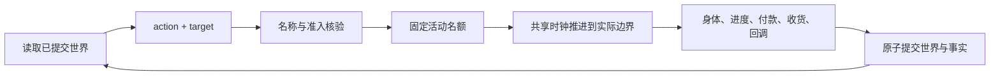

# WorldMock 产品设计说明书 — 模拟引擎

## 世界与请求

一个运行只有一个人物、一个绝对时钟和一份已提交世界。加载完整环境并验证实际模型元数据后才创建运行资产。
公开引擎创建入口从已加载配置和权威元数据派生当前模型身份与阶段预算，逐项核对调用方提供的身份。
结构合法但与实际输入不同的模型、端点、容量、预算或提示工具身份同样拒绝；拒绝发生在创建任何运行文件之前。
同秒续接开关保留调用方显式选择，其余身份只来自同一份输入与当前宿主合同。
初始 `session_open` 唤醒仅提供正常决策，不生成就寝反思，也不触发唤醒类别回调；`run_start` 回调只执行一次。

## 动作、名称与并行

公开请求的每项只有 `action` 与 `target`，删除 `way`、`app`、`to`、`pay_app`。
动作闭集为 walk、drive、take_taxi、take_bus、purchase、sleep、interact。
未知动作通过统一业务反馈返回 `ACTION_NOT_OFFERED` 和实际允许动作；已知对象不提供某动作时同样拒绝。
名称解析保留人物原始写法，以已登记的完整显示名解析，不按内容含义创造对象或动作。

| 名额 | 动作 | 规则 |
| --- | --- | --- |
| 第一名额 | 四种出行、睡眠 | 同名额互斥；睡眠还要求第二名额为空 |
| 第二名额 | 购买、interact | 同名额互斥；未收尾的已结束活动仍占名额 |

多项开始请求先核验整组，任一失败都不开始活动、不扣款、不消耗随机选择。
睡眠只能在本人住处开始。interact 只能针对当前地点或内容 app；功能 app 由引擎选择，不供人物点选。
控制工具为 report_status、pause_activity、conclude_activity、revise_day_plan、recall_task_summary，
加开始工具 start_activity 与只读 query_world。购买不能暂停；已结束活动必须由人物收尾。

## 出行、内容与目录浏览

出行使用完整内存地图的最短路径，受理时冻结路径、交通方式、天气系数、费用和自动功能 app。
不能把途中地点改成目的地。到达按真实计划结束时间登记，不提前结束同行的购买或内容活动。

interact 按目标的显式 app 或地点类型绑定选择内容：推送钉住、最近未完成、系列下一集、未看单元、轮数最少。
系列按集号自动接续，非系列完成即结束。内容进度按人物与内容共享，跨 app 和地点不重新从零计算。
暂停不推进内容；通过 `report_status` 按活动名恢复时，要求当前人在实际开始地点，并读取最新共享进度。正秒结算产生真实内容证据。
显式内容不设单次时长上限，开始与恢复读取实际剩余内容秒数；开始结果的 `details.content` 只含
`{app, title, summary, duration, pushed}`，地点内容的 `app` 为 `null`。活动事件快照只为实际内容附
`content_title`，不写退役 `title`；控制观察行的 `title` 为 `null`。

内容 app 的显式内容索引为空时，只有声明浏览时长才允许纯目录浏览。浏览每次新开始读取声明时长，
恢复读取剩余时长；有 app 使用事实，没有内容消费、等待经历或心理缓解。
浏览开始结果提供真实 `app`、声明的 `duration`，不创建 `details.content`。
平台交互开始均展示该 app 直接商品与所绑定店铺商品的去重并集；`goods` 的名称、价格、运费、预计到达和
可购买性取受理时的现有履约报价，保存在实际结果中，不能用回看时的世界重算。

地点完整呈现，不轮转、不截断。商品呈现保留实际曝光轮转；query_world 使用确定性分页和过滤交集，
不消耗随机数、不占名额、不推进时钟。商品类别过滤只允许零食、食品、饮料、商品。

## 购买、付款与收货

购买受理派生到店、外卖或快递履约，冻结目的地、商品、报价、付款 app 选择和 60 至 300 秒总时长。
整组受理先按请求前的真实停留点计算全部购买报价与合并运费，再加同组出行的即时车费核对余额；
任一不足都拒绝整组，请求项顺序不影响结果。到店购买不能与离店同时开始，进行中的到店购买须先结束；
外卖保留受理时的真实收货地点，快递不依赖当前停留点，两者均可与出行跨槽并行。
付款 app 候选末尾加入一个 null，按每个组合单等概率选择；null 表示真实直接付款。
有付款 app 的每组合单在购买末尾占 10 至 20 秒支付时间，总购买时长包含该时间。

受理时不扣款。购买正常完成时重新核验全部组合单总额，并在同一事务整次付款；余额不足则整次取消。
提前收尾或截止截断取消全部未付款订单，不付款、不收货、不产生支付通知。恰在 stop_time 完成的购买先正常结算。
付款后到店订单当秒收货，外卖在到期时真实送达，快递先到驿站、再由本人在本站 interact 领取。
取件一次领取本站全部待取包裹，同时正常选择本站绑定内容；没有待取包裹返回 `PARCEL_NOT_READY`。

真实付款生成信封资金变化；真实收货应用[交换效果](02-exchange-engine.md)、回调状态重置和个人事务累计。
取件、付款与自动 app 足迹的原因均指向真实源事件，重复请求、恢复与重放不重新选择或重复应用效果。

## 唤醒、日计划与个人事务

固定唤醒类别为 session_open、activity_completed、activity_boundary、goal_reminder_due、body_state_changed、
reconsider_due、day_plan_due、shift_start、shift_end、break_start、break_end。
同一边界同一类别只计一次。睡眠只由自己的计划结束唤醒，商品到期、推送、回调提醒、工作边界和个人事务提醒均不叫醒睡眠。

天气只来自世界按本地日期生成的事实。天气与日历在实际本地午夜登记，时间回调只在数据集声明的时间登记；
绝对时钟在夏令时变化时仍单调推进。停止时先完成真实结算和正常 run_end 回调，再写终态。

日计划保存自然语言目标和可选提醒，人物通过 revise_day_plan 或个人事务收尾控制状态。
删除根据自然语言目标自动判定进展、完成时间和奖励的路径；内容与行程的实际进度仍保留。
个人事务只根据真实收货和明确人物请求变化，不依据付款推断已经收到。

## 回调事务

回调状态与规则的数据声明归[配置](08-configuration.md)和[资源引擎](03-resource-engine.md)。
执行按规则身份排序，真实触发和效果落在同一事务；每日次数和运行起止的一次性标记持久化。
阈值回调每次提交最多触发一次，不级联。状态提示比较整个触发后的净可见结果，抵消变化不提示。
支出余额不足记录 paid=false，账户不变，后续效果继续；所有效果都有唯一真实原因。
回调提醒只在清醒且本地允许时段登记，当日一次，不选择内容、不唤醒人物。

## 原子性与恢复

观察只能读取已提交版本。请求身份重放读取原结果，参数冲突直接拒绝；中止的决策轮不执行请求。
共享时钟结算与事件在同一提交提交，检查点保存共同世界和人物工作区。
恢复严格核对原始两份 TOML、目录、内存地图和完整模型身份；只读重放只消费冻结事实。
耗尽同秒拒绝预算停止运行，不能跳过时间、生成替代行为或默认等待。
