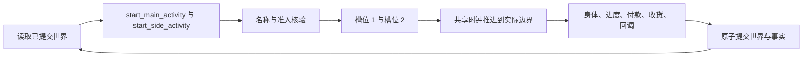
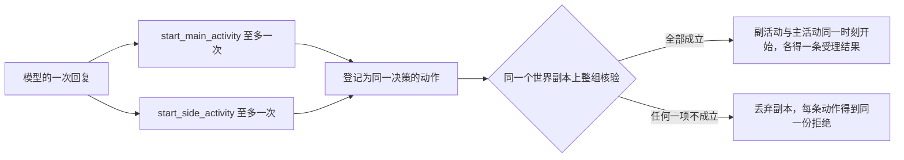

# WorldMock 产品设计说明书 — 模拟引擎

## 世界与请求

一个运行只有一个人物、一个绝对时钟和一份已提交世界。加载完整环境并验证实际模型元数据后才创建运行资产。
公开引擎创建入口从已加载配置和权威元数据派生当前模型身份与阶段预算，逐项核对调用方提供的身份。
结构合法但与实际输入不同的模型、端点、容量、预算或提示工具身份同样拒绝；拒绝发生在创建任何运行文件之前。
同秒续接开关保留调用方显式选择，其余身份只来自同一份输入与当前宿主合同。
初始 `session_open` 唤醒仅提供正常决策，不生成就寝反思，也不触发唤醒类别回调；`run_start` 回调只执行一次。

## 动作、名称与并行

开始一件事用两个工具：`start_main_activity` 开始占槽位 1 的活动，`start_side_activity` 开始占槽位 2 的活动。
每个参数都必须出现，多余字段拒绝。删除 `start_activity`、请求里的四个出行动作以及 `way`、`app`、`to`、`pay_app`。

| 工具 | `action` | `target` | `detail` |
| --- | --- | --- | --- |
| `start_main_activity` | `travel` | 目的地的地点名 | 出行方式名称 |
| `start_main_activity` | `interact` | 当前所在地点的地点名 | 要做的那件事的名称 |
| `start_main_activity` | `sleep` | 要睡的分钟数，只写数字，例如 `"470"` | `null` |
| `start_side_activity` | `purchase` | 商品名数组，一份一项 | 没有这个参数 |
| `start_side_activity` | `interact` | 恰含一个内容 app 名的数组 | 没有这个参数 |

出行方式是引擎固定的四种，名称为步行、驾车、打车、公共交通，`travel` 的 `detail` 只解析到这四个名称。
功能 app 由引擎选择，不供人物点选。

名称解析保留人物原始写法，以已登记的完整显示名解析，不按内容含义创造对象或动作，写得不准时返回候选而不替换。
`action` 由枚举保证，表外值按参数错误拒绝并给出全部允许值。`target` 解析到对象：出行与主工具的 interact 只认地点，
购买只认商品，副工具的 interact 只认内容 app；睡眠的 `target` 不做名称解析。
`detail` 在该对象该动作列出的名称里解析，引擎不默认步行，也不替人物补一件事。

| 结果 | 拒绝码 | 定位与允许值 |
| --- | --- | --- |
| 对象名找不到或对应多个对象 | `NAME_NOT_FOUND`、`NAME_AMBIGUOUS` | `target`，副工具定位到数组里的那一项 |
| `detail` 找不到或对应多个名称 | `NAME_NOT_FOUND`、`NAME_AMBIGUOUS` | `detail`；允许值是该对象该动作列出的全部名称 |
| 对象在这个工具下不提供该动作 | `ACTION_NOT_OFFERED` | `action`；允许值是该对象在本工具下提供的动作 |

对不是当前地点的地点写 interact、把当前地点写成出行目的地，都只得到 `ACTION_NOT_OFFERED`。
候选是可以照抄提交的完整调用 `{tool, arguments, note}`，至多三条；购买的候选只替换数组里出错的那一项。
名称类纠错发生在人物一侧，不登记世界请求、不计同刻轮数；环境用同一函数复核，名称问题合并为一次 `ACTION_REQUEST_INVALID`。

槽位是引擎限制同一时刻最多做两件事的两个位置，一个槽位同一时刻只放一项活动。

| 槽位 | 放什么 | 新开始的活动由谁放进来 |
| --- | --- | --- |
| 槽位 1 | 出行、睡眠、在地点做事 | 只有 `start_main_activity` |
| 槽位 2 | 购买、用内容 app | 只有 `start_side_activity` |

进行中和刚结束待收尾的活动占槽位，暂停的活动不占。睡眠占槽位 1，并要求槽位 2 没有进行中或待收尾的活动；
睡着时不能开始或恢复槽位 2 的活动。新开始才受工具约束，恢复用 `report_status`：点名暂停的活动，它回到原来的槽位，
该槽位须空着。系列换集留在原活动、原槽位，不经开始工具。

| 组合 | 能否同时进行 |
| --- | --- |
| 在地点做事 + 用内容 app | 可以 |
| 在地点做事 + 购买 | 可以，到店、外卖、快递都行 |
| 出行 + 用内容 app | 可以；出发前已在用的 app 可以带着走，也可以与出发同组开始 |
| 出行 + 购买 | 按履约方式而定，见「购买、付款与收货」 |
| 出行、睡眠、在地点做事两两之间 | 不可以，同占槽位 1 |
| 睡眠 + 任何槽位 2 的活动 | 不可以 |

开始组是模型同一次回复里的全部开始调用，一条或两条；两条时两个开始工具各一次，先后不限。
环境为每条调用登记一条动作，同一决策的动作成一组，在同一个世界副本上整组核验。

核验读请求前的世界，与出发同组的购买报价、收货地点和在场判断都按出发前的停留地点算。
整组成立后派发，次序与两条调用的先后无关：主调用是出行时先结束当前停留、开始路上会话，再开始副活动，再开始主活动。
每条动作恰好开始一项活动，活动回链开始它的那条动作。
任何一项不成立时整组不开始活动、不扣款、不消耗随机选择，顶层拒绝码取下表次序里第一条不成立的检查。

| 检查（按次序） | 拒绝码 | 何时不成立 |
| --- | --- | --- |
| 请求形状 | `ACTION_REQUEST_INVALID` | 任一调用不通过请求模型 |
| 待收尾 | `ACTIVITY_CONCLUSION_REQUIRED` | 有刚结束而未收尾的活动 |
| 名称 | `ACTION_REQUEST_INVALID` | 任一调用名称解析失败 |
| 指名商品 | `SUPPLY_NOT_FOUND` | 购买数组里未展示的名称在全量商品中找不到唯一商品 |
| 同刻阶段 | `SAME_MOMENT_ACTION_RESTRICTED` | 当前受限轮不开放开始 |
| 同槽位占用 | `RESOURCE_CONFLICT` | 某条调用要占的槽位已有进行中的活动 |
| 睡眠约束 | `RESOURCE_CONFLICT` | 主调用是 `sleep`，而槽位 2 有进行中或待收尾的活动，或同组还有副调用 |
| 主调用的对象条件 | 按动作 | 出行：有进行中的到店购买，或路线检查不通过；在地点做事：见「出行、内容与目录浏览」；睡眠：见下文 |
| 副调用的对象条件 | 按动作 | 购买：逐份报价的拒绝按数组次序取第一条，到店购买不能与出发同组 |
| 余额 | `INSUFFICIENT_FUNDS`、`INSUFFICIENT_TRAVEL_FUNDS` | 余额少于全部货款、各配送组运费与同组车费之和；没有同组购买时少于车费 |

整组只给一份拒绝，每条动作各写一条内容相同的拒绝结果。开始组有两条调用时 `reason` 末尾追加一句
` Neither start request was started.`（前面一个空格），只有一条调用时不追加。
明细只写在负责的调用上，路径以该调用在回复里的真实位置开头，没有问题的调用不出明细；世界条件造成的拒绝没有 `fix`。
同槽位占用的原因点名占用者：`The first activity slot is occupied by <活动名>.` 或
`The second activity slot is occupied by <活动名>.`；占用者是进行中的 interact 时下一步是结束或暂停它，否则是结束它。
睡眠约束的原因是 `Sleep requires the second activity slot to be empty.`；冲突来自同组的副调用时，
改法是单独提交 `start_main_activity`。

睡眠由人物写时长：`target` 是 10 到 720 的整数分钟，只写数字，全角数字与空白先归一；
带单位、小数、正负号或越界的写法都拒绝，引擎不换算、不取整、不截断。
请求不写地点，睡在人物当前停留的地点；该地点须标了 `sleepable`，否则以 `ACTIVITY_PRECONDITION_UNMET` 拒绝，
下一步指向本人的家。声明了营业时段的地点关门时不能开始睡眠，以 `LOCATION_CLOSED` 拒绝；
关门只卡开始，睡着后到了关门时刻照常睡到计划结束。

开始工具之外的世界请求是 report_status、pause_activity、conclude_activity、revise_day_plan 四个控制工具，
完整工具清单与一次回复的批次形状见[人物](06-agent.md)。
在地点做事和用内容 app 可以暂停，出行、睡眠、购买不能；已结束活动必须由人物收尾。

## 出行、内容与目录浏览

出行使用完整内存地图的最短路径，受理时冻结路径、交通方式、天气系数、费用和自动功能 app。
不能把途中地点改成目的地。到达按真实计划结束时间登记，不提前结束同行的购买或内容活动。

在地点做哪件事由人物点名。内容单元是人物能点名的一件事，单元名写在 `start_main_activity` 的 `detail` 里。

| 单元 | 单元名 | 单元键（排序用） | 包含的内容 |
| --- | --- | --- | --- |
| 独立内容 | 该内容的 `title` | 该内容的 `content_id` | 自身 |
| 系列 | `series.title` | 集号最小一集的 `content_id` | 各集，按集号升序 |

只有绑定到地点类型的内容形成单元，一个地点可点名的是绑定到它的 `kind` 的全部单元；系列各集的 `title` 不能点名。
点名后开始单元的下一条内容：独立内容是它自己，系列是完成轮数最少的各集里集号最小的一集。
它从共享进度的位置接着做，计划时长是剩余时长，剩下不到一分钟也照样开始，工具层的可用性与受理一致；
做完过的内容位置已归零，再点名就是新的一轮；点名不抽随机数。
地点活动名为「进行<单元名>（M月D日 HH:MM 起）」，点名系列时用系列名，不用各集标题。
受理时按下表次序检查对象条件，第一条不成立的给出拒绝。

| 检查（按次序） | 拒绝码 | 何时不成立 |
| --- | --- | --- |
| 营业 | `LOCATION_CLOSED` | 地点声明了营业时段而此刻不在其内 |
| 取件 | `PARCEL_NOT_READY` | 地点是驿站，而本人在此没有已到站的包裹；有包裹时这次受理同时取件，见「购买、付款与收货」 |
| 单元被占 | `RESOURCE_CONFLICT` | 该单元的某条内容是本人一项暂停中活动的当前内容；原因点名那项活动，其他单元不受影响 |

正在地点做事时出发、睡觉或点名另一个单元不自动暂停，按同槽位占用拒绝；暂停让出槽位 1 后才可以。

用内容 app 时人物只写 app 名，内容由引擎按推送钉住、最近未完成、系列下一集、未看单元、轮数最少的次序选择。
这个次序只用于内容 app，app 里的内容标题不是可写的名称；活动名为「进行<app 名>（M月D日 HH:MM 起）」。

系列按集号自动接续，留在原活动、原槽位，非系列完成即结束。内容进度按人物与内容共享，跨 app 和地点不重新从零计算。
暂停不推进内容；通过 `report_status` 按活动名恢复时，要求当前人在实际开始地点，并读取最新共享进度，
不重新选内容，也不重新检查营业、包裹和单元被占。暂停的活动没有进行中的结算区间，之后任何时刻、在原地或别处
都可以用 `conclude_activity` 结束，结束后它占着的单元可以再点名，从上次的位置接着做。
正秒结算产生真实内容证据。
显式内容不设单次时长上限，开始与恢复读取实际剩余内容秒数；开始结果的 `details.content` 只含
`{app, title, summary, duration, pushed}`，`title` 是实际开始那条内容的标题，地点内容的 `app` 为 `null`。
活动事件快照只为实际内容附 `content_title`，不写退役 `title`；控制观察行的 `title` 为 `null`。

内容 app 的显式内容索引为空时，只有声明浏览时长才允许纯目录浏览。浏览每次新开始读取声明时长，
恢复读取剩余时长；有 app 使用事实，没有内容消费、等待经历或心理缓解。
浏览开始结果提供真实 `app`、声明的 `duration`，不创建 `details.content`。
平台交互开始均展示该 app 直接商品与所绑定店铺商品的去重并集；`goods` 的名称、价格、运费、预计到达和
可购买性取受理时的现有履约报价，保存在实际结果中，不能用回看时的世界重算。

地点和当前地点的内容单元完整呈现，不轮转、不截断。商品呈现保留实际曝光轮转；query_world 使用确定性分页和过滤交集，
不消耗随机数、不占槽位、不推进时钟。商品类别过滤只允许零食、食品、饮料、商品。

## 购买、付款与收货

`start_side_activity` 的 `purchase` 把 `target` 的每个元素当作一份商品：同一个名称写两次就是两份，件数不设上限。
每一份各解析成商品、各做一次履约报价、各生成一条数量为 1 的商品履约记录，即一条订单。
`order_id` 为 `order-{action_id}-{序号:04d}`，序号按配送组的键升序、组内按 `goods_id` 升序从 1 编号；
`order_id` 的先后一律按字符串比较。店铺、收货地、下单 app、履约方式都相同的记录是一个配送组，
键的写法见[配置](08-configuration.md)。配送和运费按配送组合并：运费每组只收一次，记在组内第一条记录上，
到店购买没有运费。全部商品合成一个占槽位 2 的购买活动，活动名为「购买<商品名列表>（M月D日 HH:MM 起）」，
列表按 `goods_id` 升序，相邻的同名商品合写成「<商品名>×N」。

购买受理派生到店、外卖或快递履约，冻结目的地、商品、报价、付款 app 选择和 60 至 300 秒总时长。
整组受理先按请求前的真实停留点计算全部购买报价与合并运费，再加同组出行的即时车费核对余额；
任一不足都拒绝整组，不会只买其中几件，两条调用的先后不影响结果。

| 履约 | 与出行的关系 |
| --- | --- |
| 到店 | 不能与出发同组开始；进行中的到店购买须先结束才能出发 |
| 外卖（店铺商品远程送达） | 只能在出发前已经开始，或与出发同组开始；收货地点是出发前的停留地点，人在路上时下不了单 |
| 快递（绑定在 app 上的商品） | 不依赖当前停留点，路上也能下单 |

付款 app 候选末尾加入一个 null，按每个配送组等概率选择；null 表示真实直接付款。
有付款 app 的每个配送组在购买末尾占 10 至 20 秒支付时间，总购买时长包含该时间。

受理时不扣款。购买正常完成时重新核验全部配送组总额，并在同一事务整次付款；余额不足则整次取消。
提前收尾或截止截断取消全部未付款订单，不付款、不收货、不产生支付通知。恰在 stop_time 完成的购买先正常结算。
付款后到店订单当秒收货，外卖在到期时真实送达，快递先到驿站，再由本人到站后在本站开始一件事时领取。
外卖送达和快递到站按一趟配送各登记一条到达事件，起因恰为付清这一趟的那条付款事件。
一趟配送是同一个配送组（一次购买里 `group_key` 相同的组合单）里预计到达时刻相同的已付款商品履约记录；
各趟按预计到达时刻、`group_key` 升序排程，排程身份是 `delivery-{这一趟里最小的 order_id}`，
到期时刻取预计到达与付款时刻中较晚的一个。
预计到达时刻、履约方式和目的地都相同而配送组不同的记录不并成一趟，排出的到达事件不再被改写起因。
在驿站无论点名哪个单元，这一次受理都领取本站全部到站包裹并开始所点名的单元，取件时长就是该单元的内容时长；
没有到站包裹时本站的任何 interact 都返回 `PARCEL_NOT_READY`。
驿站取件的动作结果带着所领取的商品履约记录在领取后的快照；人物可见的购买明细和已结算文字只写这条动作自己下的订单。

真实付款生成信封资金变化；真实收货应用[交换效果](02-exchange-engine.md)、回调状态重置和个人事务累计。
取件、付款与自动 app 足迹的原因均指向真实源事件，重复请求、恢复与重放不重新选择或重复应用效果。

## 唤醒、日计划与个人事务

固定唤醒类别为 session_open、activity_completed、activity_boundary、goal_reminder_due、body_state_changed、
reconsider_due、day_plan_due、shift_start、shift_end、break_start、break_end。
同一边界同一类别只计一次。睡眠只由自己的计划结束唤醒，商品到期、推送、回调提醒、工作边界和个人事务提醒均不叫醒睡眠。

天气只来自世界按本地日期生成的事实。天气与日历在实际本地午夜登记，时间回调只在数据集声明的时间登记；
绝对时钟在夏令时变化时仍单调推进。停止时先完成真实结算和正常 run_end 回调，再写终态。

日计划保存自然语言目标和可选提醒，人物通过 revise_day_plan 或个人事务收尾控制状态。
删除根据自然语言目标自动判定进展、完成时间和奖励的路径；内容与行程的实际进度仍保留。
个人事务只根据真实收货和明确人物请求变化，不依据付款推断已经收到。

## 回调事务

回调状态与规则的数据声明归[配置](08-configuration.md)和[资源引擎](03-resource-engine.md)。
执行按规则身份排序，真实触发和效果落在同一事务；每日次数和运行起止的一次性标记持久化。
阈值回调每次提交最多触发一次，不级联。状态提示比较整个触发后的净可见结果，抵消变化不提示。
支出余额不足记录 paid=false，账户不变，后续效果继续；所有效果都有唯一真实原因。
回调提醒只在清醒且本地允许时段登记，当日一次，不选择内容、不唤醒人物。

## 原子性与恢复

观察只能读取已提交版本。请求身份重放读取原结果，参数冲突直接拒绝；中止的决策轮不执行请求。
共享时钟结算与事件在同一提交提交，检查点保存共同世界和人物工作区。
恢复严格核对原始两份 TOML、目录、内存地图和完整模型身份；只读重放只消费冻结事实。

一个决策可以登记两条开始动作：两个开始工具各一条，`decision_id` 相同、`action_id` 不同。
除此之外同一人物本轮的第二条登记是协议故障，运行停止。一组的两条动作要么都有存档结果、要么都没有；
都有时按存档重放，不重做领域动作，只有一条有属于协议故障。
同刻轮数按组计：一个开始组受理、整组被拒或重放都只加一轮；每人每秒前两次名称类拒绝不计轮数，这一条和下一次决策的安排
也按组各算一次。
耗尽同秒拒绝预算停止运行，不能跳过时间、生成替代行为或默认等待。
