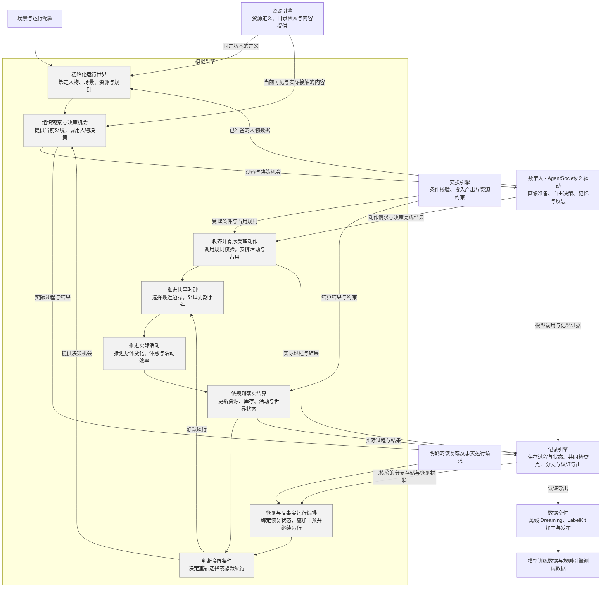
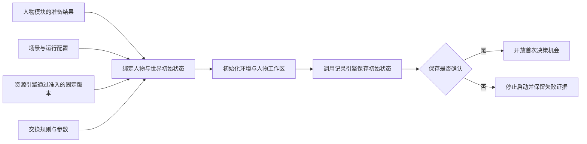
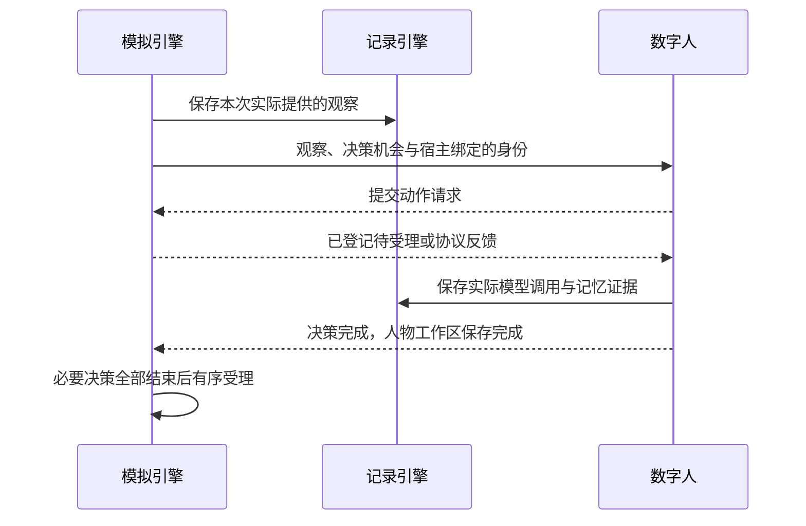
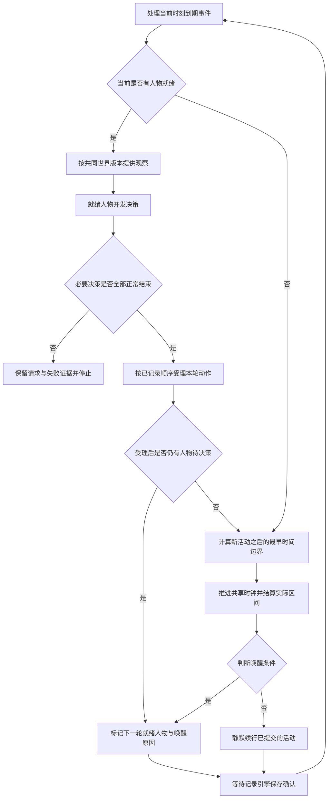
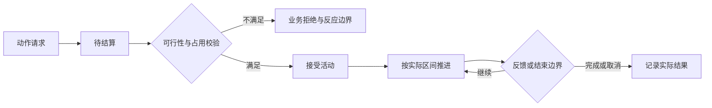
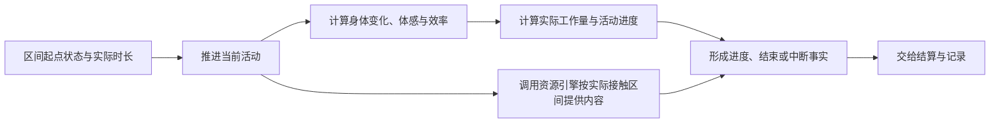
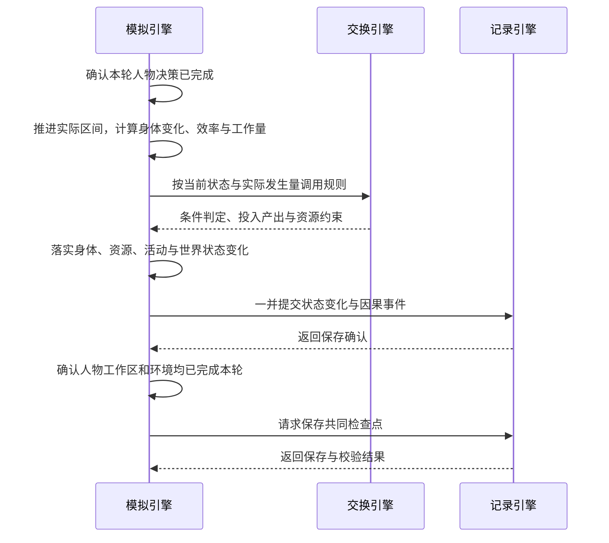
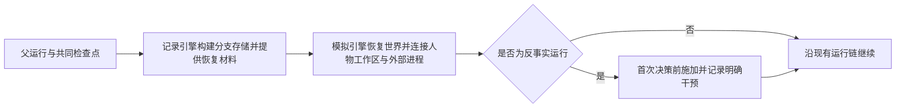

# WorldMock 产品设计说明书 — 模拟引擎

> **状态**：DRAFT；职责设计，现行接口与行为仍以冻结合同和规格为准  
> **日期**：2026-09-20  
> **版本**：v1.3  
> **范围**：运行初始化、观察与决策机会、动作受理、共享时钟、活动推进、结算、唤醒与恢复编排

模拟引擎负责让数字人在同一个世界中实际生活：在合适的时刻提供观察与决策机会，
推进已接受的活动，调用规则并落实状态变化。本文按引擎内部功能展开；
其他模块只说明交互关系，详细设计由所属模块维护。

## 1. 职责与边界

### 模拟引擎负责什么

**数字人决定做什么，模拟引擎负责事情何时发生、实际发生多少，以及世界如何随之改变。**
资源引擎提供定义与内容，交换引擎给出规则判定和计算结果，记录引擎保存事实与状态。
模拟引擎组织这些调用，并在保存确认后继续运行。

### 项目框架映射

按[概述的解决方案](00-overview.md#12-解决方案)，模拟引擎展开为下列内部功能。
灰色框对应正文主题；框外模块各自维护其能力与实现。

正文标题与灰色功能框保持同名。人物画像与记忆、资源检索、记录存储、离线 Dreaming
不设为模拟引擎内部主题。反事实运行属于实际执行；基于足迹生成假设文本属于数据交付。

### 与其他模块的分工

| 所属模块 | 独立负责的内容 | 模拟引擎如何协作 |
| --- | --- | --- |
| [人物模块](../dev/SPEC-life-realism.md) | 画像提取与参数编译、人物提示、两阶段决策、记忆检索、合并与反思 | 绑定准备结果，提供观察与机会，等待决策完成及人物工作区保存 |
| [资源引擎](03-resource-engine.md) | 资源与内容定义、语料准入、目录发布、检索排序与内容提供 | 传入当前世界条件、可见范围和实际接触区间，使用返回结果 |
| [交换引擎](02-exchange-engine.md) | 交换条件、占用与转换规则求值，投入产出和资源约束校验 | 提供当前状态、实际时长、工作量与食品利用效率等输入，使用返回结果落实状态变化 |
| [记录引擎](05-recording-engine.md) | 事件与状态存储、事务、证据关联、检查点校验、分支材料、认证导出与查询 | 提供真实过程，在完整运行边界请求保存；取得确认或恢复结果后继续 |
| [数据交付](06-delivery.md) | 证据窗口、离线 Dreaming、LabelKit 调用、编码和发布 | 实际反事实运行结束后，由记录引擎向交付提供认证导出 |
| [行为评估](07-evaluation.md) | 行为指标、评分与真实性评价；原始足迹的客观统计由记录引擎提供 | 提供可分析的运行事实，正式运行不因报告而自行改变规则或选择 |

世界状态由模拟引擎中的生活环境统一修改；人物模块维护自己的记忆与工作区，
记录引擎负责持久化与共同检查点的一致性。规则求值不自行推进时间或写入世界状态。
模拟引擎复用现有 AgentSociety 2 调度与人物调用链，不增加另一套人物决策循环或世界时钟。

### 设计依据

运行接口遵循[接口合同](../CONTRACTS.md)，调度与故障传播遵循
[AgentSociety 2 接入规格](../dev/SPEC-as2-integration.md)，时间、活动与观察行为遵循
[生活运行时规格](../dev/SPEC-life-runtime.md)。跨模块细节沿上表进入所属设计。

按时间排序、在同一时刻确定性处理事件，沿用成熟离散事件模拟的设计原则，参见
[SimPy 的时间与调度说明](https://simpy.readthedocs.io/en/latest/topical_guides/time_and_scheduling.html)。
本项目由现有运行框架与生活环境执行这些职责。

## 2. 初始化运行世界

### 输入与启动流程

| 输入 | 模拟引擎需要确定的内容 |
| --- | --- |
| 场景 | 起止时间、时区、人物与地点、日历、账户和初始活动 |
| 人物准备结果 | 人物身份、卡片与运行参数已就绪，并能绑定对应工作区 |
| 资源与规则 | 本次运行使用的固定版本及准入结果，不在运行中补抓或改写目录 |
| 运行配置 | 模型调用配置、独立运行目录及记录引擎返回的运行身份 |

当前新建入口仍会调用人物模块完成画像编译与卡片渲染，再绑定到运行；
这属于启动时准备依赖，画像提取、共识、参数映射和覆盖率算法由
[人物画像规格](../dev/SPEC-life-realism.md#画像编译)维护。
启动完成后使用已绑定结果，恢复运行使用检查点封存的人物工作区，不重新编译画像。

### 启动完成的条件

人物与世界使用同一场景时间，资源和规则依赖已就绪，初始状态保存确认后才能进入决策。
任何必需输入失败都停止启动，不能用空人物、空目录或默认动作继续。
创建新运行与打开已有运行是不同操作；已有目录不得覆盖，恢复失败不得隐式创建空运行。
运行参数见[配置设计](08-configuration.md)，目录身份与保存规则见[记录引擎](05-recording-engine.md)。

## 3. 组织观察与决策机会

输入是已确认的世界状态、当前就绪人物和唤醒原因；输出是实际提供的观察与已完成的决策结果。
是否提供机会由[判断唤醒条件](#8-判断唤醒条件)决定，本主题只组织已获准的一次决策。

### 提供当前可见的处境

模拟引擎将当前地点、体感、在场人物、通知、活动结果和计划投影成观察，
调用资源引擎提供当前可见对象与实际接触内容。准确身体数值留给结算和审计，人物接收对应体感。
人物卡片与记忆提示由人物模块组装；目录检索、排序、轮转与内容切片由资源引擎维护。

同轮人物观察基于共同世界版本。同一观察在一次决策输入中只出现一次，
未播放、未阅读、未发生的内容不能当作已接触事实。
观察字段与预算遵循[观察投影合同](../dev/SPEC-life-runtime.md#观察投影与提示合同)。

### 调用并等待人物决策

模拟引擎沿既有 AgentSociety 2 人物调用链调度，不另写决策自述、行动或记忆生成算法。
宿主绑定人物、决策和动作身份；人物提交请求不等于环境已接受或执行。
必要决策失败时，停止本轮未执行提案，不能补造动作或结束结果继续推进。
人物内部协议见[两阶段决策](../dev/SPEC-life-realism.md#两阶段决策)与
[记忆合同](../dev/SPEC-life-realism.md#记忆合同)。

### 接收计划作为时间条件

人物模块生成和调整当日计划，模拟引擎接收计划并将其起点纳入时间边界。
到达计划起点只提供决策机会，人物仍自主选择行动；计划内容不自动变成已接受的活动。
计划格式与生成规则见[日程骨架](../dev/SPEC-life-realism.md#日程骨架)。

## 4. 收齐并有序受理动作

### 收齐请求与确定顺序

输入是同一轮人物基于共同世界版本提交的动作，以及决策前已经记录的竞争顺序。
请求到达时先登记为待结算，全部必要决策正常结束后才有序受理。
输出是活动受理结果、占用安排或带原因的业务拒绝，接受活动不代表活动已经完成。

同轮人物可以并发调用模型，但共享物品、任务和余额由环境串行结算。
决策前按固定随机种子产生并记录竞争顺序，同轮观察基于共同世界版本；
请求到达先后不能改变结算顺序，环境也不能为等待某个早序请求而阻塞接收。
必要决策发生异常时，该轮尚未执行的提案不再结算，保留请求与失败证据并终止。
不可逆付款和任务提交使用稳定动作身份防止重试重复结算。

### 校验与占用安排

模拟引擎把当前状态、动作、目标与已占用资源交给交换规则核验，再根据规则结果安排活动。
同轮较早动作可能已经改变库存或任务状态，因此必须在实际受理时检查，不能只依赖观察时的可行性。
具体条件见[交换引擎](02-exchange-engine.md)，人物与动作身份仍由宿主绑定。

同一人物一次决策只提交一个主要生活动作，活动占用按注意力、身体位置和设备等规则表达。
能否同时进食并听节目、能否驾驶并玩游戏，由场景与活动规则决定，不能自行假定可以并发。

受理成功后的新活动必须参与下一时间边界计算。拒绝的有限反应时间与连续拒绝上限，
由[推进共享时钟](#5-推进共享时钟)处理；不能在同一时刻无限重新请求。

## 5. 推进共享时钟

### 一轮运行

先处理当前到期事件，再提供观察并收齐动作；环境受理后才计算下一时间边界。
决策轮尚未结束或仍有人物待决策时，不能推进共享时钟。
受理后仍有人物就绪，则先完成保存与检查点，再进入下一轮决策；无人待决策才推进时间。
边界取活动完成、内容反馈、身体变化、通知配送、工作截止、计划起点、等待结束和实验结束等相关时刻中的最早值。
某人睡眠八小时不能让其他人物的活动、通知或配送被跳过。

每次时间推进严格大于零，即时事件在当前时刻按稳定顺序处理。
普通业务拒绝和已接受的瞬时动作形成下一秒反应边界，反馈只出现一次，防止无限占用同一时刻。
连续拒绝达到场景规定上限时终止运行，成功选择后计数重置；环境不能代替人物选择等待来掩盖失败。

模拟时间统一使用 UTC epoch 秒；输出给其他模块的时间保持同一发生时刻和排序。
本次推进秒数必须恰好对应上次确认时刻到结束时刻的间隔。

### 预排事件

预排事件在共享时钟上触发，覆盖通知、工作、日历、账单、工资、改价、商品发布和配送等。
场景中明确给定的邮件、任务、日历与账单在加载时编译为初始事件，购买还会动态产生配送事件；
这些事件都要保存身份、顺序和处理游标。
同秒事件稳定排序，已经处理过的事件不能在再次观察或恢复时重复执行。
目录保持只读，运行中的价格变化属于世界状态覆盖值。

### 程序加速与媒体倍速

程序加速只减少现实等待，不减少生活耗时；观看二十分钟仍消耗二十分钟模拟时间。
人物选择的媒体倍速单独记录，跳过的内容不会进入观察或记忆。
运行速度取决于真实模型调用、内容处理和持久化耗时，不能用示意性能值代替实测。

## 6. 推进实际活动

输入是当前活动、共享时钟确定的实际区间和冻结规则。模拟引擎推进已经被接受的活动，
计算实际进度、身体变化、体感与效率，并把变化交给[依规则落实结算](#7-依规则落实结算)。
人物提交的计划时长不能当作已经完成的时间。

### 活动生命周期

### 实际区间、身体变化与效率

| 活动 | 按实际过程推进的内容 |
| --- | --- |
| 工作 | 实际投入时间与效率决定有效工作量，交付物仍须单独验收，不能以累计时间替代生产结果 |
| 进食 | 按实际消耗食品与经过区间更新进度、能量输入和消耗；购买或取得食品不等于已经进食 |
| 睡眠 | 按实际睡眠区间演化睡眠状态，持续计入基础能耗；中断后不直接恢复到满值 |
| 节目与游戏 | 节目只提供已播放片段；游戏以实际回合结果推进，简介不能充当执行结果 |
| 出行 | 按实际路线与方式推进，位置变化决定后续能够接触的对象与内容 |
| 等待 | 身体变化和其他人物、通知、配送照常推进，等待不冻结世界 |

身体演化、体感分级和效率求值由模拟引擎负责；交换引擎使用已经计算出的实际时长、工作量和利用效率等输入。
身体数值与体感分开：准确数值用于结算和审计，人物观察接收对应体感。
身体变化与工作效率的算法统一遵循[生活运行时规格](../dev/SPEC-life-runtime.md#身体语义两过程睡眠睡眠不足账体感分级)，
食品和工作等转换规则见[消费、生产与需求模型](../dev/SPEC-life-runtime.md#消费生产与需求模型)。

模拟引擎先按通用活动推进形成 `body_settlement`，再应用进食等专有效果。
其中的 `after` 不是包含全部食品效果的最终身体状态；食品能量流入须结合
`resource_flows` 与最终世界状态核验。睡眠演化由对应规则验证；
模拟引擎核对共享时钟与实际结算区间，并行活动时长不能直接相加。

实际食品利用效率尚未形成独立持久化字段，这是结算结果留证的缺口：
模拟引擎需把实际计算得到的食品利用效率随事件提交，记录引擎只能将缺失测量标为未知，不能自行补算。

### 反馈、续行与结束

普通活动只有到达对应反馈边界并满足资格才接受继续请求，游戏回合使用自己的反馈与动作入口。
活动推进遵循[生活运行时规格](../dev/SPEC-life-runtime.md)，其中使用的交换条件与转换规则见
[交换引擎](02-exchange-engine.md)。

暂停不继续产生该活动的进度与内容；完成、取消或中断只按实际发生部分形成结果。
反馈边界不自动终止活动，也不允许继续请求重复结算同一区间。
是否在该边界打断人物并重新选择，由[判断唤醒条件](#8-判断唤醒条件)独立决定。

## 7. 依规则落实结算

### 从实际进度到世界变化

输入是当前状态、已经发生的活动区间、实际工作量与履约事实。模拟引擎调用交换规则，
取得投入、产出与约束后落实变化；资源定义提供单位和边界，记录引擎负责把状态与事件一起保存。
交换规则求值不自行推进时间，也不独立写入另一份世界状态。

| 结算对象 | 模拟引擎落实的变化 |
| --- | --- |
| 资源与身体 | 应用实际区间的输入、消耗和恢复，保留变化原因与使用的规则 |
| 库存与配送 | 区分付款、取得与使用，更新持有数量和实际履约状态 |
| 工作与报酬 | 将实际交付送验，在验收与付款条件满足后按合同结算，重复提交不能重复付款 |
| 活动与世界 | 更新实际进度、完成或中断状态，以及已发生的位置和环境变化 |

一次动作的请求、接受和完成分别留证。不得把模型的成功叙述当作世界变化，
不得在计划尚未执行时提前记入产出或完成结果。

### 每轮保存与确认

模拟引擎将自己产生的观察、动作受理、活动进度和状态变化交给记录引擎，
并等待人物调用及记忆保存完成；人物内部证据由人物模块通过记录接口保存。
人物提交请求、环境接受请求、活动实际完成是不同事实，不能用前一阶段的反馈代替后一阶段的结果。
决策自述属于人物自述，准确世界变化由环境产生；所有证据绑定当前人物、决策、动作和时间。

环境仍是世界状态的唯一写入方。并发人物 worker 不能各自修改世界数据库，
模拟引擎也不能在保存失败时继续采用未提交的内存结果。
事件字段、素材发布、事务、资金对账和版本连续性只在
[记录引擎](05-recording-engine.md)维护，本文不再定义另一套存储结构或事件枚举。

### 共同检查点的调用时机

本轮人物响应、记忆写盘、环境推进和事件提交全部完成后，模拟引擎才请求共同检查点。
模拟引擎提供当前世界与人物运行状态，记录引擎负责检查点的完整性校验和保存。
模拟引擎只接受记录引擎确认的完整结果，不自行根据某个文件存在判定恢复材料有效。

检查点失败就是运行故障；已确认状态保留，不能将半成品作为恢复入口。
保存和校验细节见[保存共同检查点](05-recording-engine.md#保存共同检查点)与[恢复与反事实分支](05-recording-engine.md#恢复与反事实分支)。

## 8. 判断唤醒条件

### 结算边界与决策机会

| 边界 | 环境行为 | 人物行为与足迹 |
| --- | --- | --- |
| 静默结算 | 按实际区间更新身体、内容和活动进度 | 不调用模型；只记录进度，决策标记为否、唤醒原因为空 |
| 命中唤醒条件 | 保存变化与全部命中的原因 | 提供观察与决策机会，记录实际请求、响应和记忆 |
| 游戏回合反馈 | 保持游戏的回合边界 | 使用对应游戏动作入口，不能视为普通活动续行 |
| 睡眠 | 持续结算实际经过时间 | 只因计划结束或合同允许的唤醒事件提供机会，不受普通重估间隔打断 |

反馈粒度决定结算边界，普通重估间隔只是唤醒条件之一；二者分别使用场景参数，
不能把每次结算都变为一次模型调用。
静默边界不产生 `observation`、`decision_started`、`model_request` 或 `memory_updated`。

唤醒条件包括计划结束、体感分级变化、本人消息或配送到达、工作机会与验收结果、计划段起点、
重估间隔、营业变化、同地人物变化、活动不可行、拒绝反馈、从睡眠醒来和运行开始。
完整闭集、睡眠允许的原因与触发阈值见[生活运行时的决策节律](../dev/SPEC-life-runtime.md#决策节律结算边界与唤醒条件分离)，
留证字段见[记录引擎的决策节律增量字段](05-recording-engine.md#决策节律增量字段)。
体感变化与上一次实际提供决策时的分级比较，不与紧邻的静默结算边界比较；滞回沿用身体规则。

## 9. 恢复与反事实运行编排

`resume` 从完整检查点继续生活，`replay` 在新分支施加明确干预后重新执行环境。
恢复必须使用检查点封存的世界、人物、游戏与随机状态，不能混入父目录之后的修改或残留进程状态。
记录引擎负责新分支身份、来源关系和历史完整性；模拟引擎确认人物工作区与各参与者恢复成功后才开始决策。
运行宿主核验当前代码、依赖、模型配置与场景是否匹配冻结身份，任一不符即拒绝恢复执行。
运行宿主负责将中断状态登记为 `interrupted`；创建分支不改写父运行，已提交尾部与失败证据保留。
游戏引擎执行后、数据库提交前崩溃时，必须从共同检查点重建游戏状态，不能继续使用残留进程。
恢复失败不得变为新建空运行。

现有余额条件干预 `set_balance_fen` 在子分支首次决策前应用并留证，人物随后自主选择。
干预不替人物编写下一步行为。重放已记录结果与重新调用模型分开：前者复原既有历史，
后者不保证作出相同选择。分支保存和历史认证统一见
[记录引擎](05-recording-engine.md#反事实分支与来源关系)。

模拟引擎只负责在恢复状态上实际执行。离线经历归纳、反思、假设文本生成和 LabelKit 调用
由[数据交付](06-delivery.md#34-dreaming-窗口提取规则)负责，默认不写回运行中的人物。
只有实际完成并由记录引擎认证的运行结果，才能作为真实反事实分支交付。

## 附录：运行约束与验证

### 失败处理

| 情况 | 模拟引擎的处理 |
| --- | --- |
| 余额不足、库存不足或活动冲突 | 接收规则给出的拒绝原因，形成有限反应边界，允许人物按预算重新选择 |
| 必要人物决策失败 | 停止该轮未执行提案，不合成默认动作，不推进时间 |
| 资源、规则或必需观察不可用 | 保留已确认状态并停止，不用空内容或默认结果替代 |
| 状态、人物工作区或检查点保存失败 | 传播故障，不能以未确认的内存状态继续运行 |
| 恢复或干预失败 | 不开放首次决策机会，不改为新建空运行 |

致命异常保持故障身份，记录英文错误与关联身份后终止。
跨模块接口失败不能被改写成普通业务拒绝，也不能依据离线报告自动修改正在运行的规则。

### 当前实现入口

| 模拟职责 | 当前入口 |
| --- | --- |
| 初始化、恢复与实际反事实运行编排 | [运行入口](../../src/worldmock/runtime.py) |
| 连接人物决策与生活环境 | [环境适配](../../custom/envs/life_env.py)与既有 AgentSociety 2 调度链 |
| 观察、受理、时间、活动、结算和唤醒 | [生活运行模块](../../src/worldmock/life/) |
| 预排事件与处理游标 | [预排事件模块](../../src/worldmock/scheduling/) |

上述是职责入口，不代表整个代码目录归模拟引擎独占。当前生活运行模块内也存在资源检索等实现，
它们按资源引擎的职责维护；运行入口调用画像编译，也不改变人物算法的归属。
本文收紧设计边界，不据此宣称代码已经完成物理拆分。

### 当前实现边界

当前身体行为尚未全部由睡眠活动声明驱动；场景选定的规则也尚未贯穿活动、身体与动机执行。
这两项属于模拟引擎的运行接入与执行差距，不能因交换规则已加载或文档已归并就认定完成。
完善时应沿现有活动与身体执行路径接入，验证实际状态变化，不另建一套规则执行循环。

### 验收重点

| 验证对象 | 模拟引擎必须满足的结果 |
| --- | --- |
| 启动 | 依赖与初始保存未确认前没有人物决策，失败不会产生可继续运行的空世界 |
| 多人物受理 | 同轮观察使用共同世界版本，已记录顺序决定受理结果，请求到达顺序不改变结算 |
| 共享时钟 | 必要决策未完成时不推进，已接受的新活动参与边界计算，到期事件不遗漏或重复 |
| 活动与结算 | 只按实际区间和履约事实更新状态，请求、接受与完成分别保留 |
| 唤醒 | 静默边界不调用人物模型，实际唤醒原因完整，睡眠与游戏遵守各自边界 |
| 保存协作 | 等待状态、事件与人物工作区完成后请求检查点，保存失败立即停止 |
| 恢复执行 | 只接受核验后的完整恢复状态，明确干预在首次决策前生效，原运行保持原状 |

相关运行检查见 `tests/life/` 与 `tests/integration/`。画像质量、记忆算法、资源检索、
记录完整性和交付质量由所属模块验收；模拟引擎验证调用顺序、输入输出使用与失败传播。
实际验证要求见[验证规则](../VERIFICATION.md)，完成情况以[实现状态](../dev/implementation-status.md)为准。
文档调整不构成真实模型运行或端到端交付通过的证据。

## 版本历史

| 版本 | 日期 | 修订内容 |
| --- | --- | --- |
| v1.0 | 2026-09-20 | 统一人物准备、决策与记忆、共享时钟、恢复编排和 Dreaming 设计；删除独立人物画像设计，存储与检查点引用记录引擎 |
| v1.1 | 2026-09-20 | 按概述解决方案展开项目框架映射，明确模拟执行与资源定义、交换规则、记录保存和 LabelKit 交付的关系 |
| v1.2 | 2026-09-20 | 正文按框架图内的功能逐章展开，拆分动作受理、时钟、活动推进、结算与唤醒判断，并同步章节引用 |
| v1.3 | 2026-09-20 | 收紧为运行编排与实际执行；移除人物、资源、存储和离线交付的内部设计，同步框架图与所属模块引用 |
