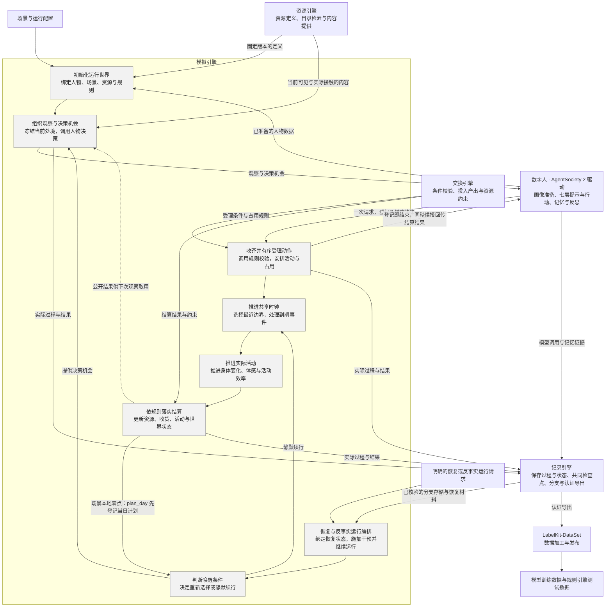
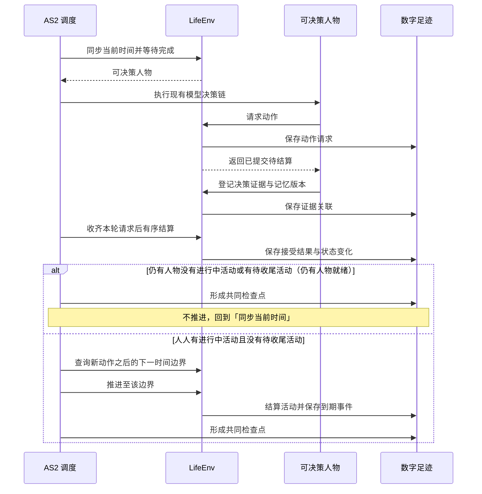
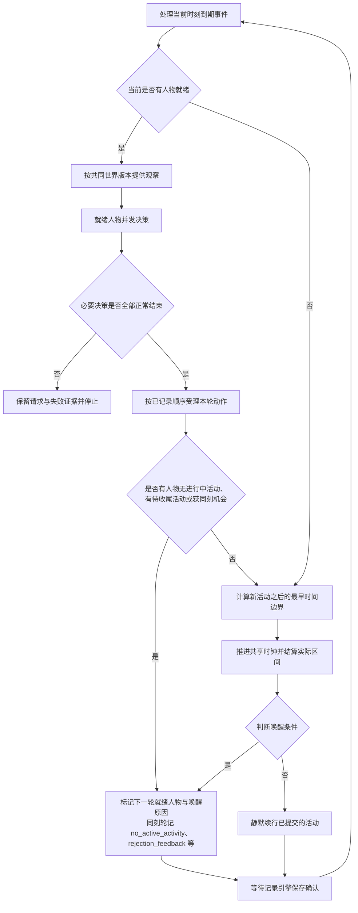
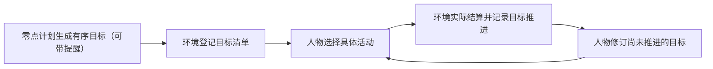
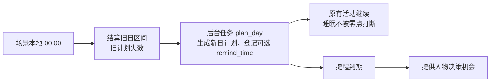

<a name="simulation-engine"></a>
# WorldMock 产品设计说明书 — 模拟引擎

<a name="simulation-engine-职责与边界"></a>
## 职责与边界

<a name="simulation-engine-模拟引擎负责什么"></a>
### 模拟引擎负责什么

**数字人决定做什么，模拟引擎负责事情何时发生、实际发生多少，以及世界如何随之改变。**
资源引擎提供定义与内容，交换引擎给出规则判定和计算结果，记录引擎保存事实与状态。
模拟引擎组织这些调用，并在保存确认后继续运行。

对人物而言，一次决策就是选择一个世界请求（一次工具调用），回复正文可有可无。
查询记忆、回看任务与查询世界当场得到答案；世界请求登记即结束本次决策，登记不回给人物；真实结果由环境结算后写进进度层，
同一秒接着决策时随工具结果交还人物。
模拟引擎负责维持这个闭环，人物模块负责其中的选择与记忆。

<a name="simulation-engine-项目框架映射"></a>
### 项目框架映射

按[概述的解决方案](00-overview.md#overview-解决方案)，模拟引擎展开为下列内部功能。
灰色框对应正文主题；框外模块各自维护其能力与实现。



正文标题与灰色功能框保持同名。人物画像与记忆、资源检索、记录存储、离线 Dreaming
不设为模拟引擎内部主题。反事实运行属于实际执行；基于足迹生成假设文本属于数据交付。
零点计划由运行时在场景本地零点与启动路径执行（同联系人回复），不经人物模块。
虚线表示已结算结果供下次观察使用，不代表每次结算都会触发新的决策。

<a name="simulation-engine-与其他模块的分工"></a>
### 与其他模块的分工

| 所属模块 | 独立负责的内容 | 模拟引擎如何协作 |
| --- | --- | --- |
| [人物模块](06-agent.md) | 画像提取与参数编译、七层提示与行动、记忆检索、合并与反思 | 绑定准备结果，提供观察与机会，等待决策完成及人物工作区保存 |
| [资源引擎](03-resource-engine.md) | 资源、动作与内容定义、目录发布、检索排序与内容提供 | 传入当前世界条件、可见范围和实际接触区间，使用返回结果 |
| [交换引擎](02-exchange-engine.md) | 交换条件、占用与转换规则求值，投入产出和资源约束校验 | 提供收货商品的类别与件数，以及当前状态与实际活动时长等输入，使用返回结果落实状态变化 |
| [记录引擎](05-recording-engine.md) | 事件与状态存储、事务、证据关联、检查点校验、分支材料、认证导出与查询 | 提供真实过程，在完整运行边界请求保存；取得确认或恢复结果后继续 |
| LabelKit-DataSet 数据加工 | 证据窗口、离线 Dreaming、LabelKit 调用、编码和发布 | 实际反事实运行结束后，由记录引擎向 LabelKit-DataSet 提供完整认证导出 |
| [行为评估](07-evaluation.md) | 行为指标、评分与真实性评价；原始足迹的客观统计由记录引擎提供 | 提供可分析的运行事实，正式运行不因报告而自行改变规则或选择 |

世界状态由模拟引擎中的生活环境统一修改；人物模块维护自己的记忆与工作区，
记录引擎负责持久化与共同检查点的一致性。规则求值不自行推进时间或写入世界状态。
模拟引擎复用现有 AgentSociety 2 调度与人物调用链，不增加另一套人物决策循环或世界时钟。
零点计划 `plan_day` 是运行时后台任务（同联系人回复），不经人物调用链，计划由其后的共同检查点封存。

<a name="simulation-engine-初始化运行世界"></a>
## 初始化运行世界

<a name="simulation-engine-输入与启动流程"></a>
### 输入与启动流程


| 输入 | 模拟引擎需要确定的内容 |
| --- | --- |
| 场景 | 起止时间、时区、人物与地点、地点类和人物交互菜单、日历、每个人物的工作安排（`work_schedule`，必填，可为 null；每周班次、日期例外与休息时段）与作息覆盖窗口（含下班、到家）、账户和身体初值（不预置活动，按作息反推，算法见[交换引擎](02-exchange-engine.md#exchange-engine-两过程睡眠模型)） |
| 人物准备结果 | 人物身份、卡片与运行参数已就绪，并能绑定对应工作区 |
| 资源与规则 | 统一登记通过的目录、发布图与固定规则，场景结构 8 的环境钉；不在运行中重生成或改写目录 |
| 运行配置 | 模型调用配置、独立运行目录及记录引擎返回的运行身份 |

当前新建入口仍会调用人物模块完成画像编译与卡片渲染，再绑定到运行；
这属于启动时准备依赖，画像提取、共识、参数映射和覆盖率算法由
[人物](06-agent.md#agent-画像编译)维护。
启动完成后使用已绑定结果，恢复运行使用检查点封存的人物工作区，不重新编译画像。
恢复按 `plan_submitted_dates` 不重复生成当日计划与提醒。
未完成的个人事务及其提醒随世界状态恢复，不重复记下、不重复完成、不重复提醒。
恢复核对清单五字段 `environment_identity`，加载共同检查点中的订单、待收货订单与呈现状态；图仍读取已发布字节，不重生成。

启动读取目录格式 2 与场景结构 8，不读取语料，包内固定规则随代码身份绑定。

<a name="simulation-engine-地图与供给初始化"></a>
### 地图与供给初始化

启动先统一登记目录，再读取发布图与场景结构 `8`。场景 `environment` 钉目录清单，`locations[]` 只选择地点身份；地点 `kind` 派生菜单类型与活动环境。
目录一次派生只读菜单和 app 索引，图覆盖全目录地点；运行不补边、抽样菜单或重生成地图。最短路等长按完整路径元组字典序决胜，所选地点间的路径可以经过未被选择节点。
初始状态使用世界结构 `11`，不初始化供给库存、报价、营业例外或资格；运行清单使用 `environment_identity`。

<a name="simulation-engine-启动完成的条件"></a>
### 启动完成的条件

人物与世界使用同一场景时间，资源和规则依赖已就绪，初始状态保存确认后才能进入决策。
工作安排在启动前完整校验：班次形状（每周七天全写、例外日期为规范的 ISO 日期、班次同日且起止先后、休息时段落在班次内且升序不重叠）
由场景模型的校验器拒绝；跨引用在加载检查里核对——工作地点是所选地点，并与场景日历交叉核对（补班日必须有班次，春节、病假、
事假日必须不当班，加班机会日不要求班次），交叉核对只对落在场景时间窗内的日历日期执行，时间窗外的例外日期不拒绝；失败为顶层英文明细，
写明人物、日期与字段。
交互菜单的地点类覆盖、人物字段、名称闭集、重复、空集合与保护项在启动前完整校验。
任何必需输入失败都停止启动，不能用空人物、空目录、全量菜单或默认动作继续。
创建新运行与打开已有运行是不同操作；已有目录不得覆盖，恢复失败不得隐式创建空运行。
运行参数见[配置设计](08-configuration.md)，目录身份与保存规则见[记录引擎](05-recording-engine.md)。

<a name="simulation-engine-状态归属与生命周期"></a>
## 状态归属与生命周期

<a name="simulation-engine-状态归属规则"></a>
### 状态归属规则

| 状态 | 包含内容 | 改变来源 |
| --- | --- | --- |
| 身体 | 能量、睡眠、娱乐/社交需要与结算时钟 | 实际区间推进和真实收货 |
| 资产与驾驶 | 账户、订单、driving_days、last_driving_date | 付款、燃油收货与实际本地驾车日；没有库存 |
| 活动 | wait、sleep、travel、action 的进度、快照、占用与终态 | 人物申请，环境验证执行 |
| 会话 | 停留/路段及当前 app_pushes | 出发、到达、推送 pending/opened/released |
| 内容 | ContentProgress{content_id, position_seconds, completed_rounds, last_consumed_at} | 仅正秒消费创建更新，跨 app 共用、人物隔离 |
| 分配工作 | work_content_ids 和实际内容完成事实 | 场景分配，本人正秒推进；播报只写叙述 |
| 目标、闹钟、事务 | 当日计划、一次性闹钟、七键事务 | 请求、到期和本人真实收货证据 |
| 记忆 | 主观记忆与已核验事件来源 | 人物记忆流程 |

身体准确数值与余额属于世界，人物提示只呈现分级与可读事实。商品、内容和动作是只读登记数据。
没有分配工作内容累计、物品持有或联系人库存；资金与进度分别留证，完成内容不触发工资。

<a name="simulation-engine-生命周期行为"></a>
### 生命周期行为

引用 [生命周期接口](09-io-formats.md#io-formats-生命周期)。

本章在此只判定一条行为：`step` 在区间内处理连续变化与到期事件，并按「时间约定」核验本次推进的时间对账。

<a name="simulation-engine-时间推进与并发活动"></a>
## 时间推进与并发活动

<a name="simulation-engine-共享时钟"></a>
### 共享时钟



同一秒可有多轮决策，每轮各形成检查点。

**时间推进规则**：
- 先处理当前时刻已到期的通知或活动，再选出需要决策的人物
- 人物完成本轮选择后，环境先结算本轮请求
- 无人就绪时（每个人物都有进行中活动且都没有待收尾活动，等待与睡眠都算），调度器再计算下一边界：活动完成、图上出行到达与配送送达、app 内容完成的 `next_interaction_at`、当地 08:00–21:00 推送整点、通知到达、一次闹钟到点、需要重新评估的身体变化、人物选择的等待结束、场景本地零点、当日目标提醒、个人事务提醒、班次与休息时段的起止（这两项只对清醒的人物，睡眠中的人物不计）或实验结束。分配工作内容没有截止边界。
- 每次推进严格大于零；即时事件在当前边界按稳定序号处理；同一秒的再决策不推进时钟，轮数受同刻上限约束
- 同刻再决策：人物没有进行中活动或有待收尾活动时，在同一模拟秒再获得决策机会，直到有一项进行中活动且没有待收尾活动；适用于运行开始、活动结束、瞬时动作之后与业务拒绝之后。决策本身不消耗模拟时间
- 同一人物同一模拟秒的决策轮数以场景参数 `max_same_moment_decisions` 封顶，时钟推进即归零（取值见 `docs/design/02-exchange-engine.md`「场景参数」章的「活动节奏与同刻决策上限」节）；达到上限仍不满足第 5 条的结束条件时进入受限轮：每轮只开放一类动作，收尾、结束与等待不会被业务拒绝，阶梯见 `docs/design/04-simulation-engine.md`「一、决策不耗时：时间只在做事时流动」规则 3
- 有进行中活动且没有待收尾活动时，瞬时动作成功后不在同一秒再给机会，下一次按决策节律；业务拒绝后在同一秒再给一次机会，受同一上限约束，达到上限后按决策节律。拒绝保留在动作结果，不替人物选择动作，也不把业务拒绝写成运行失败

**时间约定**：
- 人物决策收到当前时刻
- 环境 `step(tick, t)` 收到本次结束时刻
- 时间对账：本次推进秒数必须恰好补齐上一确认时刻到本次结束时刻的间隔；接口表述见 [生命周期接口](09-io-formats.md#io-formats-生命周期)
- 事件精度为秒；素材本身可保留更细的媒体时间，量化方式固定并记录
- 数据库的模拟时间采用 UTC epoch 秒，交付文件按合同编码为带时区的 ISO 8601；转换不改变时刻或排序

出行与配送到期由发布图的最短距离和固定速度计算，作为同一共享时钟的边界；店铺全天服务，打烊或营业变化不再产生边界。

<a name="simulation-engine-决策节律-结算边界与唤醒条件分离"></a>
### 决策节律：结算边界与唤醒条件分离

**核心原则**：结算边界与决策机会分离。

`activity_feedback_seconds=900` 作为身体、进度与内容的结算粒度；每个结算边界产生 `activity_progress` 事件并结算资源。

**是否提供决策机会，只由唤醒条件决定**。

唤醒条件和原因闭集由模拟引擎维护。修改成员时同步调度、观察和持久记录中的实际使用方。
现行唤醒原因闭集共 23 项。
`ScheduledKind` 同步删除 `work_available`、`task_expired`，现行为八项：
`mail_arrival`、`delivery_arrival`、`calendar_flag`、`bill_due`、`payroll`、`message_arrival`、`app_push`、`alarm_ring`。

```python
WakeReason = Literal[
    "planned_end", "felt_band_change", "message_arrival", "delivery_arrival",
    "commitment_threatened",
    "reconsideration_interval", "person_arrived", "person_left",
    "activity_infeasible", "rejection_feedback", "discovery_result", "wake_from_sleep", "run_start",
    "progress_report_due", "no_active_activity", "plan_reminder_due",
    "errand_reminder_due",
    "shift_start", "shift_end", "break_start", "break_end", "app_push", "alarm_ring",
]
```

睡眠期间仍可提供决策的只有 `planned_end`、`wake_from_sleep`、`run_start`、`plan_reminder_due` 与 `alarm_ring`；`errand_reminder_due`、四个班次原因与 `app_push` 都不进入睡眠允许集合。存储层登记同源的 `WAKE_REASON_NAMES` 词表，与 `life.schedule.WakeReason` 由测试互锁防漂移。

记录引擎原样保存本次判定，增量字段见[共同身体结算与决策证据](05-recording-engine.md#recording-engine-共同身体结算与决策证据)；
缺字段时的判定口径见 `docs/design/01-architecture.md`「协议门禁」。下表把闭集成员对应到触发条件：

| 唤醒原因 | 触发条件 |
| --- | --- |
| `planned_end` | 活动由世界结束：到达引擎派生的计划时长、被提醒结束睡眠，或交谈对方结束（`partner_ended`）；交谈对方结束而本人仍有其他进行中活动时，同刻轮也记此原因 |
| `felt_band_change` | 任一体感分级与上一次实际提供决策时的分级不同 |
| `message_arrival`、`delivery_arrival` | 新消息或配送到达本人 |

| `commitment_threatened` | 保留枚举成员，分配工作内容没有截止预警，当前没有触发来源 |
| `reconsideration_interval` | 距上次实际决策达到当前在手承诺对应的常规或空闲间隔 |
| `person_arrived`、`person_left` | 同一地点的在场人物集合变化 |
| `activity_infeasible` | 保留名称，当前无触发来源 |
| `discovery_result` | 保留名称，当前无触发来源 |
| `rejection_feedback` | 同一秒业务拒绝后的再决策轮，只由同刻规则写入；边界判定不产生它 |
| `wake_from_sleep`、`run_start` | 沿用现有语义 |
| `progress_report_due` | 本人某项进行中活动距其播报锚点已满播报间隔（`progress_report_interval_seconds`）；只计进行中活动，暂停、待收尾与已收尾的活动不播报；锚点为活动的 `report_anchor_at`，在开始、恢复以及对该活动播报时写入当前时刻 |
| `no_active_activity` | 边界结算后没有进行中活动的人物必获决策，同刻再决策轮也记它，不进睡眠允许集合 |
| `plan_reminder_due` | 当日目标的 `remind_time` 到点：同时到期的合并，只计一次，每条提醒只触发一次；非睡眠活动继续进行。睡眠中到点即结束睡眠（`boundary_type` 与 `interruption_reason` 记 `plan_reminder`，按实际时长结算，睡眠成为待收尾），该边界的唤醒原因含 `planned_end`、`wake_from_sleep`、`plan_reminder_due`，睡眠结束后没有其他进行中活动时另含 `no_active_activity`（不按睡眠允许集合过滤）；人物此时已清醒，同一秒成立的其他原因（例如同秒开始的班次的 `shift_start`）照常按枚举顺序并列；睡眠的计划结束与提醒同秒时记 `boundary_type=planned_end`，提醒记为已触发 |
| `errand_reminder_due` | 个人事务的提醒时刻到点：清醒的人物精确在该时刻获得一次决策机会；同一边界到期的多条事务合并为一次机会、本原因只计一次，每条事务各写一条 `environment_event`（`data.kind="errand_reminded"`，人物可见，决策与动作身份为空），与 `plan_reminder_due` 同刻到期时按枚举顺序并列；只提供决策机会，不改变事务状态，进行中的活动继续。不进睡眠允许集合：睡眠中的人物不计入候选、不形成静默边界、不交付也不消耗、不结束睡眠，睡眠期间错过的提醒在人物醒来的那个边界交付、不另起边界；事务办成或取消后不再提醒，更新时写新的提醒时刻重新计一次；只在实际交付决策机会时记账并写事件 |
| `shift_start`、`shift_end`、`break_start`、`break_end` | 结算边界的那一秒是人物工作安排中某个本地日班次的开始或结束（含前一日写到 24:00、落在当日零点的结束），或该班次某个休息时段的开始或结束，而人物此刻没有在睡：他在这一秒得到一次决策机会，其余什么都不发生——不结束、不暂停、不开始任何活动，活动状态、计划结束时刻与下一次交互时刻都不变，不新增拒绝，不写事件，不新增进度层记录；唤醒原因不进提示，人物看到的变化只有环境层 `duty.status` 与观察时刻。起止时刻由场景工作安排与世界时钟直接求值、不存交付状态，预测与唤醒共用同一事实生成器（`src/worldmock/life/duty_edges.py::duty_edges`）：日期例外优先于每周声明，区间半开，与 `duty.status` 用同一组区间按当地墙钟换算，写作 1440 的止点落在次日当地零点；不当班的日子本身没有起止（前一日写到 24:00 的结束照记），没有工作安排的人物没有这些时刻；当日目标的大致时刻与人设层作息的钟点不触发它。同一秒重合的多个起止各记一次，按枚举顺序并列，并与同一秒的其他原因合为一次机会；恰在起止那一秒因计划结束或提醒醒来的人物判定时已清醒，起止照记、排在已有原因之后。在路上、通话、交谈或使用 app 时同样提供机会；app 内容完成仍走自己的静默 `next_interaction_at` 边界。在起止上做完决策后，请求被受理且仍有进行中活动时下一次决策时刻移到下一个候选，被拒或把活动结束时照同刻再决策规则在同一秒再决策，之后的决策都不再带这个名字；同刻决策预算耗尽后的技术停顿期间，本人的起止是时钟边界，记 `no_active_activity` 与对应成员，停顿随之结束。零点上的起止由零点节律入口在零点计划之后判定；运行开始恰在起止上时第一秒只记 `run_start`。不进睡眠允许集合：睡眠中的人物不计入下一边界与下一次决策机会的候选、不形成静默边界、不被叫醒，睡过的起止醒来后不补。检查点恢复与反事实重演不为起止另存状态，按场景与时钟重新求值；已判定而尚未决策的原因随人物状态的 `pending_wake_reasons` 恢复，不重复、不补发。零点上的起止由零点节律入口在零点计划之后判定，零点恰是运行结束时在推进内判定；写到 24:00 而次日休息的班次在 00:00 记 `shift_end`，此时环境层已是次日的 `duty`，看不到「已下班」，如实记录；夏令时跳过的当地时刻按跳变前的偏移换算、重复的取第一次，换算后落到班次之外的休息时段起止照样记 |
| `app_push` | 当地 08:00–21:00 整点为娱乐类、phone_continuous 且真实绑定合格内容的动作与 app 生成一次推送机会；源事件 kind=app_push，保存动作名、标题和摘要，没有 content_kind；推送状态 pending/opened/released，推送本身不是消费，不结束或暂停活动 |
| `alarm_ring` | 一次闹钟精确到点交付；非睡眠活动继续，睡眠按实际时长结束，记录真实唤醒来源；触发后清除，不补发 |

**唤醒条件是判定规则，唤醒原因是本次命中的成员**：上表列出全部唤醒条件；某次结算边界实际命中的成员构成该次边界的唤醒原因。只有命中的边界才提供决策机会并记录这些原因。

**静默边界**：没有任何唤醒条件的边界
- 环境按人物已开始的活动续行
- 不调用人物决策模型
- 不产生 `decision_started`、`observation`、`model_request`、`memory_updated` 事件；带 `data.purpose="plan_day"` 的 `model_request` 例外
- 本区间共同身体结算（`environment_event.data.kind=body_settlement`）写入上述增量字段：本次边界未提供决策，唤醒原因为空
- 续行不是环境替人物选择：人物的选择是它开始的活动，静默边界只是不打断这一选择

**零点计划**：场景本地零点与启动路径由运行时后台任务 `plan_day` 为人物生成当日计划（同联系人回复），不调用人物，
不提供决策，不写 `decision_started`，不计同刻轮数；其模型请求与响应带 `data.purpose="plan_day"`，计划写
`environment_event`（`data.kind="day_plan_generated"`），按记录引擎设计留证。

**提供决策的边界**：
- 同一组增量字段记为提供决策，并记录实际命中的全部唤醒原因

**下一次决策机会**：没有进行中活动或有待收尾活动的人物取当前时刻；其余人物取下列各项的最小值，以本次决策时刻作为上次决策时刻计算
- 计划结束
- 体感分级预计跨越时刻：困意与饥饿都从当前状态扫描预测，步长不超过 900 秒、最多 24 小时，取首个分级变化的步点后二分到整秒；
  饥饿含昼夜项与餐时项及 800、400、100 kcal 三个能量阈值，交谈、通话期间同样预测
- 午餐、晚餐窗口的起止时刻
- 已排定的通知与配送
- 当地 08:00–21:00 的 app 推送整点；同一当地整点映射出的重复 epoch 保留，fold 固定为 0
- app 内容完成的静默 `next_interaction_at` 边界
- 当日目标提醒与一次闹钟（睡眠中也计入）
- 个人事务提醒时刻（睡眠中不计入）
- 班次与休息时段的起止时刻（只对声明了工作安排的人物，睡眠中不计入）
- 进行中活动的播报到期

- 当前在手承诺对应的重估间隔到期

常规间隔 `reconsideration_interval_seconds` 默认 5400 秒；空闲间隔
`idle_reconsideration_interval_seconds` 默认 10800 秒，不能短于常规间隔。进行中的等待不算在手承诺；人物只在等待、
且没有未推进目标、本人分配但未完成的工作内容、暂停活动或其他进行中活动时用空闲间隔。
未完成的个人事务不计入在手承诺，不改变常规与空闲间隔及闭店预警（[运行与框架集成](10-runtime.md)）。
两者沿用场景配置；在手承诺闭集、切换和精确威胁候选见
[当日目标的决策节律](04-simulation-engine.md)。睡眠继续仅接受睡眠允许的原因。

**验证**：app 内容完成是静默边界，`app_push` 才提供决策机会；睡眠期仍只接受 `planned_end`、`wake_from_sleep`、`run_start`、`plan_reminder_due` 与 `alarm_ring` 五项（见 `tests/life/test_wake_reasons.py`）；
同刻决策与计划提醒另以新增的 `tests/life/test_same_moment_decisions.py`、`tests/life/test_day_planning.py` 验收。

**依据**：Humanoid Agents 每十五分钟只在情绪非中性或某项需要偏低时才提示模型；Generative Agents 按计划执行，只在感知到需要反应的事件时重新规划；目标导向行动规划只在计划失效或更相关目标出现时重规划。重估间隔的取值依据人类注意的基本休息—活动周期约 90 分钟（Kleitman 的休息—活动周期）。

<a name="simulation-engine-决策机会规则"></a>
### 决策机会规则

app 使用、工作和睡眠由长期活动表示，不需要每秒运行模型。

**唤醒条件与重估间隔是模拟粒度**，应作为参数记录，不能声称未观察的间隔里发生了逐秒选择。

睡眠不会为每次时间推进自动写一条模型记忆；只有实际形成的观察和记忆进入人物流程。

**人物决策约束**：
- 一轮只提交一个世界请求，`start_activity` 至多同时开始两项
- 一单购买可含多件商品，所有商品行在同一次请求内原子受理。
- 记忆检索不改变世界
- 同一轮内只能登记一次世界请求；下一轮何时提供按时间推进规则决定。
- 业务拒绝后的下一次决策机会按时间推进规则第 5–7 条；重复拒绝不会被记为人物决策失败

<a name="simulation-engine-并发与占用"></a>
### 并发与占用

占用闭集恰为 wait、travel、talk、use_app、entertainment、work_study、exercise、daily_care 八项。
动作按 category 占类别，social 对应 talk；phone_continuous 另占 use_app，offline_assisted 和 other_device 不额外占手机。

| 活动或类别 | 占用 |
| --- | --- |
| 等待 | wait |
| 步行 | travel |
| 驾车 | travel、wait、entertainment、work_study、exercise、daily_care、use_app |
| 睡眠 | 全部八项 |
| 娱乐 | entertainment；持续使用手机时另占 use_app |
| 工作与学习 | work_study；持续使用手机时另占 use_app |
| 社交 | talk；持续使用手机时另占 use_app |
| 运动 | exercise；持续使用手机时另占 use_app |
| 日常照护 | daily_care；持续使用手机时另占 use_app |

同类别动作互斥；不同类别的两个持续手机动作也互斥。驾车只可再与不持续使用手机的社交动作并行，仍核验对方。
每人两个名额，进行中与待收尾各占一个，暂停不占且个数不限。资源交集以 RESOURCE_CONFLICT 拒绝，
名额超限以 SESSION_LIMIT_EXCEEDED 拒绝；反馈和受理同源，身体能量不参与准入。

模型调用可并发，环境 actor 按实际记录的种子顺序串行结算，所有观察基于共同版本；到达顺序不改结算顺序。
全部必要决策正常结束后才结算，稳定动作身份防止重试重复记账。模型、证据、记忆查询、工具服务失败
保存请求与原始异常、记录英文日志和失败阶段，不执行该轮尚未结算的提案。

<a name="simulation-engine-加速"></a>
### 加速

程序执行加速只减少现实等待。模拟中的活动时长来自这次选中内容的真实剩余时长，娱乐类可以静默续接合格内容；程序执行速度不改变内容接触速度。结算按实际模拟秒数推进，其他人的消息、推送、闹钟和送达照常发生。协议没有媒体 playback_speed。整体速度受模型调用、结算与写盘影响，加速比只由实测给出。

<a name="simulation-engine-运行观测"></a>
### 运行观测

**只读状态视图**显示模拟时间、现实耗时、运行状态，以及每个人物当前活动、app、当前内容标题与全局位置、最近动作结果、当前 session 的推送状态和下一次决策机会。正常等待、模型调用中、正在写盘和故障停止分别显示，避免把「人物正在睡眠」与「框架没有响应」混为一谈。查看状态使用已确认事件与状态，不唤醒人物、不调用模型、不改变决策。

**质量报告**从同一份数字足迹统计完成、中断、拒绝、app 使用、内容完成轮次、内容接触时长、推送送达与打开、转换效率、记忆写入与来源登记问题、个人事务的登记、办成、取消、跨夜与提醒、收尾记忆的构成与模型成本（个人事务与收尾记忆两组只报告，见个人事务与工作安排规格 6.1）。这些统计用于运行后评估；正式实验期间不根据报告暗中修改提示或替人物选择行动。

**验证**：见 `tests/footprints/test_status.py` 的 `test_status_reads_confirmed_state_without_modifying_any_run_file`。

<a name="simulation-engine-一轮运行"></a>
## 一轮运行



决策不消耗模拟时间：先处理当前到期事件，再提供观察并收齐动作；环境受理后才计算下一时间边界。
决策轮尚未结束或仍有人物待决策时，不能推进共享时钟。
受理后仍有人物就绪，则先完成保存与检查点，再进入下一轮决策；无人待决策才推进时间。
边界取活动完成、内容反馈、身体变化、通知配送、计划提醒、清醒人物的事务提醒、清醒人物的班次与休息时段起止、活动播报、场景本地零点、等待结束和实验结束等相关时刻中的最早值。
某人睡眠八小时不能让其他人物的活动、通知或配送被跳过。

每次时间推进严格大于零，即时事件在当前时刻按稳定顺序处理。
没有进行中活动或有待收尾活动的人物在同一秒再获得决策，直到有一项进行中活动（等待、睡眠都算）且没有待收尾活动；
人人满足后时钟才推进。有进行中活动时，瞬时动作成功后按决策节律，业务拒绝后同一秒再给一次机会。
同一人物同一秒的相邻决策按同秒续接组织请求，时钟推进即断链。
同一人物同一秒的轮数受场景参数 `max_same_moment_decisions` 约束，时钟推进即归零；轮数计成功、拒绝与重放，不是连续失败次数。
名称类拒绝（名称类拒绝码闭集，[资源引擎](03-resource-engine.md)）每人每秒前两次
不计轮、不施加 `service_refused` 情绪脉冲，第 3 次起照常计轮、照常施加；免计次数是实验假设。
达到上限仍不满足时给至多三轮受限轮，每轮只开放一类动作，其余动作在工具层标不可用并写明原因；开始或恢复被拒后留在原阶段。
受限轮用完仍没有进行中活动，或仍有待收尾活动（例如待收尾活动旁另有进行中活动，收尾前时钟不能推进）时，环境不替人物造活动：写一条 `environment_event`（`data.kind=decision_budget_exhausted`，
`visibility=system`，带最近一次计入轮数的拒绝码），把下次决策设在 `activity_feedback_seconds` 之后，时钟可以推进（技术停顿，身体按静息结算），
不记成人物主动等待。同一秒的轮数因此有上界。业务拒绝不构成运行失败。受限轮的阶梯见
[模拟引擎](04-simulation-engine.md)。

模拟时间统一使用 UTC epoch 秒；输出给其他模块的时间保持同一发生时刻和排序。
本次推进秒数必须恰好对应上次确认时刻到结束时刻的间隔。

<a name="simulation-engine-人物工具与管理接口"></a>
## 人物工具与管理接口
所有模型生活工具经 `submit_action(call)` 统一登记，宿主附加 `agent_id`、`decision_id`、`action_id`、
观察版本与本轮顺序；这些上下文由 runner 与路由绑定，不出现在模型可填写的参数中。
工具 Schema 由对应请求模型直接生成，全部字段必填，数组数量边界由本地校验器执行，不能静默截取。
工具定义只经原生 `tools` 发送，整次运行不变：参数不带逐轮名称枚举，description 只写用途，世界交互规则只在系统层写一次
（见「请求组成」）；参数 Schema 的字段级说明是 Schema 的一部分、不是 description：三个活动控制工具的参数逐字段写一句「格式与来源」（如活动名
「照工具层、待办层或进度层写出的名称原样抄写，包括『（9月28日 12:05 起）』这样的开始时刻」），不写规则与上限（上限由本地校验执行）；
请求级 `errands`、每条变更对象及其七个键同样各写一句（定稿见下文的用途句与字段说明表）；三个控制工具的用途句与这些说明一律不用
「登记」一词（既有说明扫描把它判为协议说法）；
`start_activity` 不带字段级规则说明，闭合请求为 `items`、`answering`，每项恰含 `target`、`way`、`app`、`to`、`pay_app`；
名称的合法性由宿主本地校验与环境受理判定：两边在同一冻结观察上调用同一个统一名称解析（`src/worldmock/life/name_resolution.py`，
[模拟引擎](04-simulation-engine.md)），宿主判为可受理的，环境也受理。
人物选择动作名称、方式、app、交流对象或收货人，以及支付 app；合格内容由环境选择，人物不能点名内容。动作必须逐字写登记名称；商品与地点以及活动控制名称沿用统一无损名称解析。私有 `interaction_bindings` 与 `catalog_bindings` 提供真实身份和完整目录资格，不进入提示。未展示的商品与动作仍可按名提交，受理时照常检查本人分配、地点、app、名额与占用。购买在所选购物 app 绑定门店中取预计送达最早者，同刻按店铺身份排序；现场购买只在人物真实所在门店进行。名称或字段错误逐项返回完整位置与可照填的五字段候选，环境不代选 app、对象或支付 app。
LifeEnv 不为每个模型工具另建同名 RPC 方法。
只读查询共用 `read_query` 这一个 RPC：运行时由 `LifeEnvProxy(EnvRouterProxy)` 等待远端并返回结果对象，
`LifeEnvActor(DirectEnvActor)` 把查询交给唯一的生活环境（`src/worldmock/life/read_query_runtime.py`），二者各只新增
`read_query` 一个方法，运行装配以这两个类建立环境 actor 与代理；actor 类固定 `max_concurrency=1`、不提供参数；
这是锁定 AS2 提交上的 Life 扩展，不改 AS2、不做多版本兼容。

| 工具 | 参数 | 返回 |
| --- | --- | --- |
| `observe` | `context` (宿主只读 RPC) | 当前可见状态、已到达通知和已完成的内容接触结果 |
| `read_query` | `context`、`tool`（`query_world` 或 `recall_task_summary`）、`request`（对应请求模型的实例）(宿主只读 RPC) | 按决策身份取本决策唯一一条已提交观察即时求值并返回结果对象；工具与请求类型不符、找不到唯一观察是协议违约；回看的业务拒绝以错误结构 `{error_code, reason, fix, items, unmet}` 作为返回值；不写事件、不改世界版本与时钟、不计同刻轮数 |
| `start_activity` | 必填 `items: [{target, way, app, to, pay_app}]` 一至两项及必填可空 `answering`；每项五字段必填，未使用字段写 null | 一项一个对象，一件商品，方式推导动作并整组原子受理；人物亲选动作与 app，环境只选择合格内容；购物 app 与支付 app 各按实际绑定校验 |
| `query_world` | 必填 `name, way, category, app`（非空白字符串或 null，至少一个非 null）、`available_only`（严格布尔）和 `offset`（严格非负 JSON 整数） | 按完整冻结目标的名称、方式、公开品类与 app 交集分页，返回 matches、total_count、next_offset；只读，不揭示私有身份，不改变世界、时钟、同刻轮数或存储 |
| `recall_task_summary` | `task_name`（当前冻结观察中本人有权回看的任务、目标或活动名称） | 即时只读回看，作为 tool 消息直接返回；不登记世界或进度 events，不计同刻轮数，仍计模型回合 |
| `report_status` | `items: list[{activity_name, summary}]`（一至两项，一项一个对象，逐项点名活动）与请求级必填 `errands: list[{change, name, item, quantity, memo, remind_time, reason}]`（与 `items` 平级，零至四条，可为 `[]`；个人事务的新增、更新、取消，见「个人事务」） | 逐项播报进行中活动的进展；点名暂停的活动即恢复它（只在其开始地点，且要有空名额）；关联当日目标同步记录各自自述（`PlanGoal.progress_note` 照存，不进提示）；`errands` 的变更与活动状态转换同批校验、同一事务提交，成功结果在 `details.errands` 给回执 `[{errand, change}]`，请求里没有「完成」 |
| `pause_activity` | `items: list[{activity_name, summary}]`（一至两项，一项一个对象，逐项点名进行中活动）与请求级必填 `errands: list[{change, name, item, quantity, memo, remind_time, reason}]`（与 `items` 平级，零至四条，可为 `[]`；个人事务的新增、更新、取消，见「个人事务」） | 逐项写自述并暂停所选进行中活动；暂停让出名额，恢复要有空名额，路上的活动不能暂停；关联当日目标同步记录各自自述（`PlanGoal.progress_note` 照存，不进提示）；`errands` 的变更与活动状态转换同批校验、同一事务提交，成功结果在 `details.errands` 给回执 `[{errand, change}]`，请求里没有「完成」 |
| `conclude_activity` | `items: list[{activity_name, summary, memories, views}]`（一至两项，一项一个对象；`memories` 是关于这项活动的零至多条普通记忆 `{type, text, importance, keywords}`，没有对象字段；`views` 是零至多条看法或偏好 `{type, about, text, importance, keywords}`，`about` 写对象、宿主写入时作为存储的 `subject`；两者都必填、可为空列表，全部项合计不超过八条，见「记忆字段」）与请求级必填 `errands: list[{change, name, item, quantity, memo, remind_time, reason}]`（与 `items` 平级，零至四条，可为 `[]`；个人事务的新增、更新、取消，见「个人事务」；`errands` 不占 `memories` 与 `views` 合计八条的上限） | 逐项写总结、记忆与看法并结束所选活动：进行中、暂停中或刚结束待收尾的活动，暂停的在任何地点都可直接结束；结束后进行中与待收尾活动所占的名额让出，未选中活动保持原状；`errands` 的变更与活动状态转换同批校验、同一事务提交，成功结果在 `details.errands` 给回执 `[{errand, change}]`，请求里没有「完成」 |
| `revise_day_plan` | `goals: List[{intent_kind, goal, remind_time, around_time}]`（替换全部未推进目标；`remind_time`、`around_time` 必填可为 null） | `status: "submitted"` |
| `send_message` | `recipient_name`, `text` | 发送模型撰写的消息，收件人名称取本轮可见名称 |
| `set_alarm` | 必填 `at`，带时区的 ISO 时间，精确到整秒 | 时间必须严格晚于现在且早于运行结束；登记一次闹钟，到点唤醒本人，恢复后不重复响铃 |

三个活动控制工具写下的 `summary` 与 `conclude_activity` 的普通记忆原文，在本 session 内是进度层中该调用的参数（按现行形状
`{"items": [{activity_name, summary, memories}]}` 写出，`views` 与请求级 `errands` 从参数中略去：前者只在人设层呈现，后者的文字
只在待办层呈现，本 session 内由该调用结果的 `details.errands` 回执可见）；session 结束后，成功的
`pause_activity`、`conclude_activity` 写下的 summary 与普通记忆原文进入记忆层 `self_notes`，`report_status` 的 summary 不进入。
读这三个工具请求的地方（宿主与环境的受理、进度层、记忆层、看法与偏好、零点计划输入、记忆写入点、交付窗口、质量报告与查看器）
都经 `control_items`（`src/worldmock/life/control_items.py`；查看器按同一规则读）取得逐项的活动名、自述与存储形状的记忆，
请求级的个人事务变更经同一模块的 `control_errands` 读出；只读取带 `items` 与 `errands` 两个键的现行形状，不直接读旧 task 或
平行数组；事件或导出里的控制请求缺 `errands` 键是完整性故障，旧形状记录直接拒绝，不留读取分支。
旧输入与旧运行直接按格式或身份错误拒绝，不提供迁移或回退。

其余工具的用途句由实际 `TOOL_DESCRIPTIONS` 定义；本合同逐字登记三个控制工具及 `start_activity`、`query_world`、`set_alarm` 的用途句（「description 只写用途」的
原则见上文与[人物](06-agent.md)）；三个控制工具的用途句与请求级 `errands` 的字段说明在此逐字登记。

`start_activity` 的用途句定稿（与代码逐字相同）：「开始一项或两项活动：逐项写目标、方式、所用应用、对方或收货人与付款应用。」。

`set_alarm` 的用途句定稿（与代码逐字相同）：「设置一个指定时刻响起的闹钟。」。

`query_world` 的用途句定稿（与代码逐字相同）：「按已知名称、方式、公开品类或所用应用查询世界，可只看此刻能做的，按返回的偏移量翻页。」。

三个控制工具的用途句与字段说明定稿（与代码逐字相同）：

| 位置 | 定稿 |
| --- | --- |
| `report_status` | 按活动名写下一两项活动的进展，并写下个人事务的变更。 |
| `pause_activity` | 按活动名暂停一两项进行中的活动并写下进展与个人事务的变更。 |
| `conclude_activity` | 按活动名结束一两项活动，写下总结、想记住的事、形成的看法与个人事务的变更。 |
| `items[].memories` | 关于这项活动、以后做决定用得上的新情况，一条一个对象，没有就写空列表。 |
| `errands` | 要新增、更新或取消的个人事务，一条一个对象，没有就写空列表。 |
| 每条变更 | 一条个人事务的变更：做什么、名称、要办成的事、备注、提醒钟点与取消原因。 |
| `change` | 这条变更做什么，从列出的三种里选一种。 |
| `name` | 事务的名称，新增时自己起，之后照待办层里的写法写。 |
| `item` | 要取得的商品名称。 |
| `quantity` | 要办成的份数。 |
| `memo` | 用自己的话写打算怎么办、去哪办。 |
| `remind_time` | 想被提醒去办这件事的钟点。 |
| `reason` | 不办了的原因。 |

<a name="simulation-engine-交互菜单声明与有效菜单"></a>
### 交互菜单声明与有效菜单

场景根对象必须显式包含 `interaction_menus_by_location_kind`，键集合恰好等于八个内置 `LocationKind`；每个人物也必须显式包含 `interaction_menu`。人物值可以为
`null`，表示不在地点菜单之外增加限制；地点菜单不能为 `null`。解析后的地点 `kind` 是交互菜单地点类，
候选活动环境由 `PLACE_KIND_ENVIRONMENTS` 从地点类型派生。

```python
InteractionMenu = {
    "allowed_actions": list[str],
}
```

数组非空、无重复且只接受非空白字符串，菜单对象不接受未知字段。
`allowed_actions` 的闭集是 `START_ACTIVITY_ACTIONS`：`travel_to`、`sleep`、`wait`、`purchase`、`do` 五项内部标准动作；
人物所选（对象，动词，方式）经本轮私有绑定映射为内部动作后按菜单判定（[模拟引擎](04-simulation-engine.md)「请求形状与菜单」）。其中 `wait`、`sleep` 必须存在，保证人物在每个地点都能等待与睡觉；二者分别对应动词
`interact` 的「自己」对象（方式「等待」）与动词 `sleep`。场景地点类缺项或多项、人物字段缺失、未知名称、
错误类型、重复、空数组或缺少保护动作均拒绝加载。

七个模型请求名由 `REQUEST_MODELS` 固定，地点菜单不剪裁工具，只收窄 `start_activity`
的可读动作选择。分配的工作内容经活动工具推进；消息正文和活动控制工具的工具资格由当前领域条件决定。

当前有效菜单按人物权威位置取得地点类菜单，再与人物菜单逐字段求交集并确定性排序；人物菜单为
`null` 时直接使用地点类菜单。它是现有状态、阶段、可见目标和回合预算门控之前的
准入约束，只能继续收窄动作选择，不能放宽既有规则。条件未满足的动作照常列出并附说明，不剪裁；
唯一的状态性收窄是同刻上限的受限轮。完整活动控制、下钻品类映射和恢复资格见
[模拟引擎](04-simulation-engine.md)。菜单不得删除工具层 `targets`、
`affordance_contract` 或候选，也不得改变候选排除原因、呈现上限和轮转。

工具层、本地决策校验和环境受理使用同一轮冻结菜单。环境在产生领域副作用前按权威
状态重验；违反动作准入的请求返回 `INTERACTION_MENU_DENIED`，
并沿用 `action_rejected` 与 `action_result` 的公开结果通道。拒绝不得扣款、消费、累计分配的工作内容、启动或恢复活动、
发送消息。只读人物查询不进入生活观察与菜单，只开放 `memory_recent`、
`memory_search`、`memory_time_range` 三个记忆工具及只读 `finish`。完整声明、失败关闭和验收要求以[模拟引擎](04-simulation-engine.md)为准。

| 管理接口 (不向模型暴露) | 参数 | 返回 |
| --- | --- | --- |
| `scheduling_state` | - | `decidable_agents: List[str]`, `next_event_time: int` |
| `commit_decision_round` | `round_id: str` | 按预定顺序结算请求 |
| `checkpoint` | `request` | 保存共同检查点 |

模型工具名是 LifeAgent 的原生请求合同。旧的分领域工具名直接删除，不维护别名；
领域执行函数继续负责实际结算。食物与耐用品的使用由 `start_activity` 的可读对象和动作定位，
再由引擎依据冻结绑定选择对应领域请求；模型不填写库存数量、物品内部身份或结算时长。
余额调整、天气设定、地点瞬移、验收强制通过和全世界读取不向人物暴露，也不提供通用代码执行接口。
`readonly=True` 表示调用不改变生活状态，观察调用本身仍需要留下证据。

<a name="simulation-engine-请求字段与结算检查"></a>
## 请求字段与结算检查

活动只有 `wait`、`sleep`、`travel`、`action`。系统动作负责购买、领取、闹钟、出行、睡眠与等待；全部数据集动作使用同一个执行器。选内容不耗时，按实际经过秒数推进身体和内容。`remaining = min(ceil(duration_seconds - position_seconds), 86400)`；开始、换内容和恢复时，计划时长为已做秒数加余量，计划结束为当前时刻加余量。娱乐在同一活动静默接续；其他四类做完一条即完成。暂停不消费，提前结束只留下真实部分，恢复沿用原内容并读取全局最新位置，不重抽。

占用闭集是 `wait`、`travel`、`talk`、`use_app`、`entertainment`、`work_study`、`exercise`、`daily_care`。每个动作占自己的类别，社交占 `talk`；`phone_continuous` 另占 `use_app`，`other_device` 与 `offline_assisted` 不另占。睡眠占全部八个；驾车占除 `talk` 外七个。每人两个活动名额，暂停让出名额，待收尾仍占名额。

购买请求在全部准入通过后只付款一次，不产生提前的商品效果。到店在同次提交收货，直送在 `delivery_arrival` 到期时收货；长途订单到驿站时只进入 `ready_for_pickup`，领取后才由同一收货函数写 `received_at`、商品效果与本人 `goods_received`。联系人收货只改变订单，不改变模拟人物身体，也不写 `goods_received`。系统没有库存、持有、食用或给予。

完整运输时长严格大于一天时，订单送往实际模拟收货人家庭地址最近且场景选中的驿站；恰一天仍直送。到站只进入 `ready_for_pickup` 并通知实际收货人，没有商品效果或 receipt。本人在站执行领取，零秒领取本人全部可取订单，每单恰一次结算；离站、他人订单和重复领取不能产生额外效果。

只有环境明确声明拥有汽车的人物能够驾车；初始可用天数由环境声明。现场在加油站为本人购买燃油恰增加七天，没有库存或身体效果。每个本地日期首次正秒驾车扣一天，不驾车不扣，同日多次不重扣；跨午夜按实际驾驶覆盖的日期计算，恰好停在午夜不扣次日。车费仍在受理出发时支付一次。

<a name="simulation-engine-活动受理拒绝码"></a>
### 活动受理拒绝码

地点前置使用 ACTIVITY_PRECONDITION_UNMET，公开原因是 `<action or purchase> requires presence at <place>.`，下一步为 `Go to <place>.`。动作无合格内容使用 CONTENT_EXHAUSTED，社交未填对方使用 COUNTERPART_REQUIRED；要求 app 却未填使用 APP_REQUIRED，非绑定 app 使用 APP_NOT_OFFERED；在线购买支付 app 缺失与未绑定分别使用 PAYMENT_APP_REQUIRED 和 PAYMENT_APP_NOT_BOUND。

恢复检查顺序是开始地点、原内容仍合格、名额、占用。ACTIVITY_TOO_SHORT 仅用于原生需要最短时长的活动，action 余量可以不足一分钟。所有宿主与环境拒绝共享英文原因、下一步和精确位置明细。已退役的来源、食品持有、工作主题、读信与生活活动身份码不再参与受理。

`set_alarm` 只接受必填 `at`，必须是带时区的整秒时刻，严格在当前与运行终点之间。到点先结算实际睡眠秒数再结束睡眠，同秒自然结束保留 `planned_end`，其他活动不停止。每个闹钟有独立证据，同秒只合并一次决策，恢复与重放不漏响或重响。

<a name="simulation-engine-请求模型的闭集与字面边界"></a>
## 请求模型的闭集与字面边界

请求模型均为封闭对象，缺字段、多字段、错误类型与越界逐项拒绝；未使用字段仍须显式写 null。`start_activity` 恰为 `items` 与 `answering`，items 一至两项，各项恰为 target、way、app、to、pay_app；没有时长、内容、份数、来源或购买偏好参数。商品、动作、app、地点与对方按完整登记名称解析，动态名称不写成静态枚举。

| 方式 | target | app | to | pay_app |
| --- | --- | --- | --- | --- |
| 步行、驾车 | 登记地点 | 导航 app 或 null | null | null |
| 睡觉、等待 | 自己 | null | null | null |
| 购买 | 商品 | 购物 app；现场购买写 null | 他人实名或 null（本人） | 远程购买写所选购物 app 支持的支付 app；现场可为支付 app 或 null |
| 进行 | 登记动作名 | 动作声明的 app 之一；无 app 动作写 null | 社交动作必须写对方实名；其他为 null | null |
| 领取 | 驿站地点 | null | null | null |

动作名称只精确匹配，近名给候选；不能把动作内容标题或 app 写成动作目标。动作有 app 时必须亲选其中一个，无 app 时必须为 null。社交对象为同处其他模拟人物或本人联系人，远程社交按 action.communication_mode 明确区分 text 与 voice。其他模拟人物不在场且不是本人联系人时不能远程交流。`answering` 可关联未回复消息，沿用实际收件人与承诺条件。

`query_world` 恰为 name、way、category、app、available_only、offset；四个字符串字段必填可空，非空不得为空白，至少一个非空；available_only 必须是 JSON 布尔，offset 必须是非布尔、非负 JSON 整数。筛选错误汇总全部动态合法值，字段错误不被页号或其他类型错误隐藏。完整冻结对象集合先筛选，再稳定分页；返回 matches、total_count、next_offset，不返回私有身份。

控制请求采用 items 与 errands，原先平行数组与缺 errands 的记录拒绝。report_status、pause_activity 每项写 activity_name 与 summary；conclude_activity 另写 memories 与 views。点名恢复暂停活动时，先检查原地点、原内容仍合格，再检查名额和占用。自述只写进度注记，不改变实际内容秒数或完成轮数。

<a name="simulation-engine-动作状态与动作结果"></a>
## 动作状态与动作结果
```python
ActionStatus = Literal[
    "submitted",      # 已提交待结算
    "accepted",       # 已接受
    "in_progress",    # 进行中
    "completed",      # 完成
    "rejected",       # 拒绝
    "cancelled",      # 取消
    "failed",         # 失败
    "unknown"         # 结果未知
]
```

人物工具在决策阶段登记请求，已提交状态只留在宿主侧，不回给模型；资产检查和世界修改在收齐本轮提案后由环境执行。模型外部调用结果不明时，结果状态使用 `unknown`。登记成功不等于购买成功，也不等于活动完成：开始一个三十分钟的活动只代表它已开始，结果中不能立即包含三十分钟后的剧情或交付成果。已接受动作带活动标识、起始时间和下一次反馈时间；完成事件带实际执行区间、结果及可追溯的结算。正常业务拒绝回给人物继续选择；记录失败或程序错误终止运行，不能伪装成业务拒绝。人物记录的「已提交」必须引用实际登记的动作请求，决定想做、请求已登记与动作已完成分别表达。

达到同刻上限（场景 `max_same_moment_decisions`）后进入受限轮（至多三轮），按观察私有证据 `same_moment_stage` 的受限轮阶段只开放一类动作；原生工具与参数不变，受限只经工具层表达：不属于本轮开放类别的动作与工具标 `available=false`，`reason` 为同刻限制，所有只读查询照常；越界请求以 `SAME_MOMENT_ACTION_RESTRICTED` 业务拒绝并计入同刻轮数（[模拟引擎](04-simulation-engine.md)「实现约定」）。同刻轮数计入受理、业务拒绝与重放；名称类拒绝（「活动受理拒绝码」的名称类拒绝码闭集）例外：每人每模拟秒前两次不计同刻轮数、不施加 `service_refused` 情绪脉冲，第 3 次起照常计轮、照常施加（免计次数是实验假设，[模拟引擎](04-simulation-engine.md)）；宿主的名称类纠错本来就不进引擎。到达上限时有待收尾活动进入只收尾的阶段（`conclude_pending`），没有进行中也没有待收尾的活动时一律进入开始或恢复（`start_or_resume`，暂停的活动不占名额，此时两个名额都空着）；开始或恢复被拒后留在原阶段，被拒的选项在工具层标原因；阶段闭集中的 `resume_or_conclude` 与 `conclude_only` 因此不再被进入。受限轮用完仍没有进行中活动，或仍有待收尾活动（例如待收尾活动旁另有进行中活动：有待收尾就要在同一秒再决策，不写该事件这一秒便没有上界）时，环境不替人物造活动：写一条 `environment_event`（`visibility=system`，`data` 为 `{kind: "decision_budget_exhausted", error_code, next_decision_at}`，`error_code` 为最近一次计入同刻轮数的拒绝码），设 `next_decision_at = now + activity_feedback_seconds`，时钟可以推进（技术停顿，身体按静息结算），不记成人物主动等待；质量报告对它计数（见[记录引擎的质量报告](05-recording-engine.md#recording-engine-质量报告)）。

开始和恢复的公开结果是 `details.content{action, app, title, summary, duration, pushed}`，六个键都必有，app 可空；实际已选内容的动作名、app 名、标题、摘要、此刻余量与推送命中直接来自发布目录和活动。娱乐接续不产生另一个开始结果。

工作就是实际消费分配内容：首次完成写本人 `work_content_completed{kind, content_id}`，公开记录 `work_completed{topic}` 的 topic 是真实内容标题。模型播报只写注记，不改变位置或轮数。

收货相关 action_result.data.orders[] 保存 DeliveryState 的完整 JSON；given、discarded、inventory_changes 与进食结果已删除，商品效果只由 goods_received 留证。

<a name="simulation-engine-系统动作-出行-睡眠-购买-领取与闹钟"></a>
## 系统动作：出行、睡眠、购买、领取与闹钟

系统自己实现出行、睡眠、购买、驿站领取与一次性闹钟；其余生活行为都是 Dataset 登记的动作，由「其他动作：统一执行、内容与推送」的同一个执行器执行。「内容」在本文只指目录里绑定到某个 Dataset 动作的一条 `Content`。系统动作没有内容：行程时长按发布图与固定速度逐次计算并存在出行活动上；睡眠计划时长取睡眠需要规则并存在睡眠活动上，按实际经过秒数结算；购买与支付是零模拟秒的时点事实，不建活动、不占名额；配送等待是既有的预排事件。登记拒绝动作上的任何时长字段。本章只写行为：闭集、常数、目录字段、请求形状、状态与导出行分别定义在「闭集」「常数表」「环境格式」「观察与工具面」「状态、事件、检查点与导出」。

<a name="simulation-engine-出行与导航"></a>
### 出行与导航

- 时长与车费：`src/worldmock/life/travel.py::plan_trip` 按发布图最短路与固定速度算出 `Trip`，`duration_seconds` 即出行活动的 `planned_duration_seconds`，`travel_activity_data` 的行程快照写进活动数据；每次推进由 `persisted_trip` 按发布图重算并比对，不符即 `IntegrityError`。车费在受理出发时由 `pay_travel_fare` 付给 `transport:service`，不记支付 app。同地点出行的拒绝、`ROUTE_DURATION_MISMATCH`、出发与到达的 session 切换都不变。
- 导航 app：人物可以在出行项的 `app` 写一个登记了 `navigation` 用途的 app；候选是全部这样的 app，不按地点或方式绑定。不写就没有导航记录，系统从不代选；所写名称不是导航用途的 app 时以 `APP_NOT_OFFERED` 拒绝并给候选。
- 记录：出行活动数据的 `navigation_app_id` 保存所选 app，未选为 null。它不是行程身份的一部分：`trip_id`、路径、时长、车费都不因它改变，`persisted_trip` 的比对不含它。
- 足迹：导航的使用方式固定为 `offline_assisted`。导出只在受理出发与实际结束（到达；人物途中结束行程时为结束时刻）各写一条 `app_touch`，以 `activity_id` 关联（`trip_id` 在同一路段每次重复，不作关联键）；运行终点截断不写结束行；不写 `app_use`，不写 `content_consumed`。
- 占用：导航 app 不占任何名额。出行占 `travel`；驾车的附加占用与 `RESOURCE_CLAIM_SLOTS` 同处定义，驾车时只剩和人说话。

<a name="simulation-engine-睡眠"></a>
### 睡眠

- 计划时长：睡眠没有内容、app 与类别，人物也不选时长。时长取 `src/worldmock/life/durations.py::derived_activity_duration` 的睡眠分支，`capped_duration_seconds(round(body.sleep_need_hours × 3600))`，存为睡眠活动的 `planned_duration_seconds`。身体按实际经过秒数结算，睡眠压力、睡眠不足恢复与代谢当量的规则不变。
- 提前结束包含闹钟到点、当日目标提醒到点（`src/worldmock/life/activities.py::end_sleep_by_reminder`，`boundary_type` 与 `interruption_reason` 记 `plan_reminder`）与运行终点截断；都按已睡秒数结算。睡眠中只有 `src/worldmock/life/schedule.py::SLEEP_ALLOWED_REASONS` 的五个原因形成决策；睡眠不能暂停，占全部名额。
- 足迹：睡眠不产生任何 app 使用行。睡眠中到期的推送照常写入 session 并形成 `push_delivered` 事实，不唤醒；睡眠中送达的订单照常收货结算，不唤醒（「收货结算」）。

<a name="simulation-engine-购买与支付"></a>
### 购买与支付

- 行与件：一个购买项是一行一件。行上的 `quantity` 恒为 1（`worldmock.life.order_routing::_item` 今天写死的值，结算公式仍读这个字段）；人物请求没有数量键；一次请求至多两项；同一商品出现两次只允许收货人不同（`src/worldmock/life/routing.py::combination_issues` 现行的 `(target, to)` 重复检查）。多人份用不同收货人的两行表达。
- 拆单：各项按 `(store_id, destination_id, app_id, payment_app_id)` 组成整单（`order_requests` 的分组键加入店铺与支付 app），其中 `store_id` 是系统为该行选出的履约店铺（到店为人物所在的店铺，在线见下面的选店）。各行独立选店，选到不同店铺的行各成一张整单；同一请求里到店与在线各成一单。每张整单一次付款、一次配送费，配送预排按履约方式分组，各组有一个 delivery_arrival 事件，不重复收费。`ORDER_LOCATION_MISMATCH` 只留作整单校验的完整性检查（`basket` 的订单行检查），人物请求到不了它：人物不能点名店铺，它现行的下一步 "Order from each store separately." 不再对人物成立。
- 在线下单：`app` 写购物 app；`pay_app` 必填，且属于该购物 app 的 `payment_app_ids`。缺失是 `PAYMENT_APP_REQUIRED`，未绑定是 `PAYMENT_APP_NOT_BOUND`，都是带候选的名称类拒绝，从不取默认值。fulfillment 按完整运输时长取 delivery 或 station_pickup。
- 选店：履约店铺由系统在「绑定该购物 app 且在售该商品」的店铺里选，取最早 `expected_at`（`delivery_seconds` 按图上最短距离），并列取最小 `store_id`。所写名称不是 `shopping` 用途的 app 是 `APP_NOT_OFFERED`；是购物 app 但它绑定的店铺都不售该商品是 `SUPPLY_NOT_AT_STORE`。
- 到店购买：`app` 为 null，店铺就是人物所在地点。该地点不是在售该商品的店铺时按「活动受理拒绝码」的要求地点分句拒绝，下一步去图上最近的在售店铺（今天 `nearest_store` 的选法）。`fulfillment = pickup`，订单 `app_id` 为 null。`pay_app` 可写任一登记了 `payment` 用途的 app；写 null 表示这笔付款不留 app 记录。不设现金或支付渠道闭集。
- 收货人与收货地：`to` 为 null 是本人，否则是已知人物或联系人（`RECIPIENT_NOT_FOUND` 不变）。收货地不是参数，取 `src/worldmock/life/recipients.py::recipient_location`：本人为当前停留地点（途中给自己下单按现行分句拒绝），同世界人物为其所在地点，联系人为 `receive_location_id`。到店为他人购买要求收货人此刻就在该店。收货人没有可用收货地时按「活动受理拒绝码」的收货人分句拒绝。
- 付款：受理当秒每单一笔 `settle_money_transfer(付款人 → merchant:<store_id>, 货款 + 配送费)`，原因 `purchase:order`，不变。支付 app 是订单内的选择，记在订单的 `payment_app_id` 上；不增加支付动作，不增加决策轮。付款成功不产生商品效果，效果只在「收货结算」。
- 时间与占用：下单与付款零模拟秒，不建活动，不占名额，不占 `use_app`。配送等待不是持续的购物 app 使用。驾车途中不能在线下单的现行准入不变。

<a name="simulation-engine-收货结算"></a>
### 收货结算

- 一个函数，三个调用点：`worldmock.life.receipt::settle_receipt` 是唯一的收货结算函数，只从今天写入持有的两处调用。到店：`src/worldmock/life/basket.py::purchase_order` 里今天调用 `add_holding` 的位置，即受理与付款的同一次结算。配送：`delivery_arrival` 到期时，`worldmock.scheduling.effects::_deliver_orders` 经 `src/worldmock/life/commerce.py::deliver_order` 调用 `add_holding` 的位置。旧 add_holding 与 inventory_change 删除；第三个调用点为本人驿站领取。
- 函数内一次做完四件事，不能分开调用：订单 `pending` 或 `ready_for_pickup → delivered`；写 `received_at`（到店等于 `created_at`，短时直送为到期当秒、长途为本人领取当秒）；对收货人施加状态效果；取走本次效果产生的资源分录。到店订单以 `pending` 建单并在同一次 `purchase_order` 内结算，订单状态闭集为 pending、ready_for_pickup、delivered；到站与收货时刻按履约方式。
- 恰好一次，沿用三道现有保护：到期事件在施加效果之前弹出并与效果同一提交（`process_scheduled_events` 的现行次序）；`delivered` 的订单再次遇到事件时原样返回、不写任何东西（`deliver_order` 现行的非 `pending` 提前返回）；重复提交的动作经 `worldmock.life.decision_coordinator::DecisionCoordinator._existing_action` 与 `processed_actions` 返回已存结果，不再分发。
- 收货人不在场或在睡：配送在到期当秒对订单的收货人结算，不看收货人此刻在哪里、是否睡着。短时直送不设门口暂存或延后结算；长途按履约方式只到站可取，本人领取才结算。
- `goods_received` 事件：模拟人物每次收货恰好写一条 `environment_event`，`data.kind = "goods_received"`，`agent_id` 是收货人，人物可见，`source_kind = "environment"`，与状态变更同一提交，不带 `action_id` 与 `decision_id`。它以 `order_id` 与 `caused_by` 关联：到店指向购买结果事件，配送指向 `delivery_arrival` 事件。

| `data` 字段 | 含义 |
| --- | --- |
| `order_id`、`payer_id`、`goods_id`、`category`、`quantity` | 订单行、付款人、商品、商品类别、件数（恒为 1） |
| `destination_id`、`recipient_location_id`、`recipient_asleep` | 订单的收货地；收货人当秒实际所在地点（途中为 null）；收货人当秒是否在睡 |
| `provided`、`applied` | 规则给出的量；收货人状态的实际变化量。二者同单位、同为非负量值 |
| `efficiency` | 只有食品：本次的利用效率 |
| 资源分录 | 本次效果自己的分录，主体为收货人，时刻为收货当秒；各类别写什么见下面的资源分录一条 |

- 食品公式：`src/worldmock/life/body.py::apply_food` 不变。`provided` = 类别热量（`GOODS_ENERGY_KCAL`）× `quantity`；效率取收货当秒的 `food_utilization_efficiency(sleep_deficit_hours)`；能量不超过 `BODY_CONSTANTS.maximum_energy_kcal`；`applied` = 能量的实际增加量。超出上限的部分丢失，不转成持有、余量或任何别的东西。
- 非食品效果取 `GOODS_RECEIPT_EFFECTS`：休闲用品每行降低一次 `entertainment_need`（下限 0），日常用品每行施加一次情绪脉冲。`provided` 是常数值，`applied` 是实际变化量（日常用品的 `applied` 是情绪值的实际变化）。没有耐用、持有与装备能力。
- 资源分录：食品写 `food:intake`（不变）；休闲用品写一条 `entertainment_need` 的减少分录，`cause` 为 `goods:receipt`（本章新增的名字，只在本条定义）；日常用品不写资源分录，情绪不是计量资源。`apply_food` 把 `food:intake` 分录写进模块级的 `_flow_buffer`，今天只在时钟推进的身体结算处被 `worldmock.life.world_ops::_resource_flows_data` 取走。收货结算函数在返回前以 `_resource_flows_data(收货人, 当秒)` 取走自己的分录并写进 `goods_received`；函数返回时缓冲为空，分录不会落到下一个事件或别人名下。
- 联系人收货：带 `receive_location_id` 的场景联系人作收货人时，订单同样变为 `delivered` 并写 `received_at`，导出的 `receipt` 行 `provided`、`applied` 为 null。不建身体，不写 `goods_received`，不声称联系人消费了什么。`WorldState.contact_holdings` 删除。
- 唤醒：不新增唤醒原因。配送送达时，付款人保留 `delivery_arrival` 环境事件（`orders[]`）、唤醒与进度记录，不论他是不是收货人；醒着的模拟收货人以同一个 `delivery_arrival` 原因被唤醒，睡着的不唤醒（该原因不在 `SLEEP_ALLOWED_REASONS`）。到店时不唤醒任何人；在店的第三方模拟收货人在自己的下一次决策从进度层看到这条收货。

<a name="simulation-engine-等待-通信与邮件"></a>
### 等待、通信与邮件

- 等待不是生活动作，也不是 Dataset 动作，是引擎的时间原语，请求为`target` 自己、`way` 等待，计划时长为场景 `activity_feedback_seconds`（`derived_activity_duration` 的默认分支），代谢当量取 `wait`，占 `wait`；没有内容、app、类别与 app 使用记录。它与睡觉一起留在每张菜单的受保护动作里（`src/worldmock/life/interaction_menu.py::PROTECTED_SELF_ACTIONS`）。时间只在有进行中活动时推进，等待是不做任何动作而让时间过去的唯一方式。
- `send_message` 仍是零模拟秒的独立工具，收件人是人物或联系人，联系人回复机制不变。它没有 app 身份，不产生 app 使用行。
- 邮件：不单独占用活动。场景邮件在 `mail_arrival` 到期当秒连同正文对人物可见，口径与直接消息相同，唤醒原因仍是 `message_arrival`。
- 没有对方的社交信息流浏览属于 `entertainment`，不属于 `social`。

<a name="simulation-engine-加油站与驾车可用天数"></a>
## 加油站与驾车可用天数

- `gas_station`（加油站）属于 `STORE_KINDS`，只供给 `GoodsCategory.fuel`（燃油）；`parcel_station`（驿站）供本人领取长途包裹。驿站不是店铺，不绑定购物 app，不供应商品；两类地点在场所投影中均为 `venue`。
- `agents[].owns_car` 为必填布尔值，`initial_driving_days` 为必填非负严格整数；没有汽车时初始天数必须为零。世界人物状态保存必填的 `driving_days`（非负整数）与 `last_driving_date`（场景本地 ISO 日期或 null）。所有权只读场景声明，不从背景关键词猜测，不建立车辆库存。
- 燃油只能由拥有汽车、实际位于加油站的本人为自己购买，当秒经唯一收货函数增加 7 个驾车可用日；常数为 `FUEL_DRIVING_DAYS = 7`，环境不能改。`provided`、`applied` 均为 7，单位为驾车可用日；不增加热量、娱乐缓解、情绪或库存。加油不清除 `last_driving_date`，不设容量上限。
- 现场购买燃油仍为 `app: null`，可在 `pay_app` 选择具有 `payment` 用途的真实加油 app 或其他支付 app；无支付 app 则保持 null。加油 app 不因此成为远程购物 app。远程购买燃油、替他人加油、无车或不在加油站均在付款前拒绝。
- 当某个本地日期第一次产生实际驾车秒数时，扣 1 个 `driving_days` 并记录该日期；同日多次驾驶不重复扣。不驾车不扣，零秒取消不扣，加油不会使同日再扣一次。剩余天数为零但当天已扣过时，当天仍可驾车；进入新的驾车日期必须有剩余天数。
- 跨本地午夜的驾驶按具有正驾驶秒数的每个日期各扣一次；受理前按实际计划区间检查覆盖这些日期的可用天数，边界恰到午夜不计下一日。日期按场景时区换算，不能除以 86400。既有驾车距离计费与 `transport:service` 转账保持原规则，加油另按商品价格付款。
- 新增稳定业务码 `CAR_REQUIRED`、`DRIVING_DAYS_EXHAUSTED`、`FUEL_PURCHASE_INVALID`。英文原因依次为 "Driving requires a car owned by this persona."、"No driving days are available for this trip."、"Fuel must be bought for yourself while present at a gas station."。驾车候选显示真实汽车和天数条件，不自动改为步行。

<a name="simulation-engine-运送超过一天时先到驿站-再领取"></a>
## 运送超过一天时先到驿站、再领取

- `Location.shipping_seconds` 为必填的严格正整数或 null。普通店铺的非空值声明从下单到末端送达或到站的完整运送时长；null 明确使用原本的固定备餐秒数加图上行程。非店铺及加油站必须为 null。环境能声明运送事实，不能改固定配送费、同城速度或准备时间。
- 远程购买的完整时长严格大于 86400 秒时，履约方式为 `station_pickup`；不超过 86400 秒仍为既有 `delivery`。到店购买仍为 `pickup`。同门店商品使用同一运输声明，不引入逐商品运输配置。
- 运送时长只报价一次。shipping_seconds 非空时直接使用完整声明；为 null 时先按实际收货人的当前可收货地址计算固定备餐秒数加图上行程。模拟收货人正在途中而无当前地址时，可用家庭地址报价，但只有严格超过一天才受理，短时仍按既有无收货地址规则拒绝。分类为长途后改用家庭地址和最近驿站保存履约目的地，不重新计算时长或改回短时；expected_at 恒为下单秒加这次报价。
- 长途下单先取实际模拟收货人的 `home_location_id`；从完整发布图上全部 `parcel_station` 中，以家庭地址的最短图距离选择最近驿站，距离相同按 `location_id` 排序。最近驿站必须被当前场景实例化，缺驿站或未选择最近驿站时拒绝环境准入，不改选更远的站。收货人正在外出或睡眠不影响长途下单。联系人没有家庭地址和自主领取语义，长途联系人订单在付款前拒绝，短时联系人直送保持原合同。
- 订单保存 `delivery_address_id`（长途为家庭地址，短时为原合同实际收货地址）、`destination_id`（长途为最近驿站）、`arrived_at`、`received_at`。状态为 `pending`、`ready_for_pickup`、`delivered`：pending 两时刻均为 null；ready_for_pickup 只有 arrived_at；delivered 两时刻非空且 `created_at <= arrived_at <= received_at`。到店两时刻等于 created_at；短时直送两时刻等于 expected_at；长途到站 arrived_at 等于 expected_at，received_at 只在本人领取时填写。
- 下单仍按既有整单分组规则付款一次，按组只收一次配送费。预排按 `(expected_at, fulfillment, destination_id, recipient_id)` 分组；分开预排不再次收费。购买结果事件的真实 `event_id` 随同一次提交绑定到配送排期的 `caused_by`，`scheduled_id` 不冒充事件身份。
- 长途到期只把订单置为 ready_for_pickup，并向实际收货人写一条本人可见的 `delivery_arrival` 环境事件（kind、scheduled_id、orders[]，每张订单明确 arrived_at 与 ready_for_pickup）；沿用 `delivery_arrival` 唤醒原因，睡眠中不叫醒。此时没有 receipt、goods_received、商品效果或库存变化。该记录的可读文字提示前往具体驿站领取。
- `start_activity` 五键不变，新增方式「领取」，内部动作为 `collect_parcel`。target 是「地点：<驿站显示名>」，app、to、pay_app 为 null。本人须实际在该站，零秒领取本人在此站全部 ready_for_pickup 订单，每张订单经唯一收货函数变为 delivered；不建活动，不占活动名额，不建立或改变库存。其他人订单不能取，无本人可取订单以 `PARCEL_NOT_READY` 拒绝，英文原因为 "No parcels are ready for you at this station."。
- 领取的 goods_received 归实际收货人，caused_by 指向本人真实领取结果事件。重复身份重放返回已存结果；重复到站和重复领取均零重复效果、零重复收货证据。
- `purchases.jsonl` 增加 `pickup_ready{agent_id, order_id, app_id, pickup_location_id, arrived_at, source_event_id}`，归实际收货人，来源取本人到站事件；此行证明通知可取。receipt 的 agent_id 改为实际模拟收货人，source_event_id 取本人的 goods_received；联系人仍归付款人，来源取真实下单或送达事件，provided、applied 为 null。purchase 行仍归付款人。跨行通过 order_id 与 recipient_id 关联，不能要求付款人与收货人相同。
- 足迹不变量保留来源与行同一所有人；增加 ready_for_pickup 零 receipt/零 goods_received、每张长途已到站订单恰一 pickup_ready、received_at 不早于 arrived_at 的检查。LabelKit-DataSet 从 pickup_ready 投影到站通知，不能从领取 receipt 再制造一次到站通知；短时配送通知保留原交接规则。
- 新增登记码 `PARCEL_STATION_REQUIRED`，英文原因为 "The nearest parcel station to a persona home must be registered and selected by the scenario."。长途联系人下单以现有收货人不能收货分句拒绝，不虚构家庭地址。

<a name="simulation-engine-系统默认闹钟"></a>
## 系统默认闹钟

- 新增一个零秒原生工具 `set_alarm`，严格请求只有 `at`：带时区偏移的 ISO 日期时间，精确到整秒，严格晚于当前模拟时间且早于运行结束。没有 app、重复周期、延后或自动创建目标；每次设置一项一次性闹钟。
- 复用 pending_events，不另建闹钟状态池；增加 `ScheduledKind.alarm_ring`。scheduled_id 由原请求 action_id 确定，data 保存原请求事件身份；设置结果为 `{alarm_id, at}`。自己的工具状态显示尚未触发的闹钟时刻。重复动作身份返回已存结果，不增加排期。
- 到点先结算睡眠的真实经过秒数，在活动快照生成前以 `alarm_ring` 结束尚未自然完成的睡眠并待收尾，其他活动继续；自然结束同秒仍保留 planned_end。随后按既有排期弹出和提交机制写一次本人可见的环境事件 `{kind: alarm_ring, scheduled_id}`，caused_by 关联真实设置结果。
- WakeReason 增加 alarm_ring，并加入 SLEEP_ALLOWED_REASONS；其余既有成员次序与含义不变。多个同秒闹钟各有证据，但按同秒节律只合并一次决策机会。触发前后检查点恢复和重放都不能重响或漏响。
- 原生工具 12 项、稳定面 9 项、REQUEST_MODELS 8 项；十八条系统层仍为十八条，仅分别描述工具列表、闹钟与文字聊天。新工具的宿主和环境结构校验共用同一模型；无效时刻以 `ALARM_TIME_INVALID` 拒绝，英文原因为 "Alarm time must be a future whole second before the run ends."。

<a name="simulation-engine-文字社交与人物注记"></a>
## 文字社交与人物注记

- Action 增加必填 `communication_mode: text | voice | null`。绑定 app 的 social 动作必须明示 text 或 voice；无 app 社交及其他类别必须为 null。这是动作通信方式，Content 仍然没有分类；不根据动作名、app 名或内容标题猜测路径。
- text 保持 social 类别，to 仍须明确点名通讯录中的联系人。统一执行器按目录主题、摘要与时长推进本人内容，不调用通话执行函数，不写通话事实，不模拟对方回复。
- 实际文字讨论和进度由 LLM 经已有 report_status.items[].summary 编写，存入 progress_note、note_history；其文字为人物自述。实际秒数才推进 ContentProgress，注记不能改位置、完成轮数、主题分配或发送事实，不把注记投影成已发送消息或对方回信。
- 有 app 社交的既有每小时 0.4 缓解与 MET 1.3 同时适用于文字和语音；常数名与说明统一为远程社交。占用仍按 social 类别和 app 使用方式决定，不能暂停，完成一条主题即 planned_end，不增加新的活动类型或内容分类。
- 登记码 `ACTION_COMMUNICATION_MODE_INVALID`，英文原因为 "App-based social actions must declare text or voice communication; other actions must declare null."。

<a name="simulation-engine-其他动作-统一执行-内容与推送"></a>
## 其他动作：统一执行、内容与推送

出行、睡眠、购买、领取、闹钟与等待之外的全部生活行为都是 Dataset 登记的动作，由一个执行器（`src/worldmock/life/action_run.py`）执行，由一个选择器（`src/worldmock/life/content_select.py`）选内容。人物只选动作，动作绑定 app 时再选其中一个 app，社交动作另在 `to` 写对方；消费哪条内容、持续多久、何时接下一条都由系统按本章确定。类别、使用方式、占用与状态效果只取「闭集」与「类别固定表」；执行器从 Dataset 读到的数值只有内容时长。

<a name="simulation-engine-执行与时长"></a>
### 执行与时长

- 一次执行一项活动：一个受理的动作项建一项 `kind = action` 的活动（活动数据见「状态、事件、检查点与导出」）。同一项活动贯穿它消费的全部内容，app 使用记录也只有一条。选取内容不消耗模拟时间。
- 计划结束：活动没有自己的时长、窗口或默认值。开始、每次换内容与恢复时，都用 `worldmock.life.activities::_resume` 已用的公式重设：`remaining = min(ceil(当前内容 duration_seconds − 位置), DERIVED_DURATION_CAP_SECONDS)`，`planned_duration_seconds = elapsed_seconds + remaining`，`planned_end_at = 当前时刻 + remaining`。`planned_end_at` 因而恒为当前内容的结束时刻（或上限）；`TimeAdvanceCoordinator._next_epoch` 的候选本来就含每项进行中活动的 `planned_end_at`，时钟在那里停下。被上限截断的内容留下 `position_seconds > 0`，下次由「内容选择」第 2 步接着做。
- 推进与证据：活动内游标 `media_position_seconds` 按实际经过秒数推进；每次结算把游标写回全局 `ContentProgress`，并写一条 `activity_progress.data.content` 证据。连续消费的总时长等于各条内容实际消费秒数之和，没有另一层截止时间，也没有额外的操作耗时。
- 完成证据：使位置到达内容 `duration_seconds` 的那次结算写 `completed = true` 的证据，`completed_rounds` 加 1，全局位置归零，向 `played[]` 追加一行，并解除当前 session 指向该内容的全部推送（`src/worldmock/life/app_push.py::release_app_pushes`）。
- 接续按类别固定：`entertainment` 在同一次结算里按「内容选择」第 2–5 步取下一条，`draw_index` 加 1，重设计划结束；活动保持进行中，`boundary_type` 仍为 null，同一条 `app_use` 行延续。其余四个类别一次执行只消费一条内容，内容结束时活动以现有的 `planned_end` 完成并成为待收尾。进行中活动的合格集合变空时同样以 `planned_end` 完成。
- 决策机会：只有现有 23 个唤醒原因之一到期，或活动完成时，才请人物决策。内容完成本身不是唤醒原因；闹钟以 alarm_ring 唤醒，不新增「继续」工具，不逐条内容决策。长时间连续执行期间的固定检查点是既有的 `progress_report_due`（场景 `progress_report_interval_seconds`，可以落在一条内容中间）。被请决策时活动照常进行，人物不结束、不暂停它就继续。
- 播报机会给出即消耗：一次决策的唤醒原因含 `progress_report_due` 时，该次决策的请求结算后，不论人物提交的是哪个工具、受理还是拒绝，该人物当时已到期的每项进行中活动的 `report_anchor_at` 都移到这一时刻。「已到期」用 `worldmock.life.rhythm::_progress_report_due` 的同一判定。`report_status` 仍经 `src/worldmock/life/activity_control.py::with_note` 写自述并移动锚点。不这样做，一次没有回应的播报会在每条内容结束时重新成立。
- 暂停：保留 `content_id` 与已消费位置，不增加进度。零消费秒的暂停不写、也不新建 `ContentProgress` 记录。
- 提前结束：`conclude_activity` 结束进行中或暂停的活动，只记录已消费的部分；未完成的内容留下 `position_seconds > 0`。`action` 活动在任何一次决策都可以结束；除社交外也都可以暂停（「社交」）。
- 恢复：`report_status` 点名暂停的活动即恢复（现行）。恢复不重抽：沿用活动里的 `content_id`，以该内容最新的全局位置覆盖活动内游标，再重设计划结束；恢复本身不消费、不增轮数、不释放推送。检查次序沿用 `_report_refusal`：开始地点 → 内容仍合格（保留的指派内容已完成时以 `CONTENT_EXHAUSTED` 拒绝，只能收尾）→ 名额 → 占用。
- 最短时长：`ACTIVITY_TOO_SHORT` 不再用于 `action` 活动。`CONTENT_MIN_SECONDS` 只约束内容全长，续做的内容可以剩不到 60 秒。
- 模型文字只描述：自述、播报与总结不改变进度、工时、热量与发送事实。活动名称里不出现内容标题或工作主题。

<a name="simulation-engine-内容选择"></a>
### 内容选择

选择器在三处被调用：受理开始（第 1–5 步）、`entertainment` 接续（第 2–5 步）、生成推送（第 2–5 步，见「推送」）。输入只有人物、动作与所选 app（动作不绑定 app 时为空）。

- 合格集合：该动作绑定的内容；动作有 app 时只留 `app_ids` 含所选 app 的；场景指派的内容（出现在任一人物的 `work_content_ids` 里）只对被指派者合格，且只在其工作地点合格；去掉已完成（`completed_rounds >= 1`）的指派内容。
- 单元：不属于系列的一条内容是一个单元。一个系列（身份 `(action_id, series.title)`）是一个单元，只由代表集出面：设 r 为各集 `completed_rounds` 的最小值，代表集是 `completed_rounds == r` 的各集里 `episode` 最小的一集。单元的轮数是独立内容的 `completed_rounds` 或系列的 r。系列因此永不越集。
- 预留集合在抽取时派生、从不落盘：该人物其他进行中或暂停活动当前选中的内容，加上当前 session 里 `pending` 或 `opened` 推送钉住的内容。因完成而 `released` 的推送不预留。
- 两项排除只在仍有别的合格内容时生效，依次施加：先从合格集合去掉预留集合，结果为空则不去；接续时再去掉刚完成的那条，结果为空则不去。代表集被排除的系列整个单元被排除。以下各步在排除后的候选上进行，第 1 步除外。

- 推送。动作有 app，当前 session 的 `app_pushes[app_id]` 为 `pending` 或 `opened`，且其内容绑定的正是本动作：取该内容，`pending` 置为 `opened`，`pinned_by_push_id` 写它的 `push_id`。
- 未完成的内容。候选里 `position_seconds > 0` 的，取 `last_consumed_at` 最近的一条，并列取最小 `content_id`。
- 已开始系列的下一集。有某集 `completed_rounds > r` 的系列，取其代表集；多个系列时取各集 `last_consumed_at` 最大值最近的，并列取代表集 `content_id` 最小的。
- 未看的单元。没有任何一集（或该条内容）`last_consumed_at` 非空的单元，按代表内容的 `content_id` 排序后键控均匀抽一个。
- 耗尽。没有未看单元时取轮数最少的单元，并列时同样排序后键控均匀抽一个。重播照实使 `completed_rounds` 加 1，不改名，不当作新内容。

- 可重复与有限：全部内容按轮重复，唯一的例外是场景指派的内容（「工作与学习」）。没有 Dataset 权重、口味、推荐或重复策略字段。
- `CONTENT_EXHAUSTED`：受理开始时合格集合为空即拒绝，工具层该行以同一原因显示不可用（内容全部分配给别人的动作不列出，按名开始同样以本码拒绝，列出规则见「工具层」）；合格集合只因人物不在工作地点而为空时改用要求地点分句（「活动受理拒绝码」）。

<a name="simulation-engine-进度与确定性"></a>
### 进度与确定性

- `ContentProgress{content_id, position_seconds, completed_rounds, last_consumed_at}` 按「人物 + 内容」保存在 `AgentState.content_progress`，跨 app 共享，人物之间不共享。不存动作、app 或「当前内容」指针：未完成即 `position_seconds > 0`，动作由内容唯一的动作绑定得出。
- 「看过」与「执行过」只有一个定义：`last_consumed_at` 非空。它是最近一次消费秒数为正的结算的模拟秒。推送送达、摘要展示、进入候选与零秒暂停都不算；今天 `worldmock.life.content::store_app_progress` 在零秒暂停时新建记录的行为删除。
- 完成即位置到达 `duration_seconds`：`completed_rounds` 加 1，位置归零，`last_consumed_at` 保留。活动内游标只是运行快照，结算与恢复都不能用它覆盖更新的全局位置；别的 app 已做完这一轮时，恢复从新一轮的 0 秒开始，随后只有实际推进到末尾才再增一轮。
- 确定性输入：选择只读冻结目录、`content_progress`、当前 session 的推送、该人物的活动与 `WorldState.random_state`。每个候选集、预留集与并列集都按 `content_id` 排序。不用内建 `hash()`、集合迭代序、墙钟与缓存。
- 抽取键：沿用 `src/worldmock/life/randomness.py::random_stream` 的键控 sha256 流，它不推进 `random_state`。活动内选择的键是 `activity_id:draw_index`（开始为 0，每接续一条加 1）；推送的键是 `scheduled_id`。每次选择至多一次抽取。键格式属于 `RULES_VERSION` 的范围。
- 不重抽：选中的内容只存在活动数据与 session 推送里。暂停、恢复、检查点恢复与反事实重演都读已存的选择；推送预排事件在提交前弹出，恢复不重发。

<a name="simulation-engine-推送"></a>
### 推送

预排、session 与状态机沿用[交换引擎](02-exchange-engine.md)「娱乐：app、内容与推送」，只改候选、选择、载荷与打开四处。

- 不变：每个人物、每个当地日、`PUSH_HOURS_LOCAL` 的每个整点一个 `app_push` 预排事件；一个 session 每个 app 至多一条（`session.app_pushes[app_id]` 任何状态的条目都阻止再推）；`push_id` 为 `<scheduled_id>:<app_id>:<content_id>`；状态 `pending`、`opened`、`released`；醒着的人以 `app_push` 唤醒，睡眠中照常写入、不唤醒；到达当秒的推送属于新的停留 session；session 结束即失去资格，内容进度保留；窗口只限制新推送；app 使用中收到推送不打断；没有合格 app 时结算为系统可见的 `{kind: "app_push", pushed: false, session_id}`。
- 候选（改）：只推送类别 `entertainment` 且使用方式 `phone_continuous` 的动作的内容。合格 app 是当前 session 没有推送条目、且至少有一个这样的动作对该人物合格集合非空的 app。工作内容、打卡页、其他设备与线下动作的内容永不被推送。
- 选择（改）：以 `scheduled_id` 为键的同一条随机流依次从排序候选取 app、取该 app 上合格的动作，再按「内容选择」第 2–5 步取内容。单元规则、历史与预留排除和打开时相同，所以推送不越集，也不选别处已预留的内容。
- 载荷（改）：人物可见的环境事件与进度层的 `app_push` 记录加动作名，推送事实加 `action_id`。
- 打开（改）：`push_opened` 是同一 session 内对「该 app + 该动作」的第一次受理开始（「内容选择」第 1 步）。中途停止后本 session 再开始同一 app 与动作，仍取同一条推送的剩余部分。在该 app 上开始别的动作既不打开也不消费它。接续从不打开推送。
- 解除（不变）：内容在任一绑定 app、任一活动里真实完成，即解除当前 session 指向它的全部推送；通知之前的完成不解除新推送；被别处完成解除的推送不强制重播。

<a name="simulation-engine-工作与学习"></a>
### 工作与学习

- 指派：场景 `agents[].work_content_ids` 把 `work_study` 动作的内容指派给人物。指派内容只有被指派者能消费，并且有限：`completed_rounds >= 1` 之后永不再选。未被任何人指派的 `work_study` 内容对所有人合格，按轮重复，不计入工作完成。人物不点名内容或主题，只选动作与 app。
- 工作地点：指派内容只在人物位于 `work_schedule.workplace_location_id` 时合格（今天 `src/worldmock/life/work.py::validate_work_start` 的规则，途中不算在场）。未指派内容不限地点。
- 累计与目标：工作目标工时就是内容的 `duration_seconds`，累计工时就是 `content_progress[content_id].position_seconds`；今天按活动求和的 `work_totals` 删除。暂停、休息与并行的其他活动不计，没有效率折扣。被 `DERIVED_DURATION_CAP_SECONDS` 截断的一次活动结束后，内容保持未完成。
- 完成：使位置到达 `duration_seconds` 的那次结算里，活动以 `boundary_type = "planned_end"` 完成，并为指派内容写一条只对本人可见的 `environment_event`，`data.kind = "work_content_completed"`（今天 `work_completion_draft` 写的 `work_topic_completed` 改名），同一次结算对本人施加一次 `MOOD_PULSES["goal_progressed"]`（+0.05）；这是新增的触发点，当日目标首次推进时的同名脉冲不变，两者互不替代。未指派内容的完成只写通用的完成证据，没有这条事件，也没有这次脉冲。状态效果见「类别固定表」。
- 在手承诺：尚有未完成的指派内容即算在手承诺（`rhythm._has_commitments` 改读内容进度），重估间隔规则不变。上下班与休息时刻仍只唤醒，不自动开始或停止工作。
- 叙述不变：播报走 `report_status.items[].summary`，`with_note(anchor=True)` 存 `progress_note` 与 `note_history`，`recall_task_summary` 返回它们。模型写的百分比或「已完成」不改变位置，不触发完成。
- 两项场景加载检查（码与英文原因在「环境格式」）：`WORK_CONTENT_REQUIRED`，每个声明了 `work_schedule` 的人物至少有一条指派内容；`WORK_CONTENT_INSUFFICIENT`，指派内容时长之和不少于该人物在 `[start_at, end_at)` 内排定的班次秒数。二者使有限的指派内容不会在运行中途无声用完。`WORK_SCHEDULE_REQUIRED` 保留。

<a name="simulation-engine-社交"></a>
### 社交

- 不绑定 app 的 `social` 动作走共同在场路径（`src/worldmock/life/social_actions.py::start_chat`）；绑定 app 时由 `communication_mode` 分流：`voice` 走 `start_call`，`text` 走统一动作执行器，不调用通话函数。所选 app 记在活动上，足迹行由使用方式决定。
- 对方必填，由人物写在 `to`；为 null 即 `COUNTERPART_REQUIRED`。无 app 路径的对方必须是此刻同处一地、可以交谈的人物；有 app 路径的对方必须是本人通讯录里的场景联系人。内容从不引用场景对象，只给话题、摘要与时长；系统不抽取对方。
- 无 app 路径：发起时向对方送出交谈邀请（现行邀请消息与 `message_arrival`）。对方以任一不绑定 app 的 `social` 动作、`to` 写发起方即为接受，不再发邀请。接受方保留自己写的动作，按「内容选择」从自己的进度取内容，按「执行与时长」的同一公式重设自己的计划结束；双方各自的 `ContentProgress` 只按本人实际消费的秒数推进，谁也不沿用对方的游标。一对人物同时至多一项。结束对齐沿用现行的 `partner_ended` 规则：任一方的活动结束（做完内容的 `planned_end`，或人物结束它），对方的那项在同一秒以 `partner_ended` 结束（`end_partner_chats`），没做完的内容留下已消费的位置。
- 有 app 路径不建模对方的回复。`voice` 受理时建立真实通话事实；`text` 只执行所选话题内容，由模型在播报中编写聊天内容与进度，不生成通话、消息或回复事实。
- 两条路径共有：一次执行一条内容，结束即 `planned_end`；不能暂停；时长只来自内容，今天按反馈间隔派生再截取的 `CHAT_DURATION_BOUNDS`、`CALL_DURATION_BOUNDS` 不再适用，晚接受不因剩余不足一分钟被拒。
- 共同秒数的证明：缓解只对事实证明的秒数给出。无 app 路径按 `shared_chat_seconds`：双方互指对方的两项活动同时进行的秒数按共同交谈速率，其余秒数（对方未接受或已结束）按无对方速率。绑定 app 的文字或语音社交全部实际秒数按远程社交速率。三个速率与代谢当量见「类别固定表」；抽到的话题摘要本身不构成交谈。
- 占用：社交活动占 `talk`；使用方式为 `phone_continuous` 时另占 `use_app`。

<a name="simulation-engine-活动受理拒绝码-2"></a>
### 活动受理拒绝码

本表是本模块新增、改名或改义的业务与名称类拒绝码及其公开文字的唯一定义处，其他章节只引用码名。尖括号内容必须替换为本轮可读名称，不能暴露内部标识。名称类拒绝带可照填的候选，「下一步」一列对它们是 `fix`；「—」表示该码现行没有这一项，保持没有。

| 码与分句 | 条件 | 英文原因 | 下一步 | `unmet` |
| --- | --- | --- | --- | --- |
| `APP_REQUIRED`（新，名称类） | 动作绑定了 app 而 `app` 为 null；空不表示任意 app | "This action is done through an app and none was named." | "Set app to one of the apps offered for this action." | — |
| `APP_NOT_OFFERED`（新，名称类） | 所写 `app` 不是该目标可用的 app：没有绑定该动作，或动作不绑定 app；出行时不是 `navigation` 用途；购买时不是 `shopping` 用途 | "The named app is not offered for this target." | "Use one of the offered apps, or null where none is offered." | — |
| `PAYMENT_APP_REQUIRED`（新，名称类） | 在线下单而 `pay_app` 为 null | "An order placed through a shopping app must name a payment app." | "Set pay_app to a payment app offered by that shopping app." | — |
| `PAYMENT_APP_NOT_BOUND`（新，名称类） | 在线下单的 `pay_app` 不在该购物 app 的 `payment_app_ids`；到店购买的 `pay_app` 不是 `payment` 用途的 app | "The named payment app cannot be used for this order." | "Use one of the offered payment apps, or null for an in-store purchase." | — |
| `COUNTERPART_REQUIRED`（新，名称类） | `social` 类别的动作而 `to` 为 null | "This action needs the other person to be named." | "Name a person who is here, or a contact when the action uses an app." | — |
| `CONTENT_EXHAUSTED`（新，业务；取代 `APP_CONTENT_EMPTY`） | 开始：该人物、动作与 app 的合格集合为空。恢复：暂停活动保留的指派内容已完成 | "Nothing is left to do for this action." | "Choose another action." | — |
| `ACTIVITY_PRECONDITION_UNMET`：要求地点（改条件） | 动作的合格集合只因人物不在工作地点而为空；或到店购买而人物所在地点不是在售该商品的店铺 | "<action or purchase> requires presence at <place>." | "Go to <place>." | `required_location_id` |
| `ACTIVITY_PRECONDITION_UNMET`：收货人不能收货 | 收货人此刻没有收货地点，或到店为他人购买而收货人不在该店 | "<name> currently has no eligible receiving location." | "Wait until <name> can receive it, or buy it for yourself." | — |
| `ELIGIBILITY_LOCATION_KIND_MISMATCH` | 类别场所规则不容许当前地点，途中不在任何地点 | "The current location category does not admit this activity." | — | — |
| `SUPPLY_NOT_FOUND` | 没有商品匹配所写名称 | "No goods exist for the written name; changing spelling cannot create goods." | "Use an exact known goods name." | — |
| `SUPPLY_NOT_AT_STORE`（改义，名称类） | 所写购物 app 绑定的店铺都不售该商品 | "The named app does not sell these goods." | "Set app to a shopping app that sells <goods>, or buy them in a store." | — |
| `ORDER_DUPLICATE_ITEM` | 同一订单重复出现相同 `(store_id, goods_id, recipient_id)` | "The same goods for the same recipient appear twice in one order." | "Keep one line for that goods and recipient." | — |
| `ROUTE_FIELDS_INVALID`（改文字） | 条件不变：方式本身不接受的键写了值（「请求形状」） | "The route fields do not match the way." | "Correct app, to, pay_app and answering." | — |
| `ACTIVITY_TOO_SHORT`（收窄） | 只剩等待与睡眠的一分钟下限；不用于 `action` 活动，也不再拒绝晚接受的交谈 | "An activity must last at least one minute." | — | — |

新增请求侧码的错误项路径：`APP_REQUIRED`、`APP_NOT_OFFERED` 指向 `items[i].app`，`PAYMENT_APP_REQUIRED`、`PAYMENT_APP_NOT_BOUND` 指向 `items[i].pay_app`，`COUNTERPART_REQUIRED` 指向 `items[i].to`；`src/worldmock/life/business_feedback.py` 的字段定位随之覆盖这三个键，`FULFILLMENT_NOT_SUPPORTED` 的定位随该码删除。

码与文字不变、只是触发位置从 `target` 移到 `to` 的社交码：`SOCIAL_PARTNER_NOT_FOUND`、`CHAT_PARTNER_NOT_AVAILABLE`、`CHAT_ALREADY_ACTIVE`、`CONTACT_NOT_FOUND`、`SOCIAL_ACTIVITY_CANNOT_PAUSE`。未知的动作名并入 `NAME_NOT_FOUND`。`ACTIVITY_DURATION_INVALID` 只剩 `capped_duration_seconds` 对等待与睡眠派生时长的校验，工作主题分句（`work.work_start_refusal`）与进食分句删除。`APP_NOT_BOUND` 保留为整单校验（`validate_purchase_order`）的现行码与文字，条件合并为「订单的 app 不在店铺的绑定里」。`RESOURCE_CONFLICT`、`SESSION_LIMIT_EXCEEDED`、`RECIPIENT_NOT_FOUND`、`DESTINATION_NOT_FOUND`、`INSUFFICIENT_FUNDS` 与本文未列出的保留码继续使用现行专属公开文字。

<a name="simulation-engine-活动名额-暂停与恢复"></a>
## 活动名额、暂停与恢复

<a name="simulation-engine-规则"></a>
### 规则

- 进行中与待收尾各占一个名额，暂停不占且个数不设上限；pause_activity 让出名额，conclude_activity 释放名额。
- 进行中、暂停与待收尾均可结束，暂停在其他地点仍可结束。
- 开始、出行与恢复均要求空名额；恢复依次核验开始地点、真实内容资格、名额和占用冲突。工作内容完成时以 CONTENT_EXHAUSTED 拒绝，不恢复旧主题上限。
- SESSION_LIMIT_EXCEEDED 点名真正占名额的活动。下一步根据能否暂停分别给结束、暂停或两种选项；工具层和受理同源。
- 出发前结束或暂停进行中的动作，只有暂停活动时可出发，它们留在原地点。
- 同刻受限阶梯在没有进行中且没有待收尾时进入 start_or_resume；有待收尾时先收尾，不按暂停数量分流。

<a name="simulation-engine-各种情形"></a>
### 各种情形

| 情形 | 当前行为 |
| --- | --- |
| 工作暂停，开始娱乐与日常照护 | 类别、使用方式和地点合法时受理，暂停工作不占名额 |
| 一项进行、一项暂停，再开始另一类动作 | 有空名额且没有占用冲突时受理 |
| 两项进行，恢复暂停的第三项 | SESSION_LIMIT_EXCEEDED，点名进行中两项；释放名额后可恢复 |
| 两项暂停后出行 | 受理，暂停活动留在原地点 |
| 仍有一项非路上动作进行时出发 | 按出发前置条件拒绝，只点名实际进行中的活动 |
| 只有暂停活动，同刻预算达到上限 | 进入开始或恢复 |
| 在其他地点结束暂停活动 | 受理 |
| 社交与可暂停动作占满名额 | 下一步仅允许暂停真正可暂停的动作 |
| 已完成分配工作恢复 | CONTENT_EXHAUSTED，完成内容不再安排 |

<a name="simulation-engine-活动占用"></a>
## 活动占用

<a name="simulation-engine-占用声明"></a>
### 占用声明

固定占用闭集为 wait、travel、talk、use_app、entertainment、work_study、exercise、daily_care。进行中活动占用交集非空即 RESOURCE_CONFLICT；暂停不参与占用。

| 动作或方式 | 固定占用 |
| --- | --- |
| 等待 | wait |
| 步行 | travel |
| 娱乐类动作 | entertainment |
| 工作与学习类动作 | work_study |
| 社交类动作 | talk |
| 运动类动作 | exercise |
| 日常照护类动作 | daily_care |
| phone_continuous | 在类别占用上加 use_app |
| offline_assisted、other_device | 只保留类别占用，不增加 use_app |
| 驾车 | 除 talk 外的全部占用 |
| 睡眠 | 全部八种占用 |

同类动作互斥，不同类的两项持续手机动作也互斥。驾车只可与符合对象资格且不是持续手机的社交动作并行；无 app 社交需同处真人，有 app 社交按明确通信方式与联系人资格受理。分配工作地点等内容资格继续核验。收货与领取是零秒行为，不占活动名额。

<a name="simulation-engine-个人事务"></a>
## 个人事务

行为归[运行与框架集成](10-runtime.md)，本节定义字段面。状态模型、上限与枚举词在
`src/worldmock/life/errand_state.py`；私有绑定、待办层行、变更的校验与应用、事务事件、完成依据与结算、提醒全部是
`src/worldmock/life/errands.py` 的纯函数，引擎与三个处理器只接线。

**范围与状态。** 个人事务只表达能由世界结算确认的事：取得一件具体商品若干份；不能绑定具体商品的打算（「买点菜」「早点睡」）
不记成事务，仍写当日目标、summary 或记忆。状态闭集三值：未完成、已完成、已取消；没有截止与过期，运行结束时仍未完成的照实留在最终状态。
「已完成」只由确定性环境代码按结算证据写入，请求里没有「完成」；「已取消」由人物请求并必须写原因。事务是人物记下的打算，与当日目标
文字、活动自述同类：随人物状态保存，但不是世界事实，不改变余额、身体、订单与验收；名称、备注与取消原因只用于呈现，不参与结算与
完成判定。分配工作内容、订单与未回复消息的呈现位置与完成事实不变，待办层不复述它们。

**存放。** `AgentState.errands: dict[str, ErrandState]`（键为事务身份，缺省 `{}`）只保存未完成事务，完成或取消时移出，终态、原因与
证据只写进同一提交的事件；事务不放进 `DayPlan`，零点置空与修订整表替换都不波及它。

| `ErrandState` 字段 | 类型 | 含义 |
| --- | --- | --- |
| `errand_id` | 字符串 | `<来源动作身份>:errand:<新增条目在请求中的下标>`，确定性生成，只存状态与事件（提示禁键） |
| `name` | 非空白字符串 | 人物起的名称，照写保存 |
| `product_id` | 字符串 | 新增时由商品名解析 |
| `quantity` | 整数 1–9 | 要办成的份数 |
| `progress` | 浮点，九位小数 | 已累计量，恒小于数量（达到即完成并移出） |
| `memo` | 字符串或 null | 人物写的备注 |
| `registered_at` | 时刻 | 记下（受理）的时刻 |
| `remind_at`、`reminded_at` | 时刻或 null | 提醒的绝对时刻与实际交付提醒的时刻；只有设了提醒的事务才有交付时刻，且不早于提醒时刻 |
| `origin_action_id`、`origin_event_id` | 字符串 | 来源动作与请求事件 |

**上限**（实验假设，见[实验文档的实验假设声明](02-exchange-engine.md)）：每人未完成事务至多 8 条；一次请求至多 4 条变更；
名称至多 30 字符；备注与取消原因各至多 120 字符；数量 1 至 9。待办层不浓缩，上限由校验执行，不静默截取、不自动合并。

**入口。** `report_status`、`pause_activity`、`conclude_activity` 各有请求级必填字段 `errands`（与 `items` 平级，零至四条，可为 `[]`）；
不放进 `items[]`，不扩到 `start_activity`、`revise_day_plan`，不新增工具。只有本次决策能点名一项活动时才能变更事务：进行中的可播报、
暂停或结束；暂停的在其开始地点可用 `report_status`（会恢复它，要有空名额），在任何地点都可用 `conclude_activity`（会结束它）；待收尾的用
`conclude_activity`；空闲与只做瞬时动作（购买、发消息、交工、修订计划）期间没有入口，这些既有效果不因携带事务而改变。

每条变更是封闭对象，七个键全部必填（字段说明的定稿见「人物工具与管理接口」）：

| 键 | 类型 | 说明 |
| --- | --- | --- |
| `change` | 「新增」「更新」「取消」 | 没有「完成」 |
| `name` | 非空白字符串 | 新增时由人物写，兼作描述；更新与取消照待办层写法 |
| `item` | 非空白字符串或 null | 商品名称，按名称解析到唯一商品 |
| `quantity` | 整数或 null | 份数 |
| `memo` | 非空白字符串或 null | 人物写的备注：打算怎么办、去哪办（不叫 `next_step`：那是拒绝结果里环境给出的下一步） |
| `remind_time` | `HH:MM` 或 null | 想被提醒的钟点，与当日目标的 `remind_time` 同名同形 |
| `reason` | 非空白字符串或 null | 取消原因 |

| 变更 | 必须非空 | 必须为 null | 其余 |
| --- | --- | --- | --- |
| 新增 | `item`、`quantity` | `reason` | `memo`、`remind_time` 可空 |
| 更新 | — | `item`、`quantity`、`reason` | `memo`、`remind_time` 为替换语义，null 即清空 |
| 取消 | `reason` | `item`、`quantity`、`memo`、`remind_time` | — |

完成依据记下后不可改，要改就取消后重新新增，二者可以在同一请求里完成并沿用原名；事务记下后不可改名，终结后名称可以再用。
同一请求内按「取消、更新、新增」的次序求值：重名、同商品与上限都按扣除本请求取消之后的未完成集合判定；同一条未完成事务在
一次请求里至多被一条更新或取消点名，两条新增不得同名。同一人物同时至多一条相同商品的未完成事务，所以一条证据至多
完成一条事务。

**原子受理。** 事务变更与同一请求的活动状态转换同批校验、同一事务提交：环境先解析活动名，再在同一冻结观察上复核事务变更，活动状态
转换之后才把变更应用到人物状态；请求因任何原因被业务拒绝时事务变更一并不生效，任何一条事务变更不合法则整请求被拒、世界不变。
新增以零累计量记下；更新只替换备注与提醒（写了钟点就按受理时刻重新换算并重新计一次提醒）；取消即移出。每条被受理的变更恰好写一条
事务事件（内容没有变化的更新也写），只在成功分支生成，不经拒绝分支也会提交的暂存通道；宿主不旁路写入事务。事务变更不是记忆写入点，
不产生 `memory_updated`（同一请求的 `memories` 仍按既有规则在登记时由宿主写入，见「记忆字段」）。成功结果恒带回执
`details.errands`：`[{errand, change}]`，顺序同请求，新增写所写的名称，更新与取消写待办层里的名称，没有变更时为 `[]`；被拒结果
没有该键。回执是「结果不复述参数」的声明例外：进度层的调用参数略去 `errands`，回执是事务变更在进度层的唯一呈现。

**校验与错误。** 请求模型校验结构（缺键、类型、枚举、交叉约束、长度、单次条数）；同请求重名、同一事务被点名两次、名称与商品的解析、
同名、同依据与上限由 `errands.change_issues` 在同一冻结观察上判定，宿主与环境调用同一函数、判定一致。不新增业务拒绝码，
这些错误都不带 `candidates`、不替换：

| 情形 | 宿主纠错 | 明细 |
| --- | --- | --- |
| 缺键、类型、枚举、交叉约束、长度、单次条数；两条新增同名；同一事务被两条更新或取消点名（只报较晚的一条） | `ARGUMENTS_INVALID` | `path` 完整到 `errands[j].<键>`，枚举给全部合法值，`expected` 给类型与格式，上限写在 `why` |
| 更新或取消的 `name` 找不到、对应多条 | `NAME_NOT_FOUND`、`NAME_AMBIGUOUS` | `allowed_values` 列本人全部未完成事务名（至多 8 个，名称字段不列全量的明示例外） |
| 新增的 `item` 解析不到唯一商品 | `NAME_NOT_FOUND`、`NAME_AMBIGUOUS` | 找不到时最接近的至多三个商品名、有歧义时对应的商品名（至多三个）写在 `why`；`allowed_values` 为 `[]` |
| 新增的名称与已有未完成事务（扣除本请求取消的）或同请求较早一条新增归一后相同；商品与它们相同；新增后未完成数超过 8 | `ARGUMENTS_INVALID` | 依次定位在该条的 `name`、`item` 与 `change`，`why` 写明冲突的事务名或上限 |

明细的英文文案与代码逐字相同（尖括号内为代入值，名称写在「」里、多个以顿号相隔）。结构错误的 `why` 取请求模型的校验原因：交叉约束为
`<键> is required when change is <变更>` 与 `<键> must be null when change is <变更>`；字符上限为
`errand name must be within 30 characters`、`errand memo must be within 120 characters`、`errand cancel reason must be within 120 characters`；
份数为 `errand quantity must be between 1 and 9`；单次条数为 `<工具名> takes at most four errand changes`（定位在 `errands`）。
与未完成事务、商品名相关的错误由 `errands.change_issues` 给出：

| 情形 | `expected` | `why` |
| --- | --- | --- |
| 更新或取消的 `name` 找不到；对应多条 | `The exact name of an open errand in the todo layer is required.` | `The errand name 「<所写>」 is not known.`；`The errand name 「<所写>」 matches several open errands.` |
| 同一事务被第二条更新或取消点名 | 同上 | `The open errand 「<事务名>」 is named by more than one update or cancel in this request.` |
| 新增的 `item` 找不到；对应多个商品 | `An exact known product name is required.` | `No product is named 「<所写>」.`，有相近名称时后接 ` Nearest product names: 「<商品名>」、….`；`The product name 「<所写>」 matches several products: 「<商品名>」、….` |
| 新增的名称与未完成事务同名；与同请求较早一条新增同名 | `A name that no open errand uses is required.` | `An open errand is already named 「<事务名>」.`；`Two added errands share the name 「<名称>」.` |
| 商品与未完成事务相同；与同请求较早一条新增相同 | `A different product is required.` | `The open errand 「<事务名>」 already tracks this product.`；`Two added errands track the same product.` |
| 新增后未完成数超过上限 | `An addition that the open errands can still take is required.` | `This addition would exceed the limit of 8 open errands.` |

环境复核的合并拒绝以各条 `why` 用 `; ` 相连作原因，改法按明细码各写一句（同样以 `; ` 相连）：`NAME_NOT_FOUND` 为 `Use an exact name.`，
`NAME_AMBIGUOUS` 为 `Use an unambiguous complete name.`，`ARGUMENTS_INVALID` 为 `Correct every reported errand change.`。

更新与取消的名称在本人未完成事务中按统一名称解析（与活动名同一函数：精确，再无损归一，唯一才受理）。环境在三个处理器里复核（只防
绕过宿主的请求），失败合并为一次 `ACTION_REQUEST_INVALID`（见「活动受理拒绝码」）；绑定指向的事务不在本人未完成集合（观察与世界对不上）
时报不带明细的 `ACTION_REQUEST_INVALID`。事件或导出里的控制请求缺 `errands` 键是完整性故障，旧形状记录直接拒绝，不留读取分支。
观察的两类私有绑定 `errand_bindings`、`errand_item_bindings` 与事务身份 `errand_id` 见「禁止进入提示的字段」；事务名不进回看名称。

**完成依据与结算。**

个人事务只表达取得一件具体商品若干份，同一人物对同一商品至多一条未完成事务。变更为七个必填键 `change`、`name`、`item`、`quantity`、`memo`、`remind_time`、`reason`，没有 `outcome`；新增必填 item 与 quantity，item 说明为「要取得的商品名称。」。
完成依据只读取事务所有人自己的 `goods_received`，按 goods_id 匹配并累加 quantity；到店成交、配送送达与别人买给本人都算，买给别人或联系人不算本人取得。证据必须排在记下事件之后，同次提交中已取消的事务不再接受证据；重复提交与恢复不重复累计。达到数量即办成，未完成的保留累计量；待办层的 done_when 与 progress 仍写取得与已取得。
每次提交在全部动作或后台事件并入之后恰好调用一次 errands.settle，按草稿先后读取 evidence_rows，只认所有人自己的 goods_received。达标移出未完成集合并写 errand_completed，否则记录累计量并写 errand_progressed。订单只产生一次收货证据，重复提交与恢复不重复累计。数量大于一依靠多次收货。

**提醒时刻。** 只支持时刻，不支持条件。`remind_time` 换算为绝对时刻：该钟点在受理时刻所在本地日的时刻严格晚于受理时刻时取今天，
否则取下一本地日（按本地日历换算），所以总在二十四小时之内。到点只提供一次决策机会并记一次（写 `reminded_at`），不改变事务的其余
状态；更新时写新的 `remind_time` 重新计一次；事务完成或取消后不再提醒；没有提醒时刻的事务不另外提供决策机会，只在平常的决策机会里
可见。唤醒原因为新增成员 `errand_reminder_due`（追加在 `plan_reminder_due` 之后；唤醒原因闭集、睡眠允许集合与触发表不在本文件，见
[生活运行时规格的决策节律](#simulation-engine-决策节律-结算边界与唤醒条件分离)），不进入睡眠允许集合：想在某个时刻起床仍只用
当日目标的提醒。调度口径：清醒人物的未提醒时刻进入下一边界与下一次决策机会的候选，精确在该时刻到点，预测与唤醒共用同一事实生成器，
候选只取严格晚于此刻的时刻；睡眠中的人物不计入候选、不形成静默边界、不交付也不消耗。每个为清醒人物提供决策机会的边界（含人物刚醒来
的那个边界，平常边界与零点边界同理）都把该人物全部已到点未提醒的事务一并交付：`errand_reminder_due` 只计一次，与该边界的其他原因
（如同刻到期的 `plan_reminder_due`）按枚举顺序并列，每条事务各写一条 `errand_reminded`；睡眠期间错过的提醒因此在醒来的边界交付，
不另起边界。进度层的提醒记录由该事件派生。未完成的事务不算在手承诺（见「当日目标的配置与质量输出」）。

**事件。** 事件类型闭集不变，`environment_event` 的 `data.kind` 增六种：

| `kind` | 何时写 | `caused_by` | 可见性 | 载荷 |
| --- | --- | --- | --- | --- |
| `errand_registered`、`errand_updated`、`errand_cancelled` | 控制请求受理时，每条被受理的变更一条 | 请求事件 | `system` | `{kind, errand}`（新增与更新为受理后的快照，取消为移出前的快照），取消另带 `reason` |
| `errand_progressed` | 结算证据命中但未达数量 | 证据事件 | `system` | `{kind, errand, quantity_added}` |
| `errand_completed` | 结算证据命中并达到数量 | 证据事件 | `agent` | `{kind, errand, quantity_added}`，`errand.progress` 为最终累计量 |
| `errand_reminded` | 提醒实际交付时 | 无 | `agent` | `{kind, errand}`（记下 `reminded_at` 后的快照） |

六种事件的决策、动作与活动身份都为空，只经 `caused_by` 关联：它们不进入任何动作窗口的结果，也不落进别人那次决策的分组（证据可以是
别人的动作，例如他人买给本人），结算与提醒事件不沿用证据事件的决策身份。一条事件只对应一条事务，人物字段为事务所有人，来源为环境，
`errand` 为 `ErrandState` 的 JSON 快照；不得含 `activity` 与 `resource_changes` 键。被进度层消费的 `errand_reminded`、
`errand_completed` 是人物可见的（交付窗口要求每个进度来源都是本人可见的结果或事件），其余四种只供审计与指标。事务变化与触发它的
事件、世界状态在同一 SQLite 事务提交。

**检查点与版本。** 共同检查点保存未完成事务；恢复后待办层逐字节相同，不重复记下、完成与提醒。`AgentState.errands` 随世界状态结构
版本 9 引入（见「领域枚举」），版本 8 的检查点与导出按版本拒绝，不迁移。

**度量。** 质量报告的 `errand_metrics`、`conclusion_memories` 两个只报告分组与 `quality.json` 结构 4 见
[记录引擎的质量报告](05-recording-engine.md#recording-engine-质量报告)，不写进 `day_plan_metrics`。

个人事务只累计实际收货；动作名称或自述不产生商品。

<a name="simulation-engine-完成依据与结算"></a>
### 完成依据与结算

个人事务只表达取得一件具体商品若干份，同一人物对同一商品至多一条未完成事务。变更为七个必填键 `change`、`name`、`item`、`quantity`、`memo`、`remind_time`、`reason`，没有 `outcome`；新增必填 item 与 quantity，item 说明为「要取得的商品名称。」。
完成依据只读取事务所有人自己的 `goods_received`，按 goods_id 匹配并累加 quantity；到店成交、配送送达与别人买给本人都算，买给别人或联系人不算本人取得。证据必须排在记下事件之后，同次提交中已取消的事务不再接受证据；重复提交与恢复不重复累计。达到数量即办成，未完成的保留累计量；待办层的 done_when 与 progress 仍写取得与已取得。

每次提交在全部动作或后台事件并入之后恰好调用 errands.settle；evidence_rows 只读取本人 goods_received，不能从动作结果、付款、活动进度或联系人订单合成证据。事件草稿顺序决定本次登记之后的证据，取消优先移出。达标写 errand_completed，未达标写 errand_progressed；重复到期不提供新证据。

<a name="simulation-engine-提醒时刻"></a>
### 提醒时刻

- 只支持时刻，不支持条件。`remind_time` 换算为绝对时刻：该钟点的今日时刻严格晚于受理时刻取今天，否则取下一本地日（按本地日历换算），所以它总在二十四小时之内。
- 到点只提供一次决策机会并记一次，不改变事务状态；更新时写新的 `remind_time` 重新计一次；事务完成或取消后不再提醒。没有提醒时刻的事务不另外提供决策机会，只在平常的决策机会里可见。
- 唤醒原因新增成员 `errand_reminder_due`，追加在 `plan_reminder_due` 之后，**不进入睡眠允许集合**。想在某个时刻起床仍只用当日目标的提醒。
- **调度口径。** 清醒人物的未提醒时刻进入下一边界与下一次决策机会的候选，精确在该时刻到点，预测与唤醒共用同一事实生成器；候选只取严格晚于此刻的时刻。睡眠中的人物不计入候选、不形成静默边界、不交付也不消耗。
  每个为清醒人物提供决策机会的边界（含人物刚醒来的那个边界），都把该人物全部已到点未提醒的事务一并交付：`errand_reminder_due` 与该边界的其他原因按枚举顺序并列、只计一次，每条事务各写一条提醒事件。睡眠期间错过的提醒因此在醒来的边界交付，不另起边界；这期间人物没有观察，待办层显示的钟点不会被读错。
- 事务提醒的候选在下一边界与下一次决策机会两处各自并入、各自按是否在睡过滤；当日目标提醒的候选与到期判定（它会结束睡眠）保持只管当日目标。提醒草稿追加到边界的事件草稿（平常边界与零点边界同理），引擎不为此新增接线。
- 未完成事务不计入在手承诺，不改变常规与空闲重估间隔及闭店预警。

<a name="simulation-engine-当日目标与生命周期"></a>
## 当日目标与生命周期

零点后台任务 `plan_day` 生成当日计划，人物以 `revise_day_plan` 修订。两者使用同一严格形状 `{goals: [...]}`：
零点计划的输出由 `PlanDayRequest` 校验，`revise_day_plan` 的请求模型与它同形。条目为
`PlanGoalInput`，只允许下表四个字段，禁止旧时段载荷和未知字段；工具 Schema 内联条目，
本地与环境共同校验文本长度、数量和意图闭集，不依赖提供商不支持的 Schema 关键字。

| 字段 | 类型 | 说明 |
| --- | --- | --- |
| `intent_kind` | 下表十一种意图的闭集 | 同一清单最多出现一次 |
| `goal` | 非空白文本，最多三百字符 | 人物想推进什么，可写粗略时段，文字不驱动活动；实际家族活动不证明这句话已完成 |
| `remind_time` | `str \| null`，必填，可为 null | 场景本地 `HH:MM`（小时 00–23，分钟 00–59）；换算为当日绝对时刻，须晚于生成或修订时刻、早于次日零点；null 表示不设提醒。当日目标里只有这个字段触发定时决策（个人事务另有自己的 `remind_time`，换算与唤醒规则不同，见「个人事务」） |
| `around_time` | `str \| null`，必填，可为 null | 大致时刻：场景本地 `HH:MM`（格式同 `remind_time`），人物打算在几点前后推进这条目标；换算为登记当日的绝对时刻 `around_at`，不要求晚于生成或修订时刻，不触发任何决策，只用于推进判定（见下文）；null 表示不限时刻（[模拟引擎](04-simulation-engine.md)） |

清单零至八条，数组顺序就是优先级。同一人物同一本地日只生成一次（幂等键 `plan_submitted_dates`），可为空；
恢复与重放不重复生成。零点计划任务在调用模型之前按幂等键跳过当日已生成的人物，同日重复生成不以业务拒绝返回。
修订只提交替换后的全部未推进目标；已推进目标按原相对顺序保留前缀，合并后仍满足上限和唯一性。
`intent_kind`、`goal`、`remind_time`、`around_time` 四个字段完全相同的未推进条目保留登记时刻与提醒状态，不重校时刻，
所以原样重发已触发提醒的目标不被拒绝；只改 `remind_time` 的条目保留登记时刻并换成新提醒（大致时刻取新值）；
只改 `around_time` 的条目保留登记时刻与提醒状态，只换大致时刻，不重校、不触发决策；
改变文字或删除记录为旧承诺丢弃，新条目重新登记；被替换或删除的目标，旧提醒取消。

零点计划的输出与 `revise_day_plan` 的请求共用同一校验函数：每个重复的意图同时定位首次出现与其后每次出现的条目
（`goals[i].intent_kind`）；条数超过八条定位在 `goals`，与重复意图在同一次校验里一并报告，不因超限提前返回。
修订入口照错误合同逐条给完整 `path`、`written`（重复时为该意图字符串，超限时为提交的 `goals`）与
`allowed_values`（重复意图各条为全部十一种意图；超限一条定位在数组 `goals`，该位置没有闭集，为 `[]`，上限写在原因
`day goals require at most eight entries` 里）；零点计划入口的附回文本逐条列位置与原因。英文原因为
`intent_kind '<kind>' may occur only once; keep one goal for this intent and merge these entries into it`
。
零点置空当日计划、`revise_day_plan` 与目标推进都不改动个人事务：事务不在 `DayPlan` 里，零点置空与修订整表替换都不波及它；
零点计划的输入只读事务（输入键「个人事务」，见[人物请求组成](06-agent.md#agent-请求组成)），不创建、不更改、不终结（见「个人事务」）；`progressed` 的含义不变。

`DayPlan` 持久形状是 `{day_end, goals}`。环境以场景本地次日零点填 `day_end`（场景本地零点指本地日期变更的那一秒：
夏令时在零点拨快、当日没有 00:00 时是该日的 01:00，零点回拨后重复出现的 00:00 不是零点）；
每条 `PlanGoal` 附加 `registered_at`、`progressed_at`、`progress_activity_id`、`progress_order_id`、`remind_at`、`reminded_at`、`around_at`。
未推进时 progressed_at、progress_activity_id、progress_order_id 都为 null；已推进时 progressed_at 非空，活动身份与订单身份恰有一个非空。
`remind_at`（`int | null`）是 `remind_time` 换算出的当日绝对时刻，未设提醒为 null；`reminded_at`（`int | null`）
是提醒触发的时刻，只有设了提醒的目标才有，且不早于 `remind_at`；提醒只触发一次。`around_at`（`int | null`）是
`around_time` 换算出的登记当日绝对时刻，早于次日零点，不限时刻为 null。
这些字段由环境生成，人物请求不能写入。零点计划的登记写 `environment_event`（`visibility=system`，
`data.kind="day_plan_generated"`）：`data.day_plan` 与修订结果同形，目标的 `registered_at` 为该事件时刻，
`data.source_event_ids` 为输入来源事件。修订的动作完成结果 `data.day_plan` 和正时长结算事件
`data.day_plan` 同样保存完整对象；计划与这些事件都与世界状态在同一事务提交。



| `intent_kind` | 活动家族闭集 |
| --- | --- |
| 睡眠 | `sleep` |
| 晨间例程 | `action.data.category=daily_care` |
| 通勤 | `travel` |
| 工作 | `action.data.category=work_study` |
| 用餐 | 本人收到 meal 类商品的 goods_received |
| 休息 | `wait` 或 `action.data.category=daily_care` |
| 娱乐 | `action.data.category=entertainment` |
| 社交 | `action.data.category=social` |
| 家务 | `action.data.category=daily_care` |
| 运动 | `action.data.category=exercise` |
| 外出 | `travel` |

动作类别来自目录 `category`，活动快照原样保存该类别。同一活动在同一人物当日
最多推进一项目标，按未推进清单顺序匹配，不把重叠家族当成两份进展。
除用餐之外的推进判定：同家族、登记之后的正时长结算；目标带 `around_at` 时，活动在当日内的进行区间（活动快照的实际开始时刻
`started_at` 至结算止点，止点不越过次日零点；不是结算区间起点）还须与 `[around_at − 5400, around_at + 5400]`
有正时长交集（容差 `GOAL_TIME_TOLERANCE_SECONDS = 5400` 秒是实验假设）；`around_at` 为 null 的目标只按家族与登记后的
正时长结算判定。「睡前」「上午」这类文字不由环境解读，写计划的模型把它换算成大致时刻。质量输出 `day_plan_metrics`
回放事件时用同一判定（`schedule.ran_in_goal_window`）。
例行意图闭集 `ROUTINE_INTENT_KINDS` 为睡眠、晨间例程、通勤、用餐（上表意图的子集，属于人设层作息）：这类目标照常
受理、判定与记录；`day_plan_metrics.deliberate_goals` 的推进比例只计非例行意图的目标，例行意图的目标另计一行
`routine_goals`。

工具开放与生命周期：`plan_day` 不是人物工具。
存在当日计划即可开放 `revise_day_plan`，包括空清单后追加目标。计划只在本地日界清除，
不因就寝隐藏。环境不按清单执行活动，不从目标文字推导时刻；当日目标里只有 `remind_time` 触发定时决策，
提醒可结束睡眠；`around_time` 只用于推进判定。个人事务的提醒只提供一次决策机会，不结束睡眠（见「个人事务」）。

| 结算拒绝错误码 | 触发条件 |
| --- | --- |
| `PLAN_GOALS_INVALID` | 请求自身合法，但与保留的已推进目标合并后超过容量或违反领域约束 |
| `PLAN_GOAL_ALREADY_PROGRESSED` | 试图把已推进意图重新提交为待推进目标 |
| `PLAN_REMIND_TIME_INVALID` | 新登记或只改了提醒的条目，其 `remind_time` 换算为当日绝对时刻后不晚于修订时刻，或不早于次日零点；四个字段完全相同或只改了 `around_time` 的条目不重校。零点计划的输出违反同一约束时不是业务拒绝，按输出不合法附回重试（见[人物的生成参数](06-agent.md#agent-生成参数)） |
| `PLAN_NOT_FOUND` | 没有当日计划时请求修订 |
| `ACTION_REQUEST_INVALID` | 请求未通过引擎边界严格校验，包括旧字段、超量或重复意图、非法文本、`remind_time` 或 `around_time` 格式错误、缺字段或伪造状态字段 |

当日计划只在待办层 `day_plan` 呈现：零点计划生成前或当日结束后为 `null`，之后为
`{date, goals}`，`goals[]` 至多八条、保持计划顺序，每条为 `{intent_kind, goal, progressed, remind_time, around_time}`
（`remind_time` 为 `HH:MM` 或 `null`，`around_time` 为`HH:MM`或 `null`）。`progressed` 为真只表示目标得到推进，不等于完成；目标行不显示人物自述，
`PlanGoal.progress_note` 照存、不进提示；内部活动证据不进提示。观察时刻是环境层 `observed_at`，人物作息在人设层 `rhythm`，目标当前可用性在工具层 `state`。

用餐目标只由本人作为收货人的 `meal` 类 `goods_received` 推进。收货秒不早于目标登记、在当日内；带 around_time 时落在前后 GOAL_TIME_TOLERANCE_SECONDS 的既有容差内。一次收货推进清单里第一条未推进用餐目标，一张订单当日只推进一个目标；零食、饮品、非食品、别人或联系人收货不推进。PlanGoal 保存 progress_order_id，目标已推进时它与 progress_activity_id 恰有一个非空。系统不合成用餐活动。

<a name="simulation-engine-零点计划与计划提醒"></a>
## 零点计划与计划提醒

<a name="simulation-engine-运行时机"></a>
### 运行时机

`plan_day` 不再是人物工具，改为运行时在场景本地零点执行的独立后台任务，由它生成当日计划。场景本地 `00:00` 加入下一
边界候选（`src/worldmock/life/time_advance.py::TimeAdvanceCoordinator._next_epoch`），无论这一刻有无活动变化。在该边界，世界照常结算前一日区间、使旧计划
失效，然后为每个人物执行 `plan_day`，根据下述输入生成新日计划。

`plan_day` 无论人物在睡觉、工作还是做别的都执行。它不是决策，不占用决策轮，也不调用人物：

- 不提供生活决策机会，不暂停、结束或重启活动，睡眠不被零点打断；
- 不调用 LifeAgent，不读写人物工作区与记忆运行时（`src/worldmock/agents/life_memory.py` 不因 `plan_day` 改动）；
- 不产生 `observation`、`decision_started`、`memory_updated`，不计同刻轮数；
- 不改 `last_decision_time`、`felt_bands_at_last_decision`、`people_at_last_decision`、`known_task_ids`、
  `pending_wake_reasons`、`next_decision_at`。
- 对个人事务只读：未完成事务作为输入「个人事务」进入请求，`plan_day` 不创建、不更改、不终结事务；零点边界结算旧日、
  使旧计划失效时也不清空 `AgentState.errands`。

零点边界上，`advance` 只结算旧日区间、使旧计划失效并提交；随后执行 `plan_day`；该秒的唤醒原因与下一决策候选由节律在
`plan_day` 提交之后判定（在手承诺按新计划计，新计划的提醒进入下一边界候选），然后才提供决策。运行终点恰为零点时不执行
`plan_day`，节律照旧在 `advance` 内判定。

- **执行位置**。照搬联系人回复的后台调用方式（`src/worldmock/runtime.py` 的 `settle_pending_model_replies`）：
  - 运行时新增与它并列的后台任务，调用方式同联系人回复（LifeEnv 在引擎提交之后 await 运行时函数），但挂点不同：零点由
    `LifeEnv.step` 在 `engine.advance` 提交之后调用；启动路径（见下）的新建运行与反事实分支由 `LifeEnv.checkpoint` 在初始
    或干预检查点提交之后调用；普通恢复（子清单 `branch_kind` 为 `resume`，`src/worldmock/footprints/checkpoint.py`）由 `LifeEnv.init`
    在引擎打开之后、首次决策之前调用，因为锁定的 AS2 在恢复模式不形成初始检查点，首轮决策
    又先于推进；该调用早于 AS2 `Society.init` 登记故障的 `try`（:162、:164），任务异常由 `init` 先经 `engine.fail_run`
    登记运行故障再抛出。联系人回复挂在 `commit_decision_round`（`custom/envs/life_env.py::LifeEnv.commit_decision_round`），而零点无人就绪时只经
    `step` 推进、没有决策轮（锁定的 AS2 `vendor/agentsociety2/packages/agentsociety2/agentsociety2/society/society.py::AgentSociety.step`），所以不挂在那里。没有人物缺当日计划时，不建客户端
    即返回；
  - 独立客户端使用运行清单中的模型身份，身份核对与联系人回复相同；
  - 计划经引擎系统入口 `src/worldmock/life/engine.py::LifeEngine.register_day_plan` 写入世界状态，
    由引擎的 `clock` 协作对象委托 `src/worldmock/life/time_advance.py::TimeAdvanceCoordinator.register_day_plan` 登记；
    后台计划不走动作派发，不进人物工具面，不产生 `action_requested`；
  - 零点边界的计划与证据在该边界的共同检查点之前提交，该边界照常形成共同检查点；启动路径的计划在初始（或反事实干预）
    检查点之后、普通恢复的计划在 `init` 中提交，由下一个共同检查点封存。
- **终点。** 运行终点恰为本地零点时，该边界只结算旧日并结束运行，不执行 `plan_day`。
- **启动路径。** 新建运行时，在初始共同检查点之后、首个 `run_start` 决策之前执行，生成时刻就是起点。
  起点恰为零点时，只按启动路径执行一次。恢复与反事实分支按世界状态中既有的 `AgentState.plan_submitted_dates`
  （`src/worldmock/life/models.py::AgentState.plan_submitted_dates`，本地日期集合）判定当日是否已执行：已执行不重复；未执行则在首次决策之前执行，反事实分支在干预之后执行。
  启动路径之后的首个决策仍带 `run_start`。

`plan_day` 不写记忆；既有的阈值巩固与就寝反思保留。



<a name="simulation-engine-输入-调用-失败与记录"></a>
### 输入、调用、失败与记录

- **输入**（只读，全部来自世界状态与足迹记录，不读人物工作区）：
  - 场景声明的人物档案（输入键「人物」：名字、背景原文 `background_story`、健康习惯、社交风格与午饭、晚饭、就寝时段，未声明的省略；
    不读人物工作区里编译后的卡片）；请求包含「下班时段」「到家时段」，取场景的 `leave_work_window`、
    `arrive_home_window`，未声明省略，只来自卡片的下班与到家时刻不进入输入；
  - 当日已核验经历的句子（见记录引擎的经历字段）；
  - 本人当日已结算的公开动作结果（消息送达、订单受理与实际收货）；
  - 当日 `conclude_activity` 请求中记录的 `summary` 与 `memories`（标「你自己记下的，未经核验」）。所以睡前收尾时写下
    「明早 7:30 起」，零点计划就能据此生成提醒；
  - 零点可见的事实子集：人物已分配且未完成的工作内容（输入键「待办任务」，每项给内容标题、内容时长目标与已做秒数）、
    收件箱、在途订单及预计送达、联系人、旧日目标的推进情况。
  - 未完成的个人事务（输入键「个人事务」）：名称、要办成什么、已办到哪、备注、提醒时刻，取自 `AgentState.errands`，不含内部身份；
    它与「待办任务」中的工作内容保持分离。
  - 计划日期当天的上班安排（输入键「上班安排」）：与环境层 `duty` 同源，不含 `status`；人物没有工作安排时为 `null`。
    这里的当天是输入键「计划日期」所指的本地日（零点边界上即新开始的一日），不是下文回顾经历所说的「当日」
    。

  不读：身体数值、交互对象、私有绑定、未到期的预排事件、人物的主观记忆库。来源由系统登记为这些事件，模型
  不填身份。「当日」在零点边界指刚结束的本地日（前一日 00:00 至本次零点），在启动路径指生成时刻所在本地日中生成
  时刻之前的部分。
- **调用与输出。** 与联系人回复一样，由独立客户端使用运行清单中的模型身份。不新增模型阶段键：阶段运行身份
  `stage_model_identity` 的 `stages` 恰为 `action`，`plan_day` 不在其中。生成参数必须给出 `max_tokens`；
  参数、中文模板与输出 Schema 写入接口合同「请求组成」「生成参数」。输出为唯一严格工具 `submit_day_plan`（`tool_choice=required`）的参数 `{goals: [{intent_kind, goal, remind_time, around_time}]}`
  （`around_time` 按[模拟引擎](04-simulation-engine.md) 增加），没有记忆。请求照常按整次 token 计数；达到窗口 85% 时先裁掉较早的当日经历句子，仍超限则按容量故障处理。
- **失败。** 输出不是合法计划时（JSON、条数、意图唯一性、文字长度、`remind_time` 的格式或时刻、`around_time` 的格式有误），
  其中重复意图的错误同时定位首次出现与其后每次出现的条目，条数超限与重复意图同批报告，零点计划与 `revise_day_plan`
  共用同一校验函数；把英文错误附回模型重试，至多 3 次。这是 `plan_day` 自有的校验重试计数，数值与接口合同「模型身份」的 `transport_max_retries` 相同，
  但分开计数，不借用传输预算（该节规定协议错误不得借用）；联系人回复不附回校验错误重试，只在后验守卫命中越界说法（到达或在路上、
  已完成或带来、揽活、保证结果）时在同一结算内重试一次、仍命中则用固定兜底句（一日运行保真规格 7.3；原引的 `src/worldmock/runtime.py` 已过期），
  瞬时传输失败与它一样另用调度器的传输预算。次数登记在「生成参数」。校验重试或传输重试耗尽时，按联系人回复的同一边界作运行故障，
  并保留请求、响应与错误证据；不用空计划或丢弃字段兜底。这属于协议或模型错误，不是业务情形，必须停止运行。
- **记录**（不新增事件类型）：

  | 内容 | 事件 | 要点 |
  | --- | --- | --- |
  | 模型请求与响应 | `model_request`、`model_response` | `visibility=system`，`data.purpose="plan_day"`，计入 `model_usage`；交付窗口、决策 token 统计与行为指标的决策请求按 `purpose` 排除它们 |
  | 计划登记 | `environment_event` | `data.kind="day_plan_generated"`，`visibility=system`；`data.day_plan` 与修订结果同形（含 `remind_time`，目标的 `registered_at` 为该事件时刻）；`data.source_event_ids` 为输入来源；`goal_metrics` 以它作为登记来源 |

  计划、提醒、来源与模型证据在同一次提交中写入；幂等键为既有字段 `AgentState.plan_submitted_dates`，
  不新增字段，同一人物同一本地日只生成一次。事件字段登记在记录引擎设计「事件正文与资源证据」。

<a name="simulation-engine-计划与提醒"></a>
### 计划与提醒

当日目标的生成、修订、推进和提醒统一见[当日目标与生命周期](#simulation-engine-当日目标与生命周期)。提醒不能把人物的自由文字当作已经发生的活动。

<a name="simulation-engine-加载校验与当日目标推进"></a>
## 加载校验与当日目标推进

场景在启动前检查环境引用、工作内容分配、工作安排和人物初值；具体约束见[配置](08-configuration.md)。当日目标的时刻与实际推进按[当日目标与生命周期](#simulation-engine-当日目标与生命周期)判定。

<a name="simulation-engine-社交接口"></a>
## 社交接口

社交在 `LifeEnv` 内实现，复用现有消息通道与事件类型，不装配 AS2 社交空间。行为规则归 `docs/design/04-simulation-engine.md`「社交最小可行版」，本节定义字段面、闭集与数值边界。

<a name="simulation-engine-场景联系人"></a>
### 场景联系人

联系人按人物在场景中声明，允许缺省为空；同一人物内 `contact_id` 唯一。

| 字段 | 类型 | 说明 |
| --- | --- | --- |
| `contact_id` | 文本 | 联系人身份，同一人物内唯一 |
| `salutation` | 文本 | 称谓 |
| `relation` | 文本 | 关系 |
| `closeness` | 整数，0–30 | 亲密度 |
| `channels` | 文本数组 | 可用联系渠道，元素非空；引擎据此约束可达性 |
| `reply_policy` | 枚举 | 回复策略，取下方闭集 |
| `receive_location_id` | 文本或 null | 收货地点；为 null 时不能收商品。收货只将订单改为 delivered 并写 received_at，不建持有、不写 goods_received |

```python
ReplyPolicy = Literal["none", "template", "model"]
```

<a name="simulation-engine-消息与收件箱"></a>
### 消息与收件箱

直接消息与交谈邀请保存在真实 inbox/outbox，send_message 为零秒且没有 app 身份。场景 mail_arrival 到达当秒，主题与完整正文对收件人可见并以 message_arrival 唤醒，不需要读信活动。文字聊天内容和进度描述由模型自行编写，但不改变实际内容秒数或伪造发送和回复。

<a name="simulation-engine-交谈与通话"></a>
### 交谈与通话

社交 `to` 必填。无 app 社交要求对方是同处一地且醒着的另一模拟人物；开始时发邀请，对方开始自己的无 app 社交动作并点名发起者即接受，各自保留自己的内容与进度。先做完的一方按计划完成，另一方同秒以 `partner_ended` 结束并留下实际部分。共同秒数每小时缓解 0.5，未接受部分缓解 0.2。有 app 社交使用本人登记的联系人和目录明确的 `communication_mode`：`voice` 走实际通话初始化，`text` 只记录主题、内容进度和模型注记，不制造通话或对方回复，两者每小时缓解 0.4。社交不能暂停。

<a name="simulation-engine-联系人回复"></a>
### 联系人回复
| 量 | 值 |
| --- | --- |
| 策略行为 | `none`：消息照常送达、不回复；`template`：落一条占位回复文本（与模型回复同样预排送达）；`model`：触发一次独立模型调用；给非 `model` 策略联系人发消息不再被拒绝 |
| 幂等 | 每条收到的消息最多回复一次，幂等键为收件消息的 `message_id` |
| `model` 回复请求字段 | `contact_id`, `reply_to_message_id`, `recipient_id`, `incoming_text`, `sender_name`, `now`, `presence`, `receive_location`, `history`, `received`：`sender_name` 为写这条来信的人物姓名；`now` 为场景本地时刻（带时区的 ISO 8601，秒精度）；`presence` 固定 `remote`（联系人只通过消息来往）；`receive_location` 为联系人收货地点的名称，没有收货地点时为 `null`；`history[{speaker, time, text}]` 为双方此前的消息（不含本次来信）按时间排序，至多 20 条；`received[{item, quantity, time}]` 为对方实际收到的物品（实际送达订单记 received_at，不存在给予或库存）；`thinking` 固定 `disabled`，`max_chars` 固定 200 |
| 回复模型请求 | `thinking` 关闭、无工具、`max_retries` 为 0；system 为下方中文模板；user 为一个 JSON 对象：`contact`（联系人档案 `contact_id`、`salutation`、`relation`、`closeness`、`channels`）、`sender_name`、`now`、`presence`、`receive_location`、`incoming_message`、`history`、`received`、`reply_char_limit` |
| 后验守卫 | 回复正文按下方四类正则闭集判定（`search` 命中即算）：`arriving`（到达或在路上）、`done_or_bringing`（已完成或带来）、`taking_over`（揽活或替对方分工）、`guaranteeing`（保证结果）。命中任一类时在同一次结算内、提交回复事件之前重试一次：重试请求是原请求的消息之后附被拦下的回复（`assistant`）与一句纠正（`user`，模板见下），其余参数不变；重试仍命中则回复正文取固定兜底句「我这边先看看，稍后回你。」。每条来信至多两次模型调用；守卫只拦常见说法，不是保证，兜底句才是 |
| 回复文本上限 | 200 字符 |
| 回复消息身份 | `reply-<被回复消息身份>` |
| 回复影响 | 只进入收件方收件箱，不改变任何资源或任务 |
| 送达时刻 | 回复在生成后登记为预排送达事件（世界状态 `pending_events`，类型 `message_arrival`），延迟为实验常量 `CONTACT_REPLY_DELAY_SECONDS`（缺省 300 秒）；到期写入收件箱并留 `message_arrival` 送达记录，收件人以 `message_arrival` 唤醒，睡眠中过滤 |
| 回复落库标记 | 域记录的 `source_kind` 为 `model_npc`；足迹事件的 `source_kind` 闭集取 `environment`、`model`、`scenario`、`external`，不含该值，落库映射为 `model`，原值保留在事件 `data.source_kind` |

| 回复事件 | 形状 |
| --- | --- |
| 待回复登记 | `environment_event`，`data.kind` 取 `model_npc_reply_pending`，携带 `request`（`model` 回复请求字段面，含来信事实、`history` 与 `received`） |
| 回复完成 | `environment_event`，`data.kind` 取 `model_npc_reply`，携带 `source_kind`、`reply_to_message_id`、`request`、`response`、`usage`、`reply`、`attempts`、`guard_applied`；`request`、`response`、`usage` 取最后一次尝试；`attempts[{request, response, text, matched}]` 按顺序记每次尝试的模型请求、原始响应、回复正文与命中的类别码（按闭集顺序，未命中为空）；`guard_applied` 为 true 表示两次都命中、`reply` 是兜底句。重试也只写这一条（幂等键不变）；在回复生成时写入，收件箱条目在预排送达到期时才出现 |

联系人回复的 system 提示（中文模板，逐字）：

```text
你是消息收件人通讯录里的一名联系人，只通过消息和对方来往：你不在对方身边，也不会去找对方。根据你的联系人档案、这次来信与你们此前的往来，以你本人的口吻写一条自然、简短的中文回复。不说自己正在赶来、已经到了或几点到哪里，不约当面见；不说已经替对方做完了什么，也不揽下对方的活、不替对方分工；要做的事只写成打算，不替结果打包票。只输出回复正文，不超过 200 个汉字，不要解释、不要客套开场。
```

后验守卫的正则闭集（Python `re`，逐字；类别码在前）：

```text
arriving: (马上|立刻|立马|这就|现在就|等会儿?就|一会儿?就)(要)?(到|过来|过去|赶过来|赶过去|来找你|去找你)|我(已经|刚|也)?(快)?到了|到(你)?(门口|楼下|楼上|门外)|(在|已经在)(路上|来的路上|过来的路上|去你那的路上)|路上了|出发了|动身了|往你那|(去|过去|过来|来|上来|下来)找你|我[^，。！？；,.!?;\n]{0,8}(到|去|回|赶到)(公司|单位|办公室|工位|现场|你那|你这|你家|楼下)
done_or_bringing: (已经|都|早就|全都)(帮你|替你|给你)?(弄|做|写|改|整理|核对|对|搞|处理|办|准备|发|交|提交|传|归纳|算|订|买|点)(完|好|妥|齐|定|了)|(帮你|替你|给你)把?[^，。！？；,.!?;\n]{0,6}(弄|做|写|改|整理|核对|搞|处理|办|准备|交|提交|订|买|点|发)(完|好|妥|了)|(都|也|已经)带(着|上了|好了|齐了|过来了|来了)|(给你|帮你)(带|拿|捎)(了|过来|过去|着)
taking_over: 我来(?=[，。！？；,.!?;\n]|$)|我来(吧|做|写|弄|改|整理|处理|负责|收尾|定稿|补|搞|核对|归纳|汇总|跟进)|交给我|包在我身上|我替你|我帮你(做|写|弄|改|整理|处理|搞|核对|对|归纳|汇总|交|提交|补|定稿|收尾)|替你(做|写|弄|改|整理|处理|搞|交|提交)|你负责|我负责|你只管
guaranteeing: (肯定|一定|绝对|保证|保准|准保)(能|来得及|赶得上|没问题|搞得定|搞定|完成|交得了|交上|按时)|打包票|放心(吧)?[，,]?(肯定|一定|保证)
```

重试时附在被拦下的回复之后的纠正（`<说法>` 按命中类别依次取下表，以「；」相连）：

```text
上面这条回复不能发出：<说法>。你只通过消息和对方来往，不在对方身边，也不会去找对方；要做的事只写成打算。请重写这条回复，只输出回复正文。
```

| 类别码 | 纠正里的说法 |
| --- | --- |
| `arriving` | 说了自己正在赶来、已经到了或会到对方所在的地方 |
| `done_or_bringing` | 说了已经替对方做完了什么或带着东西过来 |
| `taking_over` | 揽下了对方的活或替对方分了工 |
| `guaranteeing` | 替结果打了包票 |

<a name="simulation-engine-社交拒绝错误码"></a>
### 社交拒绝错误码
| 错误码 | 触发条件 |
| --- | --- |
| `RECIPIENT_NOT_FOUND` | 消息收件人既非同世界人物也非本人声明的联系人 |
| `MESSAGE_TEXT_TOO_LONG` | 消息文本超过 300 字符 |
| `CHAT_PARTNER_NOT_AVAILABLE` | 发起交谈时对方不在同一地点或正在睡眠 |
| `SOCIAL_PARTNER_NOT_FOUND` | 交谈对象不在世界人物中 |
| `CONTACT_NOT_FOUND` | 通话对象不是本人声明的联系人 |
| `CHAT_ALREADY_ACTIVE` | 同一对人物已有进行中交谈时再次发起交谈；在目标判定这一步报出，先于占用判定 |
| `RESOURCE_CONFLICT` | 新建或恢复活动的个人独占资源与本人 ACTIVE 活动冲突，或组合内部冲突；占用按[模拟引擎](04-simulation-engine.md)重列 |
| `SOCIAL_ACTIVITY_CANNOT_PAUSE` | 对交谈或通话发起暂停 |

工具层目标照常列出，不剪裁；使用与执行器相同的活动资源声明检查本人正在执行的活动，
条件未满足或占用冲突的动作标 `available=false`，以 `reason` 写一句可读原因（与选了之后的拒绝原因一字不差）。
业务拒绝（含 `RESOURCE_CONFLICT`）后按[模拟引擎](04-simulation-engine.md)
在同一秒再决策，受 `max_same_moment_decisions` 约束。

<a name="simulation-engine-声明与准入"></a>
## 声明与准入

场景文档与运行时场景都必须具有 `interaction_menus_by_location_kind`。
它是地点类字符串到 `InteractionMenu` 的映射，键集合必须恰好覆盖八个内置 `LocationKind`。
每个地点类必须显式声明，无通配键，无额外地点类，无 `null` 地点菜单。
每个 `agents[]` 必须显式具有 `interaction_menu`，取 `InteractionMenu` 或 `null`，字段不能缺失。

`InteractionMenu` 只有一个必填字段；禁止未知字段：

| 字段 | 形状 | 来源 |
| --- | --- | --- |
| `allowed_actions` | 无重复的非空字符串数组 | `START_ACTIVITY_ACTIONS` 的标准动作名（内部闭集，模型可见动词见[模拟引擎](04-simulation-engine.md)） |

未知名称、空白名称、重复、空集合、错误类型、遗漏必填字段、地点类覆盖不完整均拒绝。
场景文件入口通过既有 `IntegrityError` 报告准入失败，并记录英文错误日志；内部 Pydantic 校验提供英文原因。
不声称注册表与场景拥有一个原本不存在的统一错误码。

为防止菜单切断等待和睡眠，每个非空声明必须显式保留：

| 集合 | 必须存在的值 |
| --- | --- |
| 自身动作 | `wait`、`sleep`（分别对应动词 `interact` 的「等待」与动词 `sleep`） |

缺少保护项直接拒绝，不自动补齐。活动控制、消息和回看工具不受地点菜单剪裁，
仍服从原状态、阶段与可见身份校验；状态校验不隐藏动作，不满足时拒绝并说明。`finish` 与记忆查询不属于生活动作菜单。
目标尚未发现时，声明允许动作不等于本轮开放；当前不可行时照常列出并附说明。
更新所有在版本控制内的正式场景及相应测试输入；旧缺字段场景拒绝，不写迁移脚本。

标准动作闭集只有 `travel_to`、`sleep`、`wait`、`purchase`、`do`；每份菜单继续保护 wait 与 sleep。

<a name="simulation-engine-环境执行与拒绝"></a>
## 环境执行与拒绝

动作登记仍只确认提交，世界行为在共同结算时确定。环境依据权威场景、人物和当前结算状态重新计算菜单。
违反动作准入的直接请求在产生领域副作用前返回业务拒绝
`INTERACTION_MENU_DENIED`，写英文错误日志和既有 `action_rejected` / `action_result` 证据，
下次观察按现有公开结果通道交付。拒绝不能扣款、开始或恢复活动、推进 app 内容或全局内容进度、
改变推送状态、发送消息。
全部接口失败同时返回英文错误说明，`items[]` 每项包含
`path/written/error_code/allowed_values/expected/why/candidates`。
`path` 为从本次模型工具调用根开始的完整位置数组，例如
`["tool_calls", 0, "function", "arguments", "items", 0, "way"]`；闭集错误列全部合法枚举，名称候选仍按可读权限筛选。
`index/field` 旧错误形状直接删除；无枚举约束时 `allowed_values=[]`，`expected` 写明类型、长度、范围或前置条件，
`why` 写该参数、名称或世界前置条件的英文原因。
业务拒绝只产生公开结果并允许人物下一次决策；不因连续业务拒绝终止运行。
已结算请求的幂等重放不重做领域动作，也不重复计为新拒绝。
既有重放证据仍可追加，必须标记 `reused=true`，不能误报为一次新执行。
工作主题与其他持续活动共用菜单、地点、主题剩余上限、名额与占用校验；拒绝不累计工时。
活动控制保持原规则，任何菜单都不能放宽活动归属、反馈边界与 app 使用准入。
恢复请求的活动不存在或不属于当前人物时，由原活动身份校验拒绝；不以菜单错误掩盖既有领域错误。

<a name="simulation-engine-查询筛选与返回精简"></a>
## 查询筛选与返回精简

<a name="simulation-engine-请求"></a>
### 请求

`query_world(name, way, category, app, available_only, offset)` 六键全部必填，无缺省；前四键为非空白字符串或 null，至少一个非 null。available_only 是严格 JSON 布尔，offset 是非布尔的非负 JSON 整数。
名称、方式、公开类别和 app 筛选取交集；购买只有「购买」一种方式，不展开取得方式。`app` 只接受登记应用名，旧 from 字段被严格拒绝。

<a name="simulation-engine-应用筛选"></a>
### 应用筛选

app 名按登记名称精确匹配。商品要求实际供给店铺绑定该购物 app；动作要求动作绑定该 app。店铺与地点名不是 app 值，查询不推断购物或付款应用。
完整冻结目标先取各筛选交集，商品只保留一个身份，不按店铺展开。未知 app 的候选只能是登记应用，不能混入地点。

<a name="simulation-engine-只看此刻能做的"></a>
### 只看此刻能做的

available_only 读取冻结观察里实际命中方式与 app 的 available，不用其他动作的资格替代。现场购买要求本人在供给店铺，远程购买要求真实购物与支付绑定；动作读取同源地点、内容、名额与资源条件。
筛选在排序与切页之前，合法空页不放宽筛选或代选应用。真实执行仍复核同一组准入规则。

<a name="simulation-engine-返回"></a>
### 返回

顶层恒为 `{matches, total_count, next_offset}`。matches 是公开目标紧凑投影，只省略 null 和空集合，保留 false、零价与所有实际控制行，不返回私有身份或内容标题。动作含可空 app。
完整集合先筛选再稳定排序和分页，total_count 是完整匹配数，next_offset 是下一页偏移或 null。offset 等于总数允许空末页，超过总数报错；无匹配且 offset=0 返回合法空页。
查询只保存实际模型与 tool 交换，不写活动、事件或世界状态。

<a name="simulation-engine-错误"></a>
### 错误

独立的方式、类别和 app 错误一次报告，顶层与明细码均为 `ARGUMENTS_INVALID`，错误路径定位实际字段，候选为至多三条完整六键查询。
未知 app 的 expected 为 `null or a known app name is required.`，why 为 `The written app is not a known app name.`。app 名误写到 name 时 expected 为 `An app name belongs in app; name takes an object name.`，候选把该值移至 app，不自动改写或执行。
筛选错误不被 offset 或其他类型错误隐藏；offset 范围在筛选合法后计算。

<a name="simulation-engine-执行位置与保留约束"></a>
### 执行位置与保留约束

- `query_world` 在宿主本地冻结观察上求值；环境侧同名分支使用同一组纯函数。
- 用途句与六键 Schema 由[人物工具与管理接口](#simulation-engine-人物工具与管理接口)定义，Schema 与代码分别进入工具身份和运行身份。
- 筛选不更新呈现时刻、不扩大固定菜单读取权限；不接受否定、或、范围与表达式。
- 同一模型回合内的多个只读查询整批先校验后执行，与世界请求混批整批拒绝；最终回合与截断重试不开放查询。
- 只读查询不登记为世界动作，查看器从模型工具交换证据呈现查询。

固定食品菜单查询保留宿主本地冻结观察与环境同名入口的执行位置约束；查询不是浏览揭示，不创建新的世界事实。

<a name="simulation-engine-每次错误都要足够具体"></a>
## 每次错误都要足够具体

<a name="simulation-engine-唯一错误结构"></a>
### 唯一错误结构

宿主解析、请求模型、名称解析、环境业务拒绝和查询错误共用 `error_code`、`reason`、`fix`、`items`、`unmet`。
所有错误输出和日志使用英文；中文对象名称作为原始名称保留。reason、fix 不含校验器转储、内部身份或验收答案。
异常分支写英文错误日志，结构化证据另外持久化，不从日志文本反解析参数位置。

| items 字段 | 合同 |
| --- | --- |
| path | 从本次模型工具调用根开始的完整位置数组，保留所有数组下标；替代 index 和 field |
| written | 该位置所写的 JSON 值；缺失时为 null，并在 expected 明确 required |
| error_code | 该位置的具体错误码；顶层码表达整批结果 |
| allowed_values | 有限闭集的全部 JSON 合法选项，保留 null 的真实类型；不存在闭集时为 [] |
| expected | 英文说明类型、格式、范围、所需条件；不能用空枚举假装没有限制 |
| why | 参数、名称或世界前置条件的英文说明；不把原因另做一套枚举体系 |
| candidates | 至多三个 {tool, arguments, note}；note 必填可空、非空时为英文，arguments 是可直接提交的完整新请求 |

allowed_values 从该位置的 Pydantic Enum、Literal、JSON Schema 或冻结对象的有限方式选项直接生成。
本轮冻结观察里的有限集合同样完整返回：查询的公开品类标签，以及更新、取消个人事务时本人全部未完成事务名（至多八个）。
app 与 pay_app 的合法选项来自真实动作、购物用途和支付绑定；不需要路由时只返回 [null]。
方式未合法时只说明字段类型与真实闭集，不推断后续路由。
活动项数、分页范围、价格范围、格式、自由文本、对象名称不冒充静态枚举；分别在 expected 给约束，在 candidates 给可执行选项。
个人事务名是本人此刻的有限集合，不属此列；商品名仍不进 allowed_values，新增个人事务时最接近的至多三个商品名写在 why。
个人事务的名称类错误不带 candidates（完整请求候选要回显人物刚写的 summary 与记忆文字），与控制工具活动名错误不带候选的现行做法一致。
未知方式返回方式闭集，存在对象但方式不支持时返回该对象可写方式；世界暂时不可用仍说明时间、地点、资金和真实内容条件。
枚举为 null-only 时必须返回 [null]，不返回字符串“null”。合法枚举不能因为超过三条候选上限而截断。

```json
{
  "error_code": "ARGUMENTS_INVALID",
  "reason": "A route field is not declared for this action.",
  "fix": "Set unused route fields to null.",
  "items": [{
    "path": ["tool_calls", 0, "function", "arguments", "items", 0, "pay_app"],
    "written": "支付应用",
    "error_code": "ROUTE_FIELDS_INVALID",
    "allowed_values": [null],
    "expected": "This action requires pay_app to be null.",
    "why": "The action does not accept a payment route.",
    "candidates": []
  }],
  "unmet": []
}
```

<a name="simulation-engine-所有入口必须覆盖"></a>
### 所有入口必须覆盖

| 错误入口 | 定位和合法选项 |
| --- | --- |
| 参数 JSON 损坏或被截断 | 定位到 function.arguments，expected 含解析行列及完整对象要求；不猜未完成的字段 |
| 缺字段、类型、界限、额外字段 | 保留完整 Pydantic loc；根级跨字段验证也必须明确受影响字段，不能只返回空根位置 |
| 未知或本轮未提供的工具 | 定位到 function.name，allowed_values 是本轮全部可用工具名称 |
| 没有调用、多个世界请求、混批 | 定位到 tool_calls，expected 给合法组合；allowed_values 列本轮可用工具 |
| 活动项超限、项内字段或重复对象 | 定位 items 或 items 中具体字段；expected 给一至两项、重复规则及原子受理要求 |
| 控制请求及记忆种类 | 定位到 items 中具体元素和字段；记忆 type 返回实际合法种类闭集 |
| 个人事务变更 | 定位到 `errands[j].<键>`；`change` 返回全部合法值，`expected` 给类型与格式，长度、单次条数与未完成条数上限随校验原因写在 `why`；缺键、类型、枚举、交叉约束、长度、单次条数、两条新增同名或同一事务被两条更新或取消点名，以及新增的名称与已有未完成事务归一后相同、商品与已有或同请求另一条新增相同、新增后未完成数超过八条，都是 `ARGUMENTS_INVALID`，`why` 写明冲突的事务名或上限；更新、取消的 `name` 找不到或不唯一为 `NAME_NOT_FOUND`、`NAME_AMBIGUOUS`，`allowed_values` 列本人全部未完成事务名（至多八个），不替换；新增的 `item` 解析不到唯一商品同为这两码，最接近的至多三个商品名写在 `why`，不把全量商品名放进 `allowed_values`；这些错误都不带 `candidates`；环境用同一函数复核，失败合并为一次 `ACTION_REQUEST_INVALID` |
| 计划意图重复、时刻格式错误 | 零点计划与 `revise_day_plan` 共用同一校验函数；每个重复的意图同时定位首次出现与其后每次出现的 `goals[i].intent_kind`，条数超过八条与重复意图在同一次校验里一并报告、定位在 `goals`，不因超限提前返回。修订入口照错误合同给完整 path、written（该意图字符串；超限时为提交的 `goals`）与 allowed_values（全部意图）；零点计划入口不经这一错误结构，附回文本逐条列位置与原因。时刻错误指出 HH:MM 范围 |
| 查询请求、名称、方式或 app 错误 | 六键全部必填，枚举与动态 app 合法值完整返回；未知 app 定位 app 并给可提交查询候选，available_only 必须布尔；独立错误一次全报，分页范围在筛选合法后核验；失败不登记世界，不以空页代替错误 |
| 进行、购买、领取等业务失败 | 定位回原模型参数；expected 写明确的真实条件，unmet 保留既有领域约束 |
| 输出截断、服务或证据失败 | 定位到 tool_calls 或该调用根；无参数枚举时 []，说明失败阶段，不伪造已执行结果；服务与证据失败的阶段码为 `MODEL_SERVICE_FAILED`、`EVIDENCE_WRITE_FAILED`、`MEMORY_QUERY_FAILED`、`TOOL_SERVICE_FAILED`，只标出失败阶段与调用位置，不是对请求参数的协议纠错 |

可独立判定的错误一次全报；必须先有合法对象才能判断的后续业务条件不凭空推断。
整组接受或拒绝，禁止部分执行后才发现另一项参数不合法。宿主与环境共用纯校验、方式映射和错误构造，
在同一冻结观察中对名称和方式的判定一致。

<a name="simulation-engine-世界事实与候选"></a>
### 世界事实与候选

近名只在真实合法对象集合比较，既有二字匹配门槛不变，相似度永不自动替换。
动作精确按登记名，app 必须明确点名；真实无内容、地点不对或余额不足分别返回真实条件，不能以换名伪造成功。
候选 {tool, arguments, note} 带完整五字段开始或六字段查询，可原样提交；未知名称、路由和服务失败分开解释。
同一次错误留操作备忘，不因重复次数放宽条件，不由查询制造新的供给权限。

<a name="simulation-engine-运行故障与验证"></a>
## 运行故障与验证

<a name="simulation-engine-失败处理"></a>
### 失败处理

| 情况 | 模拟引擎的处理 |
| --- | --- |
| 目录登记或图结构不合法 | 在启动前以所属登记码与英文原因拒绝；不补节点或边，不继续空目录 |
| 恢复环境身份不符 | `Runtime environment identity mismatch`，在副作用与首次决策前拒绝 |
| 出行计算与请求时长不一致 | `ROUTE_DURATION_MISMATCH`，按发布图与方式速度重算核对 |
| 余额不足或活动冲突 | 接收规则给出的拒绝原因，同一秒再提供决策，受同刻上限约束 |
| 请求违反当前交互菜单 | 在任何领域副作用前返回 `INTERACTION_MENU_DENIED`，按业务拒绝回灌并同一秒再决策，受同刻上限约束 |
| 指名购买解析不出或此刻服务不了 | 按实际商品、购物 app、付款 app 与供给店铺给完整参数位置、同源英文原因和可照填候选；整组原子拒绝。人物必须点名应用，不代选；环境在合格店铺中按最早送达与身份排序选择。拒绝不扣款或制造库存 |
| 进度层浓缩后仍超限 | 按系统层、工具定义、各 user 层（可调用索引另单列）、续接消息与预留输出分层记录 token 用量与英文错误日志，按容量故障停止 |
| 受限轮用完仍没有进行中活动或仍有待收尾活动 | 写 `decision_budget_exhausted` 并技术停顿，不替人物造活动，不写 `run_failed` |
| 能量为 0 | 照常受理与结算，以 0 截断 |
| 交互对象为空 | 合法状态，决策照常 |
| 必要人物决策失败 | `LifeAgent.step` 先写一条带完整异常链的英文 error 日志再原样上抛（异常对象与类型不变）；工具分发失败先写日志，再按现行实现的失败阶段码 `TOOL_SERVICE_FAILED` 抛出（模型服务、证据写入、记忆查询、工具服务四个失败阶段码登记在[人物](06-agent.md#agent-工具返回通道)的宿主错误码表，只标出失败阶段与调用位置，不是对请求参数的协议纠错）；停止该轮未执行提案，不合成默认动作，不推进时间。日志走标准 logging，不是持久证据，不新增事件，不改变失败分类 |
| 资源、规则或必需观察不可用 | 保留已确认状态并停止，不用空内容或默认结果替代；空交互对象层不属于必需观察不可用 |
| 零点计划输出不合法 | 校验与 `revise_day_plan` 共用同一函数：重复意图同时定位首次与其后每次出现的 `goals[i].intent_kind`，条数超过八条与重复意图同批报告；附回错误重试（有限次数，按[时间与能量规格](#simulation-engine-零点计划与计划提醒)）；耗尽或传输失败为运行故障，保留请求、响应与错误证据 |
| 就寝反思输出不合合同（自由文本、其他工具、多次调用、条数越界、引用为空、未知或条内重复、正文超长或含身份串） | 协议违约，不是业务拒绝：与零点计划同形的有界校验重试，在原始消息之后附回上一次不合法的工具调用、英文校验错误与重新提交的指令再请求（总是基于原始消息，不逐次累积），首次之外至多三次（独立常量，与零点计划的次数同值），与传输重试分开计数；每次尝试是 AS2 记忆调度下的一次独立模型调用，请求与响应照常留证并各自计入模型用量，校验错误随下一次请求的附回消息留证；耗尽即运行故障，最后一次错误写进故障原因，本轮中止，不写入任何洞见、不登记 `memory_updated`、不降级为空反思 |
| 状态、人物工作区或检查点保存失败 | 传播故障，不能以未确认的内存状态继续运行 |
| 恢复或干预失败 | 不开放首次决策机会，不改为新建空运行 |

致命异常保持故障身份，记录英文错误与关联身份后终止。
跨模块接口失败不能被改写成普通业务拒绝，也不能依据离线报告自动修改正在运行的规则。

<a name="simulation-engine-验收重点"></a>
### 验收重点

验收以真实发布目录、纯所有者测试、引擎闭环、SQLite 事件、检查点重开和导出为证据。必须证明选择一次、恢复不重抽、共享进度不分 app、零秒不消费、娱乐静默接续、其他类别单条完成、并行占用、真实社交对象、正文即时可见、收货恰一次、燃油按驾驶日期扣减、驿站先到站再领取、闹钟睡眠结束，以及模型注记不能伪造事实。

<a name="simulation-engine-恢复与反事实运行编排"></a>
## 恢复与反事实运行编排

共同检查点封存当前活动、原内容身份与游标、全局历史、session 推送、实际订单、驾驶天数与最后驾驶日期、闹钟和预排队列。打开与恢复核对发布环境身份、代码身份和结构号，旧结构直接拒绝。恢复活动只读取原内容最新全局位置，从不重抽；已经结算的付款、收货、领取与闹钟不重复执行。反事实分支从已提交的共同检查点重新运行，仍沿用来源和时间线合同。
