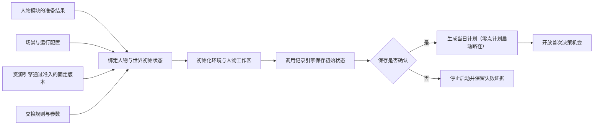
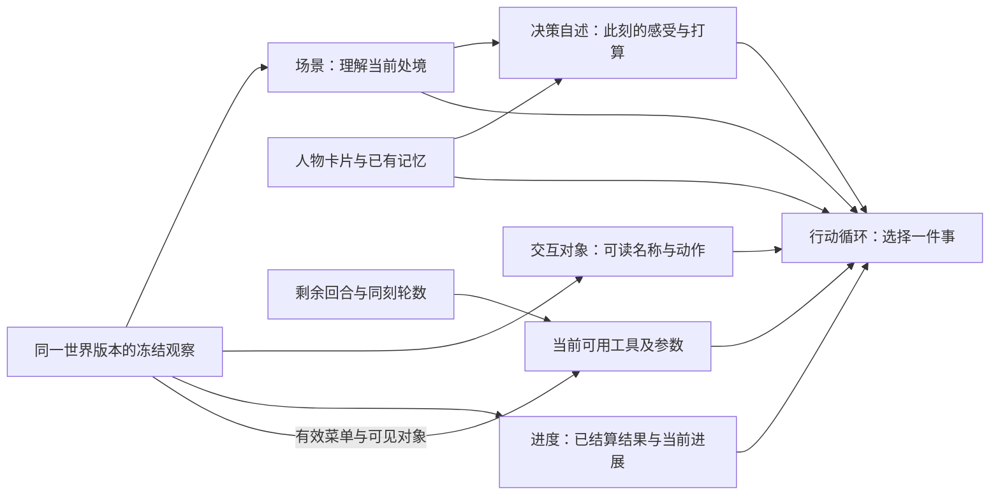
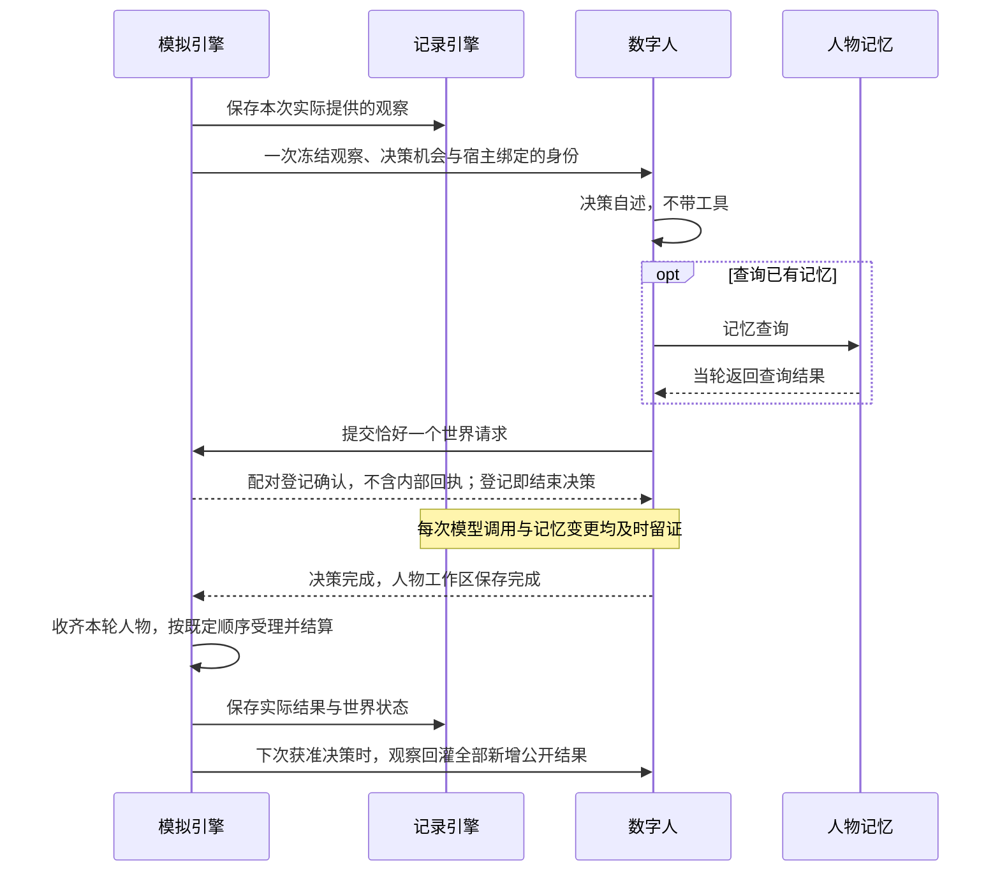
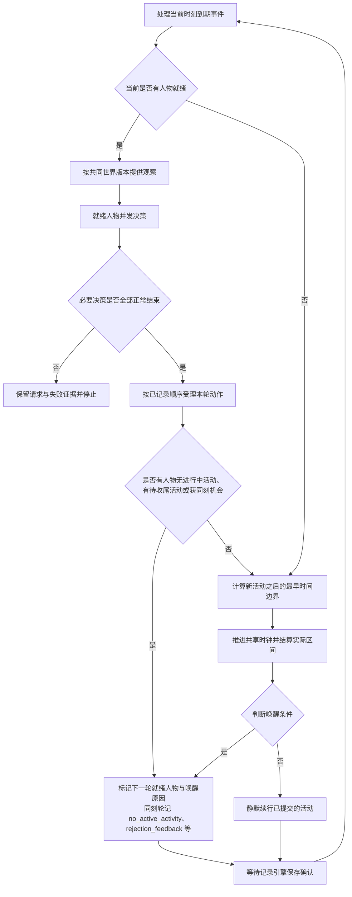
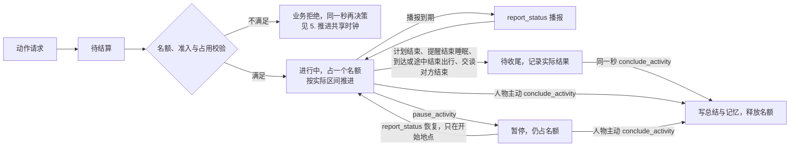
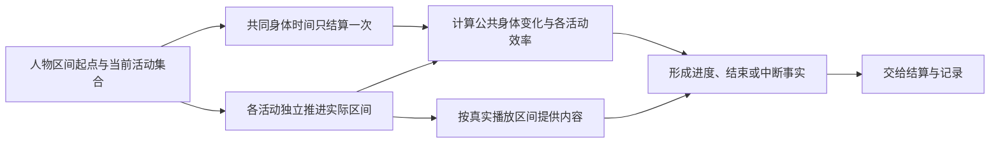
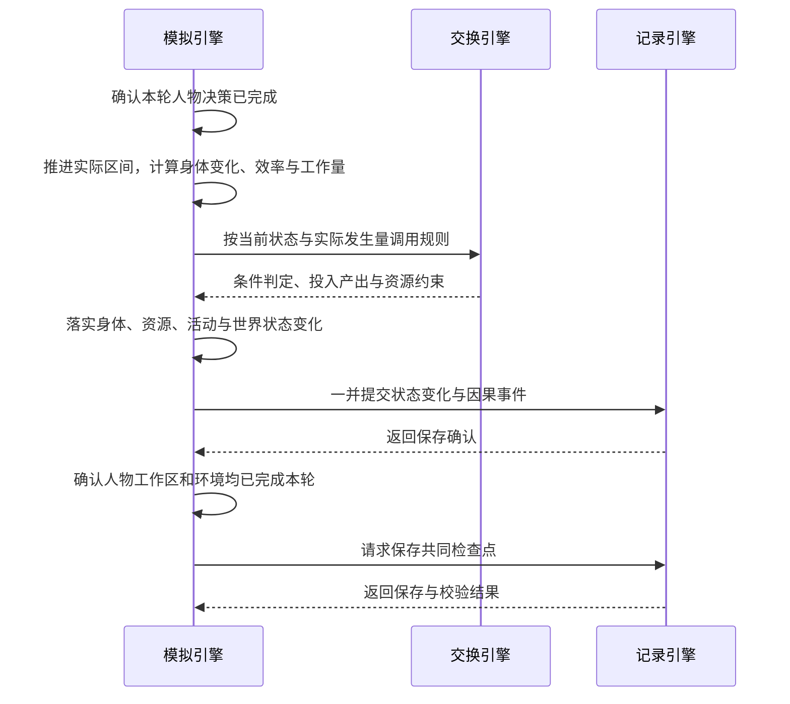
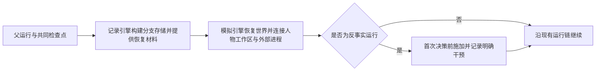

# WorldMock 产品设计说明书 — 模拟引擎

> **状态**：DRAFT；职责设计，现行接口与行为仍以冻结合同和规格为准  
> **日期**：2026-09-26  
> **版本**：v1.8
> **范围**：运行初始化、观察与决策机会、同刻决策、动作受理、活动名额与生命周期、共享时钟、活动推进、结算、零点计划、唤醒与恢复编排

模拟引擎负责让数字人在同一个世界中实际生活：在合适的时刻提供观察与决策机会，
推进已接受的活动，调用规则并落实状态变化。本文按引擎内部功能展开；
其他模块只说明交互关系，详细设计由所属模块维护。

## 1. 职责与边界

### 模拟引擎负责什么

**数字人决定做什么，模拟引擎负责事情何时发生、实际发生多少，以及世界如何随之改变。**
资源引擎提供定义与内容，交换引擎给出规则判定和计算结果，记录引擎保存事实与状态。
模拟引擎组织这些调用，并在保存确认后继续运行。

对人物而言，一次决策是先理解当前处境、说出感受与打算，再选择一件事。
查询已有记忆当场得到答案；提交生活动作只得到登记确认，真实结果由环境结算后在下次观察中告知。
模拟引擎负责维持这个闭环，人物模块负责其中的自述、选择与记忆。

### 项目框架映射

按[概述的解决方案](00-overview.md#12-解决方案)，模拟引擎展开为下列内部功能。
灰色框对应正文主题；框外模块各自维护其能力与实现。

正文标题与灰色功能框保持同名。人物画像与记忆、资源检索、记录存储、离线 Dreaming
不设为模拟引擎内部主题。反事实运行属于实际执行；基于足迹生成假设文本属于数据交付。
零点计划由运行时在场景本地零点与启动路径执行（同联系人回复），不经人物模块。
虚线表示已结算结果供下次观察使用，不代表每次结算都会触发新的决策。

### 与其他模块的分工

| 所属模块 | 独立负责的内容 | 模拟引擎如何协作 |
| --- | --- | --- |
| [人物模块](../dev/SPEC-life-realism.md) | 画像提取与参数编译、人物提示、两阶段决策、记忆检索、合并与反思 | 绑定准备结果，提供观察与机会，等待决策完成及人物工作区保存 |
| [资源引擎](03-resource-engine.md) | 资源与内容定义、语料准入、目录发布、检索排序与内容提供 | 传入当前世界条件、可见范围和实际接触区间，使用返回结果 |
| [交换引擎](02-exchange-engine.md) | 交换条件、占用与转换规则求值，投入产出和资源约束校验 | 提供当前状态、实际时长、工作量与食品利用效率等输入，使用返回结果落实状态变化 |
| [记录引擎](05-recording-engine.md) | 事件与状态存储、事务、证据关联、检查点校验、分支材料、认证导出与查询 | 提供真实过程，在完整运行边界请求保存；取得确认或恢复结果后继续 |
| [数据交付](06-delivery.md) | 证据窗口、离线 Dreaming、LabelKit 调用、编码和发布 | 实际反事实运行结束后，由记录引擎向交付提供认证导出 |
| [行为评估](07-evaluation.md) | 行为指标、评分与真实性评价；原始足迹的客观统计由记录引擎提供 | 提供可分析的运行事实，正式运行不因报告而自行改变规则或选择 |

世界状态由模拟引擎中的生活环境统一修改；人物模块维护自己的记忆与工作区，
记录引擎负责持久化与共同检查点的一致性。规则求值不自行推进时间或写入世界状态。
模拟引擎复用现有 AgentSociety 2 调度与人物调用链，不增加另一套人物决策循环或世界时钟。
零点计划 `plan_day` 是运行时后台任务（同联系人回复），不经人物调用链，计划由其后的共同检查点封存。

### 设计依据

运行接口遵循[接口合同](../CONTRACTS.md)，调度与故障传播遵循
[AgentSociety 2 接入规格](../dev/SPEC-as2-integration.md)，时间、活动与观察行为遵循
[生活运行时规格](../dev/SPEC-life-runtime.md)。人物与环境之间的上下文、登记和反馈边界遵循
[决策上下文规格](../dev/SPEC-decision-context.md)，地点类与人物的工具准入遵循
[交互菜单规格](../dev/SPEC-interaction-menu.md)，人物工具面、会话与引擎派生参数遵循
[数字人交互规格](../dev/SPEC-agent-interaction.md)，决策不耗时、能量感知与不拦人、零点计划与提醒、
生活动作与并行准入、活动名额与生命周期遵循[时间与能量规格](../dev/SPEC-time-and-energy.md)；
其业界依据分别见所属研究记录。跨模块细节沿上表进入所属设计。

按时间排序、在同一时刻确定性处理事件，沿用成熟离散事件模拟的设计原则，参见
[SimPy 的时间与调度说明](https://simpy.readthedocs.io/en/latest/topical_guides/time_and_scheduling.html)。
本项目由现有运行框架与生活环境执行这些职责。

## 2. 初始化运行世界

### 输入与启动流程

| 输入 | 模拟引擎需要确定的内容 |
| --- | --- |
| 场景 | 起止时间、时区、人物与地点、地点类和人物交互菜单、日历、账户和身体初值（不预置活动，按作息反推，算法见[生活运行时规格](../dev/SPEC-life-runtime.md#两过程睡眠模型)） |
| 人物准备结果 | 人物身份、卡片与运行参数已就绪，并能绑定对应工作区 |
| 资源与规则 | 本次运行使用的固定版本及准入结果，不在运行中补抓或改写目录 |
| 运行配置 | 模型调用配置、独立运行目录及记录引擎返回的运行身份 |

当前新建入口仍会调用人物模块完成画像编译与卡片渲染，再绑定到运行；
这属于启动时准备依赖，画像提取、共识、参数映射和覆盖率算法由
[人物画像规格](../dev/SPEC-life-realism.md#画像编译)维护。
启动完成后使用已绑定结果，恢复运行使用检查点封存的人物工作区，不重新编译画像。
恢复按 `plan_submitted_dates` 不重复生成当日计划与提醒。
恢复还必须加载持久化供给报价、库存、营业例外、人物可见供给与轮转，不用地图初值覆盖已经发生的调价或补货。

### 地图与供给初始化

场景引用唯一冻结地图，选择地点、商品和供给，并给供给库存及人物资格实例初值。
解析后的地点提供菜单分类、经营业态和活动环境；缺活动环境不得按 `anywhere` 放行。
初始化 `supply_stock`、`supply_quotes` 和 `opening_exceptions`，地图身份与来源随运行清单冻结。
路线完整性按每个所选有向端点和方式验证；显式未知可保留资料，但不能据此安排出行。

### 启动完成的条件

人物与世界使用同一场景时间，资源和规则依赖已就绪，初始状态保存确认后才能进入决策。
交互菜单的地点类覆盖、人物字段、名称闭集、重复、空集合与保护项在启动前完整校验。
任何必需输入失败都停止启动，不能用空人物、空目录、全量菜单或默认动作继续。
创建新运行与打开已有运行是不同操作；已有目录不得覆盖，恢复失败不得隐式创建空运行。
运行参数见[配置设计](08-configuration.md)，目录身份与保存规则见[记录引擎](05-recording-engine.md)。

## 3. 组织观察与决策机会

输入是已确认的世界状态、当前就绪人物和唤醒原因；输出是实际提供的观察与已完成的决策结果。
是否提供机会由[判断唤醒条件](#8-判断唤醒条件)决定，本主题只组织已获准的一次决策。

### 提供当前可见的处境

模拟引擎将当前地点、体感、在场人物、通知、活动结果和计划投影成观察，
调用资源引擎提供当前可见对象与实际接触内容。准确身体数值留给结算和审计，人物接收对应体感。
饥饿分级在低能量时不被昼夜项与餐时项钳住，能量极低时为新增的最重一档「饿得发慌」；食品标每份热量，路线标轻松、一般或费力，
二者是商品与路线事实，不是身体数值。饥饿为「饿」及以上时，场景用一句吃饭途径句说出最近的一条真实途径，
由确定性代码从本轮观察已有的事实生成，不调用模型。分级数值与阈值见[生活运行时规格](../dev/SPEC-life-runtime.md#其他体感分级)。
人物卡片与记忆提示由人物模块组装；目录检索、排序、轮转与内容切片由资源引擎维护。
模拟引擎同时按权威位置取得地点类菜单，与人物声明求交集并把有效菜单写入事件级工具支持数据。
菜单不裁剪场景、事实、可供性合同或候选；它只约束人物本轮可提交的入口与参数。

同轮人物观察基于共同世界版本，每个人物的一次决策只向环境读取一次观察。
自述与行动分别使用这份观察，模型重试、记忆查询和动作登记都不重新读取世界。
未播放、未阅读、未发生的内容不能当作已接触事实。
观察字段与预算遵循[观察投影合同](../dev/SPEC-life-runtime.md#观察投影与提示合同)。

### 人物所见与可做之事

场景帮助人物理解处境，交互对象提供人类可理解的唯一名称和可选择动作；
人物卡片和记忆说明自己是谁、经历过什么。已结算执行结果归入进度层；进度层按会话分组，
写各活动的客观进度，人物自述标「你自己记下的，未经核验」；内部身份、索引和状态维护不进入模型请求，
工具 Schema 与工具返回同样不含内部身份。
这些上下文由人物模块按阶段组装。冻结菜单收窄 `start_activity` 的动作选项，再由可见对象与剩余回合收窄；
不按人物当前活动、能量或日首计划剪裁，唯一的状态性收窄是同刻上限的受限轮。

| 人物阶段 | 使用的上下文 | 当前可做之事 |
| --- | --- | --- |
| 决策自述 | 人物卡片、场景与记忆 | 不带工具，表达感受与打算 |
| 行动 | 增加事实清单与决策自述 | 按预算查询记忆后提交恰好一个世界请求，登记即结束 |

初始请求中，system 说明身份与执行要求，并含固定一节「怎样过一天」，user 承载人物上下文，tools 限定当前可调用的工具。
同一行动循环的初始 user 只构造一次、逐字节保持不变；后续模型与工具消息单独追加，system 中的回合预算随调用更新。
即时查询结果因此可以服务当前选择，而冻结处境与菜单不会在循环中悄悄变化。

场景概括最近三条收件头，确有未展示未读项时提示人物；事实清单保留完整可见收件箱。
场景中的地点名称和营业状态解释处境；路线与供给报价由系统单向告知模型，
模型只选可读对象与动作。引擎使用本轮冻结观察中的报价和权威规则计算精确时长、数量与付款，
不要求模型回填价格、报价版本或精确秒数。暂停活动的进度与未完成工作待办分别表达。
模型为每个对象选五个动词（`travel`、`interact`、`obtain`、`consume`、`sleep`）之一，并选该对象列出的方式；
宿主私有 `interaction_bindings` 把（对象，动词，方式）绑定到内部身份、标准动作、出行方式、履约方式、`use_mode`
和冻结报价，模型仅见对象名称、动词与方式短语。提交工作成果与发送消息使用独立工具，任务与收件人同样以可读名称定位。
每次实际模型请求都计算完整上下文与预留输出；达到上下文窗口的百分之八十五时，
先按会话合并较旧的已收尾活动，再合并为一条总历史摘要；进行中、暂停与待收尾的活动、当前提醒与本轮全部
新结果原样保留。权威状态与事件不变；浓缩后仍超限则报告各层 token 用量并失败。

### 发现与比较门店供给

地点发现由 `start_activity` 的可读对象与对应动作发起，使用相同观察、菜单和回合预算。
浏览是占名额的活动，筛选与分页结果随浏览结束（`browse_result`）或在下一次观察时回灌，
下一次观察才看到新的地点与供给事实；`discovery_result` 保留在唤醒闭集中，当前没有触发来源，不另排下一秒。
游标绑定地图、筛选与起点，世界时间推进后仍可继续同一查询。
公开事实包括返回供给的报价、版本、库存、营业、资格、履约、道路状态与来源；未返回供给不取得可见资格。
人物状态用 `visible_supply_ids`、`supply_browsed_at`、`supply_browsed_location` 保存对应身份与时效。
同一商品多家门店的候选、浏览和轮转互不覆盖，消费仍按人物当前位置的商品库存。

可见时刻与呈现地点逐供给保存；超过 1800 秒或当前位置改变后，旧凭据失效。新呈现其他供给不能延长旧凭据。
由 `start_activity` 发起的下钻和有时长的商品浏览都只授权实际窗口；有时长浏览在完成结果中保存 `browse_result`，
记录完成时刻，不能使用活动开始或推进前的世界时刻。发现与浏览回灌优先占用同一个呈现窗口，
当前事实仅补剩余名额；相同事实去重，发生变化的当前事实和历史结果分别保留。
窗口外已知供给、全量商品定义和未返回供给不能借观察刷新可见凭据。

生活活动在目录中声明支持反馈边界，因此与其他普通清醒活动共用暂停、继续和恢复控制。
暂停的活动只在开始地点恢复；在别处恢复以 `ACTIVITY_PRECONDITION_UNMET` 拒绝并点名地点，保留暂停进度；
在别处可以直接结束。
旅行完成后访问资格不足也保留到达位置、路线进度和交通费，以失败原因和公开 `arrival` 回灌，
到达当秒提供合法下一决策。到达的同一秒，出行与路上开始的活动结束，会话随之切换，人物当即收尾。
旅途中的身体结算与阈值预测复用当前活动实际方式的 MET，
不能用不存在的通用 `travel` 或 `lifestyle` 费率替代驾车、步行或具体生活活动。

### 调用并等待人物决策

模拟引擎沿既有 AgentSociety 2 人物调用链调度，不另写决策自述、行动或记忆生成算法。
宿主绑定人物、决策和动作身份；人物提交请求不等于环境已接受或执行。
必要决策失败时，停止本轮未执行提案，不能补造动作或结束结果继续推进。
人物内部协议见[两阶段决策](../dev/SPEC-life-realism.md#两阶段决策)与
[记忆合同](../dev/SPEC-life-realism.md#记忆合同)。
人物在生活决策中只经 `conclude_activity` 的 `memories` 写记忆，此外只有就寝反思与阈值巩固；
来源由系统登记，零点计划 `plan_day` 不写记忆。

两阶段是决策自述与行动循环，不是固定两次模型请求。正常无查询、无纠错时，
自述与世界请求共需两次请求；查询与协议重试继续消耗同一回合预算。
登记确认保留原生工具调用配对身份，完整内部回执留给宿主审计与幂等，不能把它复制进人物提示。

只读提问使用人物卡片、持久记忆与外部问题，不触发生活决策的观察或自述。
只读路径只开放预算允许的记忆查询与结束工具，不写世界或人物记忆。

### 接收当日目标并记录实际推进

场景本地零点先结算旧日区间、使旧计划失效，再由运行时后台任务 `plan_day`（同联系人回复）为每个人物生成有序目标，
经引擎的系统登记入口写入世界状态，并写 `environment_event`（`data.kind="day_plan_generated"`）；
目标文字不转换成时间边界或自动活动。目标的 `remind_time` 登记为一次性提醒边界：到期以 `plan_reminder_due`
提供决策，睡眠中则结束睡眠，结束原因为 `plan_reminder`。人物修订计划时，原样重发的目标保留提醒，
只改提醒时刻的换成新提醒，被替换或删除的目标取消提醒。
实际正时长结算按家族匹配一条尚未推进目标，原子保存推进证据并发放一次情绪脉冲；
记录引擎负责保存事实，不负责判断目标推进。
目标与修订合同见 [当日目标规格](../dev/SPEC-day-plan-goals.md)，零点计划与提醒见
[时间与能量规格](../dev/SPEC-time-and-energy.md#四零点计划与计划提醒)。

## 4. 收齐并有序受理动作

### 收齐请求与确定顺序

输入是同一轮人物基于共同世界版本提交的动作，以及决策前已经记录的竞争顺序。
请求到达时先登记为待结算，全部必要决策正常结束后才有序受理。
输出是活动受理结果、占用安排或带原因的业务拒绝，接受活动不代表活动已经完成。

同轮人物可以并发调用模型，但共享物品、任务和余额由环境串行结算。
决策前按固定随机种子产生并记录竞争顺序，同轮观察基于共同世界版本；
请求到达先后不能改变结算顺序，环境也不能为等待某个早序请求而阻塞接收。
必要决策发生异常时，该轮尚未执行的提案不再结算，保留请求与失败证据并终止。
不可逆付款和任务提交使用稳定动作身份防止重试重复结算。

### 校验与占用安排

模拟引擎先依据权威场景、人物位置与当前状态重算交互菜单，拒绝不允许的标准动作；
恢复操作另按当前资源、地点、归属和身份检查，只在开始地点恢复。随后才把当前状态、动作、目标与已占用资源
交给交换规则核验，并根据规则结果安排活动。
菜单拒绝使用 `INTERACTION_MENU_DENIED`，在付款、消费、活动、游戏、消息与工作验收等领域副作用前
结束。该预检与交换条件是连续的两道校验，菜单不能放宽交换规则，交换规则也不能绕过菜单。
同轮较早动作可能已经改变库存或任务状态，因此必须在实际受理时检查，不能只依赖观察时的可行性。
具体条件见[交换引擎](02-exchange-engine.md)，人物与动作身份仍由宿主绑定。

同一人物一轮决策只提交一个世界请求；`start_activity` 的每项取五个动词之一并选对象列出的方式，
一个请求至多原子开始两项持续活动。每人两个活动名额，进行中、暂停中与待收尾的活动都占名额，
`conclude_activity` 之后释放。每项分别通过可见菜单与领域条件，同一暂存状态按注册表声明的占用交集
与准入事实（实际地点、目标在场、出行方式、物品状态）整组接受或拒绝；能量不参与准入。
出发前须先结束或暂停进行中的活动，否则以 `ACTIVITY_PRECONDITION_UNMET` 拒绝；有刚结束的活动时须先
`conclude_activity`，否则以 `ACTIVITY_CONCLUSION_REQUIRED` 拒绝。观看、游戏内容与生活活动的派生时长
超过 86400 秒时按 86400 秒受理并公开计划时长，出行超限仍拒绝。
活动各自推进、控制与完成，人物共同时间只结算一次；详细规则见
[一日行为可信性规格](../dev/SPEC-dayrun-behavior.md#同一人物的活动集合)与
[时间与能量规格](../dev/SPEC-time-and-energy.md#五五类生活动作与并行准入)。

受理成功后的新活动必须参与下一时间边界计算。业务拒绝后的同刻再决策与同刻上限，
由[推进共享时钟](#5-推进共享时钟)处理；不能在同一时刻无限重新请求。

## 5. 推进共享时钟

### 一轮运行

决策不消耗模拟时间：先处理当前到期事件，再提供观察并收齐动作；环境受理后才计算下一时间边界。
决策轮尚未结束或仍有人物待决策时，不能推进共享时钟。
受理后仍有人物就绪，则先完成保存与检查点，再进入下一轮决策；无人待决策才推进时间。
边界取活动完成、内容反馈、身体变化、通知配送、工作截止、计划提醒、活动播报、场景本地零点、等待结束和实验结束等相关时刻中的最早值。
某人睡眠八小时不能让其他人物的活动、通知或配送被跳过。

每次时间推进严格大于零，即时事件在当前时刻按稳定顺序处理。
没有进行中活动或有待收尾活动的人物在同一秒再获得决策，直到有一项进行中活动（等待、睡眠都算）且没有待收尾活动；
人人满足后时钟才推进。有进行中活动时，瞬时动作成功后按决策节律，业务拒绝后同一秒再给一次机会。
同一人物同一秒的轮数受场景参数 `max_same_moment_decisions` 约束，时钟推进即归零；达到上限仍不满足时进入受限轮，
每轮只开放一类动作，收尾、结束与等待不会被业务拒绝，同一秒的轮数因此有上界。
业务拒绝不构成运行失败，环境也不替人物选择活动。受限轮的阶梯见
[时间与能量规格](../dev/SPEC-time-and-energy.md#一决策不耗时时间只在做事时流动)。

模拟时间统一使用 UTC epoch 秒；输出给其他模块的时间保持同一发生时刻和排序。
本次推进秒数必须恰好对应上次确认时刻到结束时刻的间隔。

### 预排事件

预排事件在共享时钟上触发，覆盖通知、工作、日历、账单、工资、改价、商品发布和配送等。
场景中明确给定的邮件、任务、日历与账单在加载时编译为初始事件，购买还会动态产生配送事件；
这些事件都要保存身份、顺序和处理游标。
同秒事件稳定排序，已经处理过的事件不能在再次观察或恢复时重复执行。报价声明边界使用 `supply_quote_change`，
先完整切换声明再执行该秒显式调价；调价从到期时刻生效，并保留有效声明的失效边界。显式调价与补货各自保存场景假设来源，
不能沿用真实旧报价的来源标签。整单只排一个携带 `order_ids` 的配送事件，实际交付数量记录为 `inventory_changes`，重放为空。
目录保持只读，运行中的价格变化属于世界状态覆盖值。

### 程序加速与媒体倍速

程序加速只减少现实等待，不减少生活耗时；观看二十分钟仍消耗二十分钟模拟时间。
人物选择的媒体倍速单独记录，跳过的内容不会进入观察或记忆。
运行速度取决于真实模型调用、内容处理和持久化耗时，不能用示意性能值代替实测。

## 6. 推进实际活动

输入是当前活动、共享时钟确定的实际区间和冻结规则。模拟引擎推进已经被接受的活动，
计算实际进度、身体变化、体感与效率，并把变化交给[依规则落实结算](#7-依规则落实结算)。
人物提交的计划时长不能当作已经完成的时间。

### 活动生命周期

### 实际区间、身体变化与效率

| 活动 | 按实际过程推进的内容 |
| --- | --- |
| 工作 | 实际投入时间与效率决定有效工作量，交付物仍须单独验收，不能以累计时间替代生产结果；投入与有效秒数随每次结算累加到活动；距截止与剩余合同都不少于 60 秒才开工 |
| 进食 | 按实际消耗食品与经过区间更新进度、能量输入和消耗；购买或取得食品不等于已经进食 |
| 睡眠 | 按实际睡眠区间演化睡眠状态，持续计入基础能耗；中断后不直接恢复到满值；计划提醒到期时结束睡眠（结束原因 `plan_reminder`），按实际时长结算 |
| 节目与游戏 | 节目只提供已播放片段；游戏以实际回合结果推进，简介不能充当执行结果 |
| 出行 | 按实际路线与方式推进，位置变化决定后续能够接触的对象与内容；出发与到达时系统切换地点会话，到达同一秒出行与路上开始的活动结束并待收尾 |
| 等待 | 身体变化和其他人物、通知、配送照常推进，等待不冻结世界 |

身体演化、体感分级和效率求值由模拟引擎负责；交换引擎使用已经计算出的实际时长、工作量和利用效率等输入。
身体数值与体感分开：准确数值用于结算和审计，人物观察接收对应体感。
身体变化与工作效率的算法统一遵循[生活运行时规格](../dev/SPEC-life-runtime.md#身体语义两过程睡眠睡眠不足账体感分级)，
食品和工作等转换规则见[消费、生产与需求模型](../dev/SPEC-life-runtime.md#消费生产与需求模型)。

模拟引擎按人物和正时长区间形成唯一的 `body_settlement` 环境事件，再独立推进活动并应用
进食等专有效果。并行运动负荷取最大 MET，公共身体增长只记一次，同一效果通道先汇总后限幅。
能量对所有活动集合以 0 截断，不报错，也不阻止或停止任何活动；边界预测覆盖全部饥饿阈值，跨档时刻进入边界候选，
阈值数值见[生活运行时的决策节律](../dev/SPEC-life-runtime.md#决策节律结算边界与唤醒条件分离)。
各 `activity_progress` 引用共同事件，并只保存本活动进度与效果。
其中的 `after` 不是包含全部食品效果的最终身体状态；食品能量流入须结合
`resource_flows` 与最终世界状态核验。睡眠演化由对应规则验证；
模拟引擎核对共享时钟与实际结算区间，并行活动时长不能直接相加。

模拟引擎将实际食品利用效率写入进食活动的 `activity_progress.data.consumption.food_efficiency`，
对应同一区间的真实食用增量。记录引擎读取已提交测量；字段缺失时只能标为未知，不能自行补算。

### 反馈、续行与结束

普通活动只有到达对应反馈边界并满足资格才接受继续请求，游戏回合使用自己的反馈与动作入口。
播报只针对进行中的活动，锚点为活动的 `report_anchor_at`。
活动推进遵循[生活运行时规格](../dev/SPEC-life-runtime.md)，其中使用的交换条件与转换规则见
[交换引擎](02-exchange-engine.md)。

暂停不继续产生该活动的进度与内容；完成、取消或中断只按实际发生部分形成结果。
活动因计划结束或提醒结束睡眠而结束时，人物在同一秒以 `conclude_activity` 收尾。
结束、暂停与恢复逐活动写 `environment_event`；原始动作的全部子活动终结时写一次终态；暂停不是终态。
反馈边界不自动终止活动，也不允许继续请求重复结算同一区间。
是否在该边界打断人物并重新选择，由[判断唤醒条件](#8-判断唤醒条件)独立决定。

## 7. 依规则落实结算

### 从实际进度到世界变化

输入是当前状态、已经发生的活动区间、实际工作量与履约事实。模拟引擎调用交换规则，
取得投入、产出与约束后落实变化；资源定义提供单位和边界，记录引擎负责把状态与事件一起保存。
交换规则求值不自行推进时间，也不独立写入另一份世界状态。

| 结算对象 | 模拟引擎落实的变化 |
| --- | --- |
| 资源与身体 | 应用实际区间的输入、消耗和恢复，保留变化原因与使用的规则 |
| 库存与配送 | 区分付款、取得与使用，更新持有数量和实际履约状态 |
| 工作与报酬 | 将实际交付送验，在验收与付款条件满足后按合同结算，重复提交不能重复付款 |
| 活动与世界 | 更新实际进度、完成或中断状态，以及已发生的位置和环境变化 |

一次动作的请求、接受和完成分别留证。不得把模型的成功叙述当作世界变化，
不得在计划尚未执行时提前记入产出或完成结果。

### 将真实结果交还人物

登记确认只说明请求已记录；即时记忆查询返回人物已经拥有的信息；世界结果在统一结算后，
由下次获准决策时的观察交还人物。这三种返回语义分别承担确认、查询和反馈，不能相互替代。
工作验收可以在提交期间准备，但其通过或返工结论仍不能在本轮结算前回流给人物。

下次实际发送给模型的进度提示按事件顺序带回上次实际发送以来的全部新增公开结果。
事实清单保留完整结果、具体失败原因与公开工作反馈；不能因条数多而静默裁剪，超出提示预算则明确失败。
动作身份由宿主私下关联，不进入模型可见结果。
已核验经历写成句子交还人物；记忆查询的返回与工具 Schema 同样不含内部身份。
内部参考身份、答案对象、哈希、资源账户、数值身体状态和完整活动快照留在宿主证据中，
评审理由也不能夹带内部参考身份或哈希。字段与校验规则见[登记确认与结算结果](../dev/SPEC-decision-context.md#登记确认与结算结果)。

### 每轮保存与确认

模拟引擎将自己产生的观察、动作受理、活动进度和状态变化交给记录引擎，
并等待人物调用及记忆保存完成；人物内部证据由人物模块通过记录接口保存。
零点计划的模型请求与响应在零点边界的共同检查点之前，与计划、提醒同一次提交并留证。
`conclude_activity` 的记忆在登记的同一轮由宿主经 `after_step` 写入，环境只校验形状并随 `action_requested` 留证。
人物提交请求、环境接受请求、活动实际完成是不同事实，不能用前一阶段的反馈代替后一阶段的结果。
决策自述属于人物自述，准确世界变化由环境产生；所有证据绑定当前人物、决策、动作和时间。

环境仍是世界状态的唯一写入方。并发人物 worker 不能各自修改世界数据库，
模拟引擎也不能在保存失败时继续采用未提交的内存结果。
事件字段、素材发布、事务、资金对账和版本连续性只在
[记录引擎](05-recording-engine.md)维护，本文不再定义另一套存储结构或事件枚举。

### 共同检查点的调用时机

本轮人物响应、记忆写盘、环境推进和事件提交全部完成后，模拟引擎才请求共同检查点。
模拟引擎提供当前世界与人物运行状态，记录引擎负责检查点的完整性校验和保存。
模拟引擎只接受记录引擎确认的完整结果，不自行根据某个文件存在判定恢复材料有效。

检查点失败就是运行故障；已确认状态保留，不能将半成品作为恢复入口。
保存和校验细节见[保存共同检查点](05-recording-engine.md#保存共同检查点)与[恢复与反事实分支](05-recording-engine.md#恢复与反事实分支)。

## 8. 判断唤醒条件

### 结算边界与决策机会

| 边界 | 环境行为 | 人物行为与足迹 |
| --- | --- | --- |
| 静默结算 | 按实际区间更新身体、内容和活动进度 | 不调用人物决策模型（零点计划的后台调用不是人物调用）；只记录进度，决策标记为否、唤醒原因为空 |
| 命中唤醒条件 | 保存变化与全部命中的原因 | 提供观察与决策机会，记录实际请求、响应和记忆 |
| 同刻再决策 | 不推进时钟，不写 `body_settlement` | 没有进行中活动、有待收尾活动或业务拒绝后，同一秒再提供决策，唤醒原因替换为本轮原因；轮数受同刻上限约束 |
| 场景本地零点 | 结算旧日区间、使旧计划失效；运行时后台任务 `plan_day` 为每个人物生成当日计划并登记提醒 | 零点本身不提供决策、不打断睡眠；该秒的唤醒原因与下一决策候选在计划提交之后判定 |
| 游戏回合反馈 | 保持游戏的回合边界 | 使用对应游戏动作入口，不能视为普通活动续行 |
| 睡眠 | 持续结算实际经过时间 | 只因计划结束、计划提醒或合同允许的唤醒事件提供机会，计划提醒到期时结束睡眠；不受普通重估间隔打断 |

反馈粒度决定结算边界，普通重估间隔只是唤醒条件之一；二者分别使用场景参数，
不能把每次结算都变为一次模型调用。
静默边界不产生 `observation`、`decision_started`、`model_request` 或 `memory_updated`；
零点计划例外：它产生带 `purpose="plan_day"` 的 `model_request`，但同样不产生 `observation`、`decision_started` 与 `memory_updated`。

唤醒条件取生活运行时规格的唤醒闭集，本文只点名三项：`no_active_activity` 用于边界兜底，
边界结算后没有进行中活动的人物必获决策；`plan_reminder_due` 在计划提醒到期时提供决策；
播报到期（`progress_report_due`）只针对进行中活动。`activity_infeasible` 保留名称，当前无来源。
闭店威胁只从绑定当前地点的未完成任务和确实受营业限制的活动生成；自由文字目标不能证明地点绑定。
完整闭集、睡眠允许的原因与触发阈值见[生活运行时的决策节律](../dev/SPEC-life-runtime.md#决策节律结算边界与唤醒条件分离)，
留证字段见[记录引擎的共同身体结算与决策证据](05-recording-engine.md#共同身体结算与决策证据)。
体感变化与上一次实际提供决策时的分级比较，不与紧邻的静默结算边界比较；滞回沿用身体规则。

### 门店营业与报价事件

营业解释覆盖分钟级分段、跨午夜、全天开放与日期例外；明确闭店日期覆盖前日跨夜区间。
观察、候选、动机、购买和唤醒使用同一 `open/closed/unknown` 结果，不保留整点开闭店判断。
营业变化、报价生效/失效、调价和补货进入既有事件时钟，不增加周期轮询。
当前报价和库存写入世界状态；到达重验访问资格，购买重验营业、资格、报价和履约。
购买失败不撤销实际旅行；整单成功才一次付款和扣供给库存，配送实际交付才增加目的地商品数量。

## 9. 恢复与反事实运行编排

`resume` 从完整检查点继续生活，`replay` 在新分支施加明确干预后重新执行环境。
恢复必须使用检查点封存的世界、人物、游戏与随机状态，不能混入父目录之后的修改或残留进程状态。
记录引擎负责新分支身份、来源关系和历史完整性；模拟引擎确认人物工作区与各参与者恢复成功后才开始决策。
运行宿主核验当前代码（含实际导入的 AS2）、依赖、模型配置与场景是否匹配冻结身份，任一不符即拒绝恢复执行；
运行清单另记 `git_commit` 与 `git_dirty`，只记录，不参与恢复比对。
菜单声明随场景原始字节进入场景身份；静态工具描述变化进入工具模板身份。恢复不得把不同菜单、
不同工具模板或不同代码的状态解释为同一运行。
新建、打开既有运行和各恢复入口均核对决策阶段身份，含旧阶段名称的模型清单不能继续执行。
世界结构版本为 7，版本不符的检查点一律拒绝。恢复与反事实分支按 `plan_submitted_dates` 判定当日零点计划：
已生成的不重复生成计划与提醒；未生成的在首次决策之前执行，反事实分支在干预检查点之后，普通恢复在 `init` 中。
运行宿主负责将中断状态登记为 `interrupted`；创建分支不改写父运行，已提交尾部与失败证据保留。
游戏引擎执行后、数据库提交前崩溃时，必须从共同检查点重建游戏状态，不能继续使用残留进程。
恢复失败不得变为新建空运行。

现有余额条件干预 `set_balance_fen` 在子分支首次决策前应用并留证，人物随后自主选择。
干预不替人物编写下一步行为。重放已记录结果与重新调用模型分开：前者复原既有历史，
后者不保证作出相同选择。分支保存和历史认证统一见
[记录引擎](05-recording-engine.md#反事实分支与来源关系)。

模拟引擎只负责在恢复状态上实际执行。离线经历归纳、反思、假设文本生成和 LabelKit 调用
由[数据交付](06-delivery.md#34-dreaming-窗口提取规则)负责，默认不写回运行中的人物。
只有实际完成并由记录引擎认证的运行结果，才能作为真实反事实分支交付。

## 附录：运行约束与验证

### 失败处理

| 情况 | 模拟引擎的处理 |
| --- | --- |
| 余额不足、库存不足或活动冲突 | 接收规则给出的拒绝原因，同一秒再提供决策，受同刻上限约束 |
| 请求违反当前交互菜单 | 在任何领域副作用前返回 `INTERACTION_MENU_DENIED`，按业务拒绝回灌并同一秒再决策，受同刻上限约束 |
| 能量为 0 | 照常受理与结算，以 0 截断 |
| 交互对象为空 | 合法状态，决策照常 |
| 必要人物决策失败 | 停止该轮未执行提案，不合成默认动作，不推进时间 |
| 资源、规则或必需观察不可用 | 保留已确认状态并停止，不用空内容或默认结果替代；空交互对象层不属于必需观察不可用 |
| 零点计划输出不合法 | 附回错误重试（有限次数，按[时间与能量规格](../dev/SPEC-time-and-energy.md#四零点计划与计划提醒)第四章）；耗尽或传输失败为运行故障，保留请求、响应与错误证据 |
| 状态、人物工作区或检查点保存失败 | 传播故障，不能以未确认的内存状态继续运行 |
| 恢复或干预失败 | 不开放首次决策机会，不改为新建空运行 |

致命异常保持故障身份，记录英文错误与关联身份后终止。
跨模块接口失败不能被改写成普通业务拒绝，也不能依据离线报告自动修改正在运行的规则。

### 当前实现入口

| 模拟职责 | 当前入口 |
| --- | --- |
| 初始化、恢复与实际反事实运行编排 | [运行入口](../../src/worldmock/runtime.py) |
| 连接人物决策与生活环境 | [环境适配](../../custom/envs/life_env.py)与既有 AgentSociety 2 调度链 |
| 观察、受理、时间、活动、结算和唤醒 | [生活运行模块](../../src/worldmock/life/) |
| 预排事件与处理游标 | [预排事件模块](../../src/worldmock/scheduling/) |

上述是职责入口，不代表整个代码目录归模拟引擎独占。当前生活运行模块内也存在资源检索等实现，
它们按资源引擎的职责维护；运行入口调用画像编译，也不改变人物算法的归属。
本文收紧设计边界，不据此宣称代码已经完成物理拆分。

### 当前实现边界

当前身体行为尚未全部由睡眠活动声明驱动；场景选定的规则也尚未贯穿活动、身体与动机执行。
这两项属于模拟引擎的运行接入与执行差距，不能因交换规则已加载或文档已归并就认定完成。
完善时应沿现有活动与身体执行路径接入，验证实际状态变化，不另建一套规则执行循环。

### 验收重点

| 验证对象 | 模拟引擎必须满足的结果 |
| --- | --- |
| 启动 | 依赖与初始保存未确认前没有人物决策，失败不会产生可继续运行的空世界 |
| 决策上下文 | 原生人物调用每次只读取一次观察；自述、行动和只读输入边界清楚；初始上下文固定；交互对象不按人物状态剪裁（同刻上限的受限轮除外），工具按[稳定工具面](../dev/SPEC-agent-interaction.md#稳定工具面)的可见条件开放，只随阶段与预算变化；生活决策无 `finish`（只读问答保留） |
| 交互菜单 | 启动准入失败关闭；有效菜单随观察冻结；模型、本地与环境资格一致；直接请求不可绕过；候选与事实不被菜单删除 |
| 登记与反馈 | 内部回执留宿主，原生配对仍完整；记忆即时可查，已结算公开结果在下次观察完整、有序且仅回灌一次 |
| 多人物受理 | 同轮观察使用共同世界版本，已记录顺序决定受理结果，请求到达顺序不改变结算 |
| 共享时钟 | 必要决策未完成时不推进，已接受的新活动参与边界计算，到期事件不遗漏或重复；决策不耗时，推进时人人有进行中活动且没有待收尾活动，同秒轮数有上界 |
| 活动与结算 | 只按实际区间和履约事实更新状态，请求、接受与完成分别保留 |
| 身体与能量 | 任何能量下活动都能开始、继续与恢复，结算以 0 截断且不报错；低能量时饥饿分级不被钳住，饥饿每跨一档都在进行中活动里唤醒；提示不含身体数值 |
| 活动与会话 | 每人两个名额，进行中、暂停中与待收尾的活动都占名额；活动结束的同一秒人物收尾，收尾前时钟不推进；会话随出发与到达自动切换，到达时出行与路上的活动一并结束；暂停的活动只在开始地点恢复；结束、暂停与恢复逐活动留证 |
| 唤醒 | 静默边界不调用人物决策模型，实际唤醒原因完整；边界结算后没有进行中活动的人物必获决策；计划提醒准确唤醒且只一次，可结束睡眠；零点计划不提供决策；睡眠与游戏遵守各自边界 |
| 保存协作 | 等待状态、事件与人物工作区完成后请求检查点，保存失败立即停止 |
| 恢复执行 | 只接受核验后的完整恢复状态，明确干预在首次决策前生效，原运行保持原状 |

相关运行检查见 `tests/life/` 与 `tests/integration/`。画像质量、记忆算法、资源检索、
记录完整性和交付质量由所属模块验收；模拟引擎验证调用顺序、输入输出使用与失败传播。
实际验证要求见[验证规则](../VERIFICATION.md)，完成情况以[实现状态](../dev/implementation-status.md)为准。
决策上下文的条款、真实调用路径测试和独立源码突变证据见[特性验收记录](../dev/research/decision-context-verification.md)。
交互菜单的逐条证据见[交互菜单验收记录](../dev/research/interaction-menu-verification.md)。
时间与能量的逐条证据见[时间与能量验收记录](../dev/research/time-and-energy-verification.md)。
文档调整不构成真实模型运行或端到端交付通过的证据。

## 版本历史

| 版本 | 日期 | 修订内容 |
| --- | --- | --- |
| v1.0 | 2026-09-20 | 统一人物准备、决策与记忆、共享时钟、恢复编排和 Dreaming 设计；删除独立人物画像设计，存储与检查点引用记录引擎 |
| v1.1 | 2026-09-20 | 按概述解决方案展开项目框架映射，明确模拟执行与资源定义、交换规则、记录保存和 LabelKit 交付的关系 |
| v1.2 | 2026-09-20 | 正文按框架图内的功能逐章展开，拆分动作受理、时钟、活动推进、结算与唤醒判断，并同步章节引用 |
| v1.3 | 2026-09-20 | 收紧为运行编排与实际执行；移除人物、资源、存储和离线交付的内部设计，同步框架图与所属模块引用 |
| v1.4 | 2026-09-20 | 纳入决策上下文心智模型与完整交互时序，说明人物所见与工具阶段、登记与查询及结果回灌的区别，补齐公开边界、恢复与验收引用 |
| v1.5 | 2026-09-20 | 接入地点类与人物交互菜单的启动准入、冻结观察、人物工具收窄、环境副作用前重验、身份恢复与验收边界 |
| v1.6 | 2026-09-24 | 按时间与能量规格改写：决策不耗时与同刻再决策、同刻上限与受限轮；一轮一个世界请求，生活决策取消 `finish`；五个动词与方式，动作不按人物状态剪裁；两个活动名额、注册表占用与准入事实，派生时长上限；活动生命周期与同秒收尾，地点会话随出发与到达切换；能量不拦人、饥饿感知与吃饭途径句；零点计划 `plan_day` 为运行时后台任务，计划提醒可结束睡眠；身体初值按作息反推；运行身份覆盖实际导入的 AS2；世界结构版本 7；失败处理、实现边界与验收重点随之更新。补记 v1.5 之后未入表的正文改动：2bce358（地图与供给初始化、发现与比较门店供给、门店营业与报价事件；预排事件的调价与整单配送；恢复加载供给状态）、2d97d3d（当日目标）、d998a31（同人活动集合与共同身体结算）、2913546（活动执行与进度层） |
| v1.7 | 2026-09-26 | 时间与能量规格文档一致性核对：「验收重点」决策上下文行改为交互对象不按人物状态剪裁，工具按数字人交互规格「稳定工具面」的可见条件开放（原写工具面不剪裁，与条件可见不符） |
| v1.8 | 2026-09-26 | 时间与能量规格实现后文档（阶段 9）：规格已实现，「当前实现边界」删去冻结时补的「时间与能量规格尚未实现，以其第九章的绿色基线为前提；本文涉及该规格的内容按目标行为写」一句（E4-21）；「验收重点」仿决策上下文与交互菜单的验收记录说明，补「时间与能量的逐条证据见时间与能量验收记录」，链接到本特性验收记录（E4-24） |
