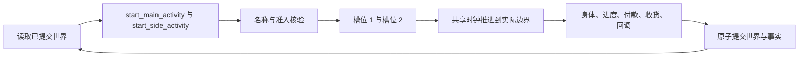
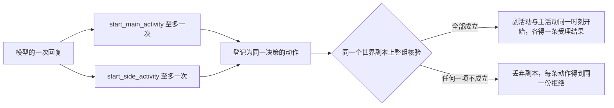
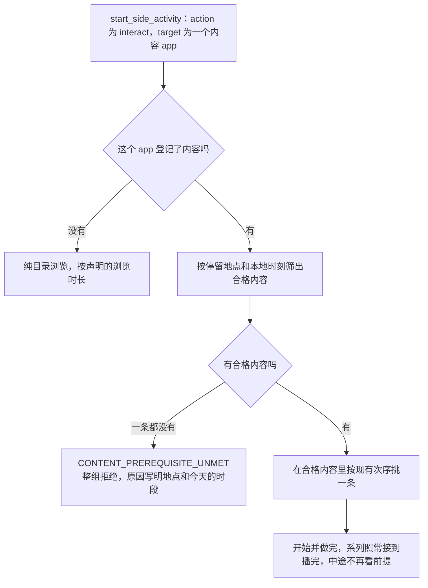

# WorldMock 产品设计说明书 — 模拟引擎

## 世界与请求

一个运行只有一个人物、一个绝对时钟和一份已提交世界。加载完整环境并验证实际模型元数据后才创建运行资产。
公开引擎创建入口从已加载配置和权威元数据派生当前模型身份与阶段预算，逐项核对调用方提供的身份。
结构合法但与实际输入不同的模型、端点、容量、预算或提示工具身份同样拒绝；拒绝发生在创建任何运行文件之前。
同秒续接开关保留调用方显式选择，其余身份只来自同一份输入与当前宿主合同。
运行开始时的初始 `session_open` 唤醒仅提供正常决策：那一刻没有一段睡眠结束，不做就寝反思，也不触发唤醒类别回调；
`run_start` 回调只执行一次。

## 动作、名称与并行

开始一件事用两个工具：`start_main_activity` 开始占槽位 1 的活动，`start_side_activity` 开始占槽位 2 的活动。
每个参数都必须出现，多余字段拒绝。删除 `start_activity`、请求里的四个出行动作以及 `way`、`app`、`to`、`pay_app`。

| 工具 | `action` | `target` | `detail` |
| --- | --- | --- | --- |
| `start_main_activity` | `travel` | 目的地的地点名 | 出行方式名称 |
| `start_main_activity` | `interact` | 当前所在地点的地点名 | 要做的那件事的名称 |
| `start_main_activity` | `sleep` | 要睡的分钟数，只写数字，例如 `"470"` | `null` |
| `start_side_activity` | `purchase` | 商品名数组，一份一项 | 没有这个参数 |
| `start_side_activity` | `interact` | 恰含一个内容 app 名的数组 | 没有这个参数 |

出行只有一个动作 `travel`，出行方式写在 `detail`：引擎自带步行，其余方式由数据集在 `travel-method.jsonl` 里定义（见[资源引擎](03-resource-engine.md)的「出行方式」），没有这个文件的环境包里人物只能步行。
`travel` 的 `detail` 只在出行方式的名称里解析；`walk`、`drive`、`take_taxi`、`take_bus` 不再是动作。
功能 app 由引擎选择，不供人物点选。

名称解析保留人物原始写法，以已登记的完整显示名解析，不按内容含义创造对象或动作，写得不准时返回候选而不替换。
`action` 由枚举保证，表外值按参数错误拒绝并给出全部允许值。`target` 解析到对象：出行与主工具的 interact 只认地点，
购买只认商品，副工具的 interact 只认内容 app；睡眠的 `target` 不做名称解析。
`detail` 在该对象该动作列出的名称里解析：先精确匹配，再按无损归一（全半角、括号、空白）逐级放宽，唯一才受理，写法实际变化时记入 `details.resolved`。引擎不默认步行，不替人物换成相近的方式，也不替人物补一件事；
出行的 `detail` 缺失、找不到或有歧义时这次出行不开始，候选是 `action` 为 `travel`、`target` 为目的地显示名、`detail` 为出行方式名称的完整调用。

| 结果 | 拒绝码 | 定位与允许值 |
| --- | --- | --- |
| 对象名找不到或对应多个对象 | `NAME_NOT_FOUND`、`NAME_AMBIGUOUS` | `target`，副工具定位到数组里的那一项 |
| `detail` 找不到或对应多个名称 | `NAME_NOT_FOUND`、`NAME_AMBIGUOUS` | `detail`；允许值是该对象该动作列出的全部名称 |
| 对象在这个工具下不提供该动作 | `ACTION_NOT_OFFERED` | `action`；允许值是该对象在本工具下提供的动作 |

对不是当前地点的地点写 interact、把当前地点写成出行目的地，都只得到 `ACTION_NOT_OFFERED`。
候选是可以照抄提交的完整调用 `{tool, arguments, note}`，至多三条；购买的候选只替换数组里出错的那一项。
名称类纠错发生在人物一侧，不登记世界请求、不计同刻轮数；环境用同一函数复核，名称问题合并为一次 `ACTION_REQUEST_INVALID`。

槽位是引擎限制同一时刻最多做两件事的两个位置，一个槽位同一时刻只放一项活动。

| 槽位 | 放什么 | 新开始的活动由谁放进来 |
| --- | --- | --- |
| 槽位 1 | 出行、睡眠、在地点做事 | 只有 `start_main_activity` |
| 槽位 2 | 购买、用内容 app | 只有 `start_side_activity` |

进行中和刚结束待收尾的活动占槽位，暂停的活动不占。睡眠占槽位 1，并要求槽位 2 没有进行中或待收尾的活动；
睡着时不能开始或恢复槽位 2 的活动。新开始才受工具约束，恢复用 `report_status`：点名暂停的活动，它回到原来的槽位，
该槽位须空着。系列换集留在原活动、原槽位，不经开始工具。

| 组合 | 能否同时进行 |
| --- | --- |
| 在地点做事 + 用内容 app | 可以 |
| 在地点做事 + 购买 | 可以，到店、外卖、快递都行 |
| 出行 + 用内容 app | 可以；出发前已在用的 app 可以带着走，也可以与出发同组开始 |
| 出行 + 购买 | 按履约方式而定，见「购买、付款与收货」 |
| 出行、睡眠、在地点做事两两之间 | 不可以，同占槽位 1 |
| 睡眠 + 任何槽位 2 的活动 | 不可以 |

开始组是模型同一次回复里的全部开始调用，一条或两条；两条时两个开始工具各一次，先后不限。
环境为每条调用登记一条动作，同一决策的动作成一组，在同一个世界副本上整组核验。

核验读请求前的世界，与出发同组的购买报价、收货地点和在场判断都按出发前的停留地点算。
整组成立后派发，次序与两条调用的先后无关：主调用是出行时先取一次出发前的停留地点留给副活动的派发，再结束当前停留、开始路上会话，再开始副活动，再开始主活动。
每条动作恰好开始一项活动，活动回链开始它的那条动作。
任何一项不成立时整组不开始活动、不扣款、不消耗随机选择，顶层拒绝码取下表次序里第一条不成立的检查。

| 检查（按次序） | 拒绝码 | 何时不成立 |
| --- | --- | --- |
| 请求形状 | `ACTION_REQUEST_INVALID` | 任一调用不通过请求模型 |
| 待收尾 | `ACTIVITY_CONCLUSION_REQUIRED` | 有刚结束而未收尾的活动 |
| 名称 | `ACTION_REQUEST_INVALID` | 任一调用名称解析失败 |
| 指名商品 | `SUPPLY_NOT_FOUND` | 购买数组里未展示的名称在全量商品中找不到唯一商品 |
| 同刻阶段 | `SAME_MOMENT_ACTION_RESTRICTED` | 当前受限轮不开放开始 |
| 同槽位占用 | `RESOURCE_CONFLICT` | 某条调用要占的槽位已有进行中的活动 |
| 睡眠约束 | `RESOURCE_CONFLICT` | 主调用是 `sleep`，而槽位 2 有进行中或待收尾的活动，或同组还有副调用 |
| 主调用的对象条件 | 按动作 | 出行：有进行中的到店购买，或路线检查不通过；在地点做事：见「出行、内容与目录浏览」；睡眠：见下文 |
| 副调用的对象条件 | 按动作 | 购买：逐份报价的拒绝按数组次序取第一条，到店购买不能与出发同组；用内容 app：登记了内容而此刻没有合格内容，见「出行、内容与目录浏览」 |
| 余额 | `INSUFFICIENT_FUNDS`、`INSUFFICIENT_TRAVEL_FUNDS` | 余额少于全部货款、各配送组运费与同组车费之和；没有同组购买时少于车费 |

整组只给一份拒绝，每条动作各写一条内容相同的拒绝结果。开始组有两条调用时 `reason` 末尾追加一句
` Neither start request was started.`（前面一个空格），只有一条调用时不追加。
明细只写在负责的调用上，路径以该调用在回复里的真实位置开头，没有问题的调用不出明细；世界条件造成的拒绝没有 `fix`。
同槽位占用的原因点名占用者：`The first activity slot is occupied by <活动名>.` 或
`The second activity slot is occupied by <活动名>.`；占用者此刻能暂停时下一步是 `Conclude or pause <活动名> first.`，
否则是 `Conclude <活动名> first.`，能否暂停见本节末尾。
睡眠约束的原因是 `Sleep requires the second activity slot to be empty.`。槽位 2 已被占时，占用者此刻能暂停时下一步是
`Conclude or pause the second activity first.`，否则是 `Conclude the second activity first.`，例如占着槽位 2 的是购买，
或者是离计划结束不足 180 秒的 app 内容；冲突来自同组的副调用时没有下一步，改法是单独提交 `start_main_activity`。

睡眠由人物写时长：`target` 是 10 到 720 的整数分钟，只写数字，全角数字与空白先归一；
带单位、小数、正负号或越界的写法都拒绝，引擎不换算、不取整、不截断。
请求不写地点，睡在人物当前停留的地点；该地点须标了 `sleepable`，否则以 `ACTIVITY_PRECONDITION_UNMET` 拒绝，
下一步指向本人的家。声明了营业时段的地点关门时不能开始睡眠，以 `LOCATION_CLOSED` 拒绝；
关门只卡开始，睡着后到了关门时刻照常睡到计划结束。

睡眠只在自己的计划结束时结束，计划结束在受理时定下：开始时刻加写的时长，再加多睡的时长。
会不会睡过头按这一觉开始的那一刻判定：受理时从开始时刻往回数 24 小时，合计本人在这 24 小时里睡了多久。
刚开始的这一觉不算在内，写多长都不影响判定；此前每段已结束的睡眠只计落在窗口内的那一截。
窗口早于运行开始时，按人设假定人物在惯常起床时刻
（睡眠中点加每日睡眠需要的一半）睡醒、此前睡满每日睡眠需要，只假定这一段，更早的时间按没睡算。
合计不足 4 小时才取随机流（键见[配置](08-configuration.md#configuration-随机键)）：先抽一位，
抽中再抽 20 到 60 的整数分钟作为多睡的时长；恰好 4 小时不抽。规则只看这 24 小时里睡了多久，不看欠的觉和每日睡眠需要。
每段睡眠只判一次，延长后的计划结束不再判；12 小时只限制人物写的数，多睡的那段不受它限制，一段睡眠最长 780 分钟。

下表以每晚 00:10 睡到 08:00 的人物为例，各行互不相关，除写明的以外此前都照常睡。

| 例子 | 开始时刻往回 24 小时里的睡眠 | 合计 | 结果 |
| --- | --- | --- | --- |
| 照常的一夜：00:10 睡 470 分钟 | 前一晚 00:10 到 08:00 | 7 小时 50 分 | 08:00 按时醒 |
| 办公室午睡：13:00 睡 60 分钟 | 当天 00:10 到 08:00 | 7 小时 50 分 | 14:00 按时醒 |
| 照常睡过一夜后熬到 01:00，睡 180 分钟 | 前一晚的睡眠落在窗口内的 01:00 到 08:00 | 7 小时 | 04:00 按时醒 |
| 上一行的短夜之后，当天 13:00 午睡 60 分钟 | 当天 01:00 到 04:00 | 3 小时 | 可能睡过头：一半 14:00 醒，一半 14:20 到 15:00 之间醒 |
| 同一个短夜之后白天没有再睡，次日 00:10 睡 470 分钟 | 短夜的 01:00 到 04:00 | 3 小时 | 可能睡过头：一半 08:00 醒，一半 08:20 到 09:00 之间醒 |
| 照常睡过一夜后通宵到 08:00，再睡 180 分钟 | 上一次睡眠恰在窗口起点 08:00 结束，计 0 | 0 | 可能睡过头：一半 11:00 醒，一半 11:20 到 12:00 之间醒 |
| 前一晚只睡 03:00 到 06:00，中午 12:00 睡 30 分钟 | 当天 03:00 到 06:00 | 3 小时 | 可能睡过头：一半 12:30 醒，一半 12:50 到 13:30 之间醒 |
| 前一晚只睡 02:00 到 06:00，中午 12:00 睡 30 分钟 | 当天 02:00 到 06:00 | 4 小时整 | 12:30 按时醒 |
| 运行从周一 08:00 开始，人物惯常 08:00 起床、每日睡眠需要 8 小时；周一 13:00 午睡 60 分钟 | 运行开始前的假定睡眠，周一 00:00 到 08:00 | 8 小时 | 14:00 按时醒 |

照常睡过一夜之后只睡三小时的那一夜自己按时醒，可能多睡的是它之后的一觉；那一觉写多长都一样，写 720 分钟并睡过头时活动长于 12 小时仍被接受。
写的时长和多睡的时长分别记在睡眠活动的 `data.declared_duration_seconds` 与 `data.oversleep_seconds`，
随受理结果的活动快照进入事件；恢复和重放读已写下的值，不再抽。到点时刻不是边界，那一刻不产生事件也不提供决策，
人物事先不知道这一觉会不会睡过头。身体按实际睡的时长结算，多睡的那段同样补觉。
睡过头的睡眠结束后，它的客观进度写成「已做约 8.5 小时，比打算的多睡了 40 分钟」，
收尾后的已结算文字用「比打算的多睡了 N 分钟」代替「按计划结束」；没有睡过头的仍写「按计划结束」。

开始工具之外的世界请求是 report_status、pause_activity、conclude_activity、revise_day_plan 四个控制工具，
完整工具清单与一次回复的批次形状见[人物](06-agent.md)。
在地点做事和用内容 app 可以暂停，出行、睡眠、购买不能；已结束活动必须由人物收尾。

快做完的活动只能结束，不能暂停：进行中的活动离计划结束不足 180 秒时，`pause_activity` 以 `ACTIVITY_PAUSE_UNAVAILABLE` 拒绝，
世界不变；恰好还剩 180 秒可以暂停。`conclude_activity` 不受这条限制，任何时候都可以用它结束，也可以什么都不做等它做完。
计划结束取活动此刻的计划结束：系列按正在做的这一集算，恢复后的活动按恢复时重排的计划结束算。
整段计划时长不足 180 秒的活动从开始就不能暂停，例如一条 60 秒的 app 内容，或上次没做完、只剩一分多钟的内容。

| 字段 | 取值 |
| --- | --- |
| `error_code` | `ACTIVITY_PAUSE_UNAVAILABLE` |
| `reason` | `The activity <活动名> ends in under three minutes and cannot be paused.` |
| `next_step` | `Conclude <活动名> or let it finish.` |
| `fix` | `Conclude this activity or let it finish instead.` |

能否暂停只有一处判定，`activity_control.pausable`：活动进行中、是 interact、离计划结束不少于 180 秒。
暂停的受理、工具层活动目标行里 `pause_activity` 的 `available` 与 `reason`、同槽位占用和睡眠约束的下一步写不写「暂停」、
槽位不够和恢复时占用冲突的下一步写不写「暂停」，读的都是它，所以人物看到的说明和提交后的结果不会不一致。
暂停的那一刻活动因此至少还剩 180 秒。不到一分钟的余量仍会出现：人物在一件事快做完时用 `conclude_activity` 结束它，
没做完的那一点留在共享进度里，下次点名或被挑中照样从那里接着做，开始时不对余量设下限。

## 出行、内容与目录浏览

出行使用完整内存地图的最短路径，等长时取完整地点元组字典序最小的一条。
受理时冻结路径、距离、出行方式的身份、天气系数、用时和车费，之后天气变化不改写已受理的行程；
恢复时按同一出行方式重算并核对，不符报 `Persisted travel plan does not match the published graph`。
用时与车费按[交换引擎](02-exchange-engine.md)的两条公式由所选出行方式的速度和价格算出；车费在出发受理时支付，余额不足以 `INSUFFICIENT_TRAVEL_FUNDS` 拒绝，原因 `The caller's available balance is below the route fare.`。
同一轮里出发并购买时，开始前的余额核对用所选出行方式的车费。
不能把途中地点改成目的地。到达按真实计划结束时间登记，不提前结束同行的购买或内容活动。

每个其他地点（目的地）下列出全部出行方式，每种方式一行：自带的步行在前，其余按 `travel_method_id` 升序，不轮转、不截断；关闭的地点照旧可以前往。
每行带车费、按当刻天气算出的用时和「轻松」或「费力」：体力档位是 `idle`、`light` 的方式写轻松，`moderate`、`heavy` 的方式和步行写费力。余额不够付车费的方式照样列出，标为此刻不可用，原因与受理一致。

出行活动保存所用出行方式的 `travel_method_id`，判断一项活动是不是出行只看它的动作是否为 `travel`。
行程身份是 `<起点>-><终点>:<travel_method_id>`，步行例如 `home->office:walking`。
同一个出行方式名称用在所有人物可见的地方：活动名为「<出行方式名称>前往<地点显示名>（M月D日 HH:MM 起）」，环境层路上的位置和已核验的到达句也用它，引擎不维护另外的说法。

导航 app 是绑定了某种出行方式的功能 app。一趟出行选一个，整趟不换：候选是绑定了这趟出行方式的功能 app 按 `app_id` 升序，
等概率取一个；没有候选的出行不记任何导航记录，也不做下面的抽取。随机键见[配置](08-configuration.md)。
导航此刻是否在前台保存在人物状态的 `navigation_foreground` 里，字段见[状态与序列化](09-io-formats.md)；
它不放进出行活动的私有数据，因为活动快照是人物可见事件的内容，导航 app 不能出现在那里。
规则只有一处，由 `navigation_foreground.settle_navigation` 在每次世界提交之前执行一次，决策轮提交和时钟推进提交都一样；
它比较提交前的世界和待提交的世界，不读别的东西。「进行中的出行」指人物状态为 `active` 的出行活动，
「进行中的槽位 2 活动」指人物状态为 `active`、占槽位 2 的活动，也就是购买或用 app。

| 先后 | 条件 | 做什么 |
| --- | --- | --- |
| 先关闭 | 导航在前台，而待提交的世界里已没有这趟进行中的出行，或者有进行中的槽位 2 活动 | 当前时刻晚于打开时刻时写一条 `step` 为 `navigation` 的 `app_foreground`，区间从打开时刻到当前时刻；然后把导航置为不在前台 |
| 再打开 | 导航不在前台，待提交的世界里有进行中的出行、没有进行中的槽位 2 活动，这趟出行有导航候选 | 这趟出行是本次提交里刚开始的就打开；否则，提交前的世界里有进行中的槽位 2 活动（它在本次提交里停止了执行）时抽一位，抽到 1 打开，抽到 0 留在后台；其余情况不变 |

打开只把 `navigation_foreground` 写成这趟出行、选定的导航 app 和当前时刻，不写事件；事件只在关闭时写，长度为 0 的区间不写。

| 情形 | 结果 |
| --- | --- |
| 出发时没有进行中的槽位 2 活动 | 导航从出发那一秒起在前台 |
| 出发时已有进行中的槽位 2 活动，或同一轮一起开始了一项 | 导航一开始不在前台，不记零秒区间；那项活动停止执行时抽一次 |
| 路上开始槽位 2 的活动（用 app，或买快递类商品） | 导航在那一秒关闭 |
| 路上一项槽位 2 活动停止执行：做完、人物提前结束、付款失败、被暂停 | 抽一次，一半概率回到前台；按真实停止的那一秒算，不等人物收尾 |
| 上一次没抽中，之后又有一项槽位 2 活动停止执行 | 再抽一次，每项活动一个键，每次都是一半概率 |
| 抽中后同一秒人物又开始一项槽位 2 活动 | 区间长度为 0，不写事件 |
| 槽位 2 活动与出行在同一秒结束 | 不抽，也没有可关闭的区间 |
| 到达、人物途中提前结束出行、运行截止 | 导航在那一秒关闭 |
| 已结束待收尾的槽位 2 活动被收尾 | 不是停止执行，不抽，导航不变 |

例：08:20:00 驾车出发，高德地图被选中；08:31:00 开始用哔哩哔哩，08:40:00 用完并抽中，08:50:00 到达。
08:31:00 写一条高德地图 08:20:00–08:31:00，08:50:00 写一条 08:40:00–08:50:00；没抽中时只有第一条。
同一轮里既出发又开始用哔哩哔哩、08:31:00 用完并抽中时，只有 08:31:00–08:50:00 一条。

人物每进入、每离开一个地点各写一条停留事件，字段和起因见[记录引擎](05-recording-engine.md)「事件与来源」。
`stay_records.stay_events` 与导航规则在同一处执行，同样只比较提交前后的世界：待提交的世界比提交前多出一段路上会话，
就为提交前进行中的那段停留写 `location_left`；多出一段停留会话就写 `location_entered`，
会话的 `opened_by_action_id` 为空的是按计划到达，非空的是人物途中提前结束出行、回到出发地。
运行开始时人物所在的那一段停留随世界创建的首次提交写一条 `run_start`；运行截止不写离开。

在地点做哪件事由人物点名。内容单元是人物能点名的一件事，单元名写在 `start_main_activity` 的 `detail` 里。

| 单元 | 单元名 | 单元键（排序用） | 包含的内容 |
| --- | --- | --- | --- |
| 独立内容 | 该内容的 `title` | 该内容的 `content_id` | 自身 |
| 系列 | `series.title` | 集号最小一集的 `content_id` | 各集，按集号升序 |

只有绑定到地点类型的内容形成单元，一个地点可点名的是绑定到它的 `kind` 的全部单元；系列各集的 `title` 不能点名。
点名后开始单元的下一条内容：独立内容是它自己，系列是完成轮数最少的各集里集号最小的一集。
它从共享进度的位置接着做，计划时长是剩余时长，剩下不到一分钟也照样开始，工具层的可用性与受理一致；
做完过的内容位置已归零，再点名就是新的一轮；点名不抽随机数。
地点活动名为「进行<单元名>（M月D日 HH:MM 起）」，点名系列时用系列名，不用各集标题。
受理时按下表次序检查对象条件，第一条不成立的给出拒绝。

| 检查（按次序） | 拒绝码 | 何时不成立 |
| --- | --- | --- |
| 营业 | `LOCATION_CLOSED` | 地点声明了营业时段而此刻不在其内 |
| 取件 | `PARCEL_NOT_READY` | 地点是驿站，而本人在此没有已到站的包裹；有包裹时这次受理同时取件，见「购买、付款与收货」 |
| 单元被占 | `RESOURCE_CONFLICT` | 该单元的某条内容是本人一项暂停中活动的当前内容；原因点名那项活动，其他单元不受影响 |

正在地点做事时出发、睡觉或点名另一个单元不自动暂停，按同槽位占用拒绝；暂停或结束它让出槽位 1 后才可以，
离计划结束不足 180 秒时只能结束。

用内容 app 时人物只写 app 名，做哪一条由引擎挑，先筛后挑。
合格内容是这个 app 绑定的内容里此刻满足内容前提的那些，由 `content_select.eligible_contents` 按 `content_id` 升序给出；
开始时的挑选、工具层的时长范围和推送候选读的是同一份结果。
筛选之后的次序不变：推送钉住、最近未完成、系列下一集、未看单元、轮数最少；预留排除和系列代表集都只在合格内容里算。
随机流的键仍是 `{activity_id}:{draw_index}`，一次挑选至多抽一次，筛选本身不抽取，所以不含任何前提的环境包挑选与推送结果不变。
这个次序只用于内容 app，app 里的内容标题不是可写的名称；活动名为「进行<app 名>（M月D日 HH:MM 起）」。

内容前提 `prerequisite` 的登记见[资源引擎](03-resource-engine.md)。判定只有一处，`content_prerequisite.prerequisite_unmet`：输入是内容行、停留地点和本地时刻，输出不满足的成员名，空即满足；它不读随机流，不改世界。
停留地点是人物当前停留会话所在的地点；人在路上时没有停留地点，既不算在出发地也不算在目的地。
本地时刻是世界当前时刻按运行时区换算的结果。没写前提的内容总是满足。

| 判定（两项各判各的） | 记下的成员 | 何时不满足 |
| --- | --- | --- |
| 地点 | `content_location` | `location_kinds` 非空，而人物没有停留地点，或停留地点的 `kind` 不在其中；只比较 `kind` 原文，不看该地点此刻是否营业 |
| 时段 | `content_time` | 写了 `opens`，而本地时刻不在当天的时段内；时段含头不含尾，秒不参与 |

登记了内容的 app 此刻没有任何合格内容时，对它的 interact 以 `CONTENT_PREREQUISITE_UNMET` 拒绝。
它是副调用的对象条件，与 `LOCATION_CLOSED`、`PARCEL_NOT_READY` 同一层，判定发生在派发任何活动、开路上会话、收车费之前。
工具层这个 app 一行的 `reason` 与受理的拒绝由同一个函数 `content_prerequisite.app_prerequisite_refusal` 产生，一字不差。
没有登记内容的 app、恢复暂停的活动、系列接续和推送都不产生这个拒绝。
它是普通业务拒绝：整组不开始，不扣款，不消耗随机流，不改内容进度和推送状态，不产生 app 使用记录，照常计入同刻决策轮数，不属于名称类拒绝。

| 字段 | 取值 |
| --- | --- |
| `error_code` | `CONTENT_PREREQUISITE_UNMET` |
| `reason` | `Nothing in <app 名称> can start here now: <分句>.`；没有任何内容差地点时去掉 `here ` 一词 |
| `fix` | `null`；这是世界条件造成的拒绝，改写请求不能让它成立 |
| `next_step` | 有内容差地点时 `Go to <地点>.`，取第一个差地点的分句的地点；都只差时间时是该码的默认下一步 `Choose another action.` |
| `unmet` | `content_location`、`content_time` 中实际出现过的，按这个次序 |
| `items` | 一条，指向这次 `start_side_activity` 调用的 `target`，`expected` 与 `why` 都是 `reason`，没有候选 |

分句按这个 app 的全部内容逐条写，内容按 `content_id` 升序；文字相同的分句只留第一次出现的那个，其余按原次序用 `; or ` 连接，不截断。
`<地点>` 是 `kind` 属于该内容前提的全部登记地点的显示名，按 `location_id` 升序用 ` or ` 连接，人物从不看到 `kind` 原文。
`<时段>` 是该内容前提当天的时段，每个写成 `HH:MM–HH:MM`，用 `, ` 连接。

| 这条内容差什么 | 分句 |
| --- | --- |
| 只差地点 | `it requires presence at <地点>` |
| 只差时间 | `it is available <时段> today`；当天没有时段时 `it is not available today` |
| 两项都差 | `it requires presence at <地点> during <时段> today`；当天没有时段时 `it requires presence at <地点> and is not available today` |

例：钉钉只有一条只在办公室、工作日 08:00–10:00 与 17:00–20:00 能开始的打卡内容。人物在家时原因是
`Nothing in 钉钉 can start here now: it requires presence at 练秋湖研发中心.`，在办公室而时段已过时是
`Nothing in 钉钉 can start now: it is available 08:00–10:00, 17:00–20:00 today.`。

前提只卡开始。它在活动开始时判定一次，开始之后到活动结束，时段结束、人离开那类地点、到达别处、播报边界、系列自动接下一集都不再判定，活动照常结算到内容末端。
恢复不判定前提，接着做同一条内容。人物提前结束而留下进度的内容，下次被挑中属于再次开始：不合格时它不在候选里，不挡住同一个 app 的其他内容；合格时仍按最近未完成优先，从保存的位置接着做。
从检查点恢复运行时，对持久活动和会话推送的核对不加前提这一项：进行中的内容和已送达的推送此刻不满足前提都是合法状态。

同一轮里出行和用内容 app 一起提交时，前提的停留地点取本轮请求生效之前的停留地点，也就是出发地，目的地不参与判断；整组核验和工具层读的都是出发前的世界，结论相同。
核验成立后派发在开路上会话之前取一次停留地点，经 `ContentRequest.stay_location_id` 传给挑选，不因为人物此时已经算在路上而把刚核验通过的内容筛掉。
已经在路上的人物没有停留地点，带地点前提的内容不能开始，只带时段前提的内容照常按时刻判定。
推送钉住仍读挑选当时的会话，即路上会话：出发前工具层显示的「有推送」和余量在同一轮出发后不兑现，按没有这条推送来挑。

整点推送处理时，一个内容 app 的候选内容是：当前会话里这个 app 还没有推送，且内容此刻合格并标了 `pushable`。
「此刻」取推送事件到期的那一秒，停留地点取该秒活动结算之后的停留会话，恰在整点到达算已经到了；人在路上时带地点前提的内容都不是候选。
候选为空的 app 不参加抽取，全部 app 都没有候选时写 `{kind: "app_push", pushed: false, session_id}`；抽取、载荷、每段会话每个 app 至多一条、完成释放都不变。
推送送达之后前提可能不再满足。打开 app 时先筛后挑，被推送的那条不在合格内容里就不钉住，活动的 `pinned_by_push_id` 为 `null`，推送保持 `pending`，不记打开；筛后没有任何合格内容时照上面的拒绝处理。
推送不撤回，仍占着这段会话里该 app 的名额，停留结束时照旧过期；同一段停留里时段再次到来而它仍未释放时恢复优先。
是否会钉住由 `content_select.pinned_push_content` 一处判定：当前会话里这个 app 有未释放的推送，并且它指向的内容在合格内容里。

系列按集号自动接续，留在原活动、原槽位，非系列完成即结束；接续不判定内容前提，在时段内、在那类地点开始的系列，时段过了或人离开之后仍一集接一集，直到播完或人物结束活动。内容进度按人物与内容共享，跨 app 和地点不重新从零计算。
暂停不推进内容；通过 `report_status` 按活动名恢复时，要求当前人在实际开始地点，并读取最新共享进度，
不重新选内容，也不重新检查营业、包裹和单元被占。暂停的活动没有进行中的结算区间，之后任何时刻、在原地或别处
都可以用 `conclude_activity` 结束，结束后它占着的单元可以再点名，从上次的位置接着做。
正秒结算产生真实内容证据。
显式内容不设单次时长上限，开始与恢复读取实际剩余内容秒数；开始结果的 `details.content` 只含
`{app, title, summary, duration, pushed}`，`title` 是实际开始那条内容的标题，地点内容的 `app` 为 `null`。
活动事件快照只为实际内容附 `content_title`，不写退役 `title`；控制观察行的 `title` 为 `null`。

走纯目录浏览的条件是这个 app 没有登记任何内容，不是此刻没有合格内容。登记了内容的 app 永远不走目录浏览：
内容都不合格时它不可用，引擎不读浏览时长，不产生没有 `content_id` 的使用记录。浏览每次新开始读取声明时长，
恢复读取剩余时长；有 app 使用事实，没有内容消费、等待经历或心理缓解。
浏览开始结果提供真实 `app`、声明的 `duration`，不创建 `details.content`。
平台交互开始均展示该 app 直接商品与所绑定店铺商品的去重并集；`goods` 的名称、价格、运费、预计到达和
可购买性取受理时的现有履约报价，保存在实际结果中，不能用回看时的世界重算。

地点和当前地点的内容单元完整呈现，不轮转、不截断。商品呈现保留实际曝光轮转；query_world 使用确定性分页和过滤交集，
不消耗随机数、不占槽位、不推进时钟。商品类别过滤只允许零食、食品、饮料、商品。

## 购买、付款与收货

`start_side_activity` 的 `purchase` 把 `target` 的每个元素当作一份商品：同一个名称写两次就是两份，件数不设上限。
每一份各解析成商品、各做一次履约报价、各生成一条数量为 1 的商品履约记录。
`order_id` 为 `order-{action_id}-{序号:04d}`，序号按配送组的键升序、组内按 `goods_id` 升序从 1 编号；
`order_id` 的先后一律按字符串比较。全部商品合成一个占槽位 2 的购买活动，
活动名为「购买<商品名列表>（M月D日 HH:MM 起）」，列表按 `goods_id` 升序，相邻的同名商品合写成「<商品名>×N」。

一次购买里的商品履约记录有三种分组，键的写法见[配置](08-configuration.md)：

| 名词 | 含义 | 按它算什么 |
| --- | --- | --- |
| 订单 | 下单的内容 app（`app_id`）相同的全部记录；到店当场买的记录 `app_id` 为 null，合成一张到店订单 | 付款：一张订单只用一种付款方式、一段付款时间、一条付款事件 |
| 配送组 | 店铺、收货地、下单 app、履约方式都相同的记录 | 运费：每组只收一次，记在组内第一条记录上；到店购买没有运费 |
| 一趟配送 | 同一个配送组里预计到达时刻相同的外卖或快递记录 | 到达排程：每趟一条到达事件 |

每个配送组、每趟配送恰好属于一张订单；一张订单可以含多个配送组。同一个内容 app 上点了两家店的外卖，付款一次、配送两趟、运费两份。
店铺商品的下单 app 按「店铺、本地日期」等概率抽取：同一次购买里同一家店的商品总在同一个下单 app 上，
一家店只有一个下单 app、一个配送组、一份运费。绑定在 app 上的快递类商品仍按商品抽取下单 app。

购买受理派生到店、外卖或快递履约，冻结目的地、商品、报价、各张订单的付款方式与付款时长、购买时长和各段的起止。
整组受理先按请求前的真实停留点计算全部购买报价与合并运费，再加同组出行的即时车费核对余额；
任一不足都拒绝整组，不会只买其中几件，两条调用的先后不影响结果。

| 履约 | 与出行的关系 |
| --- | --- |
| 到店 | 不能与出发同组开始；进行中的到店购买须先结束才能出发 |
| 外卖（店铺商品远程送达） | 只能在出发前已经开始，或与出发同组开始；收货地点是出发前的停留地点，人在路上时下不了单 |
| 快递（绑定在 app 上的商品） | 不依赖当前停留点，路上也能下单 |

付款按订单抽取，订单一律按键升序处理，到店订单排在最后。付款方式的候选是绑定了 `purchase` 的功能 app 按身份升序、
末尾加一个 null，一张订单等概率取一次：抽到功能 app 表示跳到这个 app 付款；抽到 null 表示直付，
带下单 app 的订单就在下单的内容 app 里用绑定的银行卡付，到店订单没有 app 可开。
每张订单的付款占 10 至 20 秒，在内容 app 里直付也占这段时间；只有到店订单抽到直付时付款时长为 0，没有付款段。

购买时长抽 60 至 300 秒，一次购买只抽一次，付款包在里面：实际购买时长取抽到的时长与各张订单付款时长合计中较大的一个，
两者之差是下单时间。下单时间从购买开始起按订单键升序分给带下单 app 的订单：前面每张各得「下单时间整除张数」秒，
最后一张拿剩下的全部，长度为 0 的段不存在；到店订单不参与，只有到店订单时这段时间没有 app 在前台。
付款段紧接下单时间之后，按订单键升序首尾相接，最后一段结束于购买的计划结束。
下单段的前台 app 是这张订单的下单 app；付款段的前台 app 是抽到的支付 app，直付时是这张订单的下单 app。
一至两张订单时购买是 60 至 300 秒；四张以上订单的付款合计可以超过抽到的时长，这时购买按付款合计结束、没有下单段。
购买时长、分段和付款方式在受理时全部冻结，恢复和重放不重抽。

购买进行中，每个段的开始和结束都是时钟边界，下一次推进不得越过其中任何一个；
越过是运行故障 `Purchase phase boundary was skipped`。
付款段开始的那一秒把 `payment_started_at` 写到这张订单的全部记录上，走完的那一秒写 `payment_ended_at`；
第一个付款段恰好从购买开始那一秒起时，开始时刻在受理的同一次提交里写入。付款段结束不扣款。

受理时不扣款。购买走到计划结束的那一秒重新核验整次总额：余额不足则全部记录取消、购买活动记为失败，不付款也不收货。
余额足够时在同一次提交里按订单键升序逐张结算：从人物账户转出这张订单的货款加它名下各配送组的运费，
把 `paid_at` 写到这张订单的全部记录上，写一条 `purchase_payment`，账户差额只记在这条事件上，起因是购买受理的结果；
再写这张订单的「订单已下单」和「支付成功」；到店订单的记录随后逐条当秒收货，起因是这张订单的付款事件。
订单之间不插入回调或其他结算，全部订单的 `paid_at` 都等于购买完成的时刻。
完成时只有一部分记录已付款是运行故障 `Purchase contains partially paid orders`；
有付款段没有走完是运行故障 `Purchase completion requires actual payment operation evidence`。
购买不能暂停。提前收尾或截止截断取消全部未付款记录，不付款、不收货、不产生任何通知，也不登记到达排程和发货排程；
那一秒正在进行的付款段就此截断，只留下开始时刻。恰在 stop_time 完成的购买先正常结算。

购买的每个带前台 app 的段在结束那一秒写一条 `app_foreground`，由 `purchase_phases.foreground_events` 在世界提交之前比较提交前后的世界得出。
下单段的 `step` 是 `ordering`，app 是这张订单的下单 app；付款段的 `step` 是 `payment`，app 是抽到的支付 app，直付时是这张订单的下单 app；
到店直付没有 app 可开，不写。只有一张订单时，下单 app 从购买开始开到进入付款，支付 app 从进入付款开到付款走完；
直付时下单 app 的下单与付款两条事件首尾相接，导出时并成一段。
购买被提前结束或运行截止时，正在进行的那一段在该秒截断并写出，之前走完的段不回删；余额不足导致购买失败时各段都已走完，记录保留。
到店订单没有下单段；只有到店订单的购买，在付款段之前没有任何 app 记录。

订单相关的通知共四种，人物都看不到，也不因此被叫醒。「订单已下单」「订单已发货」「订单已送达」是 `order_notification`，
「支付成功」是 `payment_notification`，字段见[记录引擎](05-recording-engine.md)。

| 通知 | 每什么一条 | 时刻 | 发送的 app | 记录集合 | 起因 | 正文 |
| --- | --- | --- | --- | --- | --- | --- |
| 订单已下单 | 每张带下单 app 的已付款订单 | 付款时刻 | 订单的下单 app | 这张订单的全部记录 | 这张订单的付款事件 | `已下单：{商品名列表}` |
| 支付成功 | 每张已付款订单；支付 app 与下单 app 都为空的不发 | 付款时刻 | 支付 app，直付时是订单的下单 app | 同上 | 同上 | `已消费 {金额} 元，购买{商品名列表}` |
| 订单已发货 | 每趟配送，外卖和快递都发 | 付款时刻加「到期时刻减付款时刻」的十分之一，向上取整到秒 | 这趟配送的下单 app | 这一趟的记录 | 所属订单的付款事件 | `{商品名列表}已发货` |
| 订单已送达 | 每趟外卖配送 | 真实送达的时刻 | 这趟配送的下单 app | 这一趟的记录 | 这一趟的到达事件 | `{商品名列表}已送达` |

付款时刻是购买完成、真正扣款的那一秒；一次购买的全部「订单已下单」「支付成功」在这一秒发出，每张订单先写「订单已下单」再写「支付成功」。
到期时刻是这趟配送到达排程的到期时刻：相隔 60 秒就在付款后 6 秒发货，相隔 700 秒就在付款后 70 秒，发货不早于付款、不晚于到达。
商品名列表是这条通知所含记录的商品名，按 `goods_id` 升序用「、」连接，同一商品多份写成「名称×份数」。
发货通知用一条预排事件实现：种类 `order_shipped`，身份 `shipped-{这一趟里最小的 order_id}`，与到达排程取同一条记录，
载荷是这一趟的记录身份，起因是所属订单的付款事件。到期时只写这一条 `order_notification`，不写别的事件，不求值回调，
不唤醒人物，也不算进人物下一次决策时刻的候选；人物睡着时照写，到期时刻晚于运行截止的不发。
一次购买的排程序号从现有最大序号加一开始，先按趟的顺序分给各趟的发货排程，再按同样的顺序分给各趟的到达排程，
所以同一秒到期时发货通知先于到达处理。外卖送达时先写人物可见的到达事件和收货，再写「订单已送达」。
快递到站不发「订单已送达」，沿用到站取件通知，照发「订单已下单」「支付成功」「订单已发货」。
到店当场买的订单只有「支付成功」，由支付 app 发；抽到直付时一条通知都没有。
付款后到店订单当秒收货，外卖在到期时真实送达，快递先到驿站，再由本人到站后在本站开始一件事时领取。
外卖商品履约记录的 `trip_id` 写成 `<店铺>-><收货地>:delivery`；后缀 `delivery` 不是出行方式身份，与数据集定义了哪些出行方式无关。
外卖送达和快递到站按一趟配送各登记一条到达事件，起因恰为这一趟所属订单的那条付款事件。
各趟按预计到达时刻、`group_key` 升序排程，排程身份是 `delivery-{这一趟里最小的 order_id}`，
到期时刻取预计到达与付款时刻中较晚的一个：付款合计把购买拖到某趟外卖的预计到达之后时，这一趟在购买完成的同一次推进里送达。
预计到达时刻、履约方式和目的地都相同而配送组不同的记录不并成一趟，排出的到达事件不再被改写起因。
在驿站无论点名哪个单元，这一次受理都领取本站全部到站包裹并开始所点名的单元，取件时长就是该单元的内容时长；
没有到站包裹时本站的任何 interact 都返回 `PARCEL_NOT_READY`。
驿站取件的动作结果带着所领取的商品履约记录在领取后的快照；人物可见的购买明细和已结算文字只写这条动作自己下的订单。

真实付款生成信封资金变化；真实收货应用[交换效果](02-exchange-engine.md)、回调状态重置和个人事务累计。
取件、付款、前台区间与通知的原因均指向真实源事件，重复请求、恢复与重放不重新选择或重复应用效果。

## 唤醒、日计划与个人事务

共享时钟推进到一个边界后，命中唤醒表里至少一个原因才请人物决策。唤醒表是代码里的唯一声明，
原因的名称、类别和先后都以它为准；「能否叫醒睡着的人」一列就是代码读的 `can_wake_sleep`。

| 序 | 名称 | 类别 | 能否叫醒睡着的人 |
| --- | --- | --- | --- |
| 1 | `planned_end` | `time_boundary` | 能 |
| 2 | `felt_band_change` | `state_change` | 不能 |
| 3 | `delivery_arrival` | `event_arrival` | 不能 |
| 4 | `reconsideration_interval` | `time_boundary` | 不能 |
| 5 | `rejection_feedback` | `outcome_feedback` | 不能 |
| 6 | `session_open` | `time_boundary` | 能 |
| 7 | `progress_report_due` | `time_boundary` | 不能 |
| 8 | `no_active_activity` | `time_boundary` | 不能 |
| 9 | `reminder_due` | `reminder_due` | 不能 |
| 10 | `duty_boundary` | `duty_boundary` | 不能 |
| 11 | `app_push` | `reminder_due` | 不能 |

人物醒着时命中的原因都保留。人物睡着时只保留能叫醒睡着的人的行，`planned_end` 一行还要求结束的是睡眠本身。
所以睡眠只在自己的计划结束时结束：日计划提醒、个人事务提醒、推送、外卖送达、快递到站、班次起止、
重估间隔和进度播报都不叫醒睡着的人，人物也不能暂停或提前结束进行中的睡眠。
睡着时到点的提醒不交付，醒后同一本地日内补交付。

睡醒那一刻同时记 `planned_end` 和 `session_open`：`session_open` 的含义是本人有一段睡眠恰在本边界完成，
运行开始时由初始待处理原因表达。体感分级没有变化时，睡醒的原因列表是 `planned_end`、`session_open`、
`no_active_activity`；这一觉不短于重估间隔时，照醒着时的规则还多一项 `reconsideration_interval`。
同一边界同一类别只计一次，`planned_end` 与 `session_open` 同属 `time_boundary`，
按类别订阅的回调只执行一次。`rejection_feedback` 只出现在同一时刻被拒之后的下一次决策里。

天气只来自世界按本地日期生成的事实。天气与日历在实际本地午夜登记，时间回调只在数据集声明的时间登记；
绝对时钟在夏令时变化时仍单调推进。停止时先完成真实结算和正常 run_end 回调，再写终态。

日计划保存自然语言目标和可选提醒，人物通过 revise_day_plan 或个人事务收尾控制状态。
删除根据自然语言目标自动判定进展、完成时间和奖励的路径；内容与行程的实际进度仍保留。
个人事务只根据真实收货和明确人物请求变化，不依据付款推断已经收到。

## 回调事务

回调状态与规则的数据声明归[配置](08-configuration.md)和[资源引擎](03-resource-engine.md)。
执行按规则身份排序，真实触发和效果落在同一事务；每日次数和运行起止的一次性标记持久化。
阈值回调每次提交最多触发一次，不级联。状态提示比较整个触发后的净可见结果，抵消变化不提示。
支出余额不足记录 paid=false，账户不变，后续效果继续；所有效果都有唯一真实原因。
回调提醒只在清醒且本地允许时段登记，当日一次，不选择内容、不唤醒人物。

## 原子性与恢复

观察只能读取已提交版本。请求身份重放读取原结果，参数冲突直接拒绝；中止的决策轮不执行请求。
共享时钟结算与事件在同一提交提交，检查点保存共同世界和人物工作区。
恢复严格核对原始两份 TOML、目录、内存地图和完整模型身份；只读重放只消费冻结事实。

一个决策可以登记两条开始动作：两个开始工具各一条，`decision_id` 相同、`action_id` 不同。
除此之外同一人物本轮的第二条登记是协议故障，运行停止。一组的两条动作要么都有存档结果、要么都没有；
都有时按存档重放，不重做领域动作，只有一条有属于协议故障。
同刻轮数按组计：一个开始组受理、整组被拒或重放都只加一轮；每人每秒前两次名称类拒绝不计轮数，这一条和下一次决策的安排
也按组各算一次。
耗尽同秒拒绝预算停止运行，不能跳过时间、生成替代行为或默认等待。
