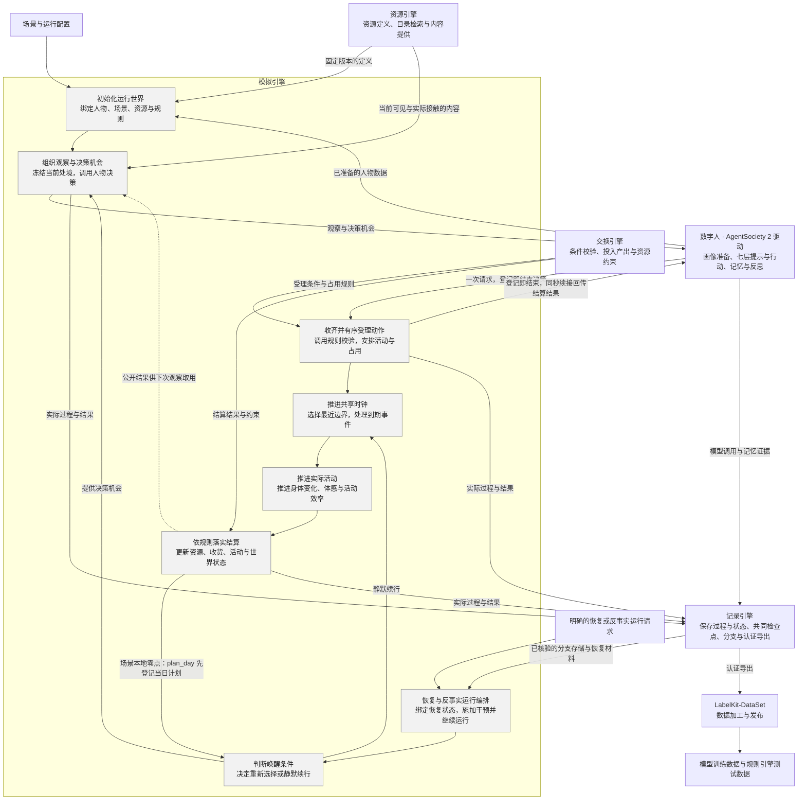
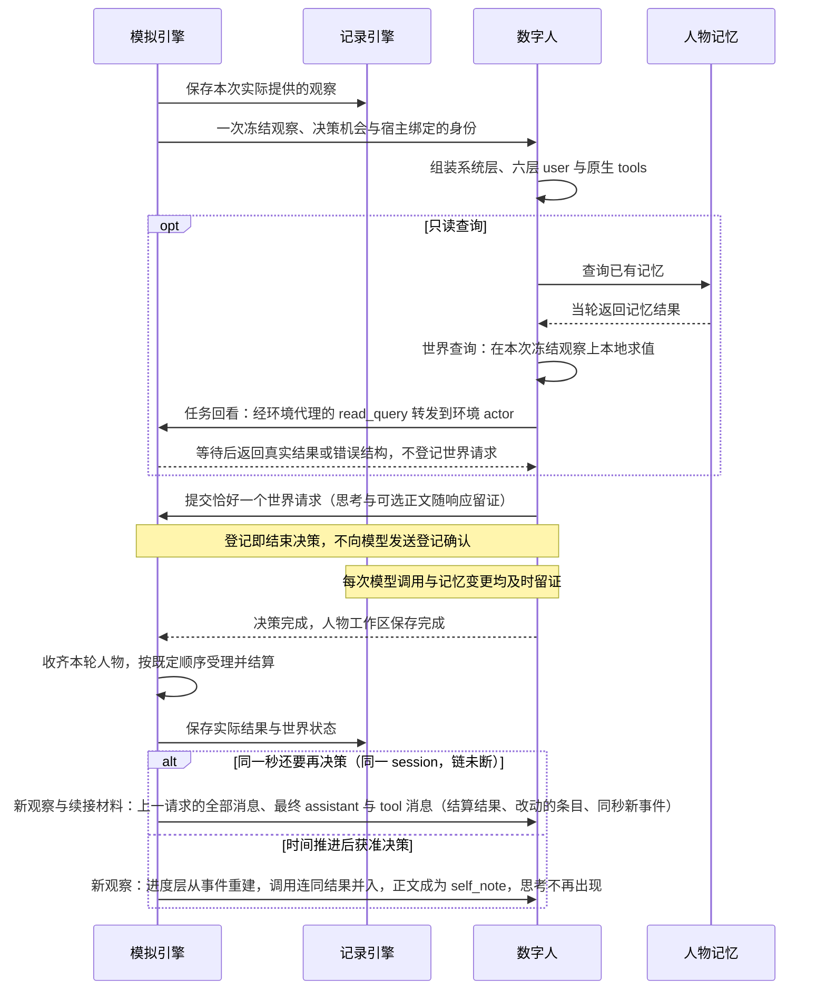
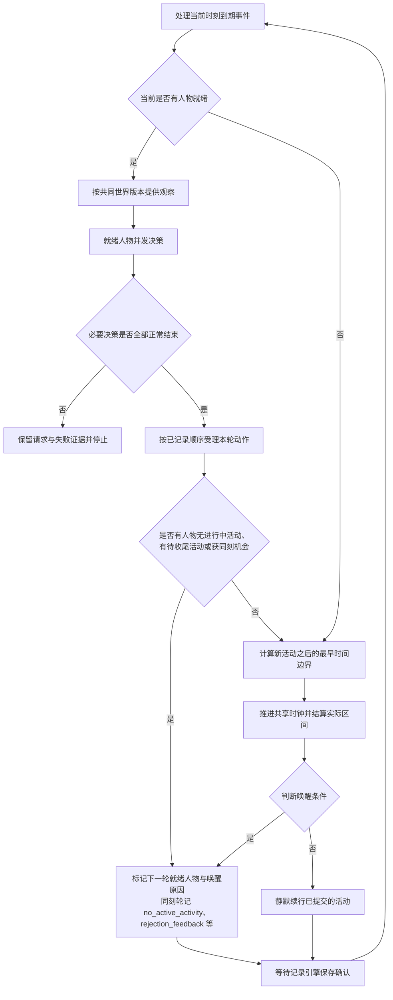
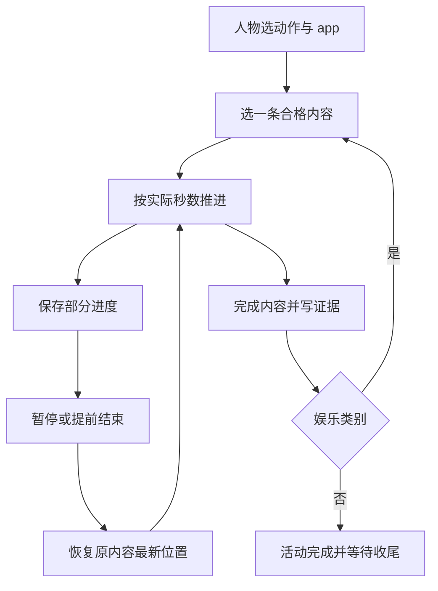
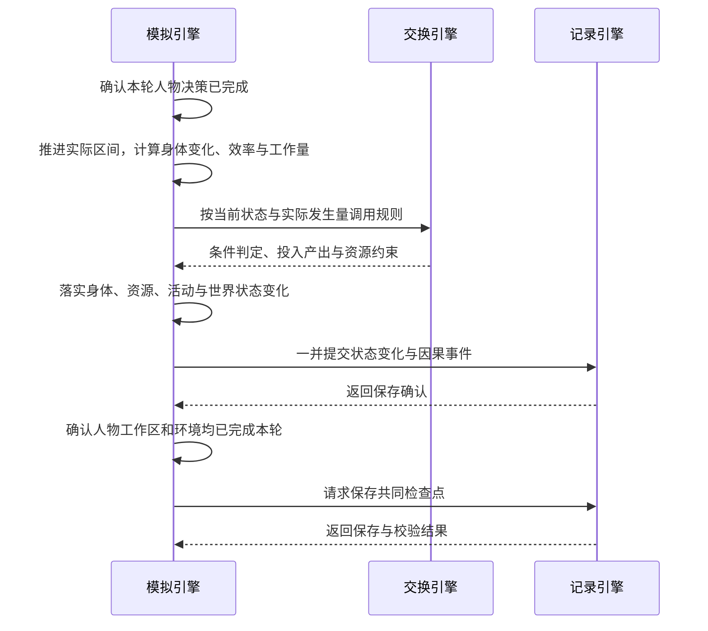

# WorldMock 产品设计说明书 — 模拟引擎

> **状态**：DRAFT；职责设计，现行接口与行为仍以冻结合同和规格为准；按人物 Prompt 规格修订，修订部分已实现（证据见[人物 Prompt 验收记录](../archive/persona-prompt/persona-prompt-verification.md)）；按一日运行保真规格同步（一日运行保真 SE1–SE8），已实现 
> **日期**：2026-10-08
> **版本**：v1.23
> **工具交互修订**：按[工具交互规格](../dev/SPEC-life-runtime.md#tool-interaction-工具请求)冻结本次设计；本次修订已实现，既有验收不覆盖新行为。
> **个人事务与工作安排修订**：按[个人事务与工作安排规格](../dev/SPEC-as2-integration.md#errands-workday-运行修复入库)分阶段同步（[实施计划](../archive/errands-workday/errands-workday-implementation-plan.md) D4 作业），已实现（离线验收，证据见[个人事务与工作安排验收记录](../archive/errands-workday/errands-workday-verification.md)）。
> **让「等待」成为例外修订**：按[让「等待」成为例外规格](../dev/SPEC-idle-fillers.md#spec-idle-fillers-让等待成为例外开发规格)修订「一轮运行」「结算边界与决策机会」「当前实现边界」「验收重点」（阶段 1）、「当前实现边界」（阶段 2）与「接收当日目标并记录实际推进」「当前实现边界」（阶段 3）。
> **同时做两件事修订**：按[同时做两件事规格](../dev/SPEC-parallel-activities.md#spec-parallel-activities-同时做两件事开发规格)修订「发现与比较门店供给」「校验与占用安排」「活动生命周期」「验收重点」（阶段 1）；「当前实现边界」（阶段 3）。
> **范围**：运行初始化、观察与决策机会、七层人物提示、同刻决策、同秒续接、动作受理、活动名额与生命周期、共享时钟、活动推进、结算、零点计划、个人事务与事务提醒、上班安排、唤醒与恢复编排
> **动作与内容简化修订**：现行设计按[动作与内容简化规格](../dev/SPEC-action-and-content-simplification.md#spec-acs-动作与内容简化开发规格)使用统一动作、无分类内容、真实收货与 app 足迹合同；实施与验收状态见[实现状态](../dev/implementation-status.md#implementation-status-动作与内容简化开发状态)。

> 2026-10-07：按资源与规则引擎简化规格同步剩余系统规则、最终提示身份与查看器（阶段 6）。

> 2026-10-07：按[资源与规则引擎简化规格](../dev/SPEC-resource-and-rule-simplification.md#spec-rrs-资源与规则引擎简化开发规格)同步阶段 5 的分配内容准入、进度与完成。

> 按[资源与规则引擎简化规格](../dev/SPEC-resource-and-rule-simplification.md#spec-rrs-资源与规则引擎简化开发规格)修订「输入与启动流程」、「地图与供给初始化」、「9. 恢复与反事实运行编排」、「当前实现入口」、「失败处理」（阶段 2）；「发现与比较门店供给、预排事件、校验与占用安排、验收重点、调用并等待人物决策、门店营业与报价事件」（阶段 3）；「人物所见与可做之事、校验与占用安排、预排事件、活动生命周期、反馈续行与结束、结算边界与决策机会、真实结果与验收重点」（阶段 4，app 使用、内容进度与推送）。

模拟引擎负责让数字人在同一个世界中实际生活：在合适的时刻提供观察与决策机会，
推进已接受的活动，调用规则并落实状态变化。本文按引擎内部功能展开；
其他模块只说明交互关系，详细设计由所属模块维护。

具体环境及制作工具按[环境数据归属规格](../dev/SPEC-environment-data-ownership.md)归 WorldMock-Dataset，
正式重制环境路径由 WorldMock-Dataset 发布决定；WorldMock 提供引擎及包内固定通用规则。
本章的 `catalog/`、`scenarios/` 指外部环境目录，命令以 WorldMock 为当前工作目录并显式传路径。
当前场景结构 8、世界结构 11；类别、使用方式、效果与供给表由 WorldMock 固定，
环境只登记对象、绑定与价格、内容时长、集数三种数；新组合放行另核对实际收据。

## 共享规则与可重建环境修订

按[共享规则与可重建环境规格](../dev/SPEC-shared-rules-and-rebuildable-env.md)修订；验收结果独立记录。

活动清单、按名动作与实际受理读取同一时长推导；逐项改变世界状态后仍重新核验。一般活动封顶一天，消费时长越界拒绝；出行在引擎重算以检查路线不匹配。人物记忆的空列表、阈值巩固、人物卡片和相似合并由 WorldMock 扩展实现，AS2 保留存储与恢复的框架合同。

完整日保留主线分层与隔离共享特性源码独立双跑生成的两份历史基线，不改写历史证明。
当前运行读取目录格式 2 与场景结构 8，并用实际存储核对完整导出、资产、检查点及逐人逐日时间线正文。
正式输入冻结与逐字节重建由数据仓验收，不宣称不同发布身份的输出摘要相同。
两份基线的用途与当前验收边界见[行为不变基线](../dev/SPEC-layering-and-test-tiers.md#layering-baseline)。

## 1. 职责与边界

### 模拟引擎负责什么

**数字人决定做什么，模拟引擎负责事情何时发生、实际发生多少，以及世界如何随之改变。**
资源引擎提供定义与内容，交换引擎给出规则判定和计算结果，记录引擎保存事实与状态。
模拟引擎组织这些调用，并在保存确认后继续运行。

对人物而言，一次决策就是选择一个世界请求（一次工具调用），回复正文可有可无。
查询记忆、回看任务与查询世界当场得到答案；世界请求登记即结束本次决策，登记不回给人物；真实结果由环境结算后写进进度层，
同一秒接着决策时随工具结果交还人物。
模拟引擎负责维持这个闭环，人物模块负责其中的选择与记忆。

### 项目框架映射

按[概述的解决方案](00-overview.md#overview-解决方案)，模拟引擎展开为下列内部功能。
灰色框对应正文主题；框外模块各自维护其能力与实现。

正文标题与灰色功能框保持同名。人物画像与记忆、资源检索、记录存储、离线 Dreaming
不设为模拟引擎内部主题。反事实运行属于实际执行；基于足迹生成假设文本属于数据交付。
零点计划由运行时在场景本地零点与启动路径执行（同联系人回复），不经人物模块。
虚线表示已结算结果供下次观察使用，不代表每次结算都会触发新的决策。

### 与其他模块的分工

| 所属模块 | 独立负责的内容 | 模拟引擎如何协作 |
| --- | --- | --- |
| [人物模块](../dev/SPEC-life-realism.md#spec-life-realism-特性规格人物决策与画像) | 画像提取与参数编译、七层提示与行动、记忆检索、合并与反思 | 绑定准备结果，提供观察与机会，等待决策完成及人物工作区保存 |
| [资源引擎](03-resource-engine.md#resource-engine-worldmock-产品设计说明书-资源引擎) | 资源、动作与内容定义、目录发布、检索排序与内容提供 | 传入当前世界条件、可见范围和实际接触区间，使用返回结果 |
| [交换引擎](02-exchange-engine.md#exchange-engine-worldmock-产品设计说明书-交换引擎) | 交换条件、占用与转换规则求值，投入产出和资源约束校验 | 提供收货商品的类别与件数，以及当前状态与实际活动时长等输入，使用返回结果落实状态变化 |
| [记录引擎](05-recording-engine.md#recording-engine-worldmock-产品设计说明书-记录引擎) | 事件与状态存储、事务、证据关联、检查点校验、分支材料、认证导出与查询 | 提供真实过程，在完整运行边界请求保存；取得确认或恢复结果后继续 |
| LabelKit-DataSet 数据加工 | 证据窗口、离线 Dreaming、LabelKit 调用、编码和发布 | 实际反事实运行结束后，由记录引擎向 LabelKit-DataSet 提供完整认证导出 |
| [行为评估](07-evaluation.md#evaluation-worldmock-产品设计说明书-行为评估) | 行为指标、评分与真实性评价；原始足迹的客观统计由记录引擎提供 | 提供可分析的运行事实，正式运行不因报告而自行改变规则或选择 |

世界状态由模拟引擎中的生活环境统一修改；人物模块维护自己的记忆与工作区，
记录引擎负责持久化与共同检查点的一致性。规则求值不自行推进时间或写入世界状态。
模拟引擎复用现有 AgentSociety 2 调度与人物调用链，不增加另一套人物决策循环或世界时钟。
零点计划 `plan_day` 是运行时后台任务（同联系人回复），不经人物调用链，计划由其后的共同检查点封存。

### 设计依据

运行接口遵循[接口合同](../CONTRACTS.md#contracts-worldmock-接口合同)，调度与故障传播遵循
[AgentSociety 2 接入规格](../dev/SPEC-as2-integration.md#spec-as2-integration-特性规格agentsociety-2-集成与改动)，时间、活动与观察行为遵循
[生活运行时规格](../dev/SPEC-life-runtime.md#spec-life-runtime-特性规格lifeenv-运行时行为与结算规则)。人物与环境之间的登记和结果通道遵循
[决策上下文规格](../dev/SPEC-decision-context.md#spec-decision-context-特性规格决策上下文与工具结果)，人物请求的七层组成、单一行动阶段、同秒续接与交互修复遵循
[人物 Prompt 规格](../dev/SPEC-life-realism.md#persona-prompt-七层请求)，地点类与人物的工具准入遵循
[交互菜单规格](../dev/SPEC-interaction-menu.md#spec-interaction-menu-特性规格交互菜单)，人物工具面、会话与引擎派生参数遵循
[数字人交互规格](../dev/SPEC-agent-interaction.md#spec-agent-interaction-特性规格数字人交互会话层上下文分层与稳定工具面)，决策不耗时、能量感知与不拦人、零点计划与提醒、
生活动作与并行准入、活动名额与生命周期遵循[时间与能量规格](../dev/SPEC-life-runtime.md#time-and-energy-决策不耗时时间只在做事时流动)；
其业界依据分别见所属研究记录。跨模块细节沿上表进入所属设计。

按时间排序、在同一时刻确定性处理事件，沿用成熟离散事件模拟的设计原则，参见
[SimPy 的时间与调度说明](https://simpy.readthedocs.io/en/latest/topical_guides/time_and_scheduling.html)。
本项目由现有运行框架与生活环境执行这些职责。

## 2. 初始化运行世界

### 输入与启动流程

| 输入 | 模拟引擎需要确定的内容 |
| --- | --- |
| 场景 | 起止时间、时区、人物与地点、地点类和人物交互菜单、日历、每个人物的工作安排（`work_schedule`，必填，可为 null；每周班次、日期例外与休息时段）与作息覆盖窗口（含下班、到家）、账户和身体初值（不预置活动，按作息反推，算法见[生活运行时规格](../dev/SPEC-life-runtime.md#spec-life-runtime-两过程睡眠模型)） |
| 人物准备结果 | 人物身份、卡片与运行参数已就绪，并能绑定对应工作区 |
| 资源与规则 | 统一登记通过的目录、发布图与固定规则，场景结构 8 的环境钉；不在运行中重生成或改写目录 |
| 运行配置 | 模型调用配置、独立运行目录及记录引擎返回的运行身份 |

当前新建入口仍会调用人物模块完成画像编译与卡片渲染，再绑定到运行；
这属于启动时准备依赖，画像提取、共识、参数映射和覆盖率算法由
[人物画像规格](../dev/SPEC-life-realism.md#spec-life-realism-画像编译)维护。
启动完成后使用已绑定结果，恢复运行使用检查点封存的人物工作区，不重新编译画像。
恢复按 `plan_submitted_dates` 不重复生成当日计划与提醒。
未完成的个人事务及其提醒随世界状态恢复，不重复记下、不重复完成、不重复提醒。
恢复核对清单五字段 `environment_identity`，加载共同检查点中的订单、待收货订单与呈现状态；图仍读取已发布字节，不重生成。

启动读取目录格式 2 与场景结构 8，不读取语料，包内固定规则随代码身份绑定。

### 地图与供给初始化

启动先统一登记目录，再读取发布图与场景结构 `8`。场景 `environment` 钉目录清单，`locations[]` 只选择地点身份；地点 `kind` 派生菜单类型与活动环境。
目录一次派生只读菜单和 app 索引，图覆盖全目录地点；运行不补边、抽样菜单或重生成地图。最短路等长按完整路径元组字典序决胜，所选地点间的路径可以经过未被选择节点。
初始状态使用世界结构 `11`，不初始化供给库存、报价、营业例外或资格；运行清单使用 `environment_identity`。

### 启动完成的条件

人物与世界使用同一场景时间，资源和规则依赖已就绪，初始状态保存确认后才能进入决策。
工作安排在启动前完整校验：班次形状（每周七天全写、例外日期为规范的 ISO 日期、班次同日且起止先后、休息时段落在班次内且升序不重叠）
由场景模型的校验器拒绝；跨引用在加载检查里核对——工作地点是所选地点，并与场景日历交叉核对（补班日必须有班次，春节、病假、
事假日必须不当班，加班机会日不要求班次），交叉核对只对落在场景时间窗内的日历日期执行，时间窗外的例外日期不拒绝；失败为顶层英文明细，
写明人物、日期与字段。
交互菜单的地点类覆盖、人物字段、名称闭集、重复、空集合与保护项在启动前完整校验。
任何必需输入失败都停止启动，不能用空人物、空目录、全量菜单或默认动作继续。
创建新运行与打开已有运行是不同操作；已有目录不得覆盖，恢复失败不得隐式创建空运行。
运行参数见[配置设计](08-configuration.md#configuration-worldmock-产品设计说明书-配置规格)，目录身份与保存规则见[记录引擎](05-recording-engine.md#recording-engine-worldmock-产品设计说明书-记录引擎)。

## 3. 组织观察与决策机会

输入是已确认的世界状态、当前就绪人物和唤醒原因；输出是实际提供的观察与已完成的决策结果。
是否提供机会由[判断唤醒条件](04-simulation-engine.md#simulation-engine-判断唤醒条件)决定，本主题只组织已获准的一次决策。

### 提供当前可见的处境

模拟引擎将当前地点、体感、今天的上班安排、在场人物、通知、活动结果、未完成的个人事务和计划投影成观察，输出工具层、记忆层、待办层、环境层与进度层的层数据，
与人设层一起组成发给人物的六层 user JSON；调用资源引擎提供当前可见对象与实际接触内容。准确身体数值留给结算和审计，人物接收对应体感。
饥饿分级在低能量时不被昼夜项与餐时项钳住，能量极低时为新增的最重一档「饿得发慌」；食品标每份热量，路线标轻松、一般或费力，
二者是商品与路线事实，不是身体数值。吃饭途径由工具层的目标（在路上的、这里能买的、能送到这里的）与系统层规则表达，
不另写吃饭途径句。分级数值与阈值见[生活运行时规格](../dev/SPEC-life-runtime.md#spec-life-runtime-其他体感分级)。
人设层由人物模块按人物卡片与场景联系人渲染，其中的关系看法与偏好由环境从事件派生；目录检索、排序、轮转与内容切片由资源引擎维护。
人设层作息里的下班、到家是人物的习惯（卡片可为 null）；今天的上班安排是场景声明、环境按世界时钟求值的事实，只写在环境层 `location`
之后的 `duty`：没有工作安排为 null，当日不当班写「休息日」（钟点、地点与状态为 null，休息时段为空），当班日写「工作日」与班次钟点、
工作地点名、休息时段与状态（「未到上班时间」「当班中」「休息时段」「已下班」之一，只由时钟与班次决定，不看人物在不在场），
不含内部身份（[个人事务与工作安排规格](../dev/SPEC-life-realism.md#errands-workday-作息补全与工作安排-环境层-duty) 4.4）。人设层、待办层、工具层与零点计划目标都不重述它，
宿主不渲染人物档案里的工作安排。
模拟引擎同时按权威位置取得地点类菜单，与人物声明求交集并把有效菜单写入事件级工具支持数据。
菜单排除的动作不在工具层列出，其可读说法写进环境层 `fixed_rules`；菜单不裁剪可供性合同或候选，只约束人物本轮可提交的动作。

同轮人物观察基于共同世界版本，每个人物的一次决策只向环境读取一次观察；模型重试、记忆查询和动作登记都不重新读取世界。
同一秒的后续决策仍各读一次观察，但模型只经续接的 tool 消息收到上一请求的结算结果与改动的条目，链首快照不变。
未播放、未阅读、未发生的内容不能当作已接触事实。
观察字段与预算遵循[观察投影合同](../dev/SPEC-life-runtime.md#spec-life-runtime-观察投影与提示合同)。

### 人物所见与可做之事

人物看见工具、人设、记忆、待办、环境与进度六层。工具层按登记名称列全部动作，每个支持的 app 有独立行，真实前置条件决定 available 与 reason。内容选择只读时长范围，开始时只抽一次，结果给 action、app、title、summary、duration、pushed。商品按 goods_id 合并店铺供给，完整查询集合不受呈现窗口裁剪。

callable_index 只含 goods、navigation_apps、payment_apps、query_categories；动作不是 app 目标，人物不能开始内容标题。邮件到达即完整正文可见。暂停活动在待办层，进行中与刚结束活动在工具层按实际生命周期控制；所有私有绑定仅供宿主解析，不进入提示。

### 发现与比较门店供给

商品在 `goods.json` 定义 `goods_id`、名称、`category`、固定 `price_fen` 与店铺绑定。类别为 `meal`、`snack`、`drink`、`leisure`、`daily`、`fuel`，同一商品全店同价，同类型店铺菜单完全相同。
`store_ids="all"` 只展开到固定供给表允许该类别的店铺，住宅不出售食品；目录一次派生 `goods_by_store` 与店铺 app 索引。没有报价、价位、抖动、库存、营业或资格。

人物以 `start_activity.items[].app` 显式选择购物 app，以 `pay_app` 显式选择支付 app；环境不代选。到店必须人在供给店铺，`app=null`，`pay_app` 可空。远程购买必须点名购物 app 及其绑定的支付 app，环境只在真实供给该商品且支持该购物 app 的店铺中按最早送达、再按店铺身份选择。完整商品标签仍约束标签店铺。

`query_world(name, way, category, app, available_only, offset)` 只读当前完整冻结观察。app 仅登记应用名称，动作与商品按名称、方式、公开类别和 app 的交集筛选，available_only 使用实际命中组合的资格。筛选先于稳定排序和分页，返回 matches、total_count、next_offset；结果无私有身份，false、零值与控制行完整保留。
查询不推进时间、不写世界结果、不消费随机状态或修改曝光记录；动态错误一次完整报告，可照填候选不代替人物选择。

商品比较包含固定到手价、图上行程与配送等待，内部身份由宿主绑定；不会通过有时长浏览生成菜单、报价或可见资格。人物自己决定到店或下单；暂停和恢复仍保留原活动、地点和名额机制，实际出行的身体和费用按图行程结算。

### 调用并等待人物决策

模拟引擎沿既有 AgentSociety 2 人物调用链调度，不另写行动或记忆生成算法。
宿主绑定人物、决策和动作身份；人物提交请求不等于环境已接受或执行。
必要决策失败时，停止本轮未执行提案，不能补造动作或结束结果继续推进。
人物请求与决策协议见[人物 Prompt 规格](../dev/SPEC-life-realism.md#persona-prompt-决策回复正文与思考)，记忆见
[记忆合同](../dev/SPEC-life-realism.md#spec-life-realism-记忆合同)。
人物在生活决策中只经 `conclude_activity` 各项的 `items[].memories`（普通记忆，只记以后做决定用得上的新情况，人设层已有的作息和
待办层已有的事务不再记；这是系统层第 6 条的要求，宿主不做语义拒绝）与 `items[].views`（看法与偏好）写记忆，此外只有
就寝反思与阈值巩固：就寝反思的模型调用只带一个严格工具 `submit_reflection`（`tool_choice=required`，思考关闭，不带 `purpose`），
恰好一次调用给出一至五条洞见，每条的 `refs` 非空、条内不重复且全部取自本次输入的记忆，正文与收尾记忆同一校验，
没有可反思的主观记忆时不调用模型；来源由系统登记，零点计划 `plan_day` 不写记忆。看法与偏好用 `about` 写对象，
宿主经 `control_items` 读出后存为带 `subject` 的 relationship、preference 记忆，只在人设层按对象原地呈现最新一条。
个人事务的新增、更新与取消写在 `report_status`、`pause_activity`、`conclude_activity` 的请求级必填字段 `errands`（与 `items` 平级，
可为 `[]`），由环境受理并随人物状态保存；只有本次决策能点名一项活动时才有入口（进行中的可播报、暂停或结束，暂停的在开始地点用
`report_status`、在任何地点用 `conclude_activity`，待收尾的用 `conclude_activity`），空闲与只做瞬时动作期间没有入口。
每条变更是七键全部必填的封闭对象，`change` 取「新增」「更新」「取消」（没有「完成」，取消必带原因）；同一请求内按取消、更新、新增的
次序求值，同一条未完成事务至多被一条更新或取消点名，两条新增不得同名，取消后可在同一请求里沿用原名新增
（[个人事务与工作安排规格](../dev/SPEC-life-runtime.md#errands-workday-个人事务-记下更新取消) 2.2）。它不是记忆写入点，不产生 `memory_updated`；
就寝反思也不记下、不办结、不取消事务，反思里想到的事由人物在其后下一次播报、暂停或收尾时记下。
记忆层在构建提示时由环境从已提交事件与世界状态派生，不新增持久状态：每个 session（一段地点停留或一段路程）结束时派生一条记忆
（系统写的 `settled` 与人物写的 `self_notes`），今天的条目按 session 列出；零点之后按本地日期并入更早日期，
只保留起源于该日且仍未了结的事项与归属该日的就寝反思。

一次决策只有一个行动阶段，可以先做只读查询，也可能有协议纠错回合；正常无查询、无纠错时恰好一次行动请求。原生工具固定为十二个：七个世界请求、两个世界查询和三个记忆查询；环境稳定面是七个世界请求加两个世界查询，共九个。`start_activity` 的一至两项各自恰含 `target`、`way`、`app`、`to`、`pay_app`，方式闭集为「步行」「驾车」「睡觉」「等待」「购买」「进行」「领取」；领取在内部执行 `collect_parcel`。`set_alarm` 是独立世界请求，参数只有 `at`。

查询与协议重试消耗同一回合预算（每次决策至多 16 个回合）。世界请求登记后不追加任何 tool 消息；完整内部回执留给宿主审计与幂等，不能把它复制进人物提示。`recall_task_summary` 与 `query_world(name, way, category, app, available_only, offset)` 属于只读查询，可与记忆查询同批。六个查询键全部必填；前四个筛选至少一个非 null，`available_only` 是严格布尔，`offset` 是严格非负整数。名称、方式、公开类别与 app 取交集，筛选先于稳定排序和分页；合法无匹配返回空页，不自动放宽。结果恒为 `{matches, total_count, next_offset}`，只省略 null 与空集合，保留 false、零值与明确原因。查询不登记世界请求、不结束决策、不推进时间、不计同刻轮数，只留下真实模型与 tool 交换证据。完整字段与错误合同由[人物工具与管理接口](../CONTRACTS.md#contracts-person-tools)唯一维护。
不能泄露尚未到达的邮件正文、未知任务或内部身份；剩最后一个回合与截断重试时只开放世界请求。

执行位置分两处：`recall_task_summary` 经 `LifeEnvProxy.read_query` 送到唯一的环境 actor（`LifeEnvActor`，并发度固定为 1）
并等待结果对象；`query_world` 由宿主在本次冻结观察上本地求值，环境侧 `read_query` 的同名分支是同一组纯函数的第二入口：
受理时两入口结果逐值相等，拒绝时两入口给出同一份校验报告。`read_query` 的 `tool` 取 `query_world`、`recall_task_summary` 之一，
`request` 是对应请求模型的实例，按决策身份取本决策唯一一条已提交观察，不写事件、不改世界版本与时钟、不计同刻轮数；
工具与请求类型不符或找不到唯一观察是协议违约，回看的业务拒绝以错误结构作为返回值。

名称写得不准时，宿主在本轮按统一名称解析纠正（`NAME_NOT_FOUND`、`NAME_AMBIGUOUS`、`WAY_NOT_OFFERED` 等名称类纠错：`start_activity`
的对象带可照填的候选，活动、任务与收件人等名称在原因里列出可以改写成的名称；一次请求里各项的名称类失败合并成一次纠错逐项报全部，控制工具
各项的活动名与关系看法写的对象 `SUBJECT_NOT_KNOWN` 也在同一次纠错里；`errands` 的缺键、类型、枚举、交叉约束、长度、单次条数，以及
两条新增同名、同一事务被两条更新或取消点名、新增名称与已有未完成事务归一后相同、同商品与超过上限报 `ARGUMENTS_INVALID`，`path`
完整到 `errands[j].<键>`，枚举给全部合法值，`expected` 写类型与格式，上限与冲突的事务名写在 `why`；更新、取消的事务名找不到或不止
一个报 `NAME_NOT_FOUND`、`NAME_AMBIGUOUS`，`allowed_values` 列本人全部未完成事务名；新增的商品名解析不到唯一商品报同样两码，最接近
的至多三个商品名写在 `why`，不列进 `allowed_values`；这些错误都不带候选、不替换，依赖未完成事务与商品名的几类由宿主与环境在同一
冻结观察上调用同一纯函数 `errands.change_issues` 判定）：这类纠错只耗本次决策的回合，不进引擎，不计同刻轮数；
环境的名称类拒绝每人每秒前两次同样不计轮（见[一轮运行](04-simulation-engine.md#simulation-engine-一轮运行)）。
思考用尽输出上限（`finish_reason=length`、正文为空、没有工具调用）的截断回合丢弃，不进入后续请求，改给结构化纠错
`OUTPUT_TRUNCATED`，相同的纠错替换、不叠加；紧接着以关闭思考、`tool_choice=required` 的请求重试一次（`max_tokens` 不变，
只开放世界请求）。重试的回合没有思考：它给出的世界请求结束本次决策，被纠错时该回合同样丢弃；重试仍没有工具调用时照常按回合预算处理
（[一日运行保真规格 7.2](../dev/SPEC-as2-integration.md#dayrun-fidelity-评审模型调用与叙述-输出截断与思考螺旋)，参数见[接口合同「生成参数」](../CONTRACTS.md#contracts-generation-parameters)）。

只读提问的 system 为只读系统层，user 为人设层与记忆层（取最近一次生活决策保存在人物工作区的快照），外部问题作为其后一条 user 消息，
不触发生活决策的观察。只读路径只开放预算允许的记忆查询与结束工具（截断重试只开放结束工具），不写世界或人物记忆。

世界查询只使用固定商品菜单、固定价格与目录店铺 app 绑定；本轮冻结观察和公开工具交换留证，不经浏览刷新事实。分配内容、反思、记忆与个人事务的调用顺序保持。

### 接收当日目标并记录实际推进

目标每人每天按意图唯一登记，只有真实活动或本人收货能够推进。action 的活动家族就是 category；娱乐、社交、运动、日常照料、工作学习分别推进相应意图。work_study 只有实际消费本人分配内容才推进工作学习目标。用餐由本人收到 meal 商品推进，不能由活动名称或模型总结代替。

## 4. 收齐并有序受理动作

### 收齐请求与确定顺序

输入是同一轮人物基于共同世界版本提交的动作，以及决策前已经记录的竞争顺序。
请求到达时先登记为待结算，全部必要决策正常结束后才有序受理。
输出是活动受理结果、占用安排或带原因的业务拒绝，接受活动不代表活动已经完成。

同轮人物可以并发调用模型，但共享物品、任务和余额由环境串行结算。
决策前按固定随机种子产生并记录竞争顺序，同轮观察基于共同世界版本；
请求到达先后不能改变结算顺序，环境也不能为等待某个早序请求而阻塞接收。
必要决策发生异常时，该轮尚未执行的提案不再结算，保留请求与失败证据并终止。
不可逆付款和消息发送使用稳定动作身份防止重试重复结算。

### 校验与占用安排

活动只有 `wait`、`sleep`、`travel`、`action`。系统动作负责购买、领取、闹钟、出行、睡眠与等待；全部数据集动作使用同一个执行器。选内容不耗时，按实际经过秒数推进身体和内容。`remaining = min(ceil(duration_seconds - position_seconds), 86400)`；开始、换内容和恢复时，计划时长为已做秒数加余量，计划结束为当前时刻加余量。娱乐在同一活动静默接续；其他四类做完一条即完成。暂停不消费，提前结束只留下真实部分，恢复沿用原内容并读取全局最新位置，不重抽。

占用闭集是 `wait`、`travel`、`talk`、`use_app`、`entertainment`、`work_study`、`exercise`、`daily_care`。每个动作占自己的类别，社交占 `talk`；`phone_continuous` 另占 `use_app`，`other_device` 与 `offline_assisted` 不另占。睡眠占全部八个；驾车占除 `talk` 外七个。每人两个活动名额，暂停让出名额，待收尾仍占名额。

分配内容只对本人合格，且要求本人工作地点；未分配学习内容可重复。运动只限固定类别场所。实际执行与工具可用性共用拒绝来源，地点错误仍列动作但标不可用。

绑定 app 的社交动作必须声明 `communication_mode`。文字模式只记录实际动作内容、位置与人物自行撰写的主题性文字，不调用通话域函数；语音模式才建立真实通话。两者均按真实经过秒数推进，人物叙述不能伪造发送、回复、通话或内容进度。

## 5. 推进共享时钟

### 一轮运行

决策不消耗模拟时间：先处理当前到期事件，再提供观察并收齐动作；环境受理后才计算下一时间边界。
决策轮尚未结束或仍有人物待决策时，不能推进共享时钟。
受理后仍有人物就绪，则先完成保存与检查点，再进入下一轮决策；无人待决策才推进时间。
边界取活动完成、内容反馈、身体变化、通知配送、计划提醒、清醒人物的事务提醒、清醒人物的班次与休息时段起止、活动播报、场景本地零点、等待结束和实验结束等相关时刻中的最早值。
某人睡眠八小时不能让其他人物的活动、通知或配送被跳过。

每次时间推进严格大于零，即时事件在当前时刻按稳定顺序处理。
没有进行中活动或有待收尾活动的人物在同一秒再获得决策，直到有一项进行中活动（等待、睡眠都算）且没有待收尾活动；
人人满足后时钟才推进。有进行中活动时，瞬时动作成功后按决策节律，业务拒绝后同一秒再给一次机会。
同一人物同一秒的相邻决策按同秒续接组织请求，时钟推进即断链。
同一人物同一秒的轮数受场景参数 `max_same_moment_decisions` 约束，时钟推进即归零；轮数计成功、拒绝与重放，不是连续失败次数。
名称类拒绝（名称类拒绝码闭集，[一日运行保真规格](../dev/SPEC-map-and-storefront.md#dayrun-fidelity-按名调用与指名购买-名称类拒绝不计同刻轮数) 3.4）每人每秒前两次
不计轮、不施加 `service_refused` 情绪脉冲，第 3 次起照常计轮、照常施加；免计次数是实验假设。
达到上限仍不满足时给至多三轮受限轮，每轮只开放一类动作，其余动作在工具层标不可用并写明原因；开始或恢复被拒后留在原阶段。
受限轮用完仍没有进行中活动，或仍有待收尾活动（例如待收尾活动旁另有进行中活动，收尾前时钟不能推进）时，环境不替人物造活动：写一条 `environment_event`（`data.kind=decision_budget_exhausted`，
`visibility=system`，带最近一次计入轮数的拒绝码），把下次决策设在 `activity_feedback_seconds` 之后，时钟可以推进（技术停顿，身体按静息结算），
不记成人物主动等待。同一秒的轮数因此有上界。业务拒绝不构成运行失败。受限轮的阶梯见
[时间与能量规格](../dev/SPEC-life-runtime.md#time-and-energy-决策不耗时时间只在做事时流动)。

模拟时间统一使用 UTC epoch 秒；输出给其他模块的时间保持同一发生时刻和排序。
本次推进秒数必须恰好对应上次确认时刻到结束时刻的间隔。

### 预排事件

购买受理当秒付款，每个请求只作一次完整运输报价，不产生提前的商品效果。到店与直送经唯一收货入口结算；完整运输时长严格大于一天时，保持原报价并改送实际模拟收货人家庭地址最近且场景选中的驿站，恰一天仍直送。到站只进入 `ready_for_pickup` 并通知实际收货人，没有 `receipt`、`goods_received` 或商品效果。本人在站执行零秒领取后才收货；离站、他人订单和重复领取不能产生额外效果。联系人直送只更新订单，不写 `goods_received`。系统没有库存、持有、食用或给予。

`set_alarm` 只接受必填 `at`，必须是带时区的整秒时刻，严格在当前与运行终点之间。到点先结算实际睡眠秒数再结束睡眠，同秒自然结束保留 `planned_end`，其他活动不停止。每个闹钟有独立证据，同秒只合并一次决策，恢复与重放不漏响或重响。

娱乐推送只从 entertainment 且 phone_continuous 动作产生，同 session 每 app 一条，实际事件带动作名。邮件到达当秒正文可见并以 message_arrival 唤醒；工资按预排固定金额支付，不依赖工作完成。

### 内容时长与实际执行

活动只有 `wait`、`sleep`、`travel`、`action`。系统动作负责购买、领取、闹钟、出行、睡眠与等待；全部数据集动作使用同一个执行器。选内容不耗时，按实际经过秒数推进身体和内容。`remaining = min(ceil(duration_seconds - position_seconds), 86400)`；开始、换内容和恢复时，计划时长为已做秒数加余量，计划结束为当前时刻加余量。娱乐在同一活动静默接续；其他四类做完一条即完成。暂停不消费，提前结束只留下真实部分，恢复沿用原内容并读取全局最新位置，不重抽。

## 6. 推进实际活动

输入是当前活动、共享时钟确定的实际区间和冻结规则。模拟引擎推进已经被接受的活动，
计算实际进度、身体变化、体感与效率，并把变化交给[依规则落实结算](04-simulation-engine.md#simulation-engine-依规则落实结算)。
人物提交的计划时长不能当作已经完成的时间。

### 活动生命周期

活动只有 `wait`、`sleep`、`travel`、`action`。系统动作负责购买、领取、闹钟、出行、睡眠与等待；全部数据集动作使用同一个执行器。选内容不耗时，按实际经过秒数推进身体和内容。`remaining = min(ceil(duration_seconds - position_seconds), 86400)`；开始、换内容和恢复时，计划时长为已做秒数加余量，计划结束为当前时刻加余量。娱乐在同一活动静默接续；其他四类做完一条即完成。暂停不消费，提前结束只留下真实部分，恢复沿用原内容并读取全局最新位置，不重抽。

### 实际区间、身体变化与效率

| 类别 | 代谢当量 | 按实际秒数的效果 |
| --- | --- | --- |
| entertainment | 1.0 | 每小时缓解娱乐需要 0.3 |
| work_study | 1.5 | 分配内容首次完成才施加 `goal_progressed` +0.05 |
| social | 无 app 1.5，有 app 1.3 | 共处、未接受、远程分别每小时 0.5、0.2、0.4 |
| exercise | 5.0 | 每小时情绪 +0.1；只限 home、outdoor、fitness 环境 |
| daily_care | 2.0 | 无额外按秒效果 |

身体共同结算只计一次经过区间；收货效果在 `goods_received` 自己的分录中结算。社交账读取同一实际活动集合，不重复扣能量。

### 反馈、续行与结束

活动只有 `wait`、`sleep`、`travel`、`action`。系统动作负责购买、领取、闹钟、出行、睡眠与等待；全部数据集动作使用同一个执行器。选内容不耗时，按实际经过秒数推进身体和内容。`remaining = min(ceil(duration_seconds - position_seconds), 86400)`；开始、换内容和恢复时，计划时长为已做秒数加余量，计划结束为当前时刻加余量。娱乐在同一活动静默接续；其他四类做完一条即完成。暂停不消费，提前结束只留下真实部分，恢复沿用原内容并读取全局最新位置，不重抽。

结算边界和决策机会分别判断。娱乐内容完成只结算和提交，不增加决策；其他类别内容完成使活动结束。长时间动作的固定机会是 `progress_report_due`，该机会提出后，不论人物使用哪个工具、受理还是拒绝，都把当时到期的活动播报锚点移到当前秒。既有唤醒原因共 23 个，包含 `alarm_ring`，没有内容完成原因。睡眠只接受工作边界、目标提醒、实验结束和闹钟等既有允许原因；娱乐推送送达不叫醒。

## 7. 依规则落实结算

### 从实际进度到世界变化

每个人的 `content_progress` 以内容为键，跨 app 共享。记录恰含 `content_id`、`position_seconds`、`completed_rounds`、必填的 `last_consumed_at`；只有正秒消费才创建或更新，推送、展示和零秒暂停不算看过。完成时位置归零、轮数加一，活动 `played` 追加实际消费区间，并释放当前 session 指向该内容的全部推送。

分配工作内容首次完成写本人可见 `work_content_completed{kind, content_id}`，原因指向那次真实 activity_progress，并施加一次目标推进脉冲。工资独立按预排支付。个人事务与用餐目标只读本人收货证据。

付款、直送、驿站到站与领取的状态和证据都遵循[供给结算与事件载荷](../CONTRACTS.md#contracts-供给结算与事件载荷)。到店与直送在真实收货时写 `received_at`、`delivered`、一次 `goods_received` 和商品效果；长途到站只写 `arrived_at` 与 `ready_for_pickup`，实际收货人本人在指定驿站领取后才写收货事实。燃油收货增加七个可驾驶日，不产生库存或身体效果。

### 将真实结果交还人物

世界请求登记即结束本次决策，登记不回显给人物；即时记忆查询返回人物已经拥有的信息；世界结果在统一结算后交还人物：
同一秒接着决策时随续接的 tool 消息返回，此后在进度层中出现。这三种语义分别承担登记、查询和反馈，不能相互替代。
分配内容的实际消费秒数只在活动结算后进入公开结果，人物叙述不能提前写成完成事实。

进度层按事件顺序列出本 session 的世界请求连同公开结果与世界事件；结果在整个 session 内保留，session 结束后由系统写成记忆层的 `settled` 句子。
统一动作开始结果是 `details.content{action,app,title,summary,duration,pushed}`，app 可空。推送在进度层为 `app_push{occurred_at,type,app,action,title,summary}`；不含内容分类，动作及 app 都是实际名称。
调用和结果不暴露 `content_id`、`push_id`、随机抽取键或全局进度内部身份。
进度层另有两种由事件派生、只写名称的记录：`errand_reminder{errand}`（事务提醒到点）与 `errand_completed{errand}`（环境确认办成），
来源事件人物可见并计入观察的进度来源；办成的事务由此对人物可见，随后从待办层消失，取消的事务只从待办层消失。个人事务不进记忆层，
记忆层不为它们写 `settled` 句；容量浓缩时 `errand_completed` 折成一句只含时刻与事务名的句子，`errand_reminder` 与当日目标提醒
同等对待、不留句。控制请求在进度层的调用参数略去 `errands`（先例：`views`），本 session 内由结果的 `details.errands` 回执
`[{errand, change}]`（`errand` 为名称，没有变更时为 `[]`，被拒结果没有该键）可见。每次请求的六层快照内，事务的完整行只在待办层，
别处只以名称引用；照原始证据回显所写内容的三处不在此列：同秒续接中上一决策原样带回的调用参数与 tool 消息里的改动、当日操作备忘的
所写与受理写法、被拒结果明细里的所写内容（与 `views` 的现行处理相同，[个人事务与工作安排规格](../dev/SPEC-life-runtime.md#errands-workday-个人事务-待办层与进度层呈现) 2.6）。
只读查询不进入进度层 `events` 或 `settled`，原生模型与 tool 交换留在实际请求证据中。
公开结果保留具体失败原因、下一步与公开工作反馈；不能静默裁剪，超出预算按预算规则处理，仍超限则明确失败。
动作身份由宿主私下关联，不进入模型可见结果；调用与结果合为一条记录，不给模型任何调用编号。
记忆查询的返回与原生工具定义同样不含内部身份。
内部参考身份、答案对象、哈希、资源账户、数值身体状态和完整活动快照留在宿主证据中，
评审理由也不能夹带内部参考身份或哈希。进度层与结果字段见[人物 Prompt 规格](../dev/SPEC-life-realism.md#persona-prompt-七层请求-进度层)，
回执隔离与递归泄漏校验见[登记确认与结算结果](../dev/SPEC-decision-context.md#spec-decision-context-登记确认与结算结果)。

### 每轮保存与确认

模拟引擎将自己产生的观察、动作受理、活动进度和状态变化交给记录引擎，
并等待人物调用及记忆保存完成；人物内部证据由人物模块通过记录接口保存。
零点计划的模型请求与响应在零点边界的共同检查点之前，与计划、提醒同一次提交并留证。
`conclude_activity` 的记忆在登记的同一轮由宿主经 `after_step` 写入，环境只校验形状并随 `action_requested` 留证。
个人事务的变更不走宿主写入：它与同一请求的活动状态转换同批校验、同一事务提交，请求被业务拒绝时一并不生效，而同一请求的 `memories`
此时已按上述规则由宿主写入；每条被受理的变更恰好写一条事务事件，只在成功分支生成。
人物提交请求、环境接受请求、活动实际完成是不同事实，不能用前一阶段的反馈代替后一阶段的结果。
回复正文属于人物自述（写入 `action_requested.data.self_note`，未经核验），思考不进入任何一层；准确世界变化由环境产生；
所有证据绑定当前人物、决策、动作和时间。

环境仍是世界状态的唯一写入方。并发人物 worker 不能各自修改世界数据库，
模拟引擎也不能在保存失败时继续采用未提交的内存结果。
事件字段、素材发布、事务、资金对账和版本连续性只在
[记录引擎](05-recording-engine.md#recording-engine-worldmock-产品设计说明书-记录引擎)维护，本文不再定义另一套存储结构或事件枚举。

### 共同检查点的调用时机

本轮人物响应、记忆写盘、环境推进和事件提交全部完成后，模拟引擎才请求共同检查点。
模拟引擎提供当前世界与人物运行状态，记录引擎负责检查点的完整性校验和保存。
模拟引擎只接受记录引擎确认的完整结果，不自行根据某个文件存在判定恢复材料有效。

检查点失败就是运行故障；已确认状态保留，不能将半成品作为恢复入口。
保存和校验细节见[保存共同检查点](05-recording-engine.md#recording-engine-保存共同检查点)与[恢复与反事实分支](05-recording-engine.md#recording-engine-恢复与反事实分支)。

## 8. 判断唤醒条件

人物醒着且 app 推送实际写入当前会话时，`app_push` 提供一次决策机会；睡眠中推送仍保存在会话，
但不唤醒人物。app 内容完成只形成静默结算边界，不能把内容接续变成人物决策。

### 结算边界与决策机会

结算边界和决策机会分别判断。娱乐内容完成只结算和提交，不增加决策；其他类别内容完成使活动结束。长时间动作的固定机会是 `progress_report_due`，该机会提出后，不论人物使用哪个工具、受理还是拒绝，都把当时到期的活动播报锚点移到当前秒。既有唤醒原因共 23 个，包含 `alarm_ring`，没有内容完成原因。睡眠只接受工作边界、目标提醒、实验结束和闹钟等既有允许原因；娱乐推送送达不叫醒。

### 门店营业与报价事件

## 9. 恢复与反事实运行编排

共同检查点封存当前活动、原内容身份与游标、全局历史、session 推送、实际订单、驾驶天数与最后驾驶日期、闹钟和预排队列。打开与恢复核对发布环境身份、代码身份和结构号，旧结构直接拒绝。恢复活动只读取原内容最新全局位置，从不重抽；已经结算的付款、收货、领取与闹钟不重复执行。反事实分支从已提交的共同检查点重新运行，仍沿用来源和时间线合同。

## 附录：运行约束与验证

### 失败处理

| 情况 | 模拟引擎的处理 |
| --- | --- |
| 目录登记或图结构不合法 | 在启动前以所属登记码与英文原因拒绝；不补节点或边，不继续空目录 |
| 恢复环境身份不符 | `Runtime environment identity mismatch`，在副作用与首次决策前拒绝 |
| 出行计算与请求时长不一致 | `ROUTE_DURATION_MISMATCH`，按发布图与方式速度重算核对 |
| 余额不足或活动冲突 | 接收规则给出的拒绝原因，同一秒再提供决策，受同刻上限约束 |
| 请求违反当前交互菜单 | 在任何领域副作用前返回 `INTERACTION_MENU_DENIED`，按业务拒绝回灌并同一秒再决策，受同刻上限约束 |
| 指名购买解析不出或此刻服务不了 | 按实际商品、购物 app、付款 app 与供给店铺给完整参数位置、同源英文原因和可照填候选；整组原子拒绝。人物必须点名应用，不代选；环境在合格店铺中按最早送达与身份排序选择。拒绝不扣款或制造库存 |
| 进度层浓缩后仍超限 | 按系统层、工具定义、各 user 层（可调用索引另单列）、续接消息与预留输出分层记录 token 用量与英文错误日志，按容量故障停止 |
| 受限轮用完仍没有进行中活动或仍有待收尾活动 | 写 `decision_budget_exhausted` 并技术停顿，不替人物造活动，不写 `run_failed` |
| 能量为 0 | 照常受理与结算，以 0 截断 |
| 交互对象为空 | 合法状态，决策照常 |
| 必要人物决策失败 | `LifeAgent.step` 先写一条带完整异常链的英文 error 日志再原样上抛（异常对象与类型不变）；工具分发失败先写日志，再按现行实现的失败阶段码 `TOOL_SERVICE_FAILED` 抛出（模型服务、证据写入、记忆查询、工具服务四个失败阶段码登记在[接口合同](../CONTRACTS.md#contracts-tool-result-channel)的宿主错误码表，只标出失败阶段与调用位置，不是对请求参数的协议纠错）；停止该轮未执行提案，不合成默认动作，不推进时间。日志走标准 logging，不是持久证据，不新增事件，不改变失败分类 |
| 资源、规则或必需观察不可用 | 保留已确认状态并停止，不用空内容或默认结果替代；空交互对象层不属于必需观察不可用 |
| 零点计划输出不合法 | 校验与 `revise_day_plan` 共用同一函数：重复意图同时定位首次与其后每次出现的 `goals[i].intent_kind`，条数超过八条与重复意图同批报告；附回错误重试（有限次数，按[时间与能量规格](../dev/SPEC-day-plan-goals.md#time-and-energy-零点计划与计划提醒)第四章）；耗尽或传输失败为运行故障，保留请求、响应与错误证据 |
| 就寝反思输出不合合同（自由文本、其他工具、多次调用、条数越界、引用为空、未知或条内重复、正文超长或含身份串） | 协议违约，不是业务拒绝：与零点计划同形的有界校验重试，在原始消息之后附回上一次不合法的工具调用、英文校验错误与重新提交的指令再请求（总是基于原始消息，不逐次累积），首次之外至多三次（独立常量，与零点计划的次数同值），与传输重试分开计数；每次尝试是 AS2 记忆调度下的一次独立模型调用，请求与响应照常留证并各自计入模型用量，校验错误随下一次请求的附回消息留证；耗尽即运行故障，最后一次错误写进故障原因，本轮中止，不写入任何洞见、不登记 `memory_updated`、不降级为空反思 |
| 状态、人物工作区或检查点保存失败 | 传播故障，不能以未确认的内存状态继续运行 |
| 恢复或干预失败 | 不开放首次决策机会，不改为新建空运行 |

致命异常保持故障身份，记录英文错误与关联身份后终止。
跨模块接口失败不能被改写成普通业务拒绝，也不能依据离线报告自动修改正在运行的规则。

### 当前实现入口

| 模拟职责 | 当前入口 |
| --- | --- |
| 目录登记与发布图查询 | [目录加载](../../src/worldmock/catalog/loader.py)、[统一登记](../../src/worldmock/catalog/admission.py)、[图查询](../../src/worldmock/catalog/graph.py) |
| 图上出行与地点提示 | [出行](../../src/worldmock/life/travel.py)、[寻路](../../src/worldmock/life/wayfinding.py) |
| 初始化、恢复与实际反事实运行编排 | [运行入口](../../src/worldmock/runtime.py) |
| 连接人物决策与生活环境 | [环境适配](../../custom/envs/life_env.py)、[只读查询转发](../../src/worldmock/life/read_query_runtime.py)（`LifeEnvActor`、`LifeEnvProxy`，actor 并发度固定为 1）与既有 AgentSociety 2 调度链 |
| 观察、受理、时间、活动、结算和唤醒 | [生活运行模块](../../src/worldmock/life/) |
| 预排事件与处理游标 | [预排事件模块](../../src/worldmock/scheduling/) |

上述是职责入口，不代表整个代码目录归模拟引擎独占。当前生活运行模块内也存在资源检索等实现，
它们按资源引擎的职责维护；运行入口调用画像编译，也不改变人物算法的归属。
当前实现以本章的具名职责对象与唯一 EngineContext 编排。

### 当前实现边界

当前生产主链使用目录格式 2、`RULES_VERSION = 2`、场景结构 8、世界结构 11、运行清单 4。人物请求、只读查询、分配内容、操作备忘与紧凑工具层都只接受现行形状；旧输入、旧工具请求与旧检查点直接拒绝，不保留双格式读取。工具字段与稳定面由[人物工具与管理接口](../CONTRACTS.md#contracts-person-tools)唯一维护，历史发布次序只在本章版本表保留。

运行、检查点与恢复使用五字段 `environment_identity`：`environment_id`、`environment_version`、
`rules_version`、`catalog_content_sha256`、`map_sha256`。
规则文件只从引擎包读取，环境不发布副本，也不添加规则哈希；`code_sha256` 额外覆盖 `src/worldmock/data/` 下每个文件。
旧格式与旧结构号直接拒绝，不迁移、不双读。

### 验收重点

验收以真实发布目录、纯所有者测试、引擎闭环、SQLite 事件、检查点重开和导出为证据。必须证明选择一次、恢复不重抽、共享进度不分 app、零秒不消费、娱乐静默接续、其他类别单条完成、并行占用、真实社交对象、正文即时可见、收货恰一次、燃油按驾驶日期扣减、驿站先到站再领取、闹钟睡眠结束，以及模型注记不能伪造事实。

## 当前运行职责对象

| 模块 | 实际职责 |
| --- | --- |
| action_run | 只读选取一次、初始化、真实内容结算、恢复及娱乐接续 |
| content_select | 内容资格、历史次序、系列、预留与确定性决胜 |
| app_push | 当前 session 的推送发出、同动作打开与完成释放 |
| receipt | 本人商品收货效果与恰一次证据 |
| parcel、fuel、alarm | 领取、驾驶可用天数与独立闹钟 |
| time_advance | 共享时钟、身体区间与实际事件提交 |

## 版本历史

| 版本 | 日期 | 修订内容 |
| --- | --- | --- |
| v1.0 | 2026-09-20 | 统一人物准备、决策与记忆、共享时钟、恢复编排和 Dreaming 设计；删除独立人物画像设计，存储与检查点引用记录引擎 |
| v1.1 | 2026-09-20 | 按概述解决方案展开项目框架映射，明确模拟执行与资源定义、交换规则、记录保存和 LabelKit 交付的关系 |
| v1.2 | 2026-09-20 | 正文按框架图内的功能逐章展开，拆分动作受理、时钟、活动推进、结算与唤醒判断，并同步章节引用 |
| v1.3 | 2026-09-20 | 收紧为运行编排与实际执行；移除人物、资源、存储和离线交付的内部设计，同步框架图与所属模块引用 |
| v1.4 | 2026-09-20 | 纳入决策上下文心智模型与完整交互时序，说明人物所见与工具阶段、登记与查询及结果回灌的区别，补齐公开边界、恢复与验收引用 |
| v1.5 | 2026-09-20 | 接入地点类与人物交互菜单的启动准入、冻结观察、人物工具收窄、环境副作用前重验、身份恢复与验收边界 |
| v1.6 | 2026-09-24 | 按时间与能量规格改写：决策不耗时与同刻再决策、同刻上限与受限轮；一轮一个世界请求，生活决策取消 `finish`；五个动词与方式，动作不按人物状态剪裁；两个活动名额、注册表占用与准入事实，派生时长上限；活动生命周期与同秒收尾，地点会话随出发与到达切换；能量不拦人、饥饿感知与吃饭途径句；零点计划 `plan_day` 为运行时后台任务，计划提醒可结束睡眠；身体初值按作息反推；运行身份覆盖实际导入的 AS2；世界结构版本 7；失败处理、实现边界与验收重点随之更新。补记 v1.5 之后未入表的正文改动：2bce358（地图与供给初始化、发现与比较门店供给、门店营业与报价事件；预排事件的调价与整单配送；恢复加载供给状态）、2d97d3d（当日目标）、d998a31（同人活动集合与共同身体结算）、2913546（活动执行与进度层） |
| v1.7 | 2026-09-26 | 时间与能量规格文档一致性核对：「验收重点」决策上下文行改为交互对象不按人物状态剪裁，工具按数字人交互规格「稳定工具面」的可见条件开放（原写工具面不剪裁，与条件可见不符） |
| v1.8 | 2026-09-26 | 时间与能量规格实现后文档（阶段 9）：规格已实现，「当前实现边界」删去冻结时补的「时间与能量规格尚未实现，以其第九章的绿色基线为前提；本文涉及该规格的内容按目标行为写」一句（E4-21）；「验收重点」仿决策上下文与交互菜单的验收记录说明，补「时间与能量的逐条证据见时间与能量验收记录」，链接到本特性验收记录（E4-24） |
| v1.9 | 2026-09-27 | 按人物 Prompt 七层规格同步（人物 Prompt 台账 E4-1–E4-21，E4-18 为阶段 2 同批作业）：文件头注明修订部分待实现，范围补七层人物提示与同秒续接；决策就是所选的世界请求，回复正文可有可无，登记即结束且不回显，同一秒再决策时随工具结果拿到结算结果；框架图、分工表与设计依据改为七层提示与行动，依据补人物 Prompt 规格；观察投影为六层 user JSON 的层数据，删吃饭途径句，菜单排除的动作不列出、写进环境层 `fixed_rules`；删自述节点、阶段行、身份前言与「怎样过一天」，改写为系统层、六层 user、整次运行不变的原生 `tools` 与同秒续接；删收件头与事实清单，暂停活动只在待办层，工作合同在 task 目标，`start_activity` 补 `from`、`to` 与 `answering`；预算按规格第四章；时序图删自述与登记确认、增续接分支；记忆层按 session 派生与零点分区，`subject` 只在人设层，单一行动阶段与只读路径；受理按 `from`、`to` 结算，给予只转移，指名购买与近似候选；一轮运行补同秒续接，删只准等待，写跨决策预算耗尽；进食开吃份量、暂停保留、结束丢弃、小数份与收尾结果，工作恢复不越过截止；收货人按 `to`、逾期任务保留；结果在本 session 内留在进度层，之后成为 settled；回复正文属人物自述，思考不进入任何一层；阶段键删 `decision_statement`，续接开关冻结进清单，普通恢复续接、反事实断链，世界结构版本 8；失败处理增三行；当前实现边界补本规格尚未实现；验收重点随之改写 |
| v1.10 | 2026-09-28 | 人物 Prompt 七层规格实现后文档（人物 Prompt 台账 E4-20、E4-22 与阶段 8 核对）：规格已实现，「当前实现边界」删去冻结时补的「人物 Prompt 七层规格尚未实现……按目标行为写」一句（E4-20）；「验收重点」补「人物 Prompt 七层的逐条证据、语义突变审查与门禁结果见人物 Prompt 验收记录」（E4-22）；按最终代码核对：一轮运行与失败处理写明受限轮用完仍有待收尾活动时同样写预算耗尽事件，收尾结果的 `outcome` 只给进食与未完成的浏览，恢复编排写明清单键 `stage_model_identity`、五个入口同一校验函数、开关的命令行参数与人物配置、反事实分支在起点断链；文件头注明修订部分已实现 |
| v1.11 | 2026-09-29 | 按[一日运行保真规格](../dev/SPEC-life-runtime.md#dayrun-fidelity-身体与需要)同步（一日运行保真 SE1–SE8，随阶段 1–5 的代码落地，按 `e377669` 核对）：「人物所见与可做之事」睡眠中送达的消息醒来后的第一个边界才读，工具层另附只列名称的可调用索引 `callable_index`（计入请求容量，容量故障日志单列），`from` 可写门店名或渠道称呼，请求级 `prefer` 必填可空，方式「购买」对列出与按名写的商品目标都受理但不列出；「发现与比较门店供给」浏览结果列完整标签、可见期不放宽，离开后凭进度层与记忆层的完整标签按名下单；「调用并等待人物决策」记忆经控制工具各项的 `memories` 与 `views`（`about` 转为 `subject`），名称类纠错只耗回合、一次请求的各项失败（含控制工具活动名与 `SUBJECT_NOT_KNOWN`）合并成一次纠错，截断回合丢弃、`OUTPUT_TRUNCATED` 纠错替换不叠加、关闭思考并 `tool_choice=required` 重试一次（只开放世界请求，只读问答只剩结束工具）；「接收当日目标并记录实际推进」目标带大致时刻、推进按其前后 90 分钟判定，例行意图照常推进、度量另计；「校验与占用安排」「失败处理」宿主与环境共用名称解析，受理写 `details.resolved` 与 `notes`，指名购买按分段匹配 M0–M3 报 `SUPPLY_NOT_FOUND`、`SOURCE_NOT_FOUND`、`SUPPLY_SOURCE_MISMATCH`、`SUPPLY_NOT_AT_STORE`、`FULFILLMENT_NOT_SUPPORTED` 或 `ACTIVITY_PRECONDITION_UNMET`，多家都能服务时按 `prefer` 选定、订单记 `channel_id`，绕过宿主的控制工具活动名合并成一次带 `items[]` 的 `ACTION_REQUEST_INVALID`；「一轮运行」名称类拒绝每人每秒前两次不计轮、不施加脉冲；「实际区间、身体变化与效率」社交账与共同用餐按本区间 `body_settlement.activity_ids` 判定（共同用餐不要求堂食），有效偏好、有缓解时不累积；「结算边界与决策机会」睡眠中不标已读、不施加消息脉冲；「验收重点」恰好一次行动请求限定为没有记忆查询与纠错的决策；文件头补修订说明，日期改写 |
| v1.12 | 2026-10-01 | 工具交互设计冻结并已实现：`items[]`请求与唯一方式解析、严格偏好枚举及本人消费空来源去向、回看与世界查询归只读、英文逐位置错误、跨时刻操作备忘、紧凑工具层、工作收件即知与普通工作即时开放、预约依据和同秒事件顺序；新增验收并说明历史证据边界 |
| v1.13 | 2026-10-03 | 同步个人事务与工作安排规格阶段 1（实施计划 D4-01–D4-10、D4-52）：「调用并等待人物决策」时序图与正文写明回看任务经环境 actor 转发、世界查询宿主本地求值，就寝反思经唯一严格工具 `submit_reflection` 提交并核验引用；「失败处理」增就寝反思不合合同一行，零点计划行补重复意图逐条定位，必要决策失败行补完整异常链日志；「当前实现入口」补只读查询转发；「验收重点」补回看转发与就寝反思；文件头增修订行；版本表改为末行最新 |
| v1.14 | 2026-10-03 | 同步个人事务与工作安排规格阶段 2（实施计划 D4-11–D4-35、D4-54，按 `d09d574` 核对）：观察投影与待办层增个人事务（键序在暂停活动之后、今日计划之前），事务文字未经核验、办成由结算确认；三个控制请求的 `errands`（八键全必填，按取消、更新、新增求值）、宿主纠错与环境复核、同一事务提交；事务上限；零点计划输入增「个人事务」，零点、修订与目标推进不改动事务；事务提醒与唤醒原因 `errand_reminder_due`，不结束睡眠，错过的提醒在醒来的那个边界交付；结算对象表增个人事务（本次提交里被取消的事务不接受该提交的证据）；进度层两种事务记录与回执，唯一出现口径的三处回显例外；同秒续接 `changes.errands`；未完成事务不计入在手承诺；世界结构 9 与恢复；当前实现边界与验收重点随之更新；文件头范围补个人事务与事务提醒 |
| v1.15 | 2026-10-03 | 同步个人事务与工作安排规格阶段 4（实施计划 D4-48–D4-50、D4-58）：`query_world` 改六键，增购买来源与只看此刻能做的筛选，筛选先于切页，结果为无损紧凑投影、不附候选，除两种参数错误外无匹配为合法空页；购买来源的写法更正为地点显示名（含「家」「住处」）或渠道称呼；验收重点与当前实现边界随之更新（当前实现边界的分阶段段落在阶段 2 一句之后补阶段 4 一句，阶段 4 与阶段 2 并行开发，在阶段 2 之后并入）；文件头修订行改为已落地阶段 1、2 与阶段 4 |
| v1.16 | 2026-10-03 | 同步个人事务与工作安排规格阶段 3（实施计划 D4-36–D4-47、D4-55，按 `56451b4` 核对）：场景输入增每个人物的工作安排与作息覆盖窗口（含下班、到家），启动前校验班次形状与跨引用（工作地点是所选地点，日历交叉核对只在时间窗内）；环境层 `duty` 每轮写明今天的上班安排（只由时钟与班次决定），同秒续接链内不变、不进 `changes`，动作不因工作安排剪裁或拒绝，班内离岗不另写事件；零点计划输入增「上班安排」与场景声明的下班、到家时段，模板改输入说明首行并新增第八条；工作安排不参与任务开放与截止；班次起止不是唤醒原因，声明的例外只有休息时段与任务要求地点的外出两种，当日不当班不产生班次；「当前实现边界」分阶段身份段补阶段 3 一句（场景结构 5、卡片结构 3），排在阶段 2 与阶段 4 之间；验收重点增上班安排一行；文件头修订行改为已落地阶段 1–4（阶段 3 在自己的分支上开发，在阶段 2、4 之后并入），版本与范围（补「上班安排」）改写 |
| v1.17 | 2026-10-04 | 个人事务与工作安排规格实现后文档（实施计划 D4-51、D4-57，按 `d8a41d3` 的代码核对该规格涉及的正文）：文件头修订行注明已实现并链接个人事务与工作安排验收记录；「验收重点」补该验收记录的链接，写明证据是离线测试、规格阶段 6 的配对全天复跑未执行；核对出一处补写：「结算边界与决策机会」班内离岗的声明例外之后注明指标对任务外出的起算（预约任务从约定开始那一天的当地零点，是阶段 3 复核后的实现；普通任务从开放时刻），口径引行为评估设计；其余条款与代码相符，不改 |
| 环境数据归属 | 2026-10-05 | 按环境数据归属规格同步双仓职责、包内通用规则与显式环境路径；场景结构 6、必填标题和冻结活动效果按正文说明，最终验收另记实际收据 |
| `2026-10-05-layering-and-test-tiers` | 2026-10-05 | 当前职责对象与依赖方向、五项行为正文归属、固定历史来源和稳定引用；业务与持久合同保持不变 |
| 共享规则与可重建环境 | 2026-10-05 | 同步规则归属、源码重建与验收合同 |
| 共享特性完整日整合 | 2026-10-05 | 区分主线分层历史基线与隔离共享特性双跑来源，完整业务和持久摘要继续比较 |
| `2026-10-05-idle-fillers-c` | 2026-10-05 | 按[让「等待」成为例外规格](../dev/SPEC-idle-fillers.md#spec-idle-fillers-让等待成为例外开发规格)阶段 1 同步：「结算边界与决策机会」写明班次与休息时段的起止既是时间边界也是唤醒原因（`shift_start`、`shift_end`、`break_start`、`break_end` 追加在 `errand_reminder_due` 之后），清醒的人物恰在起止那一秒得到一次决策机会，同秒重合的各记一次、按枚举顺序并列，起止由场景工作安排与世界时钟求值、不另存状态，不结束任何活动、不新增拒绝、不写事件、不进提示，睡眠中不计入候选、不形成静默边界、不被叫醒，睡过的不补，运行第一秒在起止上只记 `run_start`；点名的唤醒原因改称其中几项；睡眠一行补起止不在睡眠允许的原因里；「一轮运行」边界补清醒人物的班次与休息时段起止；「验收重点」唤醒行补起止对清醒人物精确到点、只提供一次决策、活动不被结束、不写事件、睡眠中不形成边界、睡过的不补，上班安排行补起止当秒 `duty.status` 随之变化并给清醒人物一次决策机会；「当前实现边界」分阶段身份补班次边界唤醒只更新代码身份；版本表去掉隔开末三行的空行；文件头增该规格修订行，版本改为 v1.19 |
| `2026-10-05-idle-fillers-a` | 2026-10-05 | 按[让「等待」成为例外规格](../dev/SPEC-idle-fillers.md#spec-idle-fillers-让等待成为例外开发规格)阶段 2 同步：「当前实现边界」分阶段身份补系统层第 7、14、15、16 条原位改写（仍为十八条），`prompt_sha256` 与代码身份随之变化，`tool_schema_sha256`、世界结构 9、质量报告结构 4 与场景结构 5 不变，改写之前的运行不能再恢复或重放，也不能与改写之后的运行合并比较；文件头修订行补「当前实现边界」（阶段 2） |
| `2026-10-05-idle-fillers-b` | 2026-10-05 | 按[让「等待」成为例外规格](../dev/SPEC-idle-fillers.md#spec-idle-fillers-让等待成为例外开发规格)阶段 3 同步：「接收当日目标并记录实际推进」写明零点计划只写今天与平常不同的事、要办的事和需要提醒的事，要按时起床的写起床时刻的提醒，出门去上班、上课、接人、赴约这类要按时到的事写该出门时刻的提醒，天天如此的作息与消遣在人设层、不写成目标，目标文字只给和人约好的事写钟点；「当前实现边界」分阶段身份补零点计划模板第三、五、六条的改写只更新代码身份，`prompt_sha256`、`tool_schema_sha256`、世界结构 9、质量报告结构 4 与场景结构 5 不变；文件头修订行补「接收当日目标并记录实际推进」「当前实现边界」（阶段 3） |
| 环境归属与等待行为整合 | 2026-10-06 | 保留已实施的班次唤醒、系统层与零点计划文本；现行场景结构 6 与显式数据仓输入，完整日核验实际工件，历史两份证明不改；跨平台方案仍未实施 |
| `2026-10-06-parallel-activities-slots` | 2026-10-06 | 按[同时做两件事规格](../dev/SPEC-parallel-activities.md#spec-parallel-activities-同时做两件事开发规格)阶段 1 同步：「发现与比较门店供给」补暂停的活动不占名额、恢复要有空名额，没有空名额时以 `SESSION_LIMIT_EXCEEDED` 拒绝并保留暂停进度；「校验与占用安排」的名额只由进行中与待收尾的活动占，`pause_activity` 让出名额，开始、出行与恢复暂停的活动都要有空名额，超限的下一步按被点名活动能否暂停写，恢复依次核对开始地点、工作截止与合同、空名额与占用冲突，只有暂停的活动时可以出发；「活动生命周期」状态图的暂停节点改为不占名额，恢复边补「有空名额」；「验收重点」活动与会话一行随之改写；文件头补修订说明，版本升为 v1.20 |
| `2026-10-06-rrs-app` | 2026-10-07 | app 目标、固定时长、跨 app 内容进度、会话推送与静默内容完成边界；阶段 4 当前 `WakeReason` 为 25 个、`ScheduledKind` 为 9 个，工作成员留到阶段 5；版本保持 v1.21 |
| `2026-10-06-parallel-activities-rule8` | 2026-10-06 | 按[同时做两件事规格](../dev/SPEC-parallel-activities.md#spec-parallel-activities-同时做两件事开发规格)阶段 3 同步：「当前实现边界」分阶段身份补系统层第 8 条原位改写（仍为十八条），`prompt_sha256` 与代码身份随之变化，`tool_schema_sha256`、世界结构 9、质量报告结构 4 与场景结构 6 不变，改写之前的运行不能再恢复或重放，也不能与改写之后的运行合并比较；文件头增该规格修订行，日期改为 2026-10-06 |
| `2026-10-06-rrs-map` | 2026-10-07 | 随机连通加权图、最短距离出行与环境恢复身份；对应正文按资源与规则引擎简化规格地图阶段修订 |
| `2026-10-06-rrs-store` | 2026-10-07 | 食品、店铺 app 来源、固定价格与单订单结算；类别消费、六个输入警告和目录覆盖率，删除本阶段退役正文 |
| `2026-10-06-rrs-work` | 2026-10-07 | 同步工作主题准入、累计与完成设计，版本号不变 |
| `2026-10-06-rrs-prompt` | 2026-10-07 | 剩余系统规则与提示身份、当前 app 和工作主题查看器；工具身份保持已验收形状 |
| `2026-10-07-repository-ownership` | 2026-10-07 | 按用户裁决收敛目录与职责：WorldMock 保留模拟、记录、完整认证足迹与评估；下游加工、模型任务、训练和规则数据归 LabelKit-DataSet，源码快照已接收，新消费验收另记实际证据 |
| `2026-10-07-acs-rules` | 2026-10-07 | 固定规则版本 2；目录格式 2、场景结构 8、世界结构 11、运行清单 4；环境仅发布目录与场景，规则只从包读取。 |
| `2026-10-07-acs-receipt` | 2026-10-07 | 付款与收货分别留证，收货由唯一函数恰好结算一次，效果与证据归收货人；个人事务七键，用餐目标按本人 meal 收货推进。 |
| `2026-10-08-acs-action` | 2026-10-08 | 统一动作执行、内容历史、推送、社交及用户补订的现行合同 |
| `2026-10-07-acs-close` | 2026-10-07 | 动作与内容简化收口：场景 8、世界 11、运行清单 4、导出 4、质量 6；统一动作、内容、收货与 app 足迹合同。 |
