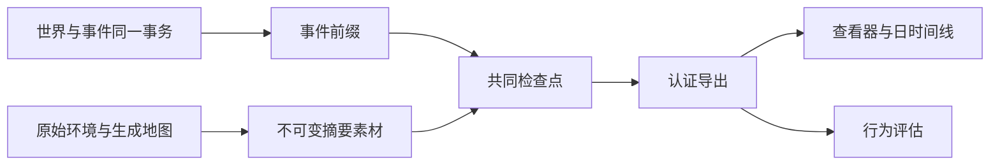

# WorldMock 产品设计说明书 — 记录引擎

## 权威事实与投影

运行的权威记录是按提交顺序保存的事件和共同世界状态。导出、查看器、记忆层与评估只消费这些事实，
不能根据模型自述、资金变化或活动名称补造内容、收货和世界事件。

## 事件与来源

事件信封携带运行、顺序、时间、人物、动作和活动身份，以及 `resource_changes`。
资金变化只允许信封字段，删除 data 内的重复账本。付款与收入支出必须引用真实两个账户并守恒。
当前活动种类只有 sleep、travel、interact、purchase。拒绝旧等待、工作、社交、消息与旧 app 活动快照。
活动快照只出现在环境写下、人物可见的事件里：受理、拒绝、动作结果、活动进度和环境事件。
人物有活动在进行时被业务拒绝，拒绝事件带着那一刻仍在进行的那项活动的快照；世界没有变，
导出把它当作这项活动的一个真实来源，不因此增加执行区间、内容消费或推送转换。

callback_effect、callback_reminder、time_trigger、weather 使用闭合字段合同。
效果包含一项实际触发原因和完整类型化结果；收入支出方向与信封资金变化一致，未支付结果没有资金变化。
独立时间事实不能伪装成上游事件的附加效果，天气条件与速度系数必须来自固定世界天气表。

唤醒原因写在共同身体结算、`decision_started` 和观察里，取值是[模拟引擎](04-simulation-engine.md)唤醒表里的名称。
每次睡醒的原因列表同时含 `planned_end` 与 `session_open`，质量报告和行为评估按原因名的计数各加一。

`memory_updated` 登记人物工作区已落盘的记忆，所有登记用同一组键：`operation`、`created_episode_ids`、
`merged_episode_ids`、`episodes`、四个文件身份、`consolidated`、`observation_event_id`、`verified_event_ids`、
`trigger`、`decision_id` 和 `reflection`。环境按 `observation_event_id` 是否为空分两路核对。

| 登记 | `observation_event_id` | `trigger` | `reflection` | 另外要求 |
| --- | --- | --- | --- | --- |
| 反思登记 | `null` | 恰为 `["reflection"]` | `{date, sleep_activity_id}`，由环境按 `due_reflection` 写入 | `due_reflection` 此刻非空；这次决策还没有观察；本人在这一时刻还没有登记过反思；`operation` 是 `append_episodes`；每条快照的来源都是 `reflection`；`verified_event_ids` 为空；`MEMORY.md` 的前后身份相等 |
| 步尾登记 | 本决策的冻结观察 | `[]` 或 `["activity_conclusion"]` | `null` | 观察属于本决策，事实窗口一致；快照里没有来源为 `reflection` 的条目 |

任一条不满足先记英文错误日志，再以 `ProtocolError("Memory update evidence is invalid")` 作为运行故障拒绝。
睡醒那一步最多有两个 `memory_updated`，先反思、后步尾，两类登记不出现在同一个事件里。

质量报告对每个 `reflection` 非空的记忆更新只凭事件独立重算四件事，任一不成立记一条 `memory_update_without_source`：
同一人物有一条 `activity_progress` 事件，快照是已完成的睡眠，结束时刻等于这次更新的发生时刻；
这是该人物在这个本地日（时区取运行清单的窗口时区）最早的一次睡醒；`reflection.date` 是这个本地日的前一天；
这次更新排在同一决策的观察之前，并且该人物在这一时刻只有这一条反思登记。
`reflection` 为空的更新照旧核对观察与事实窗口。观察不再带刚结束睡眠的私有键。

手机上的三类事由引擎写成四种环境事件：app 的开和关、进出地点、订单通知。
它们都是 `environment_event`，来源是环境，可见性是 `system`，不带资金变化，事件类型的闭集不变。
人物看不到它们：不进任何提示层、记忆、零点计划和就寝反思的输入，不能被回调规则订阅，不产生公开评估证据；
它们也不是决策机会，不新增唤醒原因，不改人物的下一次决策时刻。恢复和重放读已提交的事件，不重写、不重抽。

| `data.kind` | `data` 恰为 | 何时写 | 起因 |
| --- | --- | --- | --- |
| `app_foreground` | `{kind, app_id, step, interval_start, interval_end}` | 一段前台区间关闭的那一秒；打开时不写，长度为 0 的区间不写 | 恰一项：所属活动受理的 `action_result` |
| `location_entered` | `{kind, session_id, location_id, entry_kind}` | 一段停留开始 | 随 `entry_kind` 而定，见下表 |
| `location_left` | `{kind, session_id, location_id}` | 人物出发，这段停留结束；运行截止不写 | 恰一项：受理这次出发的 `action_result` |
| `order_notification` | `{kind, app_id, order_ids, title, summary}` | 订单已下单、已发货、已送达各自发生的那一秒 | 恰一项，随标题而定，见[模拟引擎](04-simulation-engine.md)「购买、付款与收货」 |

`app_foreground` 的 `step` 是 `navigation`、`ordering`、`payment` 之一，`interval_end` 等于事件时刻、晚于 `interval_start`；
信封的 `activity_id` 是所属活动，导航是出行活动，下单和支付是购买活动。「前台」指手机上此刻开着的那个 app，同一时刻至多一个。
`order_notification` 的 `title` 是「订单已下单」「订单已发货」「订单已送达」之一，`order_ids` 是非空、按字符串升序、不重复的商品履约记录身份。
「支付成功」沿用 `payment_notification`，字段不变。

| `entry_kind` | 含义 | 起因 |
| --- | --- | --- |
| `run_start` | 运行开始时人物已在这个地点，不是一次真实的进入；随世界创建的首次提交写入，整次运行恰一条 | 空 |
| `arrival` | 出行按计划走完，到达目的地 | 恰一项：这趟出行走完那一秒的 `activity_progress` |
| `travel_ended_early` | 人物途中提前结束出行，回到出发地开始一段新停留 | 恰一项：这次 `conclude_activity` 的 `action_result` |

停留就是地点停留会话，`session_id` 是会话身份。路上不是停留，不写这两种事件；
到达时刻恰好等于运行截止时照常写 `location_entered`，截止时人物还在的那段停留没有离开事件。

## 数字足迹

`app-usage.jsonl` 的事实共八种，共同字段是 `fact_kind`、`agent_id`、`activity_id`、`app_id`、`source_event_id`。

| `fact_kind` | 另带字段 | 来源 |
| --- | --- | --- |
| `app_use` | `segments`、`status` | 人物点名使用 app 的活动；引擎代为使用的 app 的 `app_foreground` 事件 |
| `content_consumed` | 内容身份、结算区间、位置、是否完成、推送身份 | 实际内容结算 |
| `push_delivered`、`push_opened`、`push_released` | 推送身份、内容身份、会话身份、时刻 | 推送的送达与实际转换 |
| `app_touch` | `occurred_at` | 回调规则 `footprint_chain` 的足迹；出行和付款不再写自动时间点 |
| `payment_notification` | `occurred_at`、`amount_fen`、`order_ids`、`title`、`summary` | `payment_notification` 事件 |
| `order_notification` | `occurred_at`、`order_ids`、`title`、`summary` | `order_notification` 事件；`activity_id` 为 null |

`app_use` 是 app 真实在前台的区间，分两种来源。人物点名使用的 app，区间是这项 interact 活动的正秒结算。
引擎代为使用的 app（导航、下单的内容 app、支付 app）由 `app_foreground` 投影：同一活动、同一 app 一行，字段与人物点名使用的行完全相同；
`segments` 是这一对活动与 app 的全部前台区间，按时间升序，首尾相接的并成一段；`status` 是所属活动在导出截止时的状态；
`source_event_id` 是最后一条贡献区间的 `app_foreground` 事件。
下游区分两种来源看 `activity_id` 在 `activities.jsonl` 里的 `activity_type`：`interact` 是人物点名使用，`travel` 是导航，`purchase` 是下单或付款。
`app_use` 行排在文件最前，按各行第一条来源事件的先后排列；其后是其余事实，按事件先后。
app_touch、payment_notification 和 order_notification 是系统点事实，不拥有播放、停留或复看时长。
「支付成功」由抽到的支付 app 发；抽到直付时由下单的内容 app 发，到店且直付不发。三种订单通知都由下单的内容 app 发。
内容消费使用实际内容结算区间和当前内容身份，不能使用活动起止墙钟差计算，暂停时间不计入。
纯目录浏览只有真实 app 使用，未关联内容；使用冻结 app 内容索引与声明时长认证。

`location-stays.jsonl` 每段停留一行，由 `location_entered` 与 `location_left` 按 `session_id` 配对投影，按进入事件的先后排列。

| 字段 | 取值 | 含义 |
| --- | --- | --- |
| `agent_id` | 唯一人物 | 人物 |
| `session_id` | 停留会话身份，文件内唯一 | 这段停留；与推送事实的 `session_id` 是同一套身份 |
| `location_id` | 已登记地点 | 地点 |
| `entry_kind` | `run_start`、`arrival`、`travel_ended_early` 之一 | 这段停留怎样开始 |
| `entered_at` | 纪元秒；`run_start` 的那一行等于运行开始时刻 | 进入时刻 |
| `left_at` | 纪元秒或 null，不早于 `entered_at` | 离开时刻；导出截止时还在这里则为 null |
| `enter_source_event_id` | 一条 `location_entered` 事件 | 进入的来源 |
| `leave_source_event_id` | 一条 `location_left` 事件，`left_at` 为 null 时为 null | 离开的来源 |

购买投影保存实际订单商品、门店、平台、付款 app、数量、价格与履约事实。
付款、到站与收货分开；收到的经历只能来自已提交的本人真实收货事件。
原始显示名由冻结输入与观察证据解析，人物日时间线使用实际动作与内容名称。

## 冻结输入、检查点与分支

运行素材按原字节冻结 persona.toml、config.toml、catalog/manifest.json 和目录清单文件表登记的每个目录 JSONL，另外冻结生成的 map.json。
catalog/map.jsonl 是数据集声明的距离，按原字节冻结；map.json 是引擎生成的整张图，按规范 JSON 冻结，两者是不同的素材。
导出自查先读冻结的目录清单，再要求冻结素材的名字集合恰为上述四个固定名字加文件表里的每个 catalog/ 路径；
冻结清单的文件表必须包含全部必需文件、且不含必需与可选文件名以外的路径，目录摘要按文件表里的全部文件重算。
清单保存原始字节摘要、五项环境身份、实际模型元数据与非密模型参数。凭据正文不进入清单、事件或报告。

检查点绑定准确事件前缀、共同世界和人物工作区素材。分支复制全部冻结环境素材和所需快照，
恢复前认证归档成员，拒绝绝对路径、符号链接、别名与覆盖已有目标文件。
人物工作区恢复后核验完整画像卡片、节律和模型身份，不接受旧结构或参数漂移。

## 完整导出认证

导出固定事件截止、摘要素材、活动、app 使用、购买、已核验经历、地点停留、日时间线及质量报告。
导出清单的结构号是 5。`artifacts` 的键恰为 `events`、`activities`、`verified_experiences`、`purchases`、`app_usage`、`location_stays`，
每个值是 `{path, rows, sha256}`，`location_stays` 的 `path` 是 `location-stays.jsonl`；
结构号不符报 `Export manifest is not a committed supported version`，键集不符报 `Export artifact set is invalid`。
app 的开关、订单通知和地点停留只进事件与这些工件，质量报告的结构和内容不变。
完整运行要求正常运行终态和成功最终共同检查点；时钟到达终点不能单独宣称完整。
活动保留全部实际来源，来源身份去重；活动时长来自正秒结算，暂停不计入。

认证重算投影与摘要、核对实际源事件、资金历史和最终余额、冻结原字节及目录摘要，
并验证当前活动槽位、本人收货与内容区间。重新计算摘要不能为伪造事实提供可信来源。
付款自查按订单归组：商品履约记录属于最终检查点里列出它的那个购买活动，同一次购买里下单 app（`app_id`）相同的记录是一张订单，
到店记录合成一张到店订单。每张已付款的订单恰有一条付款事件，它的购买活动、记录集合、金额、时刻、账户差额和受理来源都与这张订单一致；
一张订单不得只付一部分。两次购买走同一路线（店铺、收货地、下单 app、履约方式都相同）时各算各的，不并成一张订单。
到站取件通知的来源到站事件，起因恰为列出该记录的付款事件；本人在驿站领取的收货事件，起因是带着该记录领取后快照的取件动作结果。

手机记录的自查都只读已导出的事件、工件和最终检查点，任一不成立导出不发布。

| 检查 | 要求 | 不成立时的英文错误 |
| --- | --- | --- |
| 前台事件与订单通知的来源 | 字段闭集、系统可见、恰一个起因；前台区间为正且结束于事件时刻；通知的标题、正文和记录集合合法 | `System app event fields are outside the current contract`、`App foreground step or interval is invalid`、`Order notification text or order set is invalid` |
| 停留事件的来源 | 字段闭集、系统可见、起因个数与 `entry_kind` 相符 | `Location stay event fields or source are invalid` |
| 自动 `app_use` | 所属活动是出行或购买；`segments` 等于该活动该 app 全部前台区间合并的结果，每段落在所属活动真实执行的区间之内；`status` 等于所属活动的状态 | `Automatic app use disagrees with its foreground events` |
| 导航区间 | 所属活动是出行，步骤全为 `navigation`，一趟出行只有一个导航 app；不越出这趟出行，不与同一人物任何购买或用 app 的活动的执行区间重叠 | `Navigation app use overlaps a side activity or leaves its trip` |
| 下单与支付区间 | 所属活动是购买；下单区间的 app 是该购买某张订单的下单 app，且全部早于第一个付款段；每张付款时长大于 0 的订单，付款段 10 至 20 秒，按订单键的顺序排在购买末尾、互不重叠，订单上的付款起止与对应的支付前台区间一致，购买被截断时区间止于购买结束 | `Purchase app use disagrees with its order phases` |
| 同一时刻只有一个 app 在前台 | 同一人物全部 `app_use` 区间互不重叠、长度为正，导航、下单、支付与人物点名使用的 app 一起查 | `App use intervals overlap or have no positive duration` |
| 「支付成功」 | 每张已付款订单，支付 app 与下单 app 不全为空时恰一条；发送的 app 是支付 app，直付时是下单 app；金额、记录集合、时刻与起因和这张订单的付款事件一致 | `Payment notification count disagrees with actual payment`、`Payment notification disagrees with its actual purchase payment` |
| 订单已下单 | 每张带下单 app 的已付款订单恰一条，时刻等于付款时刻，app、记录集合与起因和这张订单一致；未付款的订单没有 | `Order notification count disagrees with actual payment, shipment or delivery`、`Order notification disagrees with its actual order event` |
| 订单已发货 | 每趟已付款的配送至多一条；发货时刻不晚于导出里最后一条事件的时刻时恰一条；时刻等于付款时刻加「到达排程的到期时刻减付款时刻」的十分之一，向上取整到秒 | 同上两句 |
| 订单已送达 | 每趟已送达的外卖配送恰一条，时刻等于送达时刻，起因是这一趟的到达事件；快递和到店没有 | 同上两句 |
| 冻结环境里的 app | 导航的 app 是绑定了该出行方式的功能 app，下单的 app 是内容 app，支付的 app 是绑定了购买的功能 app 或内容 app；「支付成功」的 app 同支付；订单通知的 app 是内容 app | `Foreground app disagrees with its frozen app role or binding`、`Payment notification disagrees with its frozen app`、`Order notification disagrees with its frozen content app` |
| 停留工件 | `location-stays.jsonl` 与由事件重新投影的结果逐行相同 | `Export location stays disagree with committed events` |
| 停留的先后 | 恰一行 `run_start` 且是第一行，进入时刻等于运行开始；各行按时间先后互不重叠，只有最后一行的离开时刻可以为 null | `Location stays overlap or are out of order` |
| 停留与出行 | 每个 `arrival` 对应一趟走完的出行：到达时刻、目的地相同，前一行的离开时刻和地点等于这趟出行的开始时刻和出发地；每个 `travel_ended_early` 的地点等于前一行的地点；每次离开对应一次被受理的出发 | `Location stay disagrees with its actual travel` |
| 停留与最终检查点 | 各行与检查点世界状态里的停留会话逐一对应：身份、地点、开始时刻相同；离开时刻非空时等于会话的结束时刻，为 null 的那一行对应结束于运行截止的会话 | `Location stays disagree with the final checkpoint` |

`app_touch` 只剩回调足迹：`rule_id` 是冻结的 `catalog/callbacks.jsonl` 里登记的一条回调规则的身份，`step` 只取 `browse` 或 `payment`；
没有冻结这份文件的运行不得有 `app_touch`。规则身份没有登记、或步骤不在这两个值之内，都报 `App touch step disagrees with its source`。
坏素材或投影拒绝发布，已有正确导出不被半成品覆盖。查看器与评估同样先认证输入。
