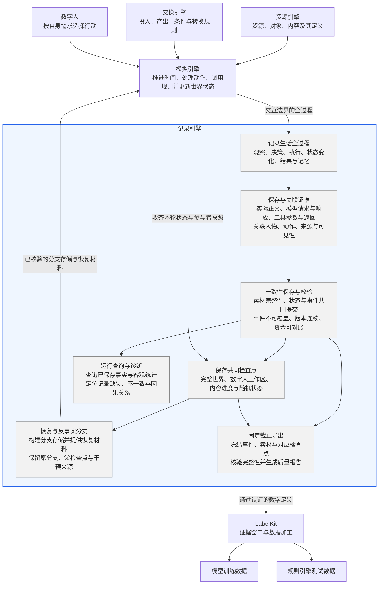
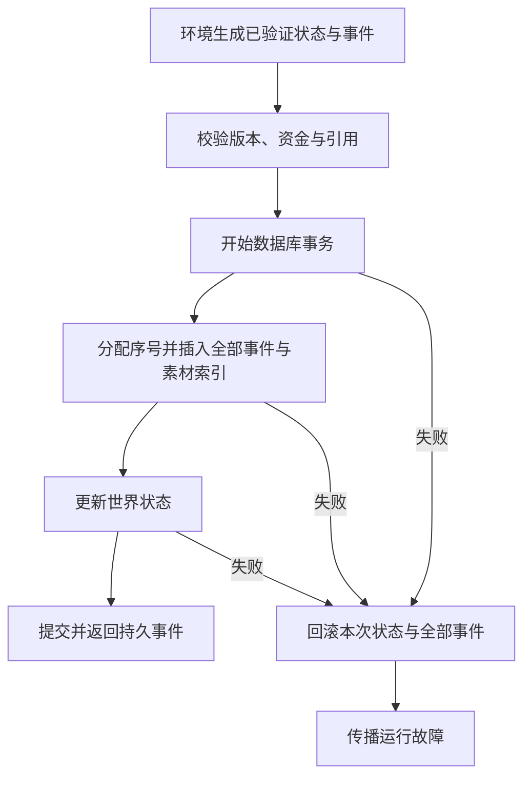
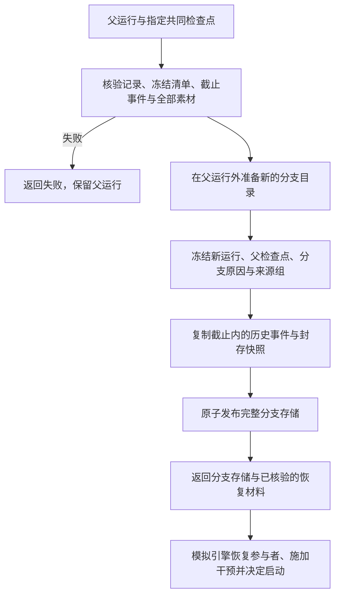
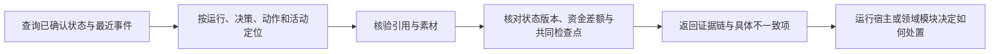

# WorldMock 产品设计说明书 — 记录引擎

> **状态**：已整合；原已冻结的接口与行为约束继续有效，待实现设计单独列出  
> **日期**：2026-09-20  
> **版本**：v1.2  
> **范围**：记录生活全过程、保存与关联证据、一致性保存与校验、保存共同检查点、恢复与反事实分支、固定截止导出、运行查询与诊断

## 记录引擎负责什么

记录引擎让一段数字人的生活能够被查证：他实际看到了什么、作出了什么选择、环境如何执行、
状态为何变化、结果是什么，以及这些经历怎样进入记忆。
它接收模拟引擎提交的事实与快照，负责保存、关联和完整性校验；
从共同检查点构建新的分支存储，提供已核验的恢复材料，原分支记录始终保留。
数字人负责行动选择与记忆，交换引擎负责规则计算，模拟引擎负责运行编排与实际执行。

本文统一维护记录引擎的设计、接口和行为约束。
[接口合同](../CONTRACTS.md)保留跨模块接口导航；
[交换引擎](02-exchange-engine.md)提供交换条件与投入产出规则，[模拟引擎](04-simulation-engine.md)推进活动并落实结算；
[数据交付](06-delivery.md)定义认证导出进入 LabelKit 后如何加工；
[验收门禁](../VERIFICATION.md)和[实现状态](../dev/implementation-status.md)分别记录放行条件与实测证据。
文档整合不构成实现完成或真实运行验收。

### 项目框架映射

沿用[概述的解决方案](00-overview.md#12-解决方案)：资源引擎提供资源与内容，交换引擎提供规则，
模拟引擎组织数字人的行动与世界变化。记录引擎在交互边界保存全过程，形成可追溯、可恢复、可交付的数字足迹。



### 职责与模块边界

责任以谁产生决定、谁保存结果划分，不因代码位于同一目录就归入同一引擎。

| 协作边界 | 上游或下游负责 | 记录引擎负责 |
| --- | --- | --- |
| 行动与结算 | 模拟引擎组织决策、唤醒与活动推进，计算身体变化，并调用交换引擎校验条件、计算投入产出 | 保存实际提交的事件与状态，核对版本、资金差额、引用和历史是否一致 |
| 内容与可见性 | 资源引擎提供内容及来源；模拟引擎决定本次观察实际交付什么 | 保存实际交付字节、来源与可见性标记，保持事件关联 |
| 记忆与共同检查点 | 数字人保存记忆和工作区；模拟引擎完成世界推进，收齐参与者快照并确定共同边界 | 校验快照齐备、字节完整、状态与截止一致，原子提交检查点 |
| 恢复与反事实执行 | 模拟引擎恢复人物与外部进程、施加干预并启动新分支 | 核验检查点，构建分支存储，保存父检查点、干预证据与来源关系 |
| 运行生命周期与故障处置 | 模拟引擎维护运行状态，决定终止、重试与继续执行 | 返回持久化结果或明确失败，提供已保存记录的只读查询和完整性诊断 |
| 数据加工与行为评估 | 数据交付组装样本、裁剪窗口和划分数据；行为评估判断真实性与实验效果 | 提供固定截止的认证足迹和可重算的事实统计 |

本文的七个功能主题均限于右栏；协作方的规则只在交接处引用所属文档，不作为记录引擎的功能或实现差距。

记录引擎使用追加事件、状态快照和内容寻址素材，复用 SQLite 与现有存储模块。
数据库事务的依据是 [SQLite 原子提交](https://www.sqlite.org/atomiccommit.html)；
不可变事件与快照的组织方式参考 [Microsoft Event Sourcing](https://learn.microsoft.com/en-us/azure/architecture/patterns/event-sourcing)。
这些工程机制不意味着重新调用模型会重现相同决策。

### 主题阅读路径

后续正文按项目框架映射中记录引擎内部的功能框展开，章节名称与图中功能名称一致。
接口、数据结构、处理规则、失败边界、实现差距和验收要求分别放入所属主题。

- [记录生活全过程](#记录生活全过程)
- [保存与关联证据](#保存与关联证据)
- [一致性保存与校验](#一致性保存与校验)
- [保存共同检查点](#保存共同检查点)
- [恢复与反事实分支](#恢复与反事实分支)
- [固定截止导出](#固定截止导出)
- [运行查询与诊断](#运行查询与诊断)

实现差距沿用已有源码核查结论，按主题分列；本次调整不修改生产代码；跨引擎约束在其所属文档维护。
各主题保留已冻结规范的验收要求与现有测试入口；测试存在不等于本次重新执行通过。
本次文档整理的验证结果记录在交付说明中，正式运行与跨系统验收仍见[实现状态](../dev/implementation-status.md)。

## 记录生活全过程

围绕数字人实际经历的顺序，明确每个环节必须留下什么，以及怎样形成结构化事件。

### 保存边界

#### 必须保存的内容

证据由运行环境在模型与环境的接口边界写入，不能依靠数字人自己维护日志。

| 生活过程 | 必须可追溯的证据 |
| --- | --- |
| 观察交付 | 数字人实际收到的正文、可见字段、内容片段范围、观察版本，以及宿主实际使用的有效交互菜单 |
| 人物决策 | 决策身份、实际上下文、模型请求与响应、已输出的决策自述和动作选择 |
| 动作执行 | 工具名、参数、返回、接受或拒绝、实际进度、中断与最终结果 |
| 状态变化 | 变化前后的状态版本、发生原因、资金变化、身体结算与环境自主事件 |
| 记忆更新 | 实际写入的记忆、记忆版本、来源事件与工作区快照 |
| 故障与结束 | 异常类型、英文错误、关联事件、运行终态与最终共同检查点 |

凭据不写入证据。模型完整请求保留必要的任务上下文，脱敏规则带版本与处理记录。
记录数字人实际输出的内容，不把额外生成的解释冒充当时的决定或事实。

### 数字足迹事件结构

#### 事件字段

环境以 `EventDraft` 提交事实，存储在事务内分配持久序号、程序时刻与世界状态版本后成为持久 `Event`：`schema_version` 固定 1，`event_seq` 大于零并按提交顺序严格递增，`wall_elapsed_ms`、`state_version_before`、`state_version_after` 非负。

| 字段组 | 字段面 |
| --- | --- |
| 记录身份 | `schema_version`, `run_id`, `event_id`, `event_seq` (严格递增), `event_type` |
| 参与与关联 | `agent_id`; 适用时有 `decision_id`, `action_id`, `activity_id`; `caused_by` 连接直接相关事件 |
| 时间 | `occurred_at` (模拟时间), `observed_at` (观察事件), `recorded_at` (程序时间), `wall_elapsed_ms` |
| 观察 | 实际可见字段、`content_refs`, `material_ranges`; `observation_version`，不含未来或未授权内容 |
| 请求与执行 | `action_name`, `params`, `status`, `start_time`, `end_time`, `progress`, `interruption_reason` |
| 结果 | `feedback`, `resource_changes`, `deliverable`, `counterparty`, `review_result`, `failure_reason` |
| 状态关联 | `state_version_before`, `state_version_after` (可回到检查点和事件重建状态) |
| 来源与可见性 | `source_kind` 取闭集 `environment`、`model`、`scenario`、`external`（默认 `environment`）；`visibility` 取闭集 `agent`、`evaluation`、`system`（默认 `agent`） |
| 素材引用 | `artifact_refs`：`AssetRef` 列表，每项含 `sha256`、`size_bytes`、`media_type` 与 `source` |

`observation` 事件的 `data` 即实际交付的结构化观察投影，不另写入 JSON 字符串副本。
其中事件级工具支持字段 `interaction_menu` 保存本轮按地点类与人物声明求得的有效菜单，供核对实际
模型 Schema、本地校验和环境派发；它不进入人物 user 消息，也不保存其他人物或全部地点的原始声明。
地点变化后的新菜单由下一次观察另行记录，既有观察不回写。
人物提示如何包装观察见[人物决策提示合同](../CONTRACTS.md#请求组成)。

请求同一动作的重试沿用动作标识；真实重复观看或再次购买必须产生新动作标识。完整原始事件保存世界事实、自述和推断三者的来源区别，既不删除重复行为，也不把相同素材的哈希当作事件标识；环境准确值、人物表达的感受与设备可见痕迹并不等价。

`agent_id` 为整数或空值；`occurred_at` 与存在时的 `observed_at` 使用模拟时刻的整数秒。
`decision_id`、`action_id`、`activity_id` 为字符串或空值，`caused_by` 为事件标识字符串列表，
`data` 为对象，`artifact_refs` 为 `AssetRef` 列表；`recorded_at` 保存程序时刻字符串。

#### 共同身体结算与决策证据

同一人物同一真实区间只产生一次 `environment_event.data.kind=body_settlement`，事件顶层
`activity_id` 为空。正文保存 `interval_start`、`interval_end`、按身份排序的 `activity_ids`、
`body_settlement`、`resource_flows`、`decision_offered` 和 `wake_reasons`。同一边界的各
`activity_progress.data.body_settlement_event_id` 引用这条已提交事件；各自只保存本活动的
进度、效率、消费和内容接触，不复制共同身体变化或将联合代谢成本分摊给某条活动。

记录引擎校验引用身份、人物、区间与事件顺序；具体身体演化和唤醒条件仍由模拟引擎计算。
静默边界也写共同身体证据，不能因没有人物决策而漏记身体时间。
唤醒原因闭集、睡眠允许的原因与触发条件统一见
[生活运行时规格的决策节律](../dev/SPEC-life-runtime.md#决策节律结算边界与唤醒条件分离)。

#### 事件类型枚举

```python
EventType = Literal[
    "observation",           # 观察交付
    "decision_started",      # 人物决策
    "model_request",         # 模型请求
    "model_response",        # 模型响应
    "action_requested",      # 动作请求
    "action_accepted",       # 动作接受
    "action_rejected",       # 动作拒绝
    "activity_progress",     # 活动进度
    "action_result",         # 动作结果
    "environment_event",     # 环境自主事件
    "memory_updated",        # 记忆变化
    "checkpoint_created",    # 检查点
    "run_ended",             # 运行结束
    "run_failed"             # 运行异常
]
```

#### 事件正文与资源证据

`data` 承载具体事件的结构化正文；`artifact_refs` 指向较大或需要保留原始字节的素材。
事件外壳的字段不能替代活动自身的领域合同。

| 事件 | 正文用途与约束 |
| --- | --- |
| `observation` | `data` 就是结构化观察投影，不额外保存一份 JSON 字符串副本 |
| `decision_started` | 保留当时实际产生的决策信息，决策自述属于模型自述 |
| `model_request`、`model_response` | 关联实际请求、响应素材、模型身份与可测量的调用用量；未得到可靠结果时不能记为成功 |
| `action_requested` | 记录实际工具请求与动作身份，不代表已通过可行性检查 |
| `action_accepted`、`action_rejected` | 记录环境的受理或业务拒绝；交互菜单拒绝保留 `INTERACTION_MENU_DENIED`，受理时不重复声明最终支付 |
| `activity_progress` | 自身实际区间、活动进度、效率、消费和内容接触，引用共同身体结算事件 |
| `action_result` | 实际结果及发生结算时的 `resource_changes`，作为支付的唯一事实 |
| `environment_event` | 实际自主事件与唯一共同身体结算；初始注资也需完整资金证据 |
| `memory_updated` | 实际记忆写入或视图刷新、来源截止与文件哈希；写盘失败不宣称完成 |
| `checkpoint_created` | 对应数据库中已提交的共同检查点 |
| `run_ended`、`run_failed` | 正常结束或运行故障，仍需结合最终检查点判定可交付性 |

##### 地图与门店供给证据

| 证据 | 保存内容与可见性 |
| --- | --- |
| 地图身份 | 运行使用的集合身份、版本、摘要及逐来源许可与通知；运行清单和导出清单一并保留 |
| 发现请求 | `discover_places` 的四个实际筛选字段、分页游标、宿主绑定动作身份与观察版本；登记确认不包含未结算结果 |
| 发现结果 | 实际返回的有序地点与供给、道路状态、路线身份/分时耗时/费用、营业与资格、原始报价和版本、购买系数及一份实际金额、库存、履约、来源及假设标记 |
| 比较与选择 | 观察实际呈现的供给身份及公开事实；决策和请求引用当时真正可见的 `supply_id`，保留 `product_id` |
| 购买与交付 | 供给、商品、地点、卖方、实际报价版本、数量、行 `total_price_fen` 与整单合计、履约目的地、准备/运输依据及来源；付款和交付分别记录 |
| 世界变化 | 按供给的库存与报价、营业例外、交付队列、人物可见供给与轮转随状态提交，拒绝不写购买副作用 |

发现沿用 `action_requested`、`action_accepted`/`action_rejected` 和 `action_result` 事件，
不新增同步世界查询通道。返回结果保存当时快照，导出不得用当前目录重建历史。
只能公开实际返回供给的库存，不能把全量 `WorldState` 库存、未接触供给或未来报价注入人物窗口。
已取得物品按商品合并，记录仍保留取得来源，不把购买或到达视为已经消费。

同地点、零处理时长的配送即时交付，仍记录 `fulfillment=delivery`、`status=delivered` 和实际 `inventory_changes`，
不安排虚构延迟。其他整单配送使用同一次到期事件携带 `order_ids`；重复事件不得再次增加库存或伪造库存变化。
订单来源保留供给、实际报价和路线的来源组合，当前报价状态的 `source` 也必须通过 `DataSource` 严格校验。
观察中的 `data.products` 是商品使用定义，`data.supplies` 是人物已知供给；提示的 `facts.products` 是实际呈现供给行。
供给行的 `price_fen/price_version/quote` 保留原始声明，`purchase_pairing_state` 保留购买配对状态，
`purchase_coefficient` 和 `purchase_price_fen` 分别记录已定义配对系数与购买一份的算子金额。
非定义配对的系数及金额为空，不能购买；未知报价的金额也保留 `null`。已定义零系数的零额履约照常留证。
行付款按原价、实际数量和系数求值，
不能用一份金额乘数量重建。品类身份与供给报价身份一起保存，历史证据不随当前规则重算。
只有实际进入提示的供给行才能更新可见凭据和呈现时刻，已知供给集不能替代实际呈现集。

发现或浏览回灌与当前供给事实共用一个身份窗口：回灌优先，其他候选只填剩余名额。
当前行与同次结果一致时不重复；有变化时以 `based_on_action_id/changes` 引用结果并按键替换，
`null` 保留为值，嵌套对象整体替换，完整当前比较事实必须可还原。原始观察和结算证据不采用这种省略。
公开 `excluded` 按全部非身份属性分组为 `object_ids`，完整事件仍逐项保存，不损失任何排除事实。
到达访问失败的终态结果包含 `error_code=LOCATION_ACCESS_DENIED`；公开 `arrival` 保存实际地点、
`access_status`、缺少的资格和来源，原始活动仍保留已完成的路线进度及其来源。
失败不能抹去已支付的交通费，也不能只留下“活动失败”而不告诉人物到达位置与拒绝原因。


##### activity_progress 事件

保存模拟引擎提交的本活动实际区间、效率、消费和内容接触，以及
`body_settlement_event_id`；身体变化与公共资源流只在该区间的共同身体结算事件中保存。
食用明细的 `interval_quantity` 是本区间正增量，`cumulative_quantity` 才是累计值；
购买、交付、开始食用和累计量重复出现都不能冒充本区间实际吃下的份额。
实际食品利用效率由进食进度的 `consumption.food_efficiency` 留证，工作效率由工作进度的
`activity_efficiency` 留证；共同身体结算不归属其中某个活动。阶段含义见
[模拟引擎的实际区间、身体变化与效率](04-simulation-engine.md#实际区间身体变化与效率)。
上游没有提供的测量值必须保持未知，不能补造数值或把缺失当作零变化。

`resource_flows` 必须是字典列表，每项恰好含 `resource`、`owner`、`direction`、`amount`、`cause` 五个键。
`resource`、`owner`、`cause` 为非空字符串；`direction` 仅取 `source` 或 `drain`；
`amount` 必须为有限正数，不能使用布尔值、NaN 或无穷值。
记录引擎校验载荷结构；交换条件与投入产出由[交换引擎](02-exchange-engine.md)计算，身体演化与状态更新由[模拟引擎](04-simulation-engine.md)执行。

#### 已核验经历与主观记忆

记录引擎仅从本人、明确截止前已提交的 `activity_progress` 投影
`waited`、`consumed`、`arrived`、`played`。路线到达取其中的真实终态与到达位置，
包括组合动作中先完成的出行子活动，不依赖聚合 `action_result`。每条经历带
`kind`、`agent_id`、`activity_id`、`source_event_id`、`event_seq`、`occurred_at` 和类型载荷。
等待只证明正时长区间；实际食用取 eat 的区间增量；到达取路线真实终态；播放取媒体位置正向区间。
请求、受理、购买、人物文字和反思均不能产生这些事实。畸形结算拒绝投影并记录英文错误日志。
完整事件前缀用于固定截止离线导出；每次观察只交付该观察事件前本人最近五条，按事件序号正序，
来源身份保留在原事件库。重复读取、检查点恢复与分支重放不额外累加或改写源事件。
导出另写哈希绑定的 `verified-experiences.jsonl`，按固定截止前缀重建全部人物事实；消费端从
`events.jsonl` 独立重算并逐行核对，不将观察五条窗口误作完整历史。

人物 `finish.memories`、`memory_*` 检索结果及就寝反思是 `epistemic_status=subjective`
的自述。合法 `refs` 仅证明来源曾显示给人物。`MEMORY.md` 由冻结身份、当轮已核验经历和单独
持久的主观归纳确定性装配；模型不能整篇重写完成事实章节。人物当前提示只采用当轮观察的事实窗口，
不重复加入上轮长期记忆视图中的旧窗口。记忆更新记录本轮观察身份、实际渲染的事实来源、新增与
相似合并的 episode 身份、对应的 `{id,type,text,epistemic_status}` 主观条目快照、
三个文件的写入后哈希及 `MEMORY.md` 写入前哈希和
主观巩固标志；快照只用于自述重复率与导出，不进入客观经历或身体指标。视图刷新不重置主观巩固计数。
空输入且视图未变化不写更新；写盘或反思失败不写成功更新。完整字段与行为见
[人物记忆合同](../CONTRACTS.md#记忆字段)和[一日行为规格](../dev/SPEC-dayrun-behavior.md#已核验经历与人物自述)。

`memory_updated.data` 的实际载荷和核对边界如下：

| 字段 | 记录内容与约束 |
| --- | --- |
| `operation` | `append_episodes` 或 `refresh_summary`；追加时有新建或合并身份，纯视图刷新时无身份且文件内容确有变化 |
| `created_episode_ids`、`merged_episode_ids` | 本次新建及相似合并的稳定身份；两组互斥且各自不重复 |
| `episodes` | 与上述身份集合恰好对应的 `{id,type,text,epistemic_status}` 快照；每项固定 `subjective` |
| `observation_event_id` | 本次决策中实际交付给该人物的观察身份 |
| `verified_event_ids` | 本轮事实窗口的 `source_event_id`，按首次出现顺序去重；同一结算事件可投影多件食品，但来源身份只记一次 |
| `memory_before_sha256`、`memory_sha256` | 写入前和写入后 `MEMORY.md` 的内容身份 |
| `episodes_sha256`、`state_sha256` | 写入后主观条目文件和记忆状态文件的内容身份 |
| `consolidated` | 该步是否实际执行主观巩固，不代表已核验事实发生变化 |

记录入口与质量重算均要求来源身份集合与该观察可见的事实窗口严格相等。
来源身份重复、越窗、跨人物或把人物自述快照写成客观状态均不能作为合法记忆更新导出。

事件全序与状态关联的验收见[一致性保存与校验的验收](#一致性保存与校验的验收)，原始素材留证见[保存与关联证据的验收](#保存与关联证据的验收)。

## 保存与关联证据

保存当时实际使用和产生的内容，让每条经历能回到原始证据，并明确它来自哪里、谁当时能够看到。

### 事件身份与因果关联

同一动作的重试沿用动作标识；真实再次观看、再次购买或再次接触内容产生新的动作标识和事件。
素材哈希只标识内容，不能作为事件身份，也不能用来删除重复行为。
`caused_by`、`decision_id`、`action_id` 与 `activity_id` 连接观察、决策、执行和结果；同秒事件按序号排序。
已经受理的请求序号不能证明活动完成或资金已支付。

### 来源与可见性

原始记录保留世界事实、数字人自述与推断的来源区别，按提交内容保存来源和可见性标记。
模拟引擎负责观察投影与访问范围；记录引擎保留实际交付证据，不能把事后完整状态冒充当时的观察。
下游的字段裁剪与证据窗口由[数据交付](06-delivery.md#3-证据窗口)负责，原始事件保持不变。

### 素材存储行为


相同内容复用已有文件，读取仍须检查引用、大小和摘要。
不存在或损坏的素材立即失败，不能返回空内容或临时替代物。
文件系统不参加 SQLite 事务，因此只有完整发布的素材才允许被事件或检查点引用；
数据库提交失败时，不得发布看似成功的记录。

`AssetRef` 拒绝未知字段，创建后不可变；`sha256` 是 64 位小写十六进制字符串，
`size_bytes` 是非负整数，`media_type` 是字符串，`source` 是来源信息对象。
`EventDraft`、`Event` 与 `Checkpoint` 的模型同样拒绝未声明字段；
具体事件正文的领域约束由对应领域模型验证。

### 素材存储接口

| 调用 | 签名 | 合同 |
| --- | --- | --- |
| `AssetStore.put` | `(content: bytes, metadata: dict) -> AssetRef` | 内容先原子落盘并核验，返回不可变引用；相同内容复用文件，接触事件仍分别生成 |
| `AssetStore.read` | `(reference: AssetRef) -> bytes` | 验证引用、大小与 SHA-256；缺失或损坏立即失败，不返回空内容 |
| `AssetStore.put_json` | `(value: object, source: dict) -> AssetRef` | 把结构化值落成素材，复用同一哈希与引用规则 |


### 保存与关联证据的验收

| 要求 | 必须通过的观察 | 证据位置 | 本次核验状态 |
| --- | --- | --- | --- |
| 素材原子写入与不可变引用 | 正文以原子方式落盘并通过核验后才发布为稳定引用；同一份素材被复用，每次接触仍各自生成事件；引用缺失、字节数或摘要对不上时当即失败，绝不返回空内容 | `tests/footprints/test_store.py` 的 `test_missing_or_damaged_asset_prevents_commit_and_checkpoint`；`tests/footprints/test_export.py` 的 `test_export_corrupt_asset_never_publishes_manifest` | 保留要求，本次未复跑 |

## 一致性保存与校验

把世界变化和对应事件作为同一笔事实保存，保证中断或错误不会留下部分成功的结果。

### 持久化结构

```
run/
  manifest.json                 # 运行身份与代码、模型、提示、规则、数据版本
  footprints.sqlite             # 事件、当前结算状态、素材索引与检查点
  assets/<sha256>               # 实际内容、模型证据、人物状态快照与交付物
  exports/<export-id>/          # 固定输入、来源索引和导出清单
```

图中只列记录引擎使用的持久化材料；冻结运行清单由运行宿主提供。
数字人维护自身记忆与可变工作区，模拟引擎协调其保存和恢复；交付目录由数据交付管理。
交互菜单声明随场景原始字节进入场景身份，静态工具描述进入工具模板身份；运行时有效菜单留在对应
观察事件里，不新增一份与场景身份重复的菜单版本清单。
记录引擎仅持有检查点封存的不可变快照。

运行清单冻结 `category_contract_version`、`category_contract_sha256`、`exchange_rules_sha256`、
`catalog_content_sha256`。LifeEngine 在创建、打开、恢复或重放的副作用之前核对当前目录与该身份；
同版本异内容拒绝执行。检查点已有的 `manifest_sha256` 覆盖这些字段，
足迹导出的 `frozen_run_manifest` 原样保留它们，不从导出时的目录重建。
字段含义见[品类接口合同](../CONTRACTS.md#品类契约与目录字段)，行为见[品类契约规格](../dev/SPEC-category-contract.md)。

成功动作的首条 `action_result.data.category_matches` 记录实际命中的 `category_id`、`rule_id`、`action`。
维护工具按这些记录统计触达次数；活动完成和幂等重试不重复登记命中。

| 数据表 | 责任 |
| --- | --- |
| `events` | 不覆盖的事件序列；可按人物、活动、动作和时间查询 |
| `world_state` | 当前已确认世界、人物资源、活动与待发生事件；带状态版本 |
| `artifacts` | 哈希、文件位置、大小、模态、来源和使用条件 |
| `checkpoints` | 完整世界快照与 AS2 人物快照引用、时钟、随机状态和最后事件序号 |

数据库只接受运行环境持有的唯一存储句柄写入；上游先保存证据素材，再通过该句柄提交引用。

`events` 由数据库触发器限制为只追加，并限制持久序号连续；历史事件不能更新或删除；已提交的检查点记录同样禁止更新或删除。
`world_state` 保存当前已确认状态，完整历史恢复依靠共同检查点及其关联事件，不能把当前状态误当作任意历史截点的状态。
素材按内容哈希共享字节，事件和引用中的来源语义仍各自保留。

### 数字足迹存储接口

状态提交接口在本主题定义；素材、检查点、恢复、固定截止读取与运行查询接口分别见对应主题。

### 存储调用

| 调用 | 签名 | 合同 |
| --- | --- | --- |
| `FootprintStore.commit` | `(state: dict, events: List[EventDraft]) -> List[Event]` | 一次事务更新状态、资金与事件；事件序号由存储分配，状态版本由环境递增并验证连续性；返回本次落库的持久事件 |


生活模型负责验证世界状态与封闭请求类型；存储接收已验证的 JSON 状态与事件，不反向决定活动或资源规则。素材引用包含 SHA-256、字节数、模态与来源。所有业务模块只通过同一个环境实例的存储句柄写入，人物 worker 不能自行修改 `footprints.sqlite`。

### 存储接口行为

| 操作 | 行为边界 |
| --- | --- |
| 新建运行 | 明确创建新的运行身份与目录；目标存在时拒绝覆盖 |
| 打开运行 | 只打开已有的有效数据库与冻结清单；缺失数据不能隐式新建 |
| 提交状态与事件 | 校验状态连续性、资金差额、因果引用和素材后，在同一事务提交全部状态与事件 |


### 事务与失败处理

#### 事务边界

生活状态、资金结算、动作状态与对应结果事件在同一笔 SQLite 事务提交。
领域规则由生活模型验证；记录引擎验证持久化一致性，不能反向决定活动规则。



#### 事务范围

外部模型调用、游戏进程和文件系统整体不在数据库事务内。
外部调用的开始、结果或未知状态由调用方提交；记录引擎按提交内容保存，不执行或重试外部调用。
同一次结算的事件批量提交，不逐事件拆散原子边界。

#### 失败分类

| 情况 | 记录引擎的处理 |
| --- | --- |
| 状态版本、事件结构、资金差额或因果引用不一致 | 拒绝提交，返回明确的校验错误，已确认数据不变 |
| 素材缺失、损坏或引用不匹配 | 拒绝读取、提交、检查点、分支或导出，不返回空内容代替证据 |
| 数据库事务失败 | 回滚本次状态与全部事件，向调用方传播失败 |
| 检查点、分支存储或导出构建失败 | 不发布成功记录或清单，不修改父运行 |
| 故障事件本身也无法保存 | 输出带可用关联身份的英文错误，不伪造已经持久化的 `run_failed` |

保存成功只代表对应记录已提交。业务拒绝、协议重试、运行终止与恢复启动由
[模拟引擎的失败处理](04-simulation-engine.md#失败处理)和[AS2 失败传播](../dev/SPEC-as2-integration.md#失败传播改动)约束；
记录引擎不得把持久化故障包装为成功返回。

### 状态版本与连续性

#### 状态版本递增

状态由环境递增版本，存储检查连续性。实际改变世界时，版本只能增加一；
仅追加观察等证据、世界内容完全相同时，可以保持同一版本。
同版本必须具有相同的确定性编码字节，不能隐藏状态修改；时钟不能倒退。

#### 事件序号严格递增

序号由存储分配，按提交顺序严格连续递增，同秒事件也有明确次序。
运行内的截止序号确定固定历史范围，不依赖墙钟时间排序。

#### 状态版本变化必须有事实事件

版本变化至少对应一个事实事件，禁止静默改变时钟、资源或活动。
`state_version_before` 与 `state_version_after` 把事件绑定到状态变化，供因果追溯、连续性检查和检查点恢复核对。

#### 状态关联字段

世界快照持久化采用确定性 JSON：键排序、集合按元素排序、编码规则固定。
新进程和不同 Python 哈希种子必须得到逐字节相同的状态。
只有事件和状态版本一致仍不足以证明完整恢复，还需检查参与者工作区、内容进度、待发生事件和随机数状态。

#### 资金守恒验证

权威资金变化只位于 `Event.data.resource_changes` 顶层，全部使用整数分。

| 约束 | 核验方式 |
| --- | --- |
| 支付只记一次 | 只在实际结算的结果事件声明；受理、再次观察与幂等回放不得再记支付 |
| 转账双方明确 | 使用 `account:` 账户标识描述双方，两端金额合计为零 |
| 事务差额一致 | 本次所有账户余额差额必须与同批权威资金事件逐项一致 |
| 初始注资完整且唯一 | 首条 `initial_funds_injected` 一次列出全部初始账户和外部对手方，之后禁止再次声明注资 |
| 完整历史可对账 | 仅凭初始注资与后续资金事件，就能重建最终共同检查点的全部账户余额 |

只检查单条事件收支平衡不够，必须核对余额差额与完整历史。
这里验证的是已提交余额与资金证据是否一致，不计算价格、报酬或支付资格；
金额由交换引擎计算，实际状态由模拟引擎提交。

### 一致性保存与校验的实现差距

| 设计要求 | 当前实现与差距 | 核查位置 |
| --- | --- | --- |
| 事件、状态与检查点共同提交 | 已有 SQLite 事务、素材校验、参与者检查与恢复路径；真实验收另见运行证据 | `src/worldmock/footprints/store.py`、`src/worldmock/footprints/checkpoint.py`、`src/worldmock/runtime.py` |


### 一致性保存与校验的验收

| 要求 | 必须通过的观察 | 证据位置 | 本次核验状态 |
| --- | --- | --- | --- |
| 事务原子性与失败回滚 | 状态、资金、动作与结果事件在同一次事务内一并落库；SQL 失败时资金与全部事件一起回滚，不留部分状态 | `tests/footprints/test_store.py` 的 `test_sql_failure_rolls_back_money_and_all_events`、`test_state_and_events_commit_together_and_reject_same_version_mutation` | 保留要求，本次未复跑 |
| 状态版本与事件序号连续性 | 时钟回退与版本跳变被拒；状态版本变化必须有至少一个事实事件；同秒事件按严格递增序号排序而不依赖时间戳 | `tests/footprints/test_branch_coverage.py` 的 `test_store_commit_rejects_clock_regression_and_version_jumps`；`tests/footprints/test_store.py` 的 `test_world_change_without_any_event_cannot_be_committed` | 保留要求，本次未复跑 |
| 资金守恒与对账 | 资金变化的唯一位置是 `Event.data.resource_changes` 顶层，单位为整数分；每条转账两端写清、相加为零；受理与幂等回放不再添支付；只看首笔注资与此后各笔权威资金事件，就能算出最终共同检查点的各账户余额 | `tests/footprints/test_ledger.py` 的 `test_final_checkpoint_balance_must_equal_complete_event_history`、`test_reused_receipt_cannot_record_a_second_payment`、`test_balanced_transfer_reconstructs_actual_final_accounts` | 保留要求，本次未复跑 |
| 真实存储介质口径 | 所有持久化行为通过真实 SQLite 与文件系统的集成测试，不以内存模拟替代 | `tests/footprints/` 全目录 | 保留要求，本次未复跑 |

## 保存共同检查点

在一轮交互完整结束后，把世界与所有参与者的状态保存为同一个可验证的恢复起点。建立分支的流程见[恢复与反事实分支](#恢复与反事实分支)。

### 检查点创建

模拟引擎收齐本轮人物响应、记忆、环境状态和全部参与者快照后，请求创建共同检查点。
记录引擎核验当前已提交状态和完整参与者集合，将人物工作区、游戏状态等快照保存为不可变素材，
再把世界状态、时钟、随机状态、素材引用和最后事件序号提交为同一条数据库记录。
协调参与者、导出工作区与判定本轮是否结束属于模拟引擎。

| 检查点字段 | 含义 |
| --- | --- |
| `schema_version`、`checkpoint_id`、`run_id` | 格式版本固定为 1、检查点身份与所属运行 |
| `current_time`、`state_version`、`state` | 已确认的世界时钟、版本与完整世界快照 |
| `last_event_seq` | 包含本次 `checkpoint_created` 事件的最后序号 |
| `snapshots` | 不可变素材引用，键必须恰好覆盖 `life` 与全部 `agent:<id>` |
| `manifest_sha256`、`record_sha256` | 冻结运行清单摘要与检查点记录摘要 |

检查点事件与检查点记录同事务提交，世界状态必须等于当前已提交状态，不增加世界版本。

数据库记录是检查点提交的唯一依据。记录存在、状态一致、所有参与者齐备且引用均可验证，才算完整检查点。
独立 JSON 或 `SOCIETY_STEP.json` 写成功不能证明共同检查点完成。

### 共同检查点接口

| 调用 | 签名 | 合同 |
| --- | --- | --- |
| `FootprintStore.checkpoint` | `(state: dict, snapshots: dict[str, AssetRef]) -> Checkpoint` | 先校验全部素材，再提交共同检查点；返回检查点记录，其身份与截止事件序号在记录内 |


| 操作 | 行为边界 |
| --- | --- |
| 创建检查点 | 校验世界状态和全部参与者素材后提交记录，返回数据库确认的检查点 |


### 地图与供给的恢复身份

世界结构版本为 `5`；旧状态直接拒绝，不迁移、不从旧商品字段重建供给。
共同检查点必须封存 `supply_stock`、`supply_quotes`、`opening_exceptions`、人物 `qualifications`、
`visible_supply_ids`、`supply_browsed_at`、`supply_browsed_location` 与 `presentation_state`。
待配送、已处理动作和已交付物品与上述状态共同恢复，调价后恢复不得回到初始报价。
地图内容、版本或摘要与冻结运行身份不一致时，打开、恢复和分支均拒绝；分支不改父运行。


### 保存共同检查点的验收

| 要求 | 必须通过的观察 | 证据位置 | 本次核验状态 |
| --- | --- | --- | --- |
| 共同检查点的完整性与参与者齐备 | 检查点先校验全部人物、游戏与环境素材再提交；缺少任一参与者的检查点不完整；最终共同检查点缺失或其之后仍有事件时运行不算完成 | `tests/footprints/test_export.py` 的 `test_checkpoint_requires_every_participant`、`test_clock_end_without_successful_final_checkpoint_is_not_complete`、`test_event_after_final_checkpoint_invalidates_completion` | 保留要求，本次未复跑 |

## 恢复与反事实分支

从共同检查点构建新的分支存储，提供已核验的世界与参与者快照，保留原运行及分支来源关系。
将这些材料恢复为可运行的世界、人物与外部进程，由模拟引擎完成。

### 恢复行为



目标目录必须全新，并且不能位于父运行目录内。
创建分支不覆盖父运行或检查点后的已提交事件；复制的历史事件保留原始身份和字节，新增事件属于新运行。
分支只使用检查点封存的工作区，不复制父运行检查点之后变动过的可变文件。

### 恢复入口边界

记录引擎的返回值只确认分支存储与恢复材料有效，不表示人物、游戏进程或模型服务已经就绪。
运行启动与失败传播由[模拟引擎的恢复编排](04-simulation-engine.md#9-恢复与反事实运行编排)和
[AS2 恢复入口](../dev/SPEC-as2-integration.md#恢复与检查点改动)负责。

### 反事实分支与来源关系

分支获得新的 `run_id`，记录 `parent_run_id`、`parent_checkpoint_id` 与分支原因，沿用 `source_group_id`。
记录引擎保存调用方提供的干预描述和 `intervention_sha256`，保持父检查点、原始事件与新分支证据可追溯。
干预是否受支持、何时执行及如何改变世界，由模拟引擎决定；实际执行结果仍通过事件和状态提交。
来源身份如何用于样本划分与反事实标签，见[数据交付](06-delivery.md)。

### 重放与重新调用的区别

读取和核验历史只能还原已经保存的事实。重新调用模型与外部服务属于模拟执行，结果不保证相同。
记录引擎不承诺外部服务严格只调用一次，也不能把新的调用结果冒充原始历史。

### 分支状态与发布

记录引擎核对检查点格式、冻结清单、状态、参与者快照与素材之间的一致性；不一致即拒绝构建分支。
运行宿主核验当前代码、依赖、模型配置、场景与静态工具模板是否满足冻结身份，决定是否允许恢复执行。
菜单声明、源码或工具模板漂移均不得迁移、补写或按旧检查点继续。
分支存储建立时世界版本增加一，追加 `environment_event` 类型的 `branch_created` 事件。
存储发布与运行就绪分别确认；模拟引擎完成参与者恢复后才允许开始决策。

### 崩溃恢复

记录引擎只提供完整共同检查点及其封存材料；未确认尾部不能拼接为检查点内的历史。
人物和游戏进程的重建见[模拟引擎的恢复编排](04-simulation-engine.md#9-恢复与反事实运行编排)。

### 分支恢复接口

| 调用 | 签名 | 合同 |
| --- | --- | --- |
| `FootprintStore.restore` | `(checkpoint: str, destination: Path, branch_metadata: dict \| None = None) -> FootprintStore` | 核对检查点与冻结清单、格式版本和全部素材后，在新目录建立分支并返回绑定该分支的存储；反事实身份发布前冻结，父目录不变 |


| 操作 | 行为边界 |
| --- | --- |
| 恢复分支 | 校验指定检查点、冻结清单与全部素材；在新目录建立并发布分支存储，父目录保持不变 |


### 恢复与反事实分支的验收

| 要求 | 必须通过的观察 | 证据位置 | 本次核验状态 |
| --- | --- | --- | --- |
| 恢复材料完整且一致 | 未通过素材校验的检查点事务不发布记录；重算摘要与状态不一致的检查点被拒 | `tests/footprints/test_store.py` 的 `test_failed_checkpoint_transaction_does_not_publish_record`、`test_rehashed_checkpoint_with_inconsistent_world_is_rejected` | 保留要求，本次未复跑 |
| 恢复分支隔离与父目录不变 | 恢复在新目录创建分支存储并提供封存工作区；父运行目录与尾部事件不被覆盖，分叉之后父运行改动过的可变工作区也不复制过来；分支目录不得落在父运行内部 | `tests/footprints/test_store.py` 的 `test_complete_checkpoint_branch_preserves_parent_and_exact_workspace`；`tests/footprints/test_branch_coverage.py` 的 `test_restore_branch_rejects_destinations_inside_parent_run` | 保留要求，本次未复跑 |

## 固定截止导出

把明确历史范围内的足迹冻结成可交付快照，让后续模拟和分支追加不改变这次交付的输入。

### 导出行为

导出以一次冻结的截止事件及其对应状态为输入，原始运行保持只读。
下游只读取导出的快照，不读取持续追加的数据库或可变工作区。
固定截止支持稳定读取，不等于当前已有任意区间的增量发布接口。

导出入口为 `export_run(store: FootprintStore, cutoff: int, destination: Path) -> dict`，
对外使用 `worldmock export`，参数以[命令行合同](../CONTRACTS.md#cli-命令接口)为准。
目标目录必须不存在；先在临时目录写出并校验素材与主文件，最后写清单并原子发布。
失败清理本次临时目录，记录英文错误并传播，不留下成功清单。

| 导出文件 | 内容与清单绑定 |
| --- | --- |
| `events.jsonl` | 截止范围内的持久事件，按原始身份和序号排列 |
| `activities.jsonl` | 从截止事件重建活动与实际区间，暂停时长不计作活动 |
| `asset-index.jsonl`、`assets/<sha256>` | 事件及完整最终检查点引用的素材索引与原始字节 |
| `quality.json` | 从同批冻结事件和活动确定性计算的质量报告 |
| `timeline/<agent>-<date>.md` | 按人物和日期呈现的时间线；当前截止与消费端认证缺口见「固定截止导出的实现差距」 |
| `manifest.json` | 运行身份、截止、来源、覆盖、完成状态、各文件摘要与冻结运行清单 |

| 导出清单字段 | 含义 |
| --- | --- |
| `schema_version`、`committed`、`run_id` | 格式版本、已发布标志与所属运行 |
| `source_group_id`、`source_run_ids` | 同源组与截止事件实际涉及的来源运行 |
| `cutoff_event_seq`、`window`、`daily_coverage` | 截止序号、实际覆盖时间窗与日期 |
| `experiment_completed` | 是否达到完整实验终态；发布成功与实验完成分别判定 |
| `artifacts.events`、`artifacts.activities`、`asset_index` | JSONL 的 `path`、`rows` 与 `sha256` |
| `quality_report` | 报告的 `path`、`size_bytes` 与 `sha256` |
| `timeline` | 每个投影的 `agent_id`、`date`、`path`、`size_bytes` 与 `sha256` |
| `frozen_run_manifest` | 原始冻结运行清单，包含地图集合版本、摘要、逐来源许可及通知 |
| `checkpoint` | 仅完整实验导出包含最终共同检查点及素材引用 |

JSONL 每行是独立完整 JSON 对象；规范编码使用 UTF-8、键排序、固定分隔符、禁止 NaN 和无穷值。
足迹导出的事件行就是持久事件，不包成 LabelKit 训练样本。
训练记录、规则夹具与字段字典属于交付阶段，不属于原始足迹文件格式。
地图和门店供给来源声明延伸到交付清单。来源署名不能替代具体公开使用方式下的许可判断；
本项目不以一个共享条款布尔值裁决数据库许可兼容，也不把场景价格和库存标成真实门店事实。

### 完整性验证

正式交付前，记录引擎校验完成标志、运行与覆盖身份、全部主文件哈希和行数、事件全序与因果引用、
唯一正常结束、最终共同检查点、参与者快照及所有素材。
只达到场景终点不代表完整；缺少最终共同检查点，或最终检查点之后仍有事件，都不能认定为完成。
不完整导出只用于诊断，禁止进入正式 LabelKit 交付。

### 导出认证

导出保留原始 `event_id`、`run_id`、序号、输入文件和行位置，素材索引绑定对应字节及摘要。
恢复与反事实分支保留父检查点和来源身份，使下游能够追溯材料来自哪段原始历史。
认证只证明导出与固定截止的持久事实一致；样本标识、窗口正文展开与数据划分由[数据交付](06-delivery.md)定义。
素材哈希与事件身份分别标识内容和发生记录，不能互相代替。

### 质量报告

当日目标的登记、修订和实际推进由模拟引擎裁决。记录引擎在原动作结果和结算事件保存完整目标清单，
与世界状态原子提交；目标的活动证据、登记时刻与推进时刻进入共同检查点，恢复不得重复发放推进脉冲。
`quality.json.day_plan_metrics` 保存按代码摘要分组的习惯、外部约束、刻意目标三层度量及受阻门禁，
只读取本批已认证截止事件；字段与判据见 [当日目标规格](../dev/SPEC-day-plan-goals.md#度量输出合同)。


`quality.json` 是同一批冻结事实的只读统计：动作结果计数、已记录活动与内容接触区间汇总、
已记录转换效率的摘要、记忆引用检查、实际模型用量、冻结价格估算和实测加速比。
`activities.known_elapsed_seconds` 是各活动自身时间之和；同人并行时另以共同身体结算区间并集报告
`activities.person_elapsed_seconds_by_agent`，不能将前者冒充人物一天的经过时长。决策节律和唤醒
原因只从每人每区间唯一的共同身体结算读取，食品与工作效率读取对应活动自身进度。
进食多样性也只取 `consume` 的 eat 正实际增量，按活动身份去重；购买请求、动作登记和未吃下的
商品不计入进食次数或偏好证据。
记录引擎不重算身体或资源效果，不推断人物意图，不设置行为真实性或训练样本合格阈值；
这些判断由对应规则、行为评估与数据交付负责。
测不到的指标标记未知，不能填成零；价格估算不能称为供应商账单。
当前报告按 `event_range`、`run_outcome`、`actions`、`activities`、`content_contact`、
`conversion_efficiency`、`decision_rhythm`、`memory_references`、`model_usage`、`acceleration` 分组，
统计从事实事件计算，不能简单把受理次数当作完成次数。
消费端先核对报告字节摘要，再从同批事件独立重算；报告存在或摘要正确本身不足以证明统计正确。
性能分析使用可测量的模型用量、墙钟耗时、模拟时长、事件和素材统计，不把假设阈值当成实测结果。

### 固定截止读取接口

| 调用 | 签名 | 合同 |
| --- | --- | --- |
| `FootprintStore.read_events` | `(cutoff: int) -> List[Event]` | 按确定事件序号读取固定截止范围，不隐式包含持续追加的新记录 |


| 操作 | 行为边界 |
| --- | --- |
| 固定截止读取 | `read_events(cutoff)` 只返回截止序号以内的事件，后续追加不改变该范围 |


### 固定截止导出的实现差距

| 设计要求 | 当前实现与差距 | 核查位置 |
| --- | --- | --- |
| 所有导出视图受同一截止约束 | 事件和活动按截止读取；时间线仍把完整数据库连接交给渲染器，可能读到截止后的同日事件 | `src/worldmock/footprints/export.py`、`scripts/render_day.py` |
| 消费端验证全部导出文件 | 时间线在清单中有摘要，但当前认证流程未验证 `manifest.timeline` 的文件 | `src/worldmock/footprints/validation.py` |


时间线缺口需要以后续实现和反例验证闭合，不能以现有完整性测试通过替代。
最小验证场景是保持同一截止，追加一条同日后续事件，确认导出时间线不变；
再修改时间线文件，确认消费端拒收。

### 固定截止导出的验收

| 要求 | 必须通过的观察 | 证据位置 | 本次核验状态 |
| --- | --- | --- | --- |
| 导出完整性与导出认证 | 导出以固定截止事件及该事件当时的状态为唯一输入，产物按 本文「持久化结构」落定；完成标志、运行与覆盖身份、主文件哈希与行数、事件全序与因果引用、唯一结束、最终共同检查点全数通过后才可进入正式交付；导出保留原始事件身份与来源位置 | `tests/footprints/test_validation.py` 的 `test_production_windows_require_and_accept_complete_authenticated_export`、`test_incomplete_or_tampered_export_never_reaches_labelkit`；`tests/footprints/test_export.py` 的 `test_export_writes_hash_bound_timeline_projections` | 保留要求，本次未复跑 |
| 质量报告的确定性与未知口径 | 同一份认证输入逐字节确定；测不到的指标如实留作未知，不落成零；估算价格不得称为供应商账单；消费端先核对报告字节摘要，再顺同一批事件独立重算 | `tests/footprints/test_quality.py` 的 `test_quality_report_is_deterministic_for_the_same_authenticated_input`、`test_missing_measurements_remain_unknown_instead_of_becoming_zero`；`tests/footprints/test_validation.py` 的 `test_quality_report_requires_bytes_and_actual_event_recomputation` | 保留要求，本次未复跑 |

## 运行查询与诊断

以已经确认的记录回答运行到哪一步、发生了什么、哪里出错；查询与诊断不推进世界，也不替数字人作决定。

### 查询边界

查询只呈现已提交世界、持久事件、检查点和运行宿主已确认的状态；不根据“暂时没有新事件”推断运行失败。
运行状态与阶段由[公共运行状态合同](../CONTRACTS.md#运行状态枚举)维护，
全局日志格式与埋点见[运行诊断输出](../CONTRACTS.md#运行诊断输出)。

记录引擎提供事实查询、引用追踪与完整性检查，自身错误使用上述公共日志合同。
持久事件与操作日志不能互相充当完成证据；已提交请求也不能证明活动完成或支付发生。

### 调试工具

```sh
uv run worldmock status --run-dir runs/white-collar
python3 scripts/inspect_run.py runs/white-collar summary
python3 scripts/inspect_run.py runs/white-collar events --type action_result --agent 0 --tail 20
python3 scripts/inspect_run.py runs/white-collar event 100
python3 scripts/inspect_run.py runs/white-collar money
python3 scripts/inspect_run.py runs/white-collar flows --tail 20
python3 scripts/render_day.py runs/white-collar/footprints.sqlite --agent 0 --date 2026-01-05 --out runs/white-collar
```

示例运行目录、人物和日期需替换为实际值。浏览工具只读打开 SQLite，不推进世界或修改事件。
`events --full` 显示完整事件；`body --agent <id>` 入口存在，但身体字段适配尚有缺口，见「运行查询与诊断的实现差距」。
日程工具读取已发生事件，`--out DIR` 将投影写入 `DIR/timeline/<agent>-<date>.md`，不把输出目录再写成 `DIR/timeline`。
中文时间线用于阅读，英文日志用于故障定位，投影不能充当人物当时的观察。

### 完整性诊断边界



诊断报告记录缺失、素材损坏、引用断开、版本不一致或资金无法对账等事实。
停滞判定、重试、重启和监控告警属于运行管理，领域状态是否合理属于对应规则与行为评估。

### 人物事件查询接口

| 调用 | 签名 | 合同 |
| --- | --- | --- |
| `FootprintStore.read_agent_events` | `(event_type: EventType, agent_id: int, after: int = 0) -> List[Event]` | 按事件类型与人物读取指定序号之后的记录 |


| 操作 | 行为边界 |
| --- | --- |
| 查询当前状态 | 返回已提交的世界副本与最后事件序号；不能将内存中尚未提交的状态对外宣称为事实 |


### 运行查询与诊断的实现差距

| 设计要求 | 当前实现与差距 | 核查位置 |
| --- | --- | --- |
| 身体浏览显示当前身体模型 | 浏览脚本还读取旧的 `energy_kcal`、`sleep_debt_hours`、`alert`，未适配当前 `body.levels` 与 `body.values` | `scripts/inspect_run.py` |


### 运行查询与诊断的验收

| 要求 | 必须通过的观察 | 证据位置 | 本次核验状态 |
| --- | --- | --- | --- |
| 只读状态查询 | 只读呈现已确认的模拟时间、运行阶段、人物活动与模型调用统计，且不向运行目录落任何写操作 | `tests/footprints/test_status.py` 的 `test_status_reads_confirmed_state_without_modifying_any_run_file` | 保留要求，本次未复跑 |

## 版本表

| 版本 | 日期 | 修订内容 |
| --- | --- | --- |
| v1.0 | 2026-09-20 | 将记录引擎的事件与存储合同、足迹行为规格、格式、导出和诊断设计集中维护；删除重复文档和过时示例，保留现行约束、验收要求与待实现边界 |
| v1.1 | 2026-09-20 | 正文按项目框架映射中的功能框展开，接口、规则、实现差距与验收要求归入各自主题 |
| v1.2 | 2026-09-20 | 明确记录引擎仅负责事实持久化、完整性、检查点材料、分支存储与认证输出；调度、身体结算、恢复编排、公共运行合同和数据加工回归各自职责 |
| `2026-09-20-decision-context` | 2026-09-20 | 对齐决策上下文特性规格：统一决策自述命名，明确登记与结算结果的通道、场景信息和预算边界 |
| `2026-09-20-interaction-menu` | 2026-09-20 | 明确观察事件保存本轮有效菜单、菜单拒绝错误及场景与工具模板身份的恢复边界 |
