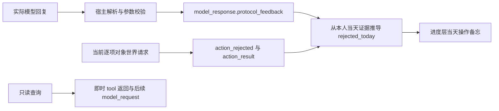
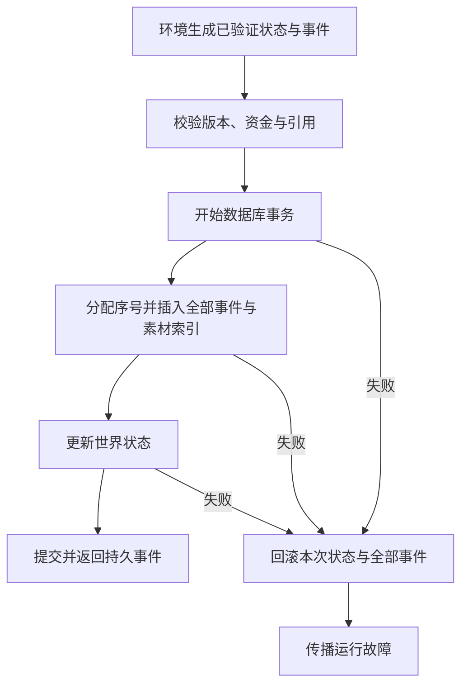
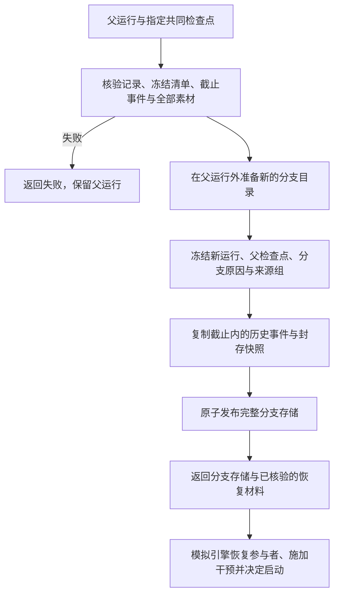
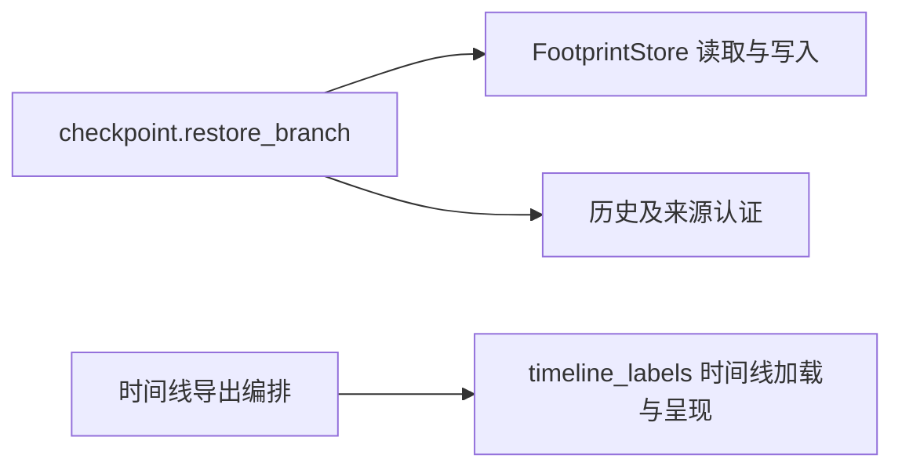

<a name="recording-engine-worldmock-产品设计说明书-记录引擎"></a>
# WorldMock 产品设计说明书 — 记录引擎

> **状态**：已整合；原已冻结的接口与行为约束继续有效，待实现设计单独列出；按人物 Prompt 规格修订，修订部分已实现（证据见[人物 Prompt 验收记录](../archive/persona-prompt/persona-prompt-verification.md)）；按一日运行保真规格同步（一日运行保真 RE1–RE6），已实现；按[个人事务与工作安排规格](../dev/SPEC-as2-integration.md#errands-workday-运行修复入库)分阶段同步（[实施计划](../archive/errands-workday/errands-workday-implementation-plan.md) D5 作业），已实现（离线验收，证据见[个人事务与工作安排验收记录](../archive/errands-workday/errands-workday-verification.md)）<br>
> **日期**：2026-10-07
> **版本**：v1.6
> **范围**：记录生活全过程、保存与关联证据、一致性保存与校验、保存共同检查点、恢复与反事实分支、固定截止导出、运行查询与诊断

> 2026-10-07：按[资源与规则引擎简化规格](../dev/SPEC-resource-and-rule-simplification.md#spec-rrs-资源与规则引擎简化开发规格)同步阶段 7 的记录、导出、交付与评估合同。

> 2026-10-07：按[资源与规则引擎简化规格](../dev/SPEC-resource-and-rule-simplification.md#spec-rrs-资源与规则引擎简化开发规格)同步阶段 5 的工作主题证据与质量报告。

> 按[资源与规则引擎简化规格](../dev/SPEC-resource-and-rule-simplification.md#spec-rrs-资源与规则引擎简化开发规格)修订「归档引用」（阶段 1）；「地图与门店供给证据」、「地图与供给的恢复身份」、「检查点创建」、「持久化结构」、「必须保存的内容」（阶段 2）；「事件字段、事件类型、事件正文、活动进度、已核验经历、共同身体结算与决策证据」（阶段 4，app 使用与推送）。

> 2026-10-01 按[工具交互规格](../dev/SPEC-life-runtime.md#tool-interaction-工具请求)修订当前工具请求、查询与错误合同；本次设计已冻结，生产代码已实现，旧验收证据不覆盖新增条款。

> 本特性首次受影响的发布升级为场景 4、地图 3、目录 5.0、品类与规则绑定 3，世界结构仍为 8。各阶段独立发布；后续格式或内容再次变化时另升相应版本，禁止同目录版本覆盖内容。

> 个人事务与工作安排规格首次受影响的发布：阶段 2 世界结构 9、质量报告结构 4，阶段 3 场景结构 5、卡片结构 3（抽取提示 `card-v3`）；地图 3、目录 5.3、品类与规则绑定 3、导出清单 2、运行清单 2 不变。上一条所说「世界结构仍为 8」只描述工具交互特性发布时的身份。

> 按[让「等待」成为例外规格](../dev/SPEC-idle-fillers.md#spec-idle-fillers-让等待成为例外开发规格)修订「共同身体结算与决策证据」「事件正文与资源证据」「调试工具」（阶段 1）；班次与休息时段起止的唤醒只变代码身份，世界结构 9、质量报告结构 4 与当前场景结构 6 不变。

> 按[动作与内容简化规格](../dev/SPEC-action-and-content-simplification.md#spec-acs-动作与内容简化开发规格)修订「固定规则、目录格式与加载边界」（阶段 1）。

<a name="design-05-recording-engine-共享规则与可重建环境修订"></a>
## 共享规则与可重建环境修订

按[共享规则与可重建环境规格](../dev/SPEC-shared-rules-and-rebuildable-env.md)修订；验收结果独立记录。

规范 JSON 摘要只有一个实现并拒绝非有限数值。原子发布写字节、同步文件后替换；POSIX 同步父目录，Windows 按平台能力发布。有效结算区间使用非布尔整数秒且起点小于终点；时间线和逐日导出均读取运行清单时区。主观记忆快照共用校验，带反思来源的合法快照不算畸形经历。代码身份继续哈希实际字节，依赖源码由固定补丁重建。

<a name="recording-engine-记录引擎负责什么"></a>
## 记录引擎负责什么

记录引擎让一段数字人的生活能够被查证：他实际看到了什么、作出了什么选择、环境如何执行、
状态为何变化、结果是什么，以及这些经历怎样进入记忆。
它接收模拟引擎提交的事实与快照，负责保存、关联和完整性校验；
从共同检查点构建新的分支存储，提供已核验的恢复材料，原分支记录始终保留。
数字人负责行动选择与记忆，交换引擎负责规则计算，模拟引擎负责运行编排与实际执行。

本文统一维护记录引擎的设计、接口和行为约束。
[接口合同](../CONTRACTS.md#contracts-worldmock-接口合同)保留跨模块接口导航；
[交换引擎](02-exchange-engine.md#exchange-engine-worldmock-产品设计说明书-交换引擎)提供交换条件与投入产出规则，[模拟引擎](04-simulation-engine.md#simulation-engine-worldmock-产品设计说明书-模拟引擎)推进活动并落实结算；
LabelKit-DataSet 定义认证导出接收后的数据加工；
[验收门禁](../VERIFICATION.md#verification-worldmock-验收标准)和[实现状态](../dev/implementation-status.md#implementation-status-worldmock-实现状态)分别记录放行条件与实测证据。
文档整合不构成实现完成或真实运行验收。

<a name="recording-engine-项目框架映射"></a>
### 项目框架映射

沿用[概述的解决方案](00-overview.md#overview-解决方案)：资源引擎提供资源与内容，交换引擎提供规则，
模拟引擎组织数字人的行动与世界变化。记录引擎在交互边界保存全过程，形成可追溯、可恢复、可交付的数字足迹。


<a name="recording-engine-职责与模块边界"></a>
### 职责与模块边界

责任以谁产生决定、谁保存结果划分，不因代码位于同一目录就归入同一引擎。

| 协作边界 | 上游或下游负责 | 记录引擎负责 |
| --- | --- | --- |
| 行动与结算 | 模拟引擎组织决策、唤醒与活动推进，计算身体变化，并调用交换引擎校验条件、计算投入产出 | 保存实际提交的事件与状态，核对版本、资金差额、引用和历史是否一致 |
| 内容与可见性 | 资源引擎提供内容及来源；模拟引擎决定本次观察实际交付什么 | 保存实际交付字节、来源与可见性标记，保持事件关联 |
| 记忆与共同检查点 | 数字人保存记忆和工作区；模拟引擎完成世界推进，收齐参与者快照并确定共同边界 | 校验快照齐备、字节完整、状态与截止一致，原子提交检查点 |
| 恢复与反事实执行 | 模拟引擎恢复人物与外部进程、施加干预并启动新分支 | 核验检查点，构建分支存储，保存父检查点、干预证据与来源关系 |
| 运行生命周期与故障处置 | 模拟引擎维护运行状态，决定终止、重试与继续执行 | 返回持久化结果或明确失败，提供已保存记录的只读查询和完整性诊断 |
| 数据加工与行为评估 | 数据交付组装样本、裁剪窗口和划分数据；行为评估判断真实性与实验效果 | 提供固定截止的认证足迹和可重算的事实统计 |

本文的七个功能主题均限于右栏；协作方的规则只在交接处引用所属文档，不作为记录引擎的功能或实现差距。

记录引擎使用追加事件、状态快照和内容寻址素材，复用 SQLite 与现有存储模块。
数据库事务的依据是 [SQLite 原子提交](https://www.sqlite.org/atomiccommit.html)；
不可变事件与快照的组织方式参考 [Microsoft Event Sourcing](https://learn.microsoft.com/en-us/azure/architecture/patterns/event-sourcing)。
这些工程机制不意味着重新调用模型会重现相同决策。

<a name="recording-engine-主题阅读路径"></a>
### 主题阅读路径

后续正文按项目框架映射中记录引擎内部的功能框展开，章节名称与图中功能名称一致。
接口、数据结构、处理规则、失败边界、实现差距和验收要求分别放入所属主题。

- [记录生活全过程](05-recording-engine.md#recording-engine-记录生活全过程)
- [保存与关联证据](05-recording-engine.md#recording-engine-保存与关联证据)
- [一致性保存与校验](05-recording-engine.md#recording-engine-一致性保存与校验)
- [保存共同检查点](05-recording-engine.md#recording-engine-保存共同检查点)
- [恢复与反事实分支](05-recording-engine.md#recording-engine-恢复与反事实分支)
- [固定截止导出](05-recording-engine.md#recording-engine-固定截止导出)
- [运行查询与诊断](05-recording-engine.md#recording-engine-运行查询与诊断)

实现差距沿用已有源码核查结论，按主题分列；本次调整不修改生产代码；跨引擎约束在其所属文档维护。
各主题保留已冻结规范的验收要求与现有测试入口；测试存在不等于本次重新执行通过。
本次文档整理的验证结果记录在交付说明中，正式运行与跨系统验收仍见[实现状态](../dev/implementation-status.md#implementation-status-worldmock-实现状态)。

<a name="recording-engine-记录生活全过程"></a>
## 记录生活全过程

围绕数字人实际经历的顺序，明确每个环节必须留下什么，以及怎样形成结构化事件。

<a name="recording-engine-保存边界"></a>
### 保存边界

<a name="recording-engine-必须保存的内容"></a>
#### 必须保存的内容

证据由运行环境在模型与环境的接口边界写入，不能依靠数字人自己维护日志。

| 生活过程 | 必须可追溯的证据 |
| --- | --- |
| 观察交付 | 数字人实际收到的正文、可见字段、内容片段范围、观察版本，以及宿主实际使用的有效交互菜单 |
| 人物决策 | 决策身份、同一秒内的轮序、实际上下文、模型请求（同秒续接时含本秒前序决策的 assistant 与 tool 消息）与响应（含可选正文与 `reasoning_content`）和所选的世界请求 |
| 后台任务 | 零点计划 `plan_day` 的请求与响应（`purpose="plan_day"`）、生成的计划与提醒及其来源；须能与人物决策区分 |
| 记忆阶段调用 | 就寝反思的模型请求与响应：请求不带 `purpose`、思考由 AS2 记忆调度关闭，`tools` 恰为一个 `strict` 的 `submit_reflection`，`tool_choice="required"`；响应恰好一次该工具调用，`message.content` 不读取。本地校验不通过时在原始消息之后附回一条 user 消息（上一次不合法的工具调用、英文校验错误与重新提交的指令；总是基于原始消息，不逐次累积）重新请求，首次之外至多三次（连同首次至多四次模型调用）；每次尝试是 AS2 记忆调度下的一次独立模型调用，请求与响应照常留证、各自计入模型用量，校验错误随下一次请求的附回消息留证，耗尽时最后一次错误写进运行故障原因；没有可反思的主观记忆时不调用模型。`submit_reflection` 不属于人物工具面，不写 `action_requested`，须能与行动请求区分 |
| 动作执行 | 工具名、参数、返回、接受或拒绝、实际进度、中断与最终结果 |
| 图上出行 | `trip_id`、起点、终点、`path`、`distance_meters`、图上进度、车费付款与到达；不生成坐标或轨迹 |
| 恢复输入 | 世界结构 11 的完整快照，以及冻结清单五字段 `environment_identity` 和对应清单摘要 |
| 状态变化 | 变化前后的状态版本、发生原因、资金变化、身体结算与环境自主事件 |
| 记忆更新 | 实际写入的记忆、记忆版本、来源事件与工作区快照；提示中的记忆层条目是构建提示时从已提交事件与世界状态派生的视图，不新增持久状态；构建结果随观察事件保存（`memory_layer`），并写进人物工作区的只读问答快照 `life_prompt_snapshot.json` |
| 个人事务 | 人物在 `report_status`、`pause_activity`、`conclude_activity` 的请求级 `errands` 里新增、更新、取消的事务，环境按结算证据累计与确认办成的事实，以及实际交付的提醒：各写一条 `environment_event`（六个 `data.kind` 见「事件正文与资源证据」）；未完成事务随世界状态与共同检查点保存，终态、原因与证据只在事件里。事务是人物记下的打算，不是世界事实，不改变余额、库存、身体、订单与验收，也不是记忆写入 |
| 故障与结束 | 异常类型、英文错误、关联事件、运行终态与最终共同检查点 |

凭据不写入证据。模型完整请求保留必要的任务上下文，脱敏规则带版本与处理记录。
记录数字人实际输出的内容，不把额外生成的解释冒充当时的决定或事实。

运行清单结构 4 不含语料钉，五字段 `environment_identity` 不变；恢复输入与检查点核对世界结构 11。

<a name="recording-engine-数字足迹事件结构"></a>
### 数字足迹事件结构

<a name="recording-engine-事件字段"></a>
#### 事件字段

环境以 `EventDraft` 提交事实，存储在事务内分配持久序号、程序时刻与世界状态版本后成为持久 `Event`：`schema_version` 固定 1，`event_seq` 大于零并按提交顺序严格递增，`wall_elapsed_ms`、`state_version_before`、`state_version_after` 非负。

| 字段组 | 字段面 |
| --- | --- |
| 记录身份 | `schema_version`, `run_id`, `event_id`, `event_seq` (严格递增), `event_type` |
| 参与与关联 | `agent_id`; 适用时有 `decision_id`, `action_id`, `activity_id`; `caused_by` 连接直接相关事件 |
| 时间 | `occurred_at` (模拟时间), `observed_at` (观察事件), `recorded_at` (程序时间), `wall_elapsed_ms` |
| 观察 | 实际可见层数据、进度来源与私有绑定；app 结果记录公开 `app_content`，不保存 `content_refs` 或分段范围；`observation_version` 不含未来或未授权内容 |
| 请求与执行 | `action_name`, `params`, `status`, `start_time`, `end_time`, `progress`, `interruption_reason` |
| 结果 | `feedback`、`resource_changes`、`counterparty`、`failure_reason`；工作活动进度另含 `work{topic_id, worked_seconds, remaining_seconds}` |
| 状态关联 | `state_version_before`, `state_version_after` (可回到检查点和事件重建状态) |
| 来源与可见性 | `source_kind` 取闭集 `environment`、`model`、`scenario`、`external`（默认 `environment`）；`visibility` 取闭集 `agent`、`evaluation`、`system`（默认 `agent`） |
| 素材引用 | `artifact_refs`：`AssetRef` 列表，每项含 `sha256`、`size_bytes`、`media_type` 与 `source` |

`observation` 事件的 `data` 保存环境构建的层数据原文（`tool_layer`、`todo_layer`、`environment_layer`、`memory_layer`）
与看法偏好 `persona_views`，以及私有绑定与证据；进度层只存来源事件引用 `progress_event_ids`（按记录顺序；调用记录的来源是
`action_requested` 与 `action_result`，记忆查询记录的来源是私有的 `model_response` 与其后的 `model_request`，交付展开证据时跳过私有来源；
个人事务的两种记录 `errand_reminder{errand}`、`errand_completed{errand}` 只写事务名称，来源是本人的 `errand_reminded` 与
`errand_completed` 事件，这两种事件为人物可见（`visibility=agent`），交付展开证据时按本人可见的环境事件展开，公开投影为空对象），
完整进度层 JSON 由实际请求的 `model_request` 保存；不另写入 JSON 字符串副本。
`todo_layer` 自世界结构版本 9 起含必填键 `errands`（键序 `layer`、`paused_activities`、`errands`、`day_plan`）：未完成的个人事务
按记下的时刻与事务身份排序，每行 `name`、`done_when`、`progress`、`memo`、`remind_time`、`noted_on`，没有时为 `[]`；行内不含
内部身份、状态枚举与可用性。私有绑定另增个人事务的两类：`errand_bindings`（未完成事务的名称、事务身份、结果种类、商品身份）
与 `errand_item_bindings`（全部商品名到商品身份），宿主与环境据此在同一冻结观察上校验事务变更；二者连同 `errand_id` 都列入
提示禁键，事务名不进回看名称。
`environment_layer` 自个人事务与工作安排规格阶段 3 起在 `location` 之后含必填可空键 `duty`（今天的上班安排：`day`、`hours`、`place`、
`breaks`、`status`；人物没有工作安排时为 `null`），由环境按场景与世界时钟求值，原样保存、不含内部身份。班内离岗照常受理、不另写事件，
工作负荷与作息偏离由行为评估从事件与场景重算。
其中事件级工具支持字段 `interaction_menu` 保存本轮按地点类与人物声明求得的有效菜单，供核对实际
模型请求、本地校验和环境派发；它不进入人物 user 消息，也不保存其他人物或全部地点的原始声明。
地点变化后的新菜单由下一次观察另行记录，既有观察不回写。
观察私有证据另记 `same_moment_stage`（本轮开放的动作类，同刻上限的受限轮阶段），同样用于核对工具层的可用性标注、
本地校验和环境派发；它不进入七层。观察私有事实另增渠道索引 `world_query_channels`（渠道身份、称呼、成员门店，列入提示禁键）；
每个供给条目所属门店记在条目的私有键 `location_id`（已在禁键内），不另冻结地点与住处的副本。
人物请求如何由七层组成见[人物决策提示合同](../CONTRACTS.md#contracts-model-request)。

请求同一动作的重试沿用动作标识；再次打开 app 或再次购买必须产生新动作标识。完整原始事件保存世界事实、自述和推断三者的来源区别，既不删除重复行为，也不把相同内容身份当作事件标识；环境准确值、人物表达的感受与设备可见痕迹并不等价。

`agent_id` 为整数或空值；`occurred_at` 与存在时的 `observed_at` 使用模拟时刻的整数秒。
`decision_id`、`action_id`、`activity_id` 为字符串或空值，`caused_by` 为事件标识字符串列表，
`data` 为对象，`artifact_refs` 为 `AssetRef` 列表；`recorded_at` 保存程序时刻字符串。

<a name="recording-engine-共同身体结算与决策证据"></a>
#### 共同身体结算与决策证据

同一人物同一真实区间只产生一次 `environment_event.data.kind=body_settlement`，事件顶层
`activity_id` 为空。正文保存 `interval_start`、`interval_end`、按身份排序的 `activity_ids`、
`body_settlement`、`resource_flows`、`decision_offered` 和 `wake_reasons`。同一边界的各
`activity_progress.data.body_settlement_event_id` 引用这条已提交事件；各自只保存本活动的
进度、效率、消费和内容接触，不复制共同身体变化或将联合代谢成本分摊给某条活动。
`activity_ids` 同时是该区间社交账的唯一口径来源：节律结算按它判定这段区间是否在睡、是否由交谈或通话记账、是否共同用餐，
不按推进后的活动状态重新推断，所以在边界结束的睡眠整段按睡眠计、在边界吃完的一餐仍算共同用餐；事件结构不因此增加字段。

场景本地零点（不是运行终点）的边界分两次提交：推进先提交旧日的结算，即带旧计划快照 `data.day_plan` 的
`activity_progress` 与终态结果，随后由零点计划为人物登记新计划（`day_plan_generated`）；该边界的共同身体结算
连同其 `decision_offered` 与 `wake_reasons` 留给零点节律入口，在 `day_plan_generated` 之后与该秒的唤醒判定一起提交。
所以零点边界的各 `activity_progress` 仍以 `data.body_settlement_event_id` 指向这条结算，但不把它列入 `caused_by`
（直接原因只能是已提交事件）。零点节律入口提交之前，该秒不提供决策，也不形成共同检查点。

记录引擎校验引用身份、人物、区间与事件顺序；具体身体演化和唤醒条件仍由模拟引擎计算。
静默边界也写共同身体证据，不能因没有人物决策而漏记身体时间。
同刻轮次（同一模拟秒内的再决策轮）没有区间，不写共同身体结算；其唤醒原因只记于
`decision_started.data.wake_reasons` 与观察。同秒续接的各轮仍逐轮写观察与 `decision_started`。
边界兜底的 `no_active_activity` 属于边界判定，照常写入结算。
唤醒原因闭集、睡眠允许的原因与触发条件统一见
[生活运行时规格的决策节律](../dev/SPEC-life-runtime.md#spec-life-runtime-决策节律结算边界与唤醒条件分离)。
`plan_reminder_due` 之后另有 `errand_reminder_due`（[个人事务与工作安排规格](../dev/SPEC-life-runtime.md#errands-workday-个人事务-提醒时刻) 2.5）：
清醒人物有已到点未提醒的个人事务、本边界为他提供决策机会时记入，与其他成员一样写进共同身体结算的 `wake_reasons`、
`decision_started.data.wake_reasons` 并经同一闭集校验；同一边界到期的多条事务合并为一次决策机会、该原因只记一次，与
`plan_reminder_due` 同刻到期时按枚举顺序并列。它不在睡眠允许的原因之内：清醒人物的未提醒时刻进入下一边界与下一次决策机会的
候选、精确到点；睡眠中的人物不计入候选、不形成静默边界、不交付也不消耗，睡眠期间错过的提醒在人物醒来的那个边界
（与 `wake_from_sleep` 并列）一并交付，不另起边界。提醒事件追加到该边界的事件草稿，平常边界随推进提交，零点边界随零点节律入口提交。

`errand_reminder_due` 之后依次是班次与休息时段起止的四个成员 `shift_start`、`shift_end`、`break_start`、`break_end`
（[让「等待」成为例外规格](../dev/SPEC-idle-fillers.md#spec-idle-fillers-让等待成为例外开发规格)）：某个结算边界的那一秒恰是人物当日班次的开始或结束
（含前一日写到 24:00、落在当地零点的结束）或该班次某个休息时段的开始或结束，而人物此刻清醒、本边界为他提供决策机会时记入对应成员，
与其他成员一样写进共同身体结算的 `wake_reasons`、`decision_started.data.wake_reasons` 并经同一闭集（足迹侧词表 `src/worldmock/footprints/models.py::WAKE_REASON_NAMES`，新名字缺登即落不了库）校验；
同一秒重合的多个起止各记一次，按枚举顺序与同一秒的其他原因并列。四个成员都不写事件，也不另存状态：起止由场景工作安排与世界时钟
重新求值，检查点、恢复与反事实分支不为它保存任何字段，已经判定而尚未决策的原因照常留在人物状态的 `pending_wake_reasons` 里随检查点恢复，
不重复、不补发。它们不在睡眠允许的原因之内：睡眠中的人物不计入候选、不形成静默边界、不被叫醒，睡过的起止醒来后不补；
运行第一秒恰在起止上时只记 `run_start`。

`app_push` 排在 `break_end` 之后，共同身体结算与 `decision_started` 使用同一最终 22 项有序闭集；
它不进入四项睡眠允许集合。

<a name="recording-engine-事件类型枚举"></a>
#### 事件类型枚举

```python
EventType = Literal[
    "observation",           # 观察交付
    "decision_started",      # 人物决策
    "model_request",         # 模型请求
    "model_response",        # 模型响应
    "action_requested",      # 动作请求
    "action_accepted",       # 动作接受
    "action_rejected",       # 动作拒绝
    "activity_progress",     # 活动进度
    "action_result",         # 动作结果
    "environment_event",     # 环境自主事件
    "memory_updated",        # 记忆变化
    "checkpoint_created",    # 检查点
    "run_ended",             # 运行结束
    "run_failed"             # 运行异常
]
```

顶层 `EventType` 闭集不变。活动的结束、暂停、恢复与实验截止的截断，零点计划的计划登记，
跨决策预算耗尽、app 推送，以及个人事务的新增、更新、取消、累计、完成与提醒，
都复用 `environment_event`，以 `data.kind` 区分
（`activity_concluded`、`activity_paused`、`activity_resumed`、`activity_truncated`、`day_plan_generated`、`decision_budget_exhausted`、
`errand_registered`、`errand_updated`、`errand_cancelled`、`errand_progressed`、`errand_completed`、`errand_reminded`、
`app_push`，
登记在下表 `environment_event` 行）；
零点计划的模型请求与响应复用 `model_request`、`model_response`，以 `data.purpose` 区分。
阶段 5 登记 `work_topic_completed`：它在人物的主题实际累计工时首次达标时出现一次，并投影为进度层 `work_completed`。

<a name="recording-engine-事件正文与资源证据"></a>
#### 事件正文与资源证据

`data` 承载具体事件的结构化正文；`artifact_refs` 指向较大或需要保留原始字节的素材。
事件外壳的字段不能替代活动自身的领域合同。

| 事件 | 正文用途与约束 |
| --- | --- |
| `observation` | `data` 是环境构建的层数据、看法偏好与私有证据，进度层只存 `progress_event_ids`；不额外保存一份 JSON 字符串副本 |
| `decision_started` | 保留当时实际产生的决策信息：`data` 为闭集 `{round_id, round_order, world_state_version, wake_reasons}`，带退役字段 `decision_statement` 或其他键即以英文错误拒绝；在本次决策的首个行动请求（`phase=request`、带生活工具、thinking 开启、无 `purpose`）与该请求同批提交，排在请求之前；就寝反思请求只带 `submit_reflection`、思考关闭，不是行动请求，不带出 `decision_started`，不计同刻轮数；引擎直驱路径的兜底写入保留。同一人物的同刻轮数按同一模拟秒内的 `decision_started` 计；引擎用于同刻上限的计数 `same_moment_rounds` 不计每人每秒前两次以名称类拒绝结束的轮次（[一日运行保真规格](../dev/SPEC-map-and-storefront.md#dayrun-fidelity-按名调用与指名购买-名称类拒绝不计同刻轮数) 3.4），可少于该数 |
| `model_request`、`model_response` | 关联实际请求、响应素材、模型身份与可测量的调用用量；未得到可靠结果时不能记为成功。同秒续接的请求原样保存本秒前序决策的原生 assistant（含 `reasoning_content`）与 tool 消息，响应保存可选正文与 `reasoning_content`；生活决策的宿主校验错误另以 `data.protocol_feedback` 保存完整结构化纠错，合法响应为 `null`，不得只保留英语错误串而丢弃位置与枚举；模型服务失败的 `failure` 证据同样带 `protocol_feedback`，其 `error_code` 为失败阶段码 `MODEL_SERVICE_FAILED`；证据写入、记忆查询与工具分发失败的阶段码为 `EVIDENCE_WRITE_FAILED`、`MEMORY_QUERY_FAILED`、`TOOL_SERVICE_FAILED`：证据写入失败与工具分发失败以运行故障上抛，记忆查询失败作为失败的 tool 结果回给模型、可在剩余回合内重试。四个码只标出失败阶段与调用位置，不是对请求参数的协议纠错，登记在[接口合同的宿主错误码表](../CONTRACTS.md#contracts-tool-result-channel)（随个人事务与工作安排规格阶段 1 补登）；`reasoning_content` 的统计只取响应 `message` 中的一份，续接请求中回传的副本不重复计。零点计划 `plan_day` 的请求与响应带 `data.purpose="plan_day"`，与人物决策请求区分：`visibility=system`、`source_kind=model`，`agent_id` 为该人物，不带 `decision_id` 与 `action_id`；`data.call_id` 为 `plan-day:<agent_id>:<本地日期>:attempt:<n>`，`data.attempt` 为尝试序号，`data.phase` 取 `request`、`response` 或 `failure`（传输或配置失败），响应另带 `usage` 与本地校验错误 `error`（合法时为空）；附回重试的请求以 `caused_by` 回链前次响应。就寝反思的请求与响应不带 `data.purpose`，经 AS2 记忆调度留证，带本次决策的 `decision_id`：每次尝试各有自己的调用身份（`data.call_id` 取本次决策内递增的模型调用序号，`data.attempt` 恒为 1，不用 `plan_day` 的 `attempt:<n>` 编号），响应证据在本地校验之前写入、`error` 为空，响应只以 `caused_by` 回链本次请求，校验重试的请求不回链前次响应；质量报告的用量与截断按调用身份各计一次 |
| `action_requested` | 记录实际工具请求与动作身份，不代表已通过可行性检查；`data` 为 `tool_name`、`request`、`request_sha256`、`reused` 与 `self_note`：提交该世界请求那次回复的非空正文（去掉首尾空白），没有时为 null，属于人物自述、未经核验。三个控制工具的 `request` 是现行形状 `{"items": [{activity_name, summary}], "errands": [...]}`（结束每项另带 `memories` 与 `views`；`errands` 为请求级必填数组、可为 `[]`、一次至多 4 条，每条恰为 `{change, name, outcome, item, quantity, memo, remind_time, reason}` 八键，全部必填、按变更种类可为 null，`change` 取「新增」「更新」「取消」，没有「完成」；同一请求内按取消、更新、新增的次序求值，同一条未完成事务在一次请求里至多被一条更新或取消点名，两条新增不得同名，取消与以原名重新新增可在同一请求里完成）。`control_items` 模块是控制请求的唯一读取入口（`control_items` 读逐项内容，`control_errands` 读请求级事务变更），经它读取的环境处理器、同刻请求分类、宿主校验、进度层、记忆层、记忆证据、零点计划输入、质量报告与交付窗口一律读当前形状；缺 `errands` 键的记录与旧 `task[]`、`summary[]`、逐项 `memories[][]` 一样按完整性故障直接拒绝，不留读取分支；查看器是独立的镜像实现，同步为缺键报错。看法与偏好的对象 `views[].about` 只随请求原文保存在这里，不写入 AS2 记忆条目；事务文字同样只随请求原文保存在这里，进度层的工具调用参数略去 `errands`，本 session 内由结果的 `details.errands` 回执可见 |
| `action_accepted`、`action_rejected` | 记录环境的受理或业务拒绝；交互菜单拒绝保留 `INTERACTION_MENU_DENIED`；同刻上限受限轮的越界请求保留 `SAME_MOMENT_ACTION_RESTRICTED`，计入同刻轮数；受理时不重复声明最终支付。`action_rejected` 的 `data` 与同一拒绝的 `action_result` 按共用错误结构（[一日运行保真规格](../dev/SPEC-as2-integration.md#dayrun-fidelity-错误合同)第四章）带 `error_code`、一句原因 `reason`（`action_result` 的 `message` 就是它，不再拼接英文码与校验转储）、改法 `fix`（没有时为 null）、下一步 `next_step` 与私有的 `unmet`、`suggested`，每次拒绝均带实际错误位置的 `items[{path, written, error_code, allowed_values, expected, why, candidates}]`，不带 `resolved` 与 `notes`；受理结果的 `action_result.data` 在名称经无损归一时带 `resolved`（`[{written, as}]`，指名购买写的商品名记为解析出的完整标签），食用、使用、制作的请求中 `from`、`to` 已是 null、本人方向由环境推导，指名购买按 `prefer` 选定门店、按「购买」定下到店或远程下单时带说明 `notes`，都原样进入公开结果。三个控制工具的事务变更与同一请求的活动状态转换同批校验、同一事务提交：活动名先按既有规则解析，其后事务变更在同一冻结观察上用与宿主同一的函数复核，任何一条不合法即全部问题合并为一次 `ACTION_REQUEST_INVALID` 业务拒绝（照常计同刻轮数），世界不变；请求因其他原因被业务拒绝时事务变更一并不生效，也不写任何事务事件（三种由请求触发的事务事件只在成功分支生成，每条被受理的变更恰好一条，内容没有变化的更新也写）。不新增业务拒绝码，逐项明细的 `path` 完整到 `errands[j].<键>`，事务变更的明细不带 `candidates`：更新、取消的 `name` 错误（`NAME_NOT_FOUND`、`NAME_AMBIGUOUS`）在 `allowed_values` 列本人全部未完成事务名，新增的 `item` 错误把最接近的至多三个商品名写在 `why`；重名、同结果同商品、同一事务被第二条更新或取消点名与未完成数超过 8 记 `ARGUMENTS_INVALID`，上限只写在 `why` |
| `activity_progress` | 自身实际区间、活动进度、效率、消费和 app 内容接触，引用共同身体结算事件；`data.content` 写当前内容的实际区间，`data.played[]` 写本次真实完成的内容轮次；人物以 `conclude_activity` 结束、暂停与恢复活动不写本事件，逐活动另写一条带活动快照的 `environment_event`；暂停不是终态 |
| `action_result` | 实际结果及发生结算时的 `resource_changes`，作为支付的唯一事实；订单记收货人 `recipient_id`、请求关联 `request_message_id` 与渠道 `channel_id`（`data.orders[]` 的每个订单一列：`from` 解析为购买渠道时是该渠道的 App 标识，否则 `null`；只在订单载荷与导出的 `purchases.jsonl`，不进世界状态的 `DeliveryState`），被 `answering` 关联的下单结果另带顶层 `answering`；给予写 `data.given`（`[{product_id, quantity, recipient_id, location_id}]`）；结束进食时活动数据增 `discarded`（开吃份量减已吃），收尾结果写 `data.outcome`（`[{activity, outcome, items[{product, eaten, discarded, remaining}], note}]`，剩余为进食地点仍持有的份数）；`use_app` 结果另带 `data.app_content{app,title,kind,summary,pushed}`；主动结束使原始动作的全部子活动终结时，按自然结束的同一路径写一次终态，并更新 `processed_actions`；同源两项的聚合终态不带快照。三个控制工具的受理结果另带事务回执 `data.errands`（公开结果的 `details.errands`，`[{errand, change}]`，按请求顺序，没有变更时为 `[]`；`errand` 为事务名称：新增写所写的名称，更新与取消写待办层里的名称）；被拒结果没有该键 |
| `environment_event` | 实际自主事件与唯一共同身体结算；`data.kind=app_push` 的人物可见推送固定带 `app`、`title`、`content_kind`、`summary`，内容类型不得覆盖事件判别键；初始注资也需完整资金证据；会话切换只进世界状态，不写事件；当日目标的提醒到期不另写事件，记于唤醒原因；班次与休息时段的起止同样不写事件，只记于唤醒原因（`shift_start`、`shift_end`、`break_start`、`break_end`），环境层 `duty.status` 的变化随观察留证；个人事务的提醒只在实际交付决策机会时写事件：同一边界到期的多条事务合并为一次决策机会，每条事务各写一条 `errand_reminded`（见本行末），进度层的提醒记录由该事件派生，不由状态推导。人物以 `conclude_activity`、`pause_activity` 与 `report_status` 的恢复改变活动时，每改变一项活动写一条：`data.kind` 取 `activity_concluded`、`activity_paused` 或 `activity_resumed`，事件顶层与 `data.activity_id` 为该活动，`data.activity` 为变更后的活动快照，`caused_by` 含本次请求事件；一条事件只对应一项活动。实验截止时，每项被截断的活动（进行中或暂停）写一条 `data.kind` 为 `activity_truncated` 的记录：事件顶层与 `data.activity_id` 为该活动，`data.activity` 为截断后的活动快照，`caused_by` 为开始该活动的请求事件。零点计划为人物登记当日计划时写一条 `data.kind="day_plan_generated"`：`visibility=system`、`source_kind=model`；`data.day_plan` 与 `revise_day_plan` 的修订结果同形（`day_end` 与各目标的 `intent_kind`、`goal`、`registered_at`、`progressed_at`、`progress_activity_id`、`progress_note`、`remind_at`、`reminded_at`、`around_at`（大致时刻 `around_time` 换算出的当日绝对时刻，可为 null），`registered_at` 为该事件时刻）；`data.source_event_ids` 为输入来源事件（已核验经历、动作结果与配送送达、收尾请求与上一天计划快照），`caused_by` 为本次最后一条模型响应；它经引擎的系统登记入口与本次模型证据、世界状态中的计划和 `plan_submitted_dates` 同一次提交，不写 `action_requested`。受限轮用完仍没有进行中活动或仍有待收尾活动时写一条 `data.kind="decision_budget_exhausted"`：`visibility=system`、`source_kind=environment`，事件顶层 `agent_id` 为该人物，`data` 为 `kind`、本秒最近一次计入同刻轮数的拒绝码 `error_code`（免计的名称类拒绝不算，没有时为 `null`）与下次决策时刻 `next_decision_at`。个人事务的每次变化写一条，`data` 为 `{kind, errand}`（`errand` 为事务快照，即 `ErrandState` 的 JSON 形状）：`data.kind` 取 `errand_registered`、`errand_updated`、`errand_cancelled`（控制请求受理时每条被受理的变更一条，`caused_by` 为请求事件，`visibility=system`；新增与更新写受理后的快照，取消写移出前的快照并另带 `reason`），`errand_progressed`（结算证据命中但未达数量，`visibility=system`，快照为累计后的状态）、`errand_completed`（结算证据命中并达到数量，`visibility=agent`，事务已移出状态，快照的 `progress` 写最终累计量；这两种另带本条证据的数量 `quantity_added`，`caused_by` 为证据事件）或 `errand_reminded`（提醒实际交付时写，`visibility=agent`，`caused_by` 为空，快照带交付时刻 `reminded_at`）。六种事件的 `decision_id`、`action_id` 与 `activity_id` 都为空，只经 `caused_by` 关联：不进入任何动作窗口的目标，也不落进别人那次决策的分组（证据可以是别人的动作，例如他人买给本人）。六种事件 `source_kind=environment`，事件顶层 `agent_id` 为事务所有人，不得含 `activity` 与 `resource_changes` 键；一条事件只对应一条事务，与触发它的事件、世界状态同一次提交。`errand_completed` 与 `errand_reminded` 被进度层消费，必须是人物可见的（交付窗口要求每个进度来源都是本人可见的结果或事件），其余四种不向人物呈现，只供审计与指标 |
| `environment_event` 的联系人回复 | 发给 `model` 策略联系人的消息登记一条 `data.kind="model_npc_reply_pending"`（`request` 为回复请求字段面，含发件人姓名、场景本地时刻、`presence=remote`、收货地名、双方往来与对方收到的物品）；回复生成时写一条 `data.kind="model_npc_reply"`：`visibility=system`、`source_kind=model`（原值 `model_npc` 在 `data.source_kind`），`caused_by` 为待回复登记；`data.request`、`data.response`、`data.usage` 取最后一次尝试，`data.attempts[{request, response, text, matched}]` 按顺序记每次尝试（后验守卫命中时同一次结算内重试一次），`data.guard_applied` 为 true 表示两次都命中、回复是固定兜底句；重试也只写这一条，幂等键仍是来信的消息身份（[接口合同「联系人回复」](../CONTRACTS.md#contracts-contact-reply)） |
| `memory_updated` | 实际记忆写入或视图刷新、写入点 `trigger`、来源截止与文件哈希；就寝反思的快照条目带来源标记，引擎据此识别反思并确定其归属日期；写盘失败不宣称完成 |
| `checkpoint_created` | 对应数据库中已提交的共同检查点 |
| `run_ended`、`run_failed` | 正常结束或运行故障，仍需结合最终检查点判定可交付性 |

个人事务的完成证据（[个人事务与工作安排规格](../dev/SPEC-life-runtime.md#errands-workday-个人事务-完成依据与结算) 2.4）：`errand_progressed` 与
`errand_completed` 的 `caused_by` 指向算数的那条结算证据，证据只在 `errands.evidence_rows` 一处读取。「取得」读本人作为收货人的订单
变为已送达——动作结果顶层 `data.orders` 里状态为已送达的订单（到店成交与当场送达的远程订单；只读顶层，不读并行开始时
`activity_results` 里的同一订单）与配送送达的 `environment_event`（`data.kind=delivery_arrival`）里本次新送达的入库行（经订单身份
取收货人，事件的人物字段是付款人）各算一次——以及制作完整结束时 `activity_progress` 的库存转换产出与本人收到的当面给予
（动作结果顶层 `data.given`）；「吃掉」读本人进食 `activity_progress` 中该商品的本区间食用量 `interval_quantity`。归属看收货人，
不看事件的人物字段，收货人是联系人时不算任何人物取得；只读结果事件，不读受理事件；下单受理、未送达订单、活动开始、制作未完成、
目标 `progressed`、任何自述与重放的动作结果都不算，记下前已持有的不算。「取得」不含地点条件：到店成交的物品留在门店，事务照样办成。
结算函数 `errands.settle` 每次提交恰好调用一次（决策轮提交在全部动作结算之后；时钟推进在后台事件并入之后、构造节律边界之前），
按草稿先后扫描：以往提交记下、到本次提交的动作全部结算后仍未完成的事务对本次提交的全部证据有效；本次提交里新增的事务只认排在其
`errand_registered` 草稿之后的证据（按事件顺序，不按时刻）；本次提交里被取消的事务已移出状态，不再接受该提交的任何证据（即使证据
排在取消之前）；活动进度类证据另要求结算区间起点不早于记下的时刻。累计量（九位小数）达到数量减 1e-9 即完成，不足时记录已累计量，
此后吃掉或给出不回退；一条证据至多命中一条事务（同一人物同时至多一条相同结果种类与商品的未完成事务），证据行只在订单由未送达变为
已送达的那一次出现，所以状态里没有「已消费证据」集合。

<a name="recording-engine-地图与门店供给证据"></a>
##### 地图与门店供给证据

| 证据 | 保存内容与可见性 |
| --- | --- |
| 环境与图身份 | 五字段 `environment_identity`，含规则版本、目录摘要与图摘要；冻结清单和检查点共同绑定 |
| 发现请求 | `start_activity` 的可读浏览对象与方式、私有绑定中的实际筛选、宿主绑定动作身份与观察版本；登记不回显，不包含未结算结果 |
| 地点与出行比较 | 实际返回地点、最短距离、步行与驾车时长及费用；路径与距离来自当时的发布图 |
| 出行执行 | `trip_id`、`origin_id`、`destination_id`、`path`、`distance_meters` 与实际图上进度；`travel_payment` 使用同一 `trip_id`，到达写实际地点 |
| 比较与选择 | 观察实际呈现的可读供给与公开事实；模型请求使用可读名称，内部事件经冻结绑定保留当时可见的 `supply_id`、`product_id` |
| 购买与交付 | 供给、商品、地点、卖方、实际报价版本、数量、行 `total_price_fen` 与整单合计、收货人与所回应的消息、履约目的地（收货人的收货地点）、准备/运输依据及来源；受理结果 `action_result.data.orders[]` 的每个订单另记 `channel_id`（`from` 解析为购买渠道时的 App 标识，否则 `null`），它不进世界状态的订单，导出的 `purchases.jsonl` 同一列；付款人是执行人物，送达只入收货人的持有；付款和交付分别记录 |
| 世界变化 | 世界结构 10 的订单、待配送、持有与呈现状态随状态提交；拒绝不写副作用，不保存供给库存、报价或营业例外 |

发现沿用 `action_requested`、`action_accepted`/`action_rejected` 和 `action_result` 事件，
耗时发现的世界动作登记保留；新增的 `query_world` 只查同一冻结观察的已知事实，不登记发现动作或揭示新事实。返回结果保存当时快照，导出不得用当前目录重建历史。
只能公开实际返回供给的库存，不能把全量 `WorldState` 库存、未接触供给或未来报价注入人物窗口。
指名购买按场景供给解析并按当前报价结算，不查可见凭据；它不因此把未呈现供给的库存或报价写进人物窗口，人物只见该次购买的公开结果。
解析按分段匹配依次判定、各报各的码（[一日运行保真规格](../dev/SPEC-map-and-storefront.md#dayrun-fidelity-按名调用与指名购买-指名购买from-是约束不是语法) 3.2、3.3、3.5）：
名称（`SUPPLY_NOT_FOUND`）、`from` 的来源范围（`null` 为全部门店，本段跳过；地点显示名（含「家」「住处」）为该地点；渠道称呼即 App 名，去掉空白、不分大小写
比较，为该渠道的成员门店，渠道由场景钉定的手机配置派生，经它成交的订单记 `channel_id`；都不是时
`SOURCE_NOT_FOUND`，标签的门店不在范围内 `SUPPLY_SOURCE_MISMATCH`，那家店不卖 `SUPPLY_NOT_AT_STORE`）、所写方式
（`FULFILLMENT_NOT_SUPPORTED`，方式为「购买」时跳过）与此刻能否服务（`ACTIVITY_PRECONDITION_UNMET`）；多家都能服务时按请求级
`prefer` 选定（并列时先比到手价、再比门店标识），所选门店与「购买」定下的方式写进受理结果 `data.notes`，拒绝的逐项明细写进
`action_rejected` 与结果的 `items`。
已取得物品按商品合并，记录仍保留取得来源，不把购买或到达视为已经消费；给予只转移持有，不计任何人的摄入。

同地点、零处理时长的配送即时交付，仍记录 `fulfillment=delivery`、`status=delivered` 和实际 `inventory_changes`，
不安排虚构延迟。其他整单配送使用同一次到期事件携带 `order_ids`；重复事件不得再次增加库存或伪造库存变化。
订单来源保留供给、实际报价和路线的来源组合，当前报价状态的 `source` 也必须通过 `DataSource` 严格校验。
观察中的 `data.products` 是商品使用定义，`data.supplies` 是人物已知供给；工具层的商品目标是实际呈现的供给，价格、时长与数量写成人读短语。
`data.supplies` 的供给行以 `price_fen/price_version/quote` 保留原始声明，`purchase_pairing_state` 保留购买配对状态，
`purchase_coefficient` 和 `purchase_price_fen` 分别记录已定义配对系数与购买一份的算子金额。
非定义配对的系数及金额为空，不能购买；未知报价的金额也保留 `null`。已定义零系数的零额履约照常留证。
行付款按原价、实际数量和系数求值，
不能用一份金额乘数量重建。品类身份与供给报价身份一起保存，历史证据不随当前规则重算。
只有实际作为工具层商品目标呈现的供给才能更新可见凭据和呈现时刻，已知供给集不能替代实际呈现集；
可见凭据只管展示与比较，指名购买不依赖它。

发现或浏览回灌与当前供给事实共用一个身份窗口：回灌优先，其他候选只填剩余名额。
浏览得到的供给只作为工具层商品目标出现一次，浏览调用的结果只列名称，写完整标签「<门店>出售的<商品>」（一日运行保真规格 5.3），
不标可得性，不用 `based_on_action_id/changes` 引用结果；完成的浏览在记忆层 `settled` 的活动句末写浏览到的完整标签，
离开浏览地点后人物照这些标签按名下单，可见凭据不因此放宽。
原始观察和结算证据不采用这种省略。
公开 `excluded` 按全部非身份属性分组为 `object_ids`，完整事件仍逐项保存，不损失任何排除事实。
出行完成保留已支付车费与实际到达地点，公开路线证据的 `object_type="route"` 关联 `trip_id`。私有图路径不进入模型请求；查看器使用运行内地点名称显示起点、终点与路径。
记录没有坐标、路线几何或轨迹，不能从图上进度伪造 GPS。

<a name="recording-engine-activity_progress-事件"></a>
##### activity_progress 事件

保存模拟引擎提交的本活动实际区间、效率、消费和 app 内容接触，以及
`body_settlement_event_id`；身体变化与公共资源流只在该区间的共同身体结算事件中保存。
活动快照的 `location_id` 为开始地点（出行为出发地），结算不改写；到达地点取 `data.arrival.location_id`，
不另设「当前地点」字段。
食用明细的 `interval_quantity` 是本区间正增量，`cumulative_quantity` 才是累计值；
购买、交付、开始食用和累计量重复出现都不能冒充本区间实际吃下的份额。
实际食品利用效率由进食进度的 `consumption.food_efficiency` 留证，工作效率由工作进度的
`activity_efficiency` 留证；共同身体结算不归属其中某个活动。阶段含义见
[模拟引擎的实际区间、身体变化与效率](04-simulation-engine.md#simulation-engine-实际区间身体变化与效率)。
上游没有提供的测量值必须保持未知，不能补造数值或把缺失当作零变化。

`use_app` 的本区间接触写在 `data.content`，记录内容身份、类型与实际起止位置；只有真实到达内容末尾时，
才把 `{content_id, kind, from_position, to_position}` 追加到 `data.played[]`。暂停、恢复动作与静默接续本身不能
伪造完成记录；全局 `ContentProgress{content_id,position_seconds,completed_rounds}` 由提交后的世界状态核对。

`resource_flows` 必须是字典列表，每项恰好含 `resource`、`owner`、`direction`、`amount`、`cause` 五个键。
`resource`、`owner`、`cause` 为非空字符串；`direction` 仅取 `source` 或 `drain`；
`amount` 必须为有限正数，不能使用布尔值、NaN 或无穷值。
记录引擎校验载荷结构；交换条件与投入产出由[交换引擎](02-exchange-engine.md#exchange-engine-worldmock-产品设计说明书-交换引擎)计算，身体演化与状态更新由[模拟引擎](04-simulation-engine.md#simulation-engine-worldmock-产品设计说明书-模拟引擎)执行。

<a name="recording-engine-已核验经历与主观记忆"></a>
#### 已核验经历与主观记忆

记录引擎仅从本人、明确截止前已提交的 `activity_progress` 投影
`waited`、`consumed`、`arrived`、`played`。路线到达取其中的真实终态与 `data.arrival.location_id`，
包括组合动作中先完成的出行子活动，不依赖聚合 `action_result`。每条经历带
`kind`、`agent_id`、`activity_id`、`source_event_id`、`event_seq`、`occurred_at` 和类型载荷。
等待只证明正时长区间；实际食用取 eat 的区间增量；到达取路线真实终态；`played` 只取
`activity_progress.data.played[]` 中真实完成的 app 内容轮次，并保留内容类型与实际位置区间。
请求、受理、购买、人物文字、反思和零点计划均不能产生这些事实。畸形结算拒绝投影并记录英文错误日志。
完整事件前缀用于固定截止离线导出；每次观察在私有证据 `verified_experiences` 中保存该观察事件前本人最近五条，按事件序号正序，
供记忆写入的来源核对；这五条及由它们生成的句子都不进人物提示，结构行与来源身份保留在私有观察和原事件库；零点计划读当日已核验经历的句子。
记忆层的 `settled` 另有来源：由共享句式从人物可见、状态为 `completed` 或 `in_progress` 且不是重放的已提交结果与世界事件生成的
确定性句子（金额按元，份数至多两位小数，时长用人读短语）；失败的请求、记忆查询、回看、`report_status`、暂停与恢复、
`revise_day_plan`、提醒、个人事务的六种事件（含人物可见的 `errand_completed` 与 `errand_reminded`）、截止预警与身体结算都不写入；
规则见[人物 Prompt 规格](../dev/SPEC-life-realism.md#persona-prompt-进度与记忆的更新)第三章。
个人事务只在待办层呈现，不进记忆层、不占记忆层的字符窗口；促成事务办成的那次购买、制作或进食照原规则写入 `settled`。
进度层浓缩时 `errand_completed` 记录折成一句「HH:MM 办成「<事务名>」」（跨日加日期），`errand_reminder` 与当日目标提醒同等对待、
折叠后不留句；这一句只在进度层的浓缩记录里，不是记忆层 `settled`，零点计划输入也不写它。
重复读取、检查点恢复与分支重放不额外累加或改写源事件。
导出另写哈希绑定的 `verified-experiences.jsonl`，按固定截止前缀重建全部人物事实；消费端从
`events.jsonl` 独立重算并逐行核对，不将观察五条窗口误作完整历史。

记忆写入点为 `conclude_activity` 与就寝反思两处，阈值巩固不变；写入的条目是 `epistemic_status=subjective`
的自述。结束活动的记忆由宿主经 `control_items` 按项展平（每项先 `memories`、后 `views`）：`views` 的 `about` 转成存储形状的
`subject`，写入 AS2 前去掉，持久记忆的存储形状不变；不为旧控制请求保留读取分支。
控制请求里的 `errands` 由环境提交到世界状态并写事务事件，不是记忆写入点，不产生 `memory_updated`；同一请求的 `memories`
仍在登记时由宿主写入，所以请求结算被拒时记忆照写而事务变更不生效。
`memory_*` 查询结果仍是 `subjective` 自述，只读返回，不是写入点。记忆来源由系统登记，模型不填身份。
`MEMORY.md` 由冻结身份、当轮已核验经历和单独
持久的主观归纳确定性装配；模型不能整篇重写完成事实章节。`MEMORY.md`、主观归纳与五条经历窗口都不再装配进人物提示：
提示中的记忆只在记忆层，阈值巩固保留，其摘要不进提示。记忆更新记录本轮观察身份、该轮观察私有证据窗口的事实来源、新增与
相似合并的 episode 身份、对应的 `{id,type,text,epistemic_status}` 主观条目快照、
三个文件的写入后哈希及 `MEMORY.md` 写入前哈希和
主观巩固标志；快照只用于自述重复率与导出，不进入客观经历或身体指标。视图刷新不重置主观巩固计数。
空输入且视图未变化不写更新；写盘失败不写成功更新。就寝反思的输出不合合同（不是恰好一次 `submit_reflection`、洞见不在一至五条、
某条引用为空、含空白项、条内重复或不属于本次输入的记忆身份、正文超过一千字符或含八位以上十六进制串）属于协议违约，不是业务拒绝：
附回英文校验错误重新请求，首次之外至多三次，与传输重试分开计数；耗尽即运行故障，本轮中止、不提交，不写入任何洞见、
不登记 `memory_updated`、不降级为空反思。完整字段与行为见
[人物记忆合同](../CONTRACTS.md#contracts-记忆字段)和[一日行为规格](../dev/SPEC-dayrun-behavior.md#spec-dayrun-behavior-已核验经历与人物自述)。

`memory_updated.data` 的实际载荷和核对边界如下：

| 字段 | 记录内容与约束 |
| --- | --- |
| `operation` | `append_episodes` 或 `refresh_summary`；追加时有新建或合并身份，纯视图刷新时无身份且文件内容确有变化 |
| `created_episode_ids`、`merged_episode_ids` | 本次新建及相似合并的稳定身份；两组互斥且各自不重复 |
| `episodes` | 与上述身份集合恰好对应的 `{id,type,text,epistemic_status}` 快照；每项固定 `subjective`；就寝反思条目另带来源标记 |
| `observation_event_id` | 本轮观察：本次决策中实际交付给该人物的观察身份 |
| `verified_event_ids` | 系统登记的来源：该轮观察私有证据窗口 `verified_experiences` 的 `source_event_id`，按首次出现顺序去重；同一结算事件可投影多件食品，但来源身份只记一次 |
| `trigger` | 本步实际发生的写入点，有序列表，顺序为 `activity_conclusion`、`reflection`：同一决策已登记（`action_requested`）带记忆或看法的 `conclude_activity`（经 `control_items` 读出，`items[].memories` 或 `items[].views` 非空）时含 `activity_conclusion`（登记后结算被拒时记忆照写），绑定观察的唤醒原因含 `wake_from_sleep` 时含 `reflection`；醒来那一轮的收尾记忆与就寝反思可同在一步，两项都列。AS2 的 `MemoryUpdateEvidence` 不带写入点，由引擎推导；写入了条目却没有任何写入点按协议违约拒绝 |
| `decision_id` | 本步所属决策，与事件顶层一致 |
| `memory_before_sha256`、`memory_sha256` | 写入前和写入后 `MEMORY.md` 的内容身份 |
| `episodes_sha256`、`state_sha256` | 写入后主观条目文件和记忆状态文件的内容身份 |
| `consolidated` | 该步是否实际执行主观巩固，不代表已核验事实发生变化 |

结束活动的来源另记于该 `conclude_activity` 的 `action_result.data.memory_sources`（`[{task, activity_id, session_id, verified_event_ids}]`，私有，不进提示）。
记录入口与质量重算均要求来源身份集合与该轮观察的私有证据窗口严格相等，并按 `trigger` 中的每个写入点分别核对来源：`activity_conclusion` 对应同一决策已登记的 `conclude_activity`，`reflection` 对应醒来那一轮的观察。
来源身份重复、越窗、跨人物或把人物自述快照写成客观状态均不能作为合法记忆更新导出。

事件全序与状态关联的验收见[一致性保存与校验的验收](05-recording-engine.md#recording-engine-一致性保存与校验的验收)，原始素材留证见[保存与关联证据的验收](05-recording-engine.md#recording-engine-保存与关联证据的验收)。

<a name="recording-engine-工具纠错只读查询与当天操作备忘的证据"></a>
### 工具纠错、只读查询与当天操作备忘的证据



`protocol_feedback` 保存完整 `{error_code, reason, fix, items, unmet}` 与宿主 `instruction`，
`items` 使用完整 `path`、`written`、`error_code`、`allowed_values`、英文 `expected`、英文 `why` 与完整 `{tool, arguments, note}` 候选；
未知工具、JSON 语法错误、批组合错误与嵌套参数错误均能从事件重建，不依赖英语错误串反解析。
实际提供商响应、请求与原生 tool 配对原样保存，结构化纠错是旁列证据，不能改写实际响应字节。

工作场景输入只以 `agents[].work_topic_ids` 分配目录主题；分配了主题的人物必须声明工作安排，主题地点就是工作地点。
主题自运行开始可见，没有预约、截止、技能、材料、通知邮件、交付或评审证据。主题累计从非失败工作活动的真实区间重算，
每次结算记录 `topic_id`、`worked_seconds` 与 `remaining_seconds`，首次达标记录 `work_topic_completed`。
邮件到达仍不公开正文；阅读结果保留实际所读正文，邮件不带工作主题引用。

`query_world`、`recall_task_summary` 与记忆查询只读冻结观察权限；它们即时返回，
不产生 `action_requested`、资源分录或世界活动，不计模拟时间和同刻轮数，仍占实际模型回合预算。
`query_world` 六键 `name`、`way`、`category`、`from`、`available_only`、`offset` 均必填、无缺省，旧四键请求按缺字段拒绝；`name`、`way`、`category`、`from` 可为 null 且至少一个非 null（四者全空时在四个位置各报一条；非 null 的 `name`、`way`、`category` 不得为空白，空白的 `from` 与其余无法解析的来源同按来源错误纠正），`from` 写购买来源（地点显示名，含「家」「住处」，或渠道称呼），与 `start_activity` 购买项的 `from` 经同一纯函数解析、只匹配供给条目；`available_only` 为严格布尔（拒绝字符串、数字与 null），true 只留已确认此刻可执行的条目（报价未知、营业未知的也被滤掉），不单独构成查询条件；`way` 写「购买」等同于同时写「到店」与「远程下单」；`category` 匹配公开 `callable_index` 的品类标签（`query_categories`，筛选不改变其计数口径），`offset` 为严格非负 JSON 整数（拒绝布尔值、数字字符串及浮点数），首批显式写 `0`。返回恒为 `{matches, total_count, next_offset}`，`next_offset` 必填可空；筛选在排序与切页之前施加，`total_count` 是全部筛选交集后的完整匹配数；每批沿用现有 `candidate_presentation_limit=20`，还有匹配时返回下一偏移，否则为 `null`。除两种查询参数错误（`from` 既不是地点显示名也不是渠道称呼；`from` 为 null、`name` 按对象名称无任何匹配且其写法恰是一个渠道称呼）外，任何筛选组合无匹配时返回 `matches=[]`、`total_count=0`、`next_offset=null`，不报错、不自动放宽、不换来源。每项是冻结目标的无损紧凑投影（`name, kind, phase, state, contract, actions, tools`，紧凑规则复用工具层分组的实现），只省略 null 与空集合，不再逐项附 `candidates`，候选只出现在错误合同里。同一冻结观察内可遍历完整权限内匹配集合，不公开超权限信息，不替代耗时浏览。
查询原生调用与返回通过实际模型消息留证；不能把查询成功记成世界请求已登记，不能提前写入浏览揭示事实。

`rejected_today` 从本人当天 `protocol_feedback` 与非重放业务拒绝确定性派生，按同一工具、参数位置和原文合并。
每条恰为 `{written, why, times, last, accepted_as}`；至多八条、每条英文 `why` 至多六十字符，记录次数与最后时刻、可空的后来受理请求；最近使用的优先，跨本地日期清空。
操作备忘跨地点会话保留，不写入或迁入人物记忆，不新增长期检查点字段，不复制整段调用或思考。
普通恢复从同一持久化证据得到同一备忘，反事实分支只读本分支已复制的截止内证据。
进度层 `events` 仍只含当前会话，备忘在独立字段呈现；同秒续接通过 `changes.rejected_today` 整体替换。
个人事务的两种进度层记录有来源事件，同秒续接时属于 tool 消息的 `events`，每条只出现一次；待办层事务行的增改删经
`changes.errands` 的 `added`（新增或内容有变的完整行）与 `removed`（名称）表达。
公开工具层为 `{layer, groups, callable_index}`，每组为 `{kind, action, way, shared, targets}`；控制对象 `action/way` 为 `null`。解组逐值恢复名称、能力、条件、合同、价格、数量、时长和控制工具；元信息冲突是渲染错误。只省略 `null` 或空集合，保留 `false`、零值与未知原因。事件与私有观察保留完整 `targets` 结构，不新增有损证据摘要。

本节的生产实现与行为、变异验收见[工具交互规格](../dev/SPEC-life-runtime.md#tool-interaction-工具请求)与[工具交互验收记录](../archive/tool-interaction/tool-interaction-verification.md)。

<a name="recording-engine-记录生活全过程的实现差距"></a>
### 记录生活全过程的实现差距

时间与能量规格登记的同刻决策证据、零点计划后台任务与系统登记入口、记忆来源、经历句子四项已随该规格实现闭合，验收见[记录生活全过程的验收](05-recording-engine.md#recording-engine-记录生活全过程的验收)。
人物 Prompt 七层规格登记的八项差距（观察保存层数据与 `progress_event_ids`、单一行动阶段与闭集 `decision_started`、`action_requested.data.self_note`、同秒续接的原生消息、记忆层派生与 `subject`、订单收货人与进食份量、`decision_budget_exhausted`、世界结构版本 8）已随该规格实现闭合，验收见[记录生活全过程的验收](05-recording-engine.md#recording-engine-记录生活全过程的验收)与[人物 Prompt 验收记录](../archive/persona-prompt/persona-prompt-verification.md)。既有条款没有未闭合差距；2026-10-01 的结构化 `protocol_feedback`、即时世界查询证据与当天操作备忘已随工具交互规格实现，证据见[工具交互验收记录](../archive/tool-interaction/tool-interaction-verification.md)，不由更早的验收证明。

<a name="recording-engine-记录生活全过程的验收"></a>
### 记录生活全过程的验收

| 要求 | 必须通过的观察 | 证据位置 | 本次核验状态 |
| --- | --- | --- | --- |
| 同刻决策证据 | 同刻轮次逐轮写 `decision_started`，唤醒原因只含本轮原因，写入时经唤醒闭集校验；同刻轮数按同一模拟秒内的 `decision_started` 计 | [时间与能量规格「验收台账」](../VERIFICATION.md#verification-incremental-evidence)的「同刻决策」「唤醒词表」行 | 已实现，证据见[时间与能量验收记录](../archive/time-and-energy/time-and-energy-verification.md) |
| 零点计划留证 | 零点计划的模型请求与响应按 `purpose` 与人物决策区分；计划、提醒、来源与模型证据同一次提交；同一人物同一本地日只生成一次，恢复与分支不重复生成 | [时间与能量规格「验收台账」](../VERIFICATION.md#verification-incremental-evidence)的「零点计划与提醒」行 | 已实现，证据见[时间与能量验收记录](../archive/time-and-energy/time-and-energy-verification.md) |
| 记忆来源 | 人物决策中的记忆只经 `conclude_activity` 写入，此外只有就寝反思与阈值巩固；来源由系统登记，模型不填身份 | [时间与能量规格「验收台账」](../VERIFICATION.md#verification-incremental-evidence)的「会话、活动与记忆」行 | 已实现，证据见[时间与能量验收记录](../archive/time-and-energy/time-and-energy-verification.md) |
| 记忆层 `settled` | 发给模型的已结算事实只在记忆层 `settled` 与进度层：`settled` 是由共享句式从人物可见、成功且不是重放的结果与世界事件生成的确定性句子，不含内部身份；私有观察仍保存 `verified_experiences` 结构行，它与由它生成的句子都不进提示 | [人物 Prompt 规格「验收台账」](../VERIFICATION.md#verification-incremental-evidence)的「记忆层」行 | 已实现，证据见[人物 Prompt 验收记录](../archive/persona-prompt/persona-prompt-verification.md) |
| 续接证据 | 同秒续接的各轮仍逐轮写观察与 `decision_started`；续接请求的 `model_request` 原样保存本秒前序决策的原生 assistant（含 `reasoning_content`）与 tool 消息，续接缓冲由环境从这些模型证据重建、不另存；观察重复门禁对链内复用链首 user 合法、跨秒重复仍失败 | [人物 Prompt 规格「验收台账」](../VERIFICATION.md#verification-incremental-evidence)的「同秒续接」「下游」行 | 已实现，证据见[人物 Prompt 验收记录](../archive/persona-prompt/persona-prompt-verification.md) |
| 记忆层 | 记忆层按 session 由已提交事件与世界状态派生，构建结果随观察事件保存，导出的就是模型所见；四种 session 结束方式与同秒归属（按边界提交）、零点分区、未了结事项、反思归属日期与 8000 字符窗口正确；检查点恢复前后逐字节相同 | [人物 Prompt 规格「验收台账」](../VERIFICATION.md#verification-incremental-evidence)的「记忆层」「人设层」行 | 已实现，证据见[人物 Prompt 验收记录](../archive/persona-prompt/persona-prompt-verification.md) |
| 订单收货人 | 订单记唯一收货人 `recipient_id` 与所回应消息 `request_message_id`，送达只入收货人的持有（同世界人物入其库存，联系人入 `contact_holdings`）；`purchases.jsonl` 的 `purchase` 行带收货人与关联消息，按订单去重、不看整体状态 | [人物 Prompt 规格「验收台账」](../VERIFICATION.md#verification-incremental-evidence)的「来源与去向」「代点关联」「下游」行 | 已实现，证据见[人物 Prompt 验收记录](../archive/persona-prompt/persona-prompt-verification.md) |
| 个人事务留证 | 三个控制请求里每条被受理的事务变更恰好写一条事务事件；六种事务事件与所记录的事务变化、触发它的事件同一提交，都不带决策与动作身份；请求里无法自报完成；办成与进展事件的 `caused_by` 指向记下之后的结算证据，重放的动作结果与重复到期的配送不重复累计；提醒只在实际交付决策机会时写事件 | [个人事务与工作安排规格「验收台账」](../VERIFICATION.md#verification-incremental-evidence)的「事务变更与原子受理」「完成依据」「结算幂等」「事务提醒」行 | 已实现，证据见[个人事务与工作安排验收记录](../archive/errands-workday/errands-workday-verification.md) |
| 个人事务检查点 | 共同检查点恢复后待办层逐字节相同，不重复记下、完成与提醒；世界结构版本 8 的检查点与导出按版本拒绝 | [个人事务与工作安排规格「验收台账」](../VERIFICATION.md#verification-incremental-evidence)的「检查点」行 | 已实现，证据见[个人事务与工作安排验收记录](../archive/errands-workday/errands-workday-verification.md) |
| 严格反思留证 | 就寝反思恰一次 `submit_reflection`；输出不合合同时附回英文校验错误重新请求（首次之外至多三次），每次尝试的请求与响应各自留证；耗尽即运行故障，本轮中止、不提交，故障时无 `memory_updated` | [个人事务与工作安排规格「验收台账」](../VERIFICATION.md#verification-incremental-evidence)的「严格反思」行 | 已实现，证据见[个人事务与工作安排验收记录](../archive/errands-workday/errands-workday-verification.md) |

<a name="recording-engine-保存与关联证据"></a>
## 保存与关联证据

保存当时实际使用和产生的内容，让每条经历能回到原始证据，并明确它来自哪里、谁当时能够看到。

<a name="recording-engine-事件身份与因果关联"></a>
### 事件身份与因果关联

同一动作的重试沿用动作标识；真实再次观看、再次购买或再次接触内容产生新的动作标识和事件。
素材哈希只标识内容，不能作为事件身份，也不能用来删除重复行为。
`caused_by`、`decision_id`、`action_id` 与 `activity_id` 连接观察、决策、执行和结果；同秒事件按序号排序。
已经受理的请求序号不能证明活动完成或资金已支付。

<a name="recording-engine-来源与可见性"></a>
### 来源与可见性

原始记录保留世界事实、数字人自述与推断的来源区别，按提交内容保存来源和可见性标记。
模拟引擎负责观察投影与访问范围；记录引擎保留实际交付证据，不能把事后完整状态冒充当时的观察。
下游的字段裁剪与证据窗口由 LabelKit-DataSet 负责，原始事件保持不变。

<a name="recording-engine-素材存储行为"></a>
### 素材存储行为


相同内容复用已有文件，读取仍须检查引用、大小和摘要。
不存在或损坏的素材立即失败，不能返回空内容或临时替代物。
文件系统不参加 SQLite 事务，因此只有完整发布的素材才允许被事件或检查点引用；
数据库提交失败时，不得发布看似成功的记录。

`AssetRef` 拒绝未知字段，创建后不可变；`sha256` 是 64 位小写十六进制字符串，
`size_bytes` 是非负整数，`media_type` 是字符串，`source` 是来源信息对象。
`EventDraft`、`Event` 与 `Checkpoint` 的模型同样拒绝未声明字段；
具体事件正文的领域约束由对应领域模型验证。

<a name="recording-engine-素材存储接口"></a>
### 素材存储接口

| 调用 | 签名 | 合同 |
| --- | --- | --- |
| `AssetStore.put` | `(content: bytes, metadata: dict) -> AssetRef` | 内容先原子落盘并核验，返回不可变引用；相同内容复用文件，接触事件仍分别生成 |
| `AssetStore.read` | `(reference: AssetRef) -> bytes` | 验证引用、大小与 SHA-256；缺失或损坏立即失败，不返回空内容 |
| `AssetStore.put_json` | `(value: object, source: dict) -> AssetRef` | 把结构化值落成素材，复用同一哈希与引用规则 |


<a name="recording-engine-保存与关联证据的验收"></a>
### 保存与关联证据的验收

| 要求 | 必须通过的观察 | 证据位置 | 本次核验状态 |
| --- | --- | --- | --- |
| 素材原子写入与不可变引用 | 正文以原子方式落盘并通过核验后才发布为稳定引用；同一份素材被复用，每次接触仍各自生成事件；引用缺失、字节数或摘要对不上时当即失败，绝不返回空内容 | `tests/footprints/test_store.py` 的 `test_missing_or_damaged_asset_prevents_commit_and_checkpoint`；`tests/footprints/test_export.py` 的 `test_export_corrupt_asset_never_publishes_manifest` | 保留要求，本次未复跑 |

<a name="recording-engine-一致性保存与校验"></a>
## 一致性保存与校验

把世界变化和对应事件作为同一笔事实保存，保证中断或错误不会留下部分成功的结果。

<a name="recording-engine-持久化结构"></a>
### 持久化结构

```
run/
  manifest.json                 # 运行身份与代码（含实际导入的 AS2）、模型、提示、规则、数据版本及 Git 状态
  footprints.sqlite             # 事件、当前结算状态、素材索引与检查点
  assets/<sha256>               # 实际内容、模型证据、人物状态快照与交付物
  exports/<export-id>/          # 固定输入、来源索引和导出清单
```

图中只列记录引擎使用的持久化材料；冻结运行清单由运行宿主提供。
数字人维护自身记忆与可变工作区，模拟引擎协调其保存和恢复；交付目录由数据交付管理。
交互菜单声明随场景原始字节进入场景身份，静态工具描述进入工具模板身份；运行时有效菜单留在对应
观察事件里，不新增一份与场景身份重复的菜单版本清单。
记录引擎仅持有检查点封存的不可变快照。

运行清单结构 `3` 冻结五字段 `environment_identity`：环境身份、环境版本、规则版本、目录内容摘要与图摘要。创建、打开、恢复或重放在副作用前核对同一身份，同版本异内容拒绝执行。
检查点已有 `manifest_sha256` 覆盖这些字段，足迹导出的 `frozen_run_manifest` 原样保留实际身份，不从导出时的目录重建。字段见[环境身份合同](../CONTRACTS.md#contracts-model-identity)。

运行清单冻结的 `code_sha256` 覆盖 `src`、`custom`、`pyproject.toml`、`uv.lock` 与实际导入的 AS2 包
（包目录内除 `__pycache__` 外的全部文件，标签与安装位置无关）。AS2 包目录缺失、为空或与固定补丁源码摘要
的源码摘要不符时，运行宿主拒绝启动，不写运行清单。清单另记 `git_commit` 与 `git_dirty`（`git status --porcelain`
是否非空，含未跟踪文件、不含忽略文件；非 Git 检出时二者为 null），二者只记录，不参与恢复比对。
规则见[时间与能量规格](../dev/SPEC-life-runtime.md#time-and-energy-决策不耗时时间只在做事时流动)「运行身份」。

维护工具按这些记录统计触达次数；活动完成和幂等重试不重复登记命中。

| 数据表 | 责任 |
| --- | --- |
| `events` | 不覆盖的事件序列；可按人物、活动、动作和时间查询 |
| `world_state` | 当前已确认世界、人物资源、活动与待发生事件；带状态版本 |
| `artifacts` | 哈希、文件位置、大小、模态、来源和使用条件 |
| `checkpoints` | 完整世界快照与 AS2 人物快照引用、时钟、随机状态和最后事件序号 |

数据库只接受运行环境持有的唯一存储句柄写入；上游先保存证据素材，再通过该句柄提交引用。

`events` 由数据库触发器限制为只追加，并限制持久序号连续；历史事件不能更新或删除；已提交的检查点记录同样禁止更新或删除。
`world_state` 保存当前已确认状态，完整历史恢复依靠共同检查点及其关联事件，不能把当前状态误当作任意历史截点的状态。
素材按内容哈希共享字节，事件和引用中的来源语义仍各自保留。

<a name="recording-engine-数字足迹存储接口"></a>
### 数字足迹存储接口

状态提交接口在本主题定义；素材、检查点、恢复、固定截止读取与运行查询接口分别见对应主题。

<a name="recording-engine-存储调用"></a>
### 存储调用

| 调用 | 签名 | 合同 |
| --- | --- | --- |
| `FootprintStore.commit` | `(state: dict, events: List[EventDraft]) -> List[Event]` | 一次事务更新状态、资金与事件；事件序号由存储分配，状态版本由环境递增并验证连续性；返回本次落库的持久事件 |


生活模型负责验证世界状态与封闭请求类型；存储接收已验证的 JSON 状态与事件，不反向决定活动或资源规则。素材引用包含 SHA-256、字节数、模态与来源。所有业务模块只通过同一个环境实例的存储句柄写入，人物 worker 不能自行修改 `footprints.sqlite`。

<a name="recording-engine-存储接口行为"></a>
### 存储接口行为

| 操作 | 行为边界 |
| --- | --- |
| 新建运行 | 明确创建新的运行身份与目录；目标存在时拒绝覆盖 |
| 打开运行 | 只打开已有的有效数据库与冻结清单；缺失数据不能隐式新建 |
| 提交状态与事件 | 校验状态连续性、资金差额、因果引用和素材后，在同一事务提交全部状态与事件 |


<a name="recording-engine-事务与失败处理"></a>
### 事务与失败处理

<a name="recording-engine-事务边界"></a>
#### 事务边界

生活状态、资金结算、动作状态与对应结果事件在同一笔 SQLite 事务提交。
领域规则由生活模型验证；记录引擎验证持久化一致性，不能反向决定活动规则。



<a name="recording-engine-事务范围"></a>
#### 事务范围

外部模型调用、游戏进程和文件系统整体不在数据库事务内。
外部调用的开始、结果或未知状态由调用方提交；记录引擎按提交内容保存，不执行或重试外部调用。
同一次结算的事件批量提交，不逐事件拆散原子边界。

<a name="recording-engine-失败分类"></a>
#### 失败分类

| 情况 | 记录引擎的处理 |
| --- | --- |
| 状态版本、事件结构、资金差额或因果引用不一致 | 拒绝提交，返回明确的校验错误，已确认数据不变 |
| 素材缺失、损坏或引用不匹配 | 拒绝读取、提交、检查点、分支或导出，不返回空内容代替证据 |
| 数据库事务失败 | 回滚本次状态与全部事件，向调用方传播失败 |
| 检查点、分支存储或导出构建失败 | 不发布成功记录或清单，不修改父运行 |
| 故障事件本身也无法保存 | 输出带可用关联身份的英文错误，不伪造已经持久化的 `run_failed` |

保存成功只代表对应记录已提交。业务拒绝、协议重试、运行终止与恢复启动由
[模拟引擎的失败处理](04-simulation-engine.md#simulation-engine-失败处理)和[AS2 失败传播](../dev/SPEC-as2-integration.md#spec-as2-integration-失败传播改动)约束；
记录引擎不得把持久化故障包装为成功返回。

<a name="recording-engine-状态版本与连续性"></a>
### 状态版本与连续性

<a name="recording-engine-状态版本递增"></a>
#### 状态版本递增

状态由环境递增版本，存储检查连续性。实际改变世界时，版本只能增加一；
仅追加观察等证据、世界内容完全相同时，可以保持同一版本。
同版本必须具有相同的确定性编码字节，不能隐藏状态修改；时钟不能倒退。

<a name="recording-engine-事件序号严格递增"></a>
#### 事件序号严格递增

序号由存储分配，按提交顺序严格连续递增，同秒事件也有明确次序。
运行内的截止序号确定固定历史范围，不依赖墙钟时间排序。

<a name="recording-engine-状态版本变化必须有事实事件"></a>
#### 状态版本变化必须有事实事件

版本变化至少对应一个事实事件，禁止静默改变时钟、资源或活动。
`state_version_before` 与 `state_version_after` 把事件绑定到状态变化，供因果追溯、连续性检查和检查点恢复核对。

<a name="recording-engine-状态关联字段"></a>
#### 状态关联字段

世界快照持久化采用确定性 JSON：键排序、集合按元素排序、编码规则固定。
新进程和不同 Python 哈希种子必须得到逐字节相同的状态。
只有事件和状态版本一致仍不足以证明完整恢复，还需检查参与者工作区、内容进度、待发生事件和随机数状态。

<a name="recording-engine-资金守恒验证"></a>
#### 资金守恒验证

权威资金变化只位于 `Event.data.resource_changes` 顶层，全部使用整数分。

| 约束 | 核验方式 |
| --- | --- |
| 支付只记一次 | 只在实际结算的结果事件声明；受理、再次观察与幂等回放不得再记支付 |
| 转账双方明确 | 使用 `account:` 账户标识描述双方，两端金额合计为零 |
| 事务差额一致 | 本次所有账户余额差额必须与同批权威资金事件逐项一致 |
| 初始注资完整且唯一 | 首条 `initial_funds_injected` 一次列出全部初始账户和外部对手方，之后禁止再次声明注资 |
| 完整历史可对账 | 仅凭初始注资与后续资金事件，就能重建最终共同检查点的全部账户余额 |

只检查单条事件收支平衡不够，必须核对余额差额与完整历史。
这里验证的是已提交余额与资金证据是否一致，不计算价格、报酬或支付资格；
金额由交换引擎计算，实际状态由模拟引擎提交。

<a name="recording-engine-一致性保存与校验的实现差距"></a>
### 一致性保存与校验的实现差距

| 设计要求 | 当前实现与差距 | 核查位置 |
| --- | --- | --- |
| 事件、状态与检查点共同提交 | 已有 SQLite 事务、素材校验、参与者检查与恢复路径；真实验收另见运行证据 | `src/worldmock/footprints/store.py`、`src/worldmock/footprints/checkpoint.py`、`src/worldmock/runtime.py` |


<a name="recording-engine-一致性保存与校验的验收"></a>
### 一致性保存与校验的验收

| 要求 | 必须通过的观察 | 证据位置 | 本次核验状态 |
| --- | --- | --- | --- |
| 事务原子性与失败回滚 | 状态、资金、动作与结果事件在同一次事务内一并落库；SQL 失败时资金与全部事件一起回滚，不留部分状态 | `tests/footprints/test_store.py` 的 `test_sql_failure_rolls_back_money_and_all_events`、`test_state_and_events_commit_together_and_reject_same_version_mutation` | 保留要求，本次未复跑 |
| 状态版本与事件序号连续性 | 时钟回退与版本跳变被拒；状态版本变化必须有至少一个事实事件；同秒事件按严格递增序号排序而不依赖时间戳 | `tests/footprints/test_branch_coverage.py` 的 `test_store_commit_rejects_clock_regression_and_version_jumps`；`tests/footprints/test_store.py` 的 `test_world_change_without_any_event_cannot_be_committed` | 保留要求，本次未复跑 |
| 资金守恒与对账 | 资金变化的唯一位置是 `Event.data.resource_changes` 顶层，单位为整数分；每条转账两端写清、相加为零；受理与幂等回放不再添支付；只看首笔注资与此后各笔权威资金事件，就能算出最终共同检查点的各账户余额 | `tests/footprints/test_ledger.py` 的 `test_final_checkpoint_balance_must_equal_complete_event_history`、`test_reused_receipt_cannot_record_a_second_payment`、`test_balanced_transfer_reconstructs_actual_final_accounts` | 保留要求，本次未复跑 |
| 真实存储介质口径 | 所有持久化行为通过真实 SQLite 与文件系统的集成测试，不以内存模拟替代 | `tests/footprints/` 全目录 | 保留要求，本次未复跑 |

<a name="recording-engine-保存共同检查点"></a>
## 保存共同检查点

在一轮交互完整结束后，把世界与所有参与者的状态保存为同一个可验证的恢复起点。建立分支的流程见[恢复与反事实分支](05-recording-engine.md#recording-engine-恢复与反事实分支)。

<a name="recording-engine-检查点创建"></a>
### 检查点创建

模拟引擎收齐本轮人物响应、记忆、环境状态和全部参与者快照后，请求创建共同检查点。
记录引擎核验当前已提交状态和完整参与者集合，将人物工作区、游戏状态等快照保存为不可变素材，
再把世界状态、时钟、随机状态、素材引用和最后事件序号提交为同一条数据库记录。
协调参与者、导出工作区与判定本轮是否结束属于模拟引擎。

| 检查点字段 | 含义 |
| --- | --- |
| `schema_version`、`checkpoint_id`、`run_id` | 格式版本固定为 1、检查点身份与所属运行 |
| `current_time`、`state_version`、`state` | 已确认的世界时钟、版本与完整世界快照 |
| `last_event_seq` | 包含本次 `checkpoint_created` 事件的最后序号 |
| `snapshots` | 不可变素材引用，键必须恰好覆盖 `life` 与全部 `agent:<id>` |
| `manifest_sha256`、`record_sha256` | 冻结运行清单摘要与检查点记录摘要 |

检查点事件与检查点记录同事务提交，世界状态必须等于当前已提交状态，不增加世界版本。

世界结构版本为 `10`（`WorldState.schema_version`），旧状态直接拒绝。完整快照保存人物身体、余额、食品持有、联系人持有、活动、会话、订单、待配送、未完成个人事务、呈现状态、内容进度与会话推送，以及时钟、随机状态和已处理事件。
出行活动数据包含 `trip_id`、`path`、`distance_meters`、`travel_payment` 与 `arrival`；旧路线身份、坐标和轨迹不保存。环境身份由冻结清单的五字段 `environment_identity` 与检查点清单摘要共同绑定。
未完成事务随人物状态保存，终态、原因和证据留在事件里。恢复不重复记下、完成或提醒；个人事务不放进 `DayPlan`，零点计划与目标推进不改动它。
同秒续接的缓冲不另存：恢复后由环境从已提交的模型证据重建，普通恢复可以继续续接，反事实分支在分支起点一律断链。
检查点封存的世界状态必须包含每个人物的同刻计数 `same_moment_rounds` 与受限轮阶段 `same_moment_stage`：
受限轮阶段依赖上一受限轮的结果，从检查点恢复后在同一秒按原阶段继续；还须包含按人物暂存的本秒呈现留痕
（`same_moment_presentation`），同一秒恢复后沿用该秒首轮的呈现窗口与置顶的浏览结果。
检查点还须封存地点会话与名额所依赖的状态：`WorldState.sessions`（每段地点停留或路上的会话及其活动），以及活动的
`concluded_at`、`report_anchor_at`、`session_ids`、`name` 与从会话移来的任务关联和自述；待收尾的活动（终态且
`concluded_at` 为空）从检查点恢复后仍占名额，人物在同一秒照常收尾。
检查点还须封存计划与提醒状态：每个人物的 `day_plan`（目标的 `remind_at`、`reminded_at` 与大致时刻 `around_at`）与既有字段
`plan_submitted_dates`（已生成当日计划的场景本地日期，零点计划的幂等键）。恢复、重放与反事实分支据此判定：当日已生成的
不重复生成计划与提醒，已触发的提醒不再触发；未生成的在首次决策之前生成。零点边界的计划在该边界的共同检查点之前提交；
启动路径的计划在初始或反事实干预检查点之后、普通恢复的计划在 `LifeEnv.init` 中提交，都由下一个共同检查点封存。

数据库记录是检查点提交的唯一依据。记录存在、状态一致、所有参与者齐备且引用均可验证，才算完整检查点。
独立 JSON 或 `SOCIETY_STEP.json` 写成功不能证明共同检查点完成。

<a name="recording-engine-共同检查点接口"></a>
### 共同检查点接口

| 调用 | 签名 | 合同 |
| --- | --- | --- |
| `FootprintStore.checkpoint` | `(state: dict, snapshots: dict[str, AssetRef]) -> Checkpoint` | 先校验全部素材，再提交共同检查点；返回检查点记录，其身份与截止事件序号在记录内 |


| 操作 | 行为边界 |
| --- | --- |
| 创建检查点 | 校验世界状态和全部参与者素材后提交记录，返回数据库确认的检查点 |


<a name="recording-engine-地图与供给的恢复身份"></a>
### 地图与供给的恢复身份

共同检查点封存世界结构 `10` 的订单、待配送、持有、呈现状态、内容进度与会话推送。图与目录定义只读，恢复不从初始目录覆盖已提交状态，也不重新生成图。
运行清单结构 `3` 保存 `environment_identity{environment_id, environment_version, rules_version, catalog_content_sha256, map_sha256}`，检查点的 `manifest_sha256` 钉同一清单。打开、恢复和反事实分支逐字段核对当前身份，差异即拒绝，分支不改父运行。
旧状态和旧清单直接拒绝，世界不再保存供给库存、报价、营业例外、资格或可见供给字段；实际恢复消费者在共同集成波次验收。

<a name="recording-engine-保存共同检查点的验收"></a>
### 保存共同检查点的验收

| 要求 | 必须通过的观察 | 证据位置 | 本次核验状态 |
| --- | --- | --- | --- |
| 共同检查点的完整性与参与者齐备 | 检查点先校验全部人物、游戏与环境素材再提交；缺少任一参与者的检查点不完整；最终共同检查点缺失或其之后仍有事件时运行不算完成 | `tests/footprints/test_export.py` 的 `test_checkpoint_requires_every_participant`、`test_clock_end_without_successful_final_checkpoint_is_not_complete`、`test_event_after_final_checkpoint_invalidates_completion` | 保留要求，本次未复跑 |

<a name="recording-engine-恢复与反事实分支"></a>
## 恢复与反事实分支

从共同检查点构建新的分支存储，提供已核验的世界与参与者快照，保留原运行及分支来源关系。
将这些材料恢复为可运行的世界、人物与外部进程，由模拟引擎完成。

<a name="recording-engine-恢复行为"></a>
### 恢复行为



目标目录必须全新，并且不能位于父运行目录内。
创建分支不覆盖父运行或检查点后的已提交事件；复制的历史事件保留原始身份和字节，新增事件属于新运行。
分支只使用检查点封存的工作区，不复制父运行检查点之后变动过的可变文件。
人物工作区快照只收普通文件，自上而下遍历，遇到符号链接或目录联接即拒绝，不进入它指向的目录；快照与恢复对成员用同一组检查，保存不了恢复不了的快照。恢复先核对全部成员再建目标目录：成员须是普通文件（稀疏等变体不算），名字是只用 `/` 分隔的根内相对路径（声明判定与安全文件共用 `corpora.manifest`），每一级在任何平台上都能原样保存（不以点或空格结尾、不是 Windows 设备名、不含 Windows 禁用字符、控制字符或孤立代理码点、UTF-8 不超过 255 字节），忽略大小写与 Unicode 规范形式后互不重名，且没有文件同时是另一成员的上级目录；写入时目标已存在只能是先前成员的别名（Windows 8.3 短名、大小写或 Unicode 规范化），同样拒绝。任一不符或归档损坏都以 `IntegrityError` 拒绝，不发布分支。

<a name="recording-engine-恢复入口边界"></a>
### 恢复入口边界

记录引擎的返回值只确认分支存储与恢复材料有效，不表示人物、游戏进程或模型服务已经就绪。
运行启动与失败传播由[模拟引擎的恢复编排](04-simulation-engine.md#simulation-engine-恢复与反事实运行编排)和
[AS2 恢复入口](../dev/SPEC-as2-integration.md#spec-as2-integration-恢复与检查点改动)负责。

<a name="recording-engine-反事实分支与来源关系"></a>
### 反事实分支与来源关系

分支获得新的 `run_id`，记录 `parent_run_id`、`parent_checkpoint_id` 与分支原因，沿用 `source_group_id`。
记录引擎保存调用方提供的干预描述和 `intervention_sha256`，保持父检查点、原始事件与新分支证据可追溯。
干预是否受支持、何时执行及如何改变世界，由模拟引擎决定；实际执行结果仍通过事件和状态提交。
下游样本划分与反事实标签由 LabelKit-DataSet 定义；原始来源身份随完整导出提供。

<a name="recording-engine-重放与重新调用的区别"></a>
### 重放与重新调用的区别

读取和核验历史只能还原已经保存的事实。重新调用模型与外部服务属于模拟执行，结果不保证相同。
记录引擎不承诺外部服务严格只调用一次，也不能把新的调用结果冒充原始历史。

<a name="recording-engine-分支状态与发布"></a>
### 分支状态与发布

记录引擎核对检查点格式、冻结清单、状态、参与者快照与素材之间的一致性；不一致即拒绝构建分支。
运行宿主核验当前代码（代码身份覆盖实际导入的 AS2）、依赖、模型配置、场景与静态工具模板是否满足冻结身份，决定是否允许恢复执行。
菜单声明、源码或工具模板漂移均不得迁移、补写或按旧检查点继续。
分支存储建立时世界版本增加一，追加 `environment_event` 类型的 `branch_created` 事件。
存储发布与运行就绪分别确认；模拟引擎完成参与者恢复后才允许开始决策。

<a name="recording-engine-崩溃恢复"></a>
### 崩溃恢复

记录引擎只提供完整共同检查点及其封存材料；未确认尾部不能拼接为检查点内的历史。
人物和游戏进程的重建见[模拟引擎的恢复编排](04-simulation-engine.md#simulation-engine-恢复与反事实运行编排)。

<a name="recording-engine-分支恢复接口"></a>
### 分支恢复接口

| 调用 | 签名 | 合同 |
| --- | --- | --- |
| `src/worldmock/footprints/checkpoint.py::restore_branch` | `(store: FootprintStore, checkpoint_id: str, destination: Path, branch_metadata: dict \| None = None) -> FootprintStore` | 核对检查点与冻结清单、格式版本和全部素材后，在新目录建立分支并返回绑定该分支的存储；反事实身份发布前冻结，父目录不变 |


| 操作 | 行为边界 |
| --- | --- |
| 恢复分支 | 校验指定检查点、冻结清单与全部素材；在新目录建立并发布分支存储，父目录保持不变 |


<a name="recording-engine-恢复与反事实分支的验收"></a>
### 恢复与反事实分支的验收

| 要求 | 必须通过的观察 | 证据位置 | 本次核验状态 |
| --- | --- | --- | --- |
| 恢复材料完整且一致 | 未通过素材校验的检查点事务不发布记录；重算摘要与状态不一致的检查点被拒 | `tests/footprints/test_store.py` 的 `test_failed_checkpoint_transaction_does_not_publish_record`、`test_rehashed_checkpoint_with_inconsistent_world_is_rejected` | 保留要求，本次未复跑 |
| 恢复分支隔离与父目录不变 | 恢复在新目录创建分支存储并提供封存工作区；父运行目录与尾部事件不被覆盖，分叉之后父运行改动过的可变工作区也不复制过来；分支目录不得落在父运行内部 | `tests/footprints/test_store.py` 的 `test_complete_checkpoint_branch_preserves_parent_and_exact_workspace`；`tests/footprints/test_branch_coverage.py` 的 `test_restore_branch_rejects_destinations_inside_parent_run` | 保留要求，本次未复跑 |

<a name="recording-engine-固定截止导出"></a>
## 固定截止导出

把明确历史范围内的足迹冻结成可交付快照，让后续模拟和分支追加不改变这次交付的输入。

<a name="recording-engine-导出行为"></a>
### 导出行为

导出以冻结的截止事件和对应状态为输入，原始运行保持只读。`export_run` 先在临时目录写出、重算并校验，
最后写清单并原子发布；失败不留下成功清单。导出清单 `schema_version` 为 3，`artifacts` 恰好包含五项：

| 工件 | 文件与事实 |
| --- | --- |
| `events` | `events.jsonl`，截止前缀内的持久事件，保留原始身份、顺序与因果引用 |
| `activities` | `activities.jsonl`，从活动快照重建的冻结活动；出行保留起点、终点、`path`、距离、`route_progress_meters`、`destination_id` 与 `travel_mode`，app 使用保留 `media_position_seconds`；不含 `effective_work_seconds` 或 `playback_speed` |
| `verified_experiences` | `verified-experiences.jsonl`，等待、消费、到达与实际 app 内容播放经历，由事件独立重算 |
| `purchases` | `purchases.jsonl`，`fact_kind` 为 `purchase` 或 `order_attempt`；没有目录浏览事实 |
| `app_usage` | `app-usage.jsonl`，`fact_kind` 为 `app_use`、`content_consumed`、`push_delivered`、`push_opened` 或 `push_released` |

`purchase` 行为 `{agent_id, order_id, food_id, store_id, app_id, quantity, unit_price_fen,
delivery_fee_fen, total_price_fen, fulfillment, recipient_id, request_message_id, created_at, action_id,
source_event_id}`。`app_use` 行为 `{agent_id, activity_id, app_id, started_at, ended_at, status,
source_event_id}`；`content_consumed` 行为 `{agent_id, activity_id, app_id, content_id, kind,
position_before, position_after, completed, push_id, source_event_id}`；三种推送事实都为
`{agent_id, push_id, app_id, content_id, session_id, occurred_at, source_event_id}`。

清单逐项写文件路径、行数与摘要，`frozen_run_manifest` 保留五字段 `environment_identity`；完整实验导出另带
最终共同检查点。素材索引、素材字节、`quality.json` 与按人物日期生成的时间线是清单认证的辅助产物，
不扩充五项 `artifacts` 闭集。JSONL 每行是独立完整 JSON 对象，使用 UTF-8、排序键和固定分隔符，
禁止 NaN 与无穷值。消费端从 `events.jsonl` 与认证检查点独立重算购买、app 使用、推送状态和质量报告，
任一不一致都拒绝。

<a name="recording-engine-完整性验证"></a>
### 完整性验证

正式交付前，记录引擎校验完成标志、运行与覆盖身份、全部主文件哈希和行数、事件全序与因果引用、
唯一正常结束、最终共同检查点、参与者快照及所有素材。
只达到场景终点不代表完整；缺少最终共同检查点，或最终检查点之后仍有事件，都不能认定为完成。
不完整导出只用于诊断，不能作为下游正式加工的认证输入。

<a name="recording-engine-导出认证"></a>
### 导出认证

导出保留原始 `event_id`、`run_id`、序号、输入文件和行位置，素材索引绑定对应字节及摘要。
恢复与反事实分支保留父检查点和来源身份，使下游能够追溯材料来自哪段原始历史。
认证只证明导出与固定截止的持久事实一致；样本标识、窗口正文展开与数据划分由 LabelKit-DataSet 定义。
素材哈希与事件身份分别标识内容和发生记录，不能互相代替。

<a name="recording-engine-质量报告"></a>
### 质量报告

当日目标的登记、修订和实际推进由模拟引擎裁决。记录引擎在零点计划的 `day_plan_generated`、修订的动作结果和结算事件中
保存完整目标清单（含各目标的 `remind_at`、`reminded_at` 与大致时刻 `around_at`），与世界状态原子提交；目标的活动证据、登记时刻与推进时刻进入共同检查点，
恢复不得重复生成零点计划，也不得重复发放推进脉冲。
`quality.json.day_plan_metrics` 保存按代码摘要分组的习惯、外部约束、刻意目标三层度量及受阻门禁，
只读取本批已认证截止事件；刻意目标层的 `family_progress_rate` 只计非例行意图的目标，例行意图另计 `routine_goals`，
推进与引擎同一判定（带大致时刻的目标只认其前后 90 分钟内进行的活动）；字段与判据见 [当日目标规格](../dev/SPEC-day-plan-goals.md#spec-day-plan-goals-度量输出合同)。


`quality.json` 是同一批冻结事实的只读统计：动作结果计数、已记录活动与内容接触区间汇总（重复观看只计从头重看）、
食品利用效率、工作主题累计、记忆来源检查、实际模型用量（含零点计划，按 `purpose` 分列：`model_usage.by_purpose` 逐项给出
`purpose`、`request_events`、`provider_responses` 与 `token_usage`；人物决策中发出的请求不带 `purpose`，记为 `decision`，
后台用途只有 `plan_day`）、冻结价格估算和实测加速比。
`activities.known_elapsed_seconds` 是各活动自身时间之和；同人并行时另以共同身体结算区间并集报告
`activities.person_elapsed_seconds_by_agent`，不能将前者冒充人物一天的经过时长。决策节律中，
边界计数与边界的唤醒原因只从每人每区间唯一的共同身体结算读取，决策轮的唤醒原因从 `decision_started` 读取，
两份唤醒原因分列：`decision_rhythm` 另按人物与模拟秒统计 `decision_started` 的同刻轮数分布
（`same_moment_round_counts`，键为同一人物同一秒的轮数，值为出现次数），并按 `decision_started.data.wake_reasons`
统计轮次原因（`decision_started_wake_reason_counts`，闭集外成员计入
`unrecognized_decision_started_wake_reason_counts`）；食品利用效率读取进食活动进度；`work_topics` 读取工作活动与主题完成证据。
报告 `schema_version` 为 5；新增 `work_topics{topics, completed, worked_seconds_by_topic, reports}`，
删除 `conversion_efficiency.work`，`model_usage.by_purpose` 不再有 `work_review`。此前 `schema_version` 4（版本 2 起 `decision_rhythm` 不再统计决策自述，删去 `decision_started_with_decision_statement` 与
`decision_started_missing_decision_statement`，另以 `decision_budget_exhausted_events` 计 `decision_budget_exhausted` 事件数；
版本 3 是[一日运行保真规格](../dev/SPEC-life-runtime.md#dayrun-fidelity-身体与需要)的新节，全部只报告不放行；版本 4 是
[个人事务与工作安排规格](../dev/SPEC-as2-integration.md#errands-workday-运行修复入库)的两个新节 `errand_metrics` 与 `conclusion_memories`，同样只报告）。
`input_warnings` 一节统计运行清单冻结的运行输入警告（警告码闭集与条目形状见[接口合同「运行输入警告」](../CONTRACTS.md#contracts-运行输入警告)）：
`recorded` 表示清单是否记录了警告；记录时给出 `warning_count`、按全部警告码列出的 `code_counts`（未出现的码为 0）、
闭集外的 `unrecognized_code_counts`、按人物编号的 `agent_counts` 与场景级（`agent_id` 为 `null`）的 `scenario_warning_count`；
清单没有记录（引擎直驱建立的运行为 `null`，旧清单没有这个键）时各计数为 `null`，不记为零。
`truncations` 一节统计输出截断（[一日运行保真规格 7.2](../dev/SPEC-as2-integration.md#dayrun-fidelity-评审模型调用与叙述-输出截断与思考螺旋)），只读已记录的
`model_response`，不需要新证据：每个调用身份取一条终态（与 `model_usage` 同一去重），提供商回复 `finish_reason` 为 `length` 的计为
一次截断；给出 `truncated_responses`、按用途分列的 `purpose_counts`（人物决策记为 `decision`）、这些回复实报的
`usage.completion_tokens` 之和 `wasted_output_tokens`（截断回合整段丢弃，输出全部浪费）与其中
`usage.completion_tokens_details.reasoning_tokens` 之和 `reasoning_tokens`；某次截断缺少对应计数时该合计为 `null`，
缺失次数记于 `responses_missing_output_tokens`、`responses_missing_reasoning_tokens`，不记为零，没有截断时两项合计为 0。
宿主判定的截断回合另在该响应的 `error` 记协议错误串「OUTPUT_TRUNCATED: <英文说明>」。
进食多样性也只取 `consume` 的 eat 正实际增量，按活动身份去重；购买请求、动作登记和未吃下的
商品不计入进食次数或偏好证据。
记录引擎不重算身体或资源效果，不推断人物意图，不设置行为真实性或训练样本合格阈值；
这些判断由对应规则、行为评估与数据交付负责。
测不到的指标标记未知，不能填成零；价格估算不能称为供应商账单。
当前报告按 `event_range`、`run_outcome`、`actions`、`activities`、`content_contact`、
`conversion_efficiency`、`decision_rhythm`、`memory_references`、`model_usage`、`acceleration`、`day_plan_metrics`、
`errand_metrics`、`conclusion_memories`、`input_warnings`、`timeline_labels`、`contact_reply_guard`、`name_rejections`、
`truncations` 分组，
统计从事实事件计算，不能简单把受理次数当作完成次数。
`memory_references` 分组保留名称，内容按 `memory_updated.data.trigger` 中的每个写入点核对系统登记的来源（收尾与反思
同在一步时两项都核对；`write_points_checked` 为核对的写入点总数）：`activity_conclusion` 对应同一决策已登记的
`conclude_activity`，`reflection` 对应醒来那一轮的观察。问题码按写入点：`conclusion_without_memory_update` 指经 `control_items` 读出
带记忆或看法的 `conclude_activity` 请求（`action_requested`；登记后结算被拒时记忆照写）在同一 `decision_id` 下没有
`trigger` 含 `activity_conclusion` 的 `memory_updated`；`memory_update_without_source` 指 `memory_updated` 的某个写入点
找不到对应登记（写入了条目却没有写入点同样计入）；观察的进度层来源 `progress_event_ids` 中任一身份不能解析到本人更早提交的事件时记
`invalid_observed_result_reference`。记忆不再带模型填写的引用，不核对条目身份引用。
`timeline_labels` 检查投影出的时间线只出现中文名称（[一日运行保真规格](../dev/SPEC-as2-integration.md#dayrun-fidelity-评审模型调用与叙述-时间线只出现中文名称)）：
用唯一的时间线渲染器从同批已认证事件逐人逐日（运行窗口内）投影时间线并逐行检查活动标签，书名号与引号内的作品标题、邮件主题不查；
其余由英文与数字连成的片段恰为 `readable.py` 中文种类表的英文键时计一项 `english_kind_names`，形如内部标识（小写片段以
`-`、`_`、`:` 相连，十二位以上十六进制串，`#` 加六位十六进制）时计一项 `internal_ids`；另给 `rows_checked` 与逐项 `findings`
（`agent_id`、`date`、`interval`、`label`、`item`、`text`）。`contact_reply_guard` 统计联系人回复的后验守卫
（[同一规格 7.3](../dev/SPEC-as2-integration.md#dayrun-fidelity-评审模型调用与叙述-联系人回复不虚构到场)）：`replies`、没有 `attempts` 证据的
`replies_without_guard_evidence`、`attempts`，按尝试计的 `hits` 与 `hits_by_category`（四个类别码全列，没有命中记 0），
按回复计的 `retries` 与 `fallbacks`。两组都只报告，不放行。
`name_rejections` 把名称类拒绝与其余协议错误分开计数（[同一规格 3.4](../dev/SPEC-map-and-storefront.md#dayrun-fidelity-按名调用与指名购买-名称类拒绝不计同刻轮数)）：
宿主一侧取人物决策（没有 `purpose` 的调用，按调用身份去重后的终态响应）已落库的结构化纠错 `data.protocol_feedback`，按其 `error_code` 归类，
名称类纠错码逐码计 `host_codes`（全部码列出，没有记 0；合计 `host_protocol_errors`），其余协议错误计 `other_protocol_errors` 与按码的 `other_protocol_codes`（落库的失败阶段码也计在这里，不是名称类纠错：现行实现中只有模型服务失败的 `MODEL_SERVICE_FAILED` 写进模型证据）；
环境一侧取不含重放的 `action_rejected`，名称类拒绝码逐码计 `environment_codes`（全部码列出，没有记 0；合计 `environment_rejections`），
并按同一人物同一模拟秒的结算先后用同刻规则分出免计（不计同刻轮数、不施加脉冲）的 `environment_free_rejections`。只报告，不放行。
`errand_metrics` 统计个人事务（[个人事务与工作安排规格](../VERIFICATION.md#errands-workday-度量与下游-质量报告) 6.1，由
`src/worldmock/evaluation/errand_metrics.py` 计算），不使用任何当日目标指标的键名，不以目标数为分母，不写进 `day_plan_metrics`：
事务身份取快照的 `errand_id`，所有人取事件的人物字段，终态是同一事务的 `errand_completed` 或 `errand_cancelled`，截止是导出的末一个事件；
`registered_count`（有 `errand_registered` 事件的不同事务数，是办成、取消、截止时未完成与跨夜四项的分母）、`completed_count`、
`cancelled_count`、`open_at_cutoff_count`（三者之和恒等于 `registered_count`）、`carried_overnight_count`（记下后跨过至少一个本地零点
仍未完成：终态恰在零点不算，截止恰在零点算）、`visible_observation_count` 与 `expected_observation_count`（记下事件之后、终态事件之前
——没有终态到截止——本人各次观察中待办层含该事务名称的次数与同期观察数，二者应相等）、`reminded_errand_count`（至少有一条
`errand_reminded` 的事务数）、`acted_after_reminder_count`（其中某次提醒之后、下一个本地零点与终态事件之前，本人有不是重放的
`action_accepted` 且指向同一商品的事务数：受理结果顶层订单的商品（在途的也算）、进食请求的商品或制作配方的产出）、
`completed_without_evidence_count`（`errand_completed` 事件缺证据引用，或引用的都不是本导出里更早、经 `errands.evidence_rows`
给出同一所有人、结果种类与商品证据行的事件的条数；完整性计数，应恒为 0）。没有任何 `errand_registered` 事件时整组为 `null`，
有事务时各计数没有命中记 0。`conclusion_memories` 统计收尾记忆：不是重放的 `conclude_activity` 请求（`action_requested`，不论之后
是否被受理：记忆在登记时写入）经 `control_items` 读出的 `items[].memories`，看法与偏好 `views` 不计；`total_count`、`routine_count`
（类型为 `routine` 的条数）、`errand_overlap_count`（文字包含同决策观察待办层里某条事务的名称，或经同一观察私有绑定
`errand_bindings`、`errand_item_bindings` 取得的其商品名称的条数；纯子串判定，不做相似度）；没有收尾记忆时整组为 `null`。
两组都只读同批已认证事件与冻结清单（本地零点按清单的 `window.timezone`）、可逐值重算；「自述完成而没有证据」没有可判定字段，
不计量；只报告，不放行。
消费端先核对报告字节摘要，再从同批事件独立重算；报告存在或摘要正确本身不足以证明统计正确。
性能分析使用可测量的模型用量、墙钟耗时、模拟时长、事件和素材统计，不把假设阈值当成实测结果。

<a name="recording-engine-固定截止读取接口"></a>
### 固定截止读取接口

| 调用 | 签名 | 合同 |
| --- | --- | --- |
| `FootprintStore.read_events` | `(cutoff: int) -> List[Event]` | 按确定事件序号读取固定截止范围，不隐式包含持续追加的新记录 |


| 操作 | 行为边界 |
| --- | --- |
| 固定截止读取 | `read_events(cutoff)` 只返回截止序号以内的事件，后续追加不改变该范围 |


<a name="recording-engine-固定截止导出的实现差距"></a>
### 固定截止导出的实现差距

| 设计要求 | 当前实现与差距 | 核查位置 |
| --- | --- | --- |
| 所有导出视图受同一截止约束 | 事件和活动按截止读取；时间线仍把完整数据库连接交给渲染器，可能读到截止后的同日事件 | `src/worldmock/footprints/export.py`、`scripts/render_day.py` |
| 消费端验证全部导出文件 | 时间线在清单中有摘要，但当前认证流程未验证 `manifest.timeline` 的文件 | `src/worldmock/footprints/validation.py` |


时间线缺口需要以后续实现和反例验证闭合，不能以现有完整性测试通过替代。
最小验证场景是保持同一截止，追加一条同日后续事件，确认导出时间线不变；
再修改时间线文件，确认消费端拒收。

<a name="recording-engine-固定截止导出的验收"></a>
### 固定截止导出的验收

| 要求 | 必须通过的观察 | 证据位置 | 本次核验状态 |
| --- | --- | --- | --- |
| 导出完整性与导出认证 | 导出以固定截止事件及该事件当时的状态为唯一输入，产物按 本文「持久化结构」落定；完成标志、运行与覆盖身份、主文件哈希与行数、事件全序与因果引用、唯一结束、最终共同检查点全数通过后才可进入正式交付；导出保留原始事件身份与来源位置 | `tests/footprints/test_validation.py` 的 `test_production_windows_require_and_accept_complete_authenticated_export`、`test_incomplete_or_tampered_export_never_reaches_labelkit`；`tests/footprints/test_export.py` 的 `test_export_writes_hash_bound_timeline_projections` | 保留要求，本次未复跑 |
| 质量报告的确定性与未知口径 | 同一份认证输入逐字节确定；测不到的指标如实留作未知，不落成零；估算价格不得称为供应商账单；消费端先核对报告字节摘要，再顺同一批事件独立重算 | `tests/footprints/test_quality.py` 的 `test_quality_report_is_deterministic_for_the_same_authenticated_input`、`test_missing_measurements_remain_unknown_instead_of_becoming_zero`；`tests/footprints/test_validation.py` 的 `test_quality_report_requires_bytes_and_actual_event_recomputation` | 保留要求，本次未复跑 |
| 活动快照与开始地点 | 主动结束与暂停写活动快照，导出的活动与最终共同检查点逐项一致；出行活动的 `location_id` 为出发地，结算不改写，到达经历照常产生 | [时间与能量规格「验收台账」](../VERIFICATION.md#verification-incremental-evidence)的「绿色基线」「本机运行修复」行 | 已实现，证据见[时间与能量验收记录](../archive/time-and-energy/time-and-energy-verification.md) |

<a name="recording-engine-运行查询与诊断"></a>
## 运行查询与诊断

以已经确认的记录回答运行到哪一步、发生了什么、哪里出错；查询与诊断不推进世界，也不替数字人作决定。

<a name="recording-engine-查询边界"></a>
### 查询边界

查询只呈现已提交世界、持久事件、检查点和运行宿主已确认的状态；不根据“暂时没有新事件”推断运行失败。
运行状态与阶段由[公共运行状态合同](../CONTRACTS.md#contracts-运行状态枚举)维护，
全局日志格式与埋点见[运行诊断输出](../CONTRACTS.md#contracts-运行诊断输出)。

记录引擎提供事实查询、引用追踪与完整性检查，自身错误使用上述公共日志合同。
持久事件与操作日志不能互相充当完成证据；已提交请求也不能证明活动完成或支付发生。

<a name="recording-engine-调试工具"></a>
### 调试工具

```sh
worldmock status --run-dir runs/white-collar
python3 scripts/inspect_run.py runs/white-collar summary
python3 scripts/inspect_run.py runs/white-collar events --type action_result --agent 0 --tail 20
python3 scripts/inspect_run.py runs/white-collar event 100
python3 scripts/inspect_run.py runs/white-collar money
python3 scripts/inspect_run.py runs/white-collar body --agent 0
python3 scripts/inspect_run.py runs/white-collar flows --tail 20
python3 scripts/inspect_run.py runs/white-collar rerun
python3 scripts/inspect_run.py runs/white-collar continuation --topic 咖啡 --baseline runs/white-collar-off
python3 scripts/inspect_run.py runs/white-collar queries
python3 scripts/render_day.py runs/white-collar/footprints.sqlite --agent 0 --date 2026-01-05 --out runs/white-collar
```

示例运行目录、人物和日期需替换为实际值。浏览工具只读打开 SQLite，不推进世界或修改事件。
`events --full` 显示完整事件；`body --agent <id>` 显示观察事件中的 `body.values` 与 `body.levels`，
逐行打印能量 `energy_kcal`、睡眠不足 `sleep_deficit_hours` 与饥饿、困意分级（`appetite`、`sleepiness`），与上一行相同或缺能量值的观察不打印。
`rerun` 只读计算[时间与能量规格「验收台账」](../VERIFICATION.md#verification-incremental-evidence)「真实复验」行的八项指标
（无进行中活动总时长、同刻轮数分布、播报唤醒占比、最低饥饿分级、首次进食前最低能量、进食次数、步行占比、
零点计划是否含早于 08:30 的提醒），逐项打印中文报告，缺少可计算记录的项标「不适用」；只报告，不作门禁。
`continuation [--topic 话题 ...] [--baseline <run_dir>]` 只读给出当前完整模型证据中的续接对比指标，以 JSON 打印 `{run_id, same_second_continuation, decisions, summary}`：`decisions` 逐决策（按首个行动请求的事件序号）
给 `decision_id`、`agent_id`、`occurred_at`、`same_second_follow_up`、`chain_position`（链首为 0，断链为 `null`）、`chain_intact`、
`tools_same_as_head`、`requests`、`reasoning_tokens` 与 `reasoning_chars`（每个响应都报告思考 token 时给 token 数，否则只给思考原文字符数，
两者不混算）、`protocol_errors`、`transport_failures`、`bad_request_400`（400 单列，不计入传输失败）、`cache_hit_tokens`、`prompt_tokens`、
`cost_usd`（与质量报告同一冻结价目）、`unpriced_responses`、`topics`（话题是否出现在思考中，缺省话题为「咖啡」）与 `repeat_orders`
（按订单去重后同一人物同一本地日再次购买同一商品的订单数）；`summary` 给链与跟进计数、同秒跟进与其余决策分列的思考量、错误、缓存、
已计价成本、话题命中、工具与链首相同的续接数与重复下单合计。行动请求按「不带 `purpose`、thinking 开启、`tools` 含 `start_activity`」识别。
开关取清单 `stage_model_identity.stages.action.same_second_continuation`；清单没有阶段身份（特性之前的运行）时为 `null`，不能作任何一臂。
`--baseline` 先核对两份清单：去掉运行身份键（`run_id`、`source_group_id`、`source_run_ids`）与续接开关后必须完全相同，且两臂开关不同，
否则以英文错误拒绝比较；可比时打印 `{arm, baseline}` 两份报告。只报告，不作门禁。
`queries` 只读按运行给出[个人事务与工作安排规格](../VERIFICATION.md#errands-workday-度量与下游-查询成本只报告) 6.3 的查询成本，以 JSON 打印
`{run_id, calls, failures, returned_chars, filtered_calls, empty_after_filter, model_calls_to_purchase, reflection_retries}`：查询调用数、
失败数、返回字符数、带筛选（`from` 或 `available_only`）的调用数、筛选后为空的次数、从首次查询到购买结算的模型调用数，以及反思校验
重试次数（工具只有 `submit_reflection` 且带附回消息的模型请求数）。口径取已落库的模型工具交换证据（`model_request`、`model_response`）：
调用是 `phase=response` 的 `model_response` 里名为 `query_world` 的工具调用；同一决策其后最先带同一调用身份的 tool 消息是解析为含
`matches` 的 JSON 对象的结果页时算成功，整批被拒（tool 消息是协议纠错）或从未得到回答算失败；返回字符数只计成功调用结果页的正文；
带筛选指 `from` 不为 null 或 `available_only` 为 true（旧四键调用不算），筛选后为空指其中成功且 `total_count` 为 0 的；
`model_calls_to_purchase` 取全运行第一个查询调用的人物与产生它的请求，计该人物从这一请求（含）到其后第一笔购买结算的
`action_result`（不含）之间开放 `start_activity` 的模型请求（含协议纠错与截断重试），没有查询或其后没有该人物的购买时为 `null`；
反思校验重试按消息多于原始两条识别。决策 token 用量取质量报告既有的模型用量分组，协议错误取 `continuation` 报告，对照运行同时报告，
本子命令不另设这些键；降低返回量不能以购买失败为代价。只报告，不作门禁。
日程工具读取已发生事件，`--out DIR` 将投影写入 `DIR/timeline/<agent>-<date>.md`，不把输出目录再写成 `DIR/timeline`。
时间线名称索引恰含 `foods`、`locations`、`messages`、`apps`、`contents`、`work_topics`、`people`；
媒体行写“用<app>看《title》”，工作行写工作主题，出行行显示实际起点、终点和路径名称。缺名时只写中文活动种类，
不写英文种类名、内部标识或其片段。`name_index` 与 `day_rows` 接受已排序事件，质量报告使用同一投影检查标签。
中文时间线用于阅读，英文日志用于故障定位；投影不能充当人物当时的观察。
运行查看器 `tools/run-viewer.html` 在浏览器本地只读解析拖入或选择的 `footprints.sqlite`；同一 run 目录的 `manifest.json`（运行清单，或
导出清单中的 `frozen_run_manifest`，以库中世界状态的 `run_id` 认定）一起拖入或选择时，总览列出清单冻结的运行输入警告 `input_warnings`
（人物的警告按人物编号在前、场景级在后，逐条给警告码与 `message`；为 `null` 或清单没有这个键时写明未计算，空列表写明没有警告），
口径见[接口合同「运行输入警告」](../CONTRACTS.md#contracts-运行输入警告)。
查看器经自己的 `controlItems` 镜像（`tools/run-viewer.html`）读取三个控制工具的请求：请求级 `errands` 不是数组即报错
（`Activity control request requires errands`），不留旧形状分支，所以世界结构 8 的运行（含配对复跑的基线臂）用产出它的提交上的
查看器查看。事件种类与唤醒原因的中文标签表同批补六种事务事件与 `errand_reminder_due`；唤醒原因标签表另有班次与休息时段起止的四个标签
（`shift_start`「班次开始」、`shift_end`「班次结束」、`break_start`「休息时段开始」、`break_end`「休息时段结束」），这四个原因没有伴随事件，
只显示中文说法。查看器里 `query_world` 请求的显示分支在
真实运行下不可达（只读查询不登记为世界动作），不计入本特性的验收。

最终标签表包含 `use_app`“用手机”、方式“打开”、`app_push`“app 推送”和
`work_topic_completed`“工作主题完成”，不保留已退役的浏览、观看、游戏、工作评审或任务截止标签。
唤醒标签闭集为 22 项，原生工具标签为 11 项；实际 Node 用例和导出重算结果另由阶段 7 回执登记。


<a name="recording-engine-完整性诊断边界"></a>
### 完整性诊断边界


诊断报告记录缺失、素材损坏、引用断开、版本不一致或资金无法对账等事实。
停滞判定、重试、重启和监控告警属于运行管理，领域状态是否合理属于对应规则与行为评估。

<a name="recording-engine-人物事件查询接口"></a>
### 人物事件查询接口

| 调用 | 签名 | 合同 |
| --- | --- | --- |
| `FootprintStore.read_agent_events` | `(event_type: EventType, agent_id: int, after: int = 0) -> List[Event]` | 按事件类型与人物读取指定序号之后的记录 |


| 操作 | 行为边界 |
| --- | --- |
| 查询当前状态 | 返回已提交的世界副本与最后事件序号；不能将内存中尚未提交的状态对外宣称为事实 |


<a name="recording-engine-运行查询与诊断的实现差距"></a>
### 运行查询与诊断的实现差距

本主题当前没有未闭合的实现差距：身体浏览已按当前身体模型读取 `body.values` 与 `body.levels`，见[调试工具](05-recording-engine.md#recording-engine-调试工具)。

<a name="recording-engine-运行查询与诊断的验收"></a>
### 运行查询与诊断的验收

| 要求 | 必须通过的观察 | 证据位置 | 本次核验状态 |
| --- | --- | --- | --- |
| 只读状态查询 | 只读呈现已确认的模拟时间、运行阶段、人物活动与模型调用统计，且不向运行目录落任何写操作 | `tests/footprints/test_status.py` 的 `test_status_reads_confirmed_state_without_modifying_any_run_file` | 保留要求，本次未复跑 |


<a name="design-recording-engine-current-responsibility"></a>
## 恢复与时间线的实际归属


分支恢复由 checkpoint 编排，store 只承担存取；时间线渲染加载由 timeline_labels 承担，不回调上层导出入口。事件、检查点、运行身份、排序、提交边界和恢复失败语义保持本章冻结合同。完整自然日基线比较包含因果引用与导出正文，代码身份和壁钟差异只按验收规格明列的范围规范化。

<a name="recording-engine-版本表"></a>
## 版本表

以下记录保留当时的变更与验证证据；当前接口约束以正文和各特性规格为准。

| 版本 | 日期 | 修订内容 |
| --- | --- | --- |
| v1.0 | 2026-09-20 | 将记录引擎的事件与存储合同、足迹行为规格、格式、导出和诊断设计集中维护；删除重复文档和过时示例，保留现行约束、验收要求与待实现边界 |
| v1.1 | 2026-09-20 | 正文按项目框架映射中的功能框展开，接口、规则、实现差距与验收要求归入各自主题 |
| v1.2 | 2026-09-20 | 明确记录引擎仅负责事实持久化、完整性、检查点材料、分支存储与认证输出；调度、身体结算、恢复编排、公共运行合同和数据加工回归各自职责 |
| `2026-09-20-decision-context` | 2026-09-20 | 对齐决策上下文特性规格：统一决策自述命名，明确登记与结算结果的通道、场景信息和预算边界 |
| `2026-09-20-interaction-menu` | 2026-09-20 | 明确观察事件保存本轮有效菜单、菜单拒绝错误及场景与工具模板身份的恢复边界 |
| `2026-09-24-time-and-energy` | 2026-09-24 | 对齐时间与能量特性规格：必须保存的内容增零点计划后台任务与同一秒内的轮序；列出 `decision_started` 的字段与同刻轮数口径；结束、暂停与恢复逐活动写带快照的 `environment_event`，主动结束按自然结束的路径写终态；会话切换与提醒到期不另写事件；提示中的供给行写完整行；活动快照的 `location_id` 为开始地点，结算不改写；零点计划不产生事实，模型只见经历句子；记忆写入点为 `conclude_activity` 与就寝反思，来源由系统登记；代码身份覆盖实际导入的 AS2；导出与质量报告按零点计划、记忆来源与两份唤醒原因改写；登记本规格的实现差距。世界结构版本 5→6 漏登，随绿色基线直接改为 7 |
| `2026-09-25-time-and-energy-stage-0` | 2026-09-25 | 时间与能量规格阶段 0（绿色基线，issue #1）：世界结构版本句移到「检查点创建」并改为 7，版本不符的旧状态（含版本 6）直接拒绝、不迁移；「地图与供给的恢复身份」改为引用该句 |
| `2026-09-25-time-and-energy-stage-1` | 2026-09-25 | 时间与能量规格阶段 1：质量报告 `decision_rhythm` 增同刻轮次统计，按人物与模拟秒计 `decision_started` 的轮数分布，并按 `decision_started.data.wake_reasons` 统计轮次原因（E5-18）；同刻轮次不写共同身体结算，唤醒原因只记于 `decision_started` 与观察，边界兜底的 `no_active_activity` 照常写入结算（E5-4）；受限轮越界请求保留 `SAME_MOMENT_ACTION_RESTRICTED` 并计入同刻轮数（E5-6）；检查点封存 `same_moment_rounds`、`same_moment_stage` 与按人物暂存的本秒呈现留痕 `same_moment_presentation`（E5-13）；观察私有证据另记 `same_moment_stage`，与实际 Schema、环境派发核对，不进 `scene` 与 `facts`（E5-3） |
| `2026-09-25-time-and-energy-stage-3` | 2026-09-25 | 时间与能量规格阶段 3（活动、会话与记忆）：事件类型闭集不变，活动的结束、暂停与恢复复用 `environment_event`（`data.kind` 取 `activity_concluded`、`activity_paused`、`activity_resumed`，带 `activity_id`、活动快照 `data.activity` 与含本次请求事件的 `caused_by`）；实验截止时每项被截断的活动（进行中或暂停）另写一条 `activity_truncated`（带截断后的活动快照，`caused_by` 为开始该活动的请求事件），同源两项的聚合终态不带快照，`activities.jsonl` 据逐活动快照重建、与最终检查点逐项一致；`memory_updated.data` 增写入点 `trigger`（`activity_conclusion`、`reflection` 的有序列表，由引擎推导）与 `decision_id`，结束活动的来源另记于 `action_result.data.memory_sources`，按每个写入点分别核对来源；检查点封存地点会话与活动的收尾、播报锚点、会话归属与名称；质量报告 `memory_references` 按写入点核对，问题码改为 `conclusion_without_memory_update`、`memory_update_without_source`，删除条目引用核对 |
| `2026-09-25-time-and-energy-stage-5` | 2026-09-25 | 时间与能量规格阶段 5（零点计划与计划提醒）：事件类型闭集不变，零点计划的计划登记复用 `environment_event`（`data.kind="day_plan_generated"`，`visibility=system`，`data.day_plan` 与修订结果同形、目标的 `registered_at` 为该事件时刻，`data.source_event_ids` 为输入来源事件，经系统登记入口与模型证据、计划和 `plan_submitted_dates` 同一次提交，不写 `action_requested`）（E5-5）；零点计划的 `model_request`、`model_response` 带 `data.purpose="plan_day"`，不带 `decision_id` 与 `action_id`，按 `call_id`、`attempt`、`phase` 留证，与人物决策请求区分（E5-6）；检查点封存计划与提醒状态（目标的 `remind_at`、`reminded_at`）与既有字段 `plan_submitted_dates`，恢复、重放与分支据此不重复生成（E5-13）；「共同身体结算与决策证据」补零点边界的两次提交：旧日结算（带旧计划快照的 `activity_progress` 与终态结果）先于零点计划提交，该边界的共同身体结算连同唤醒字段在 `day_plan_generated` 之后由零点节律入口提交，所以零点的 `activity_progress` 以 `data.body_settlement_event_id` 指向它而不列入 `caused_by`；质量报告的 `model_usage.by_purpose` 写明分列字段 |
| `2026-09-25-time-and-energy-stage-6` | 2026-09-25 | 时间与能量规格阶段 6（运行身份）：「持久化结构」写明运行清单冻结的 `code_sha256` 覆盖实际导入的 AS2，AS2 缺失、为空或与锁定源码摘要不符即拒绝启动；清单另记 `git_commit` 与 `git_dirty`，非 Git 检出时为 null，二者不参与恢复比对 |
| `2026-09-26-time-and-energy-stage-7` | 2026-09-26 | 时间与能量规格文档一致性核对：「质量报告」中零点计划、修订结果与结算事件保存的目标清单写明提醒字段 `remind_at` 与 `reminded_at`（原写请求参数名 `remind_time`，与已保存的 `day_plan` 不符）（E5-16） |
| `2026-09-26-time-and-energy-stage-9` | 2026-09-26 | 时间与能量规格实现后文档（阶段 9）：按最终代码与测试核对差距已闭合后，删去本规格的实现差距行：「固定截止导出的实现差距」中冻结时补的结束与暂停无快照、结算改写出行 `location_id` 两行，「记录生活全过程的实现差距」中同刻决策证据、零点计划后台任务与系统登记入口、记忆来源、经历句子四行，该节改为一句「本主题当前没有未闭合的实现差距」；「记录生活全过程的验收」四行与「固定截止导出的验收」的「活动快照与开始地点」行由「待实现」改为「已实现」并链接时间与能量验收记录（E5-19）；「调试工具」写明 `body --agent <id>` 显示观察事件中的 `body.values` 与 `body.levels`（能量、睡眠不足与饥饿、困意分级），补示例与只读子命令 `rerun`（计算时间与能量规格验收台账「真实复验」行的八项指标，只报告，不作门禁），删「运行查询与诊断的实现差距」中已兑现的身体浏览行，该节同样改为一句（E5-20） |
| `2026-09-27-persona-prompt` | 2026-09-27 | 对齐人物 Prompt 七层规格（人物 Prompt 台账 E5-1、E5-2、E5-8、E5-9、E5-13 的冻结部分）：文件头注明修订部分待实现；必须保存的内容中人物决策改为续接时含本秒前序 assistant 与 tool 消息的请求、含可选正文与 `reasoning_content` 的响应和所选的世界请求，记忆层条目是派生视图；地图与门店供给证据中「登记确认」改为登记不回显，订单记收货人与所回应的消息、送达只入收货人持有，指名购买不查可见凭据且不把未呈现供给写进人物窗口，给予只转移不计摄入，实际呈现的供给改为工具层商品目标，浏览结果只列名称；已核验经历的五条窗口只作私有证据、不进提示，记忆层 `settled` 另有来源（已提交结果与世界事件的确定性句子），`MEMORY.md` 与主观归纳不再装配进提示，巩固摘要不进提示；「记录生活全过程的实现差距」登记本规格的差距 |
| `2026-09-27-persona-prompt-stage-1` | 2026-09-27 | 人物 Prompt 规格阶段 1 同批作业：观察事件保存层数据、看法偏好与私有证据，进度层只存 `progress_event_ids`，完整进度层 JSON 在实际请求中，`same_moment_stage` 不进七层（E5-3）；`decision_started.data` 为闭集，带 `decision_statement` 即拒绝，在首个行动请求时同批写入；`action_requested.data` 增 `self_note`（E5-5）；续接请求与响应正文的留证，`reasoning_content` 只取响应 `message` 中的一份统计（E5-6）；世界结构版本 8，封存会话 `opened_by_action_id` 与活动 `paused_at`（E5-11）；质量报告 `schema_version` 为 2，删两项决策自述计数（E5-12） |
| `2026-09-27-persona-prompt-stage-2` | 2026-09-27 | 人物 Prompt 规格阶段 2 同批作业：同秒续接的各轮仍逐轮写观察与 `decision_started`（E5-4）；续接缓冲不另存，恢复后从模型证据重建，普通恢复续接、反事实断链（E5-11） |
| `2026-09-27-persona-prompt-stage-3` | 2026-09-27 | 人物 Prompt 规格阶段 3 同批作业：就寝反思的快照条目带来源标记，relationship、preference 的 `subject` 只随请求原文保存在 `action_requested`（E5-7）；`memory_updated` 的来源核对改为等于该轮观察的私有证据窗口 `verified_experiences`（E5-10） |
| `2026-09-27-persona-prompt-stage-4` | 2026-09-27 | 人物 Prompt 规格阶段 4 同批作业：`action_result` 的订单记 `recipient_id` 与 `request_message_id`，结束进食写已吃、丢弃与剩余份量（E5-7）；检查点封存进食活动数据的 `opened`、订单的收货人与请求关联、`contact_holdings` 与 `outbox`（E5-11） |
| `2026-09-27-persona-prompt-stage-5` | 2026-09-27 | 人物 Prompt 规格阶段 5 同批作业：`environment_event` 增 `data.kind="decision_budget_exhausted"`（`visibility=system`，`data` 为 `kind`、`error_code`、`next_decision_at`）（E5-7）；受限轮阶段不再有 `wait_only`（E5-11）；导出新增 `purchases.jsonl`，导出清单 `schema_version` 为 2，质量报告增 `decision_budget_exhausted_events`（E5-12） |
| `2026-09-28-persona-prompt-implemented` | 2026-09-28 | 人物 Prompt 规格实现后文档（人物 Prompt 台账 E5-13、E5-14 与阶段 8 核对）：文件头注明修订部分已实现；「记录生活全过程的实现差距」删去冻结时登记的本规格八项差距，改为已闭合；「记录生活全过程的验收」的「经历句子」行改为记忆层 `settled`，增续接证据、记忆层、订单收货人三行，证据指向人物 Prompt 验收记录；按最终代码核对：必须保存的内容写明记忆层构建结果随观察事件与只读问答快照保存，`progress_event_ids` 写明两类来源，`action_result` 补给予 `data.given`、下单的 `answering`、进食的 `discarded` 与收尾 `data.outcome`，`decision_budget_exhausted` 补待收尾情形与可为 null 的 `error_code`，导出文件表补 `verified-experiences.jsonl`、`purchases.jsonl` 的逐行字段，导出清单 `artifacts` 恰好四键，质量报告补 `invalid_observed_result_reference`，调试工具补只读子命令 `continuation` 及其输出字段；版本号不变 |
| `2026-09-29-dayrun-fidelity` | 2026-09-29 | 按[一日运行保真规格](../dev/SPEC-life-runtime.md#dayrun-fidelity-身体与需要)同步（一日运行保真 RE1–RE6，随阶段 1–5 的代码落地，按 `e377669` 核对）：「共同身体结算与决策证据」`activity_ids` 是社交账与共同用餐的口径来源；「事件正文与资源证据」`action_requested.request` 为控制工具的 `items` 形状（旧形状经 `control_items` 读出），`action_rejected` 与同一拒绝的 `action_result` 按共用错误结构带 `error_code`、`reason`、`fix`、`next_step` 与逐项 `items[]`，受理结果的 `resolved` 记名称归一与指名购买解析出的完整标签，`notes` 另记按 `prefer` 选定的门店与「购买」定下的方式，`action_result.data.orders[]` 的每个订单增 `channel_id`（不进 `DeliveryState`），`model_npc_reply.data` 增 `attempts[]` 与 `guard_applied`，`decision_budget_exhausted` 的 `error_code` 取最近一次计入同刻轮数的拒绝，`decision_started` 一行注明引擎的同刻计数不计免计的名称类拒绝；三处目标字段列表增 `around_at`；「地图与门店供给证据」浏览结果列完整标签，指名购买的 `from` 约束、渠道解析与按 `prefer` 选定；「已核验经历与主观记忆」`views`→`subject` 由宿主转换、存储形状不变；「导出行为」`purchases.jsonl` 增 `channel_id` 一列，`order_attempt` 的 `way` 照请求所写的方式（同义写法按方式同义表归一），时间线标签取 `readable.py` 中文种类表，工作、通话、交谈有标题；「调试工具」运行查看器总览列出清单冻结的 `input_warnings`；「质量报告」新节 `input_warnings`、`truncations`、`timeline_labels`、`contact_reply_guard`、`name_rejections`，`schema_version` 3，分组列表补齐（含此前漏列的 `day_plan_metrics`），`host_codes` 全部码列出，刻意目标的推进比例只计非例行意图；文件头补修订说明，日期改写 |
| v1.3 | 2026-10-01 | 按工具交互规格直接修订当前条款：逐项对象请求、方式推导、严格中文购买枚举与完整错误定位、即时只读查询、当天操作备忘及紧凑呈现；合同已实现，验收证据另列，历史验收不证明新增功能。 |
| `2026-10-01-tool-interaction-review` | 2026-10-01 | 按附件复核定稿：开始活动改逐项对象、购买偏好用精确中文枚举且非购买为 null、to=null 统一本人、查询四键与二十项分页；合同已实现，验收证据另列，错误语言仍待澄清且暂维持英文。 |
| v1.4 | 2026-10-03 | 按[个人事务与工作安排规格](../dev/SPEC-as2-integration.md#errands-workday-运行修复入库)同步（实施计划 D5 作业，随阶段 1 的代码落地，按 `a1f680b` 核对）：「必须保存的内容」增记忆阶段调用行，`decision_started` 行注明就寝反思请求不是行动请求，`model_request`、`model_response` 行写明反思的每次尝试是独立调用、校验错误随下一次请求的附回消息留证，并登记四个失败阶段码及其去向，「已核验经历与主观记忆」写明反思输出不合合同的有界校验重试与耗尽即运行故障，「质量报告」`name_rejections` 注明落库的失败阶段码计入其余协议错误，宿主一侧的口径照现行实现改写为读取已落库的 `data.protocol_feedback.error_code`（原写按协议错误串判定）；顺带更正「工具纠错、只读查询与当天操作备忘的证据」末句与「记录生活全过程的实现差距」末句两处把已实现的工具交互写成未实现的句子；版本表前的说明句改为以正文和各特性规格为准；文件头补同步说明，日期改写 |
| `2026-10-03-errands-workday-stage-2` | 2026-10-03 | 按[个人事务与工作安排规格](../dev/SPEC-as2-integration.md#errands-workday-运行修复入库)阶段 2 同步（实施计划 D5 作业，随阶段 2 的代码落地，按 `d09d574` 核对）：「必须保存的内容」增个人事务行；`action_requested` 请求形状增请求级 `errands`（八键、取消、更新、新增的求值次序、`control_items` 与 `control_errands` 是唯一读取入口、缺键按完整性故障拒绝），受理与拒绝行写明事务变更与活动转换同一事务提交、错误明细的路径与名称载体，`action_result` 行增回执 `details.errands`；`environment_event` 登记六种事务事件的 `data.kind`、载荷与可见性（办成与提醒为人物可见，六种都不带决策与动作身份，只经 `caused_by` 关联），当日目标提醒与事务提醒分开写；表后增完成证据一段（读取一处、按事件顺序、被取消的事务不再接受同一提交的证据、结算每次提交一次）；唤醒原因闭集补 `errand_reminder_due`（不进睡眠允许集合，睡眠中错过的在醒来的那个边界交付）；观察段补待办层 `errands`、进度层两种记录与两类私有绑定，同秒续接补 `changes.errands`；记忆层 `settled` 排除六种事务事件，浓缩句只在进度层；事务变更不是记忆写入点；检查点封存版本 9 的 `errands`，世界结构 8→9；质量报告结构 4 与 `errand_metrics`、`conclusion_memories` 两节的定义；调试工具补查看器缺 `errands` 键报错与新标签；文件头的阶段号改为 2，补本规格首次受影响的发布身份。与实施计划作业原文不一致处按规格写：三种请求触发的事务事件不带动作身份（规格 2.7），每条被受理的变更各写一条而不按状态差分（2.2），完成证据不限于到店成交的订单并补同一提交内取消的规则（2.4），提醒在醒来的那个边界交付（2.5），事务指标无事务时整组为 null、有事务时没有命中记 0（6.1） |
| `2026-10-03-errands-workday-stage-4` | 2026-10-03 | 按[个人事务与工作安排规格](../dev/SPEC-as2-integration.md#errands-workday-运行修复入库)阶段 4（查询筛选与返回精简）同步（实施计划 D5-24、D5-25、D5-30，随阶段 4 的代码落地，阶段 4 与阶段 2 并行开发，在阶段 2 之后并入）：「工具纠错、只读查询与当天操作备忘的证据」`query_world` 改六键（增 `from`、`available_only`，旧四键请求按缺字段拒绝），筛选先于切页，返回不再附候选，两种查询参数错误，与 09 同句逐字一致；「数字足迹事件结构」观察私有事实增渠道索引 `world_query_channels`，供给条目所属门店记在已禁的 `location_id`；指名购买 `from` 来源写法由「门店名」更正为地点显示名（含「家」「住处」）；「调试工具」增 `queries` 子命令（八个键与各自口径，只报告）；文件头状态改为已落地阶段 1、2 与阶段 4；版本号不变 |
| `2026-10-03-errands-workday-stage-3` | 2026-10-03 | 按[个人事务与工作安排规格](../dev/SPEC-as2-integration.md#errands-workday-运行修复入库)阶段 3 同步（实施计划 D5 作业，随阶段 3 的代码落地，按 `56451b4` 核对）：「事件字段」观察段登记环境层在 `location` 之后的必填可空键 `duty`（今天的上班安排 `day`、`hours`、`place`、`breaks`、`status`，没有工作安排为 `null`），班内离岗照常受理、不另写事件；「调试工具」增只读子命令 `inspect_run.py workday --scenario <场景文件>` 及示例（工作负荷与作息偏离，场景文件摘要须等于运行清单的 `scenario_sha256`，作息窗口取自人物工作区的结构化卡片，只报告）；文件头状态改为已落地阶段 1–4（阶段 3 在自己的分支上开发，在阶段 2、4 之后并入），本规格首次受影响发布的引用块在阶段 2 之后补阶段 3 的场景结构 5、卡片结构 3 与抽取提示 `card-v3`；版本号不变 |
| `2026-10-04-errands-workday-implemented` | 2026-10-04 | [个人事务与工作安排规格](../dev/SPEC-as2-integration.md#errands-workday-运行修复入库)实现后文档（实施计划 D5-26、D5-27，按 `d8a41d3` 的代码与验收登记表核对）：「记录生活全过程的验收」增个人事务留证、个人事务检查点、严格反思留证三行，证据位置指向该规格验收台账的对应行（首行所引的台账行照规格现名写「事务变更与原子受理」，实施计划作业原文写作「事务登记与原子受理」），状态链接个人事务与工作安排验收记录；文件头状态行注明已实现并链接该验收记录（证据为离线测试，规格阶段 6 的配对全天复跑未执行）；日期改写，版本号不变 |
| 环境数据归属 | 2026-10-05 | 按环境数据归属规格同步双仓职责、包内通用规则与显式环境路径；场景结构 6、必填标题和冻结活动效果按正文说明，最终验收另记实际收据 |
| `2026-10-05-layering-and-test-tiers` | 2026-10-05 | 当前职责对象与依赖方向、五项行为正文归属、固定历史来源和稳定引用；业务与持久合同保持不变 |
| 共享规则与可重建环境 | 2026-10-05 | 同步唯一规则归宿、固定源码补丁和平台验收合同 |
| `2026-10-05-idle-fillers-c` | 2026-10-05 | 按[让「等待」成为例外规格](../dev/SPEC-idle-fillers.md#spec-idle-fillers-让等待成为例外开发规格)阶段 1 同步：「共同身体结算与决策证据」登记 `errand_reminder_due` 之后的四个成员 `shift_start`、`shift_end`、`break_start`、`break_end`（清醒人物恰在班次或休息时段起止那一秒得到决策机会时记入，写进共同身体结算与 `decision_started` 并经同一闭集校验，同秒重合的各记一次、按枚举顺序并列；不写事件、不另存状态，按场景与时钟重新求值，已判定未决策的原因随人物状态恢复；不在睡眠允许的原因之内，睡过的不补），`errand_reminder_due` 的位置改写为排在 `plan_reminder_due` 之后；「事件正文与资源证据」`environment_event` 行补起止不写事件、只记于唤醒原因；「调试工具」补四个唤醒原因的中文标签；文件头增该规格修订说明；版本表去掉隔开末两行的空行；日期改写，版本号不变 |
| 环境归属与等待行为整合 | 2026-10-06 | 保留已实施的班次唤醒、系统层与零点计划文本；现行场景结构 6 与显式数据仓输入，完整日核验实际工件，历史两份证明不改；跨平台方案仍未实施 |
| `2026-10-06-windows-path-safety` | 2026-10-06 | 「恢复行为」补人物工作区快照与恢复的成员规则：快照不进入符号链接与目录联接，快照与恢复按同一组检查核对成员；恢复先核对全部成员再展开，名字须能在任何平台上原样保存、互不重名，写入时遇到别名拒绝，归档损坏同样拒绝 |
| `2026-10-06-rrs-rules` | 2026-10-07 | 阶段 1：固定规则与 RULES_VERSION、七份环境目录、真实环境命令和五字段运行身份；旧品类合同归档，后续消费者按阶段闭合 |
| `2026-10-06-rrs-map` | 2026-10-07 | 随机连通加权图、最短距离出行与环境恢复身份；对应正文按资源与规则引擎简化规格地图阶段修订 |
| `2026-10-06-rrs-app` | 2026-10-07 | app 内容接触的 `data.content` 与 `played[]`、`app_push` 环境事件、公开 `app_content` 结果；阶段 4 唤醒词表仍为 25 项，工作事件留到阶段 5；版本保持 v1.6 |
| `2026-10-06-rrs-work` | 2026-10-07 | 同步工作主题证据与质量报告，保留特性版本 v1.6 |
| `2026-10-06-rrs-record` | 2026-10-07 | 阶段 7：导出清单 3、五个工件、app 使用事实与最终查看器标签；版本保持 v1.6 |
| `2026-10-07-repository-ownership` | 2026-10-07 | 按用户裁决收敛目录与职责：WorldMock 保留模拟、记录、完整认证足迹与评估；下游加工、模型任务、训练和规则数据归 LabelKit-DataSet，源码快照已接收，新消费验收另记实际证据 |
| `2026-10-07-acs-rules` | 2026-10-07 | 固定规则版本 2；目录格式 2、场景结构 8、世界结构 11、运行清单 4；环境仅发布目录与场景，规则只从包读取。 |
